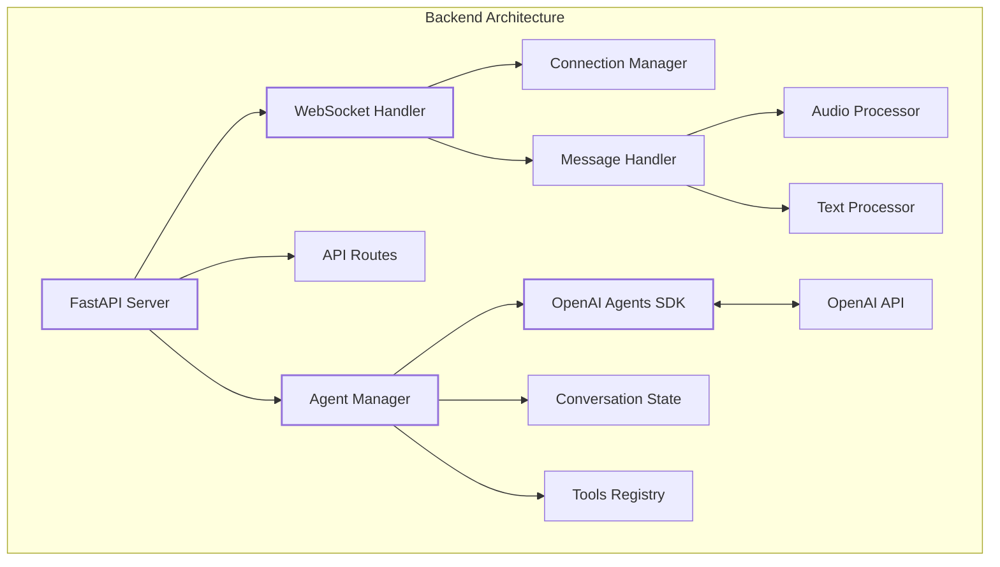
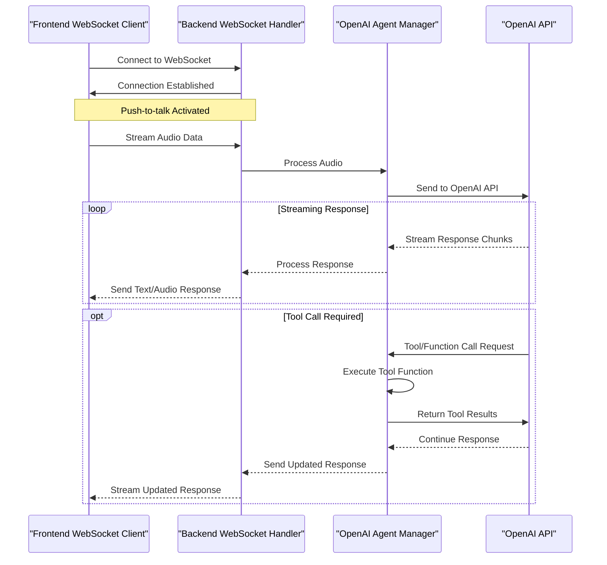
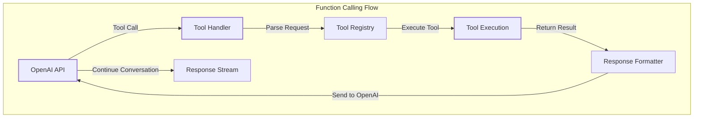
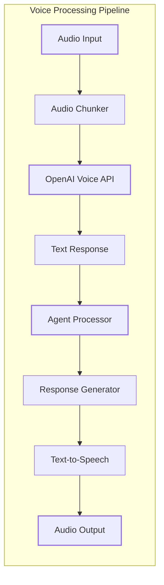

<!-- source: DeepWiki mcp.deepwiki.com · repo openai/openai-voice-agent-sdk-sample · page 3.2 Backend Architecture · fetched 2026-10-26 -->

# Backend Architecture

Relevant source files

The following files were used as context for generating this wiki page:

- [README.md](README.md)

The Backend Architecture section provides a comprehensive overview of the server-side components that power the OpenAI Voice Agent SDK Sample App. This document focuses specifically on the FastAPI implementation, WebSocket communication, OpenAI Agents SDK integration, and the underlying processing pipeline. For information about the frontend implementation, please see [Frontend Architecture](#3.1).

## Overview

The backend serves as the bridge between the user-facing frontend application and the OpenAI API. Built with FastAPI, it provides real-time communication capabilities through WebSockets while managing conversation state and voice processing.

Sources: README.md

## Core Components

### FastAPI Server

The backend is built on FastAPI, a modern, high-performance web framework for building APIs with Python. The server handles HTTP requests and WebSocket connections, providing the necessary endpoints for the frontend to communicate with.

Key responsibilities:
- Serving WebSocket connections for real-time communication
- Managing API routes for application functionality
- Configuring CORS for secure cross-origin requests
- Handling dependency injection for various components

### WebSocket Communication

The WebSocket implementation is central to the application's functionality, enabling real-time bidirectional communication between the frontend and backend. This is particularly important for the voice agent features.

Sources: README.md

### Agent Management

The Agent Manager is responsible for initializing and managing the OpenAI Agents SDK integration. It handles:

1. Setting up the agent with appropriate configuration
2. Processing incoming messages (audio or text)
3. Managing conversation state across multiple turns
4. Handling function/tool calls
5. Streaming responses back to the client

### Tools and Function Calling

The backend implements tools (functions) that the AI can call during conversations. This enables the agent to perform actions beyond simple conversation, such as retrieving information or executing commands.

Sources: README.md

## Data Flow

The backend processes data through several stages from input to response:

1. **WebSocket Connection**: The frontend establishes a WebSocket connection to the backend
2. **Audio Streaming**: User audio is streamed in chunks to the backend
3. **Audio Processing**: Audio data is processed and sent to the OpenAI API
4. **Response Generation**: OpenAI generates responses, which may include tool calls
5. **Tool Execution**: If required, tools are executed and results returned to OpenAI
6. **Response Streaming**: Text and audio responses are streamed back to the client

This architecture enables real-time, interactive conversations with the voice agent.

## Voice Processing Pipeline

The backend implements a voice processing pipeline that handles audio input and output:

Sources: README.md

## Conversation State Management

The backend maintains conversation state to enable multi-turn interactions:

| Component | Purpose |
|-----------|---------|
| Conversation Manager | Tracks conversation history and context |
| Message Store | Stores messages for context retention |
| Session Handler | Manages user sessions and persistence |
| Response Cache | Caches responses for efficient retrieval |

This state management ensures contextual awareness across conversation turns, allowing the agent to reference previous exchanges and maintain coherent discussions.

## Technical Implementation Details

### WebSocket Handler

The WebSocket handler is responsible for managing connections and processing messages. It handles:

1. Connection establishment and termination
2. Message routing and processing
3. Error handling and reconnection logic
4. Streaming responses back to the client

### OpenAI Agents SDK Integration

The backend leverages the OpenAI Agents SDK to manage conversations with the OpenAI API. This integration:

1. Initializes the agent with appropriate configuration
2. Processes audio and text inputs
3. Manages conversation context
4. Handles streaming responses
5. Processes function/tool calls

## Error Handling and Resilience

The backend implements several mechanisms to ensure reliable operation:

1. Connection recovery for WebSocket disruptions
2. Error handling for API failures
3. Graceful degradation when services are unavailable
4. Comprehensive logging for debugging and monitoring

## Conclusion

The backend architecture of the OpenAI Voice Agent SDK Sample App provides a robust foundation for building voice-enabled conversational agents. The FastAPI server with WebSocket support enables real-time communication, while the integration with the OpenAI Agents SDK provides powerful conversational capabilities. The modular design allows for customization and extension to meet specific requirements.

For details on how this backend communicates with the frontend, please see [Communication Flow](#4).

Sources: README.md

---

