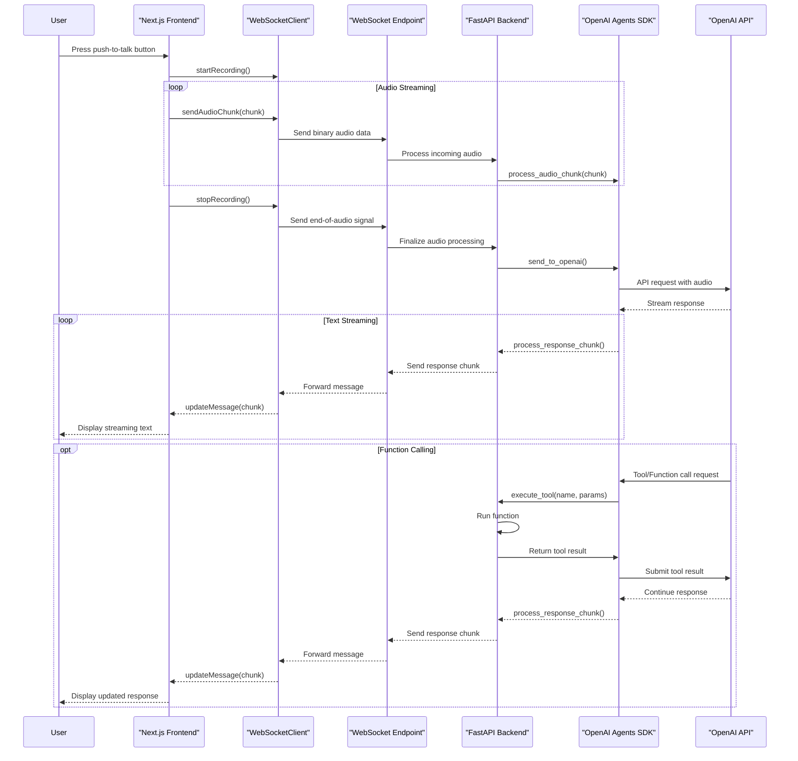
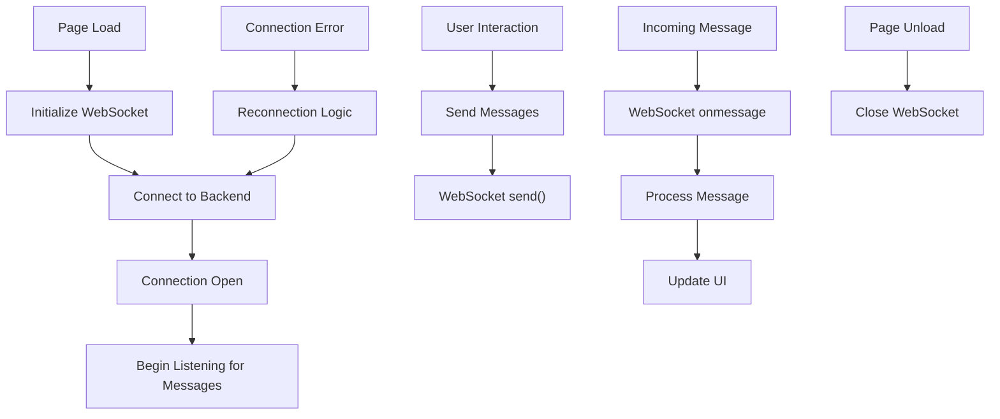
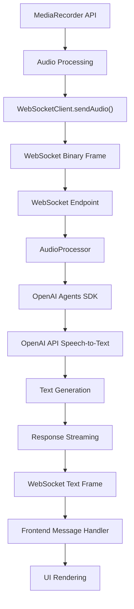
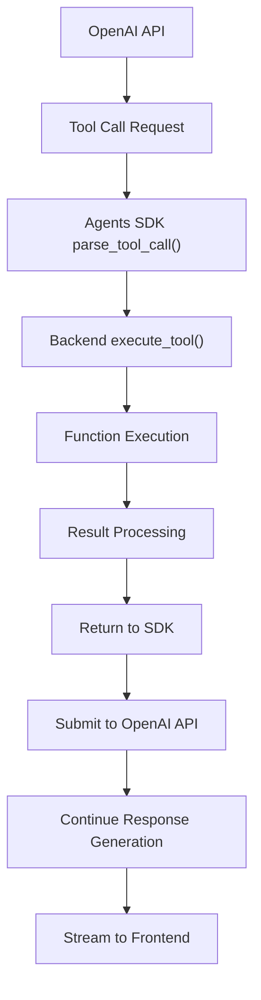
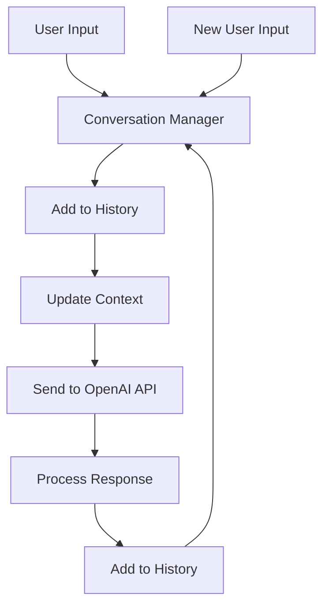
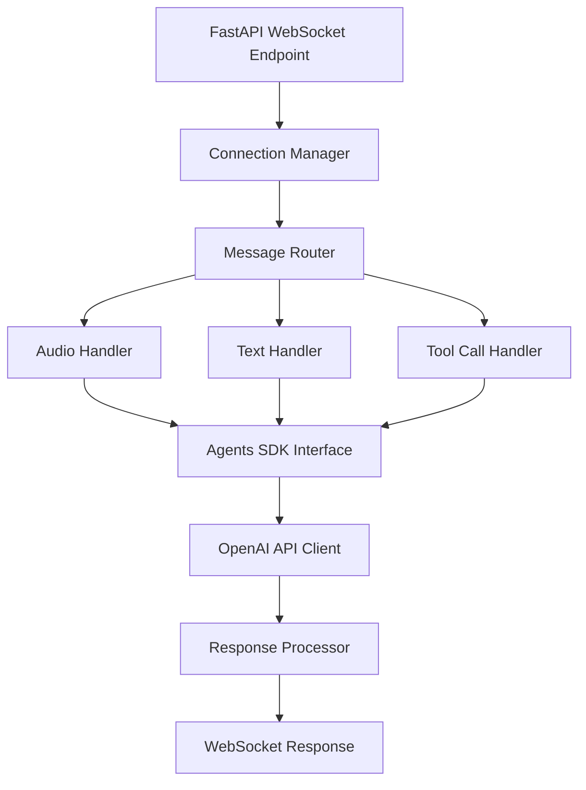

<!-- source: DeepWiki mcp.deepwiki.com · repo openai/openai-voice-agent-sdk-sample · page 4 Communication Flow · fetched 2026-10-26 -->

# Communication Flow

Relevant source files

The following files were used as context for generating this wiki page:

- [README.md](README.md)

This document explains the communication flow in the OpenAI Voice Agent SDK Sample application, detailing how data flows between the frontend, backend, and OpenAI API with a focus on WebSocket communication. For information about the overall system architecture, see [System Architecture](#3).

## Communication Overview

The application uses WebSockets as the primary communication channel between the frontend and backend components. This enables real-time, bidirectional communication that supports:
- Streaming audio input from the user to the backend
- Streaming text responses from the OpenAI API back to the user
- Tool/function call execution and results
- Multi-turn conversation state management

## End-to-End Communication Sequence

The following diagram shows the complete sequence of communication between all system components:

Sources: README.md

## WebSocket Connection Establishment

The WebSocket connection forms the backbone of real-time communication in the application. The connection is established when the user first loads the application.

### Frontend WebSocket Connection

The frontend connects to the WebSocket server using a client implementation that manages the connection lifecycle:

Sources: README.md

## Message Types and Format

The WebSocket communication uses a structured message format for different types of interactions:

| Message Type | Direction | Purpose | Format |
|--------------|-----------|---------|--------|
| Audio Data | Client → Server | Send user's voice input | Binary WebSocket frames containing audio chunks |
| Text Input | Client → Server | Send text messages | JSON with message content |
| Agent Response | Server → Client | Return agent's reply | JSON with text chunks and metadata |
| Tool Call | Server → Client | Notify of function execution | JSON with tool name and parameters |
| Tool Result | Server → Client | Return function results | JSON with execution result |
| Error | Server → Client | Communicate errors | JSON with error code and message |

## Audio Data Flow

When using push-to-talk functionality, audio data follows a specific path through the system:

Sources: README.md

## Tool/Function Calling Implementation

The application supports tool calling, allowing the agent to perform actions. This follows a specific flow:

Sources: README.md

## Conversation State Management

The backend maintains conversation state across multiple turns, which is essential for contextual understanding:

Sources: README.md

## Technical Implementation Details

### Frontend WebSocket Implementation

The frontend implements WebSocket communication through a dedicated client module that handles connection management, message serialization, and audio processing.

Key components include:
- A WebSocket client that manages the connection lifecycle
- Audio recording and processing using the MediaRecorder API
- Message handlers for different response types
- UI update logic for streaming responses

### Backend WebSocket Implementation

The backend uses FastAPI's WebSocket support to implement the server-side endpoint:

Sources: README.md

## Error Handling

The application implements comprehensive error handling to ensure a robust user experience:

1. **Connection Errors**
   - WebSocket connection drops are detected and handled
   - Automatic reconnection with exponential backoff
   - UI notifications for connection status

2. **API Errors**
   - OpenAI API errors are caught and communicated to the user
   - Graceful degradation when services are unavailable

3. **Processing Errors**
   - Audio processing failures are communicated
   - Message parsing errors are handled appropriately

## Performance Considerations

The communication design takes into account several performance factors:

1. **Low Latency**
   - WebSockets provide lower latency than HTTP polling
   - Audio is streamed in chunks to reduce processing delay

2. **Bandwidth Optimization**
   - Audio compression reduces bandwidth requirements
   - Binary WebSocket frames for efficient audio transmission

3. **Responsive UI**
   - Streaming responses provide immediate feedback
   - Asynchronous processing prevents UI blocking

## Further Information

For more information about specific components:
- For frontend component details, see [Frontend Components](#5)
- For voice processing specifics, see [Voice Processing](#6)
- For function calling implementation, see [Function Calling](#7)

---

