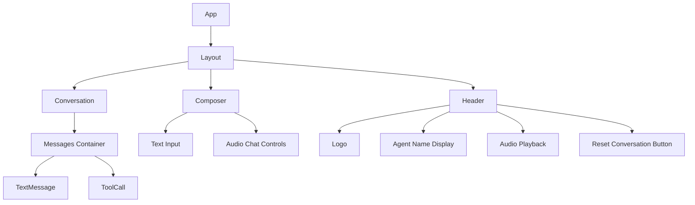
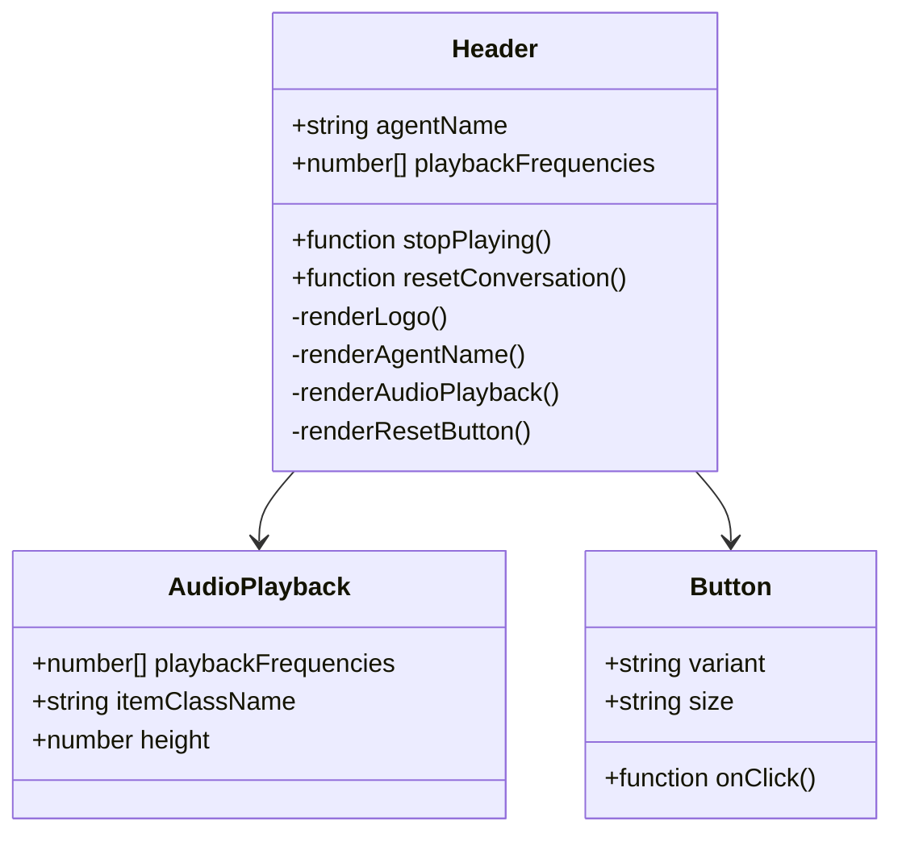
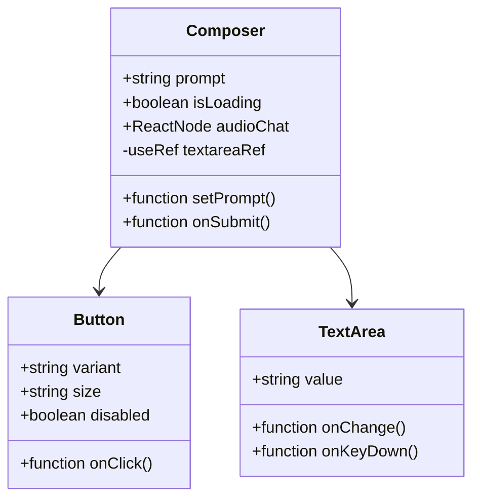
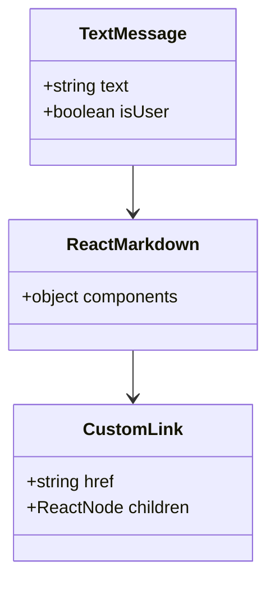
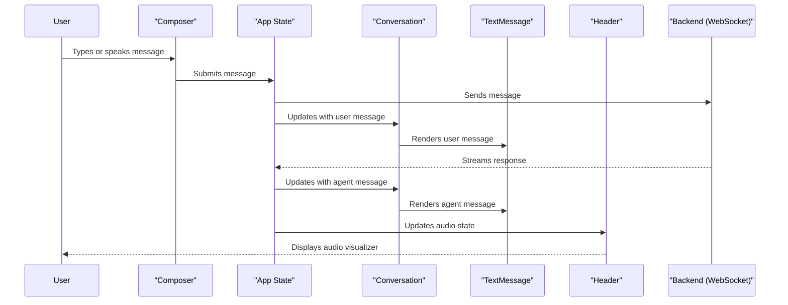
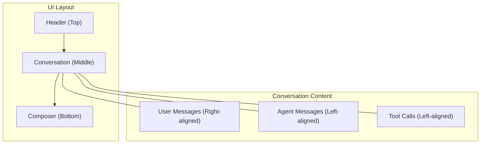
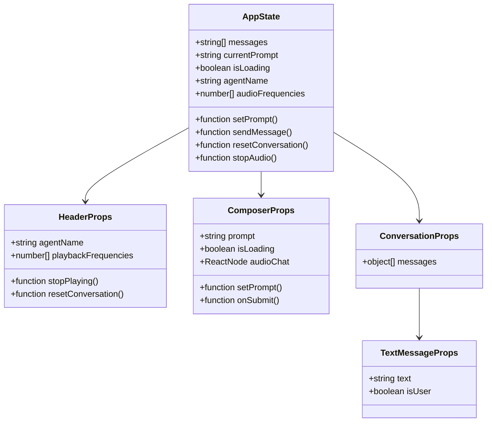

<!-- source: DeepWiki mcp.deepwiki.com · repo openai/openai-voice-agent-sdk-sample · page 5 Frontend Components · fetched 2026-10-26 -->

# Frontend Components

Relevant source files

The following files were used as context for generating this wiki page:

- [frontend/src/components/Composer.tsx](frontend/src/components/Composer.tsx)
- [frontend/src/components/Header.tsx](frontend/src/components/Header.tsx)
- [frontend/src/components/messages/TextMessage.tsx](frontend/src/components/messages/TextMessage.tsx)

This page provides an overview of the key frontend components that make up the user interface of the OpenAI Voice Agent SDK Sample App. It describes the main React components, their responsibilities, and how they interact within the Next.js application. For detailed information about specific components, see the respective subpages: [Header Component](#5.1), [Composer Component](#5.2), and [TextMessage Component](#5.3).

## Component Architecture

The frontend of the application is built using React within a Next.js framework. The components are organized in a hierarchical structure that manages different aspects of the user interface, from conversation display to user input handling.

Sources: [frontend/src/components/Header.tsx](), [frontend/src/components/Composer.tsx](), [frontend/src/components/messages/TextMessage.tsx]()

## Core Components

### Header Component

The Header component appears at the top of the application and provides application context and controls.

The Header component includes:
- OpenAI logo
- Agent name display with animation
- Audio visualization during playback
- Reset button for starting new conversations

Sources: [frontend/src/components/Header.tsx:12-127]()

### Composer Component

The Composer component handles user input, allowing users to enter messages through text or voice.

Key features:
- Auto-expanding textarea for text input
- Enter key submission handling
- Integration point for audio chat functionality
- Submit button with appropriate disabled states

Sources: [frontend/src/components/Composer.tsx:6-65]()

### TextMessage Component

The TextMessage component renders individual messages in the conversation, supporting both user and agent messages.

Key features:
- Different styling for user and agent messages
- Markdown rendering for rich text formatting
- Custom link styling
- Responsive layout with appropriate spacing

Sources: [frontend/src/components/messages/TextMessage.tsx:5-42]()

## Component Data Flow

The following diagram illustrates how data flows between the frontend components during a typical conversation:

Sources: [frontend/src/components/Composer.tsx](), [frontend/src/components/Header.tsx](), [frontend/src/components/messages/TextMessage.tsx]()

## Component Responsibilities

Each frontend component has specific responsibilities within the application:

| Component | Primary Responsibility | Key Props | Interactions |
|-----------|------------------------|-----------|--------------|
| Header | Display application context and controls | `agentName`, `playbackFrequencies`, `stopPlaying`, `resetConversation` | Audio playback visualization, New conversation creation |
| Composer | Handle user input (text and audio) | `prompt`, `setPrompt`, `onSubmit`, `isLoading`, `audioChat` | Text input, Audio recording, Message submission |
| TextMessage | Display conversation messages | `text`, `isUser` | Markdown rendering, Link formatting |
| Conversation | Manage message display and scrolling | `messages` | Rendering message components, Auto-scrolling |
| ToolCall | Display tool/function calls made by the agent | `toolCall`, `result` | Showing function execution details |

Sources: [frontend/src/components/Header.tsx](), [frontend/src/components/Composer.tsx](), [frontend/src/components/messages/TextMessage.tsx]()

## UI Layout and Styling

The application follows a vertical layout structure typical of chat applications, with components stacked to provide a natural conversation flow:

The UI uses:
- Rounded corners for messages and input components
- Different background colors to distinguish user and agent messages
- Custom styling for interactive elements like buttons
- Responsive design to adapt to different screen sizes
- Animations for transitions and audio visualization

Sources: [frontend/src/components/Header.tsx](), [frontend/src/components/Composer.tsx](), [frontend/src/components/messages/TextMessage.tsx]()

## Component Props Interface

The following diagram illustrates the props interfaces for the main components, showing how they connect to the application state:

Sources: [frontend/src/components/Header.tsx:12-22](), [frontend/src/components/Composer.tsx:6-12](), [frontend/src/components/messages/TextMessage.tsx:20-23]()

## Integration with Audio Features

The components work together to provide a seamless voice chat experience:

- The Header component displays audio visualizations during playback
- The Composer component integrates audio recording controls
- The application manages audio state transitions between components

The audio integration connects through props and state management to ensure synchronized behavior across the UI.

Sources: [frontend/src/components/Header.tsx:53-56](), [frontend/src/components/Composer.tsx:51]()

This overview page provides a foundation for understanding the frontend component architecture. For more detailed information about specific components, see the subpages on [Header Component](#5.1), [Composer Component](#5.2), and [TextMessage Component](#5.3).

---

