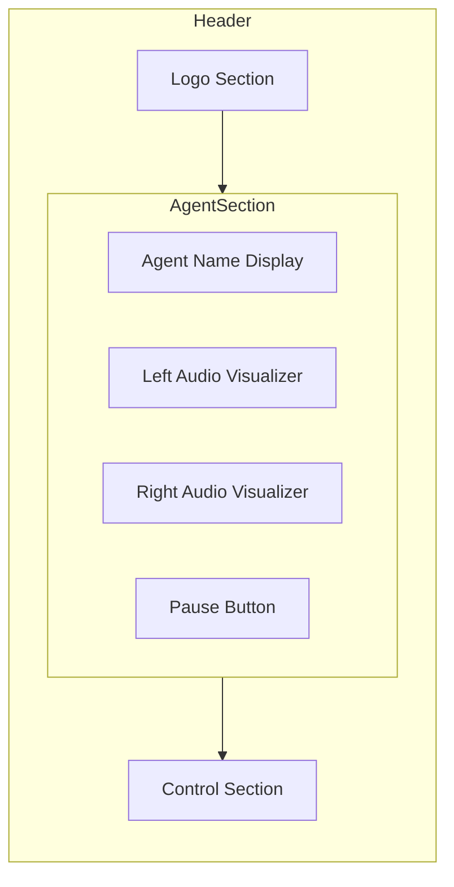
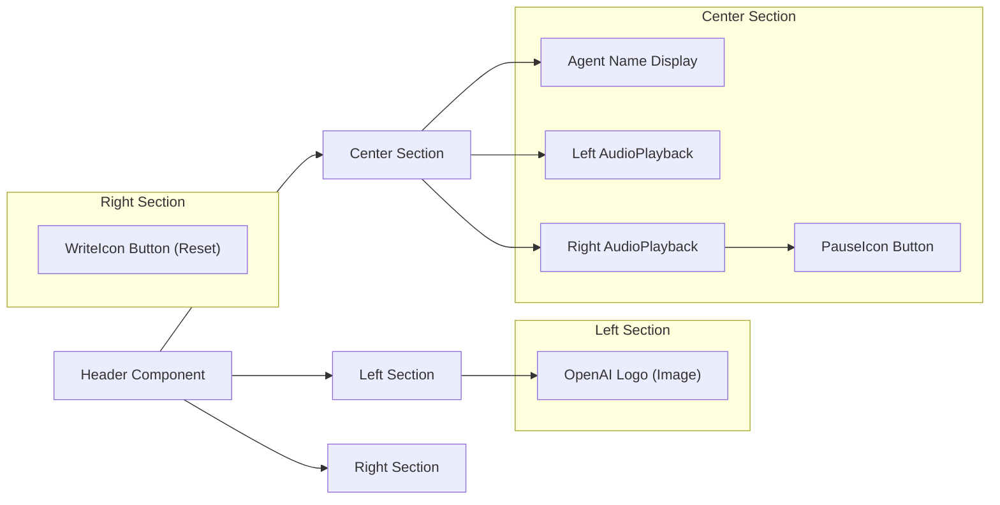
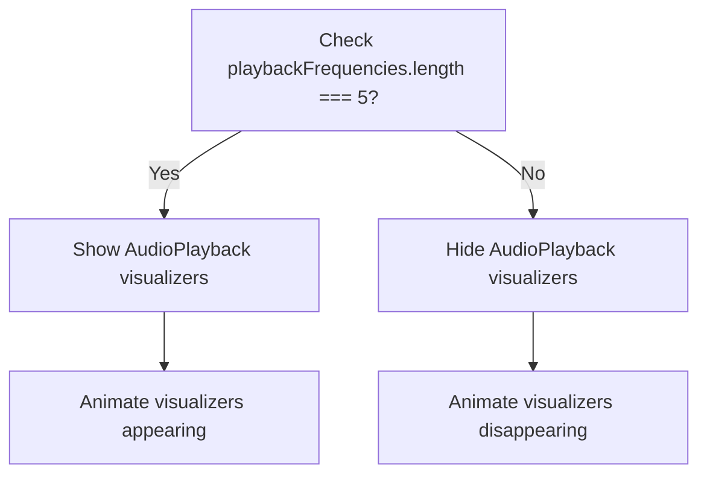
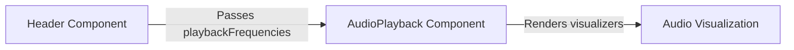
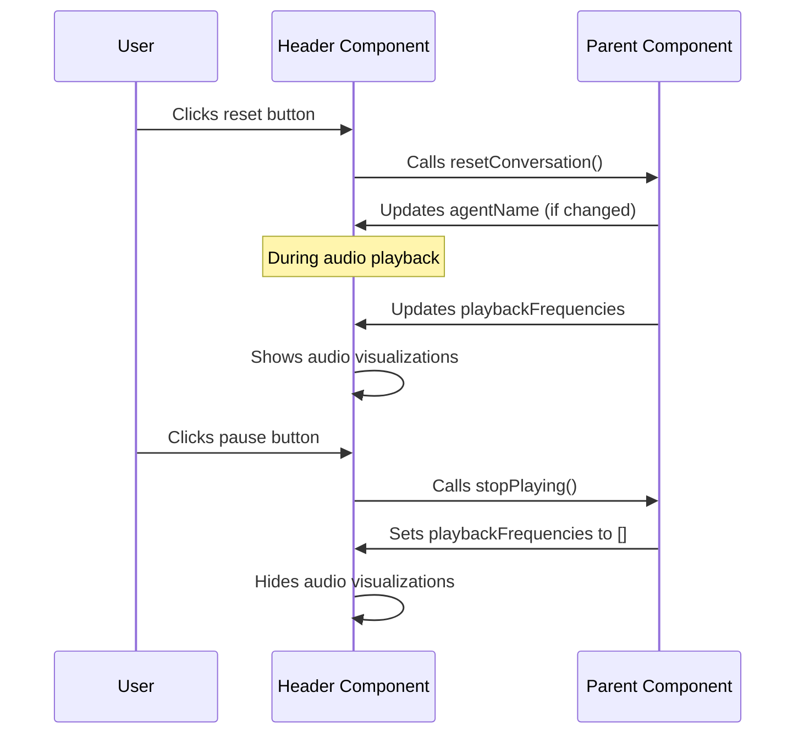

<!-- source: DeepWiki mcp.deepwiki.com · repo openai/openai-voice-agent-sdk-sample · page 5.1 Header Component · fetched 2026-10-26 -->

# Header Component

Relevant source files

The following files were used as context for generating this wiki page:

- [frontend/src/components/Header.tsx](frontend/src/components/Header.tsx)

The Header component is a key user interface element in the OpenAI Voice Agent SDK Sample application. It provides navigation controls, displays the current agent's identity, and offers audio playback controls during voice responses.

For information about text input and audio recording, see [Composer Component](#5.2).

## Purpose and Functionality

The Header component serves several important functions:

1. Displays the application logo
2. Shows the current agent's name
3. Presents audio visualizations during voice playback
4. Provides controls for stopping audio playback
5. Offers a button to reset/restart conversations

Sources: [frontend/src/components/Header.tsx:12-126]()

## Component Structure

Sources: [frontend/src/components/Header.tsx:25-126]()

## Component Interface

The Header component accepts the following props:

| Prop | Type | Description |
|------|------|-------------|
| `agentName` | `string` | The name of the active agent to display |
| `playbackFrequencies` | `number[]` | Array of frequency values for audio visualization |
| `stopPlaying` | `() => Promise<void>` | Async function to stop audio playback |
| `resetConversation` | `() => void` | Function to reset the conversation state |

Sources: [frontend/src/components/Header.tsx:12-22]()

## Detailed Component Layout

Sources: [frontend/src/components/Header.tsx:25-126]()

## Audio Visualization Logic

The Header component includes conditional rendering of audio visualization elements based on the `playbackFrequencies` prop:

The audio visualization only appears when `playbackFrequencies` contains exactly 5 elements, which serves as an indicator that audio is being played.

Sources: [frontend/src/components/Header.tsx:23](), [frontend/src/components/Header.tsx:38-58](), [frontend/src/components/Header.tsx:88-113]()

## Animation Features

The Header component uses motion animations from Framer Motion to create a polished user experience:

1. **Audio Visualizer Animations**:
   - The audio visualizers fade in and expand when audio is playing
   - They shrink and fade out when audio stops

2. **Agent Name Animations**:
   - The agent name container animates to accommodate the agent name text
   - The agent name text itself has a fade in/out transition when changed

These animations use spring physics with carefully tuned parameters for a responsive yet natural feel.

Sources: [frontend/src/components/Header.tsx:39-50](), [frontend/src/components/Header.tsx:61-71](), [frontend/src/components/Header.tsx:75-83](), [frontend/src/components/Header.tsx:89-100]()

## Key UI Elements

### Logo Section
The logo section displays the OpenAI logo using Next.js's `Image` component for optimized image loading.

Sources: [frontend/src/components/Header.tsx:27-29]()

### Agent Display Section
The agent display section shows the current agent's name in a pill-shaped container. When audio is playing, it expands to also display audio visualizers on both sides.

Sources: [frontend/src/components/Header.tsx:30-115]()

### Control Section
The control section contains a button with a `WriteIcon` that triggers the `resetConversation` function when clicked, allowing users to start a new conversation.

Sources: [frontend/src/components/Header.tsx:116-124]()

## Integration with AudioPlayback Component

The Header component integrates with the `AudioPlayback` component to display audio visualizations:

The `AudioPlayback` component receives the `playbackFrequencies` array and renders the audio visualization based on these frequency values.

Sources: [frontend/src/components/Header.tsx:7](), [frontend/src/components/Header.tsx:52-56]()

## Responsive Design

The Header component is designed to be responsive and adapts to different screen sizes:
- Uses flexbox for layout (`flex flex-row`)
- Employs relative positioning for proper element stacking
- Features animations that work across different screen sizes
- Ensures text overflow is handled appropriately with `overflow-hidden` and `whitespace-nowrap`

Sources: [frontend/src/components/Header.tsx:26](), [frontend/src/components/Header.tsx:32-35](), [frontend/src/components/Header.tsx:72]()

## User Interaction Flow

When a user interacts with the Header component:

Sources: [frontend/src/components/Header.tsx:20-21](), [frontend/src/components/Header.tsx:105-108](), [frontend/src/components/Header.tsx:117-123]()

## Summary

The Header component provides critical user interface elements for the voice agent application, including agent identification, audio playback controls, and conversation reset functionality. It features smooth animations and a clean, responsive design that enhances the overall user experience.

---

