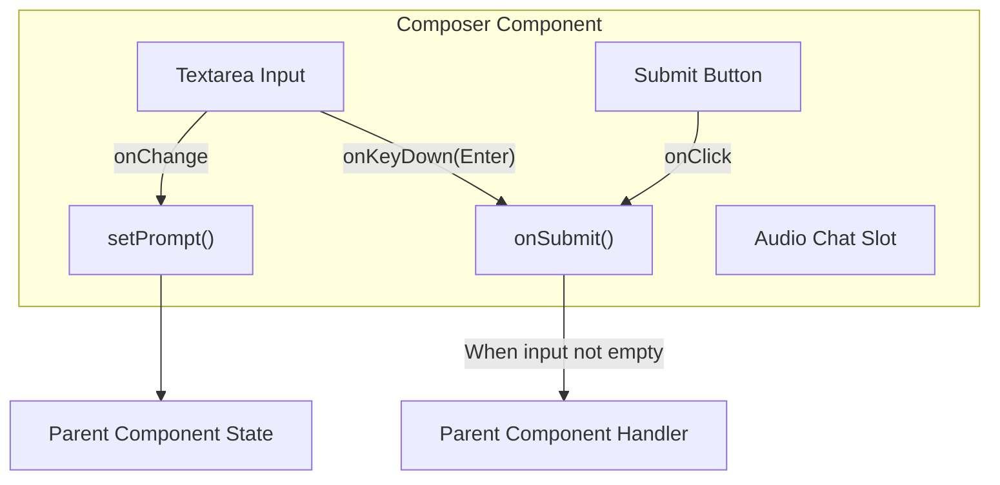
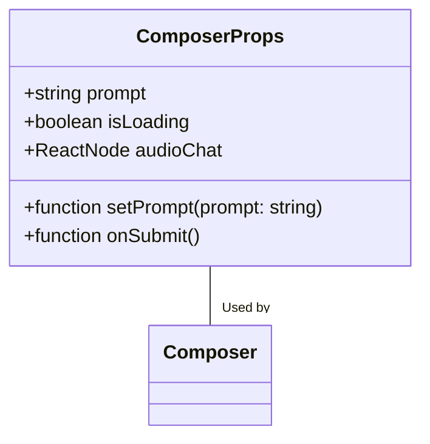
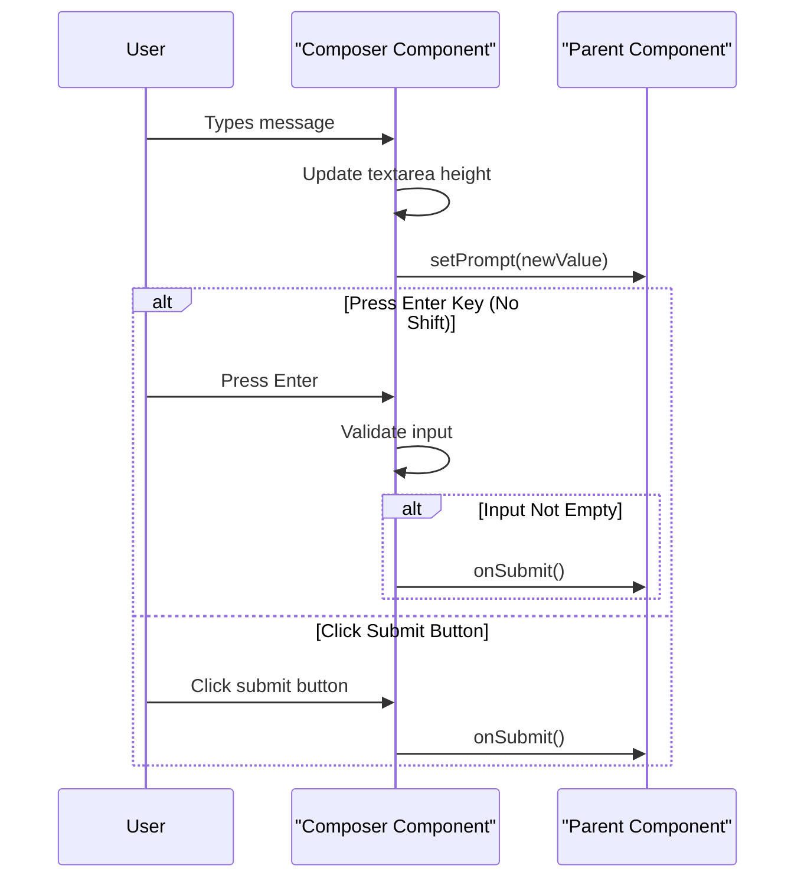
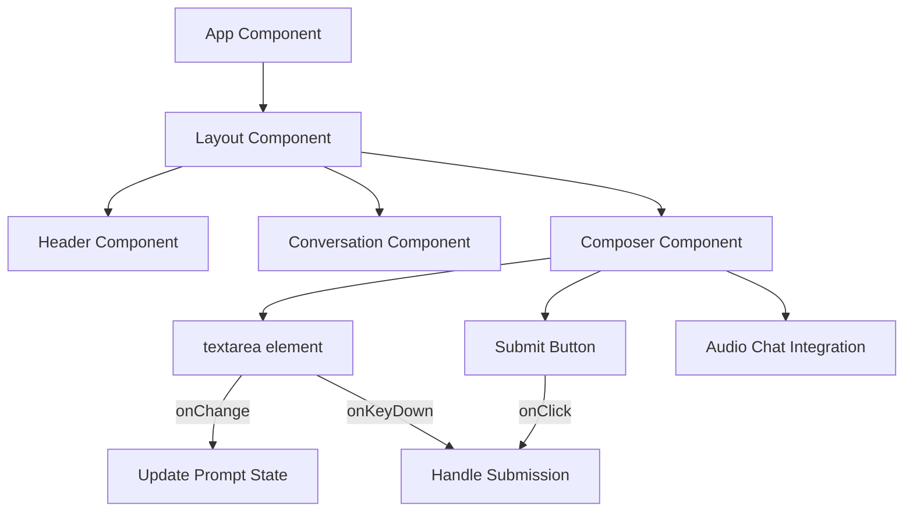
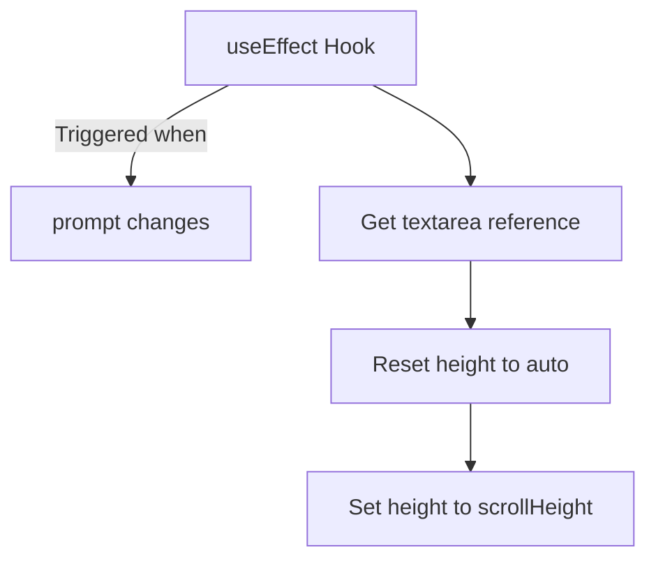

<!-- source: DeepWiki mcp.deepwiki.com · repo openai/openai-voice-agent-sdk-sample · page 5.2 Composer Component · fetched 2026-10-26 -->

# Composer Component

Relevant source files

The following files were used as context for generating this wiki page:

- [frontend/src/components/Composer.tsx](frontend/src/components/Composer.tsx)

The Composer Component serves as the primary user input interface in the OpenAI Voice Agent SDK Sample App. It provides a text input field for typed messages and integrates with audio chat functionality, enabling both text-based and voice-based interactions with the voice agent.

For information about how messages are displayed in the conversation, see [TextMessage Component](#5.3).

## Component Overview

The Composer Component is a React functional component that renders the input area at the bottom of the application interface. It provides a textarea for typing messages, a submit button for sending messages, and a space for integrating audio chat functionality.

Sources: [frontend/src/components/Composer.tsx:30-64]()

## Component Props Interface

The Composer component accepts a set of props that define its behavior and integration with the parent component:

Sources: [frontend/src/components/Composer.tsx:6-12]()

| Prop | Type | Description |
|------|------|-------------|
| `prompt` | string | Current text input value |
| `setPrompt` | function | Function to update the prompt value |
| `onSubmit` | function | Handler for form submission |
| `isLoading` | boolean | Indicates if a request is in progress |
| `audioChat` | React.ReactNode | Optional component for audio chat functionality |

Sources: [frontend/src/components/Composer.tsx:6-12]()

## Functional Behavior

The Composer component implements several key behaviors:

1. **Text Input Handling**: Captures and manages user-typed text
2. **Auto-resizing Textarea**: Dynamically adjusts the height of the textarea based on content
3. **Submission Handling**: Processes form submission via button click or Enter key press
4. **Input Validation**: Prevents submission of empty messages
5. **Audio Chat Integration**: Provides a slot for audio-based interaction

Sources: [frontend/src/components/Composer.tsx:23-28](), [frontend/src/components/Composer.tsx:40-48]()

## Integration in Frontend Architecture

The Composer component fits into the broader frontend architecture as one of the main UI components:

Sources: [frontend/src/components/Composer.tsx:30-64]()

## Component Implementation Details

### Element Structure

The Composer renders a container with the following structure:

1. Outer container div with flex layout
2. Inner container div with border styling
3. Textarea for text input
4. Control section containing:
   - Audio chat component (if provided)
   - Submit button with arrow icon

Sources: [frontend/src/components/Composer.tsx:30-64]()

### Auto-resizing Textarea

The component uses a `useRef` hook to access the textarea DOM element and implements auto-resizing functionality with a `useEffect` hook:

Sources: [frontend/src/components/Composer.tsx:21-28]()

### Submission Logic

The component handles submission through two methods:

1. **Enter Key Press**: When the user presses Enter (without Shift), the component prevents the default new line behavior, validates the input is not empty, and calls the `onSubmit` function.

2. **Button Click**: When the user clicks the submit button, the `onSubmit` function is called (the button is disabled if the input is empty or if a request is already in progress).

Sources: [frontend/src/components/Composer.tsx:40-48](), [frontend/src/components/Composer.tsx:52-60]()

## Usage Example

In a typical usage scenario, the parent component would:

1. Maintain the prompt state
2. Provide a handler for submission
3. Track loading state
4. Optionally provide an audio chat component

The Composer would then render an input area with these capabilities, forwarding user actions to the parent component.

## Styling and UI

The Composer features a clean, modern design with:

- Rounded input area with subtle border
- Flexible textarea that expands with content
- Compact, icon-based submit button
- Logical placement of the audio chat element

All styling is implemented using Tailwind CSS classes for responsive design.

Sources: [frontend/src/components/Composer.tsx:31-64]()

## Summary

The Composer Component provides the essential user input interface for the Voice Agent SDK Sample App, handling both text-based input and integrating voice-based interaction. Its design is focused on simplicity and user experience, with features like auto-resizing textarea and input validation enhancing usability. The component communicates with its parent component through a well-defined props interface, making it a flexible and reusable part of the application.

---

