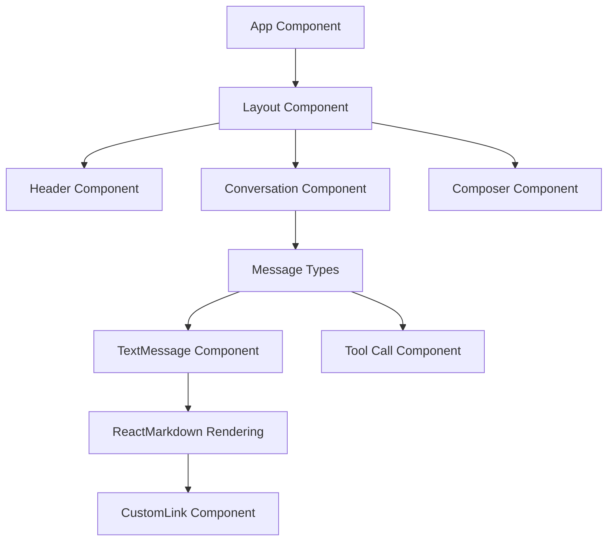
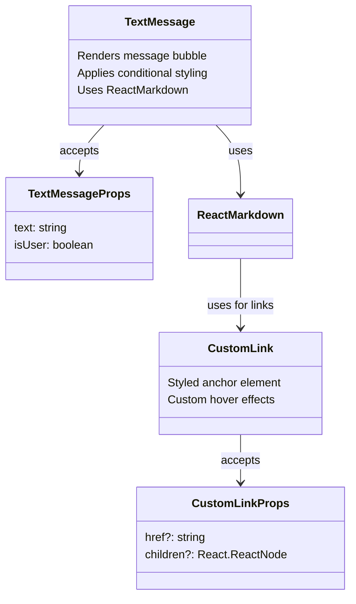
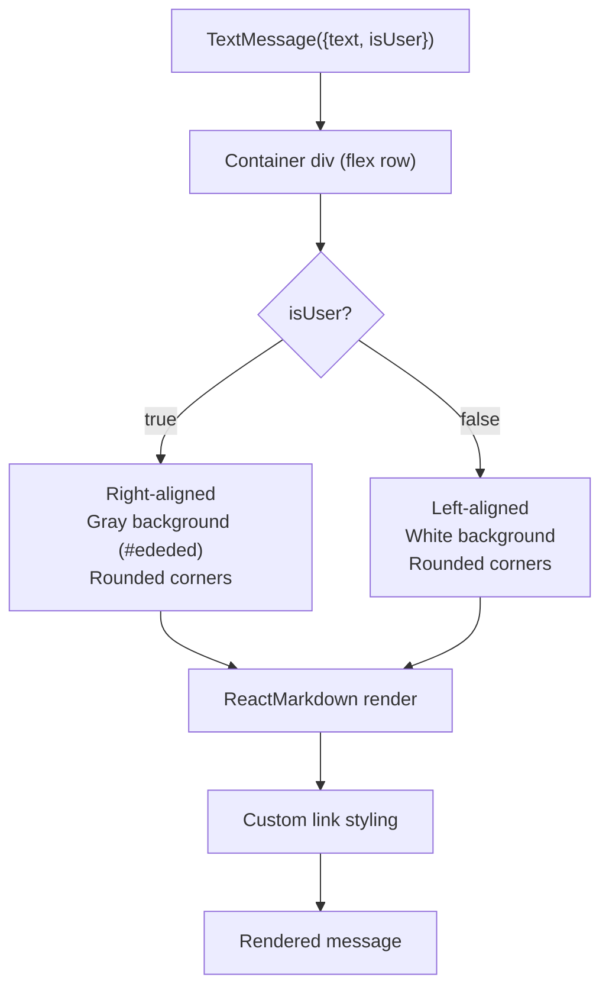
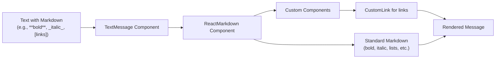
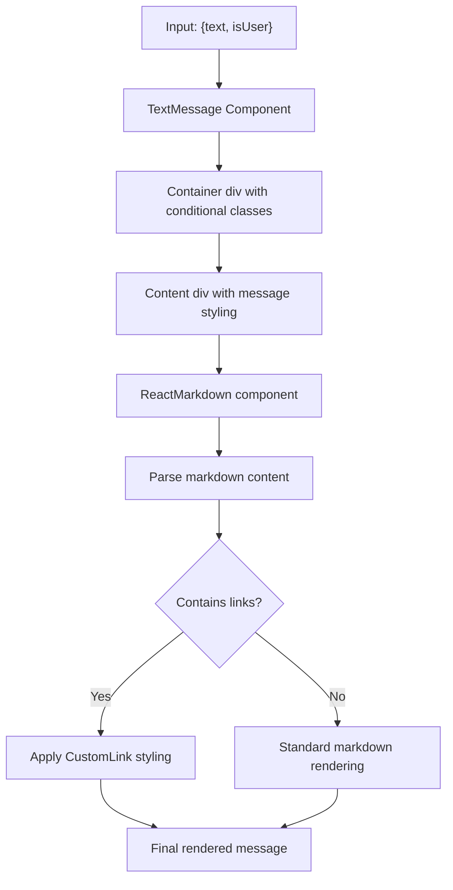

<!-- source: DeepWiki mcp.deepwiki.com · repo openai/openai-voice-agent-sdk-sample · page 5.3 TextMessage Component · fetched 2026-10-26 -->

# TextMessage Component

<details>
<summary>Relevant source files</summary>

The following files were used as context for generating this wiki page:

- [frontend/src/components/messages/TextMessage.tsx](frontend/src/components/messages/TextMessage.tsx)

</details>


## Purpose and Overview

The TextMessage component is responsible for rendering individual text messages in the conversation interface of the OpenAI Voice Agent SDK Sample App. It displays user and assistant messages with distinct styling and supports Markdown formatting for rich text presentation.

For information about how users input messages that will be rendered by this component, see the [Composer Component](#5.2).

## Component Position in Frontend Architecture

The TextMessage component is part of the message rendering subsystem within the frontend architecture:



Sources: [frontend/src/components/messages/TextMessage.tsx:25-42]()

## Component Structure

The TextMessage component has a simple yet flexible structure:



Sources: [frontend/src/components/messages/TextMessage.tsx:5-42]()

## Props

The TextMessage component accepts two props:

| Prop | Type | Description |
|------|------|-------------|
| `text` | string | The text content of the message to be displayed |
| `isUser` | boolean | Whether the message is from the user (true) or assistant (false) |

Sources: [frontend/src/components/messages/TextMessage.tsx:20-23]()

## Rendering Logic

The component applies different styling based on the message sender:



Sources: [frontend/src/components/messages/TextMessage.tsx:25-42]()

## Styling Implementation

The TextMessage component uses the `clsx` library to conditionally apply CSS classes based on whether the message is from the user or the assistant:

### Container Styling

```tsx
<div
  className={clsx("flex flex-row gap-2", {
    "justify-end py-2": isUser,
  })}
>
```

### Message Bubble Styling

```tsx
<div
  className={clsx("rounded-[20px]", {
    "px-4 max-w-[90%] ml-4 text-stone--900 bg-[#ededed]": isUser,
    "px-4 max-w-[90%] mr-4 text-black bg-white": !isUser,
  })}
>
```

Key styling characteristics:
- All messages have rounded corners (20px radius)
- Maximum width set to 90% of container
- User messages: Right-aligned, gray background
- Assistant messages: Left-aligned, white background

Sources: [frontend/src/components/messages/TextMessage.tsx:26-37]()

## Markdown Support

The component leverages ReactMarkdown to render formatted content, enabling rich text communication:



The CustomLink component provides specialized styling for links within messages:

```tsx
const CustomLink = ({ href, children, ...props }: CustomLinkProps) => (
  <a
    href={href}
    {...props}
    className="bg-gray-200 rounded-full py-1 px-2 text-sm font-medium hover:text-white hover:bg-black"
  >
    {children}
  </a>
);
```

This custom link styling includes:
- Light gray background
- Rounded pill appearance
- Hover effect (white text on black background)

Sources: [frontend/src/components/messages/TextMessage.tsx:10-18](), [frontend/src/components/messages/TextMessage.tsx:38]()

## Usage Example

Within the conversation flow, the TextMessage component would typically be used as follows:

```jsx
// Example usage in a conversation mapping
{conversationMessages.map((message, index) => (
  <TextMessage 
    key={index}
    text={message.content}
    isUser={message.role === 'user'}
  />
))}
```

The component handles both the styling and rendering of the message content, with the appropriate appearance applied based on the message source.

Sources: [frontend/src/components/messages/TextMessage.tsx:25-42]()

## Component Rendering Flow



Sources: [frontend/src/components/messages/TextMessage.tsx:25-42]()

---

