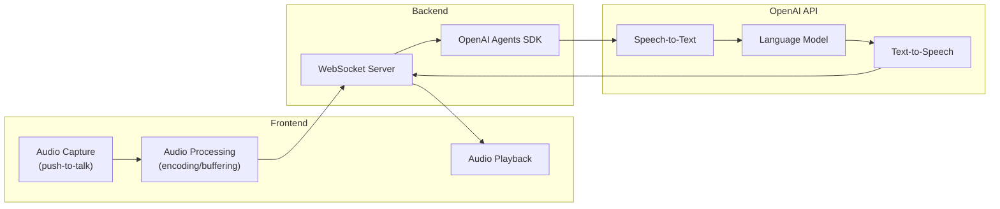
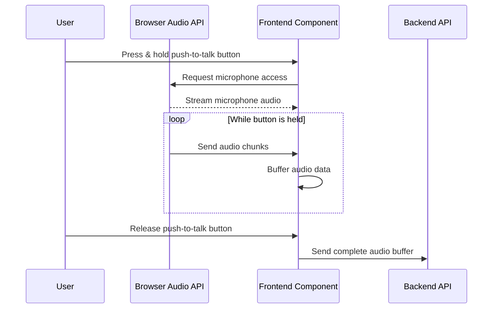
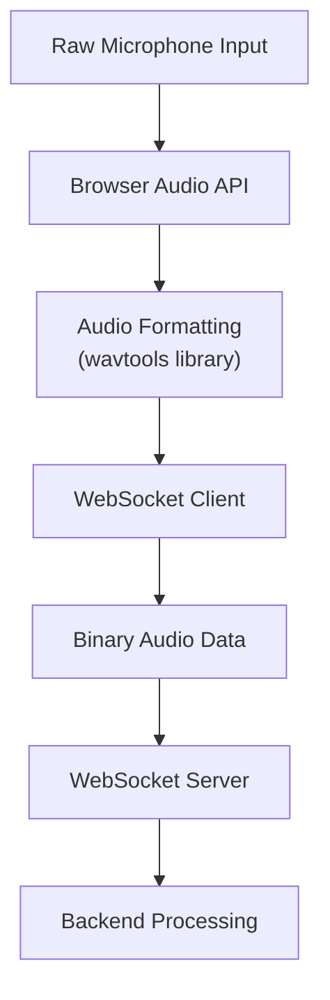
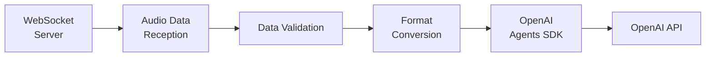
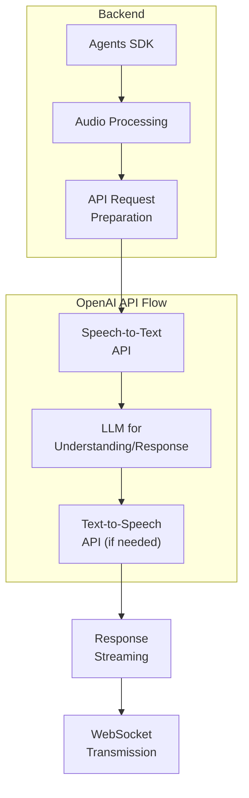
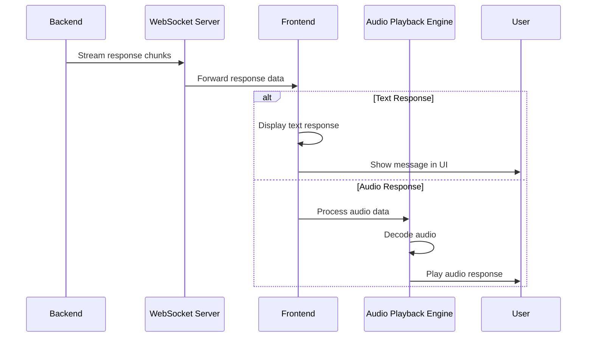

<!-- source: DeepWiki mcp.deepwiki.com · repo openai/openai-voice-agent-sdk-sample · page 6 Voice Processing · fetched 2026-10-26 -->

# Voice Processing

Relevant source files

The following files were used as context for generating this wiki page:

- [README.md](README.md)
- [frontend/package.json](frontend/package.json)

This page documents the voice processing capabilities of the OpenAI Voice Agent SDK Sample App, explaining how audio input is captured, processed, transmitted to the backend, sent to the OpenAI API, and how responses are handled. This document focuses specifically on the audio processing components of the system rather than the general conversation flow (which is covered in [Communication Flow](#4)).

## Voice Processing Architecture

The voice processing system in this application enables users to interact with the AI agent through speech using a push-to-talk interface. Below is a high-level overview of how voice data flows through the system.

Sources: README.md

## Audio Capture

The frontend implements a push-to-talk audio capture system, allowing users to record audio only when actively engaged. This approach optimizes bandwidth usage and provides a clear interaction model.

### Audio Capture Process

The audio capture implementation likely uses the browser's Web Audio API and MediaRecorder API to access the microphone and capture audio data in appropriate formats for processing.

Sources: README.md

## Audio Formatting and Transmission

Once audio is captured, it needs to be properly formatted and transmitted to the backend for processing.

### Audio Processing Flow

The frontend application uses the `wavtools` library (as seen in the package.json) to process and format audio data before transmission. This likely handles:

1. Converting raw audio data to an appropriate format (WAV)
2. Managing sample rate and bit depth
3. Potentially compressing audio for efficient transmission
4. Preparing the audio data for WebSocket transmission

Audio data is sent to the backend via WebSocket connection, which allows for real-time, bidirectional communication between the client and server.

Sources: frontend/package.json

## Backend Audio Processing

The backend receives the audio data through its WebSocket server and prepares it for processing with the OpenAI API.

### Backend Processing Flow

The backend likely performs these operations on the received audio:

1. Validation of the received data format
2. Potential reformatting if needed
3. Preparation of the audio data for the OpenAI API
4. Transmission to the OpenAI API through the Agents SDK

Sources: README.md

## OpenAI API Integration

The OpenAI Voice Agent SDK Sample App interacts with the OpenAI API through the Agents SDK to process voice data and generate appropriate responses.

### Voice Processing with OpenAI

The integration with OpenAI involves:

1. Converting speech to text using OpenAI's speech-to-text capabilities
2. Processing the text with the language model to understand and generate responses
3. Converting text responses back to speech when appropriate
4. Streaming responses back to the frontend

The application leverages OpenAI's Agents SDK to simplify this process and manage the conversation flow.

Sources: README.md

## Response Handling and Playback

After the backend receives responses from the OpenAI API, they need to be properly handled and presented to the user.

### Response Processing Flow

Response handling includes:

1. Streaming responses from the backend to the frontend via WebSocket
2. Processing the response data based on its type (text or audio)
3. Displaying text responses in the UI
4. Playing audio responses through the browser's audio system

The frontend implements real-time feedback, displaying streaming text responses while they're being generated and managing audio playback for voice responses.

Sources: README.md

## Technical Implementation Details

The voice processing capabilities are implemented using several key technologies:

| Component | Technology | Purpose |
|-----------|------------|---------|
| Audio Capture | Web Audio API | Accessing microphone and capturing audio |
| Audio Processing | wavtools library | Formatting and preparing audio data |
| Data Transmission | WebSocket | Real-time bidirectional communication |
| Backend Processing | FastAPI | Handling WebSocket connections and processing data |
| AI Integration | OpenAI Agents SDK | Interfacing with OpenAI's voice capabilities |
| Response Rendering | React.js | Displaying responses in the UI |

The push-to-talk functionality provides a simple and effective way for users to control when they're speaking to the agent, reducing background noise and optimizing the user experience.

Sources: README.md, frontend/package.json

## Voice Processing Configuration

The application is designed to work with OpenAI's voice processing capabilities with minimal configuration. The primary requirement is setting up an OpenAI API key as described in the README:

1. Set the `OPENAI_API_KEY` environment variable globally, or
2. Create a `.env` file with the API key

This configuration enables the application to access OpenAI's voice processing APIs, including speech-to-text for understanding user input and text-to-speech for generating voice responses.

Sources: README.md

## Summary

The voice processing system in the OpenAI Voice Agent SDK Sample App creates a seamless voice interaction experience by:

1. Capturing audio input through a push-to-talk interface
2. Processing and transmitting audio data via WebSockets
3. Leveraging the OpenAI Agents SDK to convert speech to text, process the content, and generate responses
4. Streaming responses back to the user in real-time
5. Supporting both text and potential audio responses

This implementation demonstrates a modern approach to building voice-enabled AI agents that can engage in multi-turn conversations with users.

Sources: README.md

---

