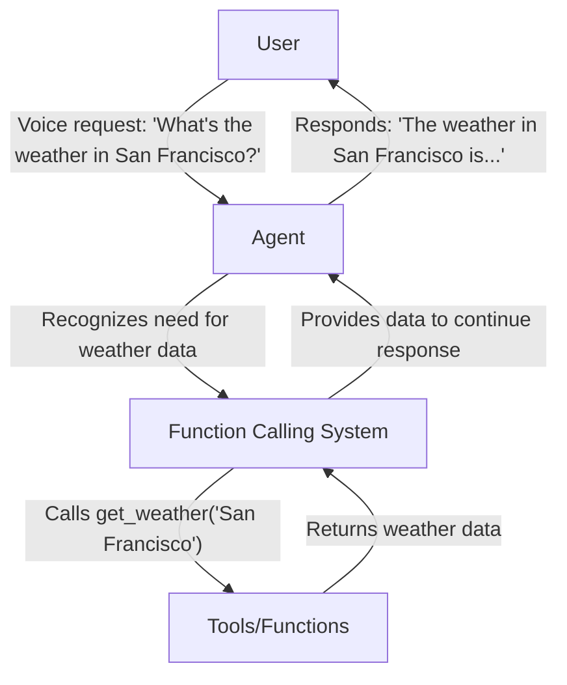
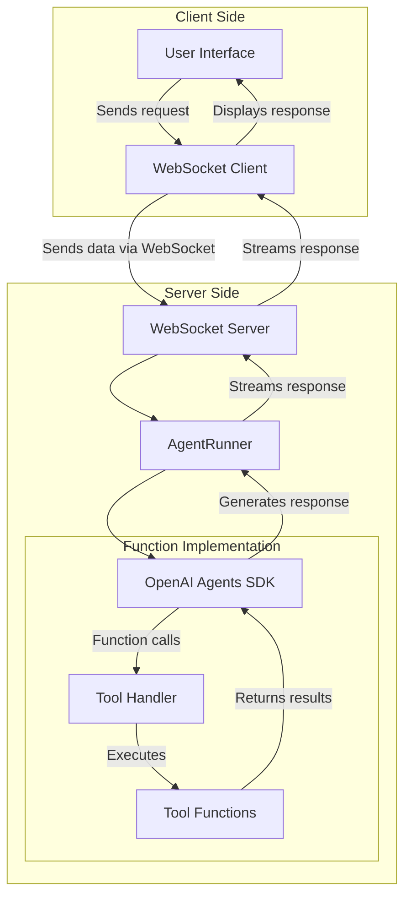
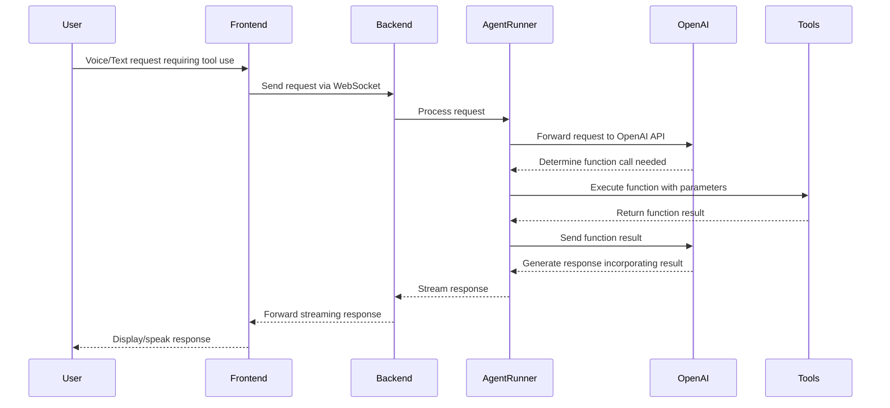

<!-- source: DeepWiki mcp.deepwiki.com · repo openai/openai-voice-agent-sdk-sample · page 7 Function Calling · fetched 2026-10-26 -->

# Function Calling

Relevant source files

The following files were used as context for generating this wiki page:

- [README.md](README.md)

This document explains how function calling works in the OpenAI Voice Agent SDK Sample App. Function calling allows the voice agent to perform specific actions or retrieve information by calling defined functions in response to user requests. This capability enables the agent to go beyond simple conversations and perform useful tasks through voice commands.

For information about voice processing and audio handling, see [Voice Processing](#6).

## What is Function Calling?

Function calling in the context of OpenAI API allows the model to generate structured function calls when it determines that an external function should be invoked to respond appropriately to a user's request. This feature enables the voice agent to:

1. Recognize when a user's request requires external action
2. Call the appropriate function with the correct parameters
3. Incorporate the function's results into its response

Sources: README.md

## Function Calling Implementation

The implementation of function calling in the sample app follows the architecture of the OpenAI Agents SDK and integrates with the FastAPI backend server.

### Architecture Overview

Sources: README.md

## Function Call Flow

When a user makes a request that requires external action, the following sequence occurs:

Sources: README.md

## Available Tools

The sample app comes with predefined tool functions that the voice agent can use to respond to user requests. These tools are implemented in the backend and registered with the Agent Runner.

| Tool Function | Description | Parameters | Return Value |
|---------------|-------------|------------|--------------|
| `get_current_time` | Retrieves the current time | Location (optional) | Current time string |
| `get_current_weather` | Gets weather information | Location | Weather details |
| `search_web` | Searches for information online | Query | Search results |

Note: The actual tool functions may differ in the implementation, as the specific details were not available in the provided information.

Sources: README.md

## Implementation Details

### Tool Registration

In the Voice Agent SDK Sample App, tools are registered with the OpenAI Agents SDK to make them available for function calling. The tools are defined as Python functions with appropriate type annotations, which get converted to OpenAI function schemas.

When registering tools with the agent, each tool specifies:
- A name for OpenAI's model to reference
- A description of what the tool does
- Required and optional parameters
- The expected return type

### Function Execution Process

When the OpenAI model determines a function should be called:

1. The model sends a structured function call request in JSON format
2. The Agent Runner intercepts this function call
3. The appropriate tool function is located and executed with the provided parameters
4. The result of the function execution is sent back to OpenAI
5. OpenAI incorporates the result into its response generation

### Streaming Function Call Results

The sample app supports streaming responses even when function calls are involved:

1. Initial response begins streaming
2. Streaming pauses when a function call is needed
3. After function execution completes, streaming resumes with the incorporated results

This creates a seamless experience for users, even when complex operations are performed behind the scenes.

Sources: README.md

## Extending Function Calling Capabilities

Developers can extend the function calling capabilities of the sample app by adding new tool functions. This involves:

1. Defining new Python functions with appropriate type annotations
2. Registering these functions with the Agent Runner
3. Ensuring the OpenAI model is aware of these new functions through proper documentation

### Example Tool Function Structure

Tool functions should follow a specific structure to work properly with the OpenAI Agents SDK:

- Clear function name that describes its purpose
- Type annotations for parameters and return values
- Comprehensive docstring explaining what the function does
- Error handling for potential issues

When properly implemented, the OpenAI model can automatically determine when to use these functions based on user requests.

Sources: README.md

## Function Calling Security Considerations

When implementing custom functions, developers should consider security implications:

1. Input validation to prevent injection attacks
2. Rate limiting for functions that access external services
3. Authentication for functions that access sensitive data
4. Sandboxing function execution to prevent system compromise

Proper security measures help ensure that the voice agent can safely execute functions without exposing vulnerabilities.

Sources: README.md

## Debugging Function Calls

The sample app includes functionality to help debug function calls:

1. Logging of function call requests and responses
2. Visibility into the decision-making process of the OpenAI model
3. Error reporting for failed function executions

These debugging features help developers understand how function calling works and identify issues when implementing custom functions.

Sources: README.md

## Conclusion

Function calling is a powerful feature of the OpenAI Voice Agent SDK Sample App that enables the creation of voice agents capable of performing meaningful actions. By understanding how function calling works and how to implement custom functions, developers can create sophisticated voice agents tailored to specific use cases.

For more information on developing and extending the application, see [Development Guide](#8).

---

