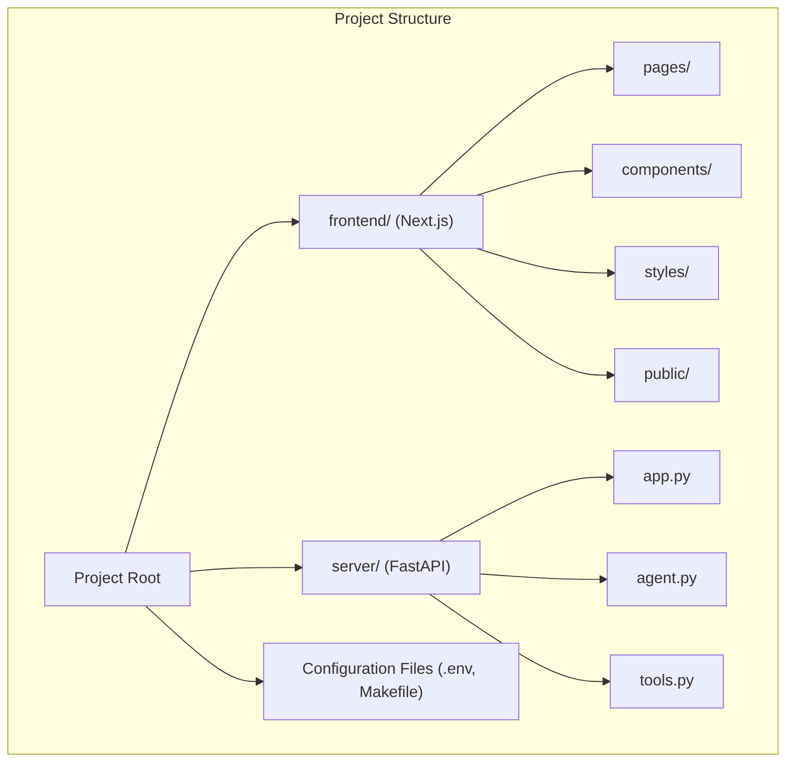
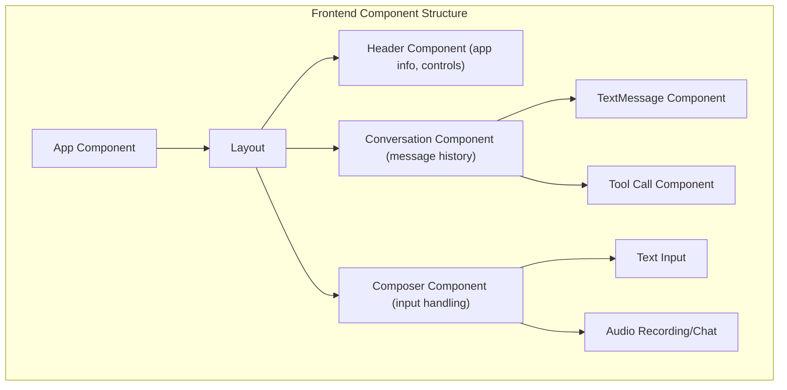
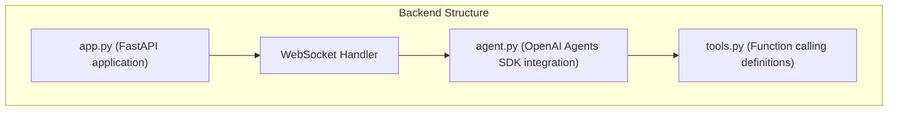
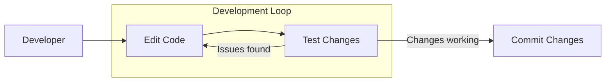
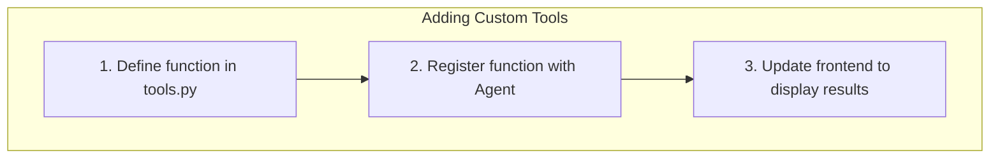
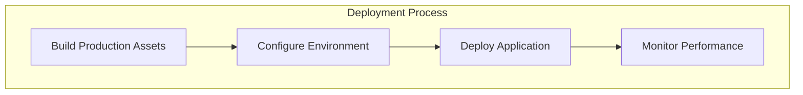
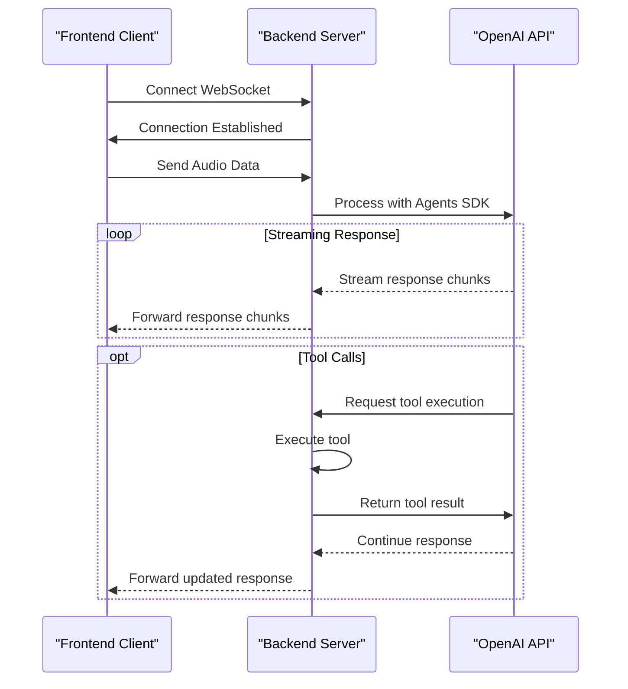
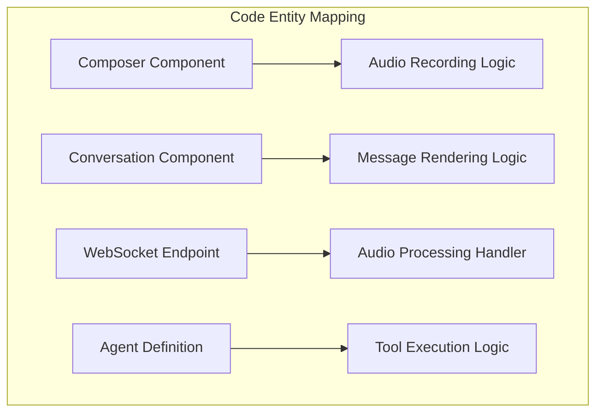

<!-- source: DeepWiki mcp.deepwiki.com · repo openai/openai-voice-agent-sdk-sample · page 8 Development Guide · fetched 2026-10-26 -->

# Development Guide

<details>
<summary>Relevant source files</summary>

The following files were used as context for generating this wiki page:

- [.gitignore](.gitignore)
- [LICENSE](LICENSE)
- [Makefile](Makefile)
- [README.md](README.md)

</details>


This guide provides comprehensive information for developers who want to modify, extend, or customize the OpenAI Voice Agent SDK Sample App. It covers development workflows, project structure, and common modification scenarios to help you efficiently work with this codebase.

For initial setup instructions, refer to [Getting Started](#2).

## Development Environment Setup

### Prerequisites

Before you begin developing with this project, ensure you have the following installed:

- Node.js and npm (for frontend development)
- Python 3.10+ (for backend development)
- `uv` package manager (for Python dependencies)
- OpenAI API key (required for voice agent functionality)

### Setting Up Your Development Environment

1. Clone the repository:
   ```bash
   git clone https://github.com/openai/openai-voice-agent-sdk-sample.git
   cd openai-voice-agent-sdk-sample/
   ```

2. Set up your OpenAI API key using one of these methods:
   - Set the `OPENAI_API_KEY` environment variable globally
   - Create a `.env` file in the project root with your API key:
     ```
     OPENAI_API_KEY=your_api_key_here
     ```

3. Install dependencies for both frontend and backend:
   ```bash
   make sync
   ```

4. Start the development server:
   ```bash
   make serve
   ```

The application will be available at http://localhost:3000.

Sources: [README.md:19-61](), [Makefile:1-10]()

## Project Structure

The application follows a client-server architecture with clear separation between frontend and backend components.



### Frontend Structure (Next.js)

The frontend application is built with Next.js and contains components for audio recording, conversation display, and user input.



### Backend Structure (FastAPI)

The backend serves as the bridge between the frontend and the OpenAI API, processing audio data and handling conversation flow.



Sources: [README.md:8-17]()

## Development Workflow

The typical development workflow involves making changes to either the frontend or backend components and testing them in real-time.



### Frontend Development

When developing frontend components:

1. The Next.js development server provides hot-reloading
2. Edit components in the `frontend/components/` directory
3. Changes appear automatically in the browser

### Backend Development

For backend development:

1. Changes to the FastAPI server require manual restart
2. Modify the agent behavior in `server/agent.py`
3. Define custom tools in `server/tools.py`

## Extending the Application

### Adding Custom Tools/Function Calls

One of the most common extensions is adding new tools for the agent to use:



### Customizing the Voice Agent

To customize the voice agent's behavior:

1. Modify the system prompt in the agent configuration
2. Adjust the agent parameters (temperature, model, etc.)
3. Add custom tools to extend capabilities

### Adding New UI Components

To add new UI components:

1. Create new React components in the `frontend/components/` directory
2. Import and use them in the appropriate parent component
3. Add necessary styling

## Testing Your Changes

The application doesn't appear to have automated tests based on the files provided, but you can test your changes manually:

1. Make changes to the code
2. Run the application with `make serve`
3. Test functionality in the browser
4. Check the console for errors

### Common Development Issues

- WebSocket connection issues
- Audio recording permission problems
- Function calling errors
- API key configuration problems

## Deployment Considerations

When preparing to deploy your modified application:

1. Ensure secure handling of API keys
2. Consider environment-specific configurations
3. Build optimized production versions of both frontend and backend



## Advanced Customization

### WebSocket Communication Flow

Understanding the WebSocket communication is essential for advanced modifications:



### Code-to-Component Mapping

This diagram maps conceptual components to their implementation in code:



Sources: [README.md:8-17]()

## Version Control and Contribution

When contributing changes to the project:

1. Create a feature branch for your changes
2. Follow the existing code style and patterns
3. Test thoroughly before submitting pull requests
4. Provide clear documentation for your changes

Sources: [README.md:63-65]()

## Conclusion

This development guide provides the foundation for modifying and extending the OpenAI Voice Agent SDK Sample App. By understanding the architecture and workflows outlined here, you can effectively customize the application to meet your specific requirements.

For more detailed information about specific components, refer to:
- [Frontend Architecture](#3.1)
- [Backend Architecture](#3.2)
- [Function Calling](#7)