# Page: Overview

# Overview

<details>
<summary>Relevant source files</summary>

The following files were used as context for generating this wiki page:

- [README.md](README.md)

</details>


This document provides an introduction to the OpenAI Voice Agent SDK Sample App, a reference implementation demonstrating how to build voice-enabled conversational agents using the OpenAI Agents SDK. For detailed setup instructions, see [Getting Started](#2), and for in-depth architectural details, see [System Architecture](#3).

## Purpose and Scope

The OpenAI Voice Agent SDK Sample App serves as a foundation for developers to create customizable voice-enabled conversational assistants. It demonstrates best practices for implementing real-time audio processing, multi-turn conversations, streaming responses, and function calling capabilities using OpenAI's APIs.

Sources: [README.md:1-17]()

## Key Features

The sample application showcases several key capabilities essential for modern voice agent applications:

- **Multi-turn conversation handling**: Support for contextual, ongoing dialogues
- **Push-to-talk audio mode**: Real-time voice input processing
- **Function calling**: Ability for the agent to execute actions or retrieve information
- **Streaming responses & tool calls**: Progressive display of agent responses

These features are implemented through a combination of frontend and backend components working together to provide a seamless user experience.

Sources: [README.md:10-15]()

## System Architecture

The application follows a client-server architecture with real-time communication capabilities:

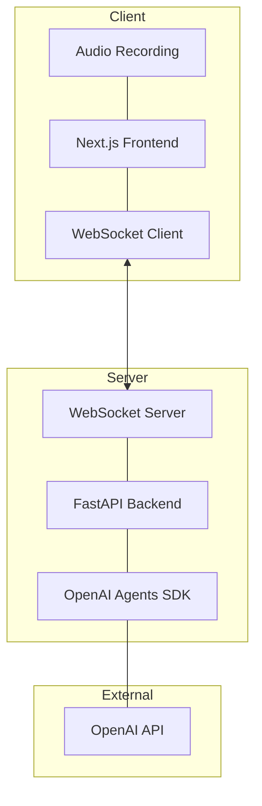

### Client Components

- **Next.js Frontend**: Provides the user interface for interaction with the voice agent
- **WebSocket Client**: Manages real-time communication with the server
- **Audio Recording**: Handles capture and transmission of user voice input

### Server Components

- **FastAPI Backend**: Processes requests and manages application logic
- **WebSocket Server**: Enables bidirectional, real-time communication
- **OpenAI Agents SDK**: Interfaces with OpenAI's APIs for voice processing and language model interaction

Sources: [README.md:8-9]()

## Communication Flow

The following diagram illustrates the interaction pattern between system components during a typical conversation:

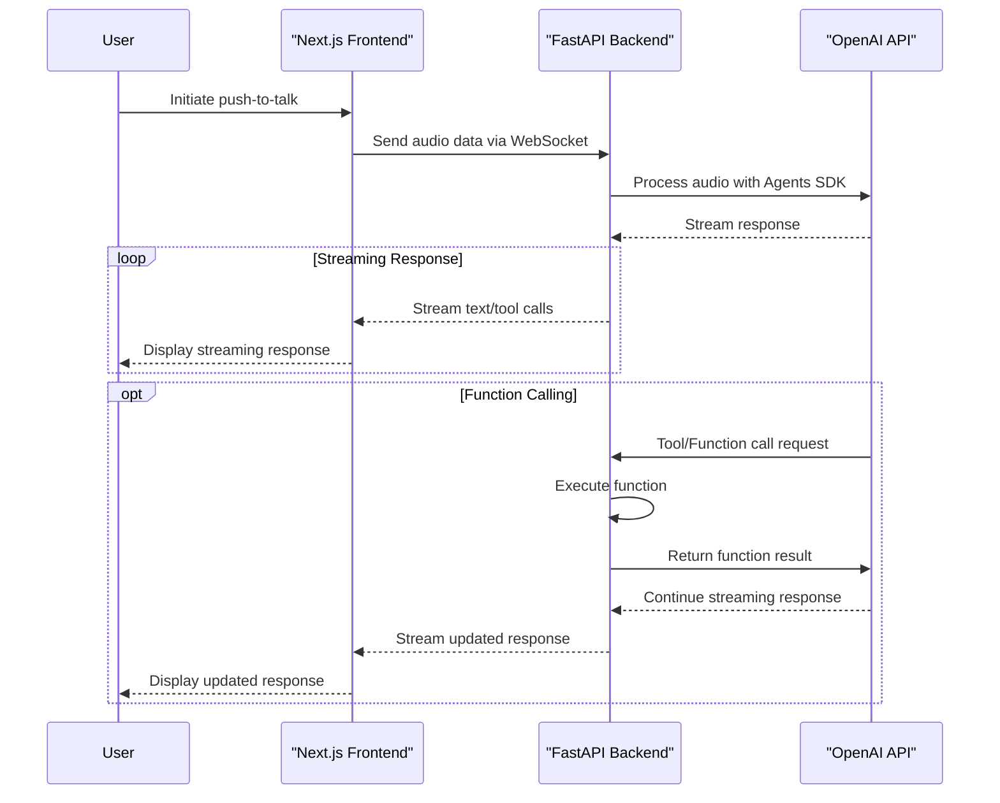

This real-time, bidirectional communication enables the responsive experience necessary for effective voice agents.

Sources: [README.md:8-15]()

## Frontend Architecture

The user interface is composed of several key components that work together to provide a cohesive experience:

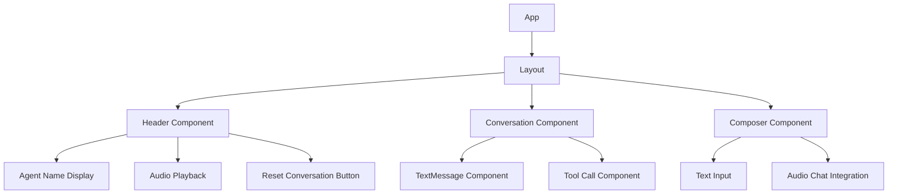

For more detailed information about these components, see [Frontend Components](#5).

## Technology Stack

The application leverages the following technologies:

| Component | Technology | Purpose |
|-----------|------------|---------|
| Frontend | Next.js | User interface and client-side logic |
| Backend | FastAPI | API server and WebSocket endpoint |
| Communication | WebSockets | Real-time bidirectional data exchange |
| AI Integration | OpenAI Agents SDK | Interface to OpenAI's API services |

Sources: [README.md:4-6]()

## Getting Started

To use this application, you'll need:

- An OpenAI API key
- Node.js and npm
- The `uv` package manager

For complete setup instructions, see the [Getting Started](#2) section.

Sources: [README.md:19-61]()

## Development Workflow

The application uses a streamlined development workflow:

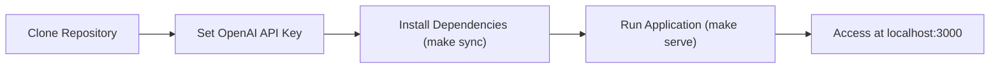

For detailed development guidelines, see the [Development Guide](#8).

Sources: [README.md:40-61]()

## Customization Opportunities

This sample application is designed as a starting point that developers can customize to their specific requirements. Common customization areas include:

- Adding domain-specific function calls
- Customizing the conversation UI
- Extending the agent's capabilities
- Integrating with additional services or APIs

For information on extending the application with function calling, see [Function Calling](#7).

Sources: [README.md:17]()

---

# Page: Getting Started

# Getting Started

<details>
<summary>Relevant source files</summary>

The following files were used as context for generating this wiki page:

- [Makefile](Makefile)
- [README.md](README.md)

</details>


This guide walks you through setting up and running the OpenAI Voice Agent SDK Sample App on your local development environment. It covers prerequisites, installation steps, and launching the application. For information about the system architecture, see [System Architecture](#3).

## Prerequisites

Before you begin, ensure you have the following requirements installed and configured:

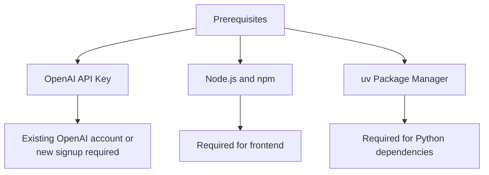

### Required Software

1. **OpenAI API Key**
   - Required to access OpenAI's API services
   - If you're new to the OpenAI API, [sign up for an account](https://platform.openai.com/signup)
   - Generate your API key by following the [Quickstart guide](https://platform.openai.com/docs/quickstart)

2. **Node.js and npm**
   - Required to build and run the Next.js frontend
   - Latest LTS version recommended

3. **uv Package Manager**
   - Required to install Python dependencies for the backend
   - Make sure it's properly installed on your system

Sources: [README.md:19-26]()

## Installation Process

Follow these steps to set up the application:

### 1. Clone the Repository

```bash
git clone https://github.com/openai/openai-voice-agent-sdk-sample.git
cd openai-voice-agent-sdk-sample/
```

Sources: [README.md:40-45]()

### 2. Set up OpenAI API Key

You have two options to set up your OpenAI API key:

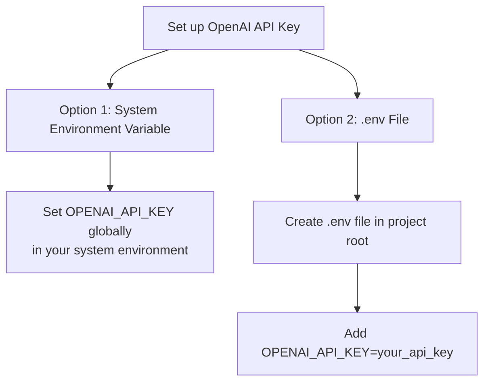

**Option 1**: Set the `OPENAI_API_KEY` environment variable globally in your system

**Option 2**: Create a `.env` file at the root of the project with your API key:
```
OPENAI_API_KEY=your_api_key
```

Sources: [README.md:29-38]()

### 3. Install Dependencies

Run the following command from the project root directory to install dependencies for both frontend and backend:

```bash
make sync
```

This command executes two operations:
- `cd frontend && npm install` - Installs Node.js dependencies for the Next.js frontend
- `cd server && uv sync` - Installs Python dependencies for the FastAPI backend using uv

Sources: [README.md:47-53](), [Makefile:1-4]()

## Running the Application

To start the application, run:

```bash
make serve
```

This command launches the Next.js development server. The application will be available at http://localhost:3000.

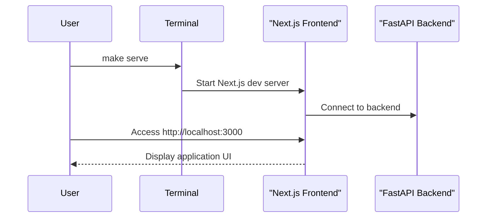

Sources: [README.md:55-61](), [Makefile:7-10]()

## Development Environment Architecture

The following diagram illustrates the components of the development environment and how they interact:

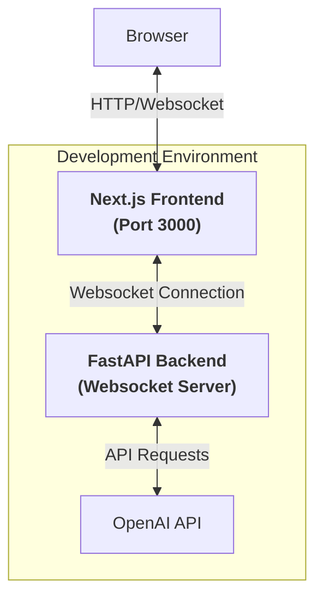

When you run `make serve`, the development environment starts with:
1. The Next.js frontend server running on port 3000
2. The FastAPI backend handling the WebSocket connections
3. The backend communicating with the OpenAI API using your provided API key

Sources: [README.md:8-17]()

## Next Steps

After successfully setting up and running the application, you can:

1. Try out the voice agent functionality through the browser interface
2. Explore the multi-turn conversation handling
3. Test the push-to-talk audio mode and streaming responses
4. Experiment with function calling capabilities

For a deeper understanding of the system architecture, refer to [System Architecture](#3).

Sources: [README.md:10-17]()

---

# Page: System Architecture

# System Architecture

<details>
<summary>Relevant source files</summary>

The following files were used as context for generating this wiki page:

- [README.md](README.md)
- [frontend/package.json](frontend/package.json)

</details>


This document provides an overview of the OpenAI Voice Agent SDK Sample App's architecture, including its major components and how they interact. It covers the high-level system design, component relationships, and data flow. For detailed information about specific components, see [Frontend Architecture](#3.1) and [Backend Architecture](#3.2).

## High-Level Architecture Overview

The OpenAI Voice Agent SDK Sample App is structured as a client-server application that enables voice-based conversations with AI agents. The system consists of three main parts: a browser-based client, a Python server, and the OpenAI API services.

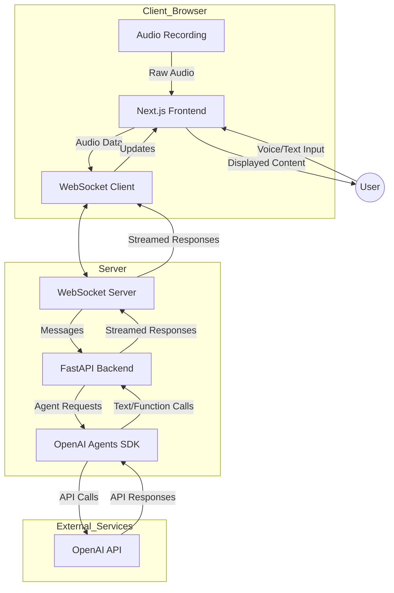

Sources: [README.md:8-17]()

## Core System Components

### 1. Client-Side Components

The client-side components run in the user's browser and are built with Next.js.

| Component | Purpose |
|-----------|---------|
| Next.js Frontend | Provides the user interface and manages the overall client-side application state |
| WebSocket Client | Handles real-time communication with the server |
| Audio Recording | Captures user's voice input when the push-to-talk button is active |

The client components work together to capture user input (voice or text), send it to the server, and display the responses in a conversational UI.

Sources: [README.md:8-17](), [frontend/package.json:13-26]()

### 2. Server-Side Components

The server-side components run on a Python backend built with FastAPI.

| Component | Purpose |
|-----------|---------|
| FastAPI Backend | Handles HTTP requests and manages the application logic |
| WebSocket Server | Provides real-time, bidirectional communication with the client |
| OpenAI Agents SDK | Integrates with OpenAI's APIs to process conversations and function calls |

The server components manage the conversation state, process audio and text inputs, call the OpenAI API, and stream responses back to the client.

Sources: [README.md:8-17]()

### 3. External Services

The application relies on external services for its core AI capabilities:

| Service | Purpose |
|---------|---------|
| OpenAI API | Provides the AI models for speech recognition, natural language understanding, text generation, and text-to-speech |

Sources: [README.md:8-17]()

## Component Relationships Diagram

The following diagram shows the relationships between the main code components and their communication paths:

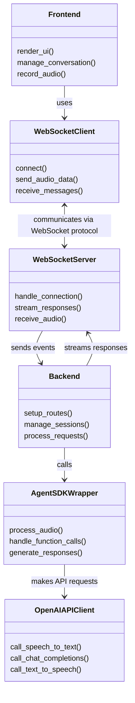

Sources: [README.md:8-17]()

## Data Flow

The data flow through the system follows this sequence:

1. **User Input**:
   - User provides audio input using the push-to-talk feature or text input.
   - The frontend captures and processes this input.

2. **Client to Server Communication**:
   - The WebSocket client sends the audio data or text message to the server.
   - For audio, the data is sent as chunks to enable real-time processing.

3. **Server Processing**:
   - The WebSocket server receives the input and passes it to the FastAPI backend.
   - For audio input, the backend uses the OpenAI Agents SDK to convert speech to text.
   - The backend processes the input text using the OpenAI Agents SDK.

4. **OpenAI API Interaction**:
   - The Agents SDK sends the processed input to the OpenAI API.
   - The API processes the request and begins streaming a response.

5. **Response Handling**:
   - The server receives the streaming response from the OpenAI API.
   - If function calls are detected, the server executes them and returns results to the API.
   - The server streams text responses and function call information back to the client.

6. **Client-Side Rendering**:
   - The WebSocket client receives the streamed response.
   - The frontend displays the text responses and renders any function call results.
   - For voice responses, the text may be converted to speech and played back.

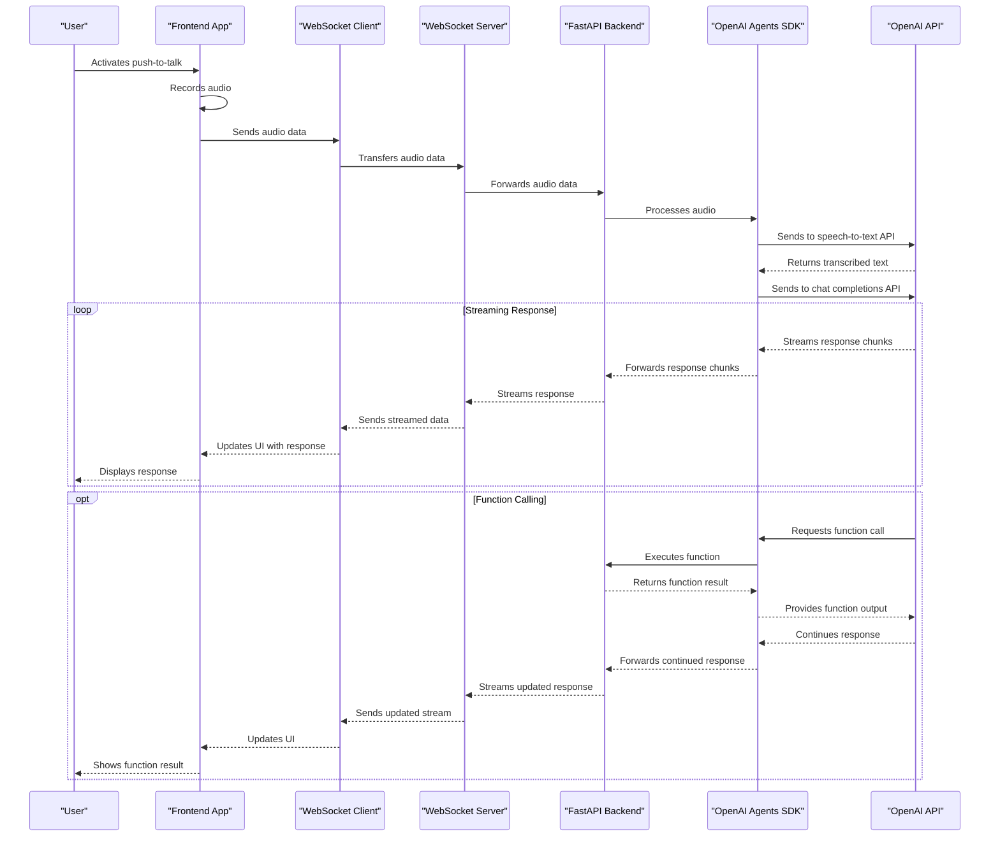

Sources: [README.md:10-16]()

## Technical Architecture Decisions

The architecture of the OpenAI Voice Agent SDK Sample App is designed around several key technical decisions:

1. **Real-time Communication**: WebSockets are used for bidirectional, low-latency communication between client and server, enabling real-time streaming of both audio input and text responses.

2. **Frontend Framework**: Next.js was chosen for the frontend to provide a modern React-based development experience with built-in routing, server-side rendering capabilities, and a component-based architecture.

3. **Backend Framework**: FastAPI was selected for the backend to provide a high-performance, async-capable Python web framework that integrates well with the OpenAI Python SDK.

4. **Separation of Concerns**: The architecture clearly separates:
   - User interface (Next.js frontend)
   - Communication layer (WebSockets)
   - Business logic (FastAPI backend)
   - AI capabilities (OpenAI Agents SDK)

5. **Streaming Responses**: The system is designed to stream responses, enabling immediate feedback to users as the AI generates content rather than waiting for complete responses.

6. **Function Calling Integration**: The architecture supports OpenAI's function calling capability, allowing the AI to trigger actions in the application during conversations.

Sources: [README.md:8-17]()

## System Requirements and Dependencies

The application has the following key dependencies:

| Component | Key Dependencies |
|-----------|------------------|
| Frontend | Next.js, React, WebSockets, react-markdown |
| Backend | FastAPI, OpenAI Agents SDK, Python WebSockets |
| Development | Node.js, npm, uv (Python package manager) |
| External | OpenAI API key |

Sources: [README.md:19-26](), [frontend/package.json:13-26]()

For more detailed information about specific system components, please refer to [Frontend Architecture](#3.1) and [Backend Architecture](#3.2).

---

# Page: Frontend Architecture

# Frontend Architecture

<details>
<summary>Relevant source files</summary>

The following files were used as context for generating this wiki page:

- [README.md](README.md)
- [frontend/eslint.config.mjs](frontend/eslint.config.mjs)
- [frontend/next.config.ts](frontend/next.config.ts)
- [frontend/package.json](frontend/package.json)
- [frontend/postcss.config.mjs](frontend/postcss.config.mjs)

</details>


## Purpose and Scope

This document details the architecture of the Next.js frontend in the OpenAI Voice Agent SDK Sample App. It covers the component hierarchy, data flow, WebSocket communication, and key UI elements that enable voice-based interactions with the OpenAI API. For backend implementation details, see [Backend Architecture](#3.2).

## Technology Stack

The frontend is built using modern web technologies focused on creating a responsive, real-time voice agent interface:

| Technology | Purpose |
|------------|---------|
| Next.js | React framework providing the foundation for the application |
| React | UI library for building component-based interfaces |
| WebSockets | Protocol enabling real-time bidirectional communication |
| Tailwind CSS | Utility-first CSS framework for styling |
| React Markdown | Component for rendering markdown content in responses |
| wavtools | Library used for audio processing |

Sources: [frontend/package.json:1-45]()

## Component Architecture

The frontend follows a hierarchical component structure designed to support conversational voice interactions.

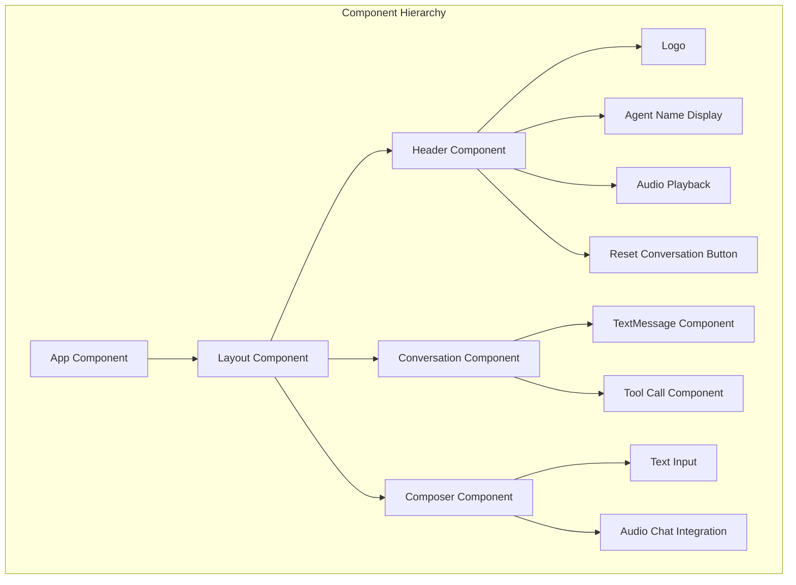

Sources: [README.md:7-17]()

## Key Components and Responsibilities

### App and Layout Components

The App component serves as the entry point for the application, while the Layout component provides the structural framework for all other components.

### Header Component

The Header component provides navigation and control elements:

- Displays the agent name and logo
- Contains the audio playback controls
- Includes a reset button to start a new conversation

### Conversation Component

The Conversation component manages the display of the conversation history:

- Renders the exchange of messages between user and agent
- Houses two specialized components:
  - TextMessage: Displays text responses with markdown support
  - ToolCall: Visualizes tool/function calls and their results

### Composer Component

The Composer component handles user input mechanisms:

- Text input field for typing messages
- Push-to-talk functionality for voice input
- Controls for starting/stopping audio recording

## Data Flow and State Management

The frontend maintains several key states that drive the user experience:

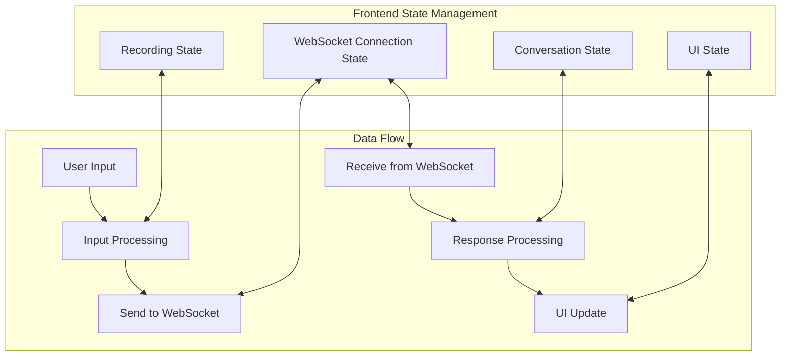

Sources: [README.md:10-16]()

## WebSocket Communication

The frontend establishes and maintains a WebSocket connection to the backend for real-time bidirectional communication:

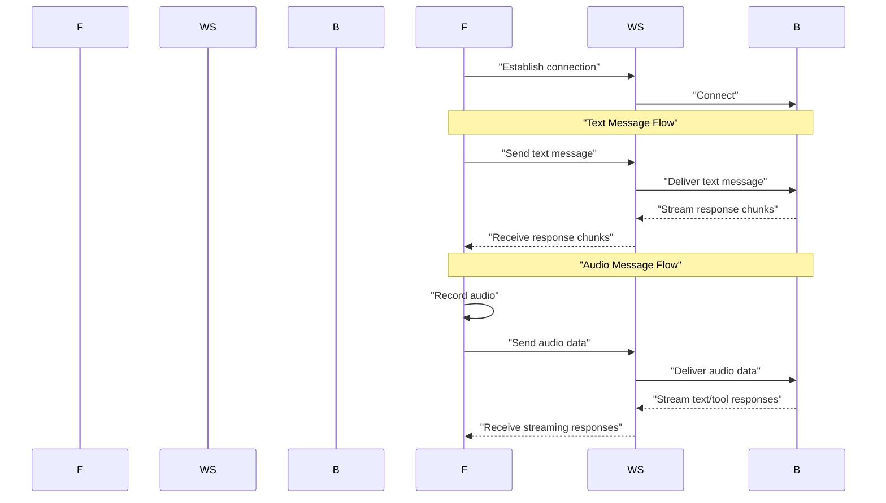

Sources: [README.md:7-17]()

## Audio Processing Flow

The frontend implements a complete audio recording and processing workflow:

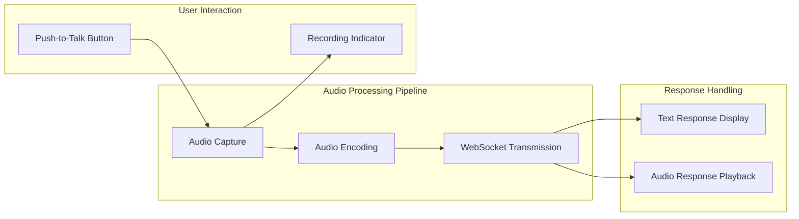

Sources: [README.md:12-13]()

## Rendering Responses

The frontend handles multiple types of responses from the agent:

1. **Text responses**: Displayed with markdown formatting support
2. **Tool call responses**: Visualized with appropriate UI elements
3. **Streaming responses**: Rendered incrementally as chunks arrive

The TextMessage component uses React Markdown to render formatted text, while the ToolCall component displays function calls and their results in a structured format.

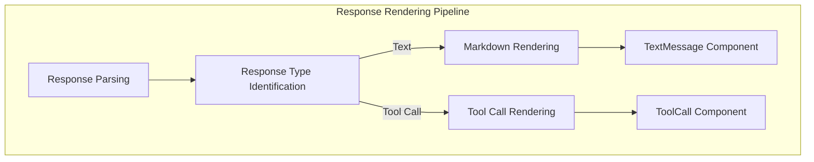

Sources: [frontend/package.json:24](), [README.md:14-15]()

## Page Layout and Styling

The application uses Tailwind CSS for styling and responsive design:

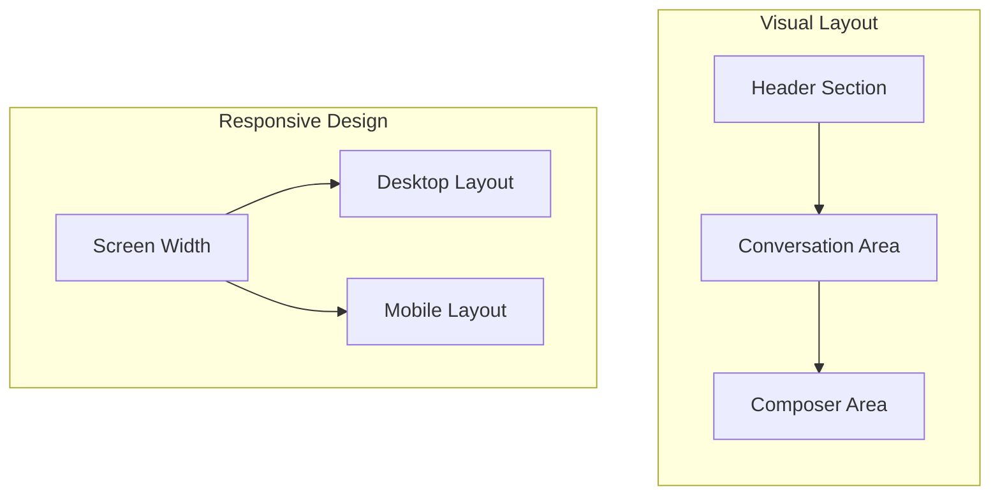

Sources: [frontend/package.json:38](), [frontend/postcss.config.mjs:1-5]()

## Conclusion

The frontend architecture of the OpenAI Voice Agent SDK Sample App is designed around a component-based structure that facilitates real-time voice interactions. The application uses WebSockets for bidirectional communication with the backend, supports audio recording and playback, and provides a responsive user interface for conversational interactions.

The modular design allows for easy extension and customization, making it a solid foundation for building voice-enabled applications powered by OpenAI's language models.

---

# Page: Backend Architecture

# Backend Architecture

<details>
<summary>Relevant source files</summary>

The following files were used as context for generating this wiki page:

- [README.md](README.md)

</details>


The Backend Architecture section provides a comprehensive overview of the server-side components that power the OpenAI Voice Agent SDK Sample App. This document focuses specifically on the FastAPI implementation, WebSocket communication, OpenAI Agents SDK integration, and the underlying processing pipeline. For information about the frontend implementation, please see [Frontend Architecture](#3.1).

## Overview

The backend serves as the bridge between the user-facing frontend application and the OpenAI API. Built with FastAPI, it provides real-time communication capabilities through WebSockets while managing conversation state and voice processing.

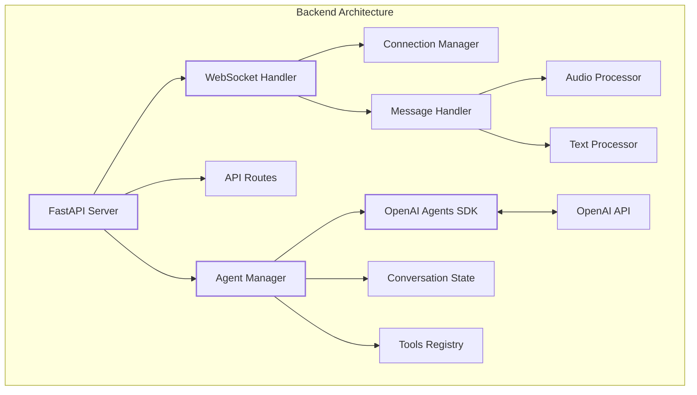

Sources: README.md

## Core Components

### FastAPI Server

The backend is built on FastAPI, a modern, high-performance web framework for building APIs with Python. The server handles HTTP requests and WebSocket connections, providing the necessary endpoints for the frontend to communicate with.

Key responsibilities:
- Serving WebSocket connections for real-time communication
- Managing API routes for application functionality
- Configuring CORS for secure cross-origin requests
- Handling dependency injection for various components

### WebSocket Communication

The WebSocket implementation is central to the application's functionality, enabling real-time bidirectional communication between the frontend and backend. This is particularly important for the voice agent features.

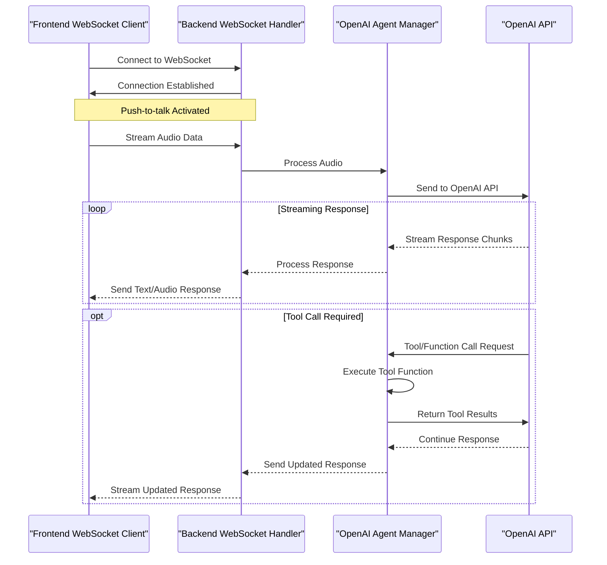

Sources: README.md

### Agent Management

The Agent Manager is responsible for initializing and managing the OpenAI Agents SDK integration. It handles:

1. Setting up the agent with appropriate configuration
2. Processing incoming messages (audio or text)
3. Managing conversation state across multiple turns
4. Handling function/tool calls
5. Streaming responses back to the client

### Tools and Function Calling

The backend implements tools (functions) that the AI can call during conversations. This enables the agent to perform actions beyond simple conversation, such as retrieving information or executing commands.

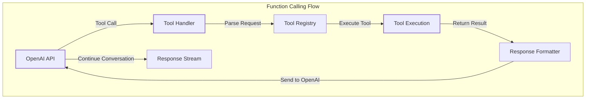

Sources: README.md

## Data Flow

The backend processes data through several stages from input to response:

1. **WebSocket Connection**: The frontend establishes a WebSocket connection to the backend
2. **Audio Streaming**: User audio is streamed in chunks to the backend
3. **Audio Processing**: Audio data is processed and sent to the OpenAI API
4. **Response Generation**: OpenAI generates responses, which may include tool calls
5. **Tool Execution**: If required, tools are executed and results returned to OpenAI
6. **Response Streaming**: Text and audio responses are streamed back to the client

This architecture enables real-time, interactive conversations with the voice agent.

## Voice Processing Pipeline

The backend implements a voice processing pipeline that handles audio input and output:

```mermaid
graph LR
    subgraph "Voice Processing Pipeline"
        AudioInput["Audio Input"] --> AudioChunker["Audio Chunker"]
        AudioChunker --> OpenAIVoiceAPI["OpenAI Voice API"]
        OpenAIVoiceAPI --> TextResponse["Text Response"]
        TextResponse --> AgentProcessor["Agent Processor"]
        AgentProcessor --> ResponseGenerator["Response Generator"]
        ResponseGenerator --> TextToSpeech["Text-to-Speech"]
        TextToSpeech --> AudioOutput["Audio Output"]
    end
    
    style AudioInput stroke-width:2px
    style OpenAIVoiceAPI stroke-width:2px
    style AgentProcessor stroke-width:2px
    style AudioOutput stroke-width:2px
```

Sources: README.md

## Conversation State Management

The backend maintains conversation state to enable multi-turn interactions:

| Component | Purpose |
|-----------|---------|
| Conversation Manager | Tracks conversation history and context |
| Message Store | Stores messages for context retention |
| Session Handler | Manages user sessions and persistence |
| Response Cache | Caches responses for efficient retrieval |

This state management ensures contextual awareness across conversation turns, allowing the agent to reference previous exchanges and maintain coherent discussions.

## Technical Implementation Details

### WebSocket Handler

The WebSocket handler is responsible for managing connections and processing messages. It handles:

1. Connection establishment and termination
2. Message routing and processing
3. Error handling and reconnection logic
4. Streaming responses back to the client

### OpenAI Agents SDK Integration

The backend leverages the OpenAI Agents SDK to manage conversations with the OpenAI API. This integration:

1. Initializes the agent with appropriate configuration
2. Processes audio and text inputs
3. Manages conversation context
4. Handles streaming responses
5. Processes function/tool calls

## Error Handling and Resilience

The backend implements several mechanisms to ensure reliable operation:

1. Connection recovery for WebSocket disruptions
2. Error handling for API failures
3. Graceful degradation when services are unavailable
4. Comprehensive logging for debugging and monitoring

## Conclusion

The backend architecture of the OpenAI Voice Agent SDK Sample App provides a robust foundation for building voice-enabled conversational agents. The FastAPI server with WebSocket support enables real-time communication, while the integration with the OpenAI Agents SDK provides powerful conversational capabilities. The modular design allows for customization and extension to meet specific requirements.

For details on how this backend communicates with the frontend, please see [Communication Flow](#4).

Sources: README.md

---

# Page: Communication Flow

# Communication Flow

<details>
<summary>Relevant source files</summary>

The following files were used as context for generating this wiki page:

- [README.md](README.md)

</details>


This document explains the communication flow in the OpenAI Voice Agent SDK Sample application, detailing how data flows between the frontend, backend, and OpenAI API with a focus on WebSocket communication. For information about the overall system architecture, see [System Architecture](#3).

## Communication Overview

The application uses WebSockets as the primary communication channel between the frontend and backend components. This enables real-time, bidirectional communication that supports:
- Streaming audio input from the user to the backend
- Streaming text responses from the OpenAI API back to the user
- Tool/function call execution and results
- Multi-turn conversation state management

## End-to-End Communication Sequence

The following diagram shows the complete sequence of communication between all system components:

```mermaid
sequenceDiagram
    participant User
    participant Frontend as "Next.js Frontend"
    participant WSClient as "WebSocketClient"
    participant WSServer as "WebSocket Endpoint"
    participant Backend as "FastAPI Backend"
    participant AgentsSDK as "OpenAI Agents SDK"
    participant OpenAI as "OpenAI API"
    
    User->>Frontend: Press push-to-talk button
    Frontend->>WSClient: startRecording()
    
    loop Audio Streaming
        Frontend->>WSClient: sendAudioChunk(chunk)
        WSClient->>WSServer: Send binary audio data
        WSServer->>Backend: Process incoming audio
        Backend->>AgentsSDK: process_audio_chunk(chunk)
    end
    
    Frontend->>WSClient: stopRecording()
    WSClient->>WSServer: Send end-of-audio signal
    WSServer->>Backend: Finalize audio processing
    Backend->>AgentsSDK: send_to_openai()
    AgentsSDK->>OpenAI: API request with audio
    
    OpenAI-->>AgentsSDK: Stream response
    
    loop Text Streaming
        AgentsSDK-->>Backend: process_response_chunk()
        Backend-->>WSServer: Send response chunk
        WSServer-->>WSClient: Forward message
        WSClient-->>Frontend: updateMessage(chunk)
        Frontend-->>User: Display streaming text
    end
    
    opt Function Calling
        OpenAI->>AgentsSDK: Tool/Function call request
        AgentsSDK->>Backend: execute_tool(name, params)
        Backend->>Backend: Run function
        Backend->>AgentsSDK: Return tool result
        AgentsSDK->>OpenAI: Submit tool result
        OpenAI-->>AgentsSDK: Continue response
        AgentsSDK-->>Backend: process_response_chunk()
        Backend-->>WSServer: Send response chunk
        WSServer-->>WSClient: Forward message
        WSClient-->>Frontend: updateMessage(chunk)
        Frontend-->>User: Display updated response
    end
```

Sources: README.md

## WebSocket Connection Establishment

The WebSocket connection forms the backbone of real-time communication in the application. The connection is established when the user first loads the application.

### Frontend WebSocket Connection

The frontend connects to the WebSocket server using a client implementation that manages the connection lifecycle:

```mermaid
graph TD
    A["Page Load"] --> B["Initialize WebSocket"]
    B --> C["Connect to Backend"]
    C --> D["Connection Open"]
    D --> E["Begin Listening for Messages"]
    
    F["User Interaction"] --> G["Send Messages"]
    G --> H["WebSocket send()"]
    
    I["Incoming Message"] --> J["WebSocket onmessage"]
    J --> K["Process Message"]
    K --> L["Update UI"]
    
    M["Connection Error"] --> N["Reconnection Logic"]
    N --> C
    
    O["Page Unload"] --> P["Close WebSocket"]
```

Sources: README.md

## Message Types and Format

The WebSocket communication uses a structured message format for different types of interactions:

| Message Type | Direction | Purpose | Format |
|--------------|-----------|---------|--------|
| Audio Data | Client → Server | Send user's voice input | Binary WebSocket frames containing audio chunks |
| Text Input | Client → Server | Send text messages | JSON with message content |
| Agent Response | Server → Client | Return agent's reply | JSON with text chunks and metadata |
| Tool Call | Server → Client | Notify of function execution | JSON with tool name and parameters |
| Tool Result | Server → Client | Return function results | JSON with execution result |
| Error | Server → Client | Communicate errors | JSON with error code and message |

## Audio Data Flow

When using push-to-talk functionality, audio data follows a specific path through the system:

```mermaid
graph TD
    A["MediaRecorder API"] --> B["Audio Processing"]
    B --> C["WebSocketClient.sendAudio()"]
    C --> D["WebSocket Binary Frame"]
    D --> E["WebSocket Endpoint"]
    E --> F["AudioProcessor"]
    F --> G["OpenAI Agents SDK"]
    G --> H["OpenAI API Speech-to-Text"]
    
    H --> I["Text Generation"]
    I --> J["Response Streaming"]
    J --> K["WebSocket Text Frame"]
    K --> L["Frontend Message Handler"]
    L --> M["UI Rendering"]
```

Sources: README.md

## Tool/Function Calling Implementation

The application supports tool calling, allowing the agent to perform actions. This follows a specific flow:

```mermaid
graph TD
    A["OpenAI API"] --> B["Tool Call Request"]
    B --> C["Agents SDK parse_tool_call()"]
    C --> D["Backend execute_tool()"]
    D --> E["Function Execution"]
    E --> F["Result Processing"]
    F --> G["Return to SDK"]
    G --> H["Submit to OpenAI API"]
    H --> I["Continue Response Generation"]
    I --> J["Stream to Frontend"]
```

Sources: README.md

## Conversation State Management

The backend maintains conversation state across multiple turns, which is essential for contextual understanding:

```mermaid
graph TD
    A["User Input"] --> B["Conversation Manager"]
    B --> C["Add to History"]
    C --> D["Update Context"]
    D --> E["Send to OpenAI API"]
    
    E --> F["Process Response"]
    F --> G["Add to History"]
    G --> B
    
    H["New User Input"] --> B
```

Sources: README.md

## Technical Implementation Details

### Frontend WebSocket Implementation

The frontend implements WebSocket communication through a dedicated client module that handles connection management, message serialization, and audio processing.

Key components include:
- A WebSocket client that manages the connection lifecycle
- Audio recording and processing using the MediaRecorder API
- Message handlers for different response types
- UI update logic for streaming responses

### Backend WebSocket Implementation

The backend uses FastAPI's WebSocket support to implement the server-side endpoint:

```mermaid
graph TD
    A["FastAPI WebSocket Endpoint"] --> B["Connection Manager"]
    B --> C["Message Router"]
    
    C --> D["Audio Handler"]
    C --> E["Text Handler"]
    C --> F["Tool Call Handler"]
    
    D --> G["Agents SDK Interface"]
    E --> G
    F --> G
    
    G --> H["OpenAI API Client"]
    
    H --> I["Response Processor"]
    I --> J["WebSocket Response"]
```

Sources: README.md

## Error Handling

The application implements comprehensive error handling to ensure a robust user experience:

1. **Connection Errors**
   - WebSocket connection drops are detected and handled
   - Automatic reconnection with exponential backoff
   - UI notifications for connection status

2. **API Errors**
   - OpenAI API errors are caught and communicated to the user
   - Graceful degradation when services are unavailable

3. **Processing Errors**
   - Audio processing failures are communicated
   - Message parsing errors are handled appropriately

## Performance Considerations

The communication design takes into account several performance factors:

1. **Low Latency**
   - WebSockets provide lower latency than HTTP polling
   - Audio is streamed in chunks to reduce processing delay

2. **Bandwidth Optimization**
   - Audio compression reduces bandwidth requirements
   - Binary WebSocket frames for efficient audio transmission

3. **Responsive UI**
   - Streaming responses provide immediate feedback
   - Asynchronous processing prevents UI blocking

## Further Information

For more information about specific components:
- For frontend component details, see [Frontend Components](#5)
- For voice processing specifics, see [Voice Processing](#6)
- For function calling implementation, see [Function Calling](#7)

---

# Page: Frontend Components

# Frontend Components

<details>
<summary>Relevant source files</summary>

The following files were used as context for generating this wiki page:

- [frontend/src/components/Composer.tsx](frontend/src/components/Composer.tsx)
- [frontend/src/components/Header.tsx](frontend/src/components/Header.tsx)
- [frontend/src/components/messages/TextMessage.tsx](frontend/src/components/messages/TextMessage.tsx)

</details>


This page provides an overview of the key frontend components that make up the user interface of the OpenAI Voice Agent SDK Sample App. It describes the main React components, their responsibilities, and how they interact within the Next.js application. For detailed information about specific components, see the respective subpages: [Header Component](#5.1), [Composer Component](#5.2), and [TextMessage Component](#5.3).

## Component Architecture

The frontend of the application is built using React within a Next.js framework. The components are organized in a hierarchical structure that manages different aspects of the user interface, from conversation display to user input handling.

```mermaid
graph TD
    App["App"] --> Layout["Layout"]
    Layout --> Header["Header"]
    Layout --> Conversation["Conversation"]
    Layout --> Composer["Composer"]
    
    Conversation --> Messages["Messages Container"]
    Messages --> TextMessage["TextMessage"]
    Messages --> ToolCall["ToolCall"]
    
    Composer --> TextInput["Text Input"]
    Composer --> AudioChat["Audio Chat Controls"]
    
    Header --> Logo["Logo"]
    Header --> AgentNameDisplay["Agent Name Display"]
    Header --> AudioPlayback["Audio Playback"]
    Header --> ResetButton["Reset Conversation Button"]
```

Sources: [frontend/src/components/Header.tsx](), [frontend/src/components/Composer.tsx](), [frontend/src/components/messages/TextMessage.tsx]()

## Core Components

### Header Component

The Header component appears at the top of the application and provides application context and controls.

```mermaid
classDiagram
    class Header {
        +string agentName
        +number[] playbackFrequencies
        +function stopPlaying()
        +function resetConversation()
        -renderLogo()
        -renderAgentName()
        -renderAudioPlayback()
        -renderResetButton()
    }
    
    Header --> AudioPlayback
    Header --> Button
    
    class AudioPlayback {
        +number[] playbackFrequencies
        +string itemClassName
        +number height
    }
    
    class Button {
        +string variant
        +string size
        +function onClick()
    }
```

The Header component includes:
- OpenAI logo
- Agent name display with animation
- Audio visualization during playback
- Reset button for starting new conversations

Sources: [frontend/src/components/Header.tsx:12-127]()

### Composer Component

The Composer component handles user input, allowing users to enter messages through text or voice.

```mermaid
classDiagram
    class Composer {
        +string prompt
        +function setPrompt()
        +function onSubmit()
        +boolean isLoading
        +ReactNode audioChat
        -useRef textareaRef
    }
    
    Composer --> Button
    Composer --> TextArea
    
    class TextArea {
        +string value
        +function onChange()
        +function onKeyDown()
    }
    
    class Button {
        +string variant
        +string size
        +boolean disabled
        +function onClick()
    }
```

Key features:
- Auto-expanding textarea for text input
- Enter key submission handling
- Integration point for audio chat functionality
- Submit button with appropriate disabled states

Sources: [frontend/src/components/Composer.tsx:6-65]()

### TextMessage Component

The TextMessage component renders individual messages in the conversation, supporting both user and agent messages.

```mermaid
classDiagram
    class TextMessage {
        +string text
        +boolean isUser
    }
    
    TextMessage --> ReactMarkdown
    ReactMarkdown --> CustomLink
    
    class ReactMarkdown {
        +object components
    }
    
    class CustomLink {
        +string href
        +ReactNode children
    }
```

Key features:
- Different styling for user and agent messages
- Markdown rendering for rich text formatting
- Custom link styling
- Responsive layout with appropriate spacing

Sources: [frontend/src/components/messages/TextMessage.tsx:5-42]()

## Component Data Flow

The following diagram illustrates how data flows between the frontend components during a typical conversation:

```mermaid
sequenceDiagram
    participant User
    participant Composer as "Composer"
    participant App as "App State"
    participant Conversation as "Conversation"
    participant TextMessage as "TextMessage"
    participant Header as "Header"
    participant Backend as "Backend (WebSocket)"
    
    User->>Composer: Types or speaks message
    Composer->>App: Submits message
    App->>Backend: Sends message
    App->>Conversation: Updates with user message
    Conversation->>TextMessage: Renders user message
    
    Backend-->>App: Streams response
    App->>Conversation: Updates with agent message
    Conversation->>TextMessage: Renders agent message
    App->>Header: Updates audio state
    Header-->>User: Displays audio visualizer
```

Sources: [frontend/src/components/Composer.tsx](), [frontend/src/components/Header.tsx](), [frontend/src/components/messages/TextMessage.tsx]()

## Component Responsibilities

Each frontend component has specific responsibilities within the application:

| Component | Primary Responsibility | Key Props | Interactions |
|-----------|------------------------|-----------|--------------|
| Header | Display application context and controls | `agentName`, `playbackFrequencies`, `stopPlaying`, `resetConversation` | Audio playback visualization, New conversation creation |
| Composer | Handle user input (text and audio) | `prompt`, `setPrompt`, `onSubmit`, `isLoading`, `audioChat` | Text input, Audio recording, Message submission |
| TextMessage | Display conversation messages | `text`, `isUser` | Markdown rendering, Link formatting |
| Conversation | Manage message display and scrolling | `messages` | Rendering message components, Auto-scrolling |
| ToolCall | Display tool/function calls made by the agent | `toolCall`, `result` | Showing function execution details |

Sources: [frontend/src/components/Header.tsx](), [frontend/src/components/Composer.tsx](), [frontend/src/components/messages/TextMessage.tsx]()

## UI Layout and Styling

The application follows a vertical layout structure typical of chat applications, with components stacked to provide a natural conversation flow:

```mermaid
graph TD
    subgraph "UI Layout"
        Header["Header (Top)"]
        Conversation["Conversation (Middle)"]
        Composer["Composer (Bottom)"]
    end
    
    Header --> Conversation
    Conversation --> Composer
    
    subgraph "Conversation Content"
        UserMessage["User Messages (Right-aligned)"]
        AgentMessage["Agent Messages (Left-aligned)"]
        ToolCallBlock["Tool Calls (Left-aligned)"]
    end
    
    Conversation --- UserMessage
    Conversation --- AgentMessage
    Conversation --- ToolCallBlock
```

The UI uses:
- Rounded corners for messages and input components
- Different background colors to distinguish user and agent messages
- Custom styling for interactive elements like buttons
- Responsive design to adapt to different screen sizes
- Animations for transitions and audio visualization

Sources: [frontend/src/components/Header.tsx](), [frontend/src/components/Composer.tsx](), [frontend/src/components/messages/TextMessage.tsx]()

## Component Props Interface

The following diagram illustrates the props interfaces for the main components, showing how they connect to the application state:

```mermaid
classDiagram
    class AppState {
        +string[] messages
        +string currentPrompt
        +boolean isLoading
        +string agentName
        +number[] audioFrequencies
        +function setPrompt()
        +function sendMessage()
        +function resetConversation()
        +function stopAudio()
    }
    
    AppState --> HeaderProps
    AppState --> ComposerProps
    AppState --> ConversationProps
    
    class HeaderProps {
        +string agentName
        +number[] playbackFrequencies
        +function stopPlaying()
        +function resetConversation()
    }
    
    class ComposerProps {
        +string prompt
        +function setPrompt()
        +function onSubmit()
        +boolean isLoading
        +ReactNode audioChat
    }
    
    class ConversationProps {
        +object[] messages
    }
    
    ConversationProps --> TextMessageProps
    
    class TextMessageProps {
        +string text
        +boolean isUser
    }
```

Sources: [frontend/src/components/Header.tsx:12-22](), [frontend/src/components/Composer.tsx:6-12](), [frontend/src/components/messages/TextMessage.tsx:20-23]()

## Integration with Audio Features

The components work together to provide a seamless voice chat experience:

- The Header component displays audio visualizations during playback
- The Composer component integrates audio recording controls
- The application manages audio state transitions between components

The audio integration connects through props and state management to ensure synchronized behavior across the UI.

Sources: [frontend/src/components/Header.tsx:53-56](), [frontend/src/components/Composer.tsx:51]()

This overview page provides a foundation for understanding the frontend component architecture. For more detailed information about specific components, see the subpages on [Header Component](#5.1), [Composer Component](#5.2), and [TextMessage Component](#5.3).

---

# Page: Header Component

# Header Component

<details>
<summary>Relevant source files</summary>

The following files were used as context for generating this wiki page:

- [frontend/src/components/Header.tsx](frontend/src/components/Header.tsx)

</details>


The Header component is a key user interface element in the OpenAI Voice Agent SDK Sample application. It provides navigation controls, displays the current agent's identity, and offers audio playback controls during voice responses.

For information about text input and audio recording, see [Composer Component](#5.2).

## Purpose and Functionality

The Header component serves several important functions:

1. Displays the application logo
2. Shows the current agent's name
3. Presents audio visualizations during voice playback
4. Provides controls for stopping audio playback
5. Offers a button to reset/restart conversations

Sources: [frontend/src/components/Header.tsx:12-126]()

## Component Structure

```mermaid
graph LR
    subgraph "Header"
        Logo["Logo Section"]
        AgentSection["Agent Section"]
        ControlSection["Control Section"]
        
        subgraph "AgentSection"
            AgentName["Agent Name Display"]
            LeftVisualizer["Left Audio Visualizer"]
            RightVisualizer["Right Audio Visualizer"]
            PauseButton["Pause Button"]
        end
    end
    
    Logo --> AgentSection
    AgentSection --> ControlSection
```

Sources: [frontend/src/components/Header.tsx:25-126]()

## Component Interface

The Header component accepts the following props:

| Prop | Type | Description |
|------|------|-------------|
| `agentName` | `string` | The name of the active agent to display |
| `playbackFrequencies` | `number[]` | Array of frequency values for audio visualization |
| `stopPlaying` | `() => Promise<void>` | Async function to stop audio playback |
| `resetConversation` | `() => void` | Function to reset the conversation state |

Sources: [frontend/src/components/Header.tsx:12-22]()

## Detailed Component Layout

```mermaid
flowchart LR
    Header["Header Component"]
    
    subgraph "Left Section"
        Logo["OpenAI Logo (Image)"]
    end
    
    subgraph "Center Section"
        AgentDisplay["Agent Name Display"]
        LeftAudio["Left AudioPlayback"]
        RightAudio["Right AudioPlayback"]
        PauseBtn["PauseIcon Button"]
    end
    
    subgraph "Right Section"
        ResetBtn["WriteIcon Button (Reset)"]
    end
    
    Header --> Left["Left Section"]
    Header --> Center["Center Section"]
    Header --> Right["Right Section"]
    
    Left --> Logo
    
    Center --> LeftAudio
    Center --> AgentDisplay
    Center --> RightAudio
    RightAudio --> PauseBtn
```

Sources: [frontend/src/components/Header.tsx:25-126]()

## Audio Visualization Logic

The Header component includes conditional rendering of audio visualization elements based on the `playbackFrequencies` prop:

```mermaid
graph TD
    Check["Check playbackFrequencies.length === 5?"]
    Check -->|"Yes"| Show["Show AudioPlayback visualizers"]
    Check -->|"No"| Hide["Hide AudioPlayback visualizers"]
    
    Show --> Animate["Animate visualizers appearing"]
    Hide --> AnimateOut["Animate visualizers disappearing"]
```

The audio visualization only appears when `playbackFrequencies` contains exactly 5 elements, which serves as an indicator that audio is being played.

Sources: [frontend/src/components/Header.tsx:23](), [frontend/src/components/Header.tsx:38-58](), [frontend/src/components/Header.tsx:88-113]()

## Animation Features

The Header component uses motion animations from Framer Motion to create a polished user experience:

1. **Audio Visualizer Animations**:
   - The audio visualizers fade in and expand when audio is playing
   - They shrink and fade out when audio stops

2. **Agent Name Animations**:
   - The agent name container animates to accommodate the agent name text
   - The agent name text itself has a fade in/out transition when changed

These animations use spring physics with carefully tuned parameters for a responsive yet natural feel.

Sources: [frontend/src/components/Header.tsx:39-50](), [frontend/src/components/Header.tsx:61-71](), [frontend/src/components/Header.tsx:75-83](), [frontend/src/components/Header.tsx:89-100]()

## Key UI Elements

### Logo Section
The logo section displays the OpenAI logo using Next.js's `Image` component for optimized image loading.

Sources: [frontend/src/components/Header.tsx:27-29]()

### Agent Display Section
The agent display section shows the current agent's name in a pill-shaped container. When audio is playing, it expands to also display audio visualizers on both sides.

Sources: [frontend/src/components/Header.tsx:30-115]()

### Control Section
The control section contains a button with a `WriteIcon` that triggers the `resetConversation` function when clicked, allowing users to start a new conversation.

Sources: [frontend/src/components/Header.tsx:116-124]()

## Integration with AudioPlayback Component

The Header component integrates with the `AudioPlayback` component to display audio visualizations:

```mermaid
graph LR
    Header["Header Component"] -->|"Passes playbackFrequencies"| AudioPlayback["AudioPlayback Component"]
    AudioPlayback -->|"Renders visualizers"| Visualizer["Audio Visualization"]
```

The `AudioPlayback` component receives the `playbackFrequencies` array and renders the audio visualization based on these frequency values.

Sources: [frontend/src/components/Header.tsx:7](), [frontend/src/components/Header.tsx:52-56]()

## Responsive Design

The Header component is designed to be responsive and adapts to different screen sizes:
- Uses flexbox for layout (`flex flex-row`)
- Employs relative positioning for proper element stacking
- Features animations that work across different screen sizes
- Ensures text overflow is handled appropriately with `overflow-hidden` and `whitespace-nowrap`

Sources: [frontend/src/components/Header.tsx:26](), [frontend/src/components/Header.tsx:32-35](), [frontend/src/components/Header.tsx:72]()

## User Interaction Flow

When a user interacts with the Header component:

```mermaid
sequenceDiagram
    participant User
    participant Header as Header Component
    participant Parent as Parent Component
    
    User->>Header: Clicks reset button
    Header->>Parent: Calls resetConversation()
    Parent->>Header: Updates agentName (if changed)
    
    Note over Header: During audio playback
    
    Parent->>Header: Updates playbackFrequencies
    Header->>Header: Shows audio visualizations
    User->>Header: Clicks pause button
    Header->>Parent: Calls stopPlaying()
    Parent->>Header: Sets playbackFrequencies to []
    Header->>Header: Hides audio visualizations
```

Sources: [frontend/src/components/Header.tsx:20-21](), [frontend/src/components/Header.tsx:105-108](), [frontend/src/components/Header.tsx:117-123]()

## Summary

The Header component provides critical user interface elements for the voice agent application, including agent identification, audio playback controls, and conversation reset functionality. It features smooth animations and a clean, responsive design that enhances the overall user experience.

---

# Page: Composer Component

# Composer Component

<details>
<summary>Relevant source files</summary>

The following files were used as context for generating this wiki page:

- [frontend/src/components/Composer.tsx](frontend/src/components/Composer.tsx)

</details>


The Composer Component serves as the primary user input interface in the OpenAI Voice Agent SDK Sample App. It provides a text input field for typed messages and integrates with audio chat functionality, enabling both text-based and voice-based interactions with the voice agent.

For information about how messages are displayed in the conversation, see [TextMessage Component](#5.3).

## Component Overview

The Composer Component is a React functional component that renders the input area at the bottom of the application interface. It provides a textarea for typing messages, a submit button for sending messages, and a space for integrating audio chat functionality.

```mermaid
graph TD
    subgraph "Composer Component"
        TextareaInput["Textarea Input"] -- "onChange" --> SetPrompt["setPrompt()"]
        TextareaInput -- "onKeyDown(Enter)" --> Submit["onSubmit()"]
        SubmitButton["Submit Button"] -- "onClick" --> Submit
        AudioChatSlot["Audio Chat Slot"]
    end

    Submit -- "When input not empty" --> ParentHandler["Parent Component Handler"]
    SetPrompt --> ParentState["Parent Component State"]
```

Sources: [frontend/src/components/Composer.tsx:30-64]()

## Component Props Interface

The Composer component accepts a set of props that define its behavior and integration with the parent component:

```mermaid
classDiagram
    class ComposerProps {
        +string prompt
        +function setPrompt(prompt: string)
        +function onSubmit()
        +boolean isLoading
        +ReactNode audioChat
    }
    
    ComposerProps -- "Used by" Composer
```

Sources: [frontend/src/components/Composer.tsx:6-12]()

| Prop | Type | Description |
|------|------|-------------|
| `prompt` | string | Current text input value |
| `setPrompt` | function | Function to update the prompt value |
| `onSubmit` | function | Handler for form submission |
| `isLoading` | boolean | Indicates if a request is in progress |
| `audioChat` | React.ReactNode | Optional component for audio chat functionality |

Sources: [frontend/src/components/Composer.tsx:6-12]()

## Functional Behavior

The Composer component implements several key behaviors:

1. **Text Input Handling**: Captures and manages user-typed text
2. **Auto-resizing Textarea**: Dynamically adjusts the height of the textarea based on content
3. **Submission Handling**: Processes form submission via button click or Enter key press
4. **Input Validation**: Prevents submission of empty messages
5. **Audio Chat Integration**: Provides a slot for audio-based interaction

```mermaid
sequenceDiagram
    participant User
    participant Composer as "Composer Component"
    participant Parent as "Parent Component"
    
    User->>Composer: Types message
    Composer->>Composer: Update textarea height
    Composer->>Parent: setPrompt(newValue)
    
    alt Press Enter Key (No Shift)
        User->>Composer: Press Enter
        Composer->>Composer: Validate input
        alt Input Not Empty
            Composer->>Parent: onSubmit()
        end
    else Click Submit Button
        User->>Composer: Click submit button
        Composer->>Parent: onSubmit()
    end
```

Sources: [frontend/src/components/Composer.tsx:23-28](), [frontend/src/components/Composer.tsx:40-48]()

## Integration in Frontend Architecture

The Composer component fits into the broader frontend architecture as one of the main UI components:

```mermaid
graph TD
    App["App Component"] --> Layout["Layout Component"]
    Layout --> Header["Header Component"]
    Layout --> Conversation["Conversation Component"]
    Layout --> Composer["Composer Component"]
    
    Composer --> TextInput["textarea element"]
    Composer --> SubmitBtn["Submit Button"]
    Composer --> AudioChatSlot["Audio Chat Integration"]
    
    TextInput -- "onChange" --> UpdateState["Update Prompt State"]
    TextInput -- "onKeyDown" --> HandleSubmit["Handle Submission"]
    SubmitBtn -- "onClick" --> HandleSubmit
```

Sources: [frontend/src/components/Composer.tsx:30-64]()

## Component Implementation Details

### Element Structure

The Composer renders a container with the following structure:

1. Outer container div with flex layout
2. Inner container div with border styling
3. Textarea for text input
4. Control section containing:
   - Audio chat component (if provided)
   - Submit button with arrow icon

Sources: [frontend/src/components/Composer.tsx:30-64]()

### Auto-resizing Textarea

The component uses a `useRef` hook to access the textarea DOM element and implements auto-resizing functionality with a `useEffect` hook:

```mermaid
graph TD
    UseEffect["useEffect Hook"] -- "Triggered when" --> PromptChanges["prompt changes"]
    UseEffect --> GetTextareaRef["Get textarea reference"]
    GetTextareaRef --> ResetHeight["Reset height to auto"]
    ResetHeight --> SetHeight["Set height to scrollHeight"]
```

Sources: [frontend/src/components/Composer.tsx:21-28]()

### Submission Logic

The component handles submission through two methods:

1. **Enter Key Press**: When the user presses Enter (without Shift), the component prevents the default new line behavior, validates the input is not empty, and calls the `onSubmit` function.

2. **Button Click**: When the user clicks the submit button, the `onSubmit` function is called (the button is disabled if the input is empty or if a request is already in progress).

Sources: [frontend/src/components/Composer.tsx:40-48](), [frontend/src/components/Composer.tsx:52-60]()

## Usage Example

In a typical usage scenario, the parent component would:

1. Maintain the prompt state
2. Provide a handler for submission
3. Track loading state
4. Optionally provide an audio chat component

The Composer would then render an input area with these capabilities, forwarding user actions to the parent component.

## Styling and UI

The Composer features a clean, modern design with:

- Rounded input area with subtle border
- Flexible textarea that expands with content
- Compact, icon-based submit button
- Logical placement of the audio chat element

All styling is implemented using Tailwind CSS classes for responsive design.

Sources: [frontend/src/components/Composer.tsx:31-64]()

## Summary

The Composer Component provides the essential user input interface for the Voice Agent SDK Sample App, handling both text-based input and integrating voice-based interaction. Its design is focused on simplicity and user experience, with features like auto-resizing textarea and input validation enhancing usability. The component communicates with its parent component through a well-defined props interface, making it a flexible and reusable part of the application.

---

# Page: TextMessage Component

# TextMessage Component

<details>
<summary>Relevant source files</summary>

The following files were used as context for generating this wiki page:

- [frontend/src/components/messages/TextMessage.tsx](frontend/src/components/messages/TextMessage.tsx)

</details>


## Purpose and Overview

The TextMessage component is responsible for rendering individual text messages in the conversation interface of the OpenAI Voice Agent SDK Sample App. It displays user and assistant messages with distinct styling and supports Markdown formatting for rich text presentation.

For information about how users input messages that will be rendered by this component, see the [Composer Component](#5.2).

## Component Position in Frontend Architecture

The TextMessage component is part of the message rendering subsystem within the frontend architecture:

```mermaid
graph TD
    App["App Component"] --> Layout["Layout Component"]
    Layout --> Header["Header Component"]
    Layout --> Conversation["Conversation Component"]
    Layout --> Composer["Composer Component"]
    Conversation --> MessageTypes["Message Types"]
    MessageTypes --> TextMessage["TextMessage Component"]
    MessageTypes --> ToolCall["Tool Call Component"]
    TextMessage --> ReactMarkdown["ReactMarkdown Rendering"]
    ReactMarkdown --> CustomLink["CustomLink Component"]
```

Sources: [frontend/src/components/messages/TextMessage.tsx:25-42]()

## Component Structure

The TextMessage component has a simple yet flexible structure:

```mermaid
classDiagram
    class TextMessageProps {
        text: string
        isUser: boolean
    }
    class CustomLinkProps {
        href?: string
        children?: React.ReactNode
    }
    class TextMessage {
        Renders message bubble
        Applies conditional styling
        Uses ReactMarkdown
    }
    class CustomLink {
        Styled anchor element
        Custom hover effects
    }
    TextMessage --> TextMessageProps: accepts
    TextMessage --> ReactMarkdown: uses
    ReactMarkdown --> CustomLink: uses for links
    CustomLink --> CustomLinkProps: accepts
```

Sources: [frontend/src/components/messages/TextMessage.tsx:5-42]()

## Props

The TextMessage component accepts two props:

| Prop | Type | Description |
|------|------|-------------|
| `text` | string | The text content of the message to be displayed |
| `isUser` | boolean | Whether the message is from the user (true) or assistant (false) |

Sources: [frontend/src/components/messages/TextMessage.tsx:20-23]()

## Rendering Logic

The component applies different styling based on the message sender:

```mermaid
flowchart TD
    TextMessage["TextMessage({text, isUser})"] --> Container["Container div (flex row)"]
    Container --> IsUserCheck{"isUser?"}
    IsUserCheck -->|"true"| UserStyling["Right-aligned\nGray background (#ededed)\nRounded corners"]
    IsUserCheck -->|"false"| AssistantStyling["Left-aligned\nWhite background\nRounded corners"]
    UserStyling --> Markdown["ReactMarkdown render"]
    AssistantStyling --> Markdown
    Markdown --> CustomLinks["Custom link styling"]
    CustomLinks --> FinalMessage["Rendered message"]
```

Sources: [frontend/src/components/messages/TextMessage.tsx:25-42]()

## Styling Implementation

The TextMessage component uses the `clsx` library to conditionally apply CSS classes based on whether the message is from the user or the assistant:

### Container Styling

```tsx
<div
  className={clsx("flex flex-row gap-2", {
    "justify-end py-2": isUser,
  })}
>
```

### Message Bubble Styling

```tsx
<div
  className={clsx("rounded-[20px]", {
    "px-4 max-w-[90%] ml-4 text-stone--900 bg-[#ededed]": isUser,
    "px-4 max-w-[90%] mr-4 text-black bg-white": !isUser,
  })}
>
```

Key styling characteristics:
- All messages have rounded corners (20px radius)
- Maximum width set to 90% of container
- User messages: Right-aligned, gray background
- Assistant messages: Left-aligned, white background

Sources: [frontend/src/components/messages/TextMessage.tsx:26-37]()

## Markdown Support

The component leverages ReactMarkdown to render formatted content, enabling rich text communication:

```mermaid
graph LR
    InputText["Text with Markdown\n(e.g., **bold**, _italic_, [links])"] --> TextMessage["TextMessage Component"]
    TextMessage --> ReactMarkdown["ReactMarkdown Component"]
    ReactMarkdown --> CustomComponents["Custom Components"]
    CustomComponents --> Links["CustomLink for links"]
    ReactMarkdown --> StandardMarkdown["Standard Markdown\n(bold, italic, lists, etc.)"]
    Links --> RenderedMessage["Rendered Message"]
    StandardMarkdown --> RenderedMessage
```

The CustomLink component provides specialized styling for links within messages:

```tsx
const CustomLink = ({ href, children, ...props }: CustomLinkProps) => (
  <a
    href={href}
    {...props}
    className="bg-gray-200 rounded-full py-1 px-2 text-sm font-medium hover:text-white hover:bg-black"
  >
    {children}
  </a>
);
```

This custom link styling includes:
- Light gray background
- Rounded pill appearance
- Hover effect (white text on black background)

Sources: [frontend/src/components/messages/TextMessage.tsx:10-18](), [frontend/src/components/messages/TextMessage.tsx:38]()

## Usage Example

Within the conversation flow, the TextMessage component would typically be used as follows:

```jsx
// Example usage in a conversation mapping
{conversationMessages.map((message, index) => (
  <TextMessage 
    key={index}
    text={message.content}
    isUser={message.role === 'user'}
  />
))}
```

The component handles both the styling and rendering of the message content, with the appropriate appearance applied based on the message source.

Sources: [frontend/src/components/messages/TextMessage.tsx:25-42]()

## Component Rendering Flow

```mermaid
flowchart TD
    Input["Input: {text, isUser}"] --> TextMessage["TextMessage Component"]
    TextMessage --> ContainerDiv["Container div with conditional classes"]
    ContainerDiv --> ContentDiv["Content div with message styling"]
    ContentDiv --> MD["ReactMarkdown component"]
    MD --> Parse["Parse markdown content"]
    Parse --> Links{"Contains links?"}
    Links -->|"Yes"| CustomLink["Apply CustomLink styling"]
    Links -->|"No"| Standard["Standard markdown rendering"]
    CustomLink --> Final["Final rendered message"]
    Standard --> Final
```

Sources: [frontend/src/components/messages/TextMessage.tsx:25-42]()

---

# Page: Voice Processing

# Voice Processing

<details>
<summary>Relevant source files</summary>

The following files were used as context for generating this wiki page:

- [README.md](README.md)
- [frontend/package.json](frontend/package.json)

</details>


This page documents the voice processing capabilities of the OpenAI Voice Agent SDK Sample App, explaining how audio input is captured, processed, transmitted to the backend, sent to the OpenAI API, and how responses are handled. This document focuses specifically on the audio processing components of the system rather than the general conversation flow (which is covered in [Communication Flow](#4)).

## Voice Processing Architecture

The voice processing system in this application enables users to interact with the AI agent through speech using a push-to-talk interface. Below is a high-level overview of how voice data flows through the system.

```mermaid
flowchart LR
    subgraph "Frontend"
        AudioCapture["Audio Capture\n(push-to-talk)"]
        AudioProcessing["Audio Processing\n(encoding/buffering)"]
        AudioPlayback["Audio Playback"]
    end
    
    subgraph "Backend"
        WebSocketServer["WebSocket Server"]
        AgentSDK["OpenAI Agents SDK"]
    end
    
    subgraph "OpenAI API"
        STT["Speech-to-Text"]
        LLM["Language Model"]
        TTS["Text-to-Speech"]
    end
    
    AudioCapture --> AudioProcessing
    AudioProcessing --> WebSocketServer
    WebSocketServer --> AgentSDK
    AgentSDK --> STT
    STT --> LLM
    LLM --> TTS
    TTS --> WebSocketServer
    WebSocketServer --> AudioPlayback
```

Sources: README.md

## Audio Capture

The frontend implements a push-to-talk audio capture system, allowing users to record audio only when actively engaged. This approach optimizes bandwidth usage and provides a clear interaction model.

### Audio Capture Process

```mermaid
sequenceDiagram
    participant User
    participant Browser as Browser Audio API
    participant Frontend as Frontend Component
    participant Backend as Backend API
    
    User->>Frontend: Press & hold push-to-talk button
    Frontend->>Browser: Request microphone access
    Browser-->>Frontend: Stream microphone audio
    
    loop While button is held
        Browser->>Frontend: Send audio chunks
        Frontend->>Frontend: Buffer audio data
    end
    
    User->>Frontend: Release push-to-talk button
    Frontend->>Backend: Send complete audio buffer
```

The audio capture implementation likely uses the browser's Web Audio API and MediaRecorder API to access the microphone and capture audio data in appropriate formats for processing.

Sources: README.md

## Audio Formatting and Transmission

Once audio is captured, it needs to be properly formatted and transmitted to the backend for processing.

### Audio Processing Flow

```mermaid
flowchart TD
    A["Raw Microphone Input"] --> B["Browser Audio API"]
    B --> C["Audio Formatting\n(wavtools library)"]
    C --> D["WebSocket Client"]
    D --> E["Binary Audio Data"]
    E --> F["WebSocket Server"]
    F --> G["Backend Processing"]
```

The frontend application uses the `wavtools` library (as seen in the package.json) to process and format audio data before transmission. This likely handles:

1. Converting raw audio data to an appropriate format (WAV)
2. Managing sample rate and bit depth
3. Potentially compressing audio for efficient transmission
4. Preparing the audio data for WebSocket transmission

Audio data is sent to the backend via WebSocket connection, which allows for real-time, bidirectional communication between the client and server.

Sources: frontend/package.json

## Backend Audio Processing

The backend receives the audio data through its WebSocket server and prepares it for processing with the OpenAI API.

### Backend Processing Flow

```mermaid
flowchart LR
    A["WebSocket\nServer"] --> B["Audio Data\nReception"]
    B --> C["Data Validation"]
    C --> D["Format\nConversion"]
    D --> E["OpenAI\nAgents SDK"]
    E --> F["OpenAI API"]
```

The backend likely performs these operations on the received audio:

1. Validation of the received data format
2. Potential reformatting if needed
3. Preparation of the audio data for the OpenAI API
4. Transmission to the OpenAI API through the Agents SDK

Sources: README.md

## OpenAI API Integration

The OpenAI Voice Agent SDK Sample App interacts with the OpenAI API through the Agents SDK to process voice data and generate appropriate responses.

### Voice Processing with OpenAI

```mermaid
flowchart TD
    subgraph "Backend"
        A["Agents SDK"] --> B["Audio Processing"]
        B --> C["API Request\nPreparation"]
    end
    
    subgraph "OpenAI API Flow"
        D["Speech-to-Text\nAPI"] --> E["LLM for\nUnderstanding/Response"]
        E --> F["Text-to-Speech\nAPI (if needed)"]
    end
    
    C --> D
    F --> G["Response\nStreaming"]
    G --> H["WebSocket\nTransmission"]
```

The integration with OpenAI involves:

1. Converting speech to text using OpenAI's speech-to-text capabilities
2. Processing the text with the language model to understand and generate responses
3. Converting text responses back to speech when appropriate
4. Streaming responses back to the frontend

The application leverages OpenAI's Agents SDK to simplify this process and manage the conversation flow.

Sources: README.md

## Response Handling and Playback

After the backend receives responses from the OpenAI API, they need to be properly handled and presented to the user.

### Response Processing Flow

```mermaid
sequenceDiagram
    participant Backend
    participant WebSocket as WebSocket Server
    participant Frontend
    participant AudioEngine as Audio Playback Engine
    participant User
    
    Backend->>WebSocket: Stream response chunks
    WebSocket->>Frontend: Forward response data
    
    alt Text Response
        Frontend->>Frontend: Display text response
        Frontend->>User: Show message in UI
    else Audio Response
        Frontend->>AudioEngine: Process audio data
        AudioEngine->>AudioEngine: Decode audio
        AudioEngine->>User: Play audio response
    end
```

Response handling includes:

1. Streaming responses from the backend to the frontend via WebSocket
2. Processing the response data based on its type (text or audio)
3. Displaying text responses in the UI
4. Playing audio responses through the browser's audio system

The frontend implements real-time feedback, displaying streaming text responses while they're being generated and managing audio playback for voice responses.

Sources: README.md

## Technical Implementation Details

The voice processing capabilities are implemented using several key technologies:

| Component | Technology | Purpose |
|-----------|------------|---------|
| Audio Capture | Web Audio API | Accessing microphone and capturing audio |
| Audio Processing | wavtools library | Formatting and preparing audio data |
| Data Transmission | WebSocket | Real-time bidirectional communication |
| Backend Processing | FastAPI | Handling WebSocket connections and processing data |
| AI Integration | OpenAI Agents SDK | Interfacing with OpenAI's voice capabilities |
| Response Rendering | React.js | Displaying responses in the UI |

The push-to-talk functionality provides a simple and effective way for users to control when they're speaking to the agent, reducing background noise and optimizing the user experience.

Sources: README.md, frontend/package.json

## Voice Processing Configuration

The application is designed to work with OpenAI's voice processing capabilities with minimal configuration. The primary requirement is setting up an OpenAI API key as described in the README:

1. Set the `OPENAI_API_KEY` environment variable globally, or
2. Create a `.env` file with the API key

This configuration enables the application to access OpenAI's voice processing APIs, including speech-to-text for understanding user input and text-to-speech for generating voice responses.

Sources: README.md

## Summary

The voice processing system in the OpenAI Voice Agent SDK Sample App creates a seamless voice interaction experience by:

1. Capturing audio input through a push-to-talk interface
2. Processing and transmitting audio data via WebSockets
3. Leveraging the OpenAI Agents SDK to convert speech to text, process the content, and generate responses
4. Streaming responses back to the user in real-time
5. Supporting both text and potential audio responses

This implementation demonstrates a modern approach to building voice-enabled AI agents that can engage in multi-turn conversations with users.

Sources: README.md

---

# Page: Function Calling

# Function Calling

<details>
<summary>Relevant source files</summary>

The following files were used as context for generating this wiki page:

- [README.md](README.md)

</details>


This document explains how function calling works in the OpenAI Voice Agent SDK Sample App. Function calling allows the voice agent to perform specific actions or retrieve information by calling defined functions in response to user requests. This capability enables the agent to go beyond simple conversations and perform useful tasks through voice commands.

For information about voice processing and audio handling, see [Voice Processing](#6).

## What is Function Calling?

Function calling in the context of OpenAI API allows the model to generate structured function calls when it determines that an external function should be invoked to respond appropriately to a user's request. This feature enables the voice agent to:

1. Recognize when a user's request requires external action
2. Call the appropriate function with the correct parameters
3. Incorporate the function's results into its response

```mermaid
flowchart TD
    U["User"] -->|"Voice request: 'What's the weather in San Francisco?'"| A["Agent"]
    A -->|"Recognizes need for weather data"| F["Function Calling System"]
    F -->|"Calls get_weather('San Francisco')"| T["Tools/Functions"]
    T -->|"Returns weather data"| F
    F -->|"Provides data to continue response"| A
    A -->|"Responds: 'The weather in San Francisco is...'"| U
```

Sources: README.md

## Function Calling Implementation

The implementation of function calling in the sample app follows the architecture of the OpenAI Agents SDK and integrates with the FastAPI backend server.

### Architecture Overview

```mermaid
graph TB
    subgraph "Client Side"
        UA["User Interface"] -->|"Sends request"| WC["WebSocket Client"]
    end
    
    subgraph "Server Side"
        WC -->|"Sends data via WebSocket"| WS["WebSocket Server"]
        WS --> AR["AgentRunner"]
        AR --> OASDK["OpenAI Agents SDK"]
        
        subgraph "Function Implementation"
            OASDK -->|"Function calls"| TH["Tool Handler"]
            TH -->|"Executes"| TF["Tool Functions"]
        end
        
        TF -->|"Returns results"| OASDK
        OASDK -->|"Generates response"| AR
        AR -->|"Streams response"| WS
    end
    
    WS -->|"Streams response"| WC
    WC -->|"Displays response"| UA
```

Sources: README.md

## Function Call Flow

When a user makes a request that requires external action, the following sequence occurs:

```mermaid
sequenceDiagram
    participant User
    participant Frontend
    participant Backend
    participant AgentRunner
    participant OpenAI
    participant Tools
    
    User->>Frontend: Voice/Text request requiring tool use
    Frontend->>Backend: Send request via WebSocket
    Backend->>AgentRunner: Process request
    AgentRunner->>OpenAI: Forward request to OpenAI API
    
    OpenAI-->>AgentRunner: Determine function call needed
    AgentRunner->>Tools: Execute function with parameters
    Tools-->>AgentRunner: Return function result
    AgentRunner->>OpenAI: Send function result
    
    OpenAI-->>AgentRunner: Generate response incorporating result
    AgentRunner-->>Backend: Stream response
    Backend-->>Frontend: Forward streaming response
    Frontend-->>User: Display/speak response
```

Sources: README.md

## Available Tools

The sample app comes with predefined tool functions that the voice agent can use to respond to user requests. These tools are implemented in the backend and registered with the Agent Runner.

| Tool Function | Description | Parameters | Return Value |
|---------------|-------------|------------|--------------|
| `get_current_time` | Retrieves the current time | Location (optional) | Current time string |
| `get_current_weather` | Gets weather information | Location | Weather details |
| `search_web` | Searches for information online | Query | Search results |

Note: The actual tool functions may differ in the implementation, as the specific details were not available in the provided information.

Sources: README.md

## Implementation Details

### Tool Registration

In the Voice Agent SDK Sample App, tools are registered with the OpenAI Agents SDK to make them available for function calling. The tools are defined as Python functions with appropriate type annotations, which get converted to OpenAI function schemas.

When registering tools with the agent, each tool specifies:
- A name for OpenAI's model to reference
- A description of what the tool does
- Required and optional parameters
- The expected return type

### Function Execution Process

When the OpenAI model determines a function should be called:

1. The model sends a structured function call request in JSON format
2. The Agent Runner intercepts this function call
3. The appropriate tool function is located and executed with the provided parameters
4. The result of the function execution is sent back to OpenAI
5. OpenAI incorporates the result into its response generation

### Streaming Function Call Results

The sample app supports streaming responses even when function calls are involved:

1. Initial response begins streaming
2. Streaming pauses when a function call is needed
3. After function execution completes, streaming resumes with the incorporated results

This creates a seamless experience for users, even when complex operations are performed behind the scenes.

Sources: README.md

## Extending Function Calling Capabilities

Developers can extend the function calling capabilities of the sample app by adding new tool functions. This involves:

1. Defining new Python functions with appropriate type annotations
2. Registering these functions with the Agent Runner
3. Ensuring the OpenAI model is aware of these new functions through proper documentation

### Example Tool Function Structure

Tool functions should follow a specific structure to work properly with the OpenAI Agents SDK:

- Clear function name that describes its purpose
- Type annotations for parameters and return values
- Comprehensive docstring explaining what the function does
- Error handling for potential issues

When properly implemented, the OpenAI model can automatically determine when to use these functions based on user requests.

Sources: README.md

## Function Calling Security Considerations

When implementing custom functions, developers should consider security implications:

1. Input validation to prevent injection attacks
2. Rate limiting for functions that access external services
3. Authentication for functions that access sensitive data
4. Sandboxing function execution to prevent system compromise

Proper security measures help ensure that the voice agent can safely execute functions without exposing vulnerabilities.

Sources: README.md

## Debugging Function Calls

The sample app includes functionality to help debug function calls:

1. Logging of function call requests and responses
2. Visibility into the decision-making process of the OpenAI model
3. Error reporting for failed function executions

These debugging features help developers understand how function calling works and identify issues when implementing custom functions.

Sources: README.md

## Conclusion

Function calling is a powerful feature of the OpenAI Voice Agent SDK Sample App that enables the creation of voice agents capable of performing meaningful actions. By understanding how function calling works and how to implement custom functions, developers can create sophisticated voice agents tailored to specific use cases.

For more information on developing and extending the application, see [Development Guide](#8).

---

# Page: Development Guide

# Development Guide

<details>
<summary>Relevant source files</summary>

The following files were used as context for generating this wiki page:

- [.gitignore](.gitignore)
- [LICENSE](LICENSE)
- [Makefile](Makefile)
- [README.md](README.md)

</details>


This guide provides comprehensive information for developers who want to modify, extend, or customize the OpenAI Voice Agent SDK Sample App. It covers development workflows, project structure, and common modification scenarios to help you efficiently work with this codebase.

For initial setup instructions, refer to [Getting Started](#2).

## Development Environment Setup

### Prerequisites

Before you begin developing with this project, ensure you have the following installed:

- Node.js and npm (for frontend development)
- Python 3.10+ (for backend development)
- `uv` package manager (for Python dependencies)
- OpenAI API key (required for voice agent functionality)

### Setting Up Your Development Environment

1. Clone the repository:
   ```bash
   git clone https://github.com/openai/openai-voice-agent-sdk-sample.git
   cd openai-voice-agent-sdk-sample/
   ```

2. Set up your OpenAI API key using one of these methods:
   - Set the `OPENAI_API_KEY` environment variable globally
   - Create a `.env` file in the project root with your API key:
     ```
     OPENAI_API_KEY=your_api_key_here
     ```

3. Install dependencies for both frontend and backend:
   ```bash
   make sync
   ```

4. Start the development server:
   ```bash
   make serve
   ```

The application will be available at http://localhost:3000.

Sources: [README.md:19-61](), [Makefile:1-10]()

## Project Structure

The application follows a client-server architecture with clear separation between frontend and backend components.

```mermaid
graph TB
    subgraph "Project Structure"
        Root["Project Root"]
        Root --> Frontend["frontend/ (Next.js)"]
        Root --> Server["server/ (FastAPI)"]
        Root --> Config["Configuration Files (.env, Makefile)"]
        
        Frontend --> Pages["pages/"]
        Frontend --> Components["components/"]
        Frontend --> Styles["styles/"]
        Frontend --> Public["public/"]
        
        Server --> App["app.py"]
        Server --> Agent["agent.py"]
        Server --> Tools["tools.py"]
    end
```

### Frontend Structure (Next.js)

The frontend application is built with Next.js and contains components for audio recording, conversation display, and user input.

```mermaid
graph TB
    subgraph "Frontend Component Structure"
        App["App Component"] --> Layout["Layout"]
        Layout --> Header["Header Component (app info, controls)"]
        Layout --> Conversation["Conversation Component (message history)"]
        Layout --> Composer["Composer Component (input handling)"]
        
        Conversation --> TextMessage["TextMessage Component"]
        Conversation --> ToolCall["Tool Call Component"]
        
        Composer --> TextInput["Text Input"]
        Composer --> AudioInput["Audio Recording/Chat"]
    end
```

### Backend Structure (FastAPI)

The backend serves as the bridge between the frontend and the OpenAI API, processing audio data and handling conversation flow.

```mermaid
graph TB
    subgraph "Backend Structure"
        App["app.py (FastAPI application)"]
        Agent["agent.py (OpenAI Agents SDK integration)"]
        Tools["tools.py (Function calling definitions)"]
        WebSocket["WebSocket Handler"]
        
        App --> WebSocket
        WebSocket --> Agent
        Agent --> Tools
    end
```

Sources: [README.md:8-17]()

## Development Workflow

The typical development workflow involves making changes to either the frontend or backend components and testing them in real-time.

```mermaid
flowchart LR
    Dev["Developer"] --> Edit["Edit Code"]
    Edit --> Test["Test Changes"]
    Test --> |"Issues found"| Edit
    Test --> |"Changes working"| Commit["Commit Changes"]
    
    subgraph "Development Loop"
        Edit
        Test
    end
```

### Frontend Development

When developing frontend components:

1. The Next.js development server provides hot-reloading
2. Edit components in the `frontend/components/` directory
3. Changes appear automatically in the browser

### Backend Development

For backend development:

1. Changes to the FastAPI server require manual restart
2. Modify the agent behavior in `server/agent.py`
3. Define custom tools in `server/tools.py`

## Extending the Application

### Adding Custom Tools/Function Calls

One of the most common extensions is adding new tools for the agent to use:

```mermaid
graph TD
    subgraph "Adding Custom Tools"
        DefineFunction["1. Define function in tools.py"]
        UpdateAgent["2. Register function with Agent"]
        HandleFrontend["3. Update frontend to display results"]
        
        DefineFunction --> UpdateAgent
        UpdateAgent --> HandleFrontend
    end
```

### Customizing the Voice Agent

To customize the voice agent's behavior:

1. Modify the system prompt in the agent configuration
2. Adjust the agent parameters (temperature, model, etc.)
3. Add custom tools to extend capabilities

### Adding New UI Components

To add new UI components:

1. Create new React components in the `frontend/components/` directory
2. Import and use them in the appropriate parent component
3. Add necessary styling

## Testing Your Changes

The application doesn't appear to have automated tests based on the files provided, but you can test your changes manually:

1. Make changes to the code
2. Run the application with `make serve`
3. Test functionality in the browser
4. Check the console for errors

### Common Development Issues

- WebSocket connection issues
- Audio recording permission problems
- Function calling errors
- API key configuration problems

## Deployment Considerations

When preparing to deploy your modified application:

1. Ensure secure handling of API keys
2. Consider environment-specific configurations
3. Build optimized production versions of both frontend and backend

```mermaid
graph TD
    subgraph "Deployment Process"
        Build["Build Production Assets"] --> Configure["Configure Environment"]
        Configure --> Deploy["Deploy Application"]
        Deploy --> Monitor["Monitor Performance"]
    end
```

## Advanced Customization

### WebSocket Communication Flow

Understanding the WebSocket communication is essential for advanced modifications:

```mermaid
sequenceDiagram
    participant Client as "Frontend Client"
    participant Server as "Backend Server"
    participant OpenAI as "OpenAI API"
    
    Client->>Server: Connect WebSocket
    Server->>Client: Connection Established
    
    Client->>Server: Send Audio Data
    Server->>OpenAI: Process with Agents SDK
    
    loop Streaming Response
        OpenAI-->>Server: Stream response chunks
        Server-->>Client: Forward response chunks
    end
    
    opt Tool Calls
        OpenAI->>Server: Request tool execution
        Server->>Server: Execute tool
        Server->>OpenAI: Return tool result
        OpenAI-->>Server: Continue response
        Server-->>Client: Forward updated response
    end
```

### Code-to-Component Mapping

This diagram maps conceptual components to their implementation in code:

```mermaid
graph TD
    subgraph "Code Entity Mapping"
        FE_Composer["Composer Component"] --> AudioRecording["Audio Recording Logic"]
        FE_Conversation["Conversation Component"] --> MessageRendering["Message Rendering Logic"]
        
        BE_WebSocket["WebSocket Endpoint"] --> AudioProcessing["Audio Processing Handler"]
        BE_Agent["Agent Definition"] --> ToolExecution["Tool Execution Logic"]
    end
```

Sources: [README.md:8-17]()

## Version Control and Contribution

When contributing changes to the project:

1. Create a feature branch for your changes
2. Follow the existing code style and patterns
3. Test thoroughly before submitting pull requests
4. Provide clear documentation for your changes

Sources: [README.md:63-65]()

## Conclusion

This development guide provides the foundation for modifying and extending the OpenAI Voice Agent SDK Sample App. By understanding the architecture and workflows outlined here, you can effectively customize the application to meet your specific requirements.

For more detailed information about specific components, refer to:
- [Frontend Architecture](#3.1)
- [Backend Architecture](#3.2)
- [Function Calling](#7)