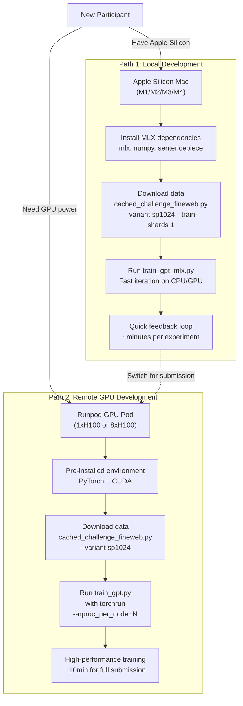
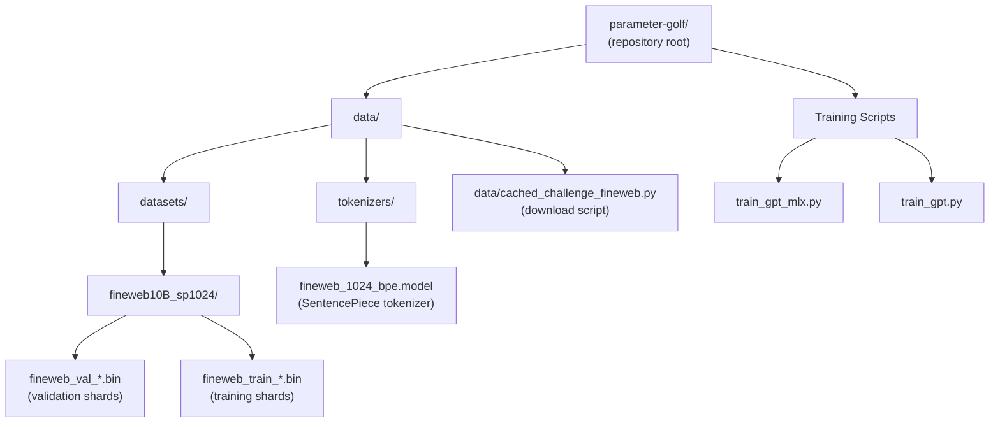
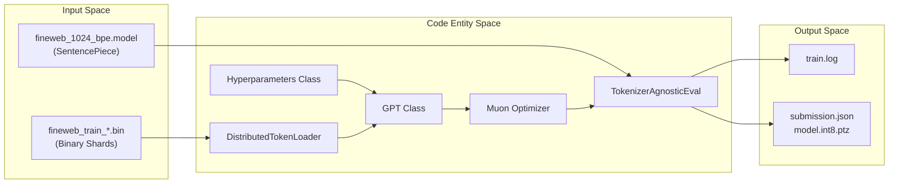

<!-- source: DeepWiki mcp.deepwiki.com · repo openai/parameter-golf · page 2 Getting Started · fetched 2026-10-26 -->

# Getting Started

<details>
<summary>Relevant source files</summary>

The following files were used as context for generating this wiki page:

- [README.md](README.md)
- [data/README.md](data/README.md)
- [data/cached_challenge_fineweb.py](data/cached_challenge_fineweb.py)
- [data/download_hf_docs_and_tokenize.py](data/download_hf_docs_and_tokenize.py)
- [data/tokenizer_specs.json](data/tokenizer_specs.json)
- [records/track_10min_16mb/2026-03-17_LoRA_TTT/README.md](records/track_10min_16mb/2026-03-17_LoRA_TTT/README.md)
- [records/track_10min_16mb/2026-03-17_LoRA_TTT/ablations.png](records/track_10min_16mb/2026-03-17_LoRA_TTT/ablations.png)
- [records/track_10min_16mb/2026-03-17_LoRA_TTT/submission.json](records/track_10min_16mb/2026-03-17_LoRA_TTT/submission.json)
- [records/track_10min_16mb/2026-03-17_LoRA_TTT/train_gpt.py](records/track_10min_16mb/2026-03-17_LoRA_TTT/train_gpt.py)
- [records/track_10min_16mb/2026-03-17_LoRA_TTT/train_v0.txt](records/track_10min_16mb/2026-03-17_LoRA_TTT/train_v0.txt)
- [records/track_10min_16mb/2026-03-17_LoRA_TTT/train_v1.txt](records/track_10min_16mb/2026-03-17_LoRA_TTT/train_v1.txt)
- [records/track_10min_16mb/2026-03-17_LoRA_TTT/train_v2.txt](records/track_10min_16mb/2026-03-17_LoRA_TTT/train_v2.txt)
- [records/track_10min_16mb/2026-03-17_LoRA_TTT/train_v3.txt](records/track_10min_16mb/2026-03-17_LoRA_TTT/train_v3.txt)
- [records/track_10min_16mb/2026-03-17_NaiveBaseline/README.md](records/track_10min_16mb/2026-03-17_NaiveBaseline/README.md)
- [records/track_10min_16mb/2026-03-17_NaiveBaseline/submission.json](records/track_10min_16mb/2026-03-17_NaiveBaseline/submission.json)
- [records/track_10min_16mb/2026-03-17_NaiveBaseline/train.log](records/track_10min_16mb/2026-03-17_NaiveBaseline/train.log)
- [requirements.txt](requirements.txt)
- [train_gpt.py](train_gpt.py)

</details>


This page provides a step-by-step guide for new participants to go from zero to running their first training run in the Parameter Golf challenge. It covers the two main development paths (local Apple Silicon with MLX vs. remote GPU clusters), explains how to download the FineWeb dataset, and shows how to execute your first training script.

For detailed environment setup including prerequisites and dependencies, see [Environment Setup](#2.1). For in-depth data download options and troubleshooting, see [Downloading Data](#2.2). For advanced training configuration and hyperparameter tuning, see [Running Your First Training](#2.3).

## Two Development Paths

Parameter Golf supports two primary development workflows, each optimized for different hardware and iteration speed requirements:



**Path 1 (Local MLX)** is designed for rapid prototyping on Apple Silicon Macs. The `train_gpt_mlx.py` script uses Apple's MLX framework for hardware-accelerated training on the unified memory architecture. This path is ideal for testing architectural changes, debugging, and quick iteration cycles without incurring GPU rental costs [train_gpt.py:2]().

**Path 2 (Remote CUDA)** targets production-quality training on NVIDIA GPUs, specifically the 8xH100 configuration used for official leaderboard submissions [README.md:6](). The `train_gpt.py` script uses PyTorch with distributed training via `torchrun` [records/track_10min_16mb/2026-03-17_LoRA_TTT/README.md:52](). This path is required for final submissions that must meet the 10-minute training constraint [README.md:12]().

**Sources:** [README.md:6-12](), [train_gpt.py:1-5](), [records/track_10min_16mb/2026-03-17_LoRA_TTT/README.md:51-53]()

## File Structure After Setup

After completing the setup process, your local repository will have the following structure:



The `data/datasets/fineweb10B_sp1024/` directory contains binary shards [train_gpt.py:41-43](). The validation split uses a fixed set of the first 50,000 documents from FineWeb [data/download_hf_docs_and_tokenize.py:26](). Training shards are numbered sequentially, and you can download a subset using the `cached_challenge_fineweb.py` script.

**Sources:** [train_gpt.py:41-44](), [data/download_hf_docs_and_tokenize.py:23-30]()

## Quick Start: MLX Path (Apple Silicon)

This workflow gets you from zero to a trained model on Apple Silicon in under 10 minutes.

### Step 1: Clone and Install Dependencies

```bash
git clone https://github.com/openai/parameter-golf.git
cd parameter-golf
python3 -m venv .venv
source .venv/bin/activate
python -m pip install --upgrade pip
pip install -r requirements.txt
```

The requirements file includes `torch`, `numpy`, `sentencepiece`, and other necessary libraries [requirements.txt:1-10]().

### Step 2: Download Data

```bash
python3 data/cached_challenge_fineweb.py --variant sp1024 --train-shards 10
```

This downloads the `sp1024` tokenizer variant (1024-token SentencePiece vocabulary) and training shards for quick iteration.

### Step 3: Run Training

```bash
RUN_ID=mlx_smoke \
ITERATIONS=200 \
python3 train_gpt_mlx.py
```

**Key Environment Variables:**
- `RUN_ID`: Identifier for this training run [train_gpt.py:45]().
- `ITERATIONS`: Number of training steps [train_gpt.py:54]().

The script outputs `val_loss` and `val_bpb` (bits-per-byte) at the end.

**Sources:** [requirements.txt:1-10](), [train_gpt.py:41-59]()

## Quick Start: CUDA Path (Remote GPU)

This workflow demonstrates training on a GPU cluster, required for official leaderboard submissions.

### Step 1: Launch Environment

Deploy a pod or instance with PyTorch and CUDA support. OpenAI provides compute grants for participants [README.md:14]().

### Step 2: Clone Repository

```bash
git clone https://github.com/openai/parameter-golf.git
cd parameter-golf
pip install -r requirements.txt
```

### Step 3: Download Data

```bash
python3 data/cached_challenge_fineweb.py --variant sp1024
```

### Step 4: Run Training

```bash
torchrun --standalone --nproc_per_node=8 train_gpt.py
```

Official record submissions use `torchrun` with 8 processes on 8xH100 GPUs [records/track_10min_16mb/2026-03-17_LoRA_TTT/README.md:52]().

**Sources:** [README.md:14](), [records/track_10min_16mb/2026-03-17_LoRA_TTT/README.md:51-53]()

## Training Workflow and Outputs

The following diagram shows the execution flow when running the training script:



**Artifact Files:**

| File | Description |
|--------------|-------------|
| `train_gpt.py` | The training script used for the run [records/track_10min_16mb/2026-03-17_LoRA_TTT/README.md:57]() |
| `submission.json` | Metadata including author, score, and model size [records/track_10min_16mb/2026-03-17_LoRA_TTT/submission.json:1-11]() |
| `train.log` | Log of the training progress and final validation metrics |

The final model artifact must be exactly 16,000,000 bytes or less [README.md:6]().

**Sources:** [train_gpt.py:39-88](), [records/track_10min_16mb/2026-03-17_LoRA_TTT/submission.json:1-11]()

## Key Configuration Parameters

Training scripts use the `Hyperparameters` class to manage configuration via environment variables [train_gpt.py:39]().

| Variable | Default | Description |
|----------|---------|-------------|
| `VOCAB_SIZE` | `1024` | Vocabulary size of the tokenizer [train_gpt.py:63]() |
| `NUM_LAYERS` | `9` | Number of transformer blocks [train_gpt.py:64]() |
| `MODEL_DIM` | `512` | Hidden dimension of the model [train_gpt.py:66]() |
| `MAX_WALLCLOCK_SECONDS` | `600.0` | 10-minute limit for record track [train_gpt.py:59]() |
| `TRAIN_BATCH_TOKENS` | `524,288` | Global batch size in tokens [train_gpt.py:57]() |

**Sources:** [train_gpt.py:39-88]()

## Validation Metrics Explained

The challenge evaluates models using **Bits-Per-Byte (bpb)** on the FineWeb validation set [README.md:6]().

- **Tokenizer-Agnostic**: Unlike raw cross-entropy loss, bpb allows comparison between models using different tokenizers [README.md:6]().
- **Calculation**: It is calculated from cross-entropy loss by normalizing against the actual byte length of the original text.
- **Goal**: Lower bpb indicates better compression and a better language model.

The `train_gpt.py` script includes a `TokenizerAgnosticEval` setup to handle this calculation [train_gpt.py:172]().

**Sources:** [README.md:6-10](), [train_gpt.py:172-175]()

---

