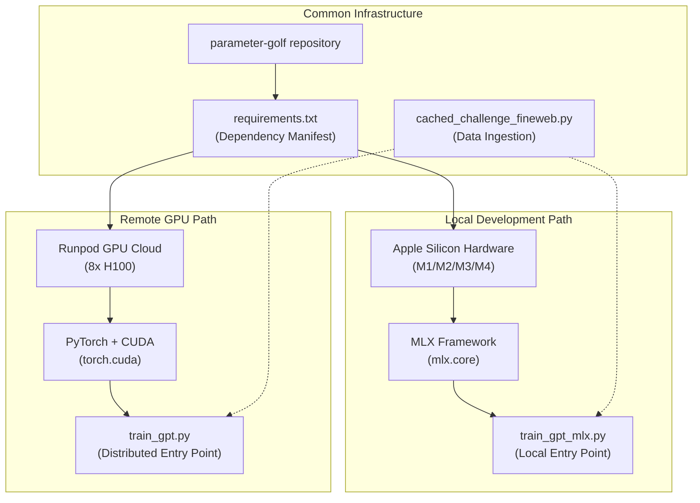
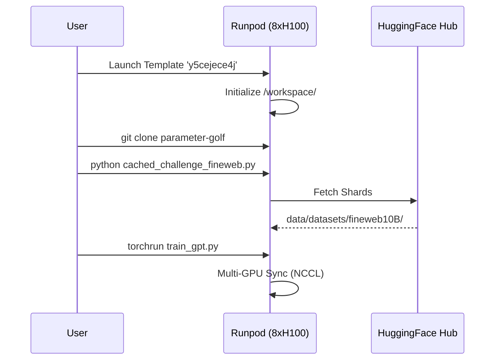

<!-- source: DeepWiki mcp.deepwiki.com · repo openai/parameter-golf · page 2.1 Environment Setup · fetched 2026-10-26 -->

# Environment Setup

<details>
<summary>Relevant source files</summary>

The following files were used as context for generating this wiki page:

- [.gitignore](.gitignore)
- [LICENSE](LICENSE)
- [README.md](README.md)
- [THIRD_PARTY_NOTICES.md](THIRD_PARTY_NOTICES.md)
- [requirements.txt](requirements.txt)

</details>


This page documents the prerequisites and installation steps required to begin training models for the Parameter Golf challenge. It covers two primary development paths: local iteration on Apple Silicon hardware using MLX, and remote training on NVIDIA GPUs using CUDA.

## Overview of Development Paths

The Parameter Golf challenge supports two distinct hardware and software stacks, each optimized for different workflows. The repository provides separate entry points for these environments: `train_gpt.py` for CUDA-based training and `train_gpt_mlx.py` for Apple Silicon.

### Hardware and Software Stack Association

The following diagram bridges the high-level development paths to the specific code entities and infrastructure used in the repository.

**Diagram: Development Path to Code Entity Mapping**

**Sources**: [README.md:6-12](), [README.md:43-126](), [requirements.txt:1-10]()

## Prerequisites

### Python Version
The codebase is designed for modern Python environments. The CUDA path is tested with Python 3.10+, while the MLX path works with Python 3.9+.

### Hardware Recommendations
The challenge centers on a 10-minute training constraint on specific hardware.

| Hardware | Use Case | Training Speed |
|----------|----------|----------------|
| **Apple Silicon (M-series)** | Local iteration, architecture prototyping | ~10-20x slower than H100 |
| **1x NVIDIA H100** | Medium-scale experiments | ~10x slower than 8xH100 |
| **8x NVIDIA H100** | **Leaderboard submissions**, record runs | Target: <10 minutes |

**Sources**: [README.md:6-12](), [README.md:43-126]()

## Dependency Installation

The `requirements.txt` file defines the core dependencies for the project. Note that some packages are specific to the CUDA environment.

| Package | Version | Purpose |
|---------|---------|---------|
| `torch` | Latest | Primary DL framework for CUDA path |
| `mlx` | Latest | Framework for Apple Silicon (manual install) |
| `numpy` | Latest | Array operations and data loading |
| `huggingface-hub` | Latest | Dataset and model downloading |
| `tiktoken` | Latest | BPE tokenization (OpenAI) |
| `sentencepiece` | Latest | Tokenization for `sp1024` variant |
| `kernels` | Latest | Custom CUDA kernels (CUDA path only) |
| `typing-extensions`| `4.15.0`| Type hinting compatibility |

**Sources**: [requirements.txt:1-10]()

## MLX Path: Apple Silicon Setup

For developers using MacBooks or Mac Studios with M-series chips, `train_gpt_mlx.py` provides a native implementation.

### 1. Repository and Environment
```bash
git clone https://github.com/openai/parameter-golf.git
cd parameter-golf
python3 -m venv .venv
source .venv/bin/activate
```

### 2. Install Dependencies
```bash
pip install mlx numpy sentencepiece huggingface-hub datasets tqdm tiktoken
```

### 3. Verification
Verify that MLX can access the Metal GPU:
```bash
python3 -c "import mlx.core as mx; print(f'MLX available: {mx.metal.is_available()}')"
```

**Sources**: [README.md:49-67](), [requirements.txt:1-10]()

## CUDA Path: Remote GPU Setup (Runpod)

Leaderboard submissions are strictly evaluated on 8xH100 instances. Runpod is the recommended provider for these resources.

### Runpod Provisioning Flow
The following diagram illustrates the interaction between the user, the Runpod environment, and the repository scripts.

**Diagram: Runpod Environment Data Flow**


### Setup Steps
1. **Launch Pod**: Use the official Parameter Golf template `y5cejece4j` on [Runpod](https://console.runpod.io/deploy).
2. **Clone Repo**:
   ```bash
   cd /workspace
   git clone https://github.com/openai/parameter-golf.git
   cd parameter-golf
   ```
3. **Verify CUDA**:
   ```bash
   python3 -c "import torch; print(f'GPUs: {torch.cuda.device_count()}')"
   ```
   For a standard record run, this should return `8`.

**Sources**: [README.md:88-122]()

## Common Post-Setup Steps

Once the environment is ready, you must populate the data directory before training.

1. **Download Data**: Use `cached_challenge_fineweb.py` to fetch the tokenized FineWeb shards. This script populates `data/datasets/` and `data/tokenizers/`.
2. **Check Licensing**: Note that parts of the repository are adapted from `modded-nanogpt` under the MIT License.

**Sources**: [README.md:71-86](), [THIRD_PARTY_NOTICES.md:1-29](), [LICENSE:1-21]()

---

