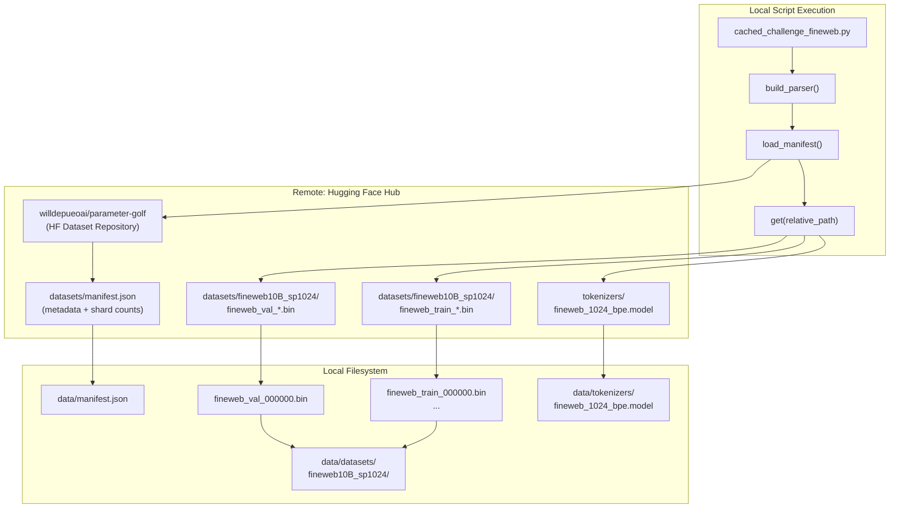
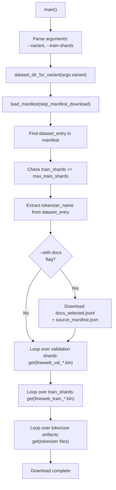
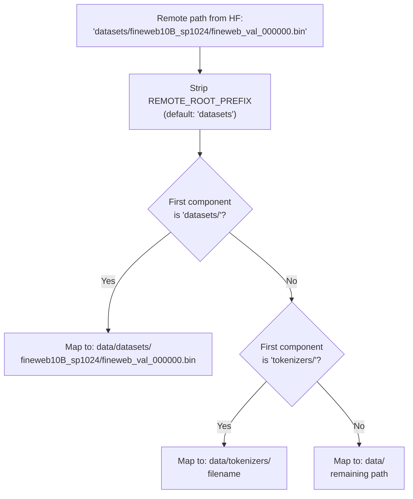
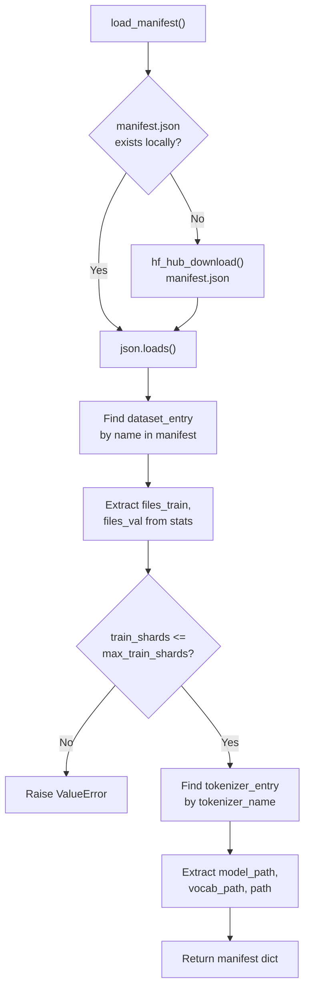
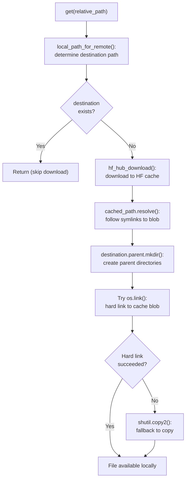

<!-- source: DeepWiki mcp.deepwiki.com · repo openai/parameter-golf · page 2.2 Downloading Data · fetched 2026-10-26 -->

# Downloading Data

<details>
<summary>Relevant source files</summary>

The following files were used as context for generating this wiki page:

- [README.md](README.md)
- [data/README.md](data/README.md)
- [data/cached_challenge_fineweb.py](data/cached_challenge_fineweb.py)
- [data/download_hf_docs_and_tokenize.py](data/download_hf_docs_and_tokenize.py)
- [data/tokenizer_specs.json](data/tokenizer_specs.json)
- [records/track_10min_16mb/2026-03-17_NaiveBaseline/README.md](records/track_10min_16mb/2026-03-17_NaiveBaseline/README.md)
- [records/track_10min_16mb/2026-03-17_NaiveBaseline/submission.json](records/track_10min_16mb/2026-03-17_NaiveBaseline/submission.json)
- [records/track_10min_16mb/2026-03-17_NaiveBaseline/train.log](records/track_10min_16mb/2026-03-17_NaiveBaseline/train.log)
- [requirements.txt](requirements.txt)

</details>


## Purpose and Scope

This page explains how to download the FineWeb dataset and tokenizers using the `cached_challenge_fineweb.py` script. This is typically the second step after environment setup when starting with Parameter Golf.

For custom data exports and tokenizer retraining, see [Custom Data Export and Tokenization](). For detailed documentation of data formats, see [Data and Tokenizer Formats](). For an overview of the FineWeb dataset itself, see [FineWeb Dataset Overview]().

**Sources:** [README.md:42-127](), [data/README.md:1-67]()

## Quick Start

After setting up your environment (see [Environment Setup]()), download the FineWeb dataset with:

```bash
python3 data/cached_challenge_fineweb.py --variant sp1024 --train-shards 80
```

This downloads:
- The full validation split (fixed 50k documents) [data/download_hf_docs_and_tokenize.py:26-26]()
- 80 training shards (~8 billion tokens) [data/README.md:21-21]()
- The `sp1024` tokenizer artifacts [data/README.md:20-20]()

For faster iteration on limited hardware, reduce the number of training shards:

```bash
python3 data/cached_challenge_fineweb.py --variant sp1024 --train-shards 10
```

**Sources:** [README.md:60-67](), [README.md:104-110](), [data/README.md:14-21]()

## Download Architecture

### High-Level Flow



**Sources:** [data/cached_challenge_fineweb.py:1-158](), [data/README.md:12-40]()

### Script Execution Flow



**Sources:** [data/cached_challenge_fineweb.py:120-157]()

## Command-Line Arguments

| Argument | Type | Default | Description |
|----------|------|---------|-------------|
| `--variant` | string | `"sp1024"` | Tokenizer family to download. Options: `sp1024`, `sp4096`, `byte260`, etc. [data/cached_challenge_fineweb.py:103-106]() |
| `--train-shards` | int | `80` | Number of training shards to download. Each shard contains 100M tokens. [data/cached_challenge_fineweb.py:97-101]() |
| `--skip-manifest` | flag | `False` | Skip downloading `manifest.json`. Only use if manifest is already present locally. [data/cached_challenge_fineweb.py:108-111]() |
| `--with-docs` | flag | `False` | Also download `docs_selected.jsonl` and verification manifest for custom tokenizer retraining. [data/cached_challenge_fineweb.py:113-116]() |

The script also accepts a positional argument for `train_shards` (for backward compatibility), but `--train-shards` is preferred. [data/cached_challenge_fineweb.py:89-95]()

**Sources:** [data/cached_challenge_fineweb.py:87-117]()

### Variant Selection

The `--variant` argument determines which tokenizer and corresponding dataset to download. The `dataset_dir_for_variant()` function maps variant names to dataset directories:

| Variant | Dataset Directory | Vocabulary Size | Type |
|---------|------------------|-----------------|------|
| `sp1024` | `fineweb10B_sp1024` | 1024 tokens | SentencePiece BPE |
| `sp4096` | `fineweb10B_sp4096` | 4096 tokens | SentencePiece BPE |
| `byte260` | `fineweb10B_byte260` | 260 bytes | Byte-level encoding |

**Sources:** [data/cached_challenge_fineweb.py:16-21](), [data/tokenizer_specs.json:1-9]()

### Shard Count Strategy

Each training shard contains exactly 100,000,000 tokens. The table below shows common configurations:

| `--train-shards` | Total Training Tokens | Approx Download Size | Use Case |
|------------------|----------------------|---------------------|----------|
| 1 | 100M | ~50 MB | Quick smoke tests |
| 10 | 1B | ~500 MB | Local iteration on Apple Silicon |
| 80 | 8B | ~4 GB | Default baseline (full 8B dataset) |
| 100 | 10B | ~5 GB | Full 10B dataset |

The validation split is always downloaded in full (all `fineweb_val_*.bin` files) regardless of `--train-shards`. [data/cached_challenge_fineweb.py:147-148]()

**Sources:** [data/README.md:29-38](), [README.md:60-67](), [data/cached_challenge_fineweb.py:147-150]()

## Local Data Layout

After running the download script, your local filesystem will have this structure:

```
data/
├── manifest.json                          # Dataset and tokenizer metadata
├── datasets/
│   └── fineweb10B_sp1024/                # Dataset directory (variant-specific)
│       ├── fineweb_val_000000.bin        # Validation split (fixed 50k docs)
│       ├── fineweb_train_000000.bin      # Training shard 0
│       ├── fineweb_train_000001.bin      # Training shard 1
│       └── ...                            # Additional training shards
└── tokenizers/
    └── fineweb_1024_bpe.model            # SentencePiece model for sp1024
```

If you specified `--with-docs`, additional files are downloaded:

```
data/
├── docs_selected.jsonl                    # Canonical document set (for retraining)
└── docs_selected.source_manifest.json     # SHA256 verification manifest
```

**Sources:** [data/README.md:5-10](), [README.md:66](), [data/cached_challenge_fineweb.py:142-144]()

### Path Resolution Logic

The `local_path_for_remote()` function maps remote Hugging Face paths to local filesystem paths:



**Sources:** [data/cached_challenge_fineweb.py:24-32]()

## Manifest-Driven Downloads

The script uses `manifest.json` to validate shard counts and locate tokenizer artifacts. This enables safe prefix downloads: you can download exactly N training shards from a larger published dataset without downloading the entire export.

### Manifest Structure (Relevant Fields)

```json
{
  "datasets": [
    {
      "name": "fineweb10B_sp1024",
      "tokenizer_name": "fineweb_1024_bpe",
      "stats": {
        "files_train": 100,
        "files_val": 1
      }
    }
  ],
  "tokenizers": [
    {
      "name": "fineweb_1024_bpe",
      "model_path": "tokenizers/fineweb_1024_bpe.model",
      "vocab_size": 1024
    }
  ]
}
```

The script validates your `--train-shards` request against `stats.files_train` to prevent requesting non-existent shards. [data/cached_challenge_fineweb.py:131-136]()

**Sources:** [data/cached_challenge_fineweb.py:65-73](), [data/cached_challenge_fineweb.py:127-140]()

### Manifest Lookup Flow



**Sources:** [data/cached_challenge_fineweb.py:65-73](), [data/cached_challenge_fineweb.py:127-140]()

## Environment Variables

Two environment variables control remote repository access:

| Variable | Default | Description |
|----------|---------|-------------|
| `MATCHED_FINEWEB_REPO_ID` | `"willdepueoai/parameter-golf"` | Hugging Face dataset repository ID [data/cached_challenge_fineweb.py:10-10]() |
| `MATCHED_FINEWEB_REMOTE_ROOT_PREFIX` | `"datasets"` | Subdirectory path within the repository where datasets are stored [data/cached_challenge_fineweb.py:11-11]() |

These are useful for downloading from custom exports on Hugging Face Hub:

```bash
MATCHED_FINEWEB_REPO_ID=your-hf-username/your-dataset-repo \
MATCHED_FINEWEB_REMOTE_ROOT_PREFIX=your_50B_export_root \
python3 data/cached_challenge_fineweb.py --variant sp1024 --train-shards 100
```

**Sources:** [data/cached_challenge_fineweb.py:10-11](), [data/README.md:31-35]()

## Download Mechanism

### File Download with Hard-Linking

The `get()` function handles individual file downloads with an optimization for disk space:



**Key optimization:** The script attempts to hard-link files from the Hugging Face cache to `data/` instead of copying. [data/cached_challenge_fineweb.py:55-58]() This saves disk space when both the cache and data directory are on the same filesystem.

**Sources:** [data/cached_challenge_fineweb.py:35-58]()

### Tokenizer Artifact Resolution

The `artifact_paths_for_tokenizer()` function extracts downloadable paths from tokenizer manifest entries [data/cached_challenge_fineweb.py:76-84]():

The function checks for these keys in order:
1. `model_path` - SentencePiece model file
2. `vocab_path` - Vocabulary file (for non-SP tokenizers)
3. `path` - Generic tokenizer file path

At least one must be present for the tokenizer to be valid.

**Sources:** [data/cached_challenge_fineweb.py:76-84](), [data/cached_challenge_fineweb.py:152-153]()

## Complete Download Example

Here's the full sequence for downloading the `sp1024` variant with 10 training shards:

```bash
# Download from default repository
python3 data/cached_challenge_fineweb.py --variant sp1024 --train-shards 10

# Expected output structure:
# data/
# ├── manifest.json                      (downloaded first)
# ├── datasets/
# │   └── fineweb10B_sp1024/
# │       ├── fineweb_val_000000.bin     (validation: always full)
# │       ├── fineweb_train_000000.bin   (training: shards 0-9)
# │       ├── fineweb_train_000001.bin
# │       └── ... (8 more training shards)
# └── tokenizers/
#     └── fineweb_1024_bpe.model         (tokenizer artifact)
```

The script will:
1. Download `manifest.json` if not present [data/cached_challenge_fineweb.py:72-72]()
2. Validate that `sp1024` dataset exists in manifest [data/cached_challenge_fineweb.py:128-130]()
3. Validate that 10 <= max training shards for `sp1024` [data/cached_challenge_fineweb.py:133-136]()
4. Download all validation shards [data/cached_challenge_fineweb.py:147-148]()
5. Download training shards 0-9 [data/cached_challenge_fineweb.py:149-150]()
6. Download tokenizer artifacts for `fineweb_1024_bpe` [data/cached_challenge_fineweb.py:152-153]()

**Sources:** [data/cached_challenge_fineweb.py:120-157](), [README.md:60-67]()

## Troubleshooting

### Common Issues

| Issue | Cause | Solution |
|-------|-------|----------|
| `FileNotFoundError: manifest.json is required` | `--skip-manifest` used but manifest not present locally | Remove `--skip-manifest` flag or manually download manifest first [data/cached_challenge_fineweb.py:69-71]() |
| `ValueError: dataset fineweb10B_spXXXX not found` | Invalid `--variant` specified | Use valid variant: `sp1024`, `sp4096`, or `byte260` [data/cached_challenge_fineweb.py:129-130]() |
| `ValueError: ... only has N training shards, requested M` | Requested more shards than available | Reduce `--train-shards` to N or less [data/cached_challenge_fineweb.py:133-136]() |
| `OSError` during hard-linking | Cross-filesystem link attempted | Script automatically falls back to `shutil.copy2()` [data/cached_challenge_fineweb.py:57-58]() |

**Sources:** [data/cached_challenge_fineweb.py:69-71](), [data/cached_challenge_fineweb.py:124-136](), [data/cached_challenge_fineweb.py:57-58]()

## Next Steps

After downloading the data:
1. Verify the local data structure exists in `data/datasets/` and `data/tokenizers/` [data/README.md:5-10]()
2. Proceed to [Running Your First Training]() to train a model with the downloaded dataset
3. For custom tokenizers or data exports, see [Custom Data Export and Tokenization]()

**Sources:** [README.md:60-127](), [data/README.md:5-10]()

---

