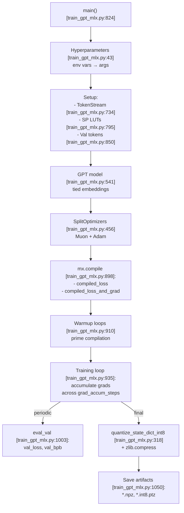
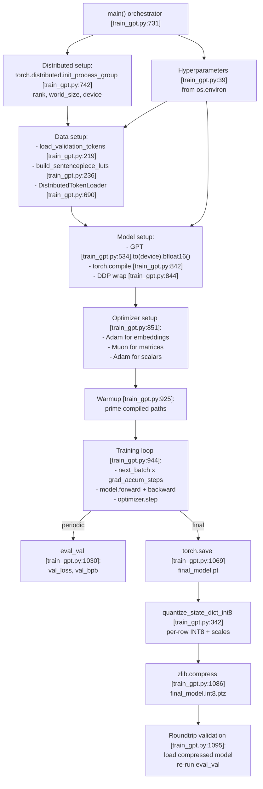
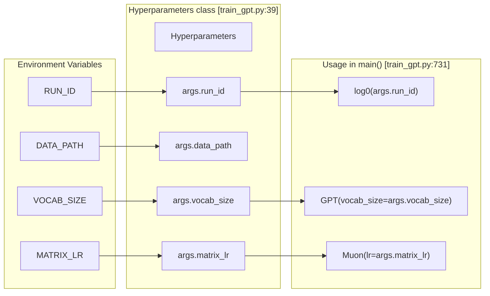

<!-- source: DeepWiki mcp.deepwiki.com · repo openai/parameter-golf · page 2.3 Running Your First Training · fetched 2026-10-26 -->

# Running Your First Training

<details>
<summary>Relevant source files</summary>

The following files were used as context for generating this wiki page:

- [records/track_10min_16mb/2026-03-17_LoRA_TTT/README.md](records/track_10min_16mb/2026-03-17_LoRA_TTT/README.md)
- [records/track_10min_16mb/2026-03-17_LoRA_TTT/ablations.png](records/track_10min_16mb/2026-03-17_LoRA_TTT/ablations.png)
- [records/track_10min_16mb/2026-03-17_LoRA_TTT/submission.json](records/track_10min_16mb/2026-03-17_LoRA_TTT/submission.json)
- [records/track_10min_16mb/2026-03-17_LoRA_TTT/train_gpt.py](records/track_10min_16mb/2026-03-17_LoRA_TTT/train_gpt.py)
- [records/track_10min_16mb/2026-03-17_LoRA_TTT/train_v0.txt](records/track_10min_16mb/2026-03-17_LoRA_TTT/train_v0.txt)
- [records/track_10min_16mb/2026-03-17_LoRA_TTT/train_v1.txt](records/track_10min_16mb/2026-03-17_LoRA_TTT/train_v1.txt)
- [records/track_10min_16mb/2026-03-17_LoRA_TTT/train_v2.txt](records/track_10min_16mb/2026-03-17_LoRA_TTT/train_v2.txt)
- [records/track_10min_16mb/2026-03-17_LoRA_TTT/train_v3.txt](records/track_10min_16mb/2026-03-17_LoRA_TTT/train_v3.txt)
- [records/track_10min_16mb/2026-03-17_NaiveBaseline/train_gpt.py](records/track_10min_16mb/2026-03-17_NaiveBaseline/train_gpt.py)
- [train_gpt.py](train_gpt.py)
- [train_gpt_mlx.py](train_gpt_mlx.py)

</details>


This page provides concrete examples of executing your first training run, either locally on Apple Silicon using MLX or on remote GPUs using CUDA. It assumes you have completed environment setup and downloaded the FineWeb dataset.

For detailed information about the training system architecture, model components, and optimization techniques, see the dedicated architecture documentation.

---

## Local Training with MLX (Apple Silicon)

The `train_gpt_mlx.py` script enables fast iteration on local Apple Silicon hardware. This is the recommended starting point for experimenting with configurations before scaling to cloud GPUs.

### Minimal Smoke Test

After downloading data with `--train-shards 10` (or even `--train-shards 1` for faster iteration), run a minimal training job using environment variables to override the defaults defined in the `Hyperparameters` class [train_gpt_mlx.py:43-98]().

```bash
RUN_ID=mlx_smoke \
ITERATIONS=200 \
TRAIN_BATCH_TOKENS=8192 \
VAL_LOSS_EVERY=0 \
VAL_BATCH_SIZE=8192 \
python3 train_gpt_mlx.py
```

This configuration:
- Runs 200 training iterations (much shorter than the default 20,000) [train_gpt_mlx.py:51]().
- Uses a small batch size (8,192 tokens vs. the default 524,288) [train_gpt_mlx.py:56]().
- Skips periodic validation (`VAL_LOSS_EVERY=0`) and only evaluates at the end [train_gpt_mlx.py:52]().
- Completes in a few minutes on M1/M2/M3 hardware.

**Sources:** [train_gpt_mlx.py:43-98]()

### Expected Output

The script will:
1. Log configuration details to `logs/<RUN_ID>.txt` [train_gpt_mlx.py:832-838]().
2. Print training loss every 200 steps (controlled by `TRAIN_LOG_EVERY`) [train_gpt_mlx.py:55]().
3. Evaluate validation metrics at the end [train_gpt_mlx.py:1003-1015]().
4. Save model artifacts:
   - `logs/<RUN_ID>_mlx_model.npz` (raw model via `mx.savez`) [train_gpt_mlx.py:1050-1053]().
   - `logs/<RUN_ID>_mlx_model.int8.ptz` (quantized + zlib compressed) [train_gpt_mlx.py:1055-1067]().

Terminal output example:
```
step:200/200 train_loss:3.2145 train_time:180000ms step_avg:900.00ms tok_s:9102
step:200/200 val_loss:2.9534 val_bpb:1.4521 train_time:182000ms step_avg:910.00ms
final_int8_zlib_roundtrip val_loss:2.9621 val_bpb:1.4562 eval_time:3200ms
```

**Sources:** [train_gpt_mlx.py:832-838](), [train_gpt_mlx.py:1003-1084]()

### MLX Execution Flow

The MLX implementation uses `mx.compile` to optimize the loss and gradient computation graphs [train_gpt_mlx.py:898-904](). It also includes logic to manage peak memory on 16GB machines via `mlx_max_microbatch_tokens` and `mlx_eager_eval` [train_gpt_mlx.py:61-65]().



**Sources:** [train_gpt_mlx.py:43-1088]()

---

## Remote Training with CUDA (Scaling Up)

Once you're satisfied with local experiments, switch to `train_gpt.py` on remote GPUs for full-scale training. The baseline configuration targets 8xH100 GPUs but works on any CUDA device.

### Single GPU Example (1xH100)

On a remote machine with the repository cloned and data downloaded:

```bash
RUN_ID=baseline_sp1024 \
DATA_PATH=./data/datasets/fineweb10B_sp1024/ \
TOKENIZER_PATH=./data/tokenizers/fineweb_1024_bpe.model \
VOCAB_SIZE=1024 \
torchrun --standalone --nproc_per_node=1 train_gpt.py
```

Key parameters from `Hyperparameters` [train_gpt.py:39-88]():
- `torchrun --nproc_per_node=1`: Single GPU execution.
- `DATA_PATH`: Points to downloaded dataset directory [train_gpt.py:41]().
- `TOKENIZER_PATH`: SentencePiece model file [train_gpt.py:44]().
- `VOCAB_SIZE`: Must match tokenizer vocabulary size [train_gpt.py:63]().

The script enforces a ~10 minute training cap by default (`MAX_WALLCLOCK_SECONDS=600.0`) [train_gpt.py:59]().

**Sources:** [train_gpt.py:39-88]()

### Multi-GPU Example (8xH100)

For final submissions or large-scale experiments:

```bash
RUN_ID=baseline_sp1024_8gpu \
DATA_PATH=./data/datasets/fineweb10B_sp1024/ \
TOKENIZER_PATH=./data/tokenizers/fineweb_1024_bpe.model \
VOCAB_SIZE=1024 \
torchrun --standalone --nproc_per_node=8 train_gpt.py
```

The training script automatically:
- Distributes data loading across ranks via `DistributedTokenLoader` [train_gpt.py:742-758]().
- Wraps the model in `DistributedDataParallel` (DDP) [train_gpt.py:844]().
- Adjusts gradient accumulation steps to maintain effective batch size [train_gpt.py:754-758]().

**Sources:** [train_gpt.py:731-1126]()

### CUDA Training Pipeline

The CUDA pipeline utilizes `torch.compile` for kernel fusion and the `Muon` optimizer for matrix-shaped parameters [train_gpt.py:96-168]().



**Sources:** [train_gpt.py:39-1126]()

---

## Key Environment Variables

The training scripts use environment variables for configuration rather than command-line arguments. This enables reproducibility by capturing the exact configuration in log files.

### Essential Configuration

| Variable | Default | Purpose |
|----------|---------|---------|
| `RUN_ID` | UUID | Identifies this run; determines log filename [train_gpt.py:45]() |
| `DATA_PATH` | `./data/datasets/fineweb10B_sp1024` | Directory containing binary shards [train_gpt.py:41]() |
| `TOKENIZER_PATH` | `./data/tokenizers/fineweb_1024_bpe.model` | SentencePiece model file [train_gpt.py:44]() |
| `VOCAB_SIZE` | `1024` | Vocabulary size; must match tokenizer [train_gpt.py:63]() |
| `SEED` | `1337` | Random seed for reproducibility [train_gpt.py:46]() |

### Model Architecture

| Variable | Default | Description |
|----------|---------|-------------|
| `NUM_LAYERS` | `9` | Total transformer blocks [train_gpt.py:64]() |
| `MODEL_DIM` | `512` | Hidden dimension width [train_gpt.py:66]() |
| `NUM_HEADS` | `8` | Number of attention heads [train_gpt.py:67]() |
| `NUM_KV_HEADS` | `4` | Number of key/value heads (GQA) [train_gpt.py:65]() |
| `MLP_MULT` | `2` | MLP expansion factor [train_gpt.py:68]() |
| `TIE_EMBEDDINGS` | `1` | Use tied embeddings (1=yes, 0=no) [train_gpt.py:69]() |

### Training Loop Control

| Variable | Default | Purpose |
|----------|---------|---------|
| `ITERATIONS` | `20000` | Maximum training steps [train_gpt.py:54]() |
| `TRAIN_BATCH_TOKENS` | `524288` | Global batch size in tokens [train_gpt.py:57]() |
| `MAX_WALLCLOCK_SECONDS` | `600.0` | Training time cap [train_gpt.py:59]() |
| `VAL_LOSS_EVERY` | `1000` | Validation frequency [train_gpt.py:50]() |
| `WARMDOWN_ITERS` | `1200` | LR warmdown window [train_gpt.py:55]() |

**Sources:** [train_gpt.py:39-88](), [train_gpt_mlx.py:43-98]()

---

## Understanding Training Outputs

### Validation BPB Metric

The script reports `val_bpb` (Bits-per-byte), the primary scoring metric. It is calculated in `eval_val` [train_gpt.py:1030-1065]() by comparing the model's negative log-likelihood (nats) against the raw byte count of the validation set [train_gpt.py:180-204]().

1. **`val_loss`**: Cross-entropy loss in nats.
2. **`val_bpb`**: `(total_nats / log(2)) / total_bytes`.

This metric is tokenizer-agnostic because it normalizes by the actual byte length of the UTF-8 source text [train_gpt.py:199-204]().

**Sources:** [train_gpt.py:180-204](), [train_gpt.py:1030-1065]()

### Post-Training Artifacts

After training, the script generates:
- **`final_model.pt`**: Full precision state dict [train_gpt.py:1069]().
- **`final_model.int8.ptz`**: Submission artifact [train_gpt.py:1086]().

The quantization process `quantize_state_dict_int8` [train_gpt.py:342-388]() converts 2D weights to INT8 with per-row scales, while keeping sensitive control tensors in higher precision based on `CONTROL_TENSOR_NAME_PATTERNS` [train_gpt.py:330-340]().



**Sources:** [train_gpt.py:39-168](), [train_gpt.py:342-422](), [train_gpt.py:1069-1120]()

---

