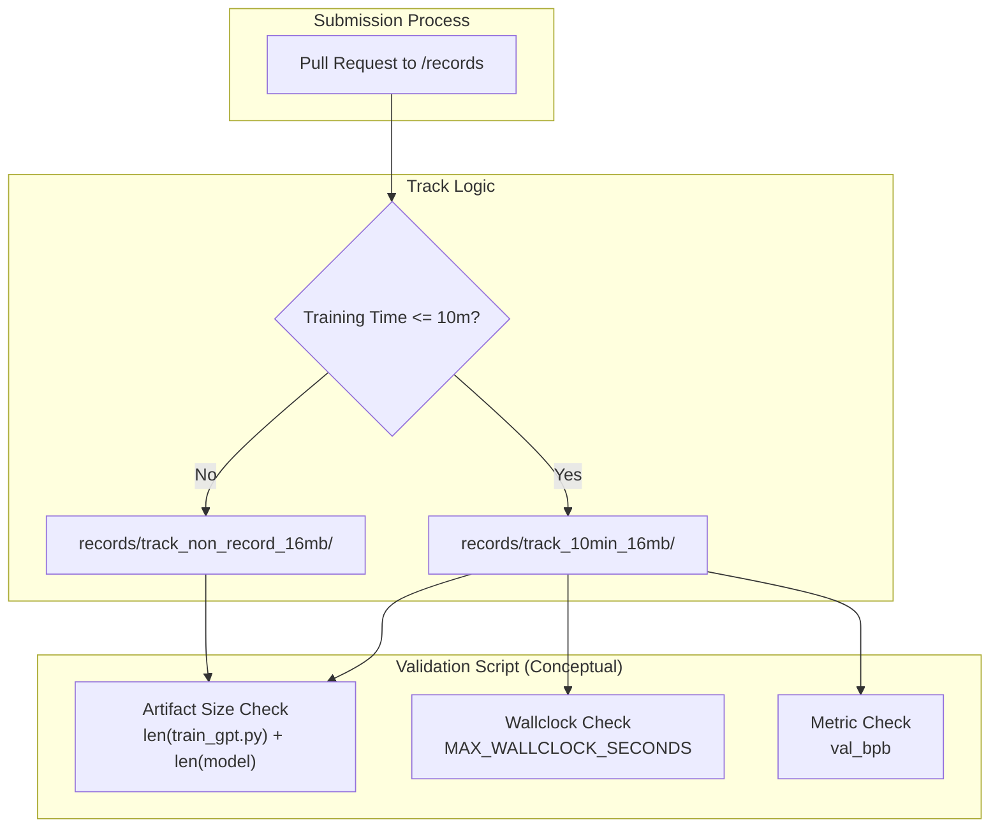
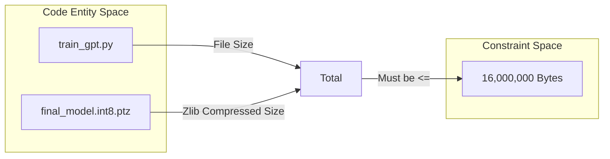

<!-- source: DeepWiki mcp.deepwiki.com · repo openai/parameter-golf · page 3 Challenge Rules and Submission · fetched 2026-10-26 -->

# Challenge Rules and Submission

Relevant source files

The following files were used as context for generating this wiki page:

- [README.md](README.md)
- [requirements.txt](requirements.txt)

This page provides comprehensive documentation of the Parameter Golf challenge rules, constraints, and submission process. It covers the hard limits that all submissions must meet, the two submission tracks (record vs. non-record), and the multi-stage validation funnel that entries pass through before acceptance.

For detailed information on specific constraints (16MB artifact limit, 10-minute training cap), see [Constraints and Requirements](#3.1). For the evaluation metric calculation and bits-per-byte measurement, see [Evaluation Metrics](#3.2). For step-by-step submission instructions and required files, see [Submission Guidelines](#3.3). For understanding when to use each track, see [Tracks: Record vs Non-Record](#3.4).

## Challenge Objective

The **OpenAI Model Craft Challenge: Parameter Golf** tasks participants with training the best language model under strict dual constraints:

1.  **Artifact size**: The combined code and compressed model must fit within exactly 16,000,000 bytes.
2.  **Training time**: For leaderboard records, training must complete within 10 minutes on 8xH100 GPUs.

Models are evaluated by **bits-per-byte** (`val_bpb`) on the FineWeb validation set. This metric is tokenizer-agnostic, treating the problem as a pure compression task. The challenge encourages exploration of unique architectures (test-time compute, aggressive parameter tying, depth recurrence) and compression schemes (low precision, QAT, bitnets).

**Sources:** [README.md:6-12]()

## The Two-Track System

The challenge maintains two distinct submission tracks to balance accessibility with frontier research.

| Track | Path | Time Limit | Artifact Limit | Acceptance Criteria |
| :--- | :--- | :--- | :--- | :--- |
| **Record Track** | `records/track_10min_16mb/` | ≤ 10 mins (8xH100) | ≤ 16,000,000 bytes | Must beat SOTA by ≥0.005 nats with p<0.01 significance |
| **Non-Record Track** | `records/track_non_record_16mb/` | Unlimited | ≤ 16,000,000 bytes | Novel approach, well-documented, runs successfully |

### Track Logic and Code Association

**Diagram 1: Track selection and associated validation constraints.**

**Sources:** [README.md:12-13](), [README.md:169-175]()

## Artifact Composition and Constraints

The 16MB limit is a hard constraint on the total size of the submission. The artifact size is calculated as the sum of the training script and the compressed model weights.

### Size Accounting

**Diagram 2: Association between code artifacts and the 16MB constraint.**

*   **Code**: All training logic, model definitions, and custom tokenizers must reside in `train_gpt.py`.
*   **Weights**: Typically stored as an INT8-quantized, `zlib` (level 9) compressed file (e.g., `final_model.int8.ptz`).
*   **Exclusions**: Documentation (`README.md`), metadata (`submission.json`), and logs (`train.log`) do not count toward the 16MB limit.
*   **Runtime**: No external downloads are permitted during evaluation. The model must be fully self-contained.

**Sources:** [README.md:131-136]()

## Required Submission Files

Every submission must include exactly these four files in its designated folder within the `records/` directory:

1.  `README.md`: Detailed explanation of the architecture, hyperparameters, and training techniques.
2.  `submission.json`: Machine-readable metadata including `name`, `github_id`, `val_bpb`, and `artifact_size`.
3.  `train.log`: The full output log from the training run.
4.  `train_gpt.py`: The complete, self-contained training script.

**Sources:** [README.md:159-168]()

## Evaluation Metrics

The primary ranking metric is **bits-per-byte** (`val_bpb`). This is derived from the cross-entropy loss (nats) on the FineWeb validation set.

*   **Tokenizer Agnostic**: By converting loss to bits-per-byte, different tokenizers (e.g., GPT-2, SentencePiece, or custom byte-level schemes) can be compared fairly.
*   **Calculation**: `val_bpb = (loss_in_nats / ln(2)) / (bytes_per_token)`.
*   **Improvement Threshold**: To claim a new Record Track SOTA, a submission must improve upon the previous record by at least **0.005 nats** with a statistical significance of **p < 0.01**.

**Sources:** [README.md:6](), [README.md:151-157]()

## Validation Process

Submissions undergo a multi-stage validation funnel:

1.  **Structural Check**: Verify all four required files exist and `submission.json` is valid.
2.  **Constraint Check**: Confirm `artifact_size` is ≤ 16,000,000 bytes and training time is within limits.
3.  **Reproducibility**: OpenAI independently runs top entries to verify that the claimed `val_bpb` is achievable using the provided `train_gpt.py`.
4.  **Scrutiny**: Tokenizer modifications or unusual evaluation methods (like extreme sequence lengths) are reviewed to ensure no "cheating" (e.g., leaking validation data) occurs.

**Sources:** [README.md:137-150]()

## Timeline and Support

*   **Challenge Duration**: March 18th to April 30th.
*   **Compute Grants**: OpenAI is sponsoring $1M in compute credits for participants.
*   **Community**: Discussions take place on the OpenAI Discord in the `#parameter-golf` channels.

**Sources:** [README.md:14-15](), [README.md:25]()

---

