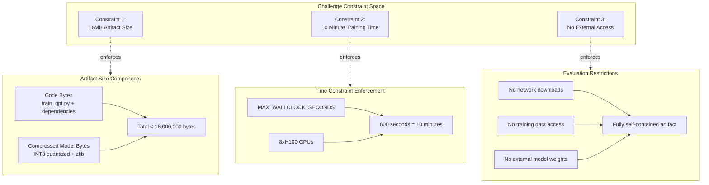
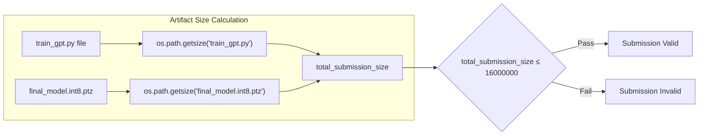
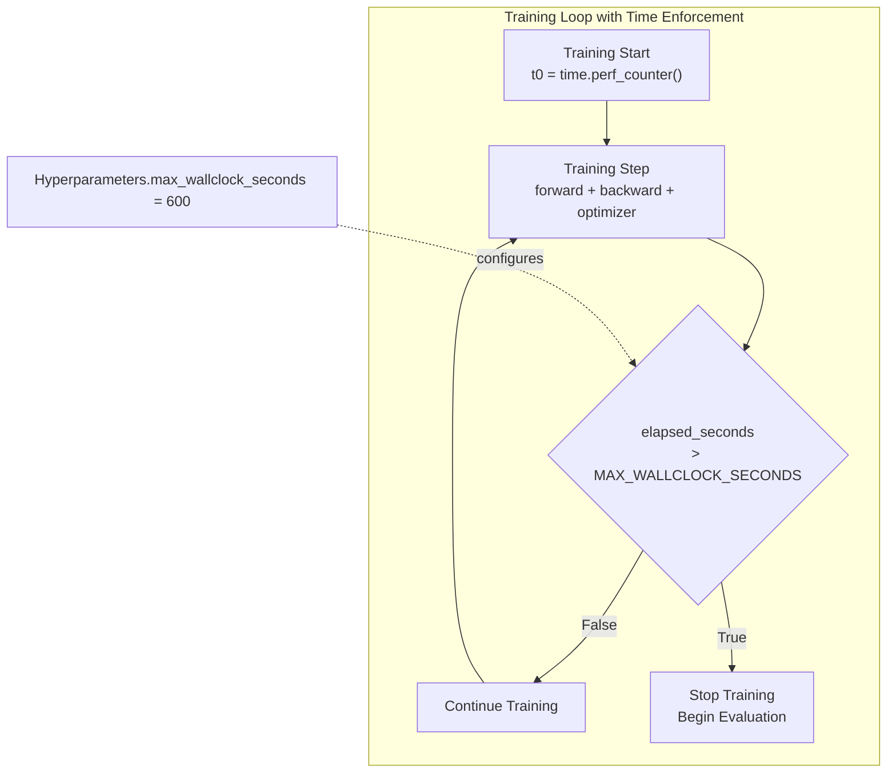
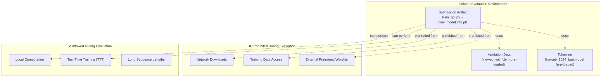
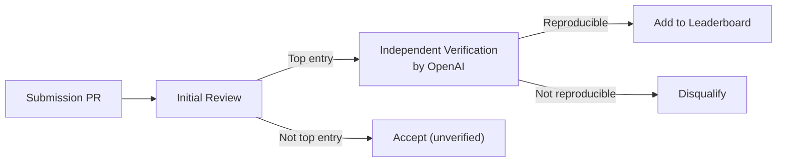

<!-- source: DeepWiki mcp.deepwiki.com · repo openai/parameter-golf · page 3.1 Constraints and Requirements · fetched 2026-10-26 -->

# Constraints and Requirements

Relevant source files

The following files were used as context for generating this wiki page:

- [README.md](README.md)
- [records/track_10min_16mb/2026-03-17_LoRA_TTT/README.md](records/track_10min_16mb/2026-03-17_LoRA_TTT/README.md)
- [records/track_10min_16mb/2026-03-17_LoRA_TTT/ablations.png](records/track_10min_16mb/2026-03-17_LoRA_TTT/ablations.png)
- [records/track_10min_16mb/2026-03-17_LoRA_TTT/submission.json](records/track_10min_16mb/2026-03-17_LoRA_TTT/submission.json)
- [records/track_10min_16mb/2026-03-17_LoRA_TTT/train_gpt.py](records/track_10min_16mb/2026-03-17_LoRA_TTT/train_gpt.py)
- [records/track_10min_16mb/2026-03-17_LoRA_TTT/train_v0.txt](records/track_10min_16mb/2026-03-17_LoRA_TTT/train_v0.txt)
- [records/track_10min_16mb/2026-03-17_LoRA_TTT/train_v1.txt](records/track_10min_16mb/2026-03-17_LoRA_TTT/train_v1.txt)
- [records/track_10min_16mb/2026-03-17_LoRA_TTT/train_v2.txt](records/track_10min_16mb/2026-03-17_LoRA_TTT/train_v2.txt)
- [records/track_10min_16mb/2026-03-17_LoRA_TTT/train_v3.txt](records/track_10min_16mb/2026-03-17_LoRA_TTT/train_v3.txt)
- [requirements.txt](requirements.txt)
- [train_gpt.py](train_gpt.py)

This page documents the hard constraints and requirements that all Parameter Golf submissions must satisfy. These constraints define the core challenge: training the best possible language model under strict resource limitations. The three fundamental constraints are the 16MB artifact size limit, the 10-minute training time limit on 8xH100 GPUs, and the prohibition on external data access during evaluation. This page also covers how these constraints are calculated, enforced, and validated.

For information about the evaluation metric (bits-per-byte), see [Evaluation Metrics](#3.2). For the submission process and file requirements, see [Submission Guidelines](#3.3). For the distinction between record-track and non-record-track submissions, see [Tracks: Record vs Non-Record](#3.4).

---

## Three Core Constraints

The Parameter Golf challenge enforces three hard constraints that together define the resource envelope for submissions. These constraints are designed to create a fair competitive environment while encouraging innovation in model architecture, compression techniques, and training efficiency.

### Challenge Constraint Space Diagram

**Sources**: [README.md:6-12](), [README.md:131-148]()

---

## Constraint 1: 16MB Artifact Size Limit

The submission artifact is capped at **exactly 16,000,000 bytes** (decimal megabytes, not 16 MiB / 16,777,216 bytes). This limit applies to the sum of all code and compressed model parameters needed to reproduce the submission's validation performance [README.md:131-134]().

### What Counts Toward the Limit

The artifact size is calculated as:
`Total Artifact Size = Code Bytes + Compressed Model Bytes`

| Component | Description | File References |
|-----------|-------------|-----------------|
| **Code Bytes** | Size of `train_gpt.py` and any dependencies needed to run evaluation | [README.md:133]() |
| **Compressed Model Bytes** | Size of quantized and compressed model checkpoint | [README.md:133-134]() |

### Exact Calculation Logic
The artifact size calculation is typically reported in the `submission.json` file generated or manually updated after training [records/track_10min_16mb/2026-03-17_LoRA_TTT/submission.json:9-10]().

### Artifact Size Calculation Flow

The `LoRA TTT` submission demonstrates compliance:
- `bytes_total`: `15,882,446`
- `bytes_code`: `58,509`
- Total is under the `16,000,000` byte limit [records/track_10min_16mb/2026-03-17_LoRA_TTT/submission.json:9-10]().

**Sources**: [README.md:131-135](), [records/track_10min_16mb/2026-03-17_LoRA_TTT/submission.json:9-10]()

---

## Constraint 2: 10-Minute Training Time Limit

Record-track submissions must complete training in **10 minutes or less** on **8xH100 GPUs**. This constraint is enforced via wallclock time, not step count or token count [README.md:6-8]().

### Hardware Specification

| Requirement | Value | Notes |
|-------------|-------|-------|
| GPU Type | H100 (80GB SXM) | Standard NVIDIA H100 configuration |
| GPU Count | 8 | Multi-GPU setup required for verification |
| Interconnect | NVLink/NVSwitch | High-bandwidth GPU-to-GPU communication |
| Time Limit | 600 seconds | Hard wallclock limit [train_gpt.py:59]() |

### Wallclock Enforcement
The time constraint is enforced through the `max_wallclock_seconds` hyperparameter, which defaults to `600.0` [train_gpt.py:59]().

### Training Loop Time Enforcement

**Sources**: [README.md:6](), [train_gpt.py:59](), [records/track_10min_16mb/2026-03-17_LoRA_TTT/train_gpt.py:60]()

### Evaluation Time
Evaluation (computing final `val_loss` and `val_bpb`) is **not** counted toward the 10-minute training limit. However, evaluation itself must complete in under 10 minutes on 8xH100s to prevent abuse [README.md:145-147](). This allows for techniques like Test-Time Training (TTT) which may be computationally expensive during inference [records/track_10min_16mb/2026-03-17_LoRA_TTT/README.md:21]().

---

## Constraint 3: No External Access During Evaluation

The submission artifact must be **fully self-contained and reproducible** without any external data access during evaluation [README.md:135-136]().

### Prohibited vs Allowed Access

### Test-Time Training (TTT)
Submissions like `LoRA TTT` use allowed local computation during evaluation to adapt the model to the validation document without leaking information across documents [records/track_10min_16mb/2026-03-17_LoRA_TTT/README.md:7-11](). This involves:
1. Splitting documents into chunks [records/track_10min_16mb/2026-03-17_LoRA_TTT/README.md:9]().
2. Scoring the chunk (calculating loss) [records/track_10min_16mb/2026-03-17_LoRA_TTT/README.md:10]().
3. Training LoRA adapters on that chunk's loss [records/track_10min_16mb/2026-03-17_LoRA_TTT/README.md:10]().
4. Resetting parameters between documents to avoid leakage [records/track_10min_16mb/2026-03-17_LoRA_TTT/README.md:11]().

**Sources**: [README.md:135-136](), [records/track_10min_16mb/2026-03-17_LoRA_TTT/README.md:7-14]()

---

## Statistical Significance and Verification

### New SOTA Requirements
New state-of-the-art records must demonstrate:
1. **Minimum Improvement**: 0.005 nats (approx 0.0072 bpb) [README.md:151]().
2. **Confidence**: p < 0.01 significance over previous records [README.md:152]().
3. **Evidence**: Multiple run logs to prove consistency [README.md:153]().

### Verification Flow

**Sources**: [README.md:137-139](), [README.md:151-153]()

---

## Summary of Constraints

| Constraint | Value | Applies To | Code Reference |
|------------|-------|------------|----------------|
| **Artifact Size** | ≤ 16,000,000 bytes | All submissions | [README.md:131]() |
| **Training Time** | ≤ 600 seconds | Record Track | [train_gpt.py:59]() |
| **Hardware** | 8x H100 GPUs | Record Track | [README.md:6]() |
| **External Data** | None at Eval | All submissions | [README.md:135]() |
| **Min Improvement** | 0.005 nats | SOTA Records | [README.md:151]() |
| **Significance** | p < 0.01 | SOTA Records | [README.md:152]() |

**Sources**: [README.md:6-12](), [README.md:131-157](), [train_gpt.py:59]()

---

