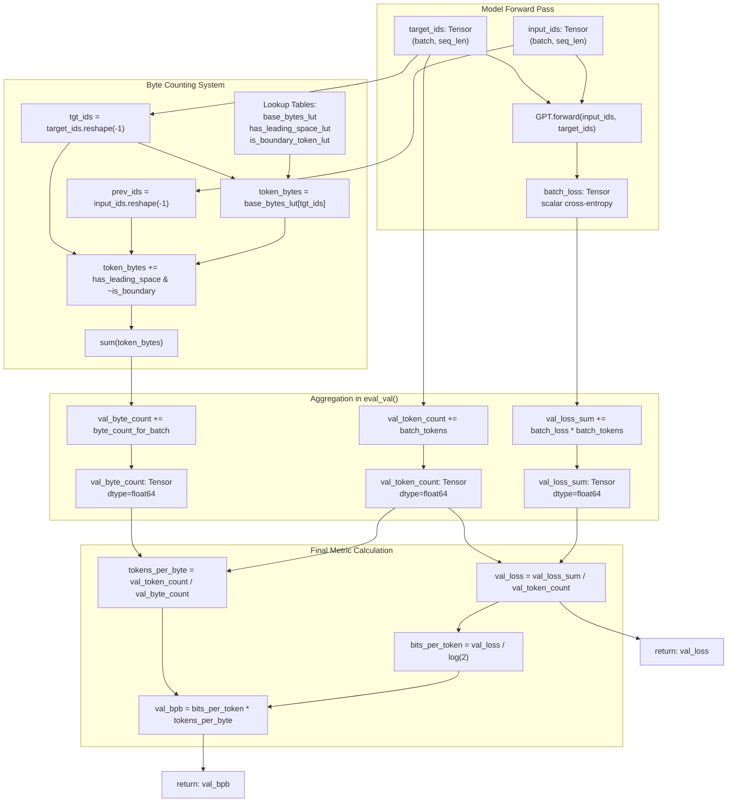
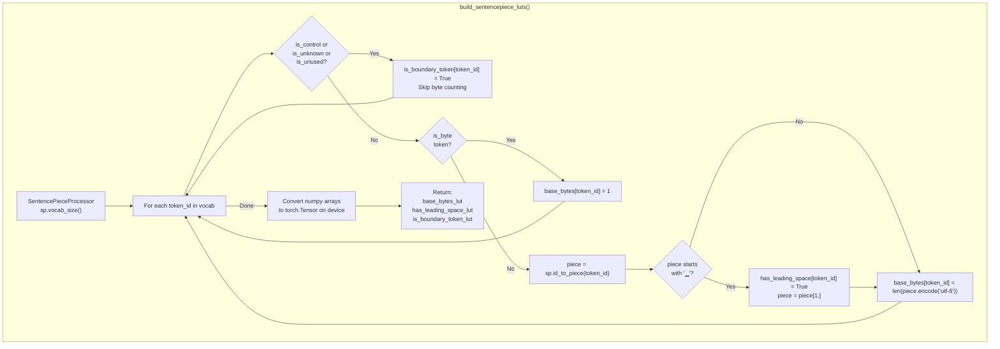

<!-- source: DeepWiki mcp.deepwiki.com · repo openai/parameter-golf · page 3.2 Evaluation Metrics · fetched 2026-10-26 -->

# Evaluation Metrics

<details>
<summary>Relevant source files</summary>

The following files were used as context for generating this wiki page:

- [README.md](README.md)
- [records/track_10min_16mb/2026-03-19_Seq2048_FP16Emb_TunedLR/README.md](records/track_10min_16mb/2026-03-19_Seq2048_FP16Emb_TunedLR/README.md)
- [records/track_10min_16mb/2026-03-19_Seq2048_FP16Emb_TunedLR/submission.json](records/track_10min_16mb/2026-03-19_Seq2048_FP16Emb_TunedLR/submission.json)
- [records/track_10min_16mb/2026-03-19_Seq2048_FP16Emb_TunedLR/train_gpt.py](records/track_10min_16mb/2026-03-19_Seq2048_FP16Emb_TunedLR/train_gpt.py)
- [records/track_10min_16mb/2026-03-19_Seq2048_FP16Emb_TunedLR/train_seed1337.log](records/track_10min_16mb/2026-03-19_Seq2048_FP16Emb_TunedLR/train_seed1337.log)
- [records/track_10min_16mb/2026-03-19_Seq2048_FP16Emb_TunedLR/train_seed3.log](records/track_10min_16mb/2026-03-19_Seq2048_FP16Emb_TunedLR/train_seed3.log)
- [records/track_10min_16mb/2026-03-19_Seq2048_FP16Emb_TunedLR/train_seed42.log](records/track_10min_16mb/2026-03-19_Seq2048_FP16Emb_TunedLR/train_seed42.log)
- [requirements.txt](requirements.txt)

</details>


## Purpose and Scope

This page documents the evaluation metrics used in the Parameter Golf challenge: validation cross-entropy loss (`val_loss`) and validation bits-per-byte (`val_bpb`). The primary leaderboard metric is `val_bpb`, which measures tokenizer-agnostic compression performance on the FineWeb validation set. This page explains why `val_bpb` is tokenizer-agnostic, how it relates to data compression, and the implementation details for calculating both metrics.

For submission requirements and constraints, see [Constraints and Requirements](3.1). For dataset details, see [FineWeb Dataset Overview](5.1).

---

## The Two Evaluation Metrics

Parameter Golf evaluates models using two related metrics computed during validation:

| Metric | Unit | Purpose | Calculation |
|--------|------|---------|-------------|
| `val_loss` | nats (natural log) | Token-level cross-entropy loss | Standard cross-entropy between model predictions and targets |
| `val_bpb` | bits per byte | Compression performance | `(val_loss / log(2)) × (token_count / byte_count)` |

The **primary leaderboard metric is `val_bpb`** because it is tokenizer-agnostic and measures the core capability: how well the model compresses the validation text, regardless of tokenization choices.

**Sources:** [README.md:6](), [records/track_10min_16mb/2026-03-19_Seq2048_FP16Emb_TunedLR/train_gpt.py:172-179]()

---

## Why Bits-Per-Byte is Tokenizer-Agnostic

### The Problem with Token-Level Loss

Using `val_loss` directly as the primary metric would create perverse incentives. Models with larger vocabularies (more tokens) would artificially appear better because:

- A large vocabulary (e.g., 50,000 tokens) can represent the same text with fewer tokens than a small one (e.g., 1,024 tokens).
- Fewer tokens means fewer prediction steps, leading to lower aggregate loss per document.
- This doesn't reflect better language understanding—just tokenization choices.

### The Solution: Bits-Per-Byte

The `val_bpb` metric normalizes by the **underlying byte count** of the text, making it independent of tokenizer design:

```
bits_per_byte = (cross_entropy_loss / log(2)) × (tokens_used / bytes_represented)
```

Where:
- `cross_entropy_loss / log(2)` converts nats to bits per token.
- `tokens_used / bytes_represented` converts bits per token to bits per byte.

This measures how many bits the model needs to encode each byte of the original text, providing an apples-to-apples comparison across different tokenizers (e.g., `sp1024` vs `byte260`).

**Sources:** [records/track_10min_16mb/2026-03-19_Seq2048_FP16Emb_TunedLR/train_gpt.py:175-178](), [README.md:6]()

---

## Calculation Flow: From Model Predictions to Metrics

The following diagram bridges the high-level evaluation concepts to the specific code entities in the training scripts.

### Metric Calculation Pipeline


**Sources:** [records/track_10min_16mb/2026-03-19_Seq2048_FP16Emb_TunedLR/train_gpt.py:219-278]()

---

## Implementation: The `eval_val` Function

The validation evaluation is implemented in the `eval_val` function, which computes both metrics in a single pass over the validation set.

### Function Signature
[records/track_10min_16mb/2026-03-19_Seq2048_FP16Emb_TunedLR/train_gpt.py:219-231]()

### Key Steps

1. **Distributed Validation**: The validation set is split across ranks to enable parallel evaluation on multi-GPU systems. Each rank processes a disjoint span of sequences [records/track_10min_16mb/2026-03-19_Seq2048_FP16Emb_TunedLR/train_gpt.py:241-246]().
2. **Accumulation in Float64**: All accumulators (`val_loss_sum`, `val_token_count`, `val_byte_count`) use `torch.float64` to prevent numerical drift during accumulation over thousands of batches [records/track_10min_16mb/2026-03-19_Seq2048_FP16Emb_TunedLR/train_gpt.py:233-235]().
3. **Byte Counting**: For each batch, the function counts the total UTF-8 bytes represented by the target tokens using precomputed lookup tables [records/track_10min_16mb/2026-03-19_Seq2048_FP16Emb_TunedLR/train_gpt.py:263-267]().
4. **All-Reduce**: In distributed mode, accumulators are synchronized across ranks using `dist.all_reduce` before computing final metrics [records/track_10min_16mb/2026-03-19_Seq2048_FP16Emb_TunedLR/train_gpt.py:270-273]().
5. **Final Calculation**: Convert accumulated sums to final metrics using the formulas described above [records/track_10min_16mb/2026-03-19_Seq2048_FP16Emb_TunedLR/train_gpt.py:275-278]().

**Sources:** [records/track_10min_16mb/2026-03-19_Seq2048_FP16Emb_TunedLR/train_gpt.py:219-278]()

---

## SentencePiece Byte Counting System

To count bytes in a tokenizer-agnostic way, the system builds lookup tables (LUTs) during initialization that map each token ID to its UTF-8 byte count.

### Lookup Table Construction Logic


**Sources:** [records/track_10min_16mb/2026-03-19_Seq2048_FP16Emb_TunedLR/train_gpt.py:180-204]()

### The Three Lookup Tables

| LUT Name | Type | Purpose |
|----------|------|---------|
| `base_bytes_lut` | `Tensor[int16]` | UTF-8 byte count for the token's piece (excluding leading space) |
| `has_leading_space_lut` | `Tensor[bool]` | Whether the token represents text after a word boundary (SentencePiece `▁` prefix) |
| `is_boundary_token_lut` | `Tensor[bool]` | Whether the token is a control/unknown/unused token (boundary markers) |

**Sources:** [records/track_10min_16mb/2026-03-19_Seq2048_FP16Emb_TunedLR/train_gpt.py:180-204]()

---

## Sliding Window Evaluation

Advanced submissions often use "Sliding Window Evaluation" to improve `val_bpb` scores. By using a stride smaller than the sequence length, the model can predict tokens with more preceding context on average.

In `Hyperparameters`, this is controlled by:
- `eval_stride`: The step size between evaluation windows (e.g., 64). [records/track_10min_16mb/2026-03-19_Seq2048_FP16Emb_TunedLR/train_gpt.py:54]()
- `eval_seq_len`: The context length used during evaluation. [records/track_10min_16mb/2026-03-19_Seq2048_FP16Emb_TunedLR/train_gpt.py:55]()

A stride of 0 indicates standard, non-overlapping evaluation. Competitive runs (like the `yahya010` submission) show a significant gap between standard and sliding evaluation:
- Standard `val_bpb`: 1.1821
- Sliding `val_bpb`: 1.1610

**Sources:** [records/track_10min_16mb/2026-03-19_Seq2048_FP16Emb_TunedLR/README.md:47](), [records/track_10min_16mb/2026-03-19_Seq2048_FP16Emb_TunedLR/submission.json:5-8]()

---

## Example Output from Training Logs

Here's an example of the metrics reported during and after training for a top-tier submission:

```
step:0/20000 val_loss:6.9370 val_bpb:4.0978 train_time:0ms step_avg:0.01ms
...
step:8319/20000 val_loss:1.9563 val_bpb:1.1586 train_time:600000ms step_avg:72.12ms
final_int8_zstd_roundtrip val_loss:1.9563 val_bpb:1.1586 eval_time:370s
```

Key observations:
- **Initial metrics**: At step 0 (random initialization), `val_bpb` is high (~4.10).
- **Quantization Gap**: High-quality submissions using **STE QAT** (Straight-Through Estimator Quantization Aware Training) achieve a "zero quant gap," where pre-quantization and post-quantization losses are identical. [records/track_10min_16mb/2026-03-19_Seq2048_FP16Emb_TunedLR/README.md:9-11]()

**Sources:** [records/track_10min_16mb/2026-03-19_Seq2048_FP16Emb_TunedLR/submission.json:7-9](), [records/track_10min_16mb/2026-03-19_Seq2048_FP16Emb_TunedLR/README.md:54]()

---

## Code Reference: Evaluation in `train_gpt.py`

### Key Functions

| Function | Definition | Purpose |
|----------|-------|---------|
| `build_sentencepiece_luts` | [records/track_10min_16mb/2026-03-19_Seq2048_FP16Emb_TunedLR/train_gpt.py:180]() | Builds lookup tables for byte counting from SentencePiece tokenizer. |
| `load_validation_tokens` | [records/track_10min_16mb/2026-03-19_Seq2048_FP16Emb_TunedLR/train_gpt.py:207]() | Loads all validation shards into a single contiguous tensor. |
| `eval_val` | [records/track_10min_16mb/2026-03-19_Seq2048_FP16Emb_TunedLR/train_gpt.py:219]() | Computes `val_loss` and `val_bpb` over the validation set. |

### Initialization in `main()`

The lookup tables and validation tokens are initialized once before the training loop starts:

```python
# [records/track_10min_16mb/2026-03-19_Seq2048_FP16Emb_TunedLR/train_gpt.py:807-817]
sp = spm.SentencePieceProcessor(model_file=args.tokenizer_path)
val_tokens = load_validation_tokens(args.val_files, args.train_seq_len)
base_bytes_lut, has_leading_space_lut, is_boundary_token_lut = build_sentencepiece_luts(
    sp, args.vocab_size, device
)
```

### Periodic Evaluation

Validation runs periodically based on the `VAL_LOSS_EVERY` hyperparameter:

```python
# [records/track_10min_16mb/2026-03-19_Seq2048_FP16Emb_TunedLR/train_gpt.py:976-995]
should_validate = last_step or (args.val_loss_every > 0 and step % args.val_loss_every == 0)
if should_validate:
    val_loss, val_bpb = eval_val(
        args, model, rank, world_size, device, grad_accum_steps,
        val_tokens, base_bytes_lut, has_leading_space_lut, is_boundary_token_lut,
    )
```

**Sources:** [records/track_10min_16mb/2026-03-19_Seq2048_FP16Emb_TunedLR/train_gpt.py:807-817](), [records/track_10min_16mb/2026-03-19_Seq2048_FP16Emb_TunedLR/train_gpt.py:976-995]()

---

