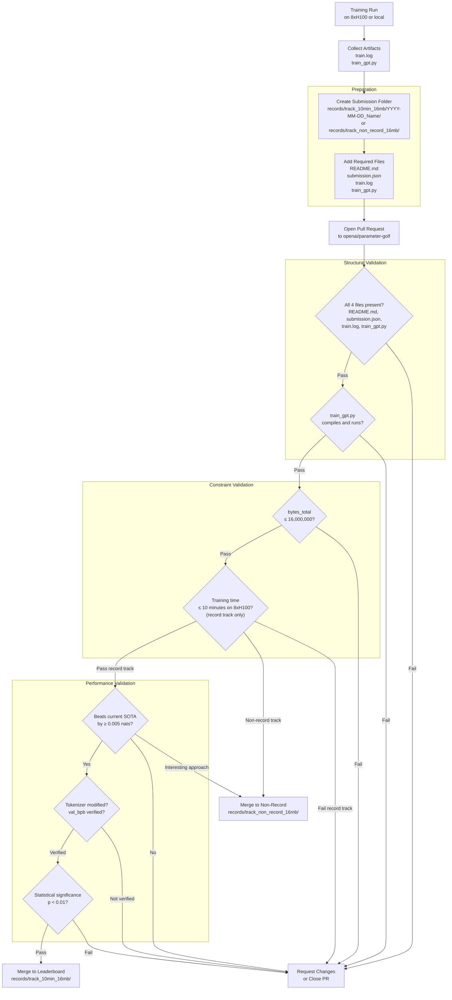
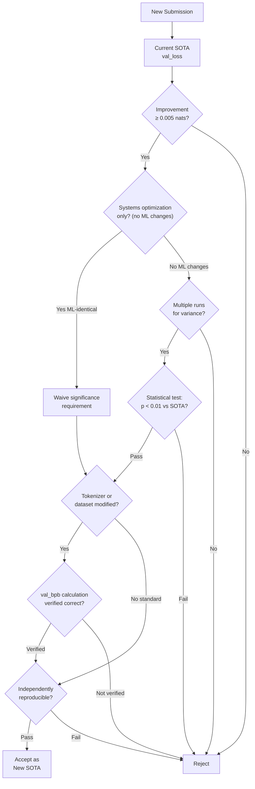

<!-- source: DeepWiki mcp.deepwiki.com · repo openai/parameter-golf · page 3.3 Submission Guidelines · fetched 2026-10-26 -->

# Submission Guidelines

<details>
<summary>Relevant source files</summary>

The following files were used as context for generating this wiki page:

- [README.md](README.md)
- [data/README.md](data/README.md)
- [data/cached_challenge_fineweb.py](data/cached_challenge_fineweb.py)
- [data/download_hf_docs_and_tokenize.py](data/download_hf_docs_and_tokenize.py)
- [data/tokenizer_specs.json](data/tokenizer_specs.json)
- [records/track_10min_16mb/2026-03-17_NaiveBaseline/README.md](records/track_10min_16mb/2026-03-17_NaiveBaseline/README.md)
- [records/track_10min_16mb/2026-03-17_NaiveBaseline/submission.json](records/track_10min_16mb/2026-03-17_NaiveBaseline/submission.json)
- [records/track_10min_16mb/2026-03-17_NaiveBaseline/train.log](records/track_10min_16mb/2026-03-17_NaiveBaseline/train.log)
- [requirements.txt](requirements.txt)

</details>


This document describes how to submit entries to the Parameter Golf challenge. It covers the pull request process, required files and formats, validation stages, and acceptance criteria for both record-track and non-record submissions. For details about the constraints themselves (16MB cap, 10-minute limit), see **3.1 Constraints and Requirements**. For information about the evaluation metric, see **3.2 Evaluation Metrics**. For examples of complete submissions, see **6 Example Submissions**.

---

## Submission Overview

All submissions to Parameter Golf are made via pull requests that add a new folder to one of the `/records` subdirectories. The submission must be entirely self-contained: all code, logs, and metadata required to verify the result must be included in the PR.

The submission folder must contain exactly four components:

| File | Purpose | Format |
|------|---------|--------|
| `train_gpt.py` | Training script and dependencies | Python code that compiles and runs standalone |
| `train.log` | Exact training log from the run | Plain text output from training execution |
| `submission.json` | Structured metadata | JSON with standardized fields |
| `README.md` | Human-readable explanation | Markdown documentation |

Sources: [README.md:161-168]()

---

## Submission Workflow

### Diagram: Submission Process Flow



Sources: [README.md:149-175]()

---

## Required Files

### 1. train_gpt.py

The training script must be a complete, standalone implementation that can be executed directly from within the submission folder. It must include all model definitions, optimizers, and compression logic.

**Requirements**:
- Must run successfully when executed from the submission folder: `torchrun --standalone --nproc_per_node=8 train_gpt.py` [records/track_10min_16mb/2026-03-17_NaiveBaseline/README.md:25]().
- All imports must be resolvable (either standard library or explicitly vendored in the script).
- No external network calls during execution.
- Must reproduce the claimed results when run on equivalent hardware.

**Artifact Size Accounting**: The size of `train_gpt.py` and any vendored dependencies counts toward the 16MB limit. This is measured as `bytes_code` in `submission.json`.

Sources: [README.md:131-136](), [README.md:167]()

---

### 2. train.log

The training log must be the exact, unmodified output from the training run that produced the submitted model. This provides a verifiable record of the training process, timing, and metrics.

**Required Log Elements**:

| Element | Purpose | Example Pattern |
|---------|---------|-----------------|
| Step logs | Training progress | `step:13780/20000 train_loss:2.06...` [records/track_10min_16mb/2026-03-17_NaiveBaseline/train.log:102]() |
| Timing metrics | Wallclock verification | `train_time:600038ms` [records/track_10min_16mb/2026-03-17_NaiveBaseline/README.md:33]() |
| Pre-quant eval | Baseline metrics | `val_loss:2.0606 val_bpb:1.2172` [records/track_10min_16mb/2026-03-17_NaiveBaseline/README.md:30]() |
| Roundtrip metrics | Final valid metrics | `final_int8_zlib_roundtrip_exact val_bpb:1.22436570` [records/track_10min_16mb/2026-03-17_NaiveBaseline/train.log:104]() |
| Artifact sizes | Size verification | `serialized model int8+zlib: 15815847 bytes` [records/track_10min_16mb/2026-03-17_NaiveBaseline/README.md:35]() |

Sources: [records/track_10min_16mb/2026-03-17_NaiveBaseline/train.log:1-104](), [records/track_10min_16mb/2026-03-17_NaiveBaseline/README.md:28-37]()

---

### 3. submission.json

A structured metadata file containing standardized fields for leaderboard display and automated validation.

**Required Schema**:
[records/track_10min_16mb/2026-03-17_NaiveBaseline/submission.json:1-11]()
```json
{
  "author": "Display name",
  "github_id": "GitHub username",
  "name": "Submission name",
  "blurb": "Short description",
  "date": "2026-03-18T14:56:29Z",
  "val_loss": 2.07269931,
  "val_bpb": 1.2243657,
  "bytes_total": 15863489,
  "bytes_code": 47642
}
```

**Field Definitions**:

| Field | Description |
|-------|-------------|
| `val_loss` | Cross-entropy validation loss (nats) from `final_int8_zlib_roundtrip`. |
| `val_bpb` | Bits-per-byte score (primary leaderboard metric). |
| `bytes_total` | Total artifact size = `bytes_code + compressed_model_bytes`. |
| `bytes_code` | Size of `train_gpt.py` in bytes. |

Sources: [records/track_10min_16mb/2026-03-17_NaiveBaseline/submission.json:1-11]()

---

### 4. README.md

A human-readable explanation of the submission. This should provide enough detail for reviewers to understand the approach and reproduce the run.

**Required Sections**:
- **Configuration**: Layout (Layers, Dim), Hyperparameters (LR, Batch Size).
- **Command**: Exact `torchrun` command used.
- **Metrics**: Summary of training time, pre-quant vs post-quant scores.
- **Included Files**: Inventory of the submission folder.

Sources: [records/track_10min_16mb/2026-03-17_NaiveBaseline/README.md:1-46]()

---

## SOTA Record Criteria

### Diagram: SOTA Acceptance Gate



Sources: [README.md:151-158]()

### 1. Performance Improvement
New SOTA records must beat the current best `val_loss` by at least **0.005 nats**. This threshold ensures meaningful progress over run-to-run variance.
Sources: [README.md:153]()

### 2. Statistical Significance
Submissions must demonstrate that the improvement is statistically significant at **p < 0.01**. This typically requires providing logs for multiple runs (e.g., 5-10) with different seeds to establish a distribution.
Sources: [README.md:153]()

### 3. Tokenizer Verification
Submissions modifying the tokenizer or dataset processing require scrutiny to ensure `val_bpb` is calculated correctly. The challenge uses a tokenizer-agnostic BPB metric to ensure fair comparison across different vocabulary sizes.
Sources: [README.md:156]()

### 4. Reproducibility
The submission must be reproducible by OpenAI on equivalent hardware (8xH100s). The `train_gpt.py` script must run without modification and complete within the 10-minute limit.
Sources: [README.md:137-139](), [README.md:158]()

---

## Track Directory Structure

```
records/
├── track_10min_16mb/              # Main leaderboard (record track)
│   └── 2026-03-17_NaiveBaseline/  # Folder name: YYYY-MM-DD_BriefName
│       ├── README.md
│       ├── submission.json
│       ├── train.log
│       └── train_gpt.py
│
└── track_non_record_16mb/         # Non-record submissions
    └── 2026-03-18_ExtendedRun/
        ├── README.md
        ├── submission.json
        ├── train.log
        └── train_gpt.py
```

Sources: [README.md:33-52](), [README.md:159]()

---

