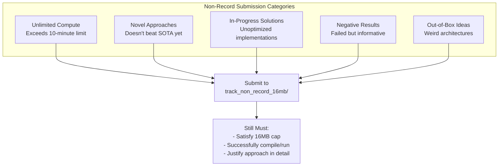
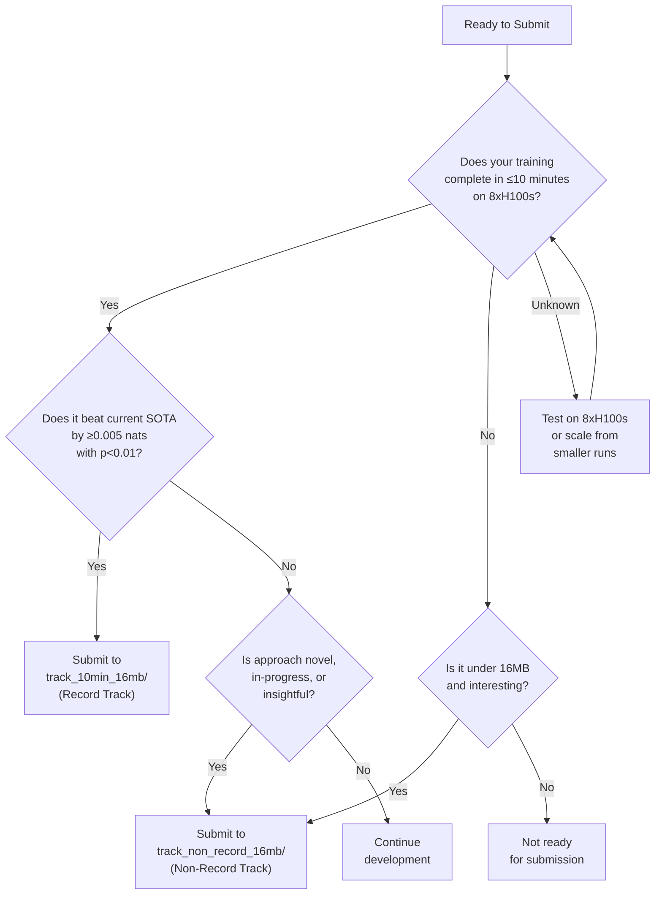

<!-- source: DeepWiki mcp.deepwiki.com · repo openai/parameter-golf · page 3.4 Tracks: Record vs Non-Record · fetched 2026-10-26 -->

# Tracks: Record vs Non-Record

<details>
<summary>Relevant source files</summary>

The following files were used as context for generating this wiki page:

- [README.md](README.md)
- [records/track_non_record_16mb/2026-03-18_Quasi10Bfrom50B_SP1024_9x512_KV4_4h_pgut3/README.md](records/track_non_record_16mb/2026-03-18_Quasi10Bfrom50B_SP1024_9x512_KV4_4h_pgut3/README.md)
- [records/track_non_record_16mb/2026-03-21_DepthRecurrence_MixedPrecisionQuant/README.md](records/track_non_record_16mb/2026-03-21_DepthRecurrence_MixedPrecisionQuant/README.md)
- [records/track_non_record_16mb/2026-03-21_DepthRecurrence_MixedPrecisionQuant/requirements.txt](records/track_non_record_16mb/2026-03-21_DepthRecurrence_MixedPrecisionQuant/requirements.txt)
- [records/track_non_record_16mb/2026-03-21_DepthRecurrence_MixedPrecisionQuant/submission.json](records/track_non_record_16mb/2026-03-21_DepthRecurrence_MixedPrecisionQuant/submission.json)
- [records/track_non_record_16mb/2026-03-21_DepthRecurrence_MixedPrecisionQuant/train_gpt.py](records/track_non_record_16mb/2026-03-21_DepthRecurrence_MixedPrecisionQuant/train_gpt.py)
- [requirements.txt](requirements.txt)

</details>


This page explains the two submission tracks in the Parameter Golf challenge: the **Record Track** (main leaderboard) and the **Non-Record Track**. Both tracks enforce the 16MB artifact size constraint, but they differ in their time limits and acceptance criteria. Understanding when to use each track is essential for submitting your work effectively.

For details on the specific submission process and required files, see [Submission Guidelines](3.3). For information about the constraints themselves, see [Constraints and Requirements](3.1).

---

## Track Comparison

The Parameter Golf challenge offers two distinct tracks to accommodate different research goals and compute budgets:

| Aspect | Record Track | Non-Record Track |
|--------|-------------|------------------|
| **Directory** | `records/track_10min_16mb/` | `records/track_non_record_16mb/` |
| **Time Limit** | ≤ 10 minutes on 8xH100 GPUs | Unlimited (hours, days, etc.) |
| **Artifact Size** | ≤ 16,000,000 bytes | ≤ 16,000,000 bytes |
| **SOTA Requirement** | Must beat current best by ≥0.005 nats (p<0.01) | Not required (interesting approaches accepted) |
| **Primary Goal** | Compete for leaderboard ranking | Share research, explore unlimited-compute frontier |
| **Verification** | Top submissions independently verified by OpenAI | Same rigor for reproducibility |
| **Acceptance Bar** | High (must improve SOTA) | High (must justify novelty/insights) |

Both tracks require the same submission files (`README.md`, `submission.json`, `train.log`, `train_gpt.py`) and enforce the same 16MB artifact cap.

**Sources:** [README.md:6-13](), [README.md:29-32](), [README.md:149-176]()

---

## Record Track: Main Leaderboard

### Purpose

The Record Track represents the official leaderboard for the Parameter Golf challenge. It enforces both the 16MB artifact constraint and a strict 10-minute training time limit on 8xH100 GPUs. This dual constraint creates a challenging optimization problem: participants must develop models that train efficiently while remaining highly compressible.

The 10-minute limit was chosen to balance two goals:
1. Make the challenge accessible (not requiring prohibitively expensive compute).
2. Force innovation in training efficiency, not just brute-force scaling.

### Hard Constraints

Record track submissions must satisfy all of the following:

```
ARTIFACT_SIZE = code_bytes + model_compressed_bytes ≤ 16,000,000
TRAINING_TIME ≤ 600 seconds (10 minutes on 8xH100 GPUs)
EVALUATION_TIME ≤ 600 seconds (no restriction on eval methods within this limit)
NO_EXTERNAL_ACCESS = True (no downloads, no training data access during eval)
```

The training time constraint is measured from script start to completion, including all initialization, training loops, validation, quantization, and compression steps. This is typically controlled via `max_wallclock_seconds` in the `Hyperparameters` class [records/track_non_record_16mb/2026-03-21_DepthRecurrence_MixedPrecisionQuant/train_gpt.py:91]().

### Acceptance Criteria

To be accepted to the main leaderboard, submissions must:

1. **Beat Current SOTA**: Achieve a `val_bpb` that is at least 0.005 nats (0.007 bpb) better than the current best.
2. **Statistical Significance**: Provide multiple run logs showing `p < 0.01` that the improvement is real (inter-run variance can be significant).
3. **Reproducibility**: Successfully run in under 10 minutes when independently verified by OpenAI.
4. **Complete Documentation**: Include all required files with detailed explanations.

Note: The statistical significance requirement is waived for submissions that improve speed through pure systems optimization without changing the ML approach.

### Directory Structure

Record track submissions are placed in `records/track_10min_16mb/` with the following structure:

```
records/track_10min_16mb/YYYY-MM-DD_SubmissionName/
├── README.md              # Detailed explanation of approach
├── submission.json        # Metadata: author, val_bpb, timing, bytes
├── train.log              # Complete training log from actual run
├── train_gpt.py           # Training script (must compile and run)
└── [other dependencies]   # Any additional required files
```

**Sources:** [README.md:6](), [README.md:131-147](), [README.md:149-168](), [README.md:29-33]()

---

## Non-Record Track: Unlimited Compute

### Purpose

The Non-Record Track serves multiple purposes beyond the main leaderboard competition:

1. **Unlimited Compute Exploration**: Investigate the parameter-limited performance frontier without time constraints.
2. **Novel Approaches**: Share interesting or unconventional techniques that may not yet beat SOTA.
3. **Negative Results**: Document failed experiments with valuable insights.
4. **In-Progress Work**: Publish unoptimized but promising implementations.

As stated in the README: "We're excited to see people push the infinite frontier of parameter limited performance as well" [README.md:12]().

### Types of Non-Record Submissions

The challenge explicitly welcomes several categories of non-record submissions:



**Diagram: Non-Record Submission Categories and Requirements**

**Sources:** [README.md:169-175]()

### Constraints

Non-record submissions have relaxed time constraints but maintain the same artifact size limit:

```
ARTIFACT_SIZE = code_bytes + model_compressed_bytes ≤ 16,000,000  (SAME)
TRAINING_TIME = unlimited (can be hours or days)                   (RELAXED)
EVALUATION_TIME = unlimited                                        (RELAXED)
NO_EXTERNAL_ACCESS = True                                          (SAME)
```

The 16MB cap remains enforced because it's fundamental to the challenge's parameter-constrained nature. For example, PR #363 used a `MAX_WALLCLOCK_SECONDS` of 14400 (4 hours) [records/track_non_record_16mb/2026-03-18_Quasi10Bfrom50B_SP1024_9x512_KV4_4h_pgut3/README.md:30]().

### Acceptance Criteria

Non-record submissions must meet a different bar:

1. **Novelty or Insight**: Demonstrate interesting techniques, architectures, or findings.
2. **Reproducibility**: Successfully compile and run (same as record track).
3. **Detailed Justification**: Explain the approach, results, and insights in README.
4. **Complete Documentation**: Include all required files.

The challenge maintains "a high bar for non-record submissions" [README.md:171](), but focuses on research value rather than SOTA performance.

### Directory Structure

Non-record submissions use `records/track_non_record_16mb/` with identical file structure:

```
records/track_non_record_16mb/YYYY-MM-DD_SubmissionName/
├── README.md              # Must explain track choice and insights
├── submission.json        # Includes "track": "non_record_16mb"
├── train.log              # Training log (may show >10min wallclock)
├── train_gpt.py           # Training script
└── [other dependencies]
```

The `submission.json` must clearly indicate the track [records/track_non_record_16mb/2026-03-21_DepthRecurrence_MixedPrecisionQuant/submission.json:2]().

**Sources:** [README.md:169-175](), [records/track_non_record_16mb/2026-03-21_DepthRecurrence_MixedPrecisionQuant/submission.json:1-10]()

---

## Choosing the Right Track

### Decision Flow



**Diagram: Track Selection Decision Flow**

**Sources:** [README.md:149-175]()

### Practical Guidance

**Choose Record Track when:**
- Your run completes in under 10 minutes on 8xH100s.
- You have evidence of beating SOTA by ≥0.005 nats.
- You want to compete for leaderboard ranking.

**Choose Non-Record Track when:**
- Training requires hours or days of compute (e.g., 4-hour runs).
- You have a novel technique that doesn't yet beat SOTA (e.g., Depth Recurrence [records/track_non_record_16mb/2026-03-21_DepthRecurrence_MixedPrecisionQuant/README.md:13]()).
- You want to document a promising but unoptimized approach.
- You have informative negative results to share.

**Example: Depth Recurrence Research**

The non-record submission at `records/track_non_record_16mb/2026-03-21_DepthRecurrence_MixedPrecisionQuant/` demonstrates this choice:

- **Approach**: Investigated depth-recurrent transformers to save parameters [records/track_non_record_16mb/2026-03-21_DepthRecurrence_MixedPrecisionQuant/README.md:61]().
- **Result**: A flat 11-layer model performed better, but the research identified "Noisy QAT" as a valuable technique [records/track_non_record_16mb/2026-03-21_DepthRecurrence_MixedPrecisionQuant/README.md:15]().
- **Track Justification**: Labeled as a "Research Contribution" because the architecture wasn't competitive in the 10-minute race but provided valuable insights [records/track_non_record_16mb/2026-03-21_DepthRecurrence_MixedPrecisionQuant/README.md:3]().

**Sources:** [records/track_non_record_16mb/2026-03-21_DepthRecurrence_MixedPrecisionQuant/README.md:1-17](), [records/track_non_record_16mb/2026-03-21_DepthRecurrence_MixedPrecisionQuant/submission.json:1-10]()

---

## Track-Specific Metadata

### submission.json Track Field

The `submission.json` file must include a `"track"` field identifying the submission category:

**Record Track:**
```json
{
  "track": "track_10min_16mb",
  ...
}
```

**Non-Record Track:**
```json
{
  "track": "non_record_16mb",
  ...
}
```

The wallclock time should reflect actual training duration. For non-record submissions, this may greatly exceed 600 seconds, as shown in the 4-hour baseline example where training stopped at 14,400 seconds [records/track_non_record_16mb/2026-03-18_Quasi10Bfrom50B_SP1024_9x512_KV4_4h_pgut3/README.md:39-43]().

**Sources:** [records/track_non_record_16mb/2026-03-21_DepthRecurrence_MixedPrecisionQuant/submission.json:2](), [records/track_non_record_16mb/2026-03-18_Quasi10Bfrom50B_SP1024_9x512_KV4_4h_pgut3/README.md:43]()

---

## Common Requirements Across Both Tracks

Regardless of track, all submissions must:

1. **Artifact Size**: Stay under 16,000,000 bytes (decimal MB, not MiB).
2. **Self-Contained**: No external downloads or network access during evaluation.
3. **Reproducible**: Scripts must compile and run successfully in the records folder.
4. **Complete Files**: Include `README.md`, `submission.json`, `train.log`, `train_gpt.py`.
5. **Detailed Documentation**: Explain approach, configuration, and results.

The only difference is the time constraint and SOTA requirement.

**Sources:** [README.md:131-136](), [README.md:159-168](), [README.md:169-175]()

---

## Leaderboard Presentation

The challenge displays both tracks in the README. Record track entries are ranked competitively on the main leaderboard [README.md:29-52](). Non-record entries are typically featured in their own section or discussed in research updates, emphasizing their role as interesting research contributions rather than leaderboard competition.

**Sources:** [README.md:29-32]()

---

