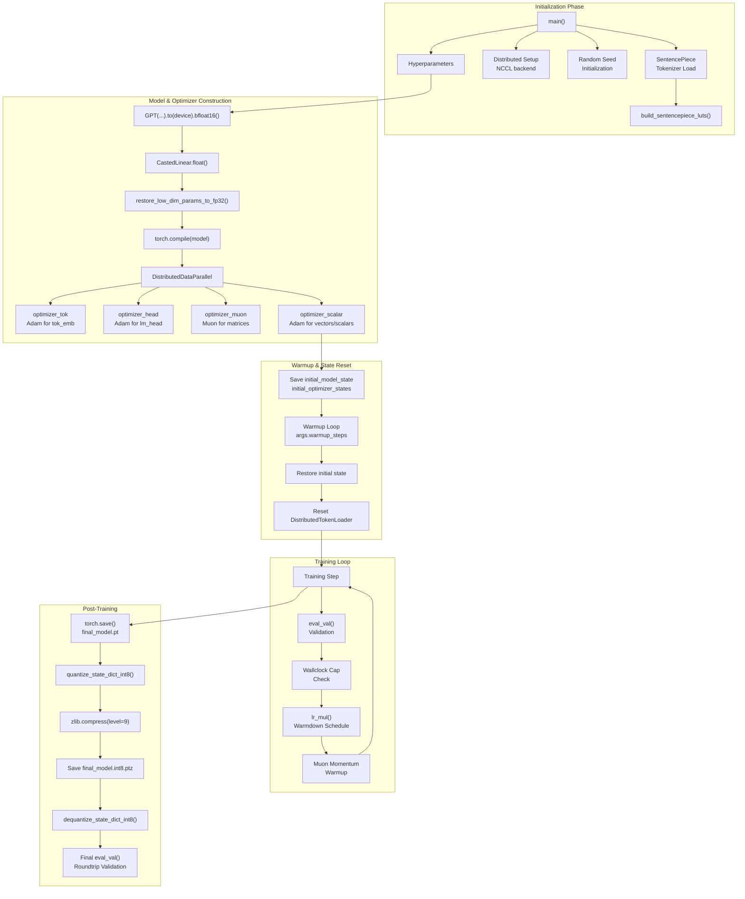
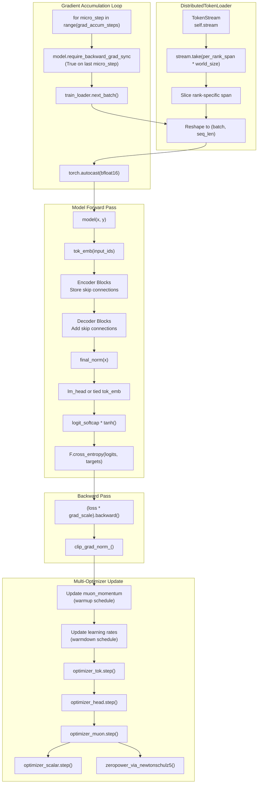
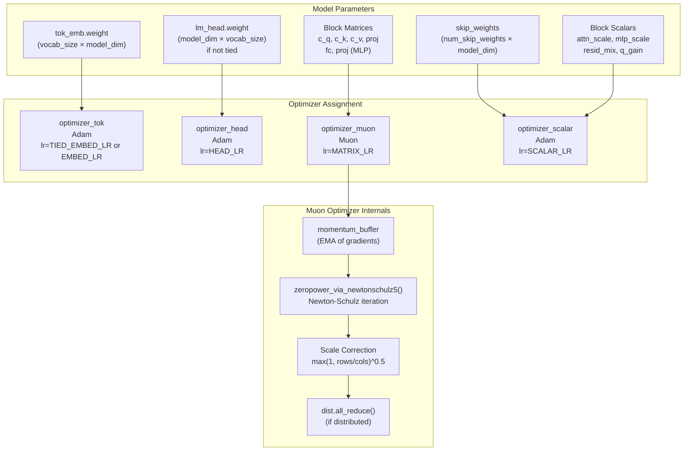
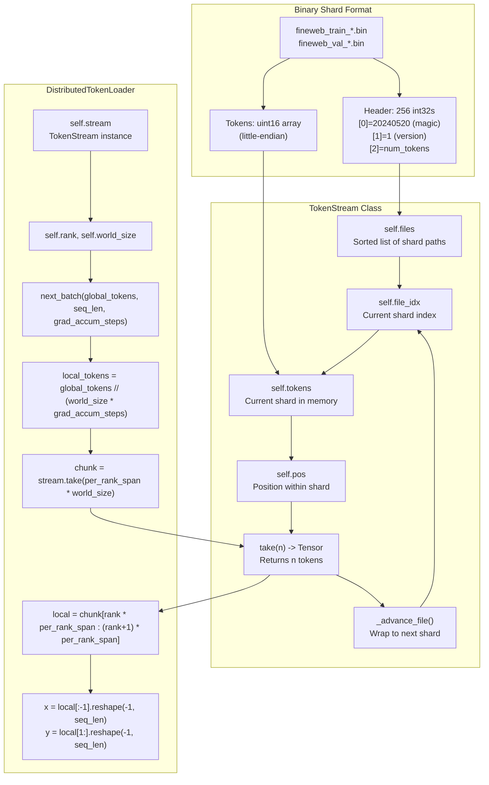
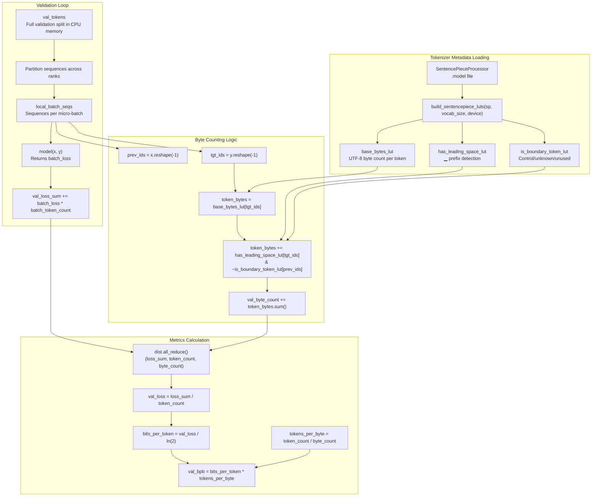
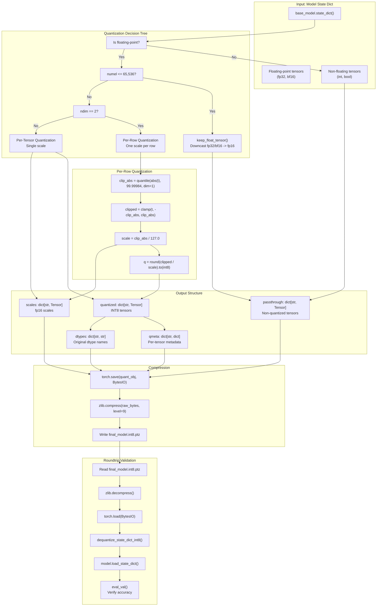

<!-- source: DeepWiki mcp.deepwiki.com · repo openai/parameter-golf · page 4 Training System Architecture · fetched 2026-10-26 -->

# Training System Architecture

<details>
<summary>Relevant source files</summary>

The following files were used as context for generating this wiki page:

- [records/track_10min_16mb/2026-03-17_LoRA_TTT/README.md](records/track_10min_16mb/2026-03-17_LoRA_TTT/README.md)
- [records/track_10min_16mb/2026-03-17_LoRA_TTT/ablations.png](records/track_10min_16mb/2026-03-17_LoRA_TTT/ablations.png)
- [records/track_10min_16mb/2026-03-17_LoRA_TTT/submission.json](records/track_10min_16mb/2026-03-17_LoRA_TTT/submission.json)
- [records/track_10min_16mb/2026-03-17_LoRA_TTT/train_gpt.py](records/track_10min_16mb/2026-03-17_LoRA_TTT/train_gpt.py)
- [records/track_10min_16mb/2026-03-17_LoRA_TTT/train_v0.txt](records/track_10min_16mb/2026-03-17_LoRA_TTT/train_v0.txt)
- [records/track_10min_16mb/2026-03-17_LoRA_TTT/train_v1.txt](records/track_10min_16mb/2026-03-17_LoRA_TTT/train_v1.txt)
- [records/track_10min_16mb/2026-03-17_LoRA_TTT/train_v2.txt](records/track_10min_16mb/2026-03-17_LoRA_TTT/train_v2.txt)
- [records/track_10min_16mb/2026-03-17_LoRA_TTT/train_v3.txt](records/track_10min_16mb/2026-03-17_LoRA_TTT/train_v3.txt)
- [train_gpt.py](train_gpt.py)
- [train_gpt_mlx.py](train_gpt_mlx.py)

</details>


This document provides a comprehensive technical overview of the training system architecture in `train_gpt.py`, the primary CUDA-based training script for the Parameter Golf challenge. It covers the major subsystems, their interactions, and the data flow through the training pipeline.

For MLX-specific training on Apple Silicon, see [Local Training with MLX](#4.6). For detailed configuration parameters, see [Configuration Parameters](#7.1). For submission requirements and constraints, see [Challenge Rules and Submission](#3).

## Purpose and Scope

The training system is designed to achieve two competing objectives within strict constraints:
1. **Training efficiency**: Complete training within 10 minutes on 8×H100 GPUs (for record-track submissions) [train_gpt.py:59-60]()
2. **Model compression**: Produce a final artifact (code + compressed model) under 16MB [train_gpt.py:1076-1119]()

This architecture achieves these goals through:
- A modular design separating data loading, model computation, optimization, and quantization [train_gpt.py:39-724]()
- Dual-optimizer strategy (Muon for matrices, Adam for embeddings/scalars) [train_gpt.py:846-893]()
- Streaming data pipeline with deterministic shard ordering [train_gpt.py:446-494]()
- Aggressive post-training INT8 quantization with zlib compression [train_gpt.py:282-422]()

**Sources:** [train_gpt.py:1-60](), [train_gpt.py:1076-1119]()

## System Components Overview

The training system consists of five major subsystems that operate independently but are orchestrated by the `main()` function:

| Subsystem | Key Classes/Functions | Primary Responsibility |
|-----------|----------------------|------------------------|
| **Configuration** | `Hyperparameters` | Centralized environment-variable-based configuration [train_gpt.py:39-88]() |
| **Data Pipeline** | `TokenStream`, `DistributedTokenLoader` | Streaming binary shard reading with rank-aware batching [train_gpt.py:446-494]() |
| **Model Architecture** | `GPT`, `Block`, `CausalSelfAttention`, `MLP` | Transformer with skip connections, GQA, RoPE, and tied embeddings [train_gpt.py:526-724]() |
| **Optimization** | `Muon`, `torch.optim.Adam` | Dual-optimizer strategy with Newton-Schulz orthogonalization [train_gpt.py:112-169]() |
| **Evaluation** | `eval_val()`, `build_sentencepiece_luts()` | Tokenizer-agnostic bits-per-byte metric [train_gpt.py:180-278]() |
| **Quantization** | `quantize_state_dict_int8()`, `dequantize_state_dict_int8()` | INT8 per-row quantization with roundtrip validation [train_gpt.py:342-422]() |

**Sources:** [train_gpt.py:39-90](), [train_gpt.py:112-169](), [train_gpt.py:426-494](), [train_gpt.py:648-724]()

## Training Script Execution Flow



**Diagram: Training script execution flow from initialization through post-training**

The `main()` function at [train_gpt.py:731-1123]() orchestrates the entire training lifecycle. Key phases:

1. **Initialization** [train_gpt.py:734-820](): Load hyperparameters, initialize distributed training, set random seeds, load tokenizer, build byte-counting lookup tables
2. **Model Construction** [train_gpt.py:822-893](): Instantiate `GPT` model, convert linear layers to fp32, compile with `torch.compile()`, wrap in DDP
3. **Warmup** [train_gpt.py:937-961](): Prime compiled paths with `args.warmup_steps` iterations, then restore initial state for reproducibility
4. **Training Loop** [train_gpt.py:963-1056](): Iterate with gradient accumulation, multi-optimizer updates, learning rate warmdown, and wallclock cap enforcement
5. **Post-Training** [train_gpt.py:1068-1119](): Serialize raw model, quantize to INT8, compress with zlib, validate roundtrip accuracy

**Sources:** [train_gpt.py:731-1123]()

## Component Interaction During Training Step



**Diagram: Single training step data flow through gradient accumulation, model forward/backward, and optimizer updates**

Each training step [train_gpt.py:1009-1034]() proceeds as follows:

1. **Data Loading**: `DistributedTokenLoader.next_batch()` [train_gpt.py:486-494]() calls `TokenStream.take()` [train_gpt.py:462-474]() to fetch a contiguous chunk, then slices out rank-specific spans
2. **Gradient Accumulation**: Loop over `grad_accum_steps` micro-batches [train_gpt.py:1011-1018](), setting `require_backward_grad_sync=True` only on the final micro-step to avoid redundant all-reduces
3. **Forward Pass**: `GPT.forward()` [train_gpt.py:700-724]() computes embeddings, runs encoder blocks (storing skip connections), decoder blocks (adding skip connections), final normalization, and cross-entropy loss
4. **Backward Pass**: Scaled backward pass accumulates gradients [train_gpt.py:1018]()
5. **Optimizer Updates**: Four separate optimizers update different parameter groups [train_gpt.py:1026-1033]():
   - `optimizer_tok`: Token embeddings (Adam)
   - `optimizer_head`: LM head if untied (Adam)
   - `optimizer_muon`: 2D matrix parameters in blocks (Muon with Newton-Schulz)
   - `optimizer_scalar`: Vectors/scalars (Adam)

**Sources:** [train_gpt.py:1009-1034](), [train_gpt.py:486-494](), [train_gpt.py:700-724]()

## Optimizer Architecture and Parameter Groups

The training system employs a sophisticated multi-optimizer strategy that splits parameters by dimensionality and role:



**Diagram: Parameter grouping and optimizer assignment strategy**

The optimizer split [train_gpt.py:846-893]() is based on empirical findings that different parameter types benefit from different optimization algorithms:

| Parameter Group | Optimizer | Learning Rate | Rationale |
|-----------------|-----------|---------------|-----------|
| `tok_emb.weight` | Adam | `TIED_EMBED_LR=0.05` (tied) or `EMBED_LR=0.6` (untied) | Embeddings require different dynamics than transformer blocks [train_gpt.py:74-77]() |
| `lm_head.weight` | Adam | `HEAD_LR=0.008` | Output projection benefits from lower LR when untied [train_gpt.py:75]() |
| Block 2D matrices (`c_q`, `c_k`, `c_v`, `proj`, `fc`) | Muon | `MATRIX_LR=0.04` | Matrix parameters benefit from orthogonalization [train_gpt.py:78]() |
| Block vectors/scalars (`attn_scale`, `mlp_scale`, `resid_mix`, `q_gain`) | Adam | `SCALAR_LR=0.04` | Small parameters kept in fp32, use standard Adam [train_gpt.py:79]() |
| `skip_weights` | Adam | `SCALAR_LR=0.04` | Residual connection weights treated as scalars [train_gpt.py:79]() |

The `Muon` optimizer [train_gpt.py:112-169]() applies Newton-Schulz orthogonalization via `zeropower_via_newtonschulz5()` [train_gpt.py:96-109](). This iterative method projects gradient matrices onto the orthogonal group, which has been shown to improve training stability and convergence for transformer models. The orthogonalization is followed by a scale correction factor `max(1, g.size(0) / g.size(1)) ** 0.5` to account for aspect ratio [train_gpt.py:155]().

**Sources:** [train_gpt.py:846-893](), [train_gpt.py:112-169](), [train_gpt.py:96-109]()

## Data Pipeline Architecture



**Diagram: Data loading pipeline from binary shards through TokenStream to distributed batches**

The data pipeline is designed for deterministic, efficient streaming:

1. **Binary Shard Format** [train_gpt.py:429-443](): Each `.bin` file contains a 256-int32 header (1024 bytes) followed by uint16 tokens. The header encodes a magic number `20240520`, version `1`, and token count. This format is compact (2 bytes per token) and fast to load.

2. **TokenStream** [train_gpt.py:446-474](): Provides infinite sequential access to tokens by wrapping around shard files. The `take(n)` method reads `n` tokens, spanning multiple shards if necessary. No shuffling or randomization occurs—training order is fully deterministic based on shard order.

3. **DistributedTokenLoader** [train_gpt.py:477-494](): Coordinates multi-GPU data loading. For each batch:
   - Calculates `local_tokens = global_tokens // (world_size * grad_accum_steps)`
   - Fetches a contiguous chunk of size `(local_tokens + 1) * world_size`
   - Slices out rank-specific span: `chunk[rank * (local_tokens+1) : (rank+1) * (local_tokens+1)]`
   - Reshapes into `(x, y)` pairs where `y = x` shifted by 1 token

The "+1" token is critical: it allows creating shifted `(x, y)` pairs without overlapping tokens across ranks, maintaining data parallelism correctness.

**Sources:** [train_gpt.py:429-443](), [train_gpt.py:446-474](), [train_gpt.py:477-494]()

## Evaluation and Metrics



**Diagram: Tokenizer-agnostic validation metric calculation flow**

The evaluation system computes two metrics [train_gpt.py:219-278]():

1. **val_loss**: Standard cross-entropy loss in natural log units (nats)
2. **val_bpb**: Bits-per-byte, a tokenizer-agnostic compression metric

**Bits-Per-Byte Calculation**

The BPB metric measures compression performance independent of tokenizer choice:

```
val_bpb = (val_loss / ln(2)) × (num_tokens / num_bytes)
        = bits_per_token × tokens_per_byte
```

Where:
- `bits_per_token = val_loss / ln(2)` converts nats to bits [train_gpt.py:276]()
- `num_bytes` is the UTF-8 byte count of the original text (before tokenization) [train_gpt.py:275]()

**Byte Counting Logic** [train_gpt.py:263-267]()

For each token, the byte count is:
1. Start with `base_bytes_lut[token_id]`: the UTF-8 length of the token's text
2. Add 1 if the token has a leading space (`▁` in SentencePiece) AND the previous token is not a boundary token (control/unknown/unused)

This correctly accounts for spaces that SentencePiece encodes as part of tokens. The lookup tables are pre-computed by `build_sentencepiece_luts()` [train_gpt.py:180-204]() which inspects each token ID to determine:
- `base_bytes_np[token_id]`: UTF-8 byte length (strip `▁` prefix first) [train_gpt.py:192-194]()
- `has_leading_space_np[token_id]`: True if token starts with `▁` [train_gpt.py:195]()
- `is_boundary_token_np[token_id]`: True if control/unknown/unused [train_gpt.py:196]()

**Sources:** [train_gpt.py:219-278](), [train_gpt.py:180-204](), [train_gpt.py:263-267]()

## Quantization and Compression Pipeline



**Diagram: Post-training quantization and compression pipeline with roundtrip validation**

The quantization system [train_gpt.py:282-422]() aggressively compresses the trained model while minimizing accuracy degradation:

**Quantization Strategy**

The `quantize_state_dict_int8()` function [train_gpt.py:342-399]() applies different strategies based on tensor properties:

| Tensor Type | Strategy | Format | Rationale |
|-------------|----------|--------|-----------|
| Non-floating (int, bool) | Passthrough | Original dtype | Already compact |
| Small floating (`numel ≤ 65,536`) | Passthrough | fp16 (downcast from fp32/bf16) | Quantization overhead not worth it [train_gpt.py:357-359]() |
| Control parameters (matching `CONTROL_TENSOR_NAME_PATTERNS`) | Passthrough | fp32 or fp16 | Critical for model stability [train_gpt.py:360-362]() |
| 2D matrices (large) | Per-row INT8 | `int8` + `fp16` scales | Captures per-channel range variation [train_gpt.py:382-390]() |
| 1D vectors (large) | Per-tensor INT8 | `int8` + `fp32` scale | Single scale sufficient [train_gpt.py:391-397]() |

**Per-Row Quantization** [train_gpt.py:321-334]()

For 2D matrices (most transformer weights):
1. Compute 99.99984th percentile of absolute values per row: `clip_abs = quantile(abs(t), 0.9999984, dim=1)` [train_gpt.py:324]()
2. Clamp values to `[-clip_abs, clip_abs]` per row [train_gpt.py:327]()
3. Compute scale: `scale = clip_abs / 127.0` (per row, stored as fp16) [train_gpt.py:328]()
4. Quantize: `q = round(clipped / scale).to(int8)` [train_gpt.py:329]()

The per-row approach is crucial because different output channels (rows in weight matrices) often have vastly different magnitude distributions. The 99.99984th percentile clipping (`INT8_CLIP_PERCENTILE=99.99984`) [train_gpt.py:307]() handles outliers without excessive clipping.

**Compression and Roundtrip** [train_gpt.py:1076-1119]()

After quantization:
1. Serialize to PyTorch format: `torch.save(quant_obj, BytesIO)` produces a binary blob [train_gpt.py:1083]()
2. Compress with zlib level 9: `zlib.compress(raw_bytes, level=9)` achieves ~2-3× additional compression [train_gpt.py:1084]()
3. Write to `final_model.int8.ptz` (PyTorch Zipped format) [train_gpt.py:1085]()
4. Reload and dequantize: `dequantize_state_dict_int8()` [train_gpt.py:401-422]() reverses the process
5. Evaluate roundtrip accuracy: Compare `q_val_bpb` to pre-quantization `val_bpb` [train_gpt.py:1115-1119]()

The roundtrip validation ensures quantization hasn't catastrophically damaged the model. Typical degradation is 0.01-0.02 BPB.

**Sources:** [train_gpt.py:282-422](), [train_gpt.py:342-399](), [train_gpt.py:321-334](), [train_gpt.py:1076-1119]()

## Learning Rate Schedules and Warmdown

The training system implements two dynamic schedules:

**Learning Rate Warmdown** [train_gpt.py:924-933]()

The `lr_mul(step, elapsed_ms)` function computes a multiplicative factor applied to all base learning rates:

- **Without wallclock cap** (`MAX_WALLCLOCK_SECONDS ≤ 0`): Standard step-based warmdown
  - Constant LR for first `iterations - warmdown_iters` steps
  - Linear decay from 1.0 to 0.0 over final `warmdown_iters` steps [train_gpt.py:926-927]()
  
- **With wallclock cap** (`MAX_WALLCLOCK_SECONDS > 0`): Time-based warmdown
  - Estimates `step_ms = elapsed_ms / step` (average ms per step so far) [train_gpt.py:928]()
  - Projects `warmdown_ms = warmdown_iters * step_ms` (time needed for warmdown) [train_gpt.py:929]()
  - When `remaining_ms ≤ warmdown_ms`, linearly decays: `lr_mul = remaining_ms / warmdown_ms` [train_gpt.py:931]()
  - Otherwise maintains `lr_mul = 1.0` [train_gpt.py:932]()

This time-based warmdown ensures the learning rate decays gracefully even if the exact step count is uncertain due to the 10-minute cap.

**Muon Momentum Warmup** [train_gpt.py:1021-1024]()

The `optimizer_muon` momentum parameter warms up from `MUON_MOMENTUM_WARMUP_START=0.85` to `MUON_MOMENTUM=0.95` over `MUON_MOMENTUM_WARMUP_STEPS=500` steps:

```python
frac = min(step / args.muon_momentum_warmup_steps, 1.0)
muon_momentum = (1 - frac) * args.muon_momentum_warmup_start + frac * args.muon_momentum
```

This gradual increase helps stabilize early training when the Newton-Schulz orthogonalization is sensitive to noisy gradients.

**Sources:** [train_gpt.py:924-933](), [train_gpt.py:1021-1024]()

## Mixed Precision and CUDA Optimizations

The training script employs several CUDA optimizations for maximum throughput:

**Mixed Precision Strategy** [train_gpt.py:838-842]()

- **Model body**: bfloat16 via `.bfloat16()` call [train_gpt.py:838]()
- **Linear layers**: fp32 weights via `CastedLinear.float()`, cast to bf16 at matmul time [train_gpt.py:509-513]()
- **Small parameters**: fp32 via `restore_low_dim_params_to_fp32()` [train_gpt.py:516-521]()
- **Forward/backward**: bf16 autocast [train_gpt.py:947](), [train_gpt.py:1015]()

The `CastedLinear` module [train_gpt.py:509-513]() keeps weights in fp32 for optimizer state quality but casts to bf16 during `forward()`, combining numerical stability with compute efficiency.

**CUDA Acceleration** [train_gpt.py:762-769]()

```python
torch.backends.cuda.matmul.allow_tf32 = True
torch.backends.cudnn.allow_tf32 = True
enable_flash_sdp(True)  # Flash Attention 2
enable_cudnn_sdp(False)
enable_mem_efficient_sdp(False)
enable_math_sdp(False)
```

- **TF32**: Enables TensorFloat-32 for matmuls and convolutions (8× faster on A100/H100) [train_gpt.py:762-763]()
- **Flash Attention**: Uses Flash Attention 2 kernels for memory-efficient attention [train_gpt.py:594-601]()

**Torch Compile** [train_gpt.py:843]()

The model is compiled with `torch.compile(dynamic=False, fullgraph=True)`, enabling:
- Kernel fusion for reduced memory bandwidth
- Operator specialization for fixed shapes
- Elimination of Python overhead

The warmup phase [train_gpt.py:937-961]() primes the compiled paths before resetting state, ensuring measurement starts from a fully-optimized code path.

**Sources:** [train_gpt.py:838-842](), [train_gpt.py:509-513](), [train_gpt.py:762-769](), [train_gpt.py:843]()

## Subsection Roadmap

For detailed documentation on specific subsystems:

- **[Training Script Overview](#4.1)**: Deep dive into `main()` orchestration, Hyperparameters class, and execution phases
- **[GPT Model Architecture](#4.2)**: Transformer architecture with encoder-decoder structure, skip connections, GQA, RoPE, and tied embeddings
- **[Optimization and Training Techniques](#4.3)**: Multi-optimizer strategy, Muon with Newton-Schulz, learning rate schedules, and gradient accumulation
- **[Data Loading Pipeline](#4.4)**: Binary shard format, TokenStream sequential reader, DistributedTokenLoader for multi-GPU training
- **[Quantization and Compression](#4.5)**: INT8 quantization schemes, zlib compression, roundtrip validation, and artifact size optimization
- **[Local Training with MLX](#4.6)**: Apple Silicon training with `train_gpt_mlx.py`, differences from CUDA version, and iteration workflow

**Sources:** [train_gpt.py:1-1127]()

---

