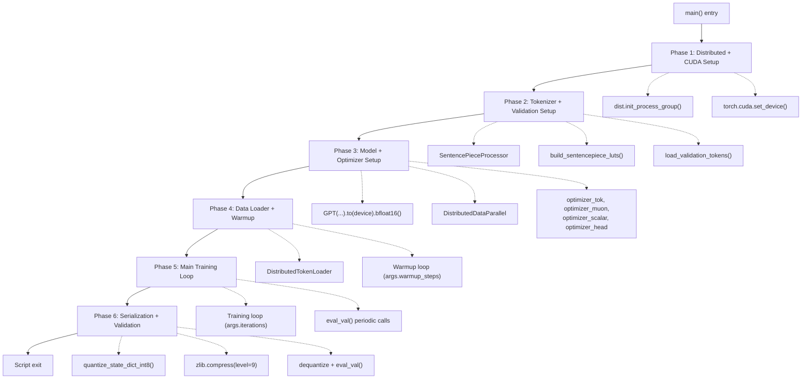
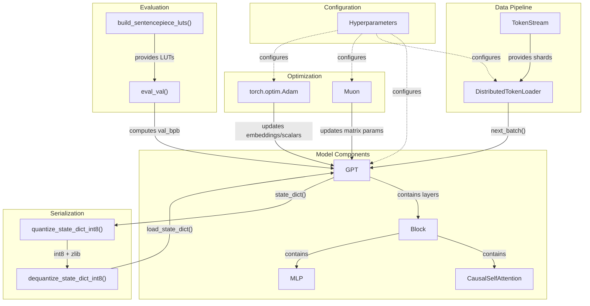
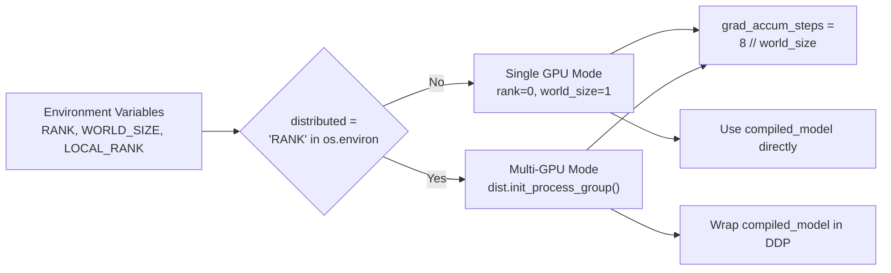
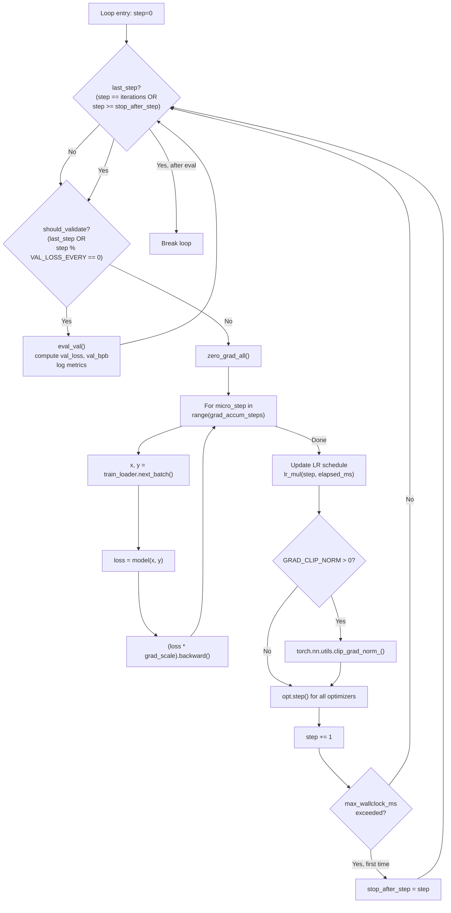

<!-- source: DeepWiki mcp.deepwiki.com · repo openai/parameter-golf · page 4.1 Training Script Overview · fetched 2026-10-26 -->

# Training Script Overview

Relevant source files

The following files were used as context for generating this wiki page:

- [records/track_10min_16mb/2026-03-17_LoRA_TTT/README.md](records/track_10min_16mb/2026-03-17_LoRA_TTT/README.md)
- [records/track_10min_16mb/2026-03-17_LoRA_TTT/ablations.png](records/track_10min_16mb/2026-03-17_LoRA_TTT/ablations.png)
- [records/track_10min_16mb/2026-03-17_LoRA_TTT/submission.json](records/track_10min_16mb/2026-03-17_LoRA_TTT/submission.json)
- [records/track_10min_16mb/2026-03-17_LoRA_TTT/train_gpt.py](records/track_10min_16mb/2026-03-17_LoRA_TTT/train_gpt.py)
- [records/track_10min_16mb/2026-03-17_LoRA_TTT/train_v0.txt](records/track_10min_16mb/2026-03-17_LoRA_TTT/train_v0.txt)
- [records/track_10min_16mb/2026-03-17_LoRA_TTT/train_v1.txt](records/track_10min_16mb/2026-03-17_LoRA_TTT/train_v1.txt)
- [records/track_10min_16mb/2026-03-17_LoRA_TTT/train_v2.txt](records/track_10min_16mb/2026-03-17_LoRA_TTT/train_v2.txt)
- [records/track_10min_16mb/2026-03-17_LoRA_TTT/train_v3.txt](records/track_10min_16mb/2026-03-17_LoRA_TTT/train_v3.txt)
- [records/track_10min_16mb/2026-03-19_Seq2048_FP16Emb_TunedLR/README.md](records/track_10min_16mb/2026-03-19_Seq2048_FP16Emb_TunedLR/README.md)
- [records/track_10min_16mb/2026-03-19_Seq2048_FP16Emb_TunedLR/submission.json](records/track_10min_16mb/2026-03-19_Seq2048_FP16Emb_TunedLR/submission.json)
- [records/track_10min_16mb/2026-03-19_Seq2048_FP16Emb_TunedLR/train_gpt.py](records/track_10min_16mb/2026-03-19_Seq2048_FP16Emb_TunedLR/train_gpt.py)
- [records/track_10min_16mb/2026-03-19_Seq2048_FP16Emb_TunedLR/train_seed1337.log](records/track_10min_16mb/2026-03-19_Seq2048_FP16Emb_TunedLR/train_seed1337.log)
- [records/track_10min_16mb/2026-03-19_Seq2048_FP16Emb_TunedLR/train_seed3.log](records/track_10min_16mb/2026-03-19_Seq2048_FP16Emb_TunedLR/train_seed3.log)
- [records/track_10min_16mb/2026-03-19_Seq2048_FP16Emb_TunedLR/train_seed42.log](records/track_10min_16mb/2026-03-19_Seq2048_FP16Emb_TunedLR/train_seed42.log)
- [train_gpt.py](train_gpt.py)

This page provides a high-level overview of `train_gpt.py`, the main training script for the Parameter Golf challenge. It covers the script's structure, orchestration flow, and how the major subsystems interact during a training run.

For detailed documentation of specific subsystems, see:
- Model architecture details: [GPT Model Architecture](#4.2)
- Optimizer implementation: [Optimization and Training Techniques](#4.3)
- Data loading mechanics: [Data Loading Pipeline](#4.4)
- Post-training compression: [Quantization and Compression](#4.5)
- MLX-based training: [Local Training with MLX](#4.6)

## Script Purpose and Design Philosophy

The `train_gpt.py` script is designed as a reference implementation and launching point for participants, not a state-of-the-art configuration. The script enforces a hard limit of 1500 lines to maintain simplicity and readability [train_gpt.py:1-5](). Competitive submissions often use modified versions of this script found in the `/records` folder [train_gpt.py:2-3]().

The script optimizes for two simultaneous constraints:
1. **Training efficiency**: Complete training in ≤10 minutes on 8xH100 GPUs [train_gpt.py:59-63]().
2. **Artifact compression**: Produce a model + code artifact ≤16,000,000 bytes.

**Sources**: [train_gpt.py:1-6](), [records/track_10min_16mb/2026-03-19_Seq2048_FP16Emb_TunedLR/README.md:1-13]()

## Main Orchestration Flow

The `main()` function orchestrates the entire training process through sequential phases:

**Sources**: [train_gpt.py:731-1123]()

## Key Classes and Their Roles

The training script is structured around several core classes that encapsulate configuration, data flow, and model components:

**Sources**: [train_gpt.py:39-87](), [train_gpt.py:112-168](), [train_gpt.py:446-494](), [train_gpt.py:648-725]()

## Hyperparameters Configuration

The `Hyperparameters` class [train_gpt.py:39-87]() centralizes all configuration via environment variables. This design allows easy experimentation without code modification:

| Category | Key Parameters | Environment Variable | Default |
|----------|---------------|---------------------|---------|
| **Data** | Data path | `DATA_PATH` | `./data/datasets/fineweb10B_sp1024` |
| | Tokenizer path | `TOKENIZER_PATH` | `./data/tokenizers/fineweb_1024_bpe.model` |
| **Model Shape** | Vocabulary size | `VOCAB_SIZE` | 1024 |
| | Number of layers | `NUM_LAYERS` | 9 |
| | Model dimension | `MODEL_DIM` | 512 |
| | Attention heads | `NUM_HEADS` | 8 |
| | KV heads (GQA) | `NUM_KV_HEADS` | 4 |
| | MLP multiplier | `MLP_MULT` | 2 |
| | Tied embeddings | `TIE_EMBEDDINGS` | 1 (True) |
| **Training Length** | Iterations | `ITERATIONS` | 20000 |
| | Batch tokens | `TRAIN_BATCH_TOKENS` | 524,288 |
| | Sequence length | `TRAIN_SEQ_LEN` | 1024 |
| | Wallclock cap (sec) | `MAX_WALLCLOCK_SECONDS` | 600.0 |
| **Optimization** | Matrix learning rate | `MATRIX_LR` | 0.04 |
| | Embedding LR | `EMBED_LR` | 0.6 |
| | Tied embed LR | `TIED_EMBED_LR` | 0.05 |
| | Scalar LR | `SCALAR_LR` | 0.04 |
| | Muon momentum | `MUON_MOMENTUM` | 0.95 |
| **Validation** | Validation frequency | `VAL_LOSS_EVERY` | 1000 |
| | Validation batch size | `VAL_BATCH_SIZE` | 524,288 |

**Sources**: [train_gpt.py:39-87]()

## Distributed Training Setup

The script supports both single-GPU and multi-GPU distributed training via PyTorch's `DistributedDataParallel`. The setup phase [train_gpt.py:742-769]() initializes the distributed environment:

The gradient accumulation strategy ensures that the global batch size remains constant (8 × `TRAIN_BATCH_TOKENS`) regardless of world size [train_gpt.py:748-751](). The script enforces that `WORLD_SIZE` must divide 8 evenly to keep `grad_accum_steps` integral [train_gpt.py:749]().

**Sources**: [train_gpt.py:742-769]()

## Training Loop Architecture

The main training loop [train_gpt.py:973-1056]() implements a simple, deterministic iteration pattern with optional wallclock-based early stopping:

Key features:
- **Gradient accumulation**: Each step performs `grad_accum_steps` forward/backward micro-steps before optimizer updates [train_gpt.py:1011-1019]().
- **Wallclock-based stopping**: When `MAX_WALLCLOCK_SECONDS` is set, the loop monitors elapsed time and stops gracefully [train_gpt.py:1049-1055]().
- **Warmdown schedule**: Learning rates decay near the end of training or when approaching the wallclock cap [train_gpt.py:924-933]().
- **Distributed sync**: Only the last micro-step synchronizes gradients across ranks [train_gpt.py:1012-1013]().

**Sources**: [train_gpt.py:973-1056](), [train_gpt.py:924-933]()

## Multi-Optimizer Strategy

Unlike typical transformer training, `train_gpt.py` uses a heterogeneous optimizer configuration [train_gpt.py:851-893]() that assigns different optimizers to different parameter groups:

| Optimizer | Parameter Group | Learning Rate | Purpose |
|-----------|----------------|---------------|---------|
| `optimizer_tok` (Adam) | `tok_emb.weight` | `TIED_EMBED_LR` or `EMBED_LR` | Token embeddings |
| `optimizer_head` (Adam) | `lm_head.weight` (if not tied) | `HEAD_LR` | Output projection |
| `optimizer_muon` (Muon) | Matrix params in `blocks.*` | `MATRIX_LR` | Transformer weight matrices |
| `optimizer_scalar` (Adam) | Vectors/scalars in `blocks.*`, `skip_weights` | `SCALAR_LR` | Normalization, scales, gains |

The Muon optimizer [train_gpt.py:112-168]() applies Newton-Schulz orthogonalization [train_gpt.py:96-109]() to matrix gradients, which provides better conditioning for large weight matrices. Control tensors matching patterns in `CONTROL_TENSOR_NAME_PATTERNS` (e.g., `attn_scale`, `resid_mix`) are handled by Adam instead of Muon [train_gpt.py:288-295]().

**Sources**: [train_gpt.py:851-893](), [train_gpt.py:112-168](), [train_gpt.py:288-295]()

## Warmup Phase

Before starting measured training, the script performs a warmup phase [train_gpt.py:937-961]() to prime PyTorch's compilation and CUDA kernels:

1. **Save initial state**: Copies model weights and optimizer states to CPU [train_gpt.py:938-939]().
2. **Run warmup iterations**: Executes `WARMUP_STEPS` (default 20) full forward/backward/optimizer cycles [train_gpt.py:941-954]().
3. **Restore initial state**: Reloads the saved weights and optimizer states [train_gpt.py:955-958]().
4. **Reset data loader**: Creates a fresh `DistributedTokenLoader` to ensure deterministic data ordering [train_gpt.py:961]().

This ensures that the timed training phase starts from true initialization with compiled code paths, eliminating first-step compilation overhead from the 10-minute clock.

**Sources**: [train_gpt.py:937-961]()

## Validation and Bits-Per-Byte Metric

The `eval_val()` function [train_gpt.py:219-278]() computes two metrics:

1. **`val_loss`**: Standard cross-entropy loss in natural log units (nats).
2. **`val_bpb`**: Bits-per-byte, the challenge's official tokenizer-agnostic metric.

The bits-per-byte calculation uses SentencePiece lookup tables created by `build_sentencepiece_luts()` [train_gpt.py:180-204]() to count the UTF-8 byte length of each token, accounting for:
- Base byte count of the token piece.
- Leading space (`▁`) contributions when preceded by non-boundary tokens.
- Special handling for control/unknown/byte tokens.

The formula is:
`val_bpb = (val_loss / ln(2)) × (total_tokens / total_bytes)` [train_gpt.py:175-178]().

This metric allows fair comparison across different tokenizers, as it measures actual compression of the raw byte stream rather than token-level perplexity.

**Sources**: [train_gpt.py:219-278](), [train_gpt.py:180-204](), [train_gpt.py:175-178]()

## Post-Training Artifact Generation

After training completes, the script produces two artifacts:

### Uncompressed State Dict
- Saved via `torch.save(base_model.state_dict(), "final_model.pt")` [train_gpt.py:1069]().
- Useful for debugging and PyTorch-native loading.
- Not submitted (too large).

### Compressed Submission Artifact
The submission artifact (`final_model.int8.ptz`) undergoes a multi-stage compression pipeline [train_gpt.py:1076-1092]():

1. **INT8 quantization** via `quantize_state_dict_int8()` [train_gpt.py:342-399]():
   - 2D tensors: Per-row scaling with 99.99984th percentile clipping.
   - 1D/0D tensors: Per-tensor scaling.
   - Small tensors (≤65,536 elements): Kept as fp16, not quantized.
   - Control tensors (matching `INT8_KEEP_FLOAT_FP32_NAME_PATTERNS`): Kept as fp32.

2. **zlib compression** at level 9 [train_gpt.py:1080]().

3. **Roundtrip validation** [train_gpt.py:1095-1119]():
   - Decompress the saved artifact.
   - Dequantize via `dequantize_state_dict_int8()` [train_gpt.py:401-422]().
   - Load into model and re-evaluate to verify quality.

The final artifact size is logged as `final_model.int8.ptz` bytes + code bytes, which must be ≤16,000,000.

**Sources**: [train_gpt.py:1068-1119](), [train_gpt.py:342-422]()

## Logging and Diagnostics

The script maintains a comprehensive log file at `logs/{RUN_ID}.txt` [train_gpt.py:772-774]() containing:

- Full source code of the script [train_gpt.py:786]().
- Python and PyTorch versions [train_gpt.py:788-789]().
- GPU information via `nvidia-smi` [train_gpt.py:790-793]().
- Configuration summary: model params, world size, batch sizes, learning rates [train_gpt.py:896-910]().
- Training step logs: `train_loss`, `train_time`, `step_avg` [train_gpt.py:1043-1046]().
- Validation logs: `val_loss`, `val_bpb` [train_gpt.py:992-995]().
- Final artifact sizes and roundtrip validation results [train_gpt.py:1088-1119]().

All logging uses the `log0()` helper [train_gpt.py:777-784](), which only executes on the master process (rank 0) to avoid duplicate output.

**Sources**: [train_gpt.py:771-794](), [train_gpt.py:1043-1046](), [train_gpt.py:992-995]()

---

