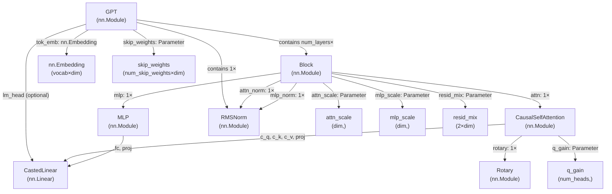
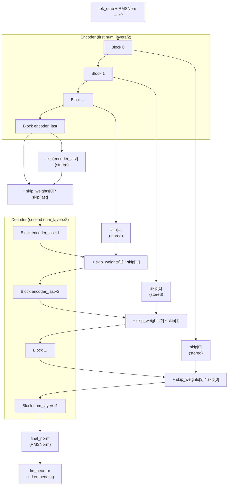

<!-- source: DeepWiki mcp.deepwiki.com · repo openai/parameter-golf · page 4.2 GPT Model Architecture · fetched 2026-10-26 -->

# GPT Model Architecture

Relevant source files

The following files were used as context for generating this wiki page:

- [records/track_10min_16mb/2026-03-17_LoRA_TTT/README.md](records/track_10min_16mb/2026-03-17_LoRA_TTT/README.md)
- [records/track_10min_16mb/2026-03-17_LoRA_TTT/ablations.png](records/track_10min_16mb/2026-03-17_LoRA_TTT/ablations.png)
- [records/track_10min_16mb/2026-03-17_LoRA_TTT/submission.json](records/track_10min_16mb/2026-03-17_LoRA_TTT/submission.json)
- [records/track_10min_16mb/2026-03-17_LoRA_TTT/train_gpt.py](records/track_10min_16mb/2026-03-17_LoRA_TTT/train_gpt.py)
- [records/track_10min_16mb/2026-03-17_LoRA_TTT/train_v0.txt](records/track_10min_16mb/2026-03-17_LoRA_TTT/train_v0.txt)
- [records/track_10min_16mb/2026-03-17_LoRA_TTT/train_v1.txt](records/track_10min_16mb/2026-03-17_LoRA_TTT/train_v1.txt)
- [records/track_10min_16mb/2026-03-17_LoRA_TTT/train_v2.txt](records/track_10min_16mb/2026-03-17_LoRA_TTT/train_v2.txt)
- [records/track_10min_16mb/2026-03-17_LoRA_TTT/train_v3.txt](records/track_10min_16mb/2026-03-17_LoRA_TTT/train_v3.txt)
- [records/track_10min_16mb/2026-03-20_10L_Int5MLP_MuonWD04_SWA50/README.md](records/track_10min_16mb/2026-03-20_10L_Int5MLP_MuonWD04_SWA50/README.md)
- [records/track_10min_16mb/2026-03-20_10L_Int5MLP_MuonWD04_SWA50/submission.json](records/track_10min_16mb/2026-03-20_10L_Int5MLP_MuonWD04_SWA50/submission.json)
- [records/track_10min_16mb/2026-03-20_10L_Int5MLP_MuonWD04_SWA50/train_gpt.py](records/track_10min_16mb/2026-03-20_10L_Int5MLP_MuonWD04_SWA50/train_gpt.py)
- [records/track_10min_16mb/2026-03-25_ValCalib_GPTQ_XSA_BigramHash3072/README.md](records/track_10min_16mb/2026-03-25_ValCalib_GPTQ_XSA_BigramHash3072/README.md)
- [records/track_10min_16mb/2026-03-25_ValCalib_GPTQ_XSA_BigramHash3072/requirements.txt](records/track_10min_16mb/2026-03-25_ValCalib_GPTQ_XSA_BigramHash3072/requirements.txt)
- [records/track_10min_16mb/2026-03-25_ValCalib_GPTQ_XSA_BigramHash3072/submission.json](records/track_10min_16mb/2026-03-25_ValCalib_GPTQ_XSA_BigramHash3072/submission.json)
- [records/track_10min_16mb/2026-03-25_ValCalib_GPTQ_XSA_BigramHash3072/train_gpt.py](records/track_10min_16mb/2026-03-25_ValCalib_GPTQ_XSA_BigramHash3072/train_gpt.py)
- [records/track_10min_16mb/2026-03-25_ValCalib_GPTQ_XSA_BigramHash3072/train_seed314.log](records/track_10min_16mb/2026-03-25_ValCalib_GPTQ_XSA_BigramHash3072/train_seed314.log)
- [records/track_10min_16mb/2026-03-25_ValCalib_GPTQ_XSA_BigramHash3072/train_seed42.log](records/track_10min_16mb/2026-03-25_ValCalib_GPTQ_XSA_BigramHash3072/train_seed42.log)
- [records/track_10min_16mb/2026-03-25_ValCalib_GPTQ_XSA_BigramHash3072/train_seed999.log](records/track_10min_16mb/2026-03-25_ValCalib_GPTQ_XSA_BigramHash3072/train_seed999.log)
- [train_gpt.py](train_gpt.py)

This document provides a detailed technical specification of the GPT model architecture implemented in Parameter Golf. It covers the model's structure, components, and forward pass logic as implemented in the `GPT` class and its constituent modules.

For information about the training loop and orchestration, see [4.1 Training Script Overview](). For details on optimizers and training techniques, see [4.3 Optimization and Training Techniques](). For post-training model compression, see [4.5 Quantization and Compression]().

---

## Model Overview

The GPT model implements a transformer-based language model with several parameter-efficient design choices optimized for the challenge constraints (16MB artifact size and 10-minute training window). The architecture uses an encoder-decoder structure with skip connections, Grouped Query Attention (GQA), Rotary Positional Embeddings (RoPE), and optional tied embeddings between input and output layers.

**Key Design Features:**
- **Encoder-decoder split with skip connections:** Improves gradient flow and allows deeper architectures within the parameter budget [train_gpt.py:704-713]().
- **Grouped Query Attention (GQA):** Reduces KV cache size and parameter count by sharing key/value heads across multiple query heads [train_gpt.py:555-565]().
- **Tied embeddings:** (Optional) Reduces parameter count by ~0.5M-1M parameters by sharing weights between the input embedding and output `lm_head` [train_gpt.py:66-69]().
- **RMSNorm:** Used for normalization with no learnable scale or bias parameters, further saving space [train_gpt.py:500-506]().
- **RoPE:** Position encoding without learned positional embeddings [train_gpt.py:524-546]().
- **ReLU² MLP activation:** A squared ReLU non-linearity found effective in recent small-model research [train_gpt.py:615-617]().
- **Logit soft-capping:** Stabilizes training by bounding logit magnitudes [train_gpt.py:719-721]().

Sources: [train_gpt.py:33-87](), [train_gpt.py:648-725](), [records/track_10min_16mb/2026-03-20_10L_Int5MLP_MuonWD04_SWA50/README.md:48-54]()

---

## Model Class Hierarchy

The following diagram bridges the architectural concepts to the specific Python classes and parameters defined in `train_gpt.py`.

Sources: [train_gpt.py:648-725](), [train_gpt.py:620-645](), [train_gpt.py:555-603](), [train_gpt.py:606-617]()

---

## Core Components

### Token Embedding Layer
The model begins with a learned token embedding layer `tok_emb` [train_gpt.py:669]().
- **Initialization:** If `tie_embeddings` is enabled, it uses `tied_embed_init_std` (default 0.005) to prevent early logit explosion [train_gpt.py:77](), [train_gpt.py:693-695]().
- **Normalization:** Embeddings are immediately normalized via `F.rms_norm` and stored as `x0`. This `x0` is used as a residual target in every block to facilitate gradient flow [train_gpt.py:701-703]().

### Transformer Blocks
Each `Block` implements pre-normalization with a specialized residual mixing mechanism.
- **`resid_mix`:** A learned parameter of shape `(2, model_dim)` that blends the current hidden state `x` with the initial embedding `x0` [train_gpt.py:628]().
- **Residual Scaling:** Outputs of the attention and MLP sub-layers are scaled by learned `attn_scale` and `mlp_scale` parameters before being added back to the residual stream [train_gpt.py:639-644]().

### Causal Self-Attention
The attention mechanism uses GQA to balance performance and parameter count.
- **Head Configuration:** Defined by `num_heads` and `num_kv_heads`. Typically, 8 query heads share 4 KV heads [train_gpt.py:65-67]().
- **Q/K Normalization:** Queries and keys are normalized using `F.rms_norm` before computing attention scores to improve training stability [train_gpt.py:588-589]().
- **`q_gain`:** A per-head learned scaling factor applied to queries after RoPE [train_gpt.py:575](), [train_gpt.py:592]().

### MLP (Feed-Forward Network)
The MLP consists of two linear layers with a hidden expansion defined by `mlp_mult`.
- **Activation:** `torch.relu(x).square()` [train_gpt.py:615]().
- **Zero Initialization:** The output projection `proj` is initialized to zeros, ensuring the block starts as an identity function [train_gpt.py:613](), [train_gpt.py:617]().

---

## Encoder-Decoder Structure with Skip Connections

The model implements a U-Net-like skip connection structure between the first half of the layers (encoder) and the second half (decoder).

**Implementation Details:**
- The `GPT.forward` method stores outputs of encoder blocks in a `skips` list [train_gpt.py:704-708]().
- Decoder blocks pop from this list and add the scaled skip connection to the current hidden state `x` [train_gpt.py:709-713]().
- The scaling is controlled by the `skip_weights` parameter [train_gpt.py:673]().

Sources: [train_gpt.py:670-673](), [train_gpt.py:704-713]()

---

## Output Layer and Soft-Capping

The final hidden state is normalized and projected to the vocabulary size.

| Feature | Implementation | Source |
| :--- | :--- | :--- |
| **Final Normalization** | `F.rms_norm(x, (x.size(-1),))` | [train_gpt.py:715]() |
| **Logit Projection** | `F.linear(x, self.tok_emb.weight)` (if tied) | [train_gpt.py:717]() |
| **Soft-Capping** | `logit_softcap * torch.tanh(logits / logit_softcap)` | [train_gpt.py:721]() |
| **Loss Function** | `F.cross_entropy(logits.float(), targets)` | [train_gpt.py:724]() |

The `logit_softcap` (default 30.0) prevents extreme values in the final layer, which is critical for stability when training with the high learning rates often used in the Muon optimizer [train_gpt.py:71]().

Sources: [train_gpt.py:715-725]()

---

## Summary of Hyperparameters

The architecture is highly configurable via the `Hyperparameters` class.

| Constant | Default | Description |
| :--- | :--- | :--- |
| `num_layers` | 9 | Total transformer blocks |
| `model_dim` | 512 | Embedding and hidden dimension |
| `num_heads` | 8 | Total attention heads |
| `num_kv_heads` | 4 | Key/Value heads for GQA |
| `mlp_mult` | 2 | Expansion factor for MLP hidden layer |
| `tie_embeddings` | 1 (True) | Share weights between input/output |
| `rope_base` | 10000.0 | Base frequency for RoPE |
| `qk_gain_init` | 1.5 | Initial scale for `q_gain` |

Sources: [train_gpt.py:63-71]()

---

