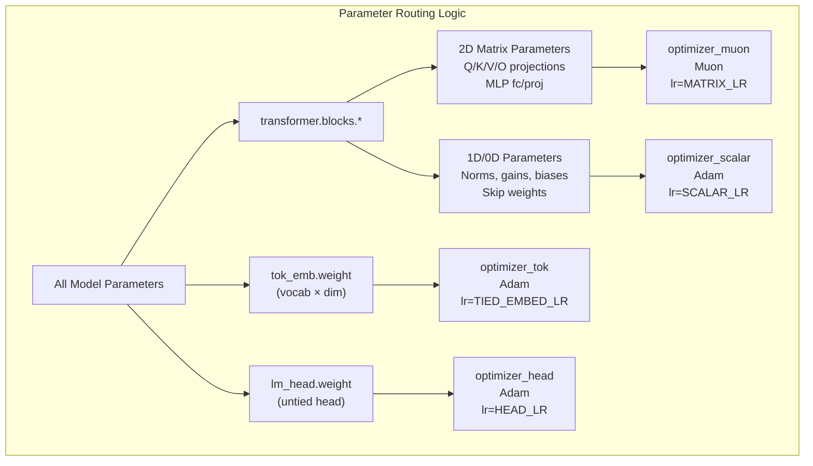
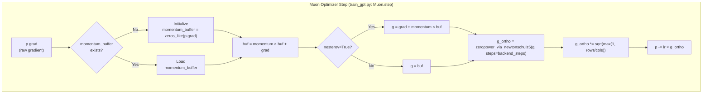
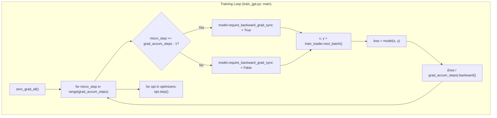

<!-- source: DeepWiki mcp.deepwiki.com · repo openai/parameter-golf · page 4.3 Optimization and Training Techniques · fetched 2026-10-26 -->

# Optimization and Training Techniques

<details>
<summary>Relevant source files</summary>

The following files were used as context for generating this wiki page:

- [records/track_10min_16mb/2026-03-17_LoRA_TTT/README.md](records/track_10min_16mb/2026-03-17_LoRA_TTT/README.md)
- [records/track_10min_16mb/2026-03-17_LoRA_TTT/ablations.png](records/track_10min_16mb/2026-03-17_LoRA_TTT/ablations.png)
- [records/track_10min_16mb/2026-03-17_LoRA_TTT/submission.json](records/track_10min_16mb/2026-03-17_LoRA_TTT/submission.json)
- [records/track_10min_16mb/2026-03-17_LoRA_TTT/train_gpt.py](records/track_10min_16mb/2026-03-17_LoRA_TTT/train_gpt.py)
- [records/track_10min_16mb/2026-03-17_LoRA_TTT/train_v0.txt](records/track_10min_16mb/2026-03-17_LoRA_TTT/train_v0.txt)
- [records/track_10min_16mb/2026-03-17_LoRA_TTT/train_v1.txt](records/track_10min_16mb/2026-03-17_LoRA_TTT/train_v1.txt)
- [records/track_10min_16mb/2026-03-17_LoRA_TTT/train_v2.txt](records/track_10min_16mb/2026-03-17_LoRA_TTT/train_v2.txt)
- [records/track_10min_16mb/2026-03-17_LoRA_TTT/train_v3.txt](records/track_10min_16mb/2026-03-17_LoRA_TTT/train_v3.txt)
- [records/track_10min_16mb/2026-03-20_10L_Int5MLP_MuonWD04_SWA50/README.md](records/track_10min_16mb/2026-03-20_10L_Int5MLP_MuonWD04_SWA50/README.md)
- [records/track_10min_16mb/2026-03-20_10L_Int5MLP_MuonWD04_SWA50/submission.json](records/track_10min_16mb/2026-03-20_10L_Int5MLP_MuonWD04_SWA50/submission.json)
- [records/track_10min_16mb/2026-03-20_10L_Int5MLP_MuonWD04_SWA50/train_gpt.py](records/track_10min_16mb/2026-03-20_10L_Int5MLP_MuonWD04_SWA50/train_gpt.py)
- [records/track_10min_16mb/2026-03-23_LeakyReLU_LegalTTT_ParallelMuon/README.md](records/track_10min_16mb/2026-03-23_LeakyReLU_LegalTTT_ParallelMuon/README.md)
- [records/track_10min_16mb/2026-03-23_LeakyReLU_LegalTTT_ParallelMuon/submission.json](records/track_10min_16mb/2026-03-23_LeakyReLU_LegalTTT_ParallelMuon/submission.json)
- [records/track_10min_16mb/2026-03-23_LeakyReLU_LegalTTT_ParallelMuon/train_gpt.py](records/track_10min_16mb/2026-03-23_LeakyReLU_LegalTTT_ParallelMuon/train_gpt.py)
- [records/track_10min_16mb/2026-03-23_LeakyReLU_LegalTTT_ParallelMuon/train_seed1337.log](records/track_10min_16mb/2026-03-23_LeakyReLU_LegalTTT_ParallelMuon/train_seed1337.log)
- [records/track_10min_16mb/2026-03-23_LeakyReLU_LegalTTT_ParallelMuon/train_seed2025.log](records/track_10min_16mb/2026-03-23_LeakyReLU_LegalTTT_ParallelMuon/train_seed2025.log)
- [records/track_10min_16mb/2026-03-23_LeakyReLU_LegalTTT_ParallelMuon/train_seed42.log](records/track_10min_16mb/2026-03-23_LeakyReLU_LegalTTT_ParallelMuon/train_seed42.log)
- [records/track_10min_16mb/2026-03-24_74M_Ternary_UNet_FP8_10L_8192BPE_YaRN_NeoMuon/run_cuda_ternary.sh](records/track_10min_16mb/2026-03-24_74M_Ternary_UNet_FP8_10L_8192BPE_YaRN_NeoMuon/run_cuda_ternary.sh)
- [records/track_10min_16mb/2026-03-24_74M_Ternary_UNet_FP8_10L_8192BPE_YaRN_NeoMuon/setup.sh](records/track_10min_16mb/2026-03-24_74M_Ternary_UNet_FP8_10L_8192BPE_YaRN_NeoMuon/setup.sh)
- [records/track_10min_16mb/2026-03-24_74M_Ternary_UNet_FP8_10L_8192BPE_YaRN_NeoMuon/submission_ternary.json](records/track_10min_16mb/2026-03-24_74M_Ternary_UNet_FP8_10L_8192BPE_YaRN_NeoMuon/submission_ternary.json)
- [records/track_10min_16mb/2026-03-24_74M_Ternary_UNet_FP8_10L_8192BPE_YaRN_NeoMuon/ternary_log_1337.txt](records/track_10min_16mb/2026-03-24_74M_Ternary_UNet_FP8_10L_8192BPE_YaRN_NeoMuon/ternary_log_1337.txt)
- [records/track_10min_16mb/2026-03-24_74M_Ternary_UNet_FP8_10L_8192BPE_YaRN_NeoMuon/ternary_log_42.txt](records/track_10min_16mb/2026-03-24_74M_Ternary_UNet_FP8_10L_8192BPE_YaRN_NeoMuon/ternary_log_42.txt)
- [records/track_10min_16mb/2026-03-24_74M_Ternary_UNet_FP8_10L_8192BPE_YaRN_NeoMuon/ternary_log_7.txt](records/track_10min_16mb/2026-03-24_74M_Ternary_UNet_FP8_10L_8192BPE_YaRN_NeoMuon/ternary_log_7.txt)
- [train_gpt.py](train_gpt.py)

</details>


This page documents the optimization algorithms, learning rate schedules, and training loop mechanics used in the Parameter Golf training pipeline. It covers the multi-optimizer strategy that combines Muon (for matrix parameters) with Adam (for embeddings and scalars), the Newton-Schulz orthogonalization procedure, gradient accumulation for distributed training, and time-based learning rate schedules.

For model architecture details, see [GPT Model Architecture](#4.2). For quantization applied after training, see [Quantization and Compression](#4.5).

---

## Multi-Optimizer Strategy

The training system uses a **parameter-type-specific optimizer assignment** rather than a single optimizer for all parameters. This design enables aggressive learning rates for different parameter types while maintaining training stability.

### Parameter Categorization

Parameters are split into groups based on their shape and role. Modern high-performance records often refine these splits further (e.g., separating tied embeddings from untied heads).

| Parameter Group | Optimizer | Default Learning Rate | Criteria | Examples |
|----------------|-----------|-----------------------|----------|----------|
| **Token Embeddings** | Adam | `EMBED_LR` (0.6) | `tok_emb.weight` | Token embedding matrix |
| **Tied Embeddings** | Adam | `TIED_EMBED_LR` (0.05) | `tok_emb.weight` (if tied) | Shared Input/Output matrix |
| **Untied LM Head** | Adam | `HEAD_LR` (0.008) | `lm_head.weight` | Final projection (if untied) |
| **Matrix Parameters** | Muon | `MATRIX_LR` (0.04) | `ndim == 2` and not control | QKV projections, MLP weights |
| **Scalar/Control** | Adam | `SCALAR_LR` (0.04) | `ndim < 2` or control pattern | Norms, scales, skip weights |

**Control tensor patterns** (kept in Adam regardless of shape): `attn_scale`, `mlp_scale`, `resid_mix`, `q_gain`, `skip_weights`, `vocab_bias`.



**Sources:** [train_gpt.py:846-893](), [train_gpt.py:73-87](), [records/track_10min_16mb/2026-03-23_LeakyReLU_LegalTTT_ParallelMuon/train_gpt.py:851-863]()

### Implementation

The parameter split is implemented in the main training setup using list comprehensions that filter by `ndim` and name patterns:

```python
# Matrix parameters: 2D tensors excluding control patterns
matrix_params = [
    p for name, p in block_named_params
    if p.ndim == 2 and not any(pattern in name for pattern in CONTROL_TENSOR_NAME_PATTERNS)
]

# Scalar/control parameters: vectors, scalars, or control patterns
scalar_params = [
    p for name, p in block_named_params
    if p.ndim < 2 or any(pattern in name for pattern in CONTROL_TENSOR_NAME_PATTERNS)
]
```

**Sources:** [train_gpt.py:851-863]()

---

## Muon Optimizer

**Muon** is a specialized optimizer for matrix-shaped parameters that applies Newton-Schulz orthogonalization to gradients before updating weights. It enables faster convergence on large weight matrices compared to standard AdamW.

### Newton-Schulz Orthogonalization

The core operation is `zeropower_via_newtonschulz5`, which orthogonalizes a 2D gradient matrix $G$ to produce an orthonormal update direction.

```python
def zeropower_via_newtonschulz5(G: Tensor, steps: int = 10, eps: float = 1e-7) -> Tensor:
    # 5th-order Newton-Schulz coefficients
    a, b, c = (3.4445, -4.7750, 2.0315)
    X = G.bfloat16()
    X /= X.norm() + eps
    transposed = G.size(0) > G.size(1)
    if transposed:
        X = X.T
    for _ in range(steps):
        A = X @ X.T
        B = b * A + c * A @ A
        X = a * X + B @ X
    return X.T if transposed else X
```

**Key properties:**
- Runs for `MUON_BACKEND_STEPS` (default: 5) iterations [train_gpt.py:81]().
- Uses `bfloat16` internally for speed [train_gpt.py:100]().
- Applied to each gradient independently before momentum accumulation.

**Sources:** [train_gpt.py:96-109](), [train_gpt.py:81]()

### Muon Optimizer Step



**Sources:** [train_gpt.py:112-168]()

### Distributed Optimization (Parallel Muon)

Advanced submissions use **Parallel Muon** to reduce synchronization overhead. Instead of standard DDP on all weights, large parameter banks are handled manually:
1. **Async Reduce-Scatter**: Gradients are reduced across ranks.
2. **Local NS**: Each rank performs Newton-Schulz on a subset of parameters.
3. **Async All-Gather**: Orthogonalized updates are gathered back.

This technique improves step time (e.g., 83.3ms vs 85ms baseline).

**Sources:** [records/track_10min_16mb/2026-03-23_LeakyReLU_LegalTTT_ParallelMuon/README.md:80-88]()

---

## Learning Rate Schedules

The system supports both **step-based** and **time-based** learning rate schedules with linear warmdown.

### Time-Based Warmdown

Time-based warmdown is critical for the 10-minute constraint. It estimates step time and starts decaying the learning rate when remaining time equals the `WARMDOWN_ITERS` duration.

```python
def lr_mul(step, elapsed_ms):
    if args.warmdown_iters > 0:
        if args.max_wallclock_seconds > 0:
            # Time-based warmdown
            step_ms = elapsed_ms / step
            warmdown_ms = args.warmdown_iters * step_ms
            remaining_ms = args.max_wallclock_seconds * 1000 - elapsed_ms
            if remaining_ms <= warmdown_ms:
                return max(0.0, remaining_ms / warmdown_ms)
        else:
            # Step-based warmdown
            warmdown_start = args.iterations - args.warmdown_iters
            if step >= warmdown_start:
                return max(0.0, (args.iterations - step) / args.warmdown_iters)
    return 1.0
```

**Sources:** [train_gpt.py:924-933](), [train_gpt.py:55](), [train_gpt.py:59]()

---

## Training Loop Mechanics

### Gradient Accumulation

Gradient accumulation splits the global batch across ranks and micro-steps. The gradient scale factor is $1 / \text{grad\_accum\_steps}$ to maintain effective batch size.



**Sources:** [train_gpt.py:1009-1034](), [train_gpt.py:748-751]()

### Mixed Precision and Casting

The model uses **bfloat16** for activations and heavy matmuls while keeping master weights and sensitive control parameters in **fp32**.

- **CastedLinear**: Weights are stored in fp32 but cast to bf16 during the forward pass [train_gpt.py:509-513]().
- **Low-Dim Params**: Norm scales and gains are restored to fp32 after model initialization [train_gpt.py:842]().
- **Autocast**: The training loop uses `torch.autocast` for compute efficiency [train_gpt.py:1015-1016]().

**Sources:** [train_gpt.py:509-513](), [train_gpt.py:842](), [train_gpt.py:1015-1016]()

---

## Advanced Techniques

### Stochastic Weight Averaging (SWA)
Modern submissions often use SWA to improve generalization. Checkpoints are collected during the warmdown phase and averaged.
- **SWA_START_FRAC**: Fraction of training (often 0.4) when averaging begins [records/track_10min_16mb/2026-03-20_10L_Int5MLP_MuonWD04_SWA50/train_gpt.py:93]().
- **SWA_EVERY**: Frequency of checkpoint collection (e.g., every 50 steps) [records/track_10min_16mb/2026-03-20_10L_Int5MLP_MuonWD04_SWA50/train_gpt.py:94]().

### Test-Time Training (TTT)
A legal TTT protocol involves a score-first sliding window evaluation where the model adapts to the validation data in a stateless manner:
1. **Score**: Eval on a 32K token chunk in `inference_mode()`.
2. **Train**: Perform SGD updates on that same chunk.
3. **Repeat**: The next chunk is scored by the model adapted on all previous chunks.

**Sources:** [records/track_10min_16mb/2026-03-23_LeakyReLU_LegalTTT_ParallelMuon/README.md:30-41](), [records/track_10min_16mb/2026-03-23_LeakyReLU_LegalTTT_ParallelMuon/README.md:45-52]()

---

