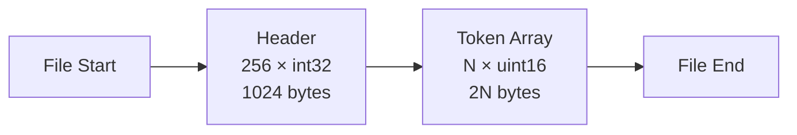
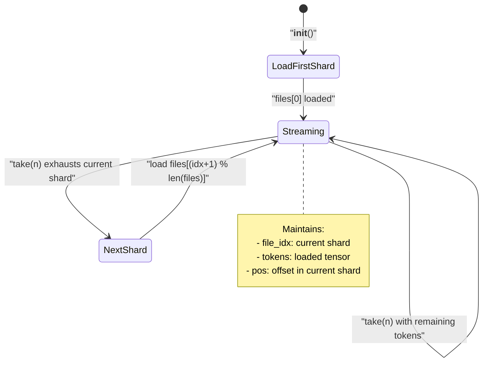
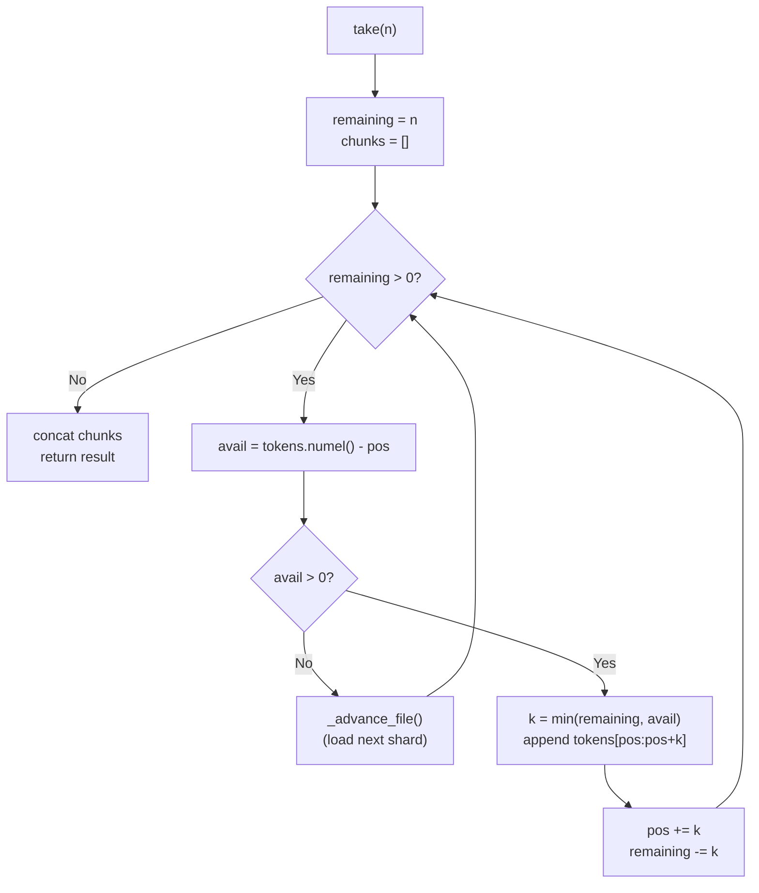
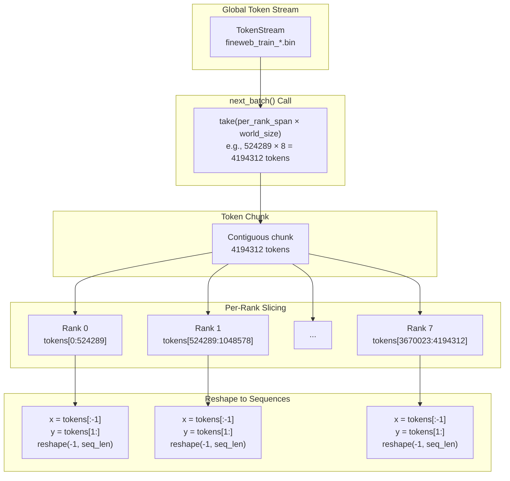
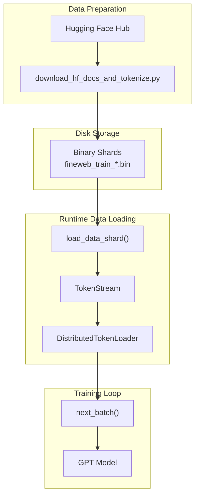

<!-- source: DeepWiki mcp.deepwiki.com · repo openai/parameter-golf · page 4.4 Data Loading Pipeline · fetched 2026-10-26 -->

# Data Loading Pipeline

<details>
<summary>Relevant source files</summary>

The following files were used as context for generating this wiki page:

- [data/README.md](data/README.md)
- [data/cached_challenge_fineweb.py](data/cached_challenge_fineweb.py)
- [data/download_hf_docs_and_tokenize.py](data/download_hf_docs_and_tokenize.py)
- [data/tokenizer_specs.json](data/tokenizer_specs.json)
- [records/track_10min_16mb/2026-03-17_LoRA_TTT/README.md](records/track_10min_16mb/2026-03-17_LoRA_TTT/README.md)
- [records/track_10min_16mb/2026-03-17_LoRA_TTT/ablations.png](records/track_10min_16mb/2026-03-17_LoRA_TTT/ablations.png)
- [records/track_10min_16mb/2026-03-17_LoRA_TTT/submission.json](records/track_10min_16mb/2026-03-17_LoRA_TTT/submission.json)
- [records/track_10min_16mb/2026-03-17_LoRA_TTT/train_gpt.py](records/track_10min_16mb/2026-03-17_LoRA_TTT/train_gpt.py)
- [records/track_10min_16mb/2026-03-17_LoRA_TTT/train_v0.txt](records/track_10min_16mb/2026-03-17_LoRA_TTT/train_v0.txt)
- [records/track_10min_16mb/2026-03-17_LoRA_TTT/train_v1.txt](records/track_10min_16mb/2026-03-17_LoRA_TTT/train_v1.txt)
- [records/track_10min_16mb/2026-03-17_LoRA_TTT/train_v2.txt](records/track_10min_16mb/2026-03-17_LoRA_TTT/train_v2.txt)
- [records/track_10min_16mb/2026-03-17_LoRA_TTT/train_v3.txt](records/track_10min_16mb/2026-03-17_LoRA_TTT/train_v3.txt)
- [records/track_10min_16mb/2026-03-17_NaiveBaseline/README.md](records/track_10min_16mb/2026-03-17_NaiveBaseline/README.md)
- [records/track_10min_16mb/2026-03-17_NaiveBaseline/submission.json](records/track_10min_16mb/2026-03-17_NaiveBaseline/submission.json)
- [records/track_10min_16mb/2026-03-17_NaiveBaseline/train.log](records/track_10min_16mb/2026-03-17_NaiveBaseline/train.log)
- [records/track_10min_16mb/2026-03-19_Seq2048_FP16Emb_TunedLR/README.md](records/track_10min_16mb/2026-03-19_Seq2048_FP16Emb_TunedLR/README.md)
- [records/track_10min_16mb/2026-03-19_Seq2048_FP16Emb_TunedLR/submission.json](records/track_10min_16mb/2026-03-19_Seq2048_FP16Emb_TunedLR/submission.json)
- [records/track_10min_16mb/2026-03-19_Seq2048_FP16Emb_TunedLR/train_gpt.py](records/track_10min_16mb/2026-03-19_Seq2048_FP16Emb_TunedLR/train_gpt.py)
- [records/track_10min_16mb/2026-03-19_Seq2048_FP16Emb_TunedLR/train_seed1337.log](records/track_10min_16mb/2026-03-19_Seq2048_FP16Emb_TunedLR/train_seed1337.log)
- [records/track_10min_16mb/2026-03-19_Seq2048_FP16Emb_TunedLR/train_seed3.log](records/track_10min_16mb/2026-03-19_Seq2048_FP16Emb_TunedLR/train_seed3.log)
- [records/track_10min_16mb/2026-03-19_Seq2048_FP16Emb_TunedLR/train_seed42.log](records/track_10min_16mb/2026-03-19_Seq2048_FP16Emb_TunedLR/train_seed42.log)
- [train_gpt.py](train_gpt.py)

</details>


This page documents the runtime data loading system used during model training. It covers how the training scripts ([train_gpt.py]()) consume pre-processed binary token shards, stream tokens efficiently, and construct batches for multi-GPU distributed training.

For information about downloading or creating these binary shards, see [Downloading Pre-processed Data](#5.2) and [Custom Data Export and Tokenization](#5.3). For the file format specifications, see [Data and Tokenizer Formats](#5.4).

## Overview

The data loading pipeline is designed for simplicity and determinism. Unlike typical PyTorch data loaders that use workers, shuffling, and sampling, this system uses **sequential streaming** with automatic wrap-around. This ensures:

- Deterministic training runs (same data order given same seed and shard configuration).
- Zero coordination overhead (no synchronization between workers).
- Minimal memory footprint (only one shard loaded at a time).
- Predictable I/O patterns (sequential file reads).

The pipeline consists of three layers:

1.  **Binary Shard Format**: Compact on-disk representation of tokenized sequences. [train_gpt.py:425-443]()
2.  **TokenStream**: Sequential reader that loads shards and wraps around indefinitely. [train_gpt.py:446-474]()
3.  **DistributedTokenLoader**: Multi-GPU batch constructor that divides token streams across ranks. [train_gpt.py:477-494]()

**Sources**: [train_gpt.py:425-494]()

## Binary Shard File Format

### File Structure

Each shard file uses a simple binary format with a 256-element `int32` header followed by `uint16` token IDs.

Title: Binary Shard File Layout

**Sources**: [train_gpt.py:429-443](), [data/download_hf_docs_and_tokenize.py:134-150]()

### Header Format

The header contains metadata and is mostly reserved for future use:

| Offset | Field | Type | Value | Description |
| :--- | :--- | :--- | :--- | :--- |
| `[0]` | Magic | `int32` | `20240520` | Format identifier |
| `[1]` | Version | `int32` | `1` | Format version |
| `[2]` | Token Count | `int32` | N | Number of tokens in file |
| `[3:255]` | Reserved | `int32` | `0` | Reserved for future use |

**Sources**: [train_gpt.py:433-435](), [data/download_hf_docs_and_tokenize.py:137-140]()

### Token Array

Following the header, tokens are stored as little-endian `uint16` values. This limits the vocabulary size to 65,536, which is sufficient for all challenge tokenizers (e.g., `sp1024` has `vocab_size=1024`).

Token arrays represent concatenated documents. Documents are tokenized independently but stored contiguously within shards.

**Sources**: [train_gpt.py:440-443](), [data/download_hf_docs_and_tokenize.py:364-387]()

### Shard Naming Convention

Training shards follow the pattern `fineweb_train_NNNNNN.bin` where `NNNNNN` is a zero-padded shard index. Validation shards use `fineweb_val_NNNNNN.bin`. The validation split always uses the first 50,000 documents and is fixed across all tokenizer variants. [train_gpt.py:42-43]()

**Sources**: [train_gpt.py:42-43](), [data/download_hf_docs_and_tokenize.py:319-321]()

## TokenStream Class

### Purpose

`TokenStream` provides infinite sequential access to tokens from a collection of shard files. It abstracts away file boundaries and automatically wraps around to the first shard after exhausting the last one.

Title: TokenStream State Machine

**Sources**: [train_gpt.py:446-474]()

### Implementation Details

The class maintains four pieces of state:
- `self.files`: List of shard file paths (sorted). [train_gpt.py:450]()
- `self.file_idx`: Index of currently loaded shard. [train_gpt.py:451]()
- `self.tokens`: Tensor of tokens from current shard. [train_gpt.py:452]()
- `self.pos`: Read position within current shard. [train_gpt.py:453]()

**Sources**: [train_gpt.py:449-455]()

### Key Methods

**`__init__(pattern: str)`**
Initializes the stream by globbing the file pattern, sorting files lexicographically to ensure consistent order, and loading the first shard. [train_gpt.py:449-455]()

**`take(n: int) -> Tensor`**
Extracts the next `n` tokens from the stream.

Title: TokenStream.take() Algorithm

The method handles cross-shard boundaries transparently by accumulating chunks until `n` tokens are collected. [train_gpt.py:462-474]()

**`_advance_file() -> None`**
Moves to the next shard with wrap-around logic. [train_gpt.py:457-460]()

## DistributedTokenLoader Class

### Purpose

`DistributedTokenLoader` wraps `TokenStream` to provide rank-aware batch construction for multi-GPU distributed training. It ensures each rank receives a disjoint span of tokens while consuming the same global stream.

Title: Multi-GPU Token Distribution

**Sources**: [train_gpt.py:477-494]()

### Batch Construction Algorithm

The `next_batch()` method constructs training batches:

1.  **Calculate per-rank allocation**: `per_rank_span = (global_tokens // (world_size * grad_accum_steps)) + 1`. The extra token is for constructing shifted (x, y) pairs. [train_gpt.py:487-488]()
2.  **Fetch global chunk**: `chunk = self.stream.take(per_rank_span * world_size)`. [train_gpt.py:489]()
3.  **Slice rank-specific span**: `local = chunk[rank * per_rank_span : (rank + 1) * per_rank_span]`. [train_gpt.py:490]()
4.  **Construct input/target pairs**:
    ```python
    x = local[:-1].reshape(-1, seq_len)
    y = local[1:].reshape(-1, seq_len)
    ```
    [train_gpt.py:491-492]()

**Sources**: [train_gpt.py:486-494]()

## Integration with Training Loop

### Data Loader Creation

The training loop creates a `DistributedTokenLoader` after distributed setup:
```python
train_loader = DistributedTokenLoader(args.train_files, rank, world_size, device)
```
[train_gpt.py:916]()

### Batch Fetching

Each training iteration fetches batches for gradient accumulation. The synchronization flag ensures DDP only performs all-reduce on the final microbatch. [train_gpt.py:1011-1018]()

### Validation Data Loading

Validation preloads all validation tokens into a single tensor at startup via `load_validation_tokens()`. [train_gpt.py:207-217]() The `eval_val()` function then partitions these sequences across ranks based on `world_size` and `rank`. [train_gpt.py:234-256]()

Recent records also introduce **Sliding Window Evaluation** (e.g., `eval_stride=64`), which uses overlapping chunks to improve BPB estimation. [records/track_10min_16mb/2026-03-19_Seq2048_FP16Emb_TunedLR/train_gpt.py:54-55]()

**Sources**: [train_gpt.py:207-256](), [train_gpt.py:916](), [train_gpt.py:1011-1018]()

## Performance Characteristics

- **I/O Efficiency**: Sequential reads front-to-back leverage OS read-ahead caching.
- **CPU Overhead**: Minimal; no on-the-fly tokenization or random number generation.
- **Memory Footprint**: Only one shard (~200MB) is loaded into memory per `TokenStream`.
- **Determinism**: All ranks stay synchronized by using the same lexicographically sorted file list and identical request sizes. [train_gpt.py:446-494]()

Title: Data Loading in Context

**Sources**: [train_gpt.py:425-494](), [data/download_hf_docs_and_tokenize.py:1-627]()

---

