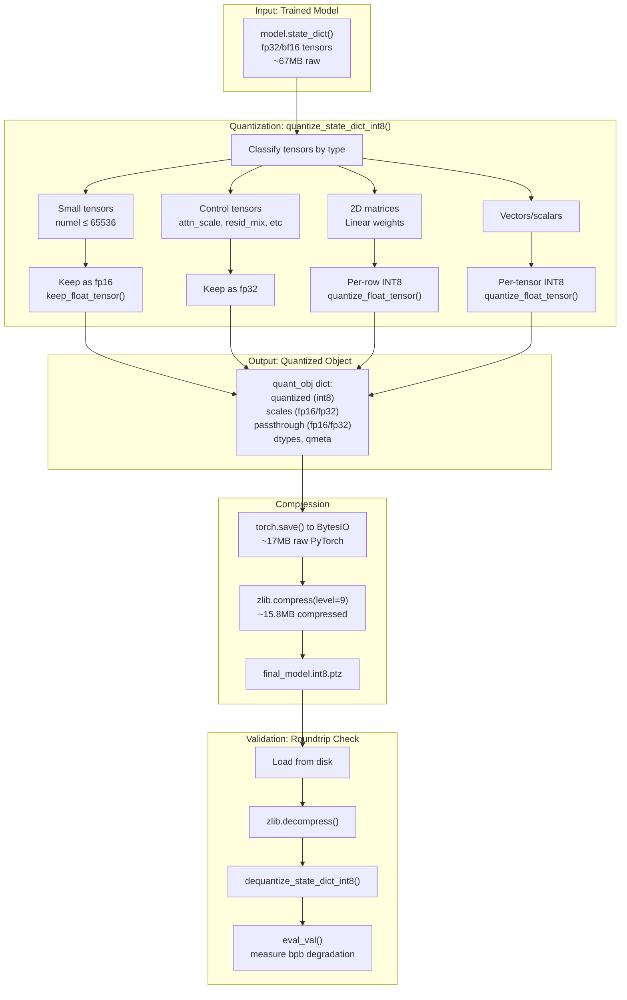
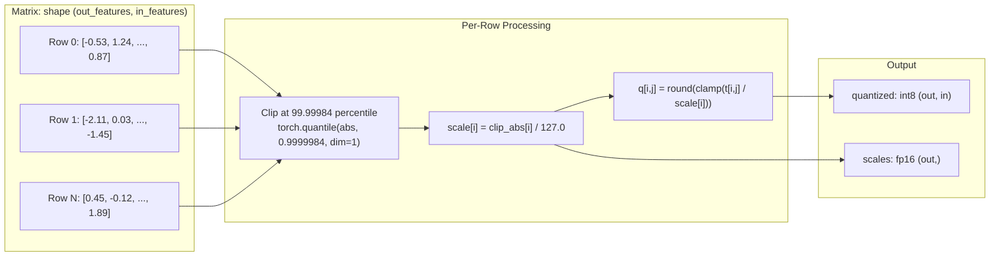
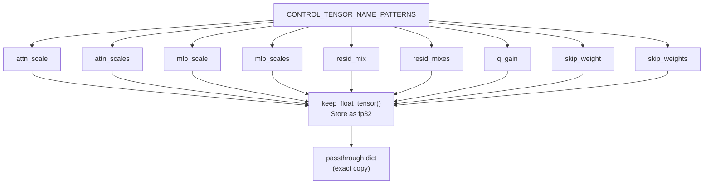
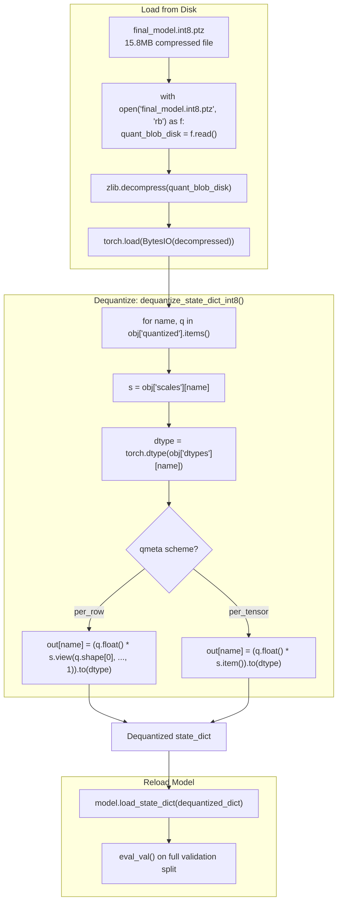

<!-- source: DeepWiki mcp.deepwiki.com · repo openai/parameter-golf · page 4.5 Quantization and Compression · fetched 2026-10-26 -->

# Quantization and Compression

<details>
<summary>Relevant source files</summary>

The following files were used as context for generating this wiki page:

- [records/track_10min_16mb/2026-03-17_LoRA_TTT/README.md](records/track_10min_16mb/2026-03-17_LoRA_TTT/README.md)
- [records/track_10min_16mb/2026-03-17_LoRA_TTT/ablations.png](records/track_10min_16mb/2026-03-17_LoRA_TTT/ablations.png)
- [records/track_10min_16mb/2026-03-17_LoRA_TTT/submission.json](records/track_10min_16mb/2026-03-17_LoRA_TTT/submission.json)
- [records/track_10min_16mb/2026-03-17_LoRA_TTT/train_gpt.py](records/track_10min_16mb/2026-03-17_LoRA_TTT/train_gpt.py)
- [records/track_10min_16mb/2026-03-17_LoRA_TTT/train_v0.txt](records/track_10min_16mb/2026-03-17_LoRA_TTT/train_v0.txt)
- [records/track_10min_16mb/2026-03-17_LoRA_TTT/train_v1.txt](records/track_10min_16mb/2026-03-17_LoRA_TTT/train_v1.txt)
- [records/track_10min_16mb/2026-03-17_LoRA_TTT/train_v2.txt](records/track_10min_16mb/2026-03-17_LoRA_TTT/train_v2.txt)
- [records/track_10min_16mb/2026-03-17_LoRA_TTT/train_v3.txt](records/track_10min_16mb/2026-03-17_LoRA_TTT/train_v3.txt)
- [records/track_10min_16mb/2026-03-19_Seq2048_FP16Emb_TunedLR/README.md](records/track_10min_16mb/2026-03-19_Seq2048_FP16Emb_TunedLR/README.md)
- [records/track_10min_16mb/2026-03-19_Seq2048_FP16Emb_TunedLR/submission.json](records/track_10min_16mb/2026-03-19_Seq2048_FP16Emb_TunedLR/submission.json)
- [records/track_10min_16mb/2026-03-19_Seq2048_FP16Emb_TunedLR/train_gpt.py](records/track_10min_16mb/2026-03-19_Seq2048_FP16Emb_TunedLR/train_gpt.py)
- [records/track_10min_16mb/2026-03-19_Seq2048_FP16Emb_TunedLR/train_seed1337.log](records/track_10min_16mb/2026-03-19_Seq2048_FP16Emb_TunedLR/train_seed1337.log)
- [records/track_10min_16mb/2026-03-19_Seq2048_FP16Emb_TunedLR/train_seed3.log](records/track_10min_16mb/2026-03-19_Seq2048_FP16Emb_TunedLR/train_seed3.log)
- [records/track_10min_16mb/2026-03-19_Seq2048_FP16Emb_TunedLR/train_seed42.log](records/track_10min_16mb/2026-03-19_Seq2048_FP16Emb_TunedLR/train_seed42.log)
- [records/track_10min_16mb/2026-03-20_10L_Int5MLP_MuonWD04_SWA50/README.md](records/track_10min_16mb/2026-03-20_10L_Int5MLP_MuonWD04_SWA50/README.md)
- [records/track_10min_16mb/2026-03-20_10L_Int5MLP_MuonWD04_SWA50/submission.json](records/track_10min_16mb/2026-03-20_10L_Int5MLP_MuonWD04_SWA50/submission.json)
- [records/track_10min_16mb/2026-03-20_10L_Int5MLP_MuonWD04_SWA50/train_gpt.py](records/track_10min_16mb/2026-03-20_10L_Int5MLP_MuonWD04_SWA50/train_gpt.py)
- [records/track_10min_16mb/2026-03-25_ValCalib_GPTQ_XSA_BigramHash3072/README.md](records/track_10min_16mb/2026-03-25_ValCalib_GPTQ_XSA_BigramHash3072/README.md)
- [records/track_10min_16mb/2026-03-25_ValCalib_GPTQ_XSA_BigramHash3072/requirements.txt](records/track_10min_16mb/2026-03-25_ValCalib_GPTQ_XSA_BigramHash3072/requirements.txt)
- [records/track_10min_16mb/2026-03-25_ValCalib_GPTQ_XSA_BigramHash3072/submission.json](records/track_10min_16mb/2026-03-25_ValCalib_GPTQ_XSA_BigramHash3072/submission.json)
- [records/track_10min_16mb/2026-03-25_ValCalib_GPTQ_XSA_BigramHash3072/train_gpt.py](records/track_10min_16mb/2026-03-25_ValCalib_GPTQ_XSA_BigramHash3072/train_gpt.py)
- [records/track_10min_16mb/2026-03-25_ValCalib_GPTQ_XSA_BigramHash3072/train_seed314.log](records/track_10min_16mb/2026-03-25_ValCalib_GPTQ_XSA_BigramHash3072/train_seed314.log)
- [records/track_10min_16mb/2026-03-25_ValCalib_GPTQ_XSA_BigramHash3072/train_seed42.log](records/track_10min_16mb/2026-03-25_ValCalib_GPTQ_XSA_BigramHash3072/train_seed42.log)
- [records/track_10min_16mb/2026-03-25_ValCalib_GPTQ_XSA_BigramHash3072/train_seed999.log](records/track_10min_16mb/2026-03-25_ValCalib_GPTQ_XSA_BigramHash3072/train_seed999.log)
- [train_gpt.py](train_gpt.py)

</details>


This page documents the post-training quantization and compression pipeline that reduces trained models from ~67MB (fp32/bf16) to under 16MB. The challenge constraint requires `code + compressed_model ≤ 16,000,000 bytes`, making aggressive but lossless-friendly compression essential for competitive submissions.

For information about training techniques that improve the quality of models before quantization, see [Optimization and Training Techniques](#4.3). For details on the binary shard format used for datasets, see [Data and Tokenizer Formats](#5.4).

---

## Overview: Post-Training Quantization Pipeline

The quantization system converts full-precision trained weights into an INT8 representation with minimal quality degradation, then applies zlib (or zstandard in advanced submissions) compression to the serialized artifact. The baseline submission demonstrates this achieves ~4x compression on the model payload while degrading validation performance by only 0.007 bpb.

### High-Level Pipeline



**Sources**: [train_gpt.py:1076-1119](), [train_gpt.py:342-422]()

---

## Quantization Strategy

The system uses two distinct quantization schemes based on tensor dimensionality, implemented in `quantize_float_tensor()`:

### Per-Row Quantization for Matrices

2D tensors (typically weight matrices from `nn.Linear` layers) use **per-row scaling** to better track output-channel variance. Each row gets its own scale factor, preserving relative magnitudes within output channels.



**Key implementation details**:
- Clipping percentile: `INT8_CLIP_PERCENTILE = 99.99984` [train_gpt.py:307-308]()
- Scale dtype: `INT8_PER_ROW_SCALE_DTYPE = torch.float16` [train_gpt.py:306-306]()
- Clamping range: `[-127, 127]` to maintain symmetry [train_gpt.py:332-333]()
- Metadata: `{"scheme": "per_row", "axis": 0}` stored in `qmeta` dict [train_gpt.py:388-399]()

**Sources**: [train_gpt.py:321-334](), [train_gpt.py:306-308]()

### Per-Tensor Quantization for Vectors

1D tensors and scalars use a simpler **per-tensor scale** since they lack the output-channel structure that benefits from per-row scaling.

| Property | Value |
|----------|-------|
| Clipping | `torch.quantile(t.abs().flatten(), 0.9999984)` |
| Scale type | `torch.float32` (scalar) |
| Quantization | `round(clamp(t / scale, -127, 127))` |
| Range | `[-127, 127]` |

**Sources**: [train_gpt.py:336-340]()

---

## Special Tensor Handling

Not all tensors are quantized. The system identifies several categories that maintain higher precision:

### Control Tensors (FP32 Passthrough)

Small control parameters that gate or scale activations are kept in full precision to avoid amplifying quantization errors:



These patterns match parameters in the `Block` and `GPT` classes:
- `Block.attn_scale` [train_gpt.py:635-635]()
- `Block.mlp_scale` [train_gpt.py:636-636]()
- `Block.resid_mix` [train_gpt.py:637-637]()
- `CausalSelfAttention.q_gain` [train_gpt.py:580-580]()
- `GPT.skip_weights` [train_gpt.py:673-673]()

**Sources**: [train_gpt.py:288-303](), [train_gpt.py:313-319]()

### Small Tensors (FP16 Storage)

Tensors with `numel() ≤ 65,536` are considered too small to benefit from INT8 quantization. These are downcast to `fp16` for storage:

```python
INT8_KEEP_FLOAT_MAX_NUMEL = 65_536
INT8_KEEP_FLOAT_STORE_DTYPE = torch.float16
```

During dequantization, if the tensor was originally `fp32` or `bf16`, the `passthrough_orig_dtypes` dict records this so it can be restored.

**Sources**: [train_gpt.py:304-305](), [train_gpt.py:373-377](), [train_gpt.py:415-421]()

---

## Advanced Techniques: QAT and Zstandard

Competitive submissions often use more aggressive techniques to squeeze performance under the 16MB cap.

### Straight-Through Estimator (STE) QAT
The submission "10L Int6 QAT + Zstd MLP2.6x" uses **Straight-Through Estimator (STE)** fake quantization during training [records/track_10min_16mb/2026-03-19_Seq2048_FP16Emb_TunedLR/README.md:9-9](). Each forward pass applies `fake_quantize_int6(w)`, teaching the model to be robust to quantization and effectively eliminating the "quant gap" (the difference between pre-quant and post-quant loss) [records/track_10min_16mb/2026-03-19_Seq2048_FP16Emb_TunedLR/README.md:54-54]().

### Mixed Precision Quantization
Recent records use mixed bit-widths, such as **Int5** for MLP weights (highly compressible) and **Int6** for attention weights (precision-sensitive) [records/track_10min_16mb/2026-03-20_10L_Int5MLP_MuonWD04_SWA50/README.md:32-34](). This savings allows for increasing model depth to 10 layers while staying under 16MB [records/track_10min_16mb/2026-03-20_10L_Int5MLP_MuonWD04_SWA50/README.md:36-36]().

### Zstandard Compression
While the baseline uses `zlib`, SOTA submissions use `zstandard` (zstd) with compression level 22 [records/track_10min_16mb/2026-03-19_Seq2048_FP16Emb_TunedLR/README.md:13-13](). Zstd-22 is significantly more effective at compressing quantized INT6/INT8 data than standard zlib [records/track_10min_16mb/2026-03-20_10L_Int5MLP_MuonWD04_SWA50/README.md:33-34]().

**Sources**: [records/track_10min_16mb/2026-03-19_Seq2048_FP16Emb_TunedLR/README.md:9-15](), [records/track_10min_16mb/2026-03-20_10L_Int5MLP_MuonWD04_SWA50/README.md:32-36]()

---

## Roundtrip Validation

After saving the compressed artifact, the training script validates that quantization degradation is acceptable by loading the model back and re-evaluating:



**Sources**: [train_gpt.py:1094-1119](), [train_gpt.py:401-422]()

---

## Code Reference Map

| Concept | Function/Constant | Location |
|---------|-------------------|----------|
| Main quantization entry | `quantize_state_dict_int8()` | [train_gpt.py:342-399]() |
| Main dequantization entry | `dequantize_state_dict_int8()` | [train_gpt.py:401-422]() |
| Per-row/per-tensor logic | `quantize_float_tensor()` | [train_gpt.py:321-340]() |
| Small tensor handling | `keep_float_tensor()` | [train_gpt.py:313-319]() |
| Control tensor patterns | `CONTROL_TENSOR_NAME_PATTERNS` | [train_gpt.py:288-295]() |
| Small tensor threshold | `INT8_KEEP_FLOAT_MAX_NUMEL` | [train_gpt.py:304-304]() |
| Clipping percentile | `INT8_CLIP_PERCENTILE` | [train_gpt.py:307-307]() |
| Scale dtype | `INT8_PER_ROW_SCALE_DTYPE` | [train_gpt.py:306-306]() |
| Compression application | Training loop, lines 1076-1092 | [train_gpt.py:1076-1092]() |
| Roundtrip validation | Training loop, lines 1094-1119 | [train_gpt.py:1094-1119]() |

**Sources**: [train_gpt.py:282-422](), [train_gpt.py:1062-1119]()

---

