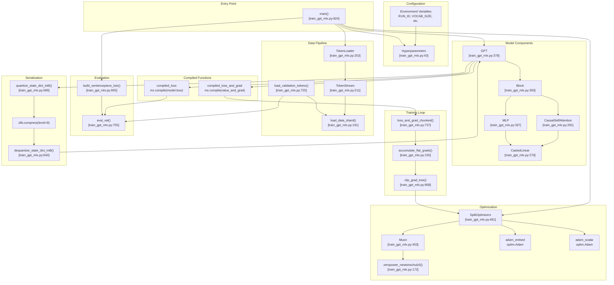
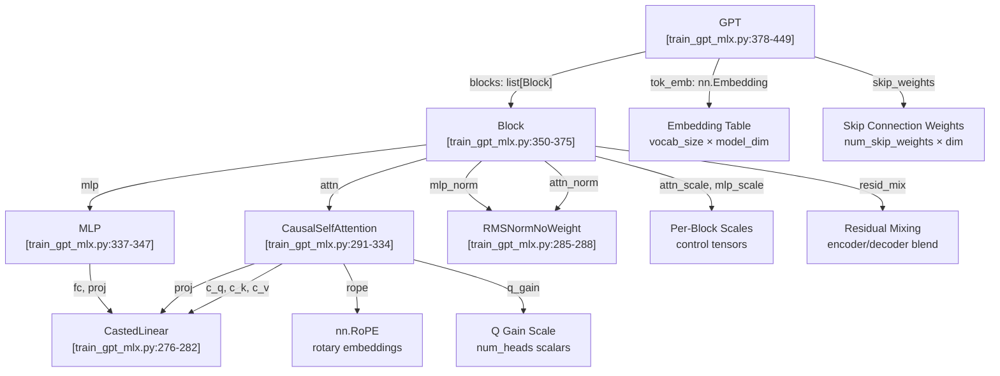

<!-- source: DeepWiki mcp.deepwiki.com · repo openai/parameter-golf · page 4.6 Local Training with MLX · fetched 2026-10-26 -->

# Local Training with MLX

Relevant source files

The following files were used as context for generating this wiki page:

- [train_gpt_mlx.py](train_gpt_mlx.py)

This page documents the MLX-based training system for Apple Silicon users, implemented in `train_gpt_mlx.py`. This training path enables rapid local iteration on Mac hardware before scaling to remote GPUs for final submissions.

For remote GPU training using PyTorch/CUDA, see [Training Script Overview](). For the overall system architecture covering both training paths, see [Overview]().

## Purpose and Scope

The MLX training system provides a complete local development workflow for participants with Apple Silicon Macs (M1, M2, M3, etc.). It implements the same GPT architecture, optimization strategy, and evaluation metrics as the CUDA training script but uses Apple's MLX framework for efficient unified memory execution on Mac hardware.

**Key characteristics:**
- **Target hardware**: Apple Silicon Macs (M1/M2/M3/M4 series)
- **Use case**: Local iteration and experimentation, not final record submissions [train_gpt_mlx.py:1-6]()
- **Completeness**: Full training pipeline including quantization and bits-per-byte evaluation
- **Compatibility**: Shares hyperparameters and data formats with `train_gpt.py` [train_gpt_mlx.py:38-42]()

**Sources:** [train_gpt_mlx.py:1-42]()

## When to Use MLX Training

The MLX path is optimized for specific scenarios in the Parameter Golf workflow:

| Scenario | Use MLX? | Reasoning |
|----------|----------|-----------|
| Initial architecture experiments | ✅ Yes | Fast iteration without GPU rental costs |
| Hyperparameter tuning | ✅ Yes | Quick feedback loop on small data subsets |
| Debugging model code | ✅ Yes | Local execution with immediate results |
| Final record submissions | ❌ No | Must use 8xH100 for official 10-minute timing |
| Large-scale training runs | ❌ No | GPU clusters provide better throughput |
| Testing quantization | ✅ Yes | Same INT8+zlib pipeline as CUDA version |

The typical workflow involves:
1. Develop and iterate locally using `train_gpt_mlx.py`.
2. Test architecture changes and hyperparameter combinations.
3. Once satisfied, transfer the configuration to `train_gpt.py` for remote GPU execution.
4. Submit the remote GPU run with verified timing to the leaderboard.

**Sources:** [train_gpt_mlx.py:1-6](), [train_gpt_mlx.py:43-98]()

## MLX vs CUDA Implementation Differences

While `train_gpt_mlx.py` implements the same model architecture and training logic as `train_gpt.py`, several implementation details differ due to MLX framework constraints and unified memory architecture:

### Core Differences

| Aspect | `train_gpt.py` (CUDA) | `train_gpt_mlx.py` (MLX) |
|--------|----------------------|--------------------------|
| **Framework** | PyTorch with CUDA | MLX (Apple framework) [train_gpt_mlx.py:24-26]() |
| **Parallelism** | Multi-GPU via DDP | Single-device only |
| **Memory model** | Discrete GPU memory | Unified memory (shared CPU/GPU) |
| **Dtype default** | `torch.bfloat16` | `mx.bfloat16` [train_gpt_mlx.py:33]() |
| **Compilation** | Optional torch.compile | Required `mx.compile` [train_gpt_mlx.py:894-903]() |
| **Gradient accumulation** | Token-based chunking | Token + memory-based chunking [train_gpt_mlx.py:61]() |
| **Linear layers** | Standard `nn.Linear` | `CastedLinear` with explicit dtype control [train_gpt_mlx.py:276-283]() |

### MLX-Specific Optimizations

1. **Memory chunking**: `MLX_MAX_MICROBATCH_TOKENS` parameter splits logical microbatches into smaller chunks to reduce peak memory pressure without changing the effective optimizer batch [train_gpt_mlx.py:61]().
2. **Eager Evaluation**: `MLX_EAGER_EVAL` forces MLX to materialize the graph after every sub-batch, preventing lazy graph buildup across accumulation steps to keep peak memory low on 16GB machines [train_gpt_mlx.py:65]().
3. **Dtype casting**: Explicit `CastedLinear` modules maintain weights in `fp32` and cast to compute dtype during the forward pass [train_gpt_mlx.py:276-283]().
4. **Warmup strategy**: Warmup compiles computation graphs without modifying parameters to avoid expensive state snapshots on unified memory [train_gpt_mlx.py:951-984]().

**Sources:** [train_gpt_mlx.py:24-34](), [train_gpt_mlx.py:61-65](), [train_gpt_mlx.py:276-283](), [train_gpt_mlx.py:894-903]()

## MLX Training System Architecture

**Figure 1: MLX Training System Data Flow**

This diagram shows the complete MLX training pipeline, mapping natural language concepts to specific code entities. The system follows a standard training loop pattern but with MLX-specific compilation and memory management.

**Sources:** [train_gpt_mlx.py:1-1089]()

## Model Implementation

The MLX GPT model follows the same architecture as the CUDA version but uses MLX primitives and explicit dtype management:

### Core Model Classes

**Figure 2: MLX Model Component Hierarchy**

### Key Implementation Details

**CastedLinear Module** [train_gpt_mlx.py:276-283]():
Weights are stored in `fp32` and cast to the compute dtype (typically `bfloat16`) during the forward pass to maintain numerical stability during accumulation [train_gpt_mlx.py:283]().

**Encoder-Decoder Architecture** [train_gpt_mlx.py:378-449]():
- First `num_layers // 2` blocks accumulate skip connections [train_gpt_mlx.py:417-421]().
- Remaining blocks consume reversed skips with learned `skip_weights` [train_gpt_mlx.py:423-429]().
- `resid_mix` enables blending current hidden state with initial embedding `x0` [train_gpt_mlx.py:418]().
- Tied embeddings: `tok_emb.weight` used for both input embedding and LM head [train_gpt_mlx.py:441]().

**Attention with RoPE and GQA** [train_gpt_mlx.py:291-334]():
- Separate Q/K/V projections with grouped-query attention [train_gpt_mlx.py:298-300]().
- RMSNorm applied to Q and K before RoPE [train_gpt_mlx.py:317-318]().
- Per-head learnable `q_gain` for initialization scaling [train_gpt_mlx.py:301]().
- MLX native `mx.fast.scaled_dot_product_attention` with causal masking [train_gpt_mlx.py:328-333]().

**Sources:** [train_gpt_mlx.py:276-449]()

## Data Loading and Batching

MLX uses the same binary shard format and tokenization as the CUDA version but implements streaming in NumPy before transferring to MLX arrays:

### TokenStream Implementation

The `TokenStream` class [train_gpt_mlx.py:211-251]() provides sequential reading across multiple shards:

1. **Shard loading**: `load_data_shard()` [train_gpt_mlx.py:191-203]() reads binary files with format validation:
   - Header: 256 int32 values (magic=20240520, version=1, num_tokens) [train_gpt_mlx.py:194-197]().
   - Tokens: uint16 values, cast to int32 for MLX [train_gpt_mlx.py:201-202]().

2. **Sequential streaming**: `TokenStream.take(n)` [train_gpt_mlx.py:240-250]() concatenates tokens across shard boundaries, automatically loading the next shard when the current is exhausted.

3. **Epoch tracking**: Emits warnings when wrapping back to the first shard [train_gpt_mlx.py:228-236]().

### Batching Strategy

**TokenLoader** [train_gpt_mlx.py:253-269]() constructs training batches:
- Takes `batch_tokens + 1` tokens to form `(input, target)` pairs [train_gpt_mlx.py:263-264]().
- Reshapes to `(batch_size, seq_len)` where `batch_size = batch_tokens // seq_len` [train_gpt_mlx.py:265-266]().

**Validation loading** [train_gpt_mlx.py:725-734]():
- Loads entire validation split into a single NumPy array [train_gpt_mlx.py:727-729]().
- Truncates to `(N * seq_len + 1)` tokens for clean batching [train_gpt_mlx.py:731-732]().

**Memory chunking** [train_gpt_mlx.py:141-152]():
The `token_chunks` function splits logical batches into memory-friendly chunks to satisfy `MLX_MAX_MICROBATCH_TOKENS` constraints [train_gpt_mlx.py:141-152]().

**Sources:** [train_gpt_mlx.py:141-269](), [train_gpt_mlx.py:725-734]()

## Optimization Strategy

MLX implements the same three-optimizer split as the CUDA version: Muon for matrices, Adam for embeddings and scalars.

### SplitOptimizers Architecture

The `SplitOptimizers` class [train_gpt_mlx.py:481-542]() orchestrates updates across parameter groups:
- **Muon**: For 2D matrix weights [train_gpt_mlx.py:495-501]().
- **Adam (Embed)**: For the tied embedding table [train_gpt_mlx.py:502-507]().
- **Adam (Scalar)**: For control tensors and small parameters [train_gpt_mlx.py:508-513]().

### Muon Optimizer for Matrices

The `Muon` class [train_gpt_mlx.py:453-478]() implements SGD-momentum with Newton-Schulz orthogonalization:

1. **Momentum warmup**: Linear warmup from `MUON_MOMENTUM_WARMUP_START` to `MUON_MOMENTUM` [train_gpt_mlx.py:462-466]().
2. **Newton-Schulz iteration** [train_gpt_mlx.py:172-188](): Fast 5-iteration approximation of matrix sign function to produce orthogonal gradients [train_gpt_mlx.py:181-186]().

### Learning Rate Schedule

The `lr_mul()` method [train_gpt_mlx.py:111-120]() implements warmdown:
- Constant LR until the warmdown phase.
- Linear decay to 0 over the final `warmdown_iters` steps.
- Supports time-based warmdown using `MAX_WALLCLOCK_SECONDS` [train_gpt_mlx.py:117-120]().

**Sources:** [train_gpt_mlx.py:111-120](), [train_gpt_mlx.py:172-188](), [train_gpt_mlx.py:453-542]()

## Memory Management and Compilation

### Gradient Accumulation with Memory Chunking

The `loss_and_grad_chunked()` function [train_gpt_mlx.py:737-752]() implements two-level chunking:
- **Level 1**: Gradient accumulation (`GRAD_ACCUM_STEPS`) to simulate large batches [train_gpt_mlx.py:57]().
- **Level 2**: Memory chunking (`MLX_MAX_MICROBATCH_TOKENS`) to limit peak memory usage per forward/backward pass [train_gpt_mlx.py:61]().

### MLX Compilation

MLX `mx.compile` captures computation graphs for faster execution [train_gpt_mlx.py:894-903]():
- `compiled_loss`: Must capture full `model.state` to include non-trainable arrays like RoPE buffers [train_gpt_mlx.py:896-898]().
- `compiled_loss_and_grad`: Uses `nn.value_and_grad` for parameter updates [train_gpt_mlx.py:900-903]().

### Warmup Strategy

The warmup phase [train_gpt_mlx.py:951-984]() primes the MLX compilation and memory allocation without updating parameters [train_gpt_mlx.py:970](). This avoids expensive state snapshots on unified memory during early training.

**Sources:** [train_gpt_mlx.py:57-65](), [train_gpt_mlx.py:737-752](), [train_gpt_mlx.py:894-903](), [train_gpt_mlx.py:951-984]()

## Validation and Metrics

### Bits-Per-Byte Calculation

The `eval_val()` function [train_gpt_mlx.py:755-802]() computes tokenizer-agnostic compression metrics by mapping tokens back to their UTF-8 byte counts using SentencePiece look-up tables [train_gpt_mlx.py:665-685]().

**Per-token byte computation** [train_gpt_mlx.py:789-794]():
Leading spaces (`▁`) contribute +1 byte when following a non-boundary token, correctly modeling SentencePiece's whitespace handling.

**Sources:** [train_gpt_mlx.py:665-685](), [train_gpt_mlx.py:755-802]()

## Quantization and Serialization

MLX implements the same INT8 quantization scheme as the CUDA version to stay under the 16MB artifact limit:

### Quantization Implementation

- **Per-row INT8 for 2D tensors** [train_gpt_mlx.py:573-580](): Uses a 99.99984th percentile clipping and float16 scales per row [train_gpt_mlx.py:598-608]().
- **Small tensor passthrough** [train_gpt_mlx.py:562-568](): Tensors ≤ 65,536 elements are kept as fp16 or fp32 [train_gpt_mlx.py:564-568]().
- **Control tensors**: Tensors matching `CONTROL_TENSOR_NAME_PATTERNS` always stay in fp32 for stability [train_gpt_mlx.py:123-130]().

### Roundtrip Validation

The script validates quantization by dequantizing the saved artifact and running a final validation pass to ensure metrics haven't degraded significantly [train_gpt_mlx.py:1074-1081]().

**Sources:** [train_gpt_mlx.py:123-130](), [train_gpt_mlx.py:545-662](), [train_gpt_mlx.py:1074-1081]()

---

