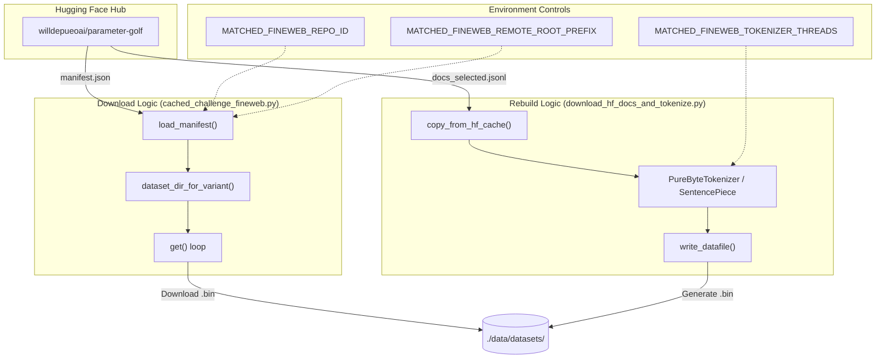
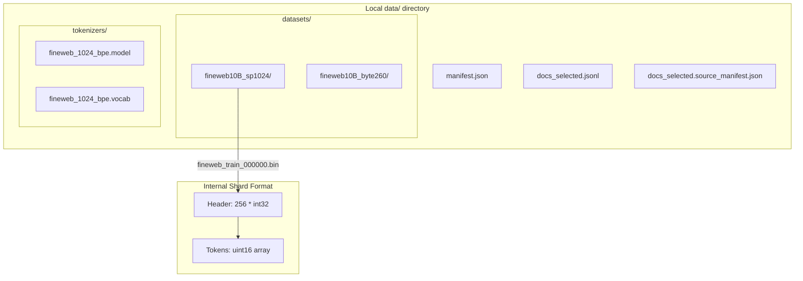

<!-- source: DeepWiki mcp.deepwiki.com · repo openai/parameter-golf · page 5 Data Infrastructure · fetched 2026-10-26 -->

# Data Infrastructure

Relevant source files

The following files were used as context for generating this wiki page:

- [README.md](README.md)
- [data/README.md](data/README.md)
- [data/cached_challenge_fineweb.py](data/cached_challenge_fineweb.py)
- [data/download_hf_docs_and_tokenize.py](data/download_hf_docs_and_tokenize.py)
- [data/tokenizer_specs.json](data/tokenizer_specs.json)
- [records/track_10min_16mb/2026-03-17_NaiveBaseline/README.md](records/track_10min_16mb/2026-03-17_NaiveBaseline/README.md)
- [records/track_10min_16mb/2026-03-17_NaiveBaseline/submission.json](records/track_10min_16mb/2026-03-17_NaiveBaseline/submission.json)
- [records/track_10min_16mb/2026-03-17_NaiveBaseline/train.log](records/track_10min_16mb/2026-03-17_NaiveBaseline/train.log)
- [requirements.txt](requirements.txt)

This document covers the data infrastructure for the Parameter Golf challenge: how datasets and tokenizers are organized, distributed, downloaded, and consumed by training scripts. It describes the dual-path architecture (downloading pre-processed binaries vs. rebuilding from source documents), the local storage layout, file formats, and the Hugging Face Hub integration.

For step-by-step instructions on downloading data for your first training run, see [Downloading Data](#2.2). For details on how training scripts consume the data, see [Data Loading Pipeline](#4.4).

## Architecture Overview

The data infrastructure provides two complementary workflows:

1.  **Download Path**: Fetch pre-processed binary shards and tokenizers from Hugging Face Hub using `cached_challenge_fineweb.py` [data/cached_challenge_fineweb.py:1-158]().
2.  **Rebuild Path**: Download canonical source documents and retokenize them using `download_hf_docs_and_tokenize.py` [data/download_hf_docs_and_tokenize.py:1-510]().

Both paths populate the same local directory structure consumed by training scripts.

### System Components and Code Entities

The following diagram maps high-level data processes to specific script functions and environment variables.

**Sources**: [data/cached_challenge_fineweb.py:10-21](), [data/cached_challenge_fineweb.py:65-73](), [data/download_hf_docs_and_tokenize.py:31-34](), [data/download_hf_docs_and_tokenize.py:134-150](), [data/README.md:1-67]()

## Local Storage Structure

The data infrastructure uses a canonical directory layout under `data/`:

| Path | Purpose | Created By |
|------|---------|------------|
| `data/datasets/fineweb10B_sp1024/` | Binary shards for sp1024 tokenizer variant | `cached_challenge_fineweb.py` or `download_hf_docs_and_tokenize.py` |
| `data/tokenizers/` | Tokenizer models and vocabularies | Both scripts |
| `data/manifest.json` | Top-level metadata for all datasets | Both scripts |
| `data/docs_selected.jsonl` | Canonical source documents (5GB) | `download_hf_docs_and_tokenize.py` |
| `data/docs_selected.source_manifest.json` | SHA256 verification for documents | `download_hf_docs_and_tokenize.py` |

**Sources**: [data/README.md:5-10](), [data/download_hf_docs_and_tokenize.py:23-24]()

## FineWeb Dataset Overview

The FineWeb dataset is a curated subset of web documents. For the challenge, it is split and sharded as follows:

- **Validation Split**: The first 50,000 documents (`NUM_VAL_DOCS = 50_000`) [data/download_hf_docs_and_tokenize.py:26]().
- **Training Split**: Sharded into blocks of 100M tokens (`SHARD_SIZE = 10**8`) [data/download_hf_docs_and_tokenize.py:27]().
- **Variants**: Supports `sp1024` (SentencePiece BPE) and `byte260` (Pure Byte) [data/cached_challenge_fineweb.py:16-21]().

For details, see [FineWeb Dataset Overview](#5.1).

## Downloading Pre-processed Data

The `cached_challenge_fineweb.py` script is the primary tool for participants to set up their environment.

- **Manifest-Driven**: It fetches a remote `manifest.json` to identify available shards and tokenizer paths [data/cached_challenge_fineweb.py:65-73]().
- **Prefix Guarantees**: Training on the first `N` shards ensures data order alignment with the baseline [data/README.md:37]().
- **Optimization**: Uses `os.link` (hard-linking) to materialize files from the Hugging Face cache without duplicating disk space [data/cached_challenge_fineweb.py:55-58]().

For details, see [Downloading Pre-processed Data](#5.2).

## Custom Data Export and Tokenization

The `download_hf_docs_and_tokenize.py` script allows participants to deviate from the standard tokenizers.

- **Verification**: Includes `docs_sha256` in `docs_selected.source_manifest.json` to verify the document list and order [data/README.md:53-54]().
- **Tokenizer Specs**: Configured via `tokenizer_specs.json`, supporting `pure_byte` and `sentencepiece_bpe` kinds [data/download_hf_docs_and_tokenize.py:192-205]().
- **Parallelization**: Controlled by `MATCHED_FINEWEB_TOKENIZER_THREADS` and `MATCHED_FINEWEB_SP_BATCH_SIZE` [data/download_hf_docs_and_tokenize.py:34-35]().

For details, see [Custom Data Export and Tokenization](#5.3).

## Data and Tokenizer Formats

### Binary Shard Format
The binary files use a specific header-first structure to facilitate fast loading:
- **Magic Number**: `20240520` [data/download_hf_docs_and_tokenize.py:29]().
- **Header**: 256 `int32` values. `header[2]` stores the token count [data/download_hf_docs_and_tokenize.py:137-140]().
- **Payload**: `uint16` tokens [data/download_hf_docs_and_tokenize.py:145]().

### Tokenizer Specifications
Tokenizers are defined in `tokenizer_specs.json` [data/tokenizer_specs.json:1-9](). The `PureByteTokenizer` class in the export script handles the raw byte encoding with a 256-byte offset [data/download_hf_docs_and_tokenize.py:39-53]().

For details, see [Data and Tokenizer Formats](#5.4).

**Sources**: [data/download_hf_docs_and_tokenize.py:29-53](), [data/download_hf_docs_and_tokenize.py:134-150](), [data/tokenizer_specs.json:1-9]()

---

