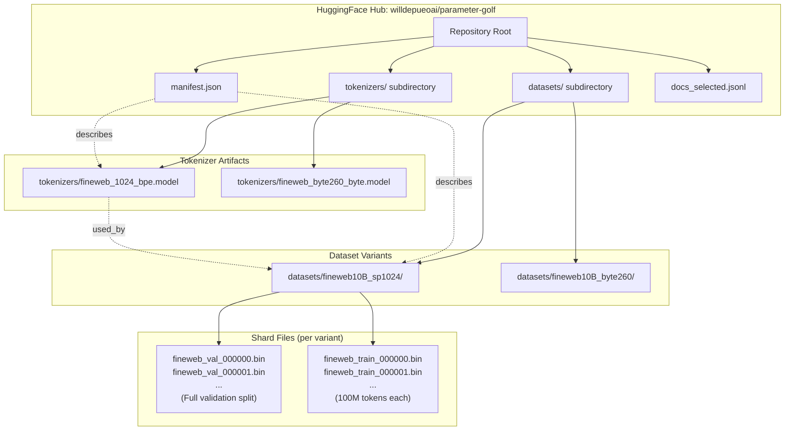
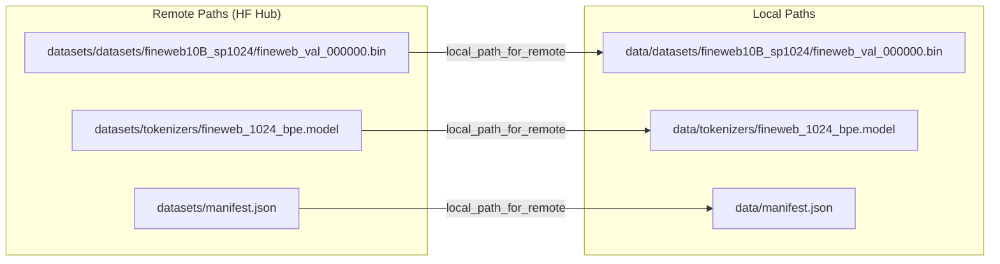
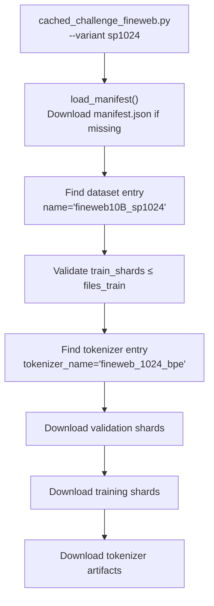

<!-- source: DeepWiki mcp.deepwiki.com · repo openai/parameter-golf · page 5.1 FineWeb Dataset Overview · fetched 2026-10-26 -->

# FineWeb Dataset Overview

<details>
<summary>Relevant source files</summary>

The following files were used as context for generating this wiki page:

- [README.md](README.md)
- [data/README.md](data/README.md)
- [data/cached_challenge_fineweb.py](data/cached_challenge_fineweb.py)
- [data/download_hf_docs_and_tokenize.py](data/download_hf_docs_and_tokenize.py)
- [data/tokenizer_specs.json](data/tokenizer_specs.json)
- [records/track_10min_16mb/2026-03-17_NaiveBaseline/README.md](records/track_10min_16mb/2026-03-17_NaiveBaseline/README.md)
- [records/track_10min_16mb/2026-03-17_NaiveBaseline/submission.json](records/track_10min_16mb/2026-03-17_NaiveBaseline/submission.json)
- [records/track_10min_16mb/2026-03-17_NaiveBaseline/train.log](records/track_10min_16mb/2026-03-17_NaiveBaseline/train.log)
- [requirements.txt](requirements.txt)

</details>


## Purpose and Scope

This page describes the FineWeb dataset used for the Parameter Golf challenge: its structure, tokenizer variants, and local storage layout. FineWeb is the evaluation dataset on which all models are scored using the bits-per-byte (BPB) metric [README.md:6]().

The challenge uses a specific subset of FineWeb, processed into binary shards of 100M tokens each [data/README.md:29](). For instructions on downloading pre-processed data, see [Downloading Pre-processed Data](#5.2). For rebuilding tokenizers or regenerating shards from source documents, see [Custom Data Export and Tokenization](#5.3).

**Sources**: [README.md:6-10](), [data/README.md:1-40]()

---

## Dataset Composition

FineWeb is a subset of the larger FineWeb corpus, preprocessed and tokenized for the challenge. The dataset consists of two splits:

- **Validation Split**: Fixed set of the first 50,000 documents from FineWeb, used for evaluation scoring [data/download_hf_docs_and_tokenize.py:26]().
- **Training Split**: Larger corpus of documents available for training, distributed across binary shards.

All models are evaluated exclusively on the validation split. The validation split is frozen and identical across all tokenizer variants, ensuring fair comparison [data/README.md:37-38]().

**Sources**: [data/download_hf_docs_and_tokenize.py:23-26](), [data/README.md:37-38]()

---

## Shard Structure

### Binary Shard Files

FineWeb data is distributed as binary shard files with a uniform naming convention [data/cached_challenge_fineweb.py:147-150]():

- `fineweb_val_NNNNNN.bin` — Validation split shards
- `fineweb_train_NNNNNN.bin` — Training split shards

Each shard is a self-contained binary file storing pre-tokenized sequences. The shard naming uses zero-padded 6-digit indexing (e.g., `fineweb_train_000000.bin`).

### Shard Sizing

Each training shard contains exactly **100,000,000 tokens** (100M tokens) [data/README.md:29](). This fixed shard size enables:

- **Prefix-based downloads**: Training scripts can request the first N shards to control dataset size [data/cached_challenge_fineweb.py:123-125]().
- **Reproducible data ordering**: The first 10 shards always contain the same 1B tokens, regardless of total download size [data/README.md:37-38]().
- **Parallel data loading**: Multi-GPU training can partition shards across ranks.

For example, the default download fetches 80 training shards (8B tokens) [data/cached_challenge_fineweb.py:99]().

**Sources**: [data/README.md:29-30](), [data/cached_challenge_fineweb.py:147-150](), [data/download_hf_docs_and_tokenize.py:27]()

---

## Dataset Structure Diagram



**Sources**: [data/cached_challenge_fineweb.py:10-14](), [data/README.md:5-10](), [data/tokenizer_specs.json:1-9]()

---

## Tokenizer Variants

FineWeb is available in multiple pre-tokenized variants. Variants are identified by a naming scheme [data/cached_challenge_fineweb.py:16-21]():

### Variant Naming Convention

| Variant Name | Tokenizer Type | Vocabulary Size | Dataset Directory |
|--------------|----------------|-----------------|-------------------|
| `sp1024` | SentencePiece BPE | 1,024 tokens | `fineweb10B_sp1024/` |
| `byte260` | Byte-level | 260 bytes | `fineweb10B_byte260/` |

### Variant Selection Logic

The `dataset_dir_for_variant()` function in `data/cached_challenge_fineweb.py` maps variant names to dataset directories [data/cached_challenge_fineweb.py:16-21]():

```python
def dataset_dir_for_variant(name: str) -> str:
    if name == "byte260":
        return "fineweb10B_byte260"
    if name.startswith("sp") and name[2:].isdigit():
        return f"fineweb10B_{name}"
    raise ValueError(f"unsupported variant {name!r}; expected byte260 or sp<VOCAB_SIZE>")
```

**Sources**: [data/cached_challenge_fineweb.py:16-21](), [data/tokenizer_specs.json:1-9]()

---

## Tokenizer Artifacts

Each tokenizer variant has associated artifact files stored in `data/tokenizers/` [data/cached_challenge_fineweb.py:14]():

### SentencePiece Tokenizers

SentencePiece tokenizers use a `.model` file containing the trained BPE model, such as `fineweb_1024_bpe.model` [data/README.md:17-20]().

### Byte-level Tokenizers

Byte-level tokenizers (e.g., `byte260`) use a simpler mapping. The `PureByteTokenizer` class handles encoding by converting UTF-8 bytes to `uint16` with a specific offset [data/download_hf_docs_and_tokenize.py:39-53]():

- `byte_offset`: 4 (reserved for pad, bos, eos, unk)
- `byte_count`: 256
- `vocab_size`: 260

### Tokenizer Metadata in Manifest

The `manifest.json` file links datasets to their tokenizers via the `tokenizer_name` field [data/cached_challenge_fineweb.py:137-140]().

**Sources**: [data/download_hf_docs_and_tokenize.py:39-53](), [data/cached_challenge_fineweb.py:76-84](), [data/cached_challenge_fineweb.py:137-140]()

---

## Local Directory Layout

When downloaded, FineWeb data is organized in the local `data/` directory as follows [data/README.md:5-10]():

```
data/
├── datasets/
│   ├── fineweb10B_sp1024/
│   │   ├── fineweb_val_000000.bin
│   │   ├── fineweb_val_000001.bin
│   │   ├── fineweb_train_000000.bin
│   │   └── ...
│   └── fineweb10B_byte260/
│       └── ...
├── tokenizers/
│   ├── fineweb_1024_bpe.model
│   └── fineweb_byte260_byte.model
├── manifest.json
├── docs_selected.jsonl
└── docs_selected.source_manifest.json
```

### Directory Structure Mapping

The local path mapping logic in `data/cached_challenge_fineweb.py` handles the translation from remote Hugging Face paths to local storage [data/cached_challenge_fineweb.py:24-32]():



**Sources**: [data/cached_challenge_fineweb.py:12-14](), [data/cached_challenge_fineweb.py:24-32](), [data/README.md:5-10]()

---

## Download Defaults and Shard Counts

### Default Download Configuration

When running `data/cached_challenge_fineweb.py` without arguments, the following defaults apply [data/cached_challenge_fineweb.py:99-106]():

| Parameter | Default Value | Description |
|-----------|---------------|-------------|
| `--variant` | `sp1024` | Tokenizer variant to download |
| `--train-shards` | `80` | Number of training shards (8B tokens) |

### Shard Count Calculation

The download script reads shard counts from `manifest.json` using the `files_train` and `files_val` stats [data/cached_challenge_fineweb.py:131-132]().

**Sources**: [data/cached_challenge_fineweb.py:99-106](), [data/cached_challenge_fineweb.py:131-136]()

---

## Validation Split Properties

### Fixed Document Set

The validation split consists of the first 50,000 documents from FineWeb [data/download_hf_docs_and_tokenize.py:26](). Key properties:

- **Frozen across runs**: Same documents regardless of download time [data/README.md:37-38]().
- **Tokenizer-independent**: Same source documents are tokenized differently per variant.
- **Always complete**: Downloads always fetch the full validation split [data/cached_challenge_fineweb.py:147-148]().

### Evaluation Usage

Training scripts evaluate models on the validation split to compute:

- **Cross-entropy loss**: Standard language modeling loss [records/track_10min_16mb/2026-03-17_NaiveBaseline/submission.json:7]().
- **Bits-per-byte (BPB)**: Tokenizer-agnostic compression metric [README.md:6]().

**Sources**: [data/download_hf_docs_and_tokenize.py:26](), [data/README.md:37-38](), [records/track_10min_16mb/2026-03-17_NaiveBaseline/submission.json:7-8]()

---

## Training Split Properties

### Prefix-Based Sampling

Training shards are numbered sequentially, enabling prefix-based sampling [data/cached_challenge_fineweb.py:149-150]():

- Download first 80 shards → Train on 8B tokens [data/README.md:21]().
- Download first 100 shards → Train on 10B tokens [data/README.md:29]().

### Distributed Loading

Multi-GPU training partitions shards across ranks. For example, in the baseline log, the `train_loader` is initialized with 25 shards for the `fineweb10B_sp1024` dataset [records/track_10min_16mb/2026-03-17_NaiveBaseline/train.log:48]().

**Sources**: [data/README.md:21-30](), [records/track_10min_16mb/2026-03-17_NaiveBaseline/train.log:48-49]()

---

## Manifest-Driven Architecture

The `manifest.json` file serves as the source of truth for dataset metadata. The `load_manifest()` function in `data/cached_challenge_fineweb.py` ensures it is available before processing downloads [data/cached_challenge_fineweb.py:65-73]().



**Sources**: [data/cached_challenge_fineweb.py:65-73](), [data/cached_challenge_fineweb.py:127-153]()

---

## Canonical Source Documents

### docs_selected.jsonl

The `docs_selected.jsonl` file contains the canonical source documents used to generate all tokenizer variants [data/download_hf_docs_and_tokenize.py:23]().

### docs_selected.source_manifest.json

The sidecar manifest file (`SIDECAR_FILENAME`) provides verification metadata, including `docs_sha256`, so users can verify they are rebuilding from the exact same document list [data/download_hf_docs_and_tokenize.py:24](), [data/README.md:53-54]().

**Sources**: [data/download_hf_docs_and_tokenize.py:23-24](), [data/README.md:53-54]()

---

