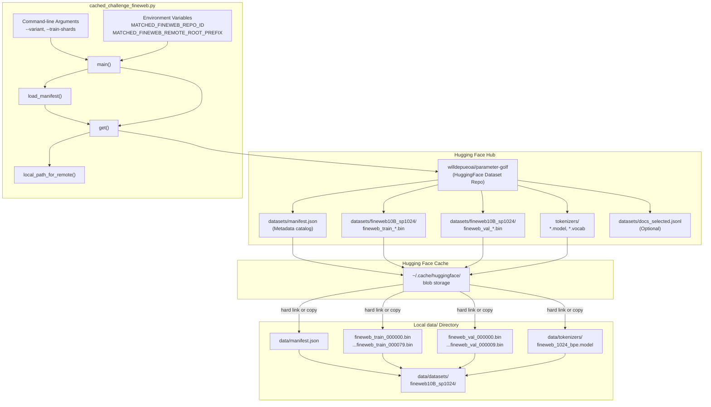
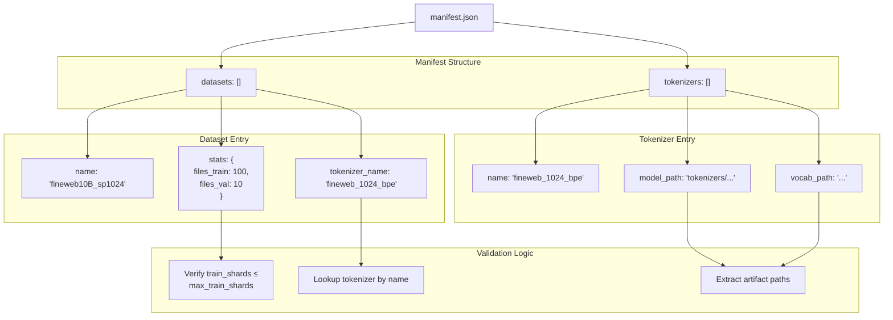
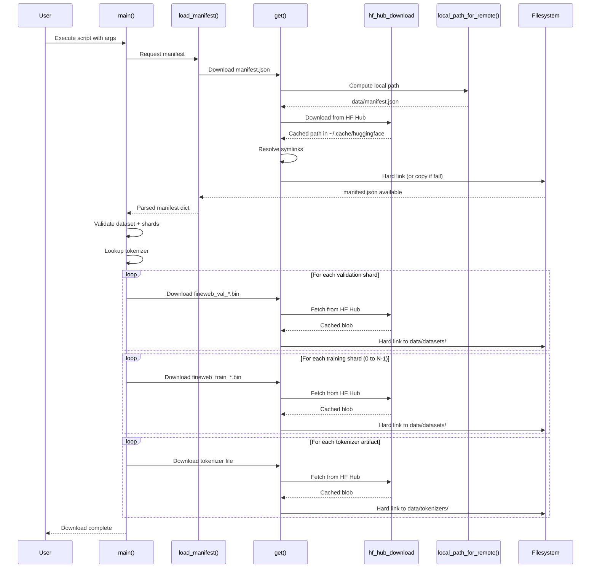
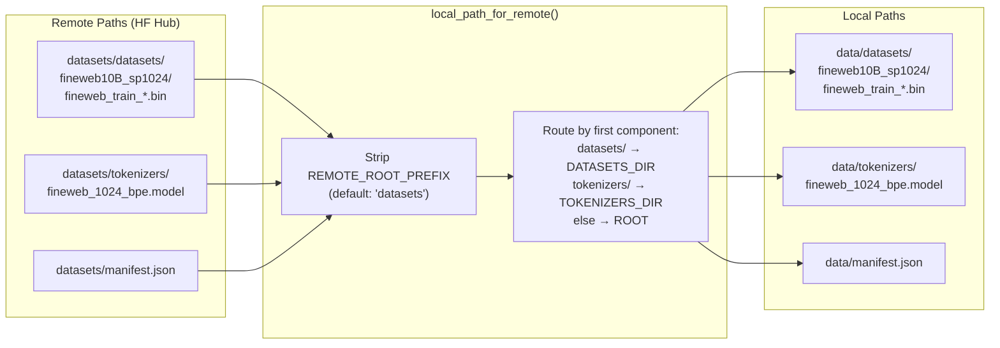

<!-- source: DeepWiki mcp.deepwiki.com · repo openai/parameter-golf · page 5.2 Downloading Pre-processed Data · fetched 2026-10-26 -->

# Downloading Pre-processed Data

<details>
<summary>Relevant source files</summary>

The following files were used as context for generating this wiki page:

- [data/README.md](data/README.md)
- [data/cached_challenge_fineweb.py](data/cached_challenge_fineweb.py)
- [data/download_hf_docs_and_tokenize.py](data/download_hf_docs_and_tokenize.py)
- [data/tokenizer_specs.json](data/tokenizer_specs.json)
- [records/track_10min_16mb/2026-03-17_NaiveBaseline/README.md](records/track_10min_16mb/2026-03-17_NaiveBaseline/README.md)
- [records/track_10min_16mb/2026-03-17_NaiveBaseline/submission.json](records/track_10min_16mb/2026-03-17_NaiveBaseline/submission.json)
- [records/track_10min_16mb/2026-03-17_NaiveBaseline/train.log](records/track_10min_16mb/2026-03-17_NaiveBaseline/train.log)

</details>


This page documents `cached_challenge_fineweb.py`, the primary script for downloading pre-processed FineWeb datasets and tokenizers from Hugging Face Hub. This is the recommended quick-start path for participants who want to use the standard tokenizer families (sp1024, sp4096, byte260, etc.) without rebuilding from scratch.

For an overview of what the FineWeb dataset contains, see [FineWeb Dataset Overview](#5.1). For rebuilding tokenizers or re-exporting shards from canonical documents, see [Custom Data Export and Tokenization](#5.3).

## Purpose and Scope

The `cached_challenge_fineweb.py` script provides a manifest-driven downloader that:
- Fetches pre-tokenized binary shards from the Hugging Face Hub repository `willdepueoai/parameter-golf` [data/cached_challenge_fineweb.py:10]().
- Downloads only the necessary validation and training shards based on user-specified limits [data/cached_challenge_fineweb.py:97-101]().
- Retrieves tokenizer artifacts (`.model`, `.vocab` files) for the selected variant [data/cached_challenge_fineweb.py:76-84]().
- Populates the local `data/datasets/` and `data/tokenizers/` directories with a reproducible layout [data/cached_challenge_fineweb.py:12-14]().
- Ensures shard prefix consistency for reproducibility (downloading N shards always means the first N shards) [data/cached_challenge_fineweb.py:149-150]().

This script does NOT retokenize documents or train tokenizers. For those operations, see [Custom Data Export and Tokenization](#5.3).

**Sources:** [data/README.md:1-40](), [data/cached_challenge_fineweb.py:1-158]()

## System Architecture

The following diagram illustrates the relationship between the Hugging Face Hub repository, the local download script, and the resulting directory structure.

### Data Flow and Code Entities


**Sources:** [data/cached_challenge_fineweb.py:10-158]()

## Command-Line Usage

### Basic Download

The most common usage downloads 8B training tokens (80 shards) for the sp1024 tokenizer variant:

```bash
python3 data/cached_challenge_fineweb.py --variant sp1024
```

This command [data/cached_challenge_fineweb.py:120-154]():
1. Downloads `manifest.json` to verify available shards.
2. Downloads all validation shards (e.g., 10 files for sp1024).
3. Downloads the first 80 training shards.
4. Downloads the tokenizer model file associated with the variant.

**Sources:** [data/README.md:14-21]()

### Downloading More Training Data

To download more training shards, specify `--train-shards` [data/cached_challenge_fineweb.py:97-101]():

```bash
python3 data/cached_challenge_fineweb.py --variant sp1024 --train-shards 180
```

The maximum number of available shards depends on the variant and is validated against the manifest [data/cached_challenge_fineweb.py:133-136](). For standard 10B token exports, the maximum is 100 shards (100M tokens per shard).

**Sources:** [data/README.md:23-28](), [data/cached_challenge_fineweb.py:96-101]()

### Supported Variants

Common tokenizer variants mapping to directory names [data/cached_challenge_fineweb.py:16-21]():

| Variant | Dataset Directory | Vocab Size | Tokenizer Type |
|---------|-------------------|------------|----------------|
| `sp1024` | `fineweb10B_sp1024` | 1024 | SentencePiece BPE |
| `sp4096` | `fineweb10B_sp4096` | 4096 | SentencePiece BPE |
| `byte260` | `fineweb10B_byte260` | 260 | Byte-level |

**Sources:** [data/cached_challenge_fineweb.py:16-21]()

### Optional: Downloading Canonical Documents

To also download the canonical document set for tokenizer retraining [data/cached_challenge_fineweb.py:113-116]():

```bash
python3 data/cached_challenge_fineweb.py --variant sp1024 --with-docs
```

This additionally downloads [data/cached_challenge_fineweb.py:142-144]():
- `data/docs_selected.jsonl` - The canonical document set.
- `data/docs_selected.source_manifest.json` - SHA256 verification manifest.

**Sources:** [data/README.md:44-54](), [data/cached_challenge_fineweb.py:112-116](), [data/cached_challenge_fineweb.py:142-144]()

## Manifest-Driven Architecture

The download process is driven by `manifest.json`, a metadata catalog that describes available datasets, their shard counts, and associated tokenizers.

### Manifest Logic Flow


**Key Functions:**

| Function | Lines | Purpose |
|----------|-------|---------|
| `load_manifest()` | [data/cached_challenge_fineweb.py:65-73]() | Downloads and parses `manifest.json` if not cached locally. |
| `dataset_dir_for_variant()` | [data/cached_challenge_fineweb.py:16-21]() | Maps variant name (e.g., `sp1024`) to dataset directory name. |
| `artifact_paths_for_tokenizer()` | [data/cached_challenge_fineweb.py:76-84]() | Extracts downloadable file paths from tokenizer entry. |

**Validation Process:**

The script validates user input against manifest metadata [data/cached_challenge_fineweb.py:127-140]():

1. **Dataset Existence**: Verifies the dataset directory exists in the manifest.
2. **Shard Count**: Ensures `--train-shards` does not exceed `stats.files_train`.
3. **Tokenizer Association**: Confirms the tokenizer referenced by the dataset exists.

**Sources:** [data/cached_challenge_fineweb.py:65-73](), [data/cached_challenge_fineweb.py:76-84](), [data/cached_challenge_fineweb.py:127-140]()

## Environment Variables

The script supports two environment variables for advanced use cases:

### MATCHED_FINEWEB_REPO_ID

Overrides the default Hugging Face repository [data/cached_challenge_fineweb.py:10]().

**Default:** `willdepueoai/parameter-golf`

**Usage:**
```bash
MATCHED_FINEWEB_REPO_ID=your-hf-username/your-dataset-repo \
python3 data/cached_challenge_fineweb.py --variant sp1024
```

**Sources:** [data/cached_challenge_fineweb.py:10]()

### MATCHED_FINEWEB_REMOTE_ROOT_PREFIX

Specifies the subdirectory prefix within the Hugging Face repository where datasets are stored [data/cached_challenge_fineweb.py:11]().

**Default:** `datasets`

**Usage:**
```bash
MATCHED_FINEWEB_REMOTE_ROOT_PREFIX=your_50B_export_root \
python3 data/cached_challenge_fineweb.py --variant sp1024 --train-shards 100
```

This is useful when the repository contains multiple exports at different scales (e.g., 10B, 50B token exports).

**Sources:** [data/README.md:32-35](), [data/cached_challenge_fineweb.py:11]()

## Download Process Flow



**Sources:** [data/cached_challenge_fineweb.py:120-157]()

### Hard-Linking Optimization

The `get()` function implements an optimization to avoid duplicating large binary files [data/cached_challenge_fineweb.py:35-59]():

1. Compute the local destination path via `local_path_for_remote()`.
2. If the file already exists, skip download [data/cached_challenge_fineweb.py:37-38]().
3. Download the file using `hf_hub_download()` (which uses HF's cache) [data/cached_challenge_fineweb.py:44-50]().
4. Resolve symlinks to get the actual blob path (`cached_source.resolve(strict=True)`) [data/cached_challenge_fineweb.py:53]().
5. Attempt to hard link: `os.link(cached_source, destination)` [data/cached_challenge_fineweb.py:56]().
6. If hard linking fails (e.g., cross-filesystem), fall back to `shutil.copy2()` [data/cached_challenge_fineweb.py:58]().

**Benefits:**
- Saves disk space by sharing file data between HF cache and local data/.
- Instantaneous "copy" operation (just a directory entry).
- Automatic deduplication if downloading the same variant multiple times.

**Why Resolve Symlinks?**
Hugging Face Hub caches files using a content-addressed blob store with symlinks in snapshot directories. The script resolves these symlinks [data/cached_challenge_fineweb.py:51-53]() to ensure the hard link points to the actual blob, not a relative symlink that would break when placed in `data/`.

**Sources:** [data/cached_challenge_fineweb.py:35-58]()

## Path Mapping and Local Structure

### Remote-to-Local Path Mapping

The `local_path_for_remote()` function translates Hugging Face repository paths to local filesystem paths [data/cached_challenge_fineweb.py:24-32]():



**Logic:**
1. Parse the remote path as a `Path` object [data/cached_challenge_fineweb.py:25]().
2. If it starts with `REMOTE_ROOT_PREFIX`, strip that prefix [data/cached_challenge_fineweb.py:26-27]().
3. Route based on the first component [data/cached_challenge_fineweb.py:28-32]():
   - `datasets/` → Store under `DATASETS_DIR`.
   - `tokenizers/` → Store under `TOKENIZERS_DIR`.
   - Otherwise → Store directly under `ROOT` (the `data/` directory).

**Sources:** [data/cached_challenge_fineweb.py:24-32]()

### Resulting Directory Structure

After running `cached_challenge_fineweb.py --variant sp1024 --train-shards 80`, the local structure is [data/README.md:5-10]():

```
data/
├── manifest.json
├── datasets/
│   └── fineweb10B_sp1024/
│       ├── fineweb_val_000000.bin
│       ├── ...
│       ├── fineweb_val_000009.bin
│       ├── fineweb_train_000000.bin
│       ├── ...
│       └── fineweb_train_000079.bin
└── tokenizers/
    └── fineweb_1024_bpe.model
```

**Sources:** [data/README.md:5-10](), [data/cached_challenge_fineweb.py:12-14]()

## Shard Prefix Guarantees

A critical feature of the manifest-driven approach is **prefix consistency**: downloading N training shards always downloads shards `000000` through `N-1`, in order [data/cached_challenge_fineweb.py:149-150]().

### Why This Matters

Training on a subset of shards must use the exact same data order as the baseline to ensure reproducibility. If participants could download arbitrary subsets, results would be incomparable.

**From the documentation** [data/README.md:29-37]():
> "Training on the first `N` train shards means training on the prefix of the same frozen shuffled export, so the data order stays aligned with the baseline for that tokenizer family."

### Implementation

The download loop enforces prefix ordering [data/cached_challenge_fineweb.py:149-150]():

```python
for i in range(train_shards):
    get(f"{dataset_prefix}/fineweb_train_{i:06d}.bin")
```

Shards are always fetched sequentially. There is no mechanism to skip shards or download non-contiguous ranges.

**Sources:** [data/README.md:29-37](), [data/cached_challenge_fineweb.py:37-38](), [data/cached_challenge_fineweb.py:149-150]()

## Validation Shard Handling

Unlike training shards, **validation shards are always downloaded in full** [data/cached_challenge_fineweb.py:147-148]():

```python
for i in range(val_shards):
    get(f"{dataset_prefix}/fineweb_val_{i:06d}.bin")
```

This ensures consistent evaluation regardless of how many training shards are used. The validation split is fixed and relatively small, so downloading all shards has minimal overhead.

**Sources:** [data/README.md:36-37](), [data/cached_challenge_fineweb.py:131-132](), [data/cached_challenge_fineweb.py:147-148]()

## Skip Manifest Option

For advanced workflows where the manifest is already cached, use `--skip-manifest` [data/cached_challenge_fineweb.py:108-111]():

```bash
python3 data/cached_challenge_fineweb.py --variant sp1024 --skip-manifest
```

This skips re-downloading `manifest.json` but still requires it to exist locally [data/cached_challenge_fineweb.py:65-73](). If the manifest is missing, the script raises `FileNotFoundError`.

**Sources:** [data/cached_challenge_fineweb.py:65-73](), [data/cached_challenge_fineweb.py:108-111]()

## Error Handling

The script performs several validation checks and raises clear errors:

| Error Condition | Check Location | Error Message |
|----------------|----------------|---------------|
| Unsupported variant name | [data/cached_challenge_fineweb.py:16-21]() | `"unsupported variant {name!r}; expected byte260 or sp<VOCAB_SIZE>"` |
| Negative shard count | [data/cached_challenge_fineweb.py:124-125]() | `"train_shards must be non-negative"` |
| Dataset not in manifest | [data/cached_challenge_fineweb.py:128-130]() | `"dataset {dataset_dir} not found in {REMOTE_ROOT_PREFIX}/manifest.json"` |
| Requested too many shards | [data/cached_challenge_fineweb.py:133-136]() | `"{args.variant} only has {max_train_shards} training shards on {REPO_ID}, requested {train_shards}"` |
| Tokenizer not in manifest | [data/cached_challenge_fineweb.py:138-140]() | `"tokenizer {tokenizer_name} not found in {REMOTE_ROOT_PREFIX}/manifest.json"` |
| Tokenizer missing artifacts | [data/cached_challenge_fineweb.py:76-84]() | `"tokenizer entry is missing downloadable artifacts: {tokenizer_entry}"` |

**Sources:** [data/cached_challenge_fineweb.py:16-21](), [data/cached_challenge_fineweb.py:76-84](), [data/cached_challenge_fineweb.py:124-140]()

## Quick Reference

### Key Constants

| Constant | Value | Location |
|----------|-------|----------|
| `REPO_ID` (default) | `"willdepueoai/parameter-golf"` | [data/cached_challenge_fineweb.py:10]() |
| `REMOTE_ROOT_PREFIX` (default) | `"datasets"` | [data/cached_challenge_fineweb.py:11]() |
| `ROOT` | `Path(__file__).resolve().parent` | [data/cached_challenge_fineweb.py:12]() |
| `DATASETS_DIR` | `ROOT / "datasets"` | [data/cached_challenge_fineweb.py:13]() |
| `TOKENIZERS_DIR` | `ROOT / "tokenizers"` | [data/cached_challenge_fineweb.py:14]() |

**Sources:** [data/cached_challenge_fineweb.py:10-14]()

---

