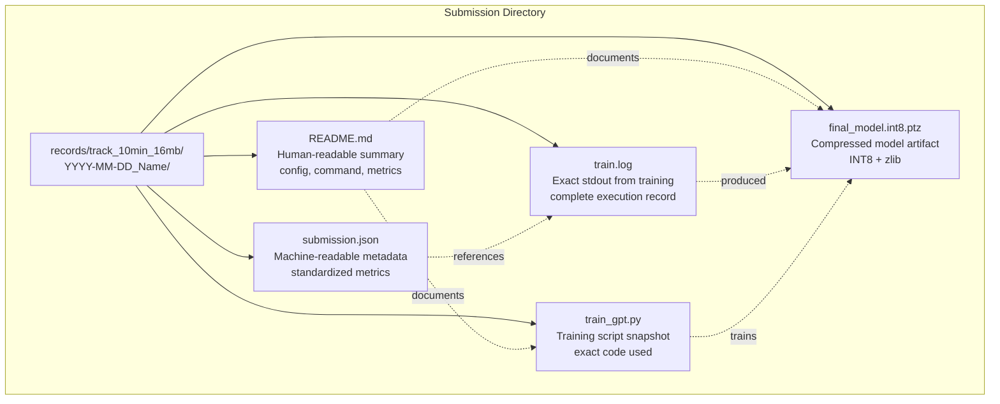
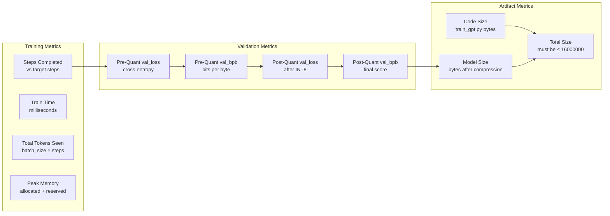
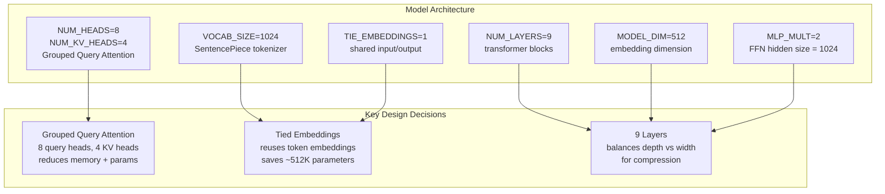
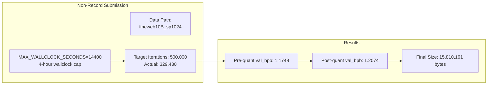

<!-- source: DeepWiki mcp.deepwiki.com · repo openai/parameter-golf · page 6 Example Submissions · fetched 2026-10-26 -->

# Example Submissions

Relevant source files

The following files were used as context for generating this wiki page:

- [records/track_10min_16mb/2026-03-17_NaiveBaseline/train_gpt.py](records/track_10min_16mb/2026-03-17_NaiveBaseline/train_gpt.py)
- [records/track_non_record_16mb/2026-03-18_Quasi10Bfrom50B_SP1024_9x512_KV4_4h_pgut3/README.md](records/track_non_record_16mb/2026-03-18_Quasi10Bfrom50B_SP1024_9x512_KV4_4h_pgut3/README.md)

This page provides detailed walkthroughs of real Parameter Golf submissions, demonstrating what a complete entry looks like from configuration to final artifacts. Each example illustrates different strategies for meeting the challenge constraints and shows how to structure a submission for validation.

For submission requirements and file formats, see [Submission Guidelines](#3.3). For detailed training system documentation, see [Training System Architecture](#4). For track definitions, see [Tracks: Record vs Non-Record](#3.4).

## Submission Anatomy

Every Parameter Golf submission follows a consistent directory structure within the `records/` folder. Understanding this structure is essential for preparing your own submissions.

**Sources:** [records/track_10min_16mb/2026-03-17_NaiveBaseline/train_gpt.py:1-5]()

### Required Files

| File | Purpose | Size Constraint |
|------|---------|----------------|
| `README.md` | Configuration summary, command, key metrics | No limit |
| `submission.json` | Structured metadata for leaderboard | No limit |
| `train.log` | Complete stdout/stderr from training run | No limit |
| `train_gpt.py` | Training script used (may include dependencies) | Counts toward 16MB |
| `final_model.int8.ptz` | Quantized, compressed model | Counts toward 16MB |

The 16MB artifact constraint applies to `train_gpt.py` + `final_model.int8.ptz` combined. The README, JSON, and log files are documentation only and do not count toward the size limit.

**Sources:** [records/track_non_record_16mb/2026-03-18_Quasi10Bfrom50B_SP1024_9x512_KV4_4h_pgut3/README.md:45-47]()

### Common Metrics to Document

All submissions should report these metrics in both README and submission.json:

**Sources:** [records/track_non_record_16mb/2026-03-18_Quasi10Bfrom50B_SP1024_9x512_KV4_4h_pgut3/README.md:38-47]()

---

## 6.1. Naive Baseline (Record Track)

The `2026-03-17_NaiveBaseline` submission demonstrates a complete record-track entry that meets all hard constraints while achieving competitive performance. This section walks through every aspect of the submission to illustrate best practices.

### Submission Location and Structure

The baseline lives in `track_10min_16mb` because it respects the 10-minute training constraint. The submission includes a `train_gpt.py` snapshot that defines the model architecture and training loop.

**Sources:** [records/track_10min_16mb/2026-03-17_NaiveBaseline/train_gpt.py:1-88]()

### Architecture Configuration

The baseline uses a parameter-efficient transformer architecture designed to fit within the 16MB constraint.

**Configuration Details:**

| Parameter | Value | Rationale |
|-----------|-------|-----------|
| `VOCAB_SIZE` | 1024 | Smaller vocab = fewer embedding params [records/track_10min_16mb/2026-03-17_NaiveBaseline/train_gpt.py:63]() |
| `NUM_LAYERS` | 9 | Depth chosen to maximize representational power [records/track_10min_16mb/2026-03-17_NaiveBaseline/train_gpt.py:64]() |
| `MODEL_DIM` | 512 | Standard width for small LMs [records/track_10min_16mb/2026-03-17_NaiveBaseline/train_gpt.py:66]() |
| `NUM_HEADS` | 8 | Multi-head attention [records/track_10min_16mb/2026-03-17_NaiveBaseline/train_gpt.py:67]() |
| `NUM_KV_HEADS` | 4 | GQA reduces KV cache size [records/track_10min_16mb/2026-03-17_NaiveBaseline/train_gpt.py:65]() |
| `MLP_MULT` | 2 | FFN expansion factor [records/track_10min_16mb/2026-03-17_NaiveBaseline/train_gpt.py:68]() |
| `TIE_EMBEDDINGS` | 1 | Shares input/output embeddings [records/track_10min_16mb/2026-03-17_NaiveBaseline/train_gpt.py:69]() |

**Sources:** [records/track_10min_16mb/2026-03-17_NaiveBaseline/train_gpt.py:62-71]()

### Training Configuration

The baseline trains with a large batch size to maximize GPU utilization within the 10-minute window.

| Hyperparameter | Value | Source |
|----------------|-------|--------|
| `TRAIN_BATCH_TOKENS` | 524,288 | [records/track_10min_16mb/2026-03-17_NaiveBaseline/train_gpt.py:57]() |
| `TRAIN_SEQ_LEN` | 1,024 | [records/track_10min_16mb/2026-03-17_NaiveBaseline/train_gpt.py:58]() |
| `MAX_WALLCLOCK_SECONDS` | 600.0 | [records/track_10min_16mb/2026-03-17_NaiveBaseline/train_gpt.py:59]() |
| `ITERATIONS` | 20,000 | [records/track_10min_16mb/2026-03-17_NaiveBaseline/train_gpt.py:54]() |

The baseline uses the `Muon` optimizer for matrix parameters, which employs Newton-Schulz iteration for orthogonalization to speed up convergence.

**Sources:** [records/track_10min_16mb/2026-03-17_NaiveBaseline/train_gpt.py:96-117]()

---

## 6.2. Extended Training Example (Non-Record Track)

The `2026-03-18_Quasi10Bfrom50B` submission represents a non-record entry. This track is for submissions that ignore the 10-minute training cap but still strictly adhere to the 16MB artifact size limit.

### Performance Analysis

This submission uses the same 9x512 architecture as the baseline but extends training to 4 hours (14,400 seconds).

**Key Metrics from the 4-hour run:**

- **Training Volume:** Saw 172.7 billion tokens compared to the baseline's ~7.2 billion [records/track_non_record_16mb/2026-03-18_Quasi10Bfrom50B_SP1024_9x512_KV4_4h_pgut3/README.md:50-51]().
- **Convergence:** Achieved a pre-quantization `val_bpb` of 1.1749, demonstrating the headroom available in the 9x512 architecture if trained longer [records/track_non_record_16mb/2026-03-18_Quasi10Bfrom50B_SP1024_9x512_KV4_4h_pgut3/README.md:40]().
- **Quantization Impact:** The post-quantization score was 1.2074, showing a ~0.03 bpb penalty for INT8 compression [records/track_non_record_16mb/2026-03-18_Quasi10Bfrom50B_SP1024_9x512_KV4_4h_pgut3/README.md:41-42]().

**Sources:** [records/track_non_record_16mb/2026-03-18_Quasi10Bfrom50B_SP1024_9x512_KV4_4h_pgut3/README.md:1-57]()

### Lessons from Non-Record Training

1. **Architecture Headroom:** The 9x512 model is capable of much lower bpb than the 10-minute baseline suggests, provided it sees more data [records/track_non_record_16mb/2026-03-18_Quasi10Bfrom50B_SP1024_9x512_KV4_4h_pgut3/README.md:39-40]().
2. **Size Constraints:** Even with unlimited compute, the 16MB cap remains the primary bottleneck for model selection [records/track_non_record_16mb/2026-03-18_Quasi10Bfrom50B_SP1024_9x512_KV4_4h_pgut3/README.md:45-47]().
3. **Evaluation Cadence:** This run used `VAL_LOSS_EVERY=20000` to minimize validation overhead during the long run [records/track_non_record_16mb/2026-03-18_Quasi10Bfrom50B_SP1024_9x512_KV4_4h_pgut3/README.md:34]().

For details on how to run your own extended training, see [Extended Training Example (Non-Record Track)](#6.2).

**Sources:** [records/track_non_record_16mb/2026-03-18_Quasi10Bfrom50B_SP1024_9x512_KV4_4h_pgut3/README.md:1-57]()

---

