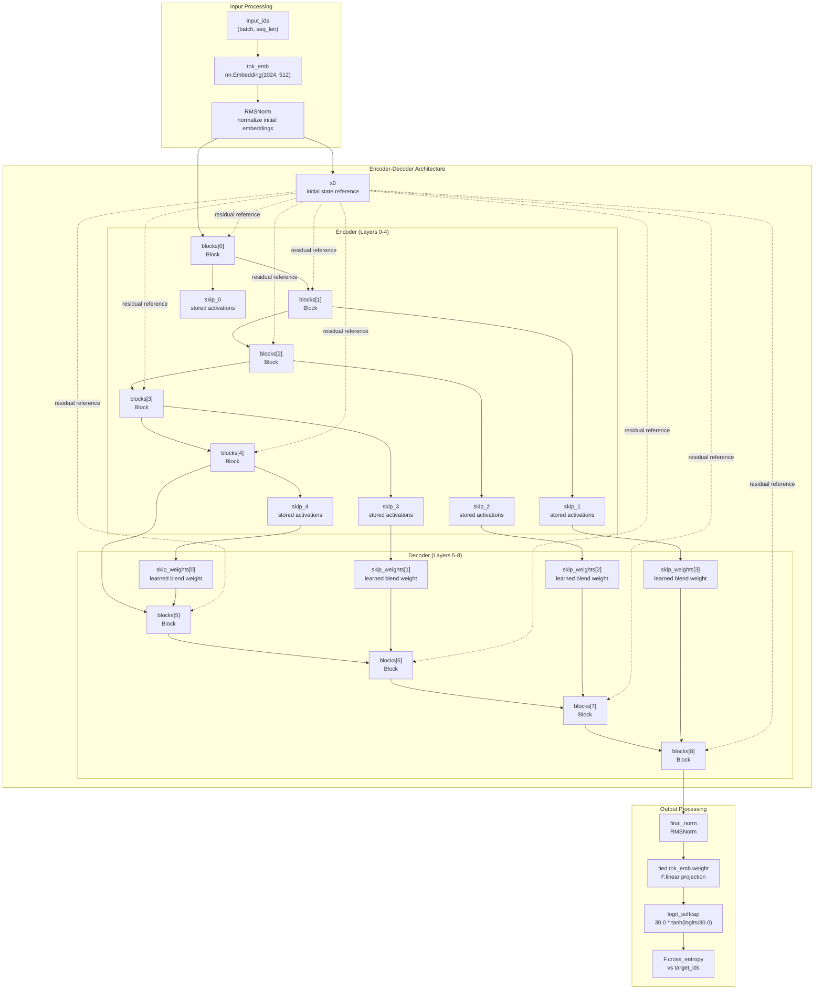
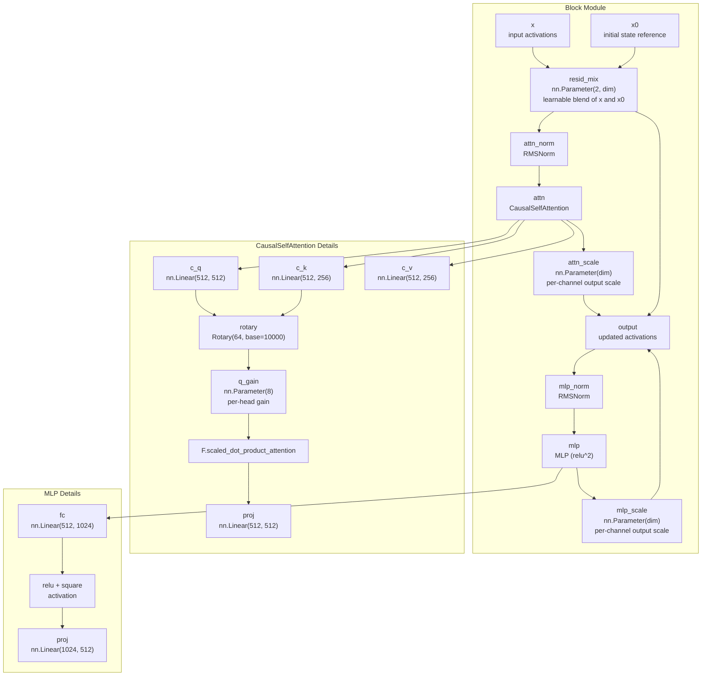
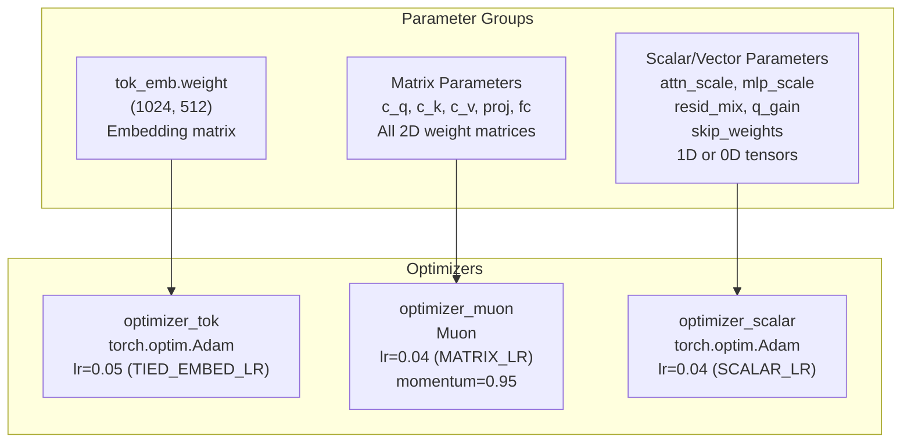
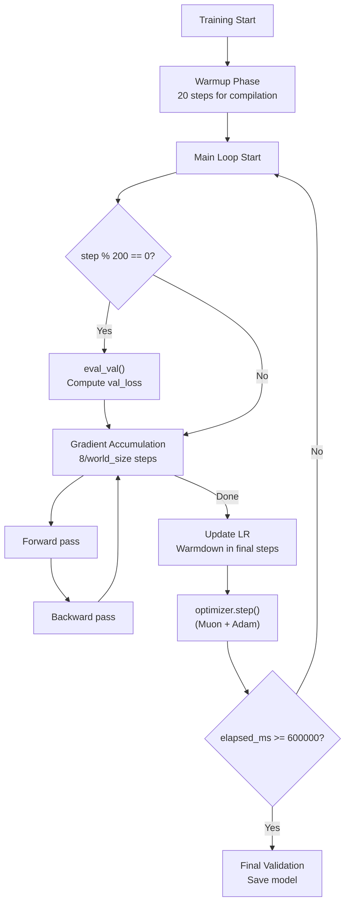

<!-- source: DeepWiki mcp.deepwiki.com · repo openai/parameter-golf · page 6.1 Naive Baseline (Record Track) · fetched 2026-10-26 -->

# Naive Baseline (Record Track)

<details>
<summary>Relevant source files</summary>

The following files were used as context for generating this wiki page:

- [data/README.md](data/README.md)
- [data/cached_challenge_fineweb.py](data/cached_challenge_fineweb.py)
- [data/download_hf_docs_and_tokenize.py](data/download_hf_docs_and_tokenize.py)
- [data/tokenizer_specs.json](data/tokenizer_specs.json)
- [records/track_10min_16mb/2026-03-17_NaiveBaseline/README.md](records/track_10min_16mb/2026-03-17_NaiveBaseline/README.md)
- [records/track_10min_16mb/2026-03-17_NaiveBaseline/submission.json](records/track_10min_16mb/2026-03-17_NaiveBaseline/submission.json)
- [records/track_10min_16mb/2026-03-17_NaiveBaseline/train.log](records/track_10min_16mb/2026-03-17_NaiveBaseline/train.log)
- [records/track_10min_16mb/2026-03-17_NaiveBaseline/train_gpt.py](records/track_10min_16mb/2026-03-17_NaiveBaseline/train_gpt.py)

</details>


This document provides a complete walkthrough of the baseline submission in the record track ([records/track_10min_16mb/2026-03-17_NaiveBaseline/]()), which serves as a reference implementation for Parameter Golf. It demonstrates a practical combination of architectural choices, training techniques, and compression strategies that achieve 1.2244 bits-per-byte under the 16MB and 10-minute constraints.

---

## Overview and Results

The Naive Baseline submission establishes a competitive starting point using standard modern techniques without exotic optimizations. It achieves 1.2244 bits-per-byte (post-quantization) with a 15.86 MB compressed artifact, leaving approximately 137 KB of headroom under the 16,000,000-byte cap.

**Key Metrics Summary**

| Metric | Value | Notes |
|--------|-------|-------|
| Pre-quantization val_bpb | 1.2172 | Raw model performance at step 13780 |
| Post-quantization val_bpb | 1.2244 | After INT8+zlib compression |
| Model size (compressed) | 15,815,847 bytes | INT8 quantized + zlib level 9 |
| Code size | 47,642 bytes | `train_gpt.py` script size |
| Total submission size | 15,863,489 bytes | 99.1% of 16MB cap |
| Training time | 600,038 ms | 10 minutes (hard stop at 600s) |
| Steps completed | 13,780 / 20,000 | Early stop due to wallclock cap |
| Tokens processed | 7.22 billion | 524,288 tokens/step × 13,780 steps |
| Parameters | 17,059,912 | ~17M parameters total |

Sources: [records/track_10min_16mb/2026-03-17_NaiveBaseline/README.md:28-37](), [records/track_10min_16mb/2026-03-17_NaiveBaseline/submission.json:1-11](), [records/track_10min_16mb/2026-03-17_NaiveBaseline/train.log:439-448]()

---

## Model Architecture

The baseline uses a compact Transformer architecture with several parameter-efficient design choices defined in the `GPT` class and its `Block` modules.

### Architecture Configuration

The model configuration is derived from environment variables via the `Hyperparameters` class:

```python
# Core dimensions from Hyperparameters
vocab_size = 1024          # SentencePiece vocabulary (sp1024)
num_layers = 9             # Total transformer blocks
model_dim = 512            # Hidden dimension
num_heads = 8              # Query heads
num_kv_heads = 4           # Key/Value heads (GQA)
mlp_mult = 2               # MLP expansion factor (512 -> 1024 -> 512)
tie_embeddings = True      # Shared input/output embeddings
```

Sources: [records/track_10min_16mb/2026-03-17_NaiveBaseline/train_gpt.py:63-71](), [records/track_10min_16mb/2026-03-17_NaiveBaseline/README.md:10-13]()

### Model Structure Diagram

This diagram maps the high-level logic in `GPT.forward` to the specific code entities.



**Key Architecture Features:**
- **Tied Embeddings**: `tok_emb.weight` is reused for output projection in `GPT.forward`, saving ~500K parameters [records/track_10min_16mb/2026-03-17_NaiveBaseline/train_gpt.py:722-723]().
- **Encoder-Decoder Split**: First 5 layers store skip connections, last 4 layers reuse them in reverse order via learned `skip_weights` [records/track_10min_16mb/2026-03-17_NaiveBaseline/train_gpt.py:706-718]().
- **Grouped Query Attention (GQA)**: 8 query heads share 4 key/value heads, reducing KV projection dimension [records/track_10min_16mb/2026-03-17_NaiveBaseline/train_gpt.py:561-564]().
- **Depth Recurrence**: All blocks maintain a residual connection to the initial normalized input `x0` via `resid_mix` [records/track_10min_16mb/2026-03-17_NaiveBaseline/train_gpt.py:633-636]().

Sources: [records/track_10min_16mb/2026-03-17_NaiveBaseline/train_gpt.py:648-725]()

### Transformer Block Structure

The `Block` class implements the core computational unit.



**Block Components:**
- `resid_mix`: Learnable blend of current activations and initial state `x0` [records/track_10min_16mb/2026-03-17_NaiveBaseline/train_gpt.py:633-636]().
- `attn_scale`, `mlp_scale`: Per-channel output scaling (replaces standard LayerScale) [records/track_10min_16mb/2026-03-17_NaiveBaseline/train_gpt.py:627-628]().
- `q_gain`: Per-head scaling for query vectors, initialized via `qk_gain_init` [records/track_10min_16mb/2026-03-17_NaiveBaseline/train_gpt.py:566]().

Sources: [records/track_10min_16mb/2026-03-17_NaiveBaseline/train_gpt.py:620-646](), [records/track_10min_16mb/2026-03-17_NaiveBaseline/train_gpt.py:555-604](), [records/track_10min_16mb/2026-03-17_NaiveBaseline/train_gpt.py:606-618]()

---

## Training Configuration

The baseline uses a configuration designed to maximize throughput on 8×H100 GPUs within the 10-minute limit.

### Hyperparameter Settings

```python
# Data configuration
DATA_PATH = "./data/datasets/fineweb10B_sp1024"
TOKENIZER_PATH = "./data/tokenizers/fineweb_1024_bpe.model"

# Training length
ITERATIONS = 20000                # Target steps
MAX_WALLCLOCK_SECONDS = 600       # 10-minute hard stop
WARMUP_STEPS = 20                 # Warmup steps for torch.compile
WARMDOWN_ITERS = 1200             # LR decay at end

# Batching
TRAIN_BATCH_TOKENS = 524_288      # Global batch size
TRAIN_SEQ_LEN = 1024              # Sequence length

# Learning rates
TIED_EMBED_LR = 0.05              # Learning rate for tied embeddings
MATRIX_LR = 0.04                  # Learning rate for Muon (matrices)
SCALAR_LR = 0.04                  # Learning rate for Adam (scalars)
```

Sources: [records/track_10min_16mb/2026-03-17_NaiveBaseline/train_gpt.py:41-88](), [records/track_10min_16mb/2026-03-17_NaiveBaseline/README.md:10-13]()

---

## Optimizer Strategy

The baseline uses a heterogeneous multi-optimizer approach, applying different algorithms to parameter groups based on their shape.

### Optimizer Assignment Diagram



**Rationale for Split Optimization:**
- **Muon for matrices**: Uses `zeropower_via_newtonschulz5` to orthogonalize updates for 2D weights [records/track_10min_16mb/2026-03-17_NaiveBaseline/train_gpt.py:153]().
- **Adam for embeddings**: Large but sparsely accessed; standard Adam with momentum is used [records/track_10min_16mb/2026-03-17_NaiveBaseline/train_gpt.py:888]().
- **Adam for scalars**: Small parameters (scales, gains) don't benefit from orthogonalization [records/track_10min_16mb/2026-03-17_NaiveBaseline/train_gpt.py:892]().

Sources: [records/track_10min_16mb/2026-03-17_NaiveBaseline/train_gpt.py:846-894](), [records/track_10min_16mb/2026-03-17_NaiveBaseline/train_gpt.py:96-168]()

---

## Training Execution

### Training Metrics Over Time

The model achieves most of its performance in the first 5000 steps, with diminishing returns afterward.

| Step | Val Loss | Val BPB | Training Time |
|------|----------|---------|---------------|
| 0    | 6.9370   | 4.0978  | 0ms           |
| 200  | 2.8397   | 1.6774  | 8699ms        |
| 5000 | 2.1534   | 1.2719  | 217688ms      |
| 13780| 2.0606   | 1.2172  | 600038ms      |

Sources: [records/track_10min_16mb/2026-03-17_NaiveBaseline/train.log:85-439]()

### Training Loop Flow

The `main` function orchestrates the loop, checking the wallclock time after each step [records/track_10min_16mb/2026-03-17_NaiveBaseline/train_gpt.py:1044-1052]().



Sources: [records/track_10min_16mb/2026-03-17_NaiveBaseline/train_gpt.py:912-1056]()

---

## Quantization and Compression

Post-training, the baseline applies per-row INT8 quantization via `quantize_state_dict_int8` [records/track_10min_16mb/2026-03-17_NaiveBaseline/train_gpt.py:342]().

### Quantization Pipeline

1. **Classification**: Each tensor is categorized by shape/name [records/track_10min_16mb/2026-03-17_NaiveBaseline/train_gpt.py:346-353]().
2. **INT8 Quantization**: 2D matrices use per-row quantization with clipping at the 99.99984 percentile [records/track_10min_16mb/2026-03-17_NaiveBaseline/train_gpt.py:321-341]().
3. **Serialization**: The quantized dictionary is saved using `torch.save` and compressed with `zlib.compress(level=9)` [records/track_10min_16mb/2026-03-17_NaiveBaseline/train_gpt.py:444-445]().

### Compression Statistics

| Stage | Bytes | Ratio |
|-------|-------|-------|
| Raw state_dict | 67,224,983 | 1.0× |
| INT8 payload | 17,178,912 | 3.91× |
| INT8 + zlib | 15,815,847 | 4.25× |

Sources: [records/track_10min_16mb/2026-03-17_NaiveBaseline/train.log:442-448](), [records/track_10min_16mb/2026-03-17_NaiveBaseline/README.md:35-37]()

---

