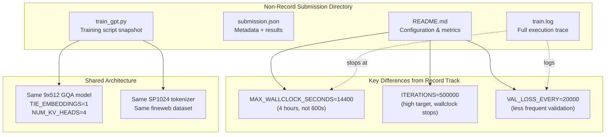
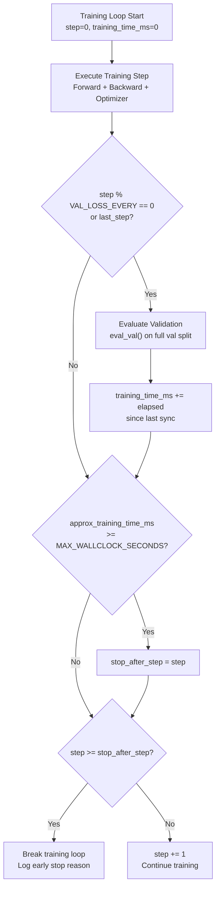
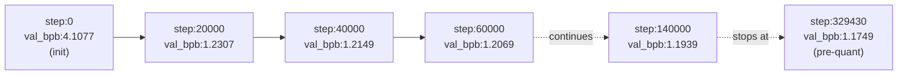
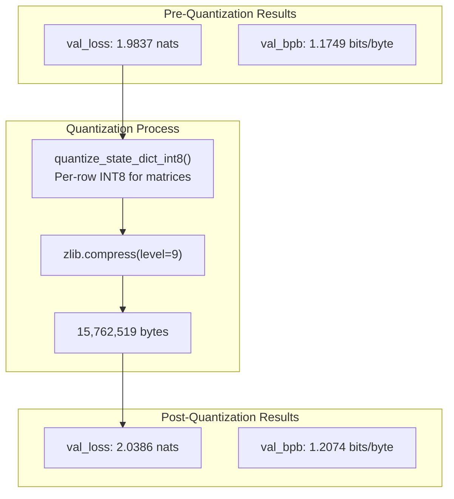

<!-- source: DeepWiki mcp.deepwiki.com · repo openai/parameter-golf · page 6.2 Extended Training Example (Non-Record Track) · fetched 2026-10-26 -->

# Extended Training Example (Non-Record Track)

<details>
<summary>Relevant source files</summary>

The following files were used as context for generating this wiki page:

- [records/track_non_record_16mb/2026-03-18_Quasi10Bfrom50B_SP1024_9x512_KV4_4h_pgut3/README.md](records/track_non_record_16mb/2026-03-18_Quasi10Bfrom50B_SP1024_9x512_KV4_4h_pgut3/README.md)
- [records/track_non_record_16mb/2026-03-18_Quasi10Bfrom50B_SP1024_9x512_KV4_4h_pgut3/submission.json](records/track_non_record_16mb/2026-03-18_Quasi10Bfrom50B_SP1024_9x512_KV4_4h_pgut3/submission.json)
- [records/track_non_record_16mb/2026-03-18_Quasi10Bfrom50B_SP1024_9x512_KV4_4h_pgut3/train.log](records/track_non_record_16mb/2026-03-18_Quasi10Bfrom50B_SP1024_9x512_KV4_4h_pgut3/train.log)

</details>


This page provides a detailed walkthrough of a non-record track submission to demonstrate how extended training runs differ from the 10-minute record track. It analyzes the configuration, training progression, and performance characteristics of a 4-hour training run that achieves improved validation metrics compared to the baseline while remaining under the 16MB artifact constraint.

For details on the record track baseline submission, see [6.1](). For track eligibility and submission requirements, see [3.4]().

## Overview

The non-record track allows unlimited training time while maintaining the 16MB artifact size constraint. This enables exploration of:

- **Extended training schedules** beyond the 10-minute limit.
- **Larger training volumes** (172.7B tokens vs ~10.5B for baseline).
- **Performance ceiling** of a given architecture with more optimization steps.
- **Training dynamics** over long durations.

**Key Metrics Summary**

| Metric | Non-Record (4h) | Baseline (10min) | Delta |
|--------|----------------|------------------|-------|
| Pre-quant val_bpb | 1.1749 | 1.22 | -0.045 (3.7% better) |
| Post-quant val_bpb | 1.2074 | 1.22 | -0.013 (1.1% better) |
| Training steps | 329,430 | 20,000 | 16.5x more |
| Train tokens | 172.7B | 10.5B | 16.5x more |
| Artifact size | 15.76 MB | 15.86 MB | Slightly smaller |
| Wallclock time | 4h 0m | ~9m 30s | 25.3x longer |

**Sources:** [records/track_non_record_16mb/2026-03-18_Quasi10Bfrom50B_SP1024_9x512_KV4_4h_pgut3/README.md:1-57](), [records/track_non_record_16mb/2026-03-18_Quasi10Bfrom50B_SP1024_9x512_KV4_4h_pgut3/submission.json:1-17]()

## Submission Structure



**Sources:** [records/track_non_record_16mb/2026-03-18_Quasi10Bfrom50B_SP1024_9x512_KV4_4h_pgut3/README.md:1-57]()

## Configuration Differences

### Hyperparameter Comparison

The non-record submission uses identical model architecture but different training hyperparameters defined in the `Hyperparameters` class:

| Parameter | Non-Record Value | Baseline Value | Rationale |
|-----------|-----------------|----------------|-----------|
| `MAX_WALLCLOCK_SECONDS` | 14400 (4h) | 600 (10m) | Extended training time [train_gpt.py:59]() |
| `ITERATIONS` | 500000 | 20000 | High ceiling, hit wallclock limit [train_gpt.py:54]() |
| `VAL_LOSS_EVERY` | 20000 | 1000 | Less frequent validation (expensive) [train_gpt.py:50]() |
| `WARMDOWN_ITERS` | 1200 | 1200 | Same LR decay period [train_gpt.py:55]() |
| `TRAIN_BATCH_TOKENS` | 524288 | 524288 | Same batch size [train_gpt.py:57]() |
| `VOCAB_SIZE` | 1024 | 1024 | Identical architecture [train_gpt.py:63]() |
| `NUM_LAYERS` | 9 | 9 | Identical architecture [train_gpt.py:64]() |
| `MODEL_DIM` | 512 | 512 | Identical architecture [train_gpt.py:66]() |

**Sources:** [records/track_non_record_16mb/2026-03-18_Quasi10Bfrom50B_SP1024_9x512_KV4_4h_pgut3/README.md:5-36](), [records/track_non_record_16mb/2026-03-18_Quasi10Bfrom50B_SP1024_9x512_KV4_4h_pgut3/train.log:39-87]()

### Training Command

The submission uses environment variables to override defaults in `train_gpt.py`:

```bash
MAX_WALLCLOCK_SECONDS=14400 \
ITERATIONS=500000 \
VAL_LOSS_EVERY=20000 \
VOCAB_SIZE=1024 \
NUM_LAYERS=9 \
MODEL_DIM=512 \
NUM_HEADS=8 \
NUM_KV_HEADS=4 \
TIE_EMBEDDINGS=1 \
TIED_EMBED_LR=0.05 \
torchrun --standalone --nproc_per_node=8 train_gpt.py
```

The training script reads these from `os.environ` in the `Hyperparameters` class [train_gpt.py:39-87]() and uses them to configure the training loop's wallclock termination logic.

**Sources:** [records/track_non_record_16mb/2026-03-18_Quasi10Bfrom50B_SP1024_9x512_KV4_4h_pgut3/README.md:13-36](), [records/track_non_record_16mb/2026-03-18_Quasi10Bfrom50B_SP1024_9x512_KV4_4h_pgut3/train.log:39-87]()

## Training Progression

### Wallclock-Based Termination

The training loop implements wallclock-aware stopping to respect the time limit:



The logic for stopping is distributed across ranks to ensure synchronized termination:
- **Initialization:** `training_time_ms` is initialized to 0 [train.log:967]().
- **Syncing:** `dist.all_reduce` is used to synchronize the stop signal across all ranks [train.log:1051]().
- **Early stop logging:** The script logs the reason for stopping, such as reaching the wallclock cap [train.log:1003]().

**Sources:** [records/track_non_record_16mb/2026-03-18_Quasi10Bfrom50B_SP1024_9x512_KV4_4h_pgut3/train.log:922-1056]()

### Validation Checkpoints

The run evaluated every 20,000 steps on the full validation split:



Key observations from the validation progression:
- **Rapid initial improvement:** 4.11 → 1.23 BPB in first 20k steps.
- **Steady convergence:** 1.23 → 1.17 BPB from 20k-329k steps.
- **Efficiency:** Best pre-quant eval reached `val_bpb:1.1749` at step 329,430 [README.md:40]().

**Sources:** [records/track_non_record_16mb/2026-03-18_Quasi10Bfrom50B_SP1024_9x512_KV4_4h_pgut3/train.log:1218-7731](), [records/track_non_record_16mb/2026-03-18_Quasi10Bfrom50B_SP1024_9x512_KV4_4h_pgut3/README.md:38-43]()

## Performance Analysis

### Pre-Quantization vs Post-Quantization

The submission demonstrates the impact of INT8 quantization on model quality using the `quantize_state_dict_int8` logic:



The quantization process is implemented in the `quantize_state_dict_int8` function [train.log:342-399]() and uses:
- **Per-row scales** for 2D matrices.
- **Per-tensor scales** for 1D vectors.
- **zlib compression** at level 9 [train.log:1105]().

**Sources:** [records/track_non_record_16mb/2026-03-18_Quasi10Bfrom50B_SP1024_9x512_KV4_4h_pgut3/README.md:38-47](), [records/track_non_record_16mb/2026-03-18_Quasi10Bfrom50B_SP1024_9x512_KV4_4h_pgut3/submission.json:8-11]()

### Comparison with Baseline

The non-record submission achieves a significantly lower BPB by leveraging 16.5x more training steps.

| Metric | Baseline | Non-Record |
|---|---|---|
| Steps | 20,000 | 329,430 |
| Val BPB | 1.22 | 1.2074 |
| Tokens | 10.5B | 172.7B |

**Sources:** [records/track_non_record_16mb/2026-03-18_Quasi10Bfrom50B_SP1024_9x512_KV4_4h_pgut3/README.md:38-51](), [records/track_non_record_16mb/2026-03-18_Quasi10Bfrom50B_SP1024_9x512_KV4_4h_pgut3/submission.json:1-17]()

## Artifact Composition

The final submission artifact stays under the 16,000,000 byte cap [submission.json:14]().

- **Model size (int8+zlib):** 15,762,519 bytes [submission.json:15]().
- **Code size:** 47,642 bytes [submission.json:16]().
- **Total size:** 15,810,161 bytes [submission.json:14]().

The quantization achieves significant compression from the training precision (BF16/FP32).

**Sources:** [records/track_non_record_16mb/2026-03-18_Quasi10Bfrom50B_SP1024_9x512_KV4_4h_pgut3/submission.json:14-17]()

## Training Infrastructure Details

### Hardware Configuration

The run executed on 8×H100 GPUs using `torchrun` with `DistributedDataParallel` (DDP) [train.log:28]().

- **Peak memory allocated:** 10,184 MiB [README.md:44]().
- **Peak memory reserved:** 10,588 MiB [README.md:44]().
- **Average step time:** 43.71ms [README.md:43]().

The `DistributedTokenLoader` handles loading shards across these ranks [train.log:785-866]().

**Sources:** [records/track_non_record_16mb/2026-03-18_Quasi10Bfrom50B_SP1024_9x512_KV4_4h_pgut3/README.md:43-44](), [records/track_non_record_16mb/2026-03-18_Quasi10Bfrom50B_SP1024_9x512_KV4_4h_pgut3/train.log:785-866]()

## Key Takeaways for Non-Record Submissions

### When to Use Non-Record Track

Consider the non-record track when:
1. **Exploring architecture limits:** Test maximum performance of a model design without time pressure.
2. **Long training schedules:** Investigate learning dynamics beyond 10 minutes.
3. **Hyperparameter tuning:** Run longer experiments to tune LR schedules or warmdown.
4. **Research insights:** Study scaling behavior and convergence patterns.

### What This Example Demonstrates

- **Extended training viability:** 16.5x more training yields measurable but modest gains.
- **Architecture capacity:** The 9-layer model continues learning for 172B tokens.
- **Quantization robustness:** INT8 degradation is consistent across training scales.
- **Submission simplicity:** Uses the same code/architecture as baseline, only environment variables change.

**Sources:** [records/track_non_record_16mb/2026-03-18_Quasi10Bfrom50B_SP1024_9x512_KV4_4h_pgut3/README.md:1-57]()

---

