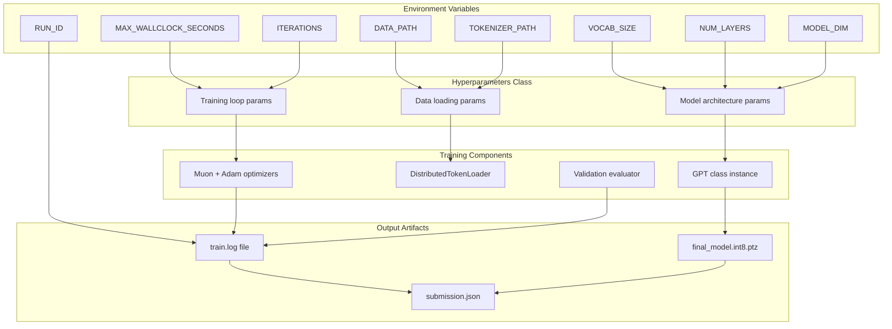
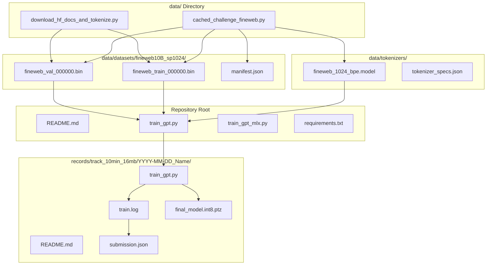
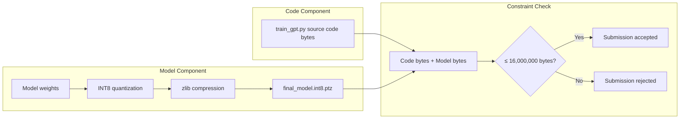
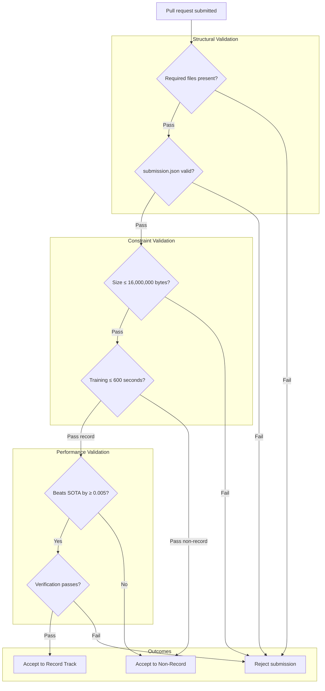

<!-- source: DeepWiki mcp.deepwiki.com · repo openai/parameter-golf · page 7 Reference · fetched 2026-10-26 -->

# Reference

Relevant source files

The following files were used as context for generating this wiki page:

- [.gitignore](.gitignore)
- [LICENSE](LICENSE)
- [README.md](README.md)
- [THIRD_PARTY_NOTICES.md](THIRD_PARTY_NOTICES.md)
- [requirements.txt](requirements.txt)

This section provides technical reference documentation for the Parameter Golf challenge, including configuration parameters, file format specifications, utility scripts, and dependency information. Use this material as a lookup guide when implementing submissions, debugging issues, or understanding the technical constraints.

For step-by-step instructions on setting up your environment and running training, see [Getting Started](#2). For detailed documentation of the training system architecture, see [Training System Architecture](#4). For information about the dataset pipeline, see [Data Infrastructure](#5).

## Quick Reference

### Critical Constraints

| Constraint | Value | Notes |
|------------|-------|-------|
| Maximum Artifact Size | 16,000,000 bytes | Exactly 16,000,000 bytes, not 16 MiB |
| Maximum Training Time (Record Track) | 10 minutes | On 8xH100 GPUs |
| Maximum Training Time (Non-Record) | Unlimited | Still subject to 16MB artifact limit |
| SOTA Improvement Threshold | 0.005 nats | Statistical significance p < 0.01 required |
| Evaluation Metric | `val_bpb` | Bits-per-byte on FineWeb validation set |

**Sources**: [README.md:6-12](), [README.md:124-130]()

### Common Environment Variables

The training scripts utilize environment variables for configuration, allowing for rapid experimentation without modifying the source code.

| Variable | Purpose | Example Values | Default |
|----------|---------|----------------|---------|
| `RUN_ID` | Identifies training run in logs | `baseline_sp1024`, `mlx_smoke` | `"run"` |
| `DATA_PATH` | Path to binary shard directory | `./data/datasets/fineweb10B_sp1024/` | `"./data/datasets/fineweb10B_sp1024/"` |
| `TOKENIZER_PATH` | Path to tokenizer model file | `./data/tokenizers/fineweb_1024_bpe.model` | See script defaults |
| `VOCAB_SIZE` | Tokenizer vocabulary size | `1024`, `260`, `4096` | `1024` |
| `MAX_WALLCLOCK_SECONDS` | Training time limit | `600`, `0` (unlimited) | `600` |
| `ITERATIONS` | Training iterations | `200`, `1000` | Computed from wallclock |
| `VAL_LOSS_EVERY` | Validation frequency | `200`, `0` (final only) | `0` |
| `TRAIN_BATCH_TOKENS` | Tokens per training batch | `8192`, `524288` | `524288` |

**Sources**: [README.md:65-75](), [README.md:108-115]()

### Required Submission Files

Every submission in the `records/` directory must contain the following structured components to be eligible for the leaderboard.

| File | Purpose | Validation |
|------|---------|------------|
| `README.md` | Explains submission approach and results | Must document configuration and methodology |
| `submission.json` | Structured metadata (name, score, etc.) | Must include `val_bpb`, GitHub ID, name |
| `train.log` | Complete training execution log | Auto-generated, must show final metrics |
| `train_gpt.py` | Training script with dependencies | Must compile and run from records folder |
| `final_model.int8.ptz` | Compressed model artifact | Must be ≤ 16,000,000 bytes including code |

**Sources**: [README.md:152-160]()

## Configuration Flow Architecture

The following diagram shows how environment variables and hyperparameters flow through the training system to configure model architecture and training behavior.

**Sources**: [README.md:65-75](), [README.md:108-115]()

## File Organization Architecture

This diagram shows the file structure for submissions and data artifacts, mapping natural language descriptions to actual file paths and naming conventions.

**Sources**: [README.md:55-61](), [README.md:97-104](), [README.md:152-160]()

## Artifact Size Calculation

The 16MB artifact limit is computed as the sum of code bytes and compressed model bytes.

**Sources**: [README.md:124-130]()

## Subsection Overview

### 7.1 Configuration Parameters
Comprehensive reference of all environment variables and hyperparameters used in training scripts, including model architecture settings (`VOCAB_SIZE`, `NUM_LAYERS`, `MODEL_DIM`), training control parameters (`MAX_WALLCLOCK_SECONDS`, `ITERATIONS`), and batch size configuration. For details, see [Configuration Parameters](#7.1).

### 7.2 File Format Specifications
Formal specifications for all file formats used in the challenge: `submission.json` schema, binary shard format (int32 header + uint16 tokens), and the `int8_clean_per_row_v1` quantization format used in `.ptz` files. For details, see [File Format Specifications](#7.2).

### 7.3 Utility Scripts
Documentation for helper scripts in the repository: `replace_hf_dataset_with_export.py` for managing dataset versions on Hugging Face Hub and `upload_when_ready.sh` for automated uploads. For details, see [Utility Scripts](#7.3).

### 7.4 Dependencies and Licenses
Lists all Python dependencies from `requirements.txt` (PyTorch, numpy, tiktoken, etc.) and explains the MIT license for the repository and third-party components adapted from `modded-nanogpt`. For details, see [Dependencies and Licenses](#7.4).

**Sources**: [requirements.txt:1-10](), [LICENSE:1-21](), [THIRD_PARTY_NOTICES.md:1-11]()

## Evaluation Constraints

The following rules apply during model evaluation and must be enforced by submission scripts:

| Constraint | Rule | Rationale |
|------------|------|-----------|
| No External Downloads | No network access or API calls | Ensures artifact is self-contained |
| No Training Data Access | Cannot read training shards during eval | Prevents data leakage |
| Maximum Evaluation Time | ≤ 10 minutes (record track) | Prevents infinite-time evaluation |
| Sequence Length | Any length allowed | Encourages long-context exploration |

**Sources**: [README.md:138-140](), [README.md:124-130]()

## Submission Validation Flow

This diagram shows the validation stages applied to submissions, mapping validation steps to actual code requirements and file checks.

**Sources**: [README.md:142-168]()

---

