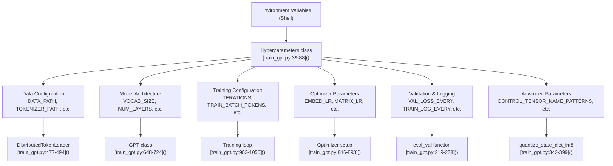
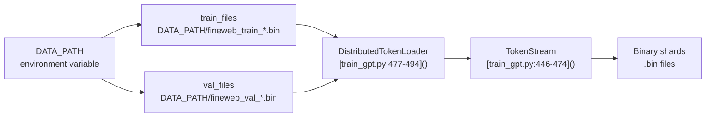
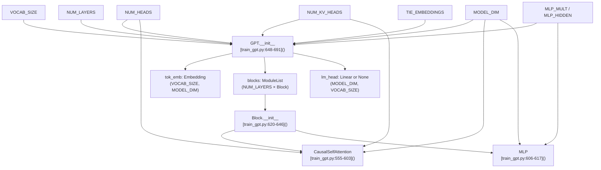
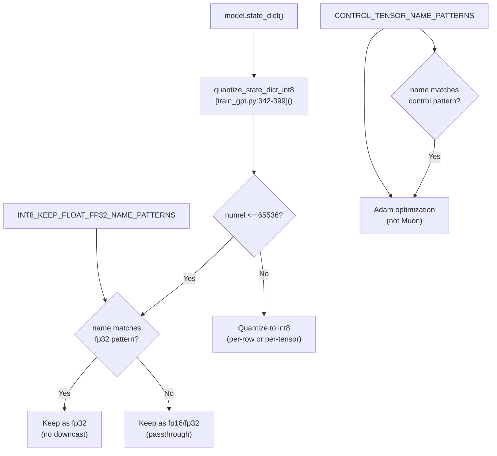

<!-- source: DeepWiki mcp.deepwiki.com · repo openai/parameter-golf · page 7.1 Configuration Parameters · fetched 2026-10-26 -->

# Configuration Parameters

Relevant source files

The following files were used as context for generating this wiki page:

- [records/track_10min_16mb/2026-03-17_LoRA_TTT/README.md](records/track_10min_16mb/2026-03-17_LoRA_TTT/README.md)
- [records/track_10min_16mb/2026-03-17_LoRA_TTT/ablations.png](records/track_10min_16mb/2026-03-17_LoRA_TTT/ablations.png)
- [records/track_10min_16mb/2026-03-17_LoRA_TTT/submission.json](records/track_10min_16mb/2026-03-17_LoRA_TTT/submission.json)
- [records/track_10min_16mb/2026-03-17_LoRA_TTT/train_gpt.py](records/track_10min_16mb/2026-03-17_LoRA_TTT/train_gpt.py)
- [records/track_10min_16mb/2026-03-17_LoRA_TTT/train_v0.txt](records/track_10min_16mb/2026-03-17_LoRA_TTT/train_v0.txt)
- [records/track_10min_16mb/2026-03-17_LoRA_TTT/train_v1.txt](records/track_10min_16mb/2026-03-17_LoRA_TTT/train_v1.txt)
- [records/track_10min_16mb/2026-03-17_LoRA_TTT/train_v2.txt](records/track_10min_16mb/2026-03-17_LoRA_TTT/train_v2.txt)
- [records/track_10min_16mb/2026-03-17_LoRA_TTT/train_v3.txt](records/track_10min_16mb/2026-03-17_LoRA_TTT/train_v3.txt)
- [records/track_10min_16mb/2026-03-19_Seq2048_FP16Emb_TunedLR/README.md](records/track_10min_16mb/2026-03-19_Seq2048_FP16Emb_TunedLR/README.md)
- [records/track_10min_16mb/2026-03-19_Seq2048_FP16Emb_TunedLR/submission.json](records/track_10min_16mb/2026-03-19_Seq2048_FP16Emb_TunedLR/submission.json)
- [records/track_10min_16mb/2026-03-19_Seq2048_FP16Emb_TunedLR/train_gpt.py](records/track_10min_16mb/2026-03-19_Seq2048_FP16Emb_TunedLR/train_gpt.py)
- [records/track_10min_16mb/2026-03-19_Seq2048_FP16Emb_TunedLR/train_seed1337.log](records/track_10min_16mb/2026-03-19_Seq2048_FP16Emb_TunedLR/train_seed1337.log)
- [records/track_10min_16mb/2026-03-19_Seq2048_FP16Emb_TunedLR/train_seed3.log](records/track_10min_16mb/2026-03-19_Seq2048_FP16Emb_TunedLR/train_seed3.log)
- [records/track_10min_16mb/2026-03-19_Seq2048_FP16Emb_TunedLR/train_seed42.log](records/track_10min_16mb/2026-03-19_Seq2048_FP16Emb_TunedLR/train_seed42.log)
- [train_gpt.py](train_gpt.py)
- [train_gpt_mlx.py](train_gpt_mlx.py)

This page provides a comprehensive reference for all configuration parameters available in the Parameter Golf training system. These parameters control model architecture, training behavior, optimization settings, data loading, and evaluation metrics. All parameters are set via environment variables and are read by the `Hyperparameters` class.

For information about the model architecture itself, see [GPT Model Architecture](#4.2). For details on the optimization strategy, see [Optimization and Training Techniques](#4.3). For submission-specific metadata, see [Submission Guidelines](#3.3).

---

## Parameter Categories Overview

The training system organizes parameters into six major categories:

**Sources**: [train_gpt.py:39-88](), [train_gpt.py:731-1126]()

---

## Data Configuration Parameters

These parameters specify data sources and tokenizers for training and validation.

| Parameter | Default | Type | Description |
|-----------|---------|------|-------------|
| `DATA_PATH` | `./data/datasets/fineweb10B_sp1024` | string | Root directory containing training and validation shards |
| `TOKENIZER_PATH` | `./data/tokenizers/fineweb_1024_bpe.model` | string | Path to SentencePiece `.model` file for tokenization |
| `RUN_ID` | `uuid.uuid4()` | string | Unique identifier for the training run, used in log filenames |
| `SEED` | `1337` | int | Random seed for reproducibility across NumPy, PyTorch, and Python |

### Data Path Resolution

The `DATA_PATH` is automatically joined with `fineweb_train_*.bin` and `fineweb_val_*.bin` glob patterns in the `Hyperparameters` class [train_gpt.py:41-43](). The validation split always uses all `fineweb_val_*.bin` files (representing the first 50k documents), while training shards are consumed sequentially and wrap around indefinitely.

**Sources**: [train_gpt.py:39-46](), [train_gpt.py:446-494]()

---

## Model Architecture Parameters

These parameters define the structure and size of the GPT model.

| Parameter | Default | Type | Description |
|-----------|---------|------|-------------|
| `VOCAB_SIZE` | `1024` | int | Tokenizer vocabulary size; must match the loaded tokenizer |
| `NUM_LAYERS` | `9` | int | Total number of transformer blocks |
| `MODEL_DIM` | `512` | int | Hidden dimension size for embeddings and all transformer layers |
| `NUM_HEADS` | `8` | int | Number of query heads in multi-head attention |
| `NUM_KV_HEADS` | `4` | int | Number of key/value heads for grouped query attention (GQA) |
| `MLP_MULT` | `2` | int | Multiplier for MLP hidden dimension (hidden_dim = MODEL_DIM × MLP_MULT) |
| `MLP_HIDDEN` | (derived) | int | Explicit MLP hidden dimension (overrides `MLP_MULT` if set in some record scripts) |
| `TIE_EMBEDDINGS` | `1` | bool (int) | If `1`, share weights between token embedding and output projection |
| `ROPE_BASE` | `10000.0` | float | Base frequency for rotary positional embeddings (RoPE) |
| `LOGIT_SOFTCAP` | `30.0` | float | Softcap value for logits: `logit_softcap * tanh(logits / logit_softcap)` |
| `QK_GAIN_INIT` | `1.5` | float | Initial value for per-head Q scaling gains in attention |
| `TIED_EMBED_INIT_STD` | `0.005` | float | Standard deviation for token embedding initialization when `TIE_EMBEDDINGS=1` |

### Model Architecture Parameter Flow

The model uses an encoder-decoder architecture with skip connections. `NUM_LAYERS` is split into `num_encoder_layers = NUM_LAYERS // 2` and `num_decoder_layers = NUM_LAYERS - num_encoder_layers` [train_gpt.py:670-672]().

**Sources**: [train_gpt.py:62-71](), [train_gpt.py:648-724](), [records/track_10min_16mb/2026-03-19_Seq2048_FP16Emb_TunedLR/train_gpt.py:67-76]()

---

## Training Configuration Parameters

These parameters control the training duration, batch sizes, and time constraints.

| Parameter | Default | Type | Description |
|-----------|---------|------|-------------|
| `ITERATIONS` | `20000` | int | Maximum number of training steps |
| `TRAIN_BATCH_TOKENS` | `524288` | int | Total tokens per global batch across all GPUs |
| `TRAIN_SEQ_LEN` | `1024` | int | Sequence length for each training example |
| `MAX_WALLCLOCK_SECONDS` | `600.0` | float | Wallclock time limit in seconds (10-minute cap) |
| `WARMUP_STEPS` | `20` | int | Number of warmup steps before training |
| `WARMDOWN_ITERS` | `1200` | int | Number of iterations over which learning rate linearly decays to zero |
| `GRAD_CLIP_NORM` | `0.0` | float | Global gradient norm clipping threshold |

### MLX Specific Parameters (train_gpt_mlx.py)
When training on Apple Silicon using `train_gpt_mlx.py`, additional parameters are available to manage memory:

| Parameter | Default | Type | Description |
|-----------|---------|------|-------------|
| `MLX_MAX_MICROBATCH_TOKENS` | `8192` | int | Sub-divides microbatches to reduce peak memory pressure [train_gpt_mlx.py:61]() |
| `MLX_EAGER_EVAL` | `1` | bool | Forces materialization after sub-batches to prevent graph buildup [train_gpt_mlx.py:65]() |

**Sources**: [train_gpt.py:53-60](), [train_gpt_mlx.py:51-68]()

---

## Optimizer Parameters

The training system uses a multi-optimizer strategy: Muon for matrix parameters, Adam for embeddings and scalars.

| Parameter | Default | Type | Description |
|-----------|---------|------|-------------|
| `EMBED_LR` | `0.6` | float | Adam learning rate for token embeddings (untied) |
| `HEAD_LR` | `0.008` | float | Adam learning rate for output projection (untied) |
| `TIED_EMBED_LR` | `0.05` | float | Adam learning rate for token embeddings (tied) |
| `MATRIX_LR` | `0.04` | float | Muon learning rate for matrix parameters |
| `SCALAR_LR` | `0.04` | float | Adam learning rate for scalar/vector parameters |
| `MUON_MOMENTUM` | `0.95` | float | Target Muon momentum value |
| `MUON_BACKEND_STEPS` | `5` | int | Newton-Schulz iteration steps for Muon |
| `MUON_MOMENTUM_WARMUP_START` | `0.85` | float | Initial Muon momentum value |
| `MUON_MOMENTUM_WARMUP_STEPS` | `500` | int | Steps for Muon momentum warmup |
| `BETA1` | `0.9` | float | Adam β₁ |
| `BETA2` | `0.95` | float | Adam β₂ |

**Sources**: [train_gpt.py:73-87](), [train_gpt_mlx.py:85-95]()

---

## Evaluation Parameters

Recent high-performance records introduce advanced evaluation parameters to optimize the bits-per-byte (BPB) metric.

| Parameter | Default | Type | Description |
|-----------|---------|------|-------------|
| `VAL_LOSS_EVERY` | `1000` | int | Frequency (in steps) for running full validation |
| `VAL_BATCH_SIZE` | `524288` | int | Total tokens for validation batches |
| `EVAL_STRIDE` | `0` | int | Stride for sliding window evaluation (e.g., `64`) [records/track_10min_16mb/2026-03-19_Seq2048_FP16Emb_TunedLR/train_gpt.py:54]() |
| `EVAL_SEQ_LEN` | `0` | int | Context length for evaluation (0 = use `TRAIN_SEQ_LEN`) [records/track_10min_16mb/2026-03-19_Seq2048_FP16Emb_TunedLR/train_gpt.py:55]() |

### Test-Time Training (LoRA TTT)
Some submissions use `LoRA TTT` during evaluation [records/track_10min_16mb/2026-03-17_LoRA_TTT/README.md:7-13]():

| Parameter | Default | Type | Description |
|-----------|---------|------|-------------|
| `TTT_LORA_RANK` | `8` | int | Rank for LoRA adapters during evaluation |
| `TTT_LORA_LR` | `0.01` | float | Learning rate for LoRA test-time training |
| `TTT_CHUNK_SIZE` | `256` | int | Chunk size for adaptation steps |

**Sources**: [records/track_10min_16mb/2026-03-19_Seq2048_FP16Emb_TunedLR/train_gpt.py:49-55](), [records/track_10min_16mb/2026-03-17_LoRA_TTT/train_gpt.py:89-94]()

---

## Advanced and Internal Parameters

| Parameter | Default | Type | Description |
|-----------|---------|------|-------------|
| `CONTROL_TENSOR_NAME_PATTERNS` | `attn_scale,attn_scales...` | string | Patterns for control tensors bypassing Muon [train_gpt_mlx.py:123-130]() |
| `INT8_KEEP_FLOAT_FP32_NAME_PATTERNS` | (matches control) | string | Patterns for tensors kept in fp32 during quantization [train_gpt_mlx.py:131-138]() |

### Quantization Parameter Influence

**Sources**: [train_gpt_mlx.py:123-138](), [train_gpt.py:342-399]()

---

