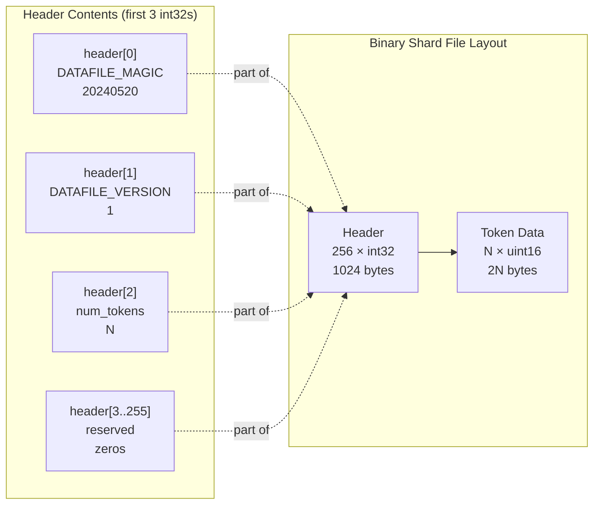
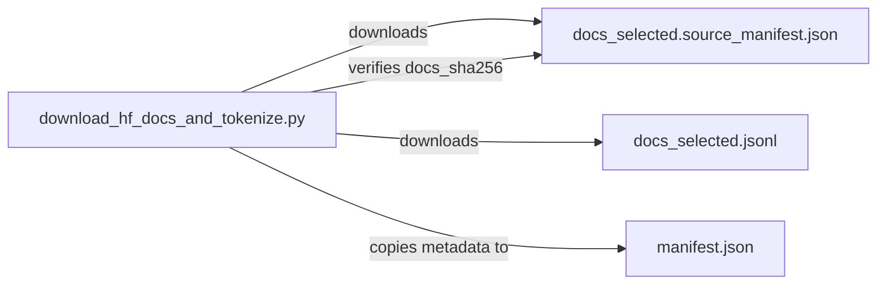
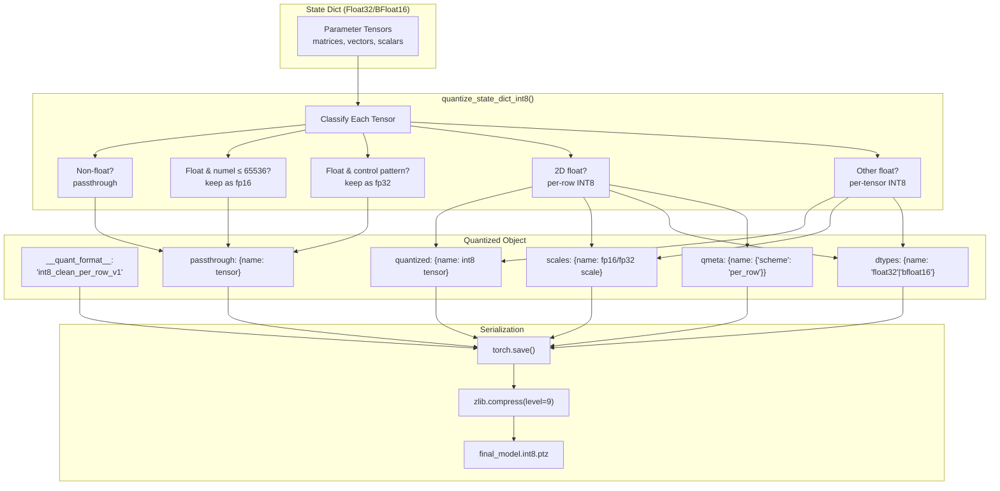

<!-- source: DeepWiki mcp.deepwiki.com · repo openai/parameter-golf · page 7.2 File Format Specifications · fetched 2026-10-26 -->

# File Format Specifications

<details>
<summary>Relevant source files</summary>

The following files were used as context for generating this wiki page:

- [data/README.md](data/README.md)
- [data/cached_challenge_fineweb.py](data/cached_challenge_fineweb.py)
- [data/download_hf_docs_and_tokenize.py](data/download_hf_docs_and_tokenize.py)
- [data/tokenizer_specs.json](data/tokenizer_specs.json)
- [records/track_10min_16mb/2026-03-17_LoRA_TTT/README.md](records/track_10min_16mb/2026-03-17_LoRA_TTT/README.md)
- [records/track_10min_16mb/2026-03-17_LoRA_TTT/ablations.png](records/track_10min_16mb/2026-03-17_LoRA_TTT/ablations.png)
- [records/track_10min_16mb/2026-03-17_LoRA_TTT/submission.json](records/track_10min_16mb/2026-03-17_LoRA_TTT/submission.json)
- [records/track_10min_16mb/2026-03-17_LoRA_TTT/train_gpt.py](records/track_10min_16mb/2026-03-17_LoRA_TTT/train_gpt.py)
- [records/track_10min_16mb/2026-03-17_LoRA_TTT/train_v0.txt](records/track_10min_16mb/2026-03-17_LoRA_TTT/train_v0.txt)
- [records/track_10min_16mb/2026-03-17_LoRA_TTT/train_v1.txt](records/track_10min_16mb/2026-03-17_LoRA_TTT/train_v1.txt)
- [records/track_10min_16mb/2026-03-17_LoRA_TTT/train_v2.txt](records/track_10min_16mb/2026-03-17_LoRA_TTT/train_v2.txt)
- [records/track_10min_16mb/2026-03-17_LoRA_TTT/train_v3.txt](records/track_10min_16mb/2026-03-17_LoRA_TTT/train_v3.txt)
- [records/track_10min_16mb/2026-03-17_NaiveBaseline/README.md](records/track_10min_16mb/2026-03-17_NaiveBaseline/README.md)
- [records/track_10min_16mb/2026-03-17_NaiveBaseline/submission.json](records/track_10min_16mb/2026-03-17_NaiveBaseline/submission.json)
- [records/track_10min_16mb/2026-03-17_NaiveBaseline/train.log](records/track_10min_16mb/2026-03-17_NaiveBaseline/train.log)
- [train_gpt.py](train_gpt.py)

</details>


This page provides formal specifications for all file formats used in the Parameter Golf challenge: binary data shards, submission metadata, dataset manifests, quantization formats, and tokenizer configurations. For information about using these formats in practice, see [Downloading Data](#2.2) and [Data and Tokenizer Formats](#5.4). For the quantization workflow, see [Quantization and Compression](#4.5).

---

## Binary Shard Format

Binary shards store tokenized sequences in a compact, memory-mappable format. Files follow the naming pattern `fineweb_train_*.bin` or `fineweb_val_*.bin` and are produced by the data export pipeline.

### File Structure



### Specification

| Field | Offset (bytes) | Type | Value | Description |
|-------|---------------|------|-------|-------------|
| Magic number | 0 | `<i4` (little-endian int32) | `20240520` | File format identifier (`DATAFILE_MAGIC`) |
| Version | 4 | `<i4` | `1` | Format version (`DATAFILE_VERSION`) |
| Token count | 8 | `<i4` | N | Number of tokens in file |
| Reserved | 12-1023 | `<i4` × 253 | 0 | Unused, must be zero |
| Token data | 1024+ | `<u2` (little-endian uint16) × N | - | Sequence of token IDs |

**Constraints:**
- Token IDs must be in range `[0, vocab_size)` where `vocab_size ≤ 65535` (uint16 max) [data/download_hf_docs_and_tokenize.py:142-145]()
- File size must be exactly `1024 + 2N` bytes [data/download_hf_docs_and_tokenize.py:148-150]()
- Maximum token count: `2^31 - 1` (int32 max) [data/download_hf_docs_and_tokenize.py:135-136]()

### Code References

**Writing shards:**
- [data/download_hf_docs_and_tokenize.py:134-150]() - `write_datafile()` function
- Constants: [data/download_hf_docs_and_tokenize.py:29-30]() - `DATAFILE_MAGIC`, `DATAFILE_VERSION`

**Reading shards:**
- [train_gpt.py:429-443]() - `load_data_shard()` function
- Header validation: [train_gpt.py:434-435]() - checks magic number and version
- Size validation: [train_gpt.py:437-439]() - ensures file size matches token count

**Sources:** [data/download_hf_docs_and_tokenize.py:29-30](), [data/download_hf_docs_and_tokenize.py:134-150](), [train_gpt.py:429-443]()

---

## submission.json Schema

Each submission includes a `submission.json` file with metadata and performance metrics. This file is used for leaderboard display and submission validation.

### Structure

```json
{
  "author": "string",
  "github_id": "string",
  "name": "string",
  "blurb": "string",
  "date": "ISO 8601 datetime string",
  "val_loss": number,
  "val_bpb": number,
  "bytes_total": integer,
  "bytes_code": integer
}
```

### Field Specifications

| Field | Type | Required | Description |
|-------|------|----------|-------------|
| `author` | string | Yes | Participant or team name |
| `github_id` | string | Yes | GitHub username for attribution |
| `name` | string | Yes | Human-readable submission name |
| `blurb` | string | Yes | Short description of approach (1-2 sentences) |
| `date` | string | Yes | Submission timestamp in ISO 8601 format with timezone |
| `val_loss` | number | Yes | Final validation cross-entropy loss (nats) after int8+zlib roundtrip |
| `val_bpb` | number | Yes | Final validation bits-per-byte metric (used for ranking) |
| `bytes_total` | integer | Yes | Total submission size: `bytes_code + compressed_model_size` |
| `bytes_code` | integer | Yes | Size of training script in UTF-8 bytes |

**Constraints:**
- `bytes_total` must be ≤ `16,000,000` (exactly 16MB, not 16 MiB)
- `val_loss` and `val_bpb` must match the final roundtrip evaluation metrics
- `date` should use format: `"YYYY-MM-DDTHH:MM:SSZ"` (UTC) or with timezone offset

### Example

```json
{
  "author": "sam",
  "github_id": "samacqua",
  "name": "LoRA TTT",
  "blurb": "Naive baseline + per-document LoRA test-time training at eval...",
  "date": "2026-03-19T10:00:00Z",
  "val_loss": 2.0142,
  "val_bpb": 1.1929,
  "bytes_total": 15882446,
  "bytes_code": 58509
}
```

**Sources:** [records/track_10min_16mb/2026-03-17_LoRA_TTT/submission.json:1-11]()

---

## manifest.json Structure

The manifest file describes a complete data export: source documents, tokenizers, and generated binary shards. Created by `download_hf_docs_and_tokenize.py` and optionally referenced by `cached_challenge_fineweb.py`.

```mermaid
graph TB
    MANIFEST["manifest.json"]
    
    subgraph "Top-Level Fields"
        VERSION["version: '10B'"]
        NUM_DOCS["num_docs: total count"]
        NUM_VAL["num_val_docs: validation split size"]
        SHUFFLE["shuffle_seed: null or int"]
        SHARD_SIZE["shard_size: tokens per shard"]
        APPEND_EOS["append_eos: boolean"]
        DOCS_JSONL["docs_jsonl: path to source"]
        DOCS_META["docs_meta: {…}"]
    end
    
    subgraph "docs_meta Object"
        REMOTE_REPO["remote_repo_id"]
        REMOTE_ROOT["remote_root"]
        DOCS_SHA["docs_sha256"]
        SOURCE_MANIFEST["source_manifest"]
        SOURCE_SIDECAR["source_sidecar: {…}"]
    end
    
    subgraph "Arrays"
        TOK_SPECS["tokenizer_specs: [{…}, …]"]
        TOKENIZERS["tokenizers: [{…}, …]"]
        DATASETS["datasets: [{…}, …]"]
    end
    
    subgraph "datasets[i] Object"
        DS_NAME["name: 'fineweb10B_sp1024'"]
        DS_TOK_NAME["tokenizer_name"]
        DS_TOK_KIND["tokenizer_kind"]
        DS_PATH["path: datasets/…"]
        DS_TRAIN_GLOB["train_glob: pattern"]
        DS_VAL_GLOB["val_glob: pattern"]
        DS_VOCAB["vocab_size"]
        DS_BOS["bos_id"]
        DS_EOS["eos_id"]
        DS_BIGRAM["recommended_bigram_vocab_size"]
        DS_STATS["stats: {…}"]
    end
    
    MANIFEST --> VERSION
    MANIFEST --> NUM_DOCS
    MANIFEST --> NUM_VAL
    MANIFEST --> SHUFFLE
    MANIFEST --> SHARD_SIZE
    MANIFEST --> APPEND_EOS
    MANIFEST --> DOCS_JSONL
    MANIFEST --> DOCS_META
    MANIFEST --> TOK_SPECS
    MANIFEST --> TOKENIZERS
    MANIFEST --> DATASETS
    
    DOCS_META --> REMOTE_REPO
    DOCS_META --> REMOTE_ROOT
    DOCS_META --> DOCS_SHA
    DOCS_META --> SOURCE_MANIFEST
    DOCS_META --> SOURCE_SIDECAR
    
    DATASETS --> DS_NAME
    DATASETS --> DS_TOK_NAME
    DATASETS --> DS_TOK_KIND
    DATASETS --> DS_PATH
    DATASETS --> DS_TRAIN_GLOB
    DATASETS --> DS_VAL_GLOB
    DATASETS --> DS_VOCAB
    DATASETS --> DS_BOS
    DATASETS --> DS_EOS
    DATASETS --> DS_BIGRAM
    DATASETS --> DS_STATS
```



### Top-Level Schema

| Field | Type | Description |
|-------|------|-------------|
| `version` | string | Dataset version (e.g., `"10B"`) [data/download_hf_docs_and_tokenize.py:25]() |
| `num_docs` | integer | Total document count in source |
| `num_val_docs` | integer | Number of documents in validation split [data/download_hf_docs_and_tokenize.py:26]() |
| `shuffle_seed` | integer or null | Random seed for document shuffling |
| `shard_size` | integer | Tokens per shard (typically `100,000,000`) [data/download_hf_docs_and_tokenize.py:27]() |
| `append_eos` | boolean | Whether EOS token appended to each document [data/download_hf_docs_and_tokenize.py:28]() |
| `docs_jsonl` | string | Path to source `docs_selected.jsonl` |
| `docs_meta` | object | Source document metadata |

### Path Relativization

All file paths in the manifest are relative to the manifest's parent directory. Absolute paths are converted during export by `relativize_manifest_paths()`.

**Sources:** [data/download_hf_docs_and_tokenize.py:153-165](), [data/download_hf_docs_and_tokenize.py:25-28]()

---

## docs_selected.source_manifest.json Format

This sidecar file accompanies `docs_selected.jsonl` and provides document verification metadata. Used by `download_hf_docs_and_tokenize.py` to verify document integrity.

### Structure

```json
{
  "num_docs": integer,
  "docs_val": integer,
  "docs_sha256": "hex string (64 chars)",
  "shuffle_seed": integer or null,
  "source_info": "optional description",
  "created_at": "optional ISO 8601 timestamp"
}
```

### Field Specifications

| Field | Type | Required | Description |
|-------|------|----------|-------------|
| `num_docs` | integer | Yes | Total document count (used to avoid counting) |
| `docs_sha256` | string | No | SHA256 hash of entire `docs_selected.jsonl` for verification |

### Usage



**Sources:** [data/download_hf_docs_and_tokenize.py:73-84](), [data/README.md:52-53]()

---

## Quantization Format: int8_clean_per_row_v1

The quantization format compresses trained models to fit within the 16MB constraint. It uses INT8 quantization with per-row scaling for matrices and per-tensor scaling for vectors, followed by zlib compression.



### Specification

| Key | Type | Description |
|-----|------|-------------|
| `__quant_format__` | string | Must be `"int8_clean_per_row_v1"` [train_gpt.py:343]() |
| `quantized` | dict[str, Tensor] | INT8 quantized tensors [train_gpt.py:344]() |
| `scales` | dict[str, Tensor] | Scaling factors (fp16 or fp32) [train_gpt.py:345]() |
| `passthrough` | dict[str, Tensor] | Unquantized tensors (small/non-float) [train_gpt.py:347]() |

**Quantization logic:**
- Per-row scale computed via quantile (99.99984%) [train_gpt.py:313-316]()
- Matrices (2D) use per-row quantization [train_gpt.py:365-375]()
- Vectors use per-tensor quantization [train_gpt.py:377-386]()
- Small tensors (numel ≤ 65,536) are kept as fp16 [train_gpt.py:304-306]()

**Sources:** [train_gpt.py:304-386](), [train_gpt.py:1076-1119]()

---

## Tokenizer File Formats

The repository supports two tokenizer types: SentencePiece BPE and pure byte tokenizers.

### Pure Byte Tokenizer JSON

A minimal tokenizer that maps UTF-8 bytes directly to token IDs with special tokens.

**Structure:** [data/download_hf_docs_and_tokenize.py:61-66]()
```json
{
  "tokenizer_type": "pure_byte",
  "config": {
    "pad_id": 0,
    "bos_id": 1,
    "eos_id": 2,
    "unk_id": 3,
    "byte_offset": 4,
    "byte_count": 256
  },
  "vocab_size": 260
}
```

**Encoding Logic:** UTF-8 bytes map to `byte + byte_offset` [data/download_hf_docs_and_tokenize.py:51-53]().

### tokenizer_specs.json Format

Configuration file defining tokenizers to build during data export.

**Structure:** [data/tokenizer_specs.json:1-10]()
```json
{
  "tokenizers": [
    {
      "name": "sp_bpe_1024",
      "dataset_suffix": "sp1024",
      "vocab_size": 1024
    }
  ]
}
```

**Kind Detection:**
The `tokenizer_kind()` function infers tokenizer type from the `kind` field or `vocab_size` [data/download_hf_docs_and_tokenize.py:192-211]().

**Sources:** [data/download_hf_docs_and_tokenize.py:38-67](), [data/download_hf_docs_and_tokenize.py:192-211](), [data/tokenizer_specs.json:1-10]()

---

