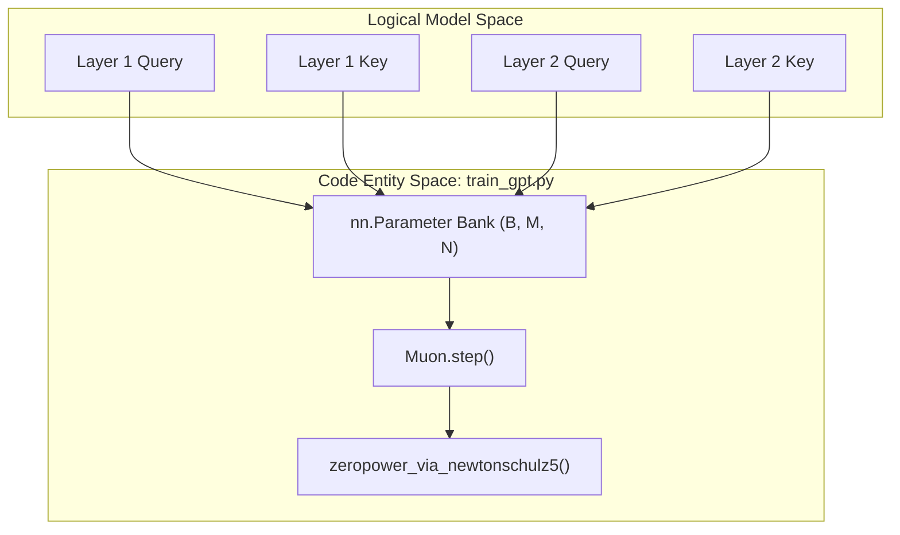
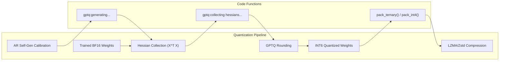

<!-- source: DeepWiki mcp.deepwiki.com · repo openai/parameter-golf · page 8 Glossary · fetched 2026-10-26 -->

# Glossary

Relevant source files

The following files were used as context for generating this wiki page:

- [README.md](README.md)
- [records/track_10min_16mb/2026-03-17_LoRA_TTT/README.md](records/track_10min_16mb/2026-03-17_LoRA_TTT/README.md)
- [records/track_10min_16mb/2026-03-17_LoRA_TTT/ablations.png](records/track_10min_16mb/2026-03-17_LoRA_TTT/ablations.png)
- [records/track_10min_16mb/2026-03-17_LoRA_TTT/submission.json](records/track_10min_16mb/2026-03-17_LoRA_TTT/submission.json)
- [records/track_10min_16mb/2026-03-17_LoRA_TTT/train_gpt.py](records/track_10min_16mb/2026-03-17_LoRA_TTT/train_gpt.py)
- [records/track_10min_16mb/2026-03-17_LoRA_TTT/train_v0.txt](records/track_10min_16mb/2026-03-17_LoRA_TTT/train_v0.txt)
- [records/track_10min_16mb/2026-03-17_LoRA_TTT/train_v1.txt](records/track_10min_16mb/2026-03-17_LoRA_TTT/train_v1.txt)
- [records/track_10min_16mb/2026-03-17_LoRA_TTT/train_v2.txt](records/track_10min_16mb/2026-03-17_LoRA_TTT/train_v2.txt)
- [records/track_10min_16mb/2026-03-17_LoRA_TTT/train_v3.txt](records/track_10min_16mb/2026-03-17_LoRA_TTT/train_v3.txt)
- [records/track_10min_16mb/2026-03-23_LeakyReLU_LegalTTT_ParallelMuon/README.md](records/track_10min_16mb/2026-03-23_LeakyReLU_LegalTTT_ParallelMuon/README.md)
- [records/track_10min_16mb/2026-03-23_LeakyReLU_LegalTTT_ParallelMuon/submission.json](records/track_10min_16mb/2026-03-23_LeakyReLU_LegalTTT_ParallelMuon/submission.json)
- [records/track_10min_16mb/2026-03-23_LeakyReLU_LegalTTT_ParallelMuon/train_gpt.py](records/track_10min_16mb/2026-03-23_LeakyReLU_LegalTTT_ParallelMuon/train_gpt.py)
- [records/track_10min_16mb/2026-03-23_LeakyReLU_LegalTTT_ParallelMuon/train_seed1337.log](records/track_10min_16mb/2026-03-23_LeakyReLU_LegalTTT_ParallelMuon/train_seed1337.log)
- [records/track_10min_16mb/2026-03-23_LeakyReLU_LegalTTT_ParallelMuon/train_seed2025.log](records/track_10min_16mb/2026-03-23_LeakyReLU_LegalTTT_ParallelMuon/train_seed2025.log)
- [records/track_10min_16mb/2026-03-23_LeakyReLU_LegalTTT_ParallelMuon/train_seed42.log](records/track_10min_16mb/2026-03-23_LeakyReLU_LegalTTT_ParallelMuon/train_seed42.log)
- [records/track_10min_16mb/2026-03-24_74M_Ternary_UNet_FP8_10L_8192BPE_YaRN_NeoMuon/run_cuda_ternary.sh](records/track_10min_16mb/2026-03-24_74M_Ternary_UNet_FP8_10L_8192BPE_YaRN_NeoMuon/run_cuda_ternary.sh)
- [records/track_10min_16mb/2026-03-24_74M_Ternary_UNet_FP8_10L_8192BPE_YaRN_NeoMuon/setup.sh](records/track_10min_16mb/2026-03-24_74M_Ternary_UNet_FP8_10L_8192BPE_YaRN_NeoMuon/setup.sh)
- [records/track_10min_16mb/2026-03-24_74M_Ternary_UNet_FP8_10L_8192BPE_YaRN_NeoMuon/submission_ternary.json](records/track_10min_16mb/2026-03-24_74M_Ternary_UNet_FP8_10L_8192BPE_YaRN_NeoMuon/submission_ternary.json)
- [records/track_10min_16mb/2026-03-24_74M_Ternary_UNet_FP8_10L_8192BPE_YaRN_NeoMuon/ternary_log_1337.txt](records/track_10min_16mb/2026-03-24_74M_Ternary_UNet_FP8_10L_8192BPE_YaRN_NeoMuon/ternary_log_1337.txt)
- [records/track_10min_16mb/2026-03-24_74M_Ternary_UNet_FP8_10L_8192BPE_YaRN_NeoMuon/ternary_log_42.txt](records/track_10min_16mb/2026-03-24_74M_Ternary_UNet_FP8_10L_8192BPE_YaRN_NeoMuon/ternary_log_42.txt)
- [records/track_10min_16mb/2026-03-24_74M_Ternary_UNet_FP8_10L_8192BPE_YaRN_NeoMuon/ternary_log_7.txt](records/track_10min_16mb/2026-03-24_74M_Ternary_UNet_FP8_10L_8192BPE_YaRN_NeoMuon/ternary_log_7.txt)
- [records/track_10min_16mb/2026-03-25_ValCalib_GPTQ_XSA_BigramHash3072/README.md](records/track_10min_16mb/2026-03-25_ValCalib_GPTQ_XSA_BigramHash3072/README.md)
- [records/track_10min_16mb/2026-03-25_ValCalib_GPTQ_XSA_BigramHash3072/requirements.txt](records/track_10min_16mb/2026-03-25_ValCalib_GPTQ_XSA_BigramHash3072/requirements.txt)
- [records/track_10min_16mb/2026-03-25_ValCalib_GPTQ_XSA_BigramHash3072/submission.json](records/track_10min_16mb/2026-03-25_ValCalib_GPTQ_XSA_BigramHash3072/submission.json)
- [records/track_10min_16mb/2026-03-25_ValCalib_GPTQ_XSA_BigramHash3072/train_gpt.py](records/track_10min_16mb/2026-03-25_ValCalib_GPTQ_XSA_BigramHash3072/train_gpt.py)
- [records/track_10min_16mb/2026-03-25_ValCalib_GPTQ_XSA_BigramHash3072/train_seed314.log](records/track_10min_16mb/2026-03-25_ValCalib_GPTQ_XSA_BigramHash3072/train_seed314.log)
- [records/track_10min_16mb/2026-03-25_ValCalib_GPTQ_XSA_BigramHash3072/train_seed42.log](records/track_10min_16mb/2026-03-25_ValCalib_GPTQ_XSA_BigramHash3072/train_seed42.log)
- [records/track_10min_16mb/2026-03-25_ValCalib_GPTQ_XSA_BigramHash3072/train_seed999.log](records/track_10min_16mb/2026-03-25_ValCalib_GPTQ_XSA_BigramHash3072/train_seed999.log)
- [records/track_non_record_16mb/2026-03-21_DepthRecurrence_MixedPrecisionQuant/README.md](records/track_non_record_16mb/2026-03-21_DepthRecurrence_MixedPrecisionQuant/README.md)
- [records/track_non_record_16mb/2026-03-21_DepthRecurrence_MixedPrecisionQuant/requirements.txt](records/track_non_record_16mb/2026-03-21_DepthRecurrence_MixedPrecisionQuant/requirements.txt)
- [records/track_non_record_16mb/2026-03-21_DepthRecurrence_MixedPrecisionQuant/submission.json](records/track_non_record_16mb/2026-03-21_DepthRecurrence_MixedPrecisionQuant/submission.json)
- [records/track_non_record_16mb/2026-03-21_DepthRecurrence_MixedPrecisionQuant/train_gpt.py](records/track_non_record_16mb/2026-03-21_DepthRecurrence_MixedPrecisionQuant/train_gpt.py)
- [requirements.txt](requirements.txt)
- [train_gpt.py](train_gpt.py)

This page provides definitions of codebase-specific terms, jargon, and abbreviations used throughout the Parameter Golf repository. It serves as a technical reference for onboarding engineers to understand the specific implementation details of optimizers, quantization schemes, and architectural techniques used in the challenge.

## Core Challenge Terminology

| Term | Definition | Code Reference |
|:---|:---|:---|
| **val_bpb** | Bits-per-byte. The primary evaluation metric, calculated as `loss / log(2) * (tokens / bytes)`. It is tokenizer-agnostic. | [train_gpt.py:172-185]() |
| **Record Track** | Submissions constrained to a 16MB artifact and 10 minutes of training on 8xH100 GPUs. | [README.md:12-12]() |
| **Non-Record Track** | Submissions constrained to 16MB artifact size but with unlimited training compute. | [README.md:12-12]() |
| **Artifact** | The total submission package, including the training script and compressed model weights. | [README.md:6-6]() |
| **16MB Limit** | The hard constraint of exactly 16,000,000 bytes for the final submission artifact. | [README.md:6-6]() |

**Sources**: [README.md:6-12](), [train_gpt.py:172-185]()

## Optimization Techniques

### Muon (Optimizer)
A second-order-like optimizer that performs orthogonalization on matrix-shaped parameters. It uses **Newton-Schulz iteration** to ensure that updates are spatially decorrelated, significantly accelerating convergence in the early phases of training.
*   **Newton-Schulz Iteration**: A fast iterative method to compute the matrix inverse square root or orthogonalize a matrix. In this codebase, it is implemented in `zeropower_via_newtonschulz5`.
*   **Parallel Muon**: An optimized distributed version of Muon that uses `reduce_scatter` and `all_gather` to perform orthogonalization on shards of the parameter banks.

### Parameter Banking
A technique where multiple logical layers (e.g., all query/key/value projections across layers) are concatenated into a single large 3D tensor (`nn.Parameter`). This allows for batched operations and more efficient distributed communication during the Muon update step.

**Sources**: [train_gpt.py:96-170](), [records/track_10min_16mb/2026-03-25_ValCalib_GPTQ_XSA_BigramHash3072/train_gpt.py:100-168]()

## Architectural Components

### XSA (Cross-Layer Shared Attention)
An architectural technique where attention parameters (projections) are shared across multiple layers to save parameters while maintaining depth. Recent SOTA runs apply XSA across all 11 layers of the model.
*   **Code Pointer**: Controlled by `xsa_last_n` in the `Hyperparameters` class.

### BigramHash
A parameter-efficient embedding technique that uses a hash table of bigrams (pairs of tokens) to augment the standard token embeddings. This allows the model to capture local context without a massive increase in the primary embedding matrix size.
*   **Implementation**: Often found as a separate lookup table added to the base `nn.Embedding` output.

### VE (Value Embedding / Vector Embedding)
Extra embedding dimensions or layers specifically targeting the value projection in attention blocks, often used in the final layers of the model to increase representational capacity.
*   **Code Pointer**: Configured via `VE_ENABLED` and `VE_LAYERS` environment variables.

### TTT (Test-Time Training)
A protocol where the model weights are further updated on the validation data during the evaluation phase. To remain "legal," the evaluation must be "score-first," meaning the model must predict a chunk of data before it is allowed to learn from that same chunk.
*   **Implementation**: Usually involves an SGD optimizer loop within the evaluation function.

**Sources**: [records/track_10min_16mb/2026-03-25_ValCalib_GPTQ_XSA_BigramHash3072/README.md:38-44](), [records/track_10min_16mb/2026-03-23_LeakyReLU_LegalTTT_ParallelMuon/README.md:30-42]()

## Quantization and Compression

### GPTQ (Generalized Post-Training Quantization)
A sophisticated quantization method that minimizes the reconstruction error of layer outputs by using the second-order information (Hessian matrix) of the activations.
*   **GPTQ-lite**: A simplified version using diagonal Hessian approximations.
*   **Full Hessian GPTQ**: Uses the complete $X^T X$ matrix for more accurate weight rounding.
*   **AR Self-Gen Calibration**: A technique where the model generates its own calibration data autoregressively to avoid using validation data during the quantization process.

### QAT (Quantization-Aware Training)
Training the model with simulated quantization (usually using Straight-Through Estimators) so the model learns to be robust to the precision loss of the final 6-bit or 8-bit format.
*   **Late QAT**: Enabling quantization noise only in the final stages of training (e.g., when the learning rate warmdown reaches a certain threshold).

**Sources**: [records/track_10min_16mb/2026-03-25_ValCalib_GPTQ_XSA_BigramHash3072/train_seed42.log:72-80](), [records/track_10min_16mb/2026-03-24_74M_Ternary_UNet_FP8_10L_8192BPE_YaRN_NeoMuon/ternary_log_7.txt:114-156]()

## Evaluation Metrics and Logic

### Sliding Window Evaluation
Instead of evaluating non-overlapping blocks, the model's context window is slid across the validation set with a specific stride (e.g., `stride=64`). This allows the model to utilize more context for more predictions, generally resulting in a lower (better) BPB score.
*   **Code Pointer**: Controlled by `EVAL_STRIDE` in `Hyperparameters`.

### Warmdown
A phase at the end of training where the learning rate is decayed to zero. In Parameter Golf, "warmdown" is often more critical than "warmup" due to the short 10-minute training window.
*   **Code Pointer**: `warmdown_iters` in `Hyperparameters`.

**Sources**: [train_gpt.py:54-56](), [records/track_10min_16mb/2026-03-25_ValCalib_GPTQ_XSA_BigramHash3072/train_seed42.log:83-84]()