# Page: Overview

# Overview

<details>
<summary>Relevant source files</summary>

The following files were used as context for generating this wiki page:

- [README.md](README.md)
- [requirements.txt](requirements.txt)

</details>


This document introduces the **OpenAI Model Craft Challenge: Parameter Golf**: its objective, constraints, evaluation methodology, and repository structure. Parameter Golf is a machine learning optimization challenge where participants train the best possible language model that fits in a 16MB artifact and trains in under 10 minutes on 8xH100s, evaluated by compression performance on a held-out validation set. [README.md:6-6]()

---

## Challenge Objective

Parameter Golf is an **L(N) optimization problem**: minimize validation loss given a fixed parameter budget (N), unconstrained by data, compute steps, or architecture choices. [README.md:8-10]() The challenge is inspired by [NanoGPT Speedrunning](https://github.com/KellerJordan/modded-nanogpt), which optimizes L(T) (lowest loss in constrained time).

The evaluation metric is **bits-per-byte (bpb)** on the FineWeb validation set, a tokenizer-agnostic compression metric. [README.md:6-6]() Lower bpb indicates better language modeling performance. The validation set is fixed: the first 50,000 documents from FineWeb, ensuring consistent evaluation across all submissions. [README.md:6-6]()

**Sources**: [README.md:6-10]()

---

## Core Constraints

All submissions must satisfy three hard constraints:

| Constraint | Specification | What Counts |
|------------|---------------|-------------|
| **Artifact Size** | ≤ 16,000,000 bytes (decimal 16MB) | `train_gpt.py` code bytes + compressed model bytes (INT8 quantized + zlib compressed) |
| **Training Time** | ≤ 10 minutes on 8×H100 GPUs (record track) | Wall-clock time from script start to completion |
| **Evaluation Access** | No external data or network access | Model must be self-contained; no downloads during evaluation |

The artifact size limit encourages aggressive compression techniques (quantization, pruning, novel tokenizers), while the training time limit forces efficient architectures and optimizers. Non-record submissions bypass the 10-minute constraint but must still satisfy the 16MB limit. [README.md:12-12]()

**Sources**: [README.md:6-13]()

---

## Repository Structure

The repository is organized into distinct functional areas, each serving a specific role in the challenge workflow:

### Repository Data Flow and Entity Mapping

This diagram maps natural language concepts to the specific code entities and files that implement them.

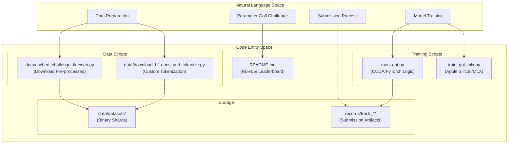

**Key Files and Directories**:

| Path | Purpose |
|------|---------|
| `README.md` | Challenge rules, getting started guide, leaderboard. [README.md:1-27]() |
| `train_gpt.py` | Main CUDA training script containing `GPT` model and `Muon` optimizer. |
| `train_gpt_mlx.py` | Apple Silicon variant using the MLX framework for local iteration. |
| `data/cached_challenge_fineweb.py` | Downloads pre-tokenized FineWeb dataset from Hugging Face Hub. |
| `data/download_hf_docs_and_tokenize.py` | Rebuilds dataset from canonical `docs_selected.jsonl` with custom tokenizers. |
| `records/track_10min_16mb/` | Leaderboard submissions meeting the 10-minute constraint. [README.md:33-52]() |
| `records/track_non_record_16mb/` | Entries exploring the parameter-limited frontier without time limits. [README.md:12-12]() |

**Sources**: [README.md:6-52](), [requirements.txt:1-10]()

---

## Challenge Tracks

Parameter Golf operates two parallel tracks:

### Record Track (`records/track_10min_16mb/`)

The main leaderboard for state-of-the-art submissions. [README.md:29-32]() Requirements:
- **Training time**: ≤ 10 minutes on 8×H100 GPUs. [README.md:6-6]()
- **Artifact size**: ≤ 16,000,000 bytes. [README.md:6-6]()
- **Performance threshold**: To be considered a "record," submissions typically need to show significant improvement over existing SOTA. [README.md:33-52]()

### Non-Record Track (`records/track_non_record_16mb/`)

Accepts submissions that exceed the 10-minute training limit but still satisfy the 16MB artifact constraint. [README.md:12-12]() This track is for:
- Unlimited compute approaches exploring the parameter-limited frontier.
- Novel architectures or compression schemes.
- Experimental techniques requiring longer training.

**Sources**: [README.md:6-12](), [README.md:29-52]()

---

## Participant Workflow

This diagram illustrates the lifecycle of a submission from environment setup to leaderboard inclusion.

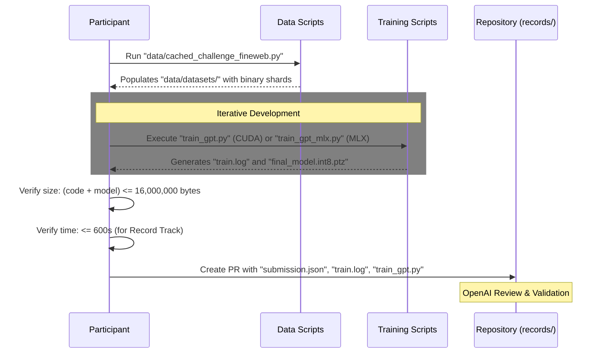

**Workflow Steps**:

1. **Setup**: Install dependencies from `requirements.txt` (e.g., `torch`, `tiktoken`, `sentencepiece`). [requirements.txt:1-10]()
2. **Data**: Download FineWeb shards using `data/cached_challenge_fineweb.py`.
3. **Training**: Configure hyperparameters and run `train_gpt.py` with `torchrun` for distributed training.
4. **Validation**: Verify artifact size (≤ 16MB) and training time (≤ 10 min for record track).
5. **Submission**: Create a folder in the appropriate `records/` subdirectory and submit a Pull Request. [README.md:33-52]()

**Sources**: [README.md:6-52](), [requirements.txt:1-10]()

---

## Design Space and Innovation

The challenge constraints define a multi-dimensional optimization space:

### Architecture and Compression
- **Test-time compute**: Extended inference computation per prediction. [README.md:8-8]()
- **Parameter tying**: Shared embeddings or weight sharing across layers. [README.md:8-8]()
- **Quantization**: INT8, BitNets, or novel low-precision schemes. [README.md:8-8]()
- **Optimizers**: Use of `Muon` (from `modded-nanogpt`) or custom second-order methods to accelerate convergence within the 10-minute window. [README.md:8-8]()

### Evaluation Metric: Bits-Per-Byte (bpb)
The challenge uses `val_bpb` (bits-per-byte) as the primary evaluation metric. It is a tokenizer-agnostic measure of how well the model compresses the FineWeb validation set. [README.md:6-6]()

**Sources**: [README.md:6-10]()

---

## Support and Community

- **Compute Grants**: OpenAI is sponsoring $1,000,000 in compute credits to help participants. [README.md:14-15]()
- **Participant Form**: Used to attribute submissions and reach out about opportunities. [README.md:17-23]()
- **Timeline**: The challenge runs from March 18th to April 30th. [README.md:25-25]()

**Sources**: [README.md:14-25]()

---

# Page: Getting Started

# Getting Started

<details>
<summary>Relevant source files</summary>

The following files were used as context for generating this wiki page:

- [README.md](README.md)
- [data/README.md](data/README.md)
- [data/cached_challenge_fineweb.py](data/cached_challenge_fineweb.py)
- [data/download_hf_docs_and_tokenize.py](data/download_hf_docs_and_tokenize.py)
- [data/tokenizer_specs.json](data/tokenizer_specs.json)
- [records/track_10min_16mb/2026-03-17_LoRA_TTT/README.md](records/track_10min_16mb/2026-03-17_LoRA_TTT/README.md)
- [records/track_10min_16mb/2026-03-17_LoRA_TTT/ablations.png](records/track_10min_16mb/2026-03-17_LoRA_TTT/ablations.png)
- [records/track_10min_16mb/2026-03-17_LoRA_TTT/submission.json](records/track_10min_16mb/2026-03-17_LoRA_TTT/submission.json)
- [records/track_10min_16mb/2026-03-17_LoRA_TTT/train_gpt.py](records/track_10min_16mb/2026-03-17_LoRA_TTT/train_gpt.py)
- [records/track_10min_16mb/2026-03-17_LoRA_TTT/train_v0.txt](records/track_10min_16mb/2026-03-17_LoRA_TTT/train_v0.txt)
- [records/track_10min_16mb/2026-03-17_LoRA_TTT/train_v1.txt](records/track_10min_16mb/2026-03-17_LoRA_TTT/train_v1.txt)
- [records/track_10min_16mb/2026-03-17_LoRA_TTT/train_v2.txt](records/track_10min_16mb/2026-03-17_LoRA_TTT/train_v2.txt)
- [records/track_10min_16mb/2026-03-17_LoRA_TTT/train_v3.txt](records/track_10min_16mb/2026-03-17_LoRA_TTT/train_v3.txt)
- [records/track_10min_16mb/2026-03-17_NaiveBaseline/README.md](records/track_10min_16mb/2026-03-17_NaiveBaseline/README.md)
- [records/track_10min_16mb/2026-03-17_NaiveBaseline/submission.json](records/track_10min_16mb/2026-03-17_NaiveBaseline/submission.json)
- [records/track_10min_16mb/2026-03-17_NaiveBaseline/train.log](records/track_10min_16mb/2026-03-17_NaiveBaseline/train.log)
- [requirements.txt](requirements.txt)
- [train_gpt.py](train_gpt.py)

</details>


This page provides a step-by-step guide for new participants to go from zero to running their first training run in the Parameter Golf challenge. It covers the two main development paths (local Apple Silicon with MLX vs. remote GPU clusters), explains how to download the FineWeb dataset, and shows how to execute your first training script.

For detailed environment setup including prerequisites and dependencies, see [Environment Setup](#2.1). For in-depth data download options and troubleshooting, see [Downloading Data](#2.2). For advanced training configuration and hyperparameter tuning, see [Running Your First Training](#2.3).

## Two Development Paths

Parameter Golf supports two primary development workflows, each optimized for different hardware and iteration speed requirements:

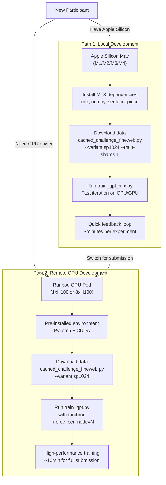

**Path 1 (Local MLX)** is designed for rapid prototyping on Apple Silicon Macs. The `train_gpt_mlx.py` script uses Apple's MLX framework for hardware-accelerated training on the unified memory architecture. This path is ideal for testing architectural changes, debugging, and quick iteration cycles without incurring GPU rental costs [train_gpt.py:2]().

**Path 2 (Remote CUDA)** targets production-quality training on NVIDIA GPUs, specifically the 8xH100 configuration used for official leaderboard submissions [README.md:6](). The `train_gpt.py` script uses PyTorch with distributed training via `torchrun` [records/track_10min_16mb/2026-03-17_LoRA_TTT/README.md:52](). This path is required for final submissions that must meet the 10-minute training constraint [README.md:12]().

**Sources:** [README.md:6-12](), [train_gpt.py:1-5](), [records/track_10min_16mb/2026-03-17_LoRA_TTT/README.md:51-53]()

## File Structure After Setup

After completing the setup process, your local repository will have the following structure:

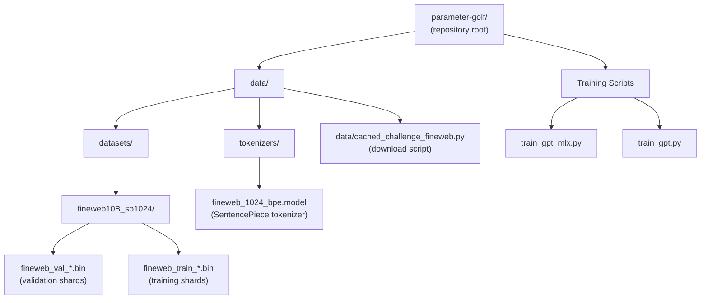

The `data/datasets/fineweb10B_sp1024/` directory contains binary shards [train_gpt.py:41-43](). The validation split uses a fixed set of the first 50,000 documents from FineWeb [data/download_hf_docs_and_tokenize.py:26](). Training shards are numbered sequentially, and you can download a subset using the `cached_challenge_fineweb.py` script.

**Sources:** [train_gpt.py:41-44](), [data/download_hf_docs_and_tokenize.py:23-30]()

## Quick Start: MLX Path (Apple Silicon)

This workflow gets you from zero to a trained model on Apple Silicon in under 10 minutes.

### Step 1: Clone and Install Dependencies

```bash
git clone https://github.com/openai/parameter-golf.git
cd parameter-golf
python3 -m venv .venv
source .venv/bin/activate
python -m pip install --upgrade pip
pip install -r requirements.txt
```

The requirements file includes `torch`, `numpy`, `sentencepiece`, and other necessary libraries [requirements.txt:1-10]().

### Step 2: Download Data

```bash
python3 data/cached_challenge_fineweb.py --variant sp1024 --train-shards 10
```

This downloads the `sp1024` tokenizer variant (1024-token SentencePiece vocabulary) and training shards for quick iteration.

### Step 3: Run Training

```bash
RUN_ID=mlx_smoke \
ITERATIONS=200 \
python3 train_gpt_mlx.py
```

**Key Environment Variables:**
- `RUN_ID`: Identifier for this training run [train_gpt.py:45]().
- `ITERATIONS`: Number of training steps [train_gpt.py:54]().

The script outputs `val_loss` and `val_bpb` (bits-per-byte) at the end.

**Sources:** [requirements.txt:1-10](), [train_gpt.py:41-59]()

## Quick Start: CUDA Path (Remote GPU)

This workflow demonstrates training on a GPU cluster, required for official leaderboard submissions.

### Step 1: Launch Environment

Deploy a pod or instance with PyTorch and CUDA support. OpenAI provides compute grants for participants [README.md:14]().

### Step 2: Clone Repository

```bash
git clone https://github.com/openai/parameter-golf.git
cd parameter-golf
pip install -r requirements.txt
```

### Step 3: Download Data

```bash
python3 data/cached_challenge_fineweb.py --variant sp1024
```

### Step 4: Run Training

```bash
torchrun --standalone --nproc_per_node=8 train_gpt.py
```

Official record submissions use `torchrun` with 8 processes on 8xH100 GPUs [records/track_10min_16mb/2026-03-17_LoRA_TTT/README.md:52]().

**Sources:** [README.md:14](), [records/track_10min_16mb/2026-03-17_LoRA_TTT/README.md:51-53]()

## Training Workflow and Outputs

The following diagram shows the execution flow when running the training script:

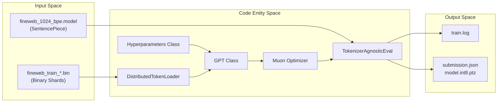

**Artifact Files:**

| File | Description |
|--------------|-------------|
| `train_gpt.py` | The training script used for the run [records/track_10min_16mb/2026-03-17_LoRA_TTT/README.md:57]() |
| `submission.json` | Metadata including author, score, and model size [records/track_10min_16mb/2026-03-17_LoRA_TTT/submission.json:1-11]() |
| `train.log` | Log of the training progress and final validation metrics |

The final model artifact must be exactly 16,000,000 bytes or less [README.md:6]().

**Sources:** [train_gpt.py:39-88](), [records/track_10min_16mb/2026-03-17_LoRA_TTT/submission.json:1-11]()

## Key Configuration Parameters

Training scripts use the `Hyperparameters` class to manage configuration via environment variables [train_gpt.py:39]().

| Variable | Default | Description |
|----------|---------|-------------|
| `VOCAB_SIZE` | `1024` | Vocabulary size of the tokenizer [train_gpt.py:63]() |
| `NUM_LAYERS` | `9` | Number of transformer blocks [train_gpt.py:64]() |
| `MODEL_DIM` | `512` | Hidden dimension of the model [train_gpt.py:66]() |
| `MAX_WALLCLOCK_SECONDS` | `600.0` | 10-minute limit for record track [train_gpt.py:59]() |
| `TRAIN_BATCH_TOKENS` | `524,288` | Global batch size in tokens [train_gpt.py:57]() |

**Sources:** [train_gpt.py:39-88]()

## Validation Metrics Explained

The challenge evaluates models using **Bits-Per-Byte (bpb)** on the FineWeb validation set [README.md:6]().

- **Tokenizer-Agnostic**: Unlike raw cross-entropy loss, bpb allows comparison between models using different tokenizers [README.md:6]().
- **Calculation**: It is calculated from cross-entropy loss by normalizing against the actual byte length of the original text.
- **Goal**: Lower bpb indicates better compression and a better language model.

The `train_gpt.py` script includes a `TokenizerAgnosticEval` setup to handle this calculation [train_gpt.py:172]().

**Sources:** [README.md:6-10](), [train_gpt.py:172-175]()

---

# Page: Environment Setup

# Environment Setup

<details>
<summary>Relevant source files</summary>

The following files were used as context for generating this wiki page:

- [.gitignore](.gitignore)
- [LICENSE](LICENSE)
- [README.md](README.md)
- [THIRD_PARTY_NOTICES.md](THIRD_PARTY_NOTICES.md)
- [requirements.txt](requirements.txt)

</details>


This page documents the prerequisites and installation steps required to begin training models for the Parameter Golf challenge. It covers two primary development paths: local iteration on Apple Silicon hardware using MLX, and remote training on NVIDIA GPUs using CUDA.

## Overview of Development Paths

The Parameter Golf challenge supports two distinct hardware and software stacks, each optimized for different workflows. The repository provides separate entry points for these environments: `train_gpt.py` for CUDA-based training and `train_gpt_mlx.py` for Apple Silicon.

### Hardware and Software Stack Association

The following diagram bridges the high-level development paths to the specific code entities and infrastructure used in the repository.

**Diagram: Development Path to Code Entity Mapping**
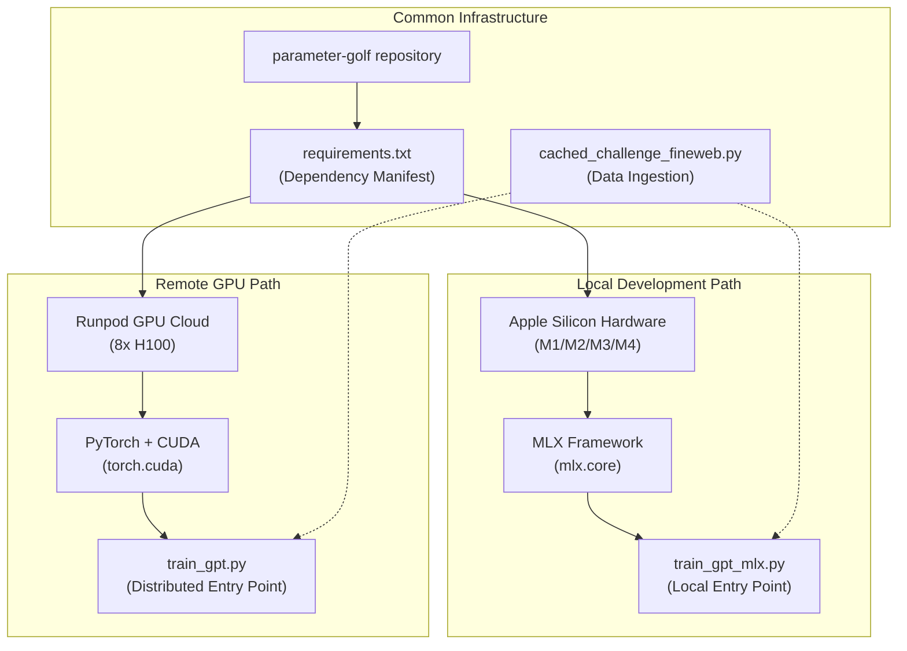
**Sources**: [README.md:6-12](), [README.md:43-126](), [requirements.txt:1-10]()

## Prerequisites

### Python Version
The codebase is designed for modern Python environments. The CUDA path is tested with Python 3.10+, while the MLX path works with Python 3.9+.

### Hardware Recommendations
The challenge centers on a 10-minute training constraint on specific hardware.

| Hardware | Use Case | Training Speed |
|----------|----------|----------------|
| **Apple Silicon (M-series)** | Local iteration, architecture prototyping | ~10-20x slower than H100 |
| **1x NVIDIA H100** | Medium-scale experiments | ~10x slower than 8xH100 |
| **8x NVIDIA H100** | **Leaderboard submissions**, record runs | Target: <10 minutes |

**Sources**: [README.md:6-12](), [README.md:43-126]()

## Dependency Installation

The `requirements.txt` file defines the core dependencies for the project. Note that some packages are specific to the CUDA environment.

| Package | Version | Purpose |
|---------|---------|---------|
| `torch` | Latest | Primary DL framework for CUDA path |
| `mlx` | Latest | Framework for Apple Silicon (manual install) |
| `numpy` | Latest | Array operations and data loading |
| `huggingface-hub` | Latest | Dataset and model downloading |
| `tiktoken` | Latest | BPE tokenization (OpenAI) |
| `sentencepiece` | Latest | Tokenization for `sp1024` variant |
| `kernels` | Latest | Custom CUDA kernels (CUDA path only) |
| `typing-extensions`| `4.15.0`| Type hinting compatibility |

**Sources**: [requirements.txt:1-10]()

## MLX Path: Apple Silicon Setup

For developers using MacBooks or Mac Studios with M-series chips, `train_gpt_mlx.py` provides a native implementation.

### 1. Repository and Environment
```bash
git clone https://github.com/openai/parameter-golf.git
cd parameter-golf
python3 -m venv .venv
source .venv/bin/activate
```

### 2. Install Dependencies
```bash
pip install mlx numpy sentencepiece huggingface-hub datasets tqdm tiktoken
```

### 3. Verification
Verify that MLX can access the Metal GPU:
```bash
python3 -c "import mlx.core as mx; print(f'MLX available: {mx.metal.is_available()}')"
```

**Sources**: [README.md:49-67](), [requirements.txt:1-10]()

## CUDA Path: Remote GPU Setup (Runpod)

Leaderboard submissions are strictly evaluated on 8xH100 instances. Runpod is the recommended provider for these resources.

### Runpod Provisioning Flow
The following diagram illustrates the interaction between the user, the Runpod environment, and the repository scripts.

**Diagram: Runpod Environment Data Flow**
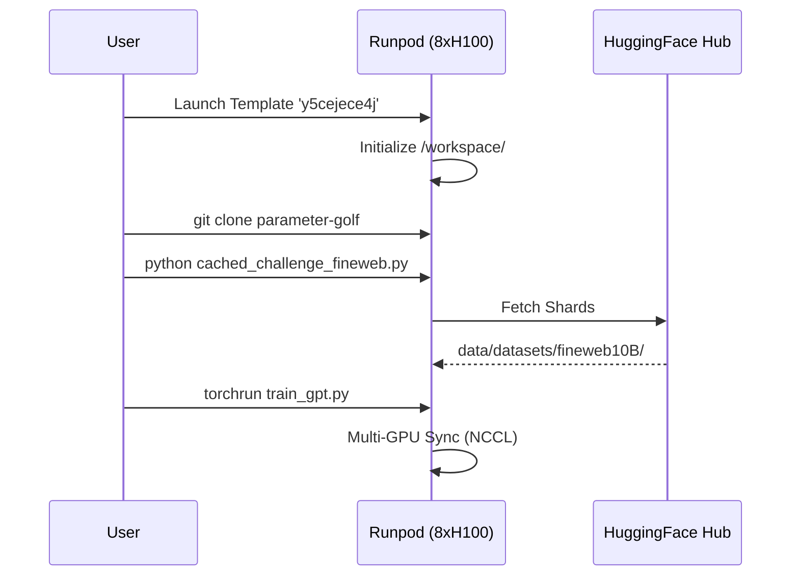

### Setup Steps
1. **Launch Pod**: Use the official Parameter Golf template `y5cejece4j` on [Runpod](https://console.runpod.io/deploy).
2. **Clone Repo**:
   ```bash
   cd /workspace
   git clone https://github.com/openai/parameter-golf.git
   cd parameter-golf
   ```
3. **Verify CUDA**:
   ```bash
   python3 -c "import torch; print(f'GPUs: {torch.cuda.device_count()}')"
   ```
   For a standard record run, this should return `8`.

**Sources**: [README.md:88-122]()

## Common Post-Setup Steps

Once the environment is ready, you must populate the data directory before training.

1. **Download Data**: Use `cached_challenge_fineweb.py` to fetch the tokenized FineWeb shards. This script populates `data/datasets/` and `data/tokenizers/`.
2. **Check Licensing**: Note that parts of the repository are adapted from `modded-nanogpt` under the MIT License.

**Sources**: [README.md:71-86](), [THIRD_PARTY_NOTICES.md:1-29](), [LICENSE:1-21]()

---

# Page: Downloading Data

# Downloading Data

<details>
<summary>Relevant source files</summary>

The following files were used as context for generating this wiki page:

- [README.md](README.md)
- [data/README.md](data/README.md)
- [data/cached_challenge_fineweb.py](data/cached_challenge_fineweb.py)
- [data/download_hf_docs_and_tokenize.py](data/download_hf_docs_and_tokenize.py)
- [data/tokenizer_specs.json](data/tokenizer_specs.json)
- [records/track_10min_16mb/2026-03-17_NaiveBaseline/README.md](records/track_10min_16mb/2026-03-17_NaiveBaseline/README.md)
- [records/track_10min_16mb/2026-03-17_NaiveBaseline/submission.json](records/track_10min_16mb/2026-03-17_NaiveBaseline/submission.json)
- [records/track_10min_16mb/2026-03-17_NaiveBaseline/train.log](records/track_10min_16mb/2026-03-17_NaiveBaseline/train.log)
- [requirements.txt](requirements.txt)

</details>


## Purpose and Scope

This page explains how to download the FineWeb dataset and tokenizers using the `cached_challenge_fineweb.py` script. This is typically the second step after environment setup when starting with Parameter Golf.

For custom data exports and tokenizer retraining, see [Custom Data Export and Tokenization](). For detailed documentation of data formats, see [Data and Tokenizer Formats](). For an overview of the FineWeb dataset itself, see [FineWeb Dataset Overview]().

**Sources:** [README.md:42-127](), [data/README.md:1-67]()

## Quick Start

After setting up your environment (see [Environment Setup]()), download the FineWeb dataset with:

```bash
python3 data/cached_challenge_fineweb.py --variant sp1024 --train-shards 80
```

This downloads:
- The full validation split (fixed 50k documents) [data/download_hf_docs_and_tokenize.py:26-26]()
- 80 training shards (~8 billion tokens) [data/README.md:21-21]()
- The `sp1024` tokenizer artifacts [data/README.md:20-20]()

For faster iteration on limited hardware, reduce the number of training shards:

```bash
python3 data/cached_challenge_fineweb.py --variant sp1024 --train-shards 10
```

**Sources:** [README.md:60-67](), [README.md:104-110](), [data/README.md:14-21]()

## Download Architecture

### High-Level Flow

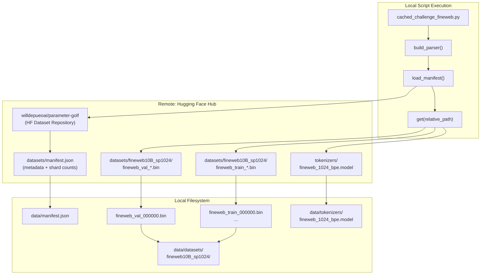

**Sources:** [data/cached_challenge_fineweb.py:1-158](), [data/README.md:12-40]()

### Script Execution Flow

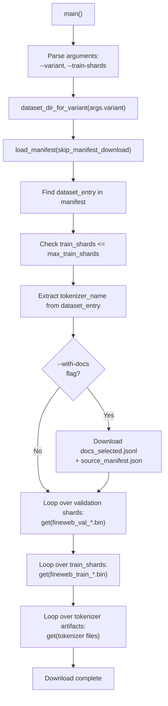

**Sources:** [data/cached_challenge_fineweb.py:120-157]()

## Command-Line Arguments

| Argument | Type | Default | Description |
|----------|------|---------|-------------|
| `--variant` | string | `"sp1024"` | Tokenizer family to download. Options: `sp1024`, `sp4096`, `byte260`, etc. [data/cached_challenge_fineweb.py:103-106]() |
| `--train-shards` | int | `80` | Number of training shards to download. Each shard contains 100M tokens. [data/cached_challenge_fineweb.py:97-101]() |
| `--skip-manifest` | flag | `False` | Skip downloading `manifest.json`. Only use if manifest is already present locally. [data/cached_challenge_fineweb.py:108-111]() |
| `--with-docs` | flag | `False` | Also download `docs_selected.jsonl` and verification manifest for custom tokenizer retraining. [data/cached_challenge_fineweb.py:113-116]() |

The script also accepts a positional argument for `train_shards` (for backward compatibility), but `--train-shards` is preferred. [data/cached_challenge_fineweb.py:89-95]()

**Sources:** [data/cached_challenge_fineweb.py:87-117]()

### Variant Selection

The `--variant` argument determines which tokenizer and corresponding dataset to download. The `dataset_dir_for_variant()` function maps variant names to dataset directories:

| Variant | Dataset Directory | Vocabulary Size | Type |
|---------|------------------|-----------------|------|
| `sp1024` | `fineweb10B_sp1024` | 1024 tokens | SentencePiece BPE |
| `sp4096` | `fineweb10B_sp4096` | 4096 tokens | SentencePiece BPE |
| `byte260` | `fineweb10B_byte260` | 260 bytes | Byte-level encoding |

**Sources:** [data/cached_challenge_fineweb.py:16-21](), [data/tokenizer_specs.json:1-9]()

### Shard Count Strategy

Each training shard contains exactly 100,000,000 tokens. The table below shows common configurations:

| `--train-shards` | Total Training Tokens | Approx Download Size | Use Case |
|------------------|----------------------|---------------------|----------|
| 1 | 100M | ~50 MB | Quick smoke tests |
| 10 | 1B | ~500 MB | Local iteration on Apple Silicon |
| 80 | 8B | ~4 GB | Default baseline (full 8B dataset) |
| 100 | 10B | ~5 GB | Full 10B dataset |

The validation split is always downloaded in full (all `fineweb_val_*.bin` files) regardless of `--train-shards`. [data/cached_challenge_fineweb.py:147-148]()

**Sources:** [data/README.md:29-38](), [README.md:60-67](), [data/cached_challenge_fineweb.py:147-150]()

## Local Data Layout

After running the download script, your local filesystem will have this structure:

```
data/
├── manifest.json                          # Dataset and tokenizer metadata
├── datasets/
│   └── fineweb10B_sp1024/                # Dataset directory (variant-specific)
│       ├── fineweb_val_000000.bin        # Validation split (fixed 50k docs)
│       ├── fineweb_train_000000.bin      # Training shard 0
│       ├── fineweb_train_000001.bin      # Training shard 1
│       └── ...                            # Additional training shards
└── tokenizers/
    └── fineweb_1024_bpe.model            # SentencePiece model for sp1024
```

If you specified `--with-docs`, additional files are downloaded:

```
data/
├── docs_selected.jsonl                    # Canonical document set (for retraining)
└── docs_selected.source_manifest.json     # SHA256 verification manifest
```

**Sources:** [data/README.md:5-10](), [README.md:66](), [data/cached_challenge_fineweb.py:142-144]()

### Path Resolution Logic

The `local_path_for_remote()` function maps remote Hugging Face paths to local filesystem paths:

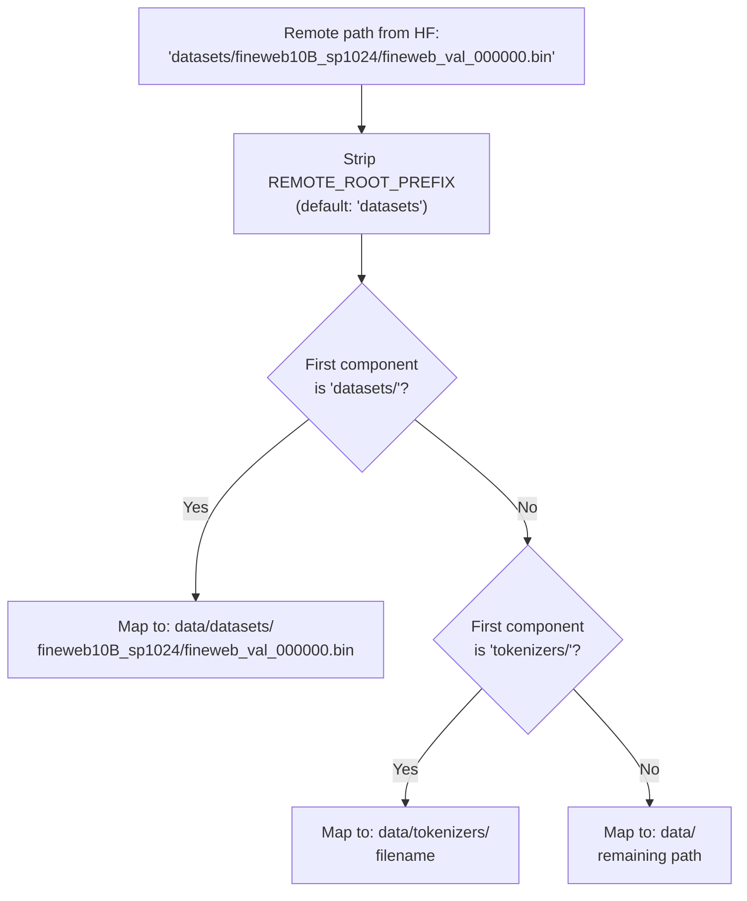

**Sources:** [data/cached_challenge_fineweb.py:24-32]()

## Manifest-Driven Downloads

The script uses `manifest.json` to validate shard counts and locate tokenizer artifacts. This enables safe prefix downloads: you can download exactly N training shards from a larger published dataset without downloading the entire export.

### Manifest Structure (Relevant Fields)

```json
{
  "datasets": [
    {
      "name": "fineweb10B_sp1024",
      "tokenizer_name": "fineweb_1024_bpe",
      "stats": {
        "files_train": 100,
        "files_val": 1
      }
    }
  ],
  "tokenizers": [
    {
      "name": "fineweb_1024_bpe",
      "model_path": "tokenizers/fineweb_1024_bpe.model",
      "vocab_size": 1024
    }
  ]
}
```

The script validates your `--train-shards` request against `stats.files_train` to prevent requesting non-existent shards. [data/cached_challenge_fineweb.py:131-136]()

**Sources:** [data/cached_challenge_fineweb.py:65-73](), [data/cached_challenge_fineweb.py:127-140]()

### Manifest Lookup Flow

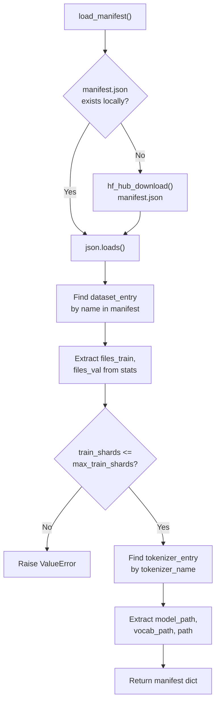

**Sources:** [data/cached_challenge_fineweb.py:65-73](), [data/cached_challenge_fineweb.py:127-140]()

## Environment Variables

Two environment variables control remote repository access:

| Variable | Default | Description |
|----------|---------|-------------|
| `MATCHED_FINEWEB_REPO_ID` | `"willdepueoai/parameter-golf"` | Hugging Face dataset repository ID [data/cached_challenge_fineweb.py:10-10]() |
| `MATCHED_FINEWEB_REMOTE_ROOT_PREFIX` | `"datasets"` | Subdirectory path within the repository where datasets are stored [data/cached_challenge_fineweb.py:11-11]() |

These are useful for downloading from custom exports on Hugging Face Hub:

```bash
MATCHED_FINEWEB_REPO_ID=your-hf-username/your-dataset-repo \
MATCHED_FINEWEB_REMOTE_ROOT_PREFIX=your_50B_export_root \
python3 data/cached_challenge_fineweb.py --variant sp1024 --train-shards 100
```

**Sources:** [data/cached_challenge_fineweb.py:10-11](), [data/README.md:31-35]()

## Download Mechanism

### File Download with Hard-Linking

The `get()` function handles individual file downloads with an optimization for disk space:

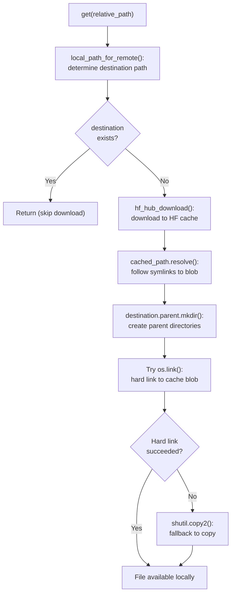

**Key optimization:** The script attempts to hard-link files from the Hugging Face cache to `data/` instead of copying. [data/cached_challenge_fineweb.py:55-58]() This saves disk space when both the cache and data directory are on the same filesystem.

**Sources:** [data/cached_challenge_fineweb.py:35-58]()

### Tokenizer Artifact Resolution

The `artifact_paths_for_tokenizer()` function extracts downloadable paths from tokenizer manifest entries [data/cached_challenge_fineweb.py:76-84]():

The function checks for these keys in order:
1. `model_path` - SentencePiece model file
2. `vocab_path` - Vocabulary file (for non-SP tokenizers)
3. `path` - Generic tokenizer file path

At least one must be present for the tokenizer to be valid.

**Sources:** [data/cached_challenge_fineweb.py:76-84](), [data/cached_challenge_fineweb.py:152-153]()

## Complete Download Example

Here's the full sequence for downloading the `sp1024` variant with 10 training shards:

```bash
# Download from default repository
python3 data/cached_challenge_fineweb.py --variant sp1024 --train-shards 10

# Expected output structure:
# data/
# ├── manifest.json                      (downloaded first)
# ├── datasets/
# │   └── fineweb10B_sp1024/
# │       ├── fineweb_val_000000.bin     (validation: always full)
# │       ├── fineweb_train_000000.bin   (training: shards 0-9)
# │       ├── fineweb_train_000001.bin
# │       └── ... (8 more training shards)
# └── tokenizers/
#     └── fineweb_1024_bpe.model         (tokenizer artifact)
```

The script will:
1. Download `manifest.json` if not present [data/cached_challenge_fineweb.py:72-72]()
2. Validate that `sp1024` dataset exists in manifest [data/cached_challenge_fineweb.py:128-130]()
3. Validate that 10 <= max training shards for `sp1024` [data/cached_challenge_fineweb.py:133-136]()
4. Download all validation shards [data/cached_challenge_fineweb.py:147-148]()
5. Download training shards 0-9 [data/cached_challenge_fineweb.py:149-150]()
6. Download tokenizer artifacts for `fineweb_1024_bpe` [data/cached_challenge_fineweb.py:152-153]()

**Sources:** [data/cached_challenge_fineweb.py:120-157](), [README.md:60-67]()

## Troubleshooting

### Common Issues

| Issue | Cause | Solution |
|-------|-------|----------|
| `FileNotFoundError: manifest.json is required` | `--skip-manifest` used but manifest not present locally | Remove `--skip-manifest` flag or manually download manifest first [data/cached_challenge_fineweb.py:69-71]() |
| `ValueError: dataset fineweb10B_spXXXX not found` | Invalid `--variant` specified | Use valid variant: `sp1024`, `sp4096`, or `byte260` [data/cached_challenge_fineweb.py:129-130]() |
| `ValueError: ... only has N training shards, requested M` | Requested more shards than available | Reduce `--train-shards` to N or less [data/cached_challenge_fineweb.py:133-136]() |
| `OSError` during hard-linking | Cross-filesystem link attempted | Script automatically falls back to `shutil.copy2()` [data/cached_challenge_fineweb.py:57-58]() |

**Sources:** [data/cached_challenge_fineweb.py:69-71](), [data/cached_challenge_fineweb.py:124-136](), [data/cached_challenge_fineweb.py:57-58]()

## Next Steps

After downloading the data:
1. Verify the local data structure exists in `data/datasets/` and `data/tokenizers/` [data/README.md:5-10]()
2. Proceed to [Running Your First Training]() to train a model with the downloaded dataset
3. For custom tokenizers or data exports, see [Custom Data Export and Tokenization]()

**Sources:** [README.md:60-127](), [data/README.md:5-10]()

---

# Page: Running Your First Training

# Running Your First Training

<details>
<summary>Relevant source files</summary>

The following files were used as context for generating this wiki page:

- [records/track_10min_16mb/2026-03-17_LoRA_TTT/README.md](records/track_10min_16mb/2026-03-17_LoRA_TTT/README.md)
- [records/track_10min_16mb/2026-03-17_LoRA_TTT/ablations.png](records/track_10min_16mb/2026-03-17_LoRA_TTT/ablations.png)
- [records/track_10min_16mb/2026-03-17_LoRA_TTT/submission.json](records/track_10min_16mb/2026-03-17_LoRA_TTT/submission.json)
- [records/track_10min_16mb/2026-03-17_LoRA_TTT/train_gpt.py](records/track_10min_16mb/2026-03-17_LoRA_TTT/train_gpt.py)
- [records/track_10min_16mb/2026-03-17_LoRA_TTT/train_v0.txt](records/track_10min_16mb/2026-03-17_LoRA_TTT/train_v0.txt)
- [records/track_10min_16mb/2026-03-17_LoRA_TTT/train_v1.txt](records/track_10min_16mb/2026-03-17_LoRA_TTT/train_v1.txt)
- [records/track_10min_16mb/2026-03-17_LoRA_TTT/train_v2.txt](records/track_10min_16mb/2026-03-17_LoRA_TTT/train_v2.txt)
- [records/track_10min_16mb/2026-03-17_LoRA_TTT/train_v3.txt](records/track_10min_16mb/2026-03-17_LoRA_TTT/train_v3.txt)
- [records/track_10min_16mb/2026-03-17_NaiveBaseline/train_gpt.py](records/track_10min_16mb/2026-03-17_NaiveBaseline/train_gpt.py)
- [train_gpt.py](train_gpt.py)
- [train_gpt_mlx.py](train_gpt_mlx.py)

</details>


This page provides concrete examples of executing your first training run, either locally on Apple Silicon using MLX or on remote GPUs using CUDA. It assumes you have completed environment setup and downloaded the FineWeb dataset.

For detailed information about the training system architecture, model components, and optimization techniques, see the dedicated architecture documentation.

---

## Local Training with MLX (Apple Silicon)

The `train_gpt_mlx.py` script enables fast iteration on local Apple Silicon hardware. This is the recommended starting point for experimenting with configurations before scaling to cloud GPUs.

### Minimal Smoke Test

After downloading data with `--train-shards 10` (or even `--train-shards 1` for faster iteration), run a minimal training job using environment variables to override the defaults defined in the `Hyperparameters` class [train_gpt_mlx.py:43-98]().

```bash
RUN_ID=mlx_smoke \
ITERATIONS=200 \
TRAIN_BATCH_TOKENS=8192 \
VAL_LOSS_EVERY=0 \
VAL_BATCH_SIZE=8192 \
python3 train_gpt_mlx.py
```

This configuration:
- Runs 200 training iterations (much shorter than the default 20,000) [train_gpt_mlx.py:51]().
- Uses a small batch size (8,192 tokens vs. the default 524,288) [train_gpt_mlx.py:56]().
- Skips periodic validation (`VAL_LOSS_EVERY=0`) and only evaluates at the end [train_gpt_mlx.py:52]().
- Completes in a few minutes on M1/M2/M3 hardware.

**Sources:** [train_gpt_mlx.py:43-98]()

### Expected Output

The script will:
1. Log configuration details to `logs/<RUN_ID>.txt` [train_gpt_mlx.py:832-838]().
2. Print training loss every 200 steps (controlled by `TRAIN_LOG_EVERY`) [train_gpt_mlx.py:55]().
3. Evaluate validation metrics at the end [train_gpt_mlx.py:1003-1015]().
4. Save model artifacts:
   - `logs/<RUN_ID>_mlx_model.npz` (raw model via `mx.savez`) [train_gpt_mlx.py:1050-1053]().
   - `logs/<RUN_ID>_mlx_model.int8.ptz` (quantized + zlib compressed) [train_gpt_mlx.py:1055-1067]().

Terminal output example:
```
step:200/200 train_loss:3.2145 train_time:180000ms step_avg:900.00ms tok_s:9102
step:200/200 val_loss:2.9534 val_bpb:1.4521 train_time:182000ms step_avg:910.00ms
final_int8_zlib_roundtrip val_loss:2.9621 val_bpb:1.4562 eval_time:3200ms
```

**Sources:** [train_gpt_mlx.py:832-838](), [train_gpt_mlx.py:1003-1084]()

### MLX Execution Flow

The MLX implementation uses `mx.compile` to optimize the loss and gradient computation graphs [train_gpt_mlx.py:898-904](). It also includes logic to manage peak memory on 16GB machines via `mlx_max_microbatch_tokens` and `mlx_eager_eval` [train_gpt_mlx.py:61-65]().

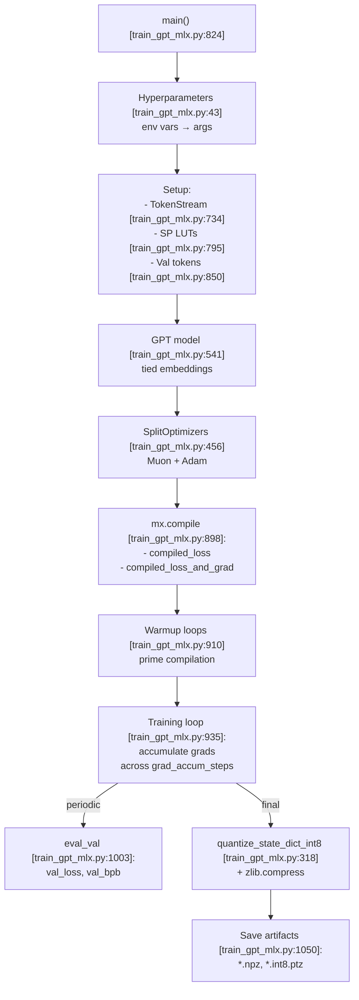

**Sources:** [train_gpt_mlx.py:43-1088]()

---

## Remote Training with CUDA (Scaling Up)

Once you're satisfied with local experiments, switch to `train_gpt.py` on remote GPUs for full-scale training. The baseline configuration targets 8xH100 GPUs but works on any CUDA device.

### Single GPU Example (1xH100)

On a remote machine with the repository cloned and data downloaded:

```bash
RUN_ID=baseline_sp1024 \
DATA_PATH=./data/datasets/fineweb10B_sp1024/ \
TOKENIZER_PATH=./data/tokenizers/fineweb_1024_bpe.model \
VOCAB_SIZE=1024 \
torchrun --standalone --nproc_per_node=1 train_gpt.py
```

Key parameters from `Hyperparameters` [train_gpt.py:39-88]():
- `torchrun --nproc_per_node=1`: Single GPU execution.
- `DATA_PATH`: Points to downloaded dataset directory [train_gpt.py:41]().
- `TOKENIZER_PATH`: SentencePiece model file [train_gpt.py:44]().
- `VOCAB_SIZE`: Must match tokenizer vocabulary size [train_gpt.py:63]().

The script enforces a ~10 minute training cap by default (`MAX_WALLCLOCK_SECONDS=600.0`) [train_gpt.py:59]().

**Sources:** [train_gpt.py:39-88]()

### Multi-GPU Example (8xH100)

For final submissions or large-scale experiments:

```bash
RUN_ID=baseline_sp1024_8gpu \
DATA_PATH=./data/datasets/fineweb10B_sp1024/ \
TOKENIZER_PATH=./data/tokenizers/fineweb_1024_bpe.model \
VOCAB_SIZE=1024 \
torchrun --standalone --nproc_per_node=8 train_gpt.py
```

The training script automatically:
- Distributes data loading across ranks via `DistributedTokenLoader` [train_gpt.py:742-758]().
- Wraps the model in `DistributedDataParallel` (DDP) [train_gpt.py:844]().
- Adjusts gradient accumulation steps to maintain effective batch size [train_gpt.py:754-758]().

**Sources:** [train_gpt.py:731-1126]()

### CUDA Training Pipeline

The CUDA pipeline utilizes `torch.compile` for kernel fusion and the `Muon` optimizer for matrix-shaped parameters [train_gpt.py:96-168]().

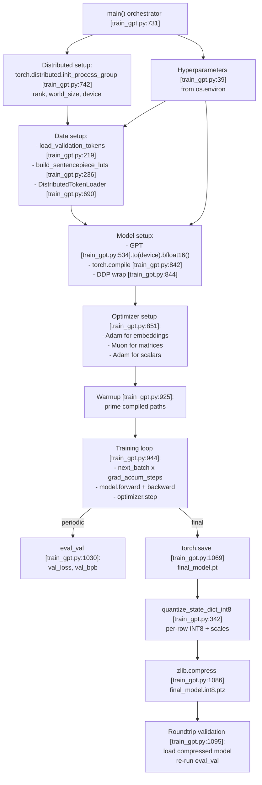

**Sources:** [train_gpt.py:39-1126]()

---

## Key Environment Variables

The training scripts use environment variables for configuration rather than command-line arguments. This enables reproducibility by capturing the exact configuration in log files.

### Essential Configuration

| Variable | Default | Purpose |
|----------|---------|---------|
| `RUN_ID` | UUID | Identifies this run; determines log filename [train_gpt.py:45]() |
| `DATA_PATH` | `./data/datasets/fineweb10B_sp1024` | Directory containing binary shards [train_gpt.py:41]() |
| `TOKENIZER_PATH` | `./data/tokenizers/fineweb_1024_bpe.model` | SentencePiece model file [train_gpt.py:44]() |
| `VOCAB_SIZE` | `1024` | Vocabulary size; must match tokenizer [train_gpt.py:63]() |
| `SEED` | `1337` | Random seed for reproducibility [train_gpt.py:46]() |

### Model Architecture

| Variable | Default | Description |
|----------|---------|-------------|
| `NUM_LAYERS` | `9` | Total transformer blocks [train_gpt.py:64]() |
| `MODEL_DIM` | `512` | Hidden dimension width [train_gpt.py:66]() |
| `NUM_HEADS` | `8` | Number of attention heads [train_gpt.py:67]() |
| `NUM_KV_HEADS` | `4` | Number of key/value heads (GQA) [train_gpt.py:65]() |
| `MLP_MULT` | `2` | MLP expansion factor [train_gpt.py:68]() |
| `TIE_EMBEDDINGS` | `1` | Use tied embeddings (1=yes, 0=no) [train_gpt.py:69]() |

### Training Loop Control

| Variable | Default | Purpose |
|----------|---------|---------|
| `ITERATIONS` | `20000` | Maximum training steps [train_gpt.py:54]() |
| `TRAIN_BATCH_TOKENS` | `524288` | Global batch size in tokens [train_gpt.py:57]() |
| `MAX_WALLCLOCK_SECONDS` | `600.0` | Training time cap [train_gpt.py:59]() |
| `VAL_LOSS_EVERY` | `1000` | Validation frequency [train_gpt.py:50]() |
| `WARMDOWN_ITERS` | `1200` | LR warmdown window [train_gpt.py:55]() |

**Sources:** [train_gpt.py:39-88](), [train_gpt_mlx.py:43-98]()

---

## Understanding Training Outputs

### Validation BPB Metric

The script reports `val_bpb` (Bits-per-byte), the primary scoring metric. It is calculated in `eval_val` [train_gpt.py:1030-1065]() by comparing the model's negative log-likelihood (nats) against the raw byte count of the validation set [train_gpt.py:180-204]().

1. **`val_loss`**: Cross-entropy loss in nats.
2. **`val_bpb`**: `(total_nats / log(2)) / total_bytes`.

This metric is tokenizer-agnostic because it normalizes by the actual byte length of the UTF-8 source text [train_gpt.py:199-204]().

**Sources:** [train_gpt.py:180-204](), [train_gpt.py:1030-1065]()

### Post-Training Artifacts

After training, the script generates:
- **`final_model.pt`**: Full precision state dict [train_gpt.py:1069]().
- **`final_model.int8.ptz`**: Submission artifact [train_gpt.py:1086]().

The quantization process `quantize_state_dict_int8` [train_gpt.py:342-388]() converts 2D weights to INT8 with per-row scales, while keeping sensitive control tensors in higher precision based on `CONTROL_TENSOR_NAME_PATTERNS` [train_gpt.py:330-340]().

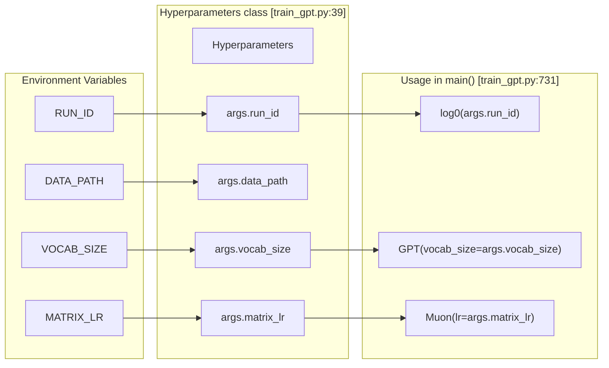

**Sources:** [train_gpt.py:39-168](), [train_gpt.py:342-422](), [train_gpt.py:1069-1120]()

---

# Page: Challenge Rules and Submission

# Challenge Rules and Submission

<details>
<summary>Relevant source files</summary>

The following files were used as context for generating this wiki page:

- [README.md](README.md)
- [requirements.txt](requirements.txt)

</details>


This page provides comprehensive documentation of the Parameter Golf challenge rules, constraints, and submission process. It covers the hard limits that all submissions must meet, the two submission tracks (record vs. non-record), and the multi-stage validation funnel that entries pass through before acceptance.

For detailed information on specific constraints (16MB artifact limit, 10-minute training cap), see [Constraints and Requirements](#3.1). For the evaluation metric calculation and bits-per-byte measurement, see [Evaluation Metrics](#3.2). For step-by-step submission instructions and required files, see [Submission Guidelines](#3.3). For understanding when to use each track, see [Tracks: Record vs Non-Record](#3.4).

## Challenge Objective

The **OpenAI Model Craft Challenge: Parameter Golf** tasks participants with training the best language model under strict dual constraints:

1.  **Artifact size**: The combined code and compressed model must fit within exactly 16,000,000 bytes.
2.  **Training time**: For leaderboard records, training must complete within 10 minutes on 8xH100 GPUs.

Models are evaluated by **bits-per-byte** (`val_bpb`) on the FineWeb validation set. This metric is tokenizer-agnostic, treating the problem as a pure compression task. The challenge encourages exploration of unique architectures (test-time compute, aggressive parameter tying, depth recurrence) and compression schemes (low precision, QAT, bitnets).

**Sources:** [README.md:6-12]()

## The Two-Track System

The challenge maintains two distinct submission tracks to balance accessibility with frontier research.

| Track | Path | Time Limit | Artifact Limit | Acceptance Criteria |
| :--- | :--- | :--- | :--- | :--- |
| **Record Track** | `records/track_10min_16mb/` | ≤ 10 mins (8xH100) | ≤ 16,000,000 bytes | Must beat SOTA by ≥0.005 nats with p<0.01 significance |
| **Non-Record Track** | `records/track_non_record_16mb/` | Unlimited | ≤ 16,000,000 bytes | Novel approach, well-documented, runs successfully |

### Track Logic and Code Association

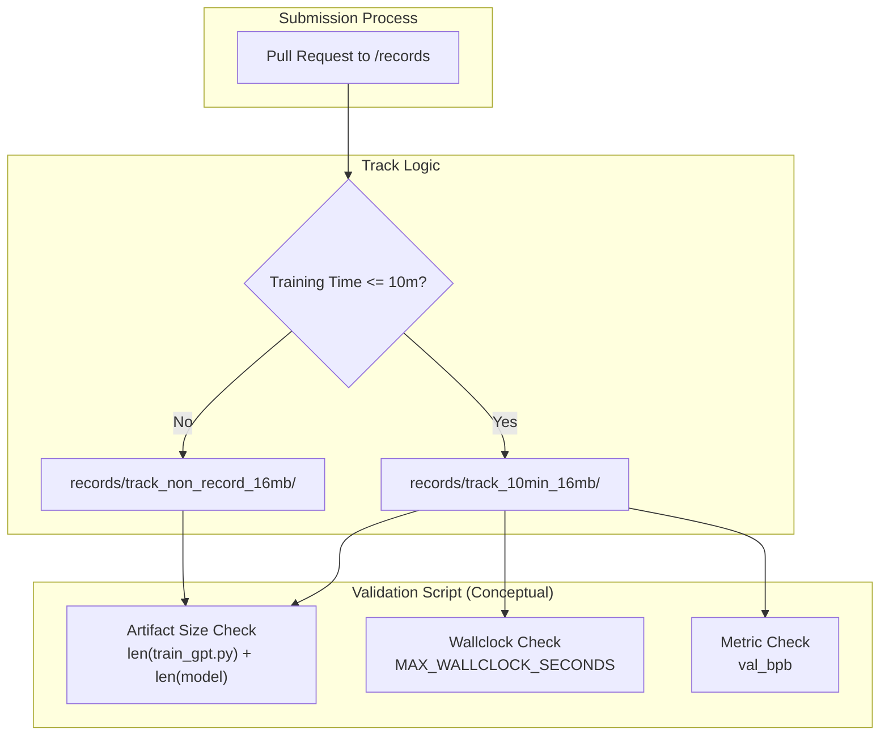

**Diagram 1: Track selection and associated validation constraints.**

**Sources:** [README.md:12-13](), [README.md:169-175]()

## Artifact Composition and Constraints

The 16MB limit is a hard constraint on the total size of the submission. The artifact size is calculated as the sum of the training script and the compressed model weights.

### Size Accounting

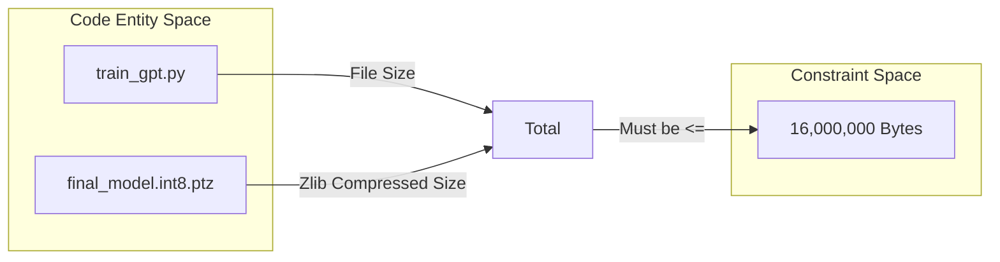

**Diagram 2: Association between code artifacts and the 16MB constraint.**

*   **Code**: All training logic, model definitions, and custom tokenizers must reside in `train_gpt.py`.
*   **Weights**: Typically stored as an INT8-quantized, `zlib` (level 9) compressed file (e.g., `final_model.int8.ptz`).
*   **Exclusions**: Documentation (`README.md`), metadata (`submission.json`), and logs (`train.log`) do not count toward the 16MB limit.
*   **Runtime**: No external downloads are permitted during evaluation. The model must be fully self-contained.

**Sources:** [README.md:131-136]()

## Required Submission Files

Every submission must include exactly these four files in its designated folder within the `records/` directory:

1.  `README.md`: Detailed explanation of the architecture, hyperparameters, and training techniques.
2.  `submission.json`: Machine-readable metadata including `name`, `github_id`, `val_bpb`, and `artifact_size`.
3.  `train.log`: The full output log from the training run.
4.  `train_gpt.py`: The complete, self-contained training script.

**Sources:** [README.md:159-168]()

## Evaluation Metrics

The primary ranking metric is **bits-per-byte** (`val_bpb`). This is derived from the cross-entropy loss (nats) on the FineWeb validation set.

*   **Tokenizer Agnostic**: By converting loss to bits-per-byte, different tokenizers (e.g., GPT-2, SentencePiece, or custom byte-level schemes) can be compared fairly.
*   **Calculation**: `val_bpb = (loss_in_nats / ln(2)) / (bytes_per_token)`.
*   **Improvement Threshold**: To claim a new Record Track SOTA, a submission must improve upon the previous record by at least **0.005 nats** with a statistical significance of **p < 0.01**.

**Sources:** [README.md:6](), [README.md:151-157]()

## Validation Process

Submissions undergo a multi-stage validation funnel:

1.  **Structural Check**: Verify all four required files exist and `submission.json` is valid.
2.  **Constraint Check**: Confirm `artifact_size` is ≤ 16,000,000 bytes and training time is within limits.
3.  **Reproducibility**: OpenAI independently runs top entries to verify that the claimed `val_bpb` is achievable using the provided `train_gpt.py`.
4.  **Scrutiny**: Tokenizer modifications or unusual evaluation methods (like extreme sequence lengths) are reviewed to ensure no "cheating" (e.g., leaking validation data) occurs.

**Sources:** [README.md:137-150]()

## Timeline and Support

*   **Challenge Duration**: March 18th to April 30th.
*   **Compute Grants**: OpenAI is sponsoring $1M in compute credits for participants.
*   **Community**: Discussions take place on the OpenAI Discord in the `#parameter-golf` channels.

**Sources:** [README.md:14-15](), [README.md:25]()

---

# Page: Constraints and Requirements

# Constraints and Requirements

<details>
<summary>Relevant source files</summary>

The following files were used as context for generating this wiki page:

- [README.md](README.md)
- [records/track_10min_16mb/2026-03-17_LoRA_TTT/README.md](records/track_10min_16mb/2026-03-17_LoRA_TTT/README.md)
- [records/track_10min_16mb/2026-03-17_LoRA_TTT/ablations.png](records/track_10min_16mb/2026-03-17_LoRA_TTT/ablations.png)
- [records/track_10min_16mb/2026-03-17_LoRA_TTT/submission.json](records/track_10min_16mb/2026-03-17_LoRA_TTT/submission.json)
- [records/track_10min_16mb/2026-03-17_LoRA_TTT/train_gpt.py](records/track_10min_16mb/2026-03-17_LoRA_TTT/train_gpt.py)
- [records/track_10min_16mb/2026-03-17_LoRA_TTT/train_v0.txt](records/track_10min_16mb/2026-03-17_LoRA_TTT/train_v0.txt)
- [records/track_10min_16mb/2026-03-17_LoRA_TTT/train_v1.txt](records/track_10min_16mb/2026-03-17_LoRA_TTT/train_v1.txt)
- [records/track_10min_16mb/2026-03-17_LoRA_TTT/train_v2.txt](records/track_10min_16mb/2026-03-17_LoRA_TTT/train_v2.txt)
- [records/track_10min_16mb/2026-03-17_LoRA_TTT/train_v3.txt](records/track_10min_16mb/2026-03-17_LoRA_TTT/train_v3.txt)
- [requirements.txt](requirements.txt)
- [train_gpt.py](train_gpt.py)

</details>


This page documents the hard constraints and requirements that all Parameter Golf submissions must satisfy. These constraints define the core challenge: training the best possible language model under strict resource limitations. The three fundamental constraints are the 16MB artifact size limit, the 10-minute training time limit on 8xH100 GPUs, and the prohibition on external data access during evaluation. This page also covers how these constraints are calculated, enforced, and validated.

For information about the evaluation metric (bits-per-byte), see [Evaluation Metrics](#3.2). For the submission process and file requirements, see [Submission Guidelines](#3.3). For the distinction between record-track and non-record-track submissions, see [Tracks: Record vs Non-Record](#3.4).

---

## Three Core Constraints

The Parameter Golf challenge enforces three hard constraints that together define the resource envelope for submissions. These constraints are designed to create a fair competitive environment while encouraging innovation in model architecture, compression techniques, and training efficiency.

### Challenge Constraint Space Diagram
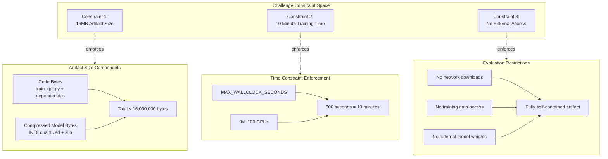

**Sources**: [README.md:6-12](), [README.md:131-148]()

---

## Constraint 1: 16MB Artifact Size Limit

The submission artifact is capped at **exactly 16,000,000 bytes** (decimal megabytes, not 16 MiB / 16,777,216 bytes). This limit applies to the sum of all code and compressed model parameters needed to reproduce the submission's validation performance [README.md:131-134]().

### What Counts Toward the Limit

The artifact size is calculated as:
`Total Artifact Size = Code Bytes + Compressed Model Bytes`

| Component | Description | File References |
|-----------|-------------|-----------------|
| **Code Bytes** | Size of `train_gpt.py` and any dependencies needed to run evaluation | [README.md:133]() |
| **Compressed Model Bytes** | Size of quantized and compressed model checkpoint | [README.md:133-134]() |

### Exact Calculation Logic
The artifact size calculation is typically reported in the `submission.json` file generated or manually updated after training [records/track_10min_16mb/2026-03-17_LoRA_TTT/submission.json:9-10]().

### Artifact Size Calculation Flow
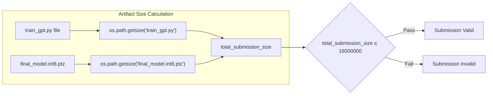

The `LoRA TTT` submission demonstrates compliance:
- `bytes_total`: `15,882,446`
- `bytes_code`: `58,509`
- Total is under the `16,000,000` byte limit [records/track_10min_16mb/2026-03-17_LoRA_TTT/submission.json:9-10]().

**Sources**: [README.md:131-135](), [records/track_10min_16mb/2026-03-17_LoRA_TTT/submission.json:9-10]()

---

## Constraint 2: 10-Minute Training Time Limit

Record-track submissions must complete training in **10 minutes or less** on **8xH100 GPUs**. This constraint is enforced via wallclock time, not step count or token count [README.md:6-8]().

### Hardware Specification

| Requirement | Value | Notes |
|-------------|-------|-------|
| GPU Type | H100 (80GB SXM) | Standard NVIDIA H100 configuration |
| GPU Count | 8 | Multi-GPU setup required for verification |
| Interconnect | NVLink/NVSwitch | High-bandwidth GPU-to-GPU communication |
| Time Limit | 600 seconds | Hard wallclock limit [train_gpt.py:59]() |

### Wallclock Enforcement
The time constraint is enforced through the `max_wallclock_seconds` hyperparameter, which defaults to `600.0` [train_gpt.py:59]().

### Training Loop Time Enforcement
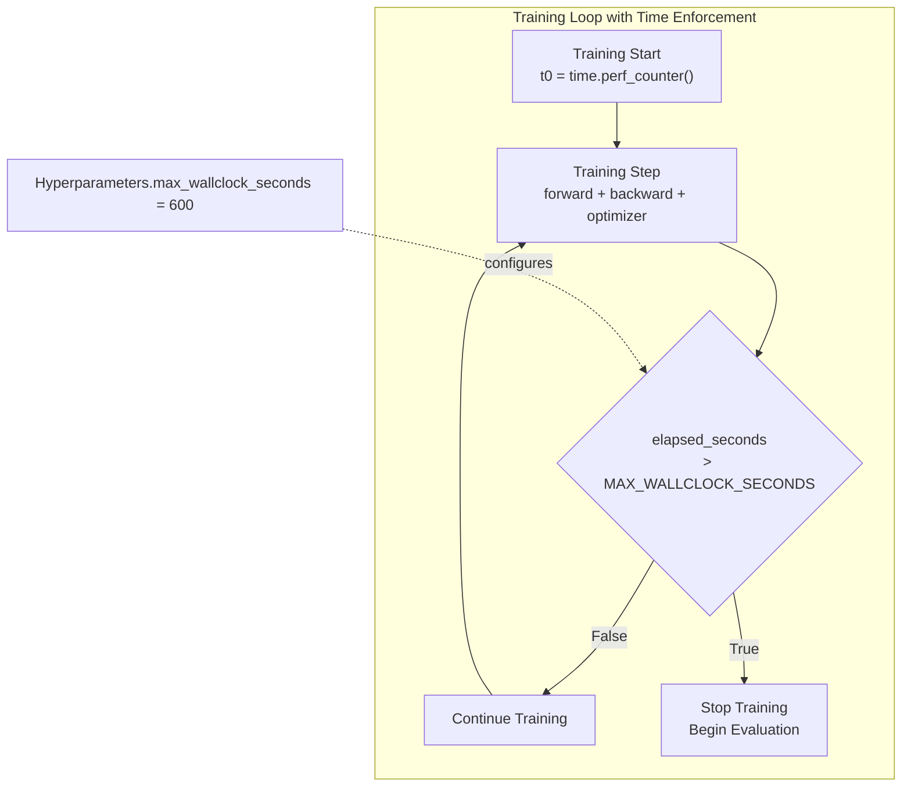

**Sources**: [README.md:6](), [train_gpt.py:59](), [records/track_10min_16mb/2026-03-17_LoRA_TTT/train_gpt.py:60]()

### Evaluation Time
Evaluation (computing final `val_loss` and `val_bpb`) is **not** counted toward the 10-minute training limit. However, evaluation itself must complete in under 10 minutes on 8xH100s to prevent abuse [README.md:145-147](). This allows for techniques like Test-Time Training (TTT) which may be computationally expensive during inference [records/track_10min_16mb/2026-03-17_LoRA_TTT/README.md:21]().

---

## Constraint 3: No External Access During Evaluation

The submission artifact must be **fully self-contained and reproducible** without any external data access during evaluation [README.md:135-136]().

### Prohibited vs Allowed Access
```mermaid
graph TB
    subgraph Evaluation_Environment["Isolated Evaluation Environment"]
        ARTIFACT["Submission Artifact<br/>train_gpt.py + final_model.int8.ptz"]
        VAL_DATA["Validation Data<br/>fineweb_val_*.bin (pre-loaded)"]
        TOKENIZER["Tokenizer<br/>fineweb_1024_bpe.model (pre-loaded)"]
    end
    
    subgraph Prohibited_Access["❌ Prohibited During Evaluation"]
        NETWORK["Network Downloads"]
        TRAIN_DATA["Training Data Access"]
        PRETRAINED["External Pretrained Weights"]
    end
    
    subgraph Allowed_Access["✓ Allowed During Evaluation"]
        LOCAL_COMPUTE["Local Computation"]
        TEST_TIME["Test-Time Training (TTT)"]
        LONG_CONTEXT["Long Sequence Lengths"]
    end
    
    ARTIFACT -.uses.-> VAL_DATA
    ARTIFACT -.uses.-> TOKENIZER
    ARTIFACT -.can perform.-> LOCAL_COMPUTE
    ARTIFACT -.can perform.-> TEST_TIME
    
    ARTIFACT -.prohibited from.-> NETWORK
    ARTIFACT -.prohibited from.-> TRAIN_DATA
    ARTIFACT -.prohibited from.-> PRETRAINED
```

### Test-Time Training (TTT)
Submissions like `LoRA TTT` use allowed local computation during evaluation to adapt the model to the validation document without leaking information across documents [records/track_10min_16mb/2026-03-17_LoRA_TTT/README.md:7-11](). This involves:
1. Splitting documents into chunks [records/track_10min_16mb/2026-03-17_LoRA_TTT/README.md:9]().
2. Scoring the chunk (calculating loss) [records/track_10min_16mb/2026-03-17_LoRA_TTT/README.md:10]().
3. Training LoRA adapters on that chunk's loss [records/track_10min_16mb/2026-03-17_LoRA_TTT/README.md:10]().
4. Resetting parameters between documents to avoid leakage [records/track_10min_16mb/2026-03-17_LoRA_TTT/README.md:11]().

**Sources**: [README.md:135-136](), [records/track_10min_16mb/2026-03-17_LoRA_TTT/README.md:7-14]()

---

## Statistical Significance and Verification

### New SOTA Requirements
New state-of-the-art records must demonstrate:
1. **Minimum Improvement**: 0.005 nats (approx 0.0072 bpb) [README.md:151]().
2. **Confidence**: p < 0.01 significance over previous records [README.md:152]().
3. **Evidence**: Multiple run logs to prove consistency [README.md:153]().

### Verification Flow
```mermaid
graph LR
    SUBMISSION["Submission PR"]
    REVIEW["Initial Review"]
    VERIFICATION["Independent Verification<br/>by OpenAI"]
    
    SUBMISSION --> REVIEW
    REVIEW -->|Top entry| VERIFICATION
    REVIEW -->|Not top entry| ACCEPT_UNVERIFIED["Accept (unverified)"]
    
    VERIFICATION -->|Reproducible| LEADERBOARD["Add to Leaderboard"]
    VERIFICATION -->|Not reproducible| DISQUALIFY["Disqualify"]
```

**Sources**: [README.md:137-139](), [README.md:151-153]()

---

## Summary of Constraints

| Constraint | Value | Applies To | Code Reference |
|------------|-------|------------|----------------|
| **Artifact Size** | ≤ 16,000,000 bytes | All submissions | [README.md:131]() |
| **Training Time** | ≤ 600 seconds | Record Track | [train_gpt.py:59]() |
| **Hardware** | 8x H100 GPUs | Record Track | [README.md:6]() |
| **External Data** | None at Eval | All submissions | [README.md:135]() |
| **Min Improvement** | 0.005 nats | SOTA Records | [README.md:151]() |
| **Significance** | p < 0.01 | SOTA Records | [README.md:152]() |

**Sources**: [README.md:6-12](), [README.md:131-157](), [train_gpt.py:59]()

---

# Page: Evaluation Metrics

# Evaluation Metrics

<details>
<summary>Relevant source files</summary>

The following files were used as context for generating this wiki page:

- [README.md](README.md)
- [records/track_10min_16mb/2026-03-19_Seq2048_FP16Emb_TunedLR/README.md](records/track_10min_16mb/2026-03-19_Seq2048_FP16Emb_TunedLR/README.md)
- [records/track_10min_16mb/2026-03-19_Seq2048_FP16Emb_TunedLR/submission.json](records/track_10min_16mb/2026-03-19_Seq2048_FP16Emb_TunedLR/submission.json)
- [records/track_10min_16mb/2026-03-19_Seq2048_FP16Emb_TunedLR/train_gpt.py](records/track_10min_16mb/2026-03-19_Seq2048_FP16Emb_TunedLR/train_gpt.py)
- [records/track_10min_16mb/2026-03-19_Seq2048_FP16Emb_TunedLR/train_seed1337.log](records/track_10min_16mb/2026-03-19_Seq2048_FP16Emb_TunedLR/train_seed1337.log)
- [records/track_10min_16mb/2026-03-19_Seq2048_FP16Emb_TunedLR/train_seed3.log](records/track_10min_16mb/2026-03-19_Seq2048_FP16Emb_TunedLR/train_seed3.log)
- [records/track_10min_16mb/2026-03-19_Seq2048_FP16Emb_TunedLR/train_seed42.log](records/track_10min_16mb/2026-03-19_Seq2048_FP16Emb_TunedLR/train_seed42.log)
- [requirements.txt](requirements.txt)

</details>


## Purpose and Scope

This page documents the evaluation metrics used in the Parameter Golf challenge: validation cross-entropy loss (`val_loss`) and validation bits-per-byte (`val_bpb`). The primary leaderboard metric is `val_bpb`, which measures tokenizer-agnostic compression performance on the FineWeb validation set. This page explains why `val_bpb` is tokenizer-agnostic, how it relates to data compression, and the implementation details for calculating both metrics.

For submission requirements and constraints, see [Constraints and Requirements](3.1). For dataset details, see [FineWeb Dataset Overview](5.1).

---

## The Two Evaluation Metrics

Parameter Golf evaluates models using two related metrics computed during validation:

| Metric | Unit | Purpose | Calculation |
|--------|------|---------|-------------|
| `val_loss` | nats (natural log) | Token-level cross-entropy loss | Standard cross-entropy between model predictions and targets |
| `val_bpb` | bits per byte | Compression performance | `(val_loss / log(2)) × (token_count / byte_count)` |

The **primary leaderboard metric is `val_bpb`** because it is tokenizer-agnostic and measures the core capability: how well the model compresses the validation text, regardless of tokenization choices.

**Sources:** [README.md:6](), [records/track_10min_16mb/2026-03-19_Seq2048_FP16Emb_TunedLR/train_gpt.py:172-179]()

---

## Why Bits-Per-Byte is Tokenizer-Agnostic

### The Problem with Token-Level Loss

Using `val_loss` directly as the primary metric would create perverse incentives. Models with larger vocabularies (more tokens) would artificially appear better because:

- A large vocabulary (e.g., 50,000 tokens) can represent the same text with fewer tokens than a small one (e.g., 1,024 tokens).
- Fewer tokens means fewer prediction steps, leading to lower aggregate loss per document.
- This doesn't reflect better language understanding—just tokenization choices.

### The Solution: Bits-Per-Byte

The `val_bpb` metric normalizes by the **underlying byte count** of the text, making it independent of tokenizer design:

```
bits_per_byte = (cross_entropy_loss / log(2)) × (tokens_used / bytes_represented)
```

Where:
- `cross_entropy_loss / log(2)` converts nats to bits per token.
- `tokens_used / bytes_represented` converts bits per token to bits per byte.

This measures how many bits the model needs to encode each byte of the original text, providing an apples-to-apples comparison across different tokenizers (e.g., `sp1024` vs `byte260`).

**Sources:** [records/track_10min_16mb/2026-03-19_Seq2048_FP16Emb_TunedLR/train_gpt.py:175-178](), [README.md:6]()

---

## Calculation Flow: From Model Predictions to Metrics

The following diagram bridges the high-level evaluation concepts to the specific code entities in the training scripts.

### Metric Calculation Pipeline
```mermaid
graph TB
    subgraph "Model Forward Pass"
        INPUT["input_ids: Tensor<br/>(batch, seq_len)"]
        TARGET["target_ids: Tensor<br/>(batch, seq_len)"]
        MODEL["GPT.forward(input_ids, target_ids)"]
        LOSS_RAW["batch_loss: Tensor<br/>scalar cross-entropy"]
    end
    
    subgraph "Aggregation in eval_val()"
        LOSS_SUM["val_loss_sum: Tensor<br/>dtype=float64"]
        TOKEN_COUNT["val_token_count: Tensor<br/>dtype=float64"]
        BYTE_COUNT["val_byte_count: Tensor<br/>dtype=float64"]
        
        LOSS_AGG["val_loss_sum += batch_loss * batch_tokens"]
        TOKEN_AGG["val_token_count += batch_tokens"]
        BYTE_AGG["val_byte_count += byte_count_for_batch"]
    end
    
    subgraph "Byte Counting System"
        LUTS["Lookup Tables:<br/>base_bytes_lut<br/>has_leading_space_lut<br/>is_boundary_token_lut"]
        PREV_IDS["prev_ids = input_ids.reshape(-1)"]
        TGT_IDS["tgt_ids = target_ids.reshape(-1)"]
        TOKEN_BYTES["token_bytes = base_bytes_lut[tgt_ids]"]
        SPACE_ADJ["token_bytes += has_leading_space & ~is_boundary"]
        BYTE_SUM["sum(token_bytes)"]
    end
    
    subgraph "Final Metric Calculation"
        VAL_LOSS_CALC["val_loss = val_loss_sum / val_token_count"]
        BITS_PER_TOK["bits_per_token = val_loss / log(2)"]
        TOKENS_PER_BYTE["tokens_per_byte = val_token_count / val_byte_count"]
        VAL_BPB_CALC["val_bpb = bits_per_token * tokens_per_byte"]
    end
    
    INPUT --> MODEL
    TARGET --> MODEL
    MODEL --> LOSS_RAW
    
    LOSS_RAW --> LOSS_AGG
    TARGET --> TOKEN_AGG
    LOSS_AGG --> LOSS_SUM
    TOKEN_AGG --> TOKEN_COUNT
    
    TARGET --> TGT_IDS
    INPUT --> PREV_IDS
    LUTS --> TOKEN_BYTES
    TGT_IDS --> TOKEN_BYTES
    TOKEN_BYTES --> SPACE_ADJ
    PREV_IDS --> SPACE_ADJ
    TGT_IDS --> SPACE_ADJ
    SPACE_ADJ --> BYTE_SUM
    BYTE_SUM --> BYTE_AGG
    BYTE_AGG --> BYTE_COUNT
    
    LOSS_SUM --> VAL_LOSS_CALC
    TOKEN_COUNT --> VAL_LOSS_CALC
    TOKEN_COUNT --> TOKENS_PER_BYTE
    BYTE_COUNT --> TOKENS_PER_BYTE
    VAL_LOSS_CALC --> BITS_PER_TOK
    BITS_PER_TOK --> VAL_BPB_CALC
    TOKENS_PER_BYTE --> VAL_BPB_CALC
    
    VAL_LOSS_CALC --> OUTPUT_LOSS["return: val_loss"]
    VAL_BPB_CALC --> OUTPUT_BPB["return: val_bpb"]
```

**Sources:** [records/track_10min_16mb/2026-03-19_Seq2048_FP16Emb_TunedLR/train_gpt.py:219-278]()

---

## Implementation: The `eval_val` Function

The validation evaluation is implemented in the `eval_val` function, which computes both metrics in a single pass over the validation set.

### Function Signature
[records/track_10min_16mb/2026-03-19_Seq2048_FP16Emb_TunedLR/train_gpt.py:219-231]()

### Key Steps

1. **Distributed Validation**: The validation set is split across ranks to enable parallel evaluation on multi-GPU systems. Each rank processes a disjoint span of sequences [records/track_10min_16mb/2026-03-19_Seq2048_FP16Emb_TunedLR/train_gpt.py:241-246]().
2. **Accumulation in Float64**: All accumulators (`val_loss_sum`, `val_token_count`, `val_byte_count`) use `torch.float64` to prevent numerical drift during accumulation over thousands of batches [records/track_10min_16mb/2026-03-19_Seq2048_FP16Emb_TunedLR/train_gpt.py:233-235]().
3. **Byte Counting**: For each batch, the function counts the total UTF-8 bytes represented by the target tokens using precomputed lookup tables [records/track_10min_16mb/2026-03-19_Seq2048_FP16Emb_TunedLR/train_gpt.py:263-267]().
4. **All-Reduce**: In distributed mode, accumulators are synchronized across ranks using `dist.all_reduce` before computing final metrics [records/track_10min_16mb/2026-03-19_Seq2048_FP16Emb_TunedLR/train_gpt.py:270-273]().
5. **Final Calculation**: Convert accumulated sums to final metrics using the formulas described above [records/track_10min_16mb/2026-03-19_Seq2048_FP16Emb_TunedLR/train_gpt.py:275-278]().

**Sources:** [records/track_10min_16mb/2026-03-19_Seq2048_FP16Emb_TunedLR/train_gpt.py:219-278]()

---

## SentencePiece Byte Counting System

To count bytes in a tokenizer-agnostic way, the system builds lookup tables (LUTs) during initialization that map each token ID to its UTF-8 byte count.

### Lookup Table Construction Logic
```mermaid
graph TB
    subgraph "build_sentencepiece_luts()"
        SP["SentencePieceProcessor<br/>sp.vocab_size()"]
        LOOP["For each token_id in vocab"]
        
        CHECK_SPECIAL{"is_control or<br/>is_unknown or<br/>is_unused?"}
        MARK_BOUNDARY["is_boundary_token[token_id] = True<br/>Skip byte counting"]
        
        CHECK_BYTE{"is_byte<br/>token?"}
        SET_ONE["base_bytes[token_id] = 1"]
        
        GET_PIECE["piece = sp.id_to_piece(token_id)"]
        CHECK_SPACE{"piece starts<br/>with '▁'?"}
        SET_SPACE["has_leading_space[token_id] = True<br/>piece = piece[1:]"]
        ENCODE["base_bytes[token_id] = len(piece.encode('utf-8'))"]
        
        TENSORIZE["Convert numpy arrays<br/>to torch.Tensor on device"]
        OUTPUT["Return:<br/>base_bytes_lut<br/>has_leading_space_lut<br/>is_boundary_token_lut"]
    end
    
    SP --> LOOP
    LOOP --> CHECK_SPECIAL
    CHECK_SPECIAL -->|Yes| MARK_BOUNDARY
    CHECK_SPECIAL -->|No| CHECK_BYTE
    
    CHECK_BYTE -->|Yes| SET_ONE
    CHECK_BYTE -->|No| GET_PIECE
    
    GET_PIECE --> CHECK_SPACE
    CHECK_SPACE -->|Yes| SET_SPACE
    CHECK_SPACE -->|No| ENCODE
    SET_SPACE --> ENCODE
    
    SET_ONE --> LOOP
    ENCODE --> LOOP
    MARK_BOUNDARY --> LOOP
    
    LOOP -->|Done| TENSORIZE
    TENSORIZE --> OUTPUT
```

**Sources:** [records/track_10min_16mb/2026-03-19_Seq2048_FP16Emb_TunedLR/train_gpt.py:180-204]()

### The Three Lookup Tables

| LUT Name | Type | Purpose |
|----------|------|---------|
| `base_bytes_lut` | `Tensor[int16]` | UTF-8 byte count for the token's piece (excluding leading space) |
| `has_leading_space_lut` | `Tensor[bool]` | Whether the token represents text after a word boundary (SentencePiece `▁` prefix) |
| `is_boundary_token_lut` | `Tensor[bool]` | Whether the token is a control/unknown/unused token (boundary markers) |

**Sources:** [records/track_10min_16mb/2026-03-19_Seq2048_FP16Emb_TunedLR/train_gpt.py:180-204]()

---

## Sliding Window Evaluation

Advanced submissions often use "Sliding Window Evaluation" to improve `val_bpb` scores. By using a stride smaller than the sequence length, the model can predict tokens with more preceding context on average.

In `Hyperparameters`, this is controlled by:
- `eval_stride`: The step size between evaluation windows (e.g., 64). [records/track_10min_16mb/2026-03-19_Seq2048_FP16Emb_TunedLR/train_gpt.py:54]()
- `eval_seq_len`: The context length used during evaluation. [records/track_10min_16mb/2026-03-19_Seq2048_FP16Emb_TunedLR/train_gpt.py:55]()

A stride of 0 indicates standard, non-overlapping evaluation. Competitive runs (like the `yahya010` submission) show a significant gap between standard and sliding evaluation:
- Standard `val_bpb`: 1.1821
- Sliding `val_bpb`: 1.1610

**Sources:** [records/track_10min_16mb/2026-03-19_Seq2048_FP16Emb_TunedLR/README.md:47](), [records/track_10min_16mb/2026-03-19_Seq2048_FP16Emb_TunedLR/submission.json:5-8]()

---

## Example Output from Training Logs

Here's an example of the metrics reported during and after training for a top-tier submission:

```
step:0/20000 val_loss:6.9370 val_bpb:4.0978 train_time:0ms step_avg:0.01ms
...
step:8319/20000 val_loss:1.9563 val_bpb:1.1586 train_time:600000ms step_avg:72.12ms
final_int8_zstd_roundtrip val_loss:1.9563 val_bpb:1.1586 eval_time:370s
```

Key observations:
- **Initial metrics**: At step 0 (random initialization), `val_bpb` is high (~4.10).
- **Quantization Gap**: High-quality submissions using **STE QAT** (Straight-Through Estimator Quantization Aware Training) achieve a "zero quant gap," where pre-quantization and post-quantization losses are identical. [records/track_10min_16mb/2026-03-19_Seq2048_FP16Emb_TunedLR/README.md:9-11]()

**Sources:** [records/track_10min_16mb/2026-03-19_Seq2048_FP16Emb_TunedLR/submission.json:7-9](), [records/track_10min_16mb/2026-03-19_Seq2048_FP16Emb_TunedLR/README.md:54]()

---

## Code Reference: Evaluation in `train_gpt.py`

### Key Functions

| Function | Definition | Purpose |
|----------|-------|---------|
| `build_sentencepiece_luts` | [records/track_10min_16mb/2026-03-19_Seq2048_FP16Emb_TunedLR/train_gpt.py:180]() | Builds lookup tables for byte counting from SentencePiece tokenizer. |
| `load_validation_tokens` | [records/track_10min_16mb/2026-03-19_Seq2048_FP16Emb_TunedLR/train_gpt.py:207]() | Loads all validation shards into a single contiguous tensor. |
| `eval_val` | [records/track_10min_16mb/2026-03-19_Seq2048_FP16Emb_TunedLR/train_gpt.py:219]() | Computes `val_loss` and `val_bpb` over the validation set. |

### Initialization in `main()`

The lookup tables and validation tokens are initialized once before the training loop starts:

```python
# [records/track_10min_16mb/2026-03-19_Seq2048_FP16Emb_TunedLR/train_gpt.py:807-817]
sp = spm.SentencePieceProcessor(model_file=args.tokenizer_path)
val_tokens = load_validation_tokens(args.val_files, args.train_seq_len)
base_bytes_lut, has_leading_space_lut, is_boundary_token_lut = build_sentencepiece_luts(
    sp, args.vocab_size, device
)
```

### Periodic Evaluation

Validation runs periodically based on the `VAL_LOSS_EVERY` hyperparameter:

```python
# [records/track_10min_16mb/2026-03-19_Seq2048_FP16Emb_TunedLR/train_gpt.py:976-995]
should_validate = last_step or (args.val_loss_every > 0 and step % args.val_loss_every == 0)
if should_validate:
    val_loss, val_bpb = eval_val(
        args, model, rank, world_size, device, grad_accum_steps,
        val_tokens, base_bytes_lut, has_leading_space_lut, is_boundary_token_lut,
    )
```

**Sources:** [records/track_10min_16mb/2026-03-19_Seq2048_FP16Emb_TunedLR/train_gpt.py:807-817](), [records/track_10min_16mb/2026-03-19_Seq2048_FP16Emb_TunedLR/train_gpt.py:976-995]()

---

# Page: Submission Guidelines

# Submission Guidelines

<details>
<summary>Relevant source files</summary>

The following files were used as context for generating this wiki page:

- [README.md](README.md)
- [data/README.md](data/README.md)
- [data/cached_challenge_fineweb.py](data/cached_challenge_fineweb.py)
- [data/download_hf_docs_and_tokenize.py](data/download_hf_docs_and_tokenize.py)
- [data/tokenizer_specs.json](data/tokenizer_specs.json)
- [records/track_10min_16mb/2026-03-17_NaiveBaseline/README.md](records/track_10min_16mb/2026-03-17_NaiveBaseline/README.md)
- [records/track_10min_16mb/2026-03-17_NaiveBaseline/submission.json](records/track_10min_16mb/2026-03-17_NaiveBaseline/submission.json)
- [records/track_10min_16mb/2026-03-17_NaiveBaseline/train.log](records/track_10min_16mb/2026-03-17_NaiveBaseline/train.log)
- [requirements.txt](requirements.txt)

</details>


This document describes how to submit entries to the Parameter Golf challenge. It covers the pull request process, required files and formats, validation stages, and acceptance criteria for both record-track and non-record submissions. For details about the constraints themselves (16MB cap, 10-minute limit), see **3.1 Constraints and Requirements**. For information about the evaluation metric, see **3.2 Evaluation Metrics**. For examples of complete submissions, see **6 Example Submissions**.

---

## Submission Overview

All submissions to Parameter Golf are made via pull requests that add a new folder to one of the `/records` subdirectories. The submission must be entirely self-contained: all code, logs, and metadata required to verify the result must be included in the PR.

The submission folder must contain exactly four components:

| File | Purpose | Format |
|------|---------|--------|
| `train_gpt.py` | Training script and dependencies | Python code that compiles and runs standalone |
| `train.log` | Exact training log from the run | Plain text output from training execution |
| `submission.json` | Structured metadata | JSON with standardized fields |
| `README.md` | Human-readable explanation | Markdown documentation |

Sources: [README.md:161-168]()

---

## Submission Workflow

### Diagram: Submission Process Flow

```mermaid
graph TB
    Training["Training Run<br/>on 8xH100 or local"]
    Artifacts["Collect Artifacts<br/>train.log<br/>train_gpt.py"]
    
    subgraph "Preparation"
        Folder["Create Submission Folder<br/>records/track_10min_16mb/YYYY-MM-DD_Name/<br/>or records/track_non_record_16mb/"]
        Files["Add Required Files<br/>README.md<br/>submission.json<br/>train.log<br/>train_gpt.py"]
    end
    
    PR["Open Pull Request<br/>to openai/parameter-golf"]
    
    subgraph "Structural Validation"
        FileCheck{"All 4 files present?<br/>README.md, submission.json,<br/>train.log, train_gpt.py"}
        CompileCheck{"train_gpt.py<br/>compiles and runs?"}
    end
    
    subgraph "Constraint Validation"
        SizeCheck{"bytes_total<br/>≤ 16,000,000?"}
        TimeCheck{"Training time<br/>≤ 10 minutes on 8xH100?<br/>(record track only)"}
    end
    
    subgraph "Performance Validation"
        SOTACheck{"Beats current SOTA<br/>by ≥ 0.005 nats?"}
        SigCheck{"Statistical significance<br/>p < 0.01?"}
        TokenizerCheck{"Tokenizer modified?<br/>val_bpb verified?"}
    end
    
    Accept["Merge to Leaderboard<br/>records/track_10min_16mb/"]
    NonRecord["Merge to Non-Record<br/>records/track_non_record_16mb/"]
    Reject["Request Changes<br/>or Close PR"]
    
    Training --> Artifacts
    Artifacts --> Folder
    Folder --> Files
    Files --> PR
    
    PR --> FileCheck
    FileCheck -->|Pass| CompileCheck
    FileCheck -->|Fail| Reject
    
    CompileCheck -->|Pass| SizeCheck
    CompileCheck -->|Fail| Reject
    
    SizeCheck -->|Pass| TimeCheck
    SizeCheck -->|Fail| Reject
    
    TimeCheck -->|Pass record track| SOTACheck
    TimeCheck -->|Non-record track| NonRecord
    TimeCheck -->|Fail record track| Reject
    
    SOTACheck -->|Yes| TokenizerCheck
    SOTACheck -->|Interesting approach| NonRecord
    SOTACheck -->|No| Reject
    
    TokenizerCheck -->|Verified| SigCheck
    TokenizerCheck -->|Not verified| Reject
    
    SigCheck -->|Pass| Accept
    SigCheck -->|Fail| Reject
```

Sources: [README.md:149-175]()

---

## Required Files

### 1. train_gpt.py

The training script must be a complete, standalone implementation that can be executed directly from within the submission folder. It must include all model definitions, optimizers, and compression logic.

**Requirements**:
- Must run successfully when executed from the submission folder: `torchrun --standalone --nproc_per_node=8 train_gpt.py` [records/track_10min_16mb/2026-03-17_NaiveBaseline/README.md:25]().
- All imports must be resolvable (either standard library or explicitly vendored in the script).
- No external network calls during execution.
- Must reproduce the claimed results when run on equivalent hardware.

**Artifact Size Accounting**: The size of `train_gpt.py` and any vendored dependencies counts toward the 16MB limit. This is measured as `bytes_code` in `submission.json`.

Sources: [README.md:131-136](), [README.md:167]()

---

### 2. train.log

The training log must be the exact, unmodified output from the training run that produced the submitted model. This provides a verifiable record of the training process, timing, and metrics.

**Required Log Elements**:

| Element | Purpose | Example Pattern |
|---------|---------|-----------------|
| Step logs | Training progress | `step:13780/20000 train_loss:2.06...` [records/track_10min_16mb/2026-03-17_NaiveBaseline/train.log:102]() |
| Timing metrics | Wallclock verification | `train_time:600038ms` [records/track_10min_16mb/2026-03-17_NaiveBaseline/README.md:33]() |
| Pre-quant eval | Baseline metrics | `val_loss:2.0606 val_bpb:1.2172` [records/track_10min_16mb/2026-03-17_NaiveBaseline/README.md:30]() |
| Roundtrip metrics | Final valid metrics | `final_int8_zlib_roundtrip_exact val_bpb:1.22436570` [records/track_10min_16mb/2026-03-17_NaiveBaseline/train.log:104]() |
| Artifact sizes | Size verification | `serialized model int8+zlib: 15815847 bytes` [records/track_10min_16mb/2026-03-17_NaiveBaseline/README.md:35]() |

Sources: [records/track_10min_16mb/2026-03-17_NaiveBaseline/train.log:1-104](), [records/track_10min_16mb/2026-03-17_NaiveBaseline/README.md:28-37]()

---

### 3. submission.json

A structured metadata file containing standardized fields for leaderboard display and automated validation.

**Required Schema**:
[records/track_10min_16mb/2026-03-17_NaiveBaseline/submission.json:1-11]()
```json
{
  "author": "Display name",
  "github_id": "GitHub username",
  "name": "Submission name",
  "blurb": "Short description",
  "date": "2026-03-18T14:56:29Z",
  "val_loss": 2.07269931,
  "val_bpb": 1.2243657,
  "bytes_total": 15863489,
  "bytes_code": 47642
}
```

**Field Definitions**:

| Field | Description |
|-------|-------------|
| `val_loss` | Cross-entropy validation loss (nats) from `final_int8_zlib_roundtrip`. |
| `val_bpb` | Bits-per-byte score (primary leaderboard metric). |
| `bytes_total` | Total artifact size = `bytes_code + compressed_model_bytes`. |
| `bytes_code` | Size of `train_gpt.py` in bytes. |

Sources: [records/track_10min_16mb/2026-03-17_NaiveBaseline/submission.json:1-11]()

---

### 4. README.md

A human-readable explanation of the submission. This should provide enough detail for reviewers to understand the approach and reproduce the run.

**Required Sections**:
- **Configuration**: Layout (Layers, Dim), Hyperparameters (LR, Batch Size).
- **Command**: Exact `torchrun` command used.
- **Metrics**: Summary of training time, pre-quant vs post-quant scores.
- **Included Files**: Inventory of the submission folder.

Sources: [records/track_10min_16mb/2026-03-17_NaiveBaseline/README.md:1-46]()

---

## SOTA Record Criteria

### Diagram: SOTA Acceptance Gate

```mermaid
graph TB
    Submission["New Submission"]
    Current["Current SOTA<br/>val_loss"]
    ImprovementCheck{"Improvement<br/>≥ 0.005 nats?"}
    SystemsOnly{"Systems optimization<br/>only? (no ML changes)"}
    MultiRun{"Multiple runs<br/>for variance?"}
    StatTest{"Statistical test:<br/>p < 0.01 vs SOTA?"}
    TokenizerMod{"Tokenizer or<br/>dataset modified?"}
    BPBVerify{"val_bpb calculation<br/>verified correct?"}
    ReproCheck{"Independently<br/>reproducible?"}
    
    AcceptSOTA["Accept as<br/>New SOTA"]
    WaiveSig["Waive significance<br/>requirement"]
    Reject["Reject"]
    
    Submission --> Current
    Current --> ImprovementCheck
    ImprovementCheck -->|Yes| SystemsOnly
    ImprovementCheck -->|No| Reject
    SystemsOnly -->|Yes ML-identical| WaiveSig
    SystemsOnly -->|No ML changes| MultiRun
    WaiveSig --> TokenizerMod
    MultiRun -->|Yes| StatTest
    MultiRun -->|No| Reject
    StatTest -->|Pass| TokenizerMod
    StatTest -->|Fail| Reject
    TokenizerMod -->|Yes| BPBVerify
    TokenizerMod -->|No standard| ReproCheck
    BPBVerify -->|Verified| ReproCheck
    BPBVerify -->|Not verified| Reject
    ReproCheck -->|Pass| AcceptSOTA
    ReproCheck -->|Fail| Reject
```

Sources: [README.md:151-158]()

### 1. Performance Improvement
New SOTA records must beat the current best `val_loss` by at least **0.005 nats**. This threshold ensures meaningful progress over run-to-run variance.
Sources: [README.md:153]()

### 2. Statistical Significance
Submissions must demonstrate that the improvement is statistically significant at **p < 0.01**. This typically requires providing logs for multiple runs (e.g., 5-10) with different seeds to establish a distribution.
Sources: [README.md:153]()

### 3. Tokenizer Verification
Submissions modifying the tokenizer or dataset processing require scrutiny to ensure `val_bpb` is calculated correctly. The challenge uses a tokenizer-agnostic BPB metric to ensure fair comparison across different vocabulary sizes.
Sources: [README.md:156]()

### 4. Reproducibility
The submission must be reproducible by OpenAI on equivalent hardware (8xH100s). The `train_gpt.py` script must run without modification and complete within the 10-minute limit.
Sources: [README.md:137-139](), [README.md:158]()

---

## Track Directory Structure

```
records/
├── track_10min_16mb/              # Main leaderboard (record track)
│   └── 2026-03-17_NaiveBaseline/  # Folder name: YYYY-MM-DD_BriefName
│       ├── README.md
│       ├── submission.json
│       ├── train.log
│       └── train_gpt.py
│
└── track_non_record_16mb/         # Non-record submissions
    └── 2026-03-18_ExtendedRun/
        ├── README.md
        ├── submission.json
        ├── train.log
        └── train_gpt.py
```

Sources: [README.md:33-52](), [README.md:159]()

---

# Page: Tracks: Record vs Non-Record

# Tracks: Record vs Non-Record

<details>
<summary>Relevant source files</summary>

The following files were used as context for generating this wiki page:

- [README.md](README.md)
- [records/track_non_record_16mb/2026-03-18_Quasi10Bfrom50B_SP1024_9x512_KV4_4h_pgut3/README.md](records/track_non_record_16mb/2026-03-18_Quasi10Bfrom50B_SP1024_9x512_KV4_4h_pgut3/README.md)
- [records/track_non_record_16mb/2026-03-21_DepthRecurrence_MixedPrecisionQuant/README.md](records/track_non_record_16mb/2026-03-21_DepthRecurrence_MixedPrecisionQuant/README.md)
- [records/track_non_record_16mb/2026-03-21_DepthRecurrence_MixedPrecisionQuant/requirements.txt](records/track_non_record_16mb/2026-03-21_DepthRecurrence_MixedPrecisionQuant/requirements.txt)
- [records/track_non_record_16mb/2026-03-21_DepthRecurrence_MixedPrecisionQuant/submission.json](records/track_non_record_16mb/2026-03-21_DepthRecurrence_MixedPrecisionQuant/submission.json)
- [records/track_non_record_16mb/2026-03-21_DepthRecurrence_MixedPrecisionQuant/train_gpt.py](records/track_non_record_16mb/2026-03-21_DepthRecurrence_MixedPrecisionQuant/train_gpt.py)
- [requirements.txt](requirements.txt)

</details>


This page explains the two submission tracks in the Parameter Golf challenge: the **Record Track** (main leaderboard) and the **Non-Record Track**. Both tracks enforce the 16MB artifact size constraint, but they differ in their time limits and acceptance criteria. Understanding when to use each track is essential for submitting your work effectively.

For details on the specific submission process and required files, see [Submission Guidelines](3.3). For information about the constraints themselves, see [Constraints and Requirements](3.1).

---

## Track Comparison

The Parameter Golf challenge offers two distinct tracks to accommodate different research goals and compute budgets:

| Aspect | Record Track | Non-Record Track |
|--------|-------------|------------------|
| **Directory** | `records/track_10min_16mb/` | `records/track_non_record_16mb/` |
| **Time Limit** | ≤ 10 minutes on 8xH100 GPUs | Unlimited (hours, days, etc.) |
| **Artifact Size** | ≤ 16,000,000 bytes | ≤ 16,000,000 bytes |
| **SOTA Requirement** | Must beat current best by ≥0.005 nats (p<0.01) | Not required (interesting approaches accepted) |
| **Primary Goal** | Compete for leaderboard ranking | Share research, explore unlimited-compute frontier |
| **Verification** | Top submissions independently verified by OpenAI | Same rigor for reproducibility |
| **Acceptance Bar** | High (must improve SOTA) | High (must justify novelty/insights) |

Both tracks require the same submission files (`README.md`, `submission.json`, `train.log`, `train_gpt.py`) and enforce the same 16MB artifact cap.

**Sources:** [README.md:6-13](), [README.md:29-32](), [README.md:149-176]()

---

## Record Track: Main Leaderboard

### Purpose

The Record Track represents the official leaderboard for the Parameter Golf challenge. It enforces both the 16MB artifact constraint and a strict 10-minute training time limit on 8xH100 GPUs. This dual constraint creates a challenging optimization problem: participants must develop models that train efficiently while remaining highly compressible.

The 10-minute limit was chosen to balance two goals:
1. Make the challenge accessible (not requiring prohibitively expensive compute).
2. Force innovation in training efficiency, not just brute-force scaling.

### Hard Constraints

Record track submissions must satisfy all of the following:

```
ARTIFACT_SIZE = code_bytes + model_compressed_bytes ≤ 16,000,000
TRAINING_TIME ≤ 600 seconds (10 minutes on 8xH100 GPUs)
EVALUATION_TIME ≤ 600 seconds (no restriction on eval methods within this limit)
NO_EXTERNAL_ACCESS = True (no downloads, no training data access during eval)
```

The training time constraint is measured from script start to completion, including all initialization, training loops, validation, quantization, and compression steps. This is typically controlled via `max_wallclock_seconds` in the `Hyperparameters` class [records/track_non_record_16mb/2026-03-21_DepthRecurrence_MixedPrecisionQuant/train_gpt.py:91]().

### Acceptance Criteria

To be accepted to the main leaderboard, submissions must:

1. **Beat Current SOTA**: Achieve a `val_bpb` that is at least 0.005 nats (0.007 bpb) better than the current best.
2. **Statistical Significance**: Provide multiple run logs showing `p < 0.01` that the improvement is real (inter-run variance can be significant).
3. **Reproducibility**: Successfully run in under 10 minutes when independently verified by OpenAI.
4. **Complete Documentation**: Include all required files with detailed explanations.

Note: The statistical significance requirement is waived for submissions that improve speed through pure systems optimization without changing the ML approach.

### Directory Structure

Record track submissions are placed in `records/track_10min_16mb/` with the following structure:

```
records/track_10min_16mb/YYYY-MM-DD_SubmissionName/
├── README.md              # Detailed explanation of approach
├── submission.json        # Metadata: author, val_bpb, timing, bytes
├── train.log              # Complete training log from actual run
├── train_gpt.py           # Training script (must compile and run)
└── [other dependencies]   # Any additional required files
```

**Sources:** [README.md:6](), [README.md:131-147](), [README.md:149-168](), [README.md:29-33]()

---

## Non-Record Track: Unlimited Compute

### Purpose

The Non-Record Track serves multiple purposes beyond the main leaderboard competition:

1. **Unlimited Compute Exploration**: Investigate the parameter-limited performance frontier without time constraints.
2. **Novel Approaches**: Share interesting or unconventional techniques that may not yet beat SOTA.
3. **Negative Results**: Document failed experiments with valuable insights.
4. **In-Progress Work**: Publish unoptimized but promising implementations.

As stated in the README: "We're excited to see people push the infinite frontier of parameter limited performance as well" [README.md:12]().

### Types of Non-Record Submissions

The challenge explicitly welcomes several categories of non-record submissions:

```mermaid
graph TB
    subgraph "Non-Record Submission Categories"
        UC["Unlimited Compute<br/>Exceeds 10-minute limit"]
        NA["Novel Approaches<br/>Doesn't beat SOTA yet"]
        IP["In-Progress Solutions<br/>Unoptimized implementations"]
        NR["Negative Results<br/>Failed but informative"]
        OB["Out-of-Box Ideas<br/>Weird architectures"]
    end
    
    UC --> SUBMIT["Submit to<br/>track_non_record_16mb/"]
    NA --> SUBMIT
    IP --> SUBMIT
    NR --> SUBMIT
    OB --> SUBMIT
    
    SUBMIT --> REQ["Still Must:<br/>- Satisfy 16MB cap<br/>- Successfully compile/run<br/>- Justify approach in detail"]
```

**Diagram: Non-Record Submission Categories and Requirements**

**Sources:** [README.md:169-175]()

### Constraints

Non-record submissions have relaxed time constraints but maintain the same artifact size limit:

```
ARTIFACT_SIZE = code_bytes + model_compressed_bytes ≤ 16,000,000  (SAME)
TRAINING_TIME = unlimited (can be hours or days)                   (RELAXED)
EVALUATION_TIME = unlimited                                        (RELAXED)
NO_EXTERNAL_ACCESS = True                                          (SAME)
```

The 16MB cap remains enforced because it's fundamental to the challenge's parameter-constrained nature. For example, PR #363 used a `MAX_WALLCLOCK_SECONDS` of 14400 (4 hours) [records/track_non_record_16mb/2026-03-18_Quasi10Bfrom50B_SP1024_9x512_KV4_4h_pgut3/README.md:30]().

### Acceptance Criteria

Non-record submissions must meet a different bar:

1. **Novelty or Insight**: Demonstrate interesting techniques, architectures, or findings.
2. **Reproducibility**: Successfully compile and run (same as record track).
3. **Detailed Justification**: Explain the approach, results, and insights in README.
4. **Complete Documentation**: Include all required files.

The challenge maintains "a high bar for non-record submissions" [README.md:171](), but focuses on research value rather than SOTA performance.

### Directory Structure

Non-record submissions use `records/track_non_record_16mb/` with identical file structure:

```
records/track_non_record_16mb/YYYY-MM-DD_SubmissionName/
├── README.md              # Must explain track choice and insights
├── submission.json        # Includes "track": "non_record_16mb"
├── train.log              # Training log (may show >10min wallclock)
├── train_gpt.py           # Training script
└── [other dependencies]
```

The `submission.json` must clearly indicate the track [records/track_non_record_16mb/2026-03-21_DepthRecurrence_MixedPrecisionQuant/submission.json:2]().

**Sources:** [README.md:169-175](), [records/track_non_record_16mb/2026-03-21_DepthRecurrence_MixedPrecisionQuant/submission.json:1-10]()

---

## Choosing the Right Track

### Decision Flow

```mermaid
graph TD
    START["Ready to Submit"] --> Q1{"Does your training<br/>complete in ≤10 minutes<br/>on 8xH100s?"}
    
    Q1 -->|Yes| Q2{"Does it beat current SOTA<br/>by ≥0.005 nats<br/>with p<0.01?"}
    Q1 -->|No| Q3{"Is it under 16MB<br/>and interesting?"}
    Q1 -->|Unknown| TEST["Test on 8xH100s<br/>or scale from<br/>smaller runs"]
    
    Q2 -->|Yes| RECORD["Submit to<br/>track_10min_16mb/<br/>(Record Track)"]
    Q2 -->|No| Q4{"Is approach novel,<br/>in-progress, or<br/>insightful?"}
    
    Q3 -->|Yes| NONREC["Submit to<br/>track_non_record_16mb/<br/>(Non-Record Track)"]
    Q3 -->|No| REJECT["Not ready<br/>for submission"]
    
    Q4 -->|Yes| NONREC
    Q4 -->|No| WAIT["Continue<br/>development"]
    
    TEST --> Q1
```

**Diagram: Track Selection Decision Flow**

**Sources:** [README.md:149-175]()

### Practical Guidance

**Choose Record Track when:**
- Your run completes in under 10 minutes on 8xH100s.
- You have evidence of beating SOTA by ≥0.005 nats.
- You want to compete for leaderboard ranking.

**Choose Non-Record Track when:**
- Training requires hours or days of compute (e.g., 4-hour runs).
- You have a novel technique that doesn't yet beat SOTA (e.g., Depth Recurrence [records/track_non_record_16mb/2026-03-21_DepthRecurrence_MixedPrecisionQuant/README.md:13]()).
- You want to document a promising but unoptimized approach.
- You have informative negative results to share.

**Example: Depth Recurrence Research**

The non-record submission at `records/track_non_record_16mb/2026-03-21_DepthRecurrence_MixedPrecisionQuant/` demonstrates this choice:

- **Approach**: Investigated depth-recurrent transformers to save parameters [records/track_non_record_16mb/2026-03-21_DepthRecurrence_MixedPrecisionQuant/README.md:61]().
- **Result**: A flat 11-layer model performed better, but the research identified "Noisy QAT" as a valuable technique [records/track_non_record_16mb/2026-03-21_DepthRecurrence_MixedPrecisionQuant/README.md:15]().
- **Track Justification**: Labeled as a "Research Contribution" because the architecture wasn't competitive in the 10-minute race but provided valuable insights [records/track_non_record_16mb/2026-03-21_DepthRecurrence_MixedPrecisionQuant/README.md:3]().

**Sources:** [records/track_non_record_16mb/2026-03-21_DepthRecurrence_MixedPrecisionQuant/README.md:1-17](), [records/track_non_record_16mb/2026-03-21_DepthRecurrence_MixedPrecisionQuant/submission.json:1-10]()

---

## Track-Specific Metadata

### submission.json Track Field

The `submission.json` file must include a `"track"` field identifying the submission category:

**Record Track:**
```json
{
  "track": "track_10min_16mb",
  ...
}
```

**Non-Record Track:**
```json
{
  "track": "non_record_16mb",
  ...
}
```

The wallclock time should reflect actual training duration. For non-record submissions, this may greatly exceed 600 seconds, as shown in the 4-hour baseline example where training stopped at 14,400 seconds [records/track_non_record_16mb/2026-03-18_Quasi10Bfrom50B_SP1024_9x512_KV4_4h_pgut3/README.md:39-43]().

**Sources:** [records/track_non_record_16mb/2026-03-21_DepthRecurrence_MixedPrecisionQuant/submission.json:2](), [records/track_non_record_16mb/2026-03-18_Quasi10Bfrom50B_SP1024_9x512_KV4_4h_pgut3/README.md:43]()

---

## Common Requirements Across Both Tracks

Regardless of track, all submissions must:

1. **Artifact Size**: Stay under 16,000,000 bytes (decimal MB, not MiB).
2. **Self-Contained**: No external downloads or network access during evaluation.
3. **Reproducible**: Scripts must compile and run successfully in the records folder.
4. **Complete Files**: Include `README.md`, `submission.json`, `train.log`, `train_gpt.py`.
5. **Detailed Documentation**: Explain approach, configuration, and results.

The only difference is the time constraint and SOTA requirement.

**Sources:** [README.md:131-136](), [README.md:159-168](), [README.md:169-175]()

---

## Leaderboard Presentation

The challenge displays both tracks in the README. Record track entries are ranked competitively on the main leaderboard [README.md:29-52](). Non-record entries are typically featured in their own section or discussed in research updates, emphasizing their role as interesting research contributions rather than leaderboard competition.

**Sources:** [README.md:29-32]()

---

# Page: Training System Architecture

# Training System Architecture

<details>
<summary>Relevant source files</summary>

The following files were used as context for generating this wiki page:

- [records/track_10min_16mb/2026-03-17_LoRA_TTT/README.md](records/track_10min_16mb/2026-03-17_LoRA_TTT/README.md)
- [records/track_10min_16mb/2026-03-17_LoRA_TTT/ablations.png](records/track_10min_16mb/2026-03-17_LoRA_TTT/ablations.png)
- [records/track_10min_16mb/2026-03-17_LoRA_TTT/submission.json](records/track_10min_16mb/2026-03-17_LoRA_TTT/submission.json)
- [records/track_10min_16mb/2026-03-17_LoRA_TTT/train_gpt.py](records/track_10min_16mb/2026-03-17_LoRA_TTT/train_gpt.py)
- [records/track_10min_16mb/2026-03-17_LoRA_TTT/train_v0.txt](records/track_10min_16mb/2026-03-17_LoRA_TTT/train_v0.txt)
- [records/track_10min_16mb/2026-03-17_LoRA_TTT/train_v1.txt](records/track_10min_16mb/2026-03-17_LoRA_TTT/train_v1.txt)
- [records/track_10min_16mb/2026-03-17_LoRA_TTT/train_v2.txt](records/track_10min_16mb/2026-03-17_LoRA_TTT/train_v2.txt)
- [records/track_10min_16mb/2026-03-17_LoRA_TTT/train_v3.txt](records/track_10min_16mb/2026-03-17_LoRA_TTT/train_v3.txt)
- [train_gpt.py](train_gpt.py)
- [train_gpt_mlx.py](train_gpt_mlx.py)

</details>


This document provides a comprehensive technical overview of the training system architecture in `train_gpt.py`, the primary CUDA-based training script for the Parameter Golf challenge. It covers the major subsystems, their interactions, and the data flow through the training pipeline.

For MLX-specific training on Apple Silicon, see [Local Training with MLX](#4.6). For detailed configuration parameters, see [Configuration Parameters](#7.1). For submission requirements and constraints, see [Challenge Rules and Submission](#3).

## Purpose and Scope

The training system is designed to achieve two competing objectives within strict constraints:
1. **Training efficiency**: Complete training within 10 minutes on 8×H100 GPUs (for record-track submissions) [train_gpt.py:59-60]()
2. **Model compression**: Produce a final artifact (code + compressed model) under 16MB [train_gpt.py:1076-1119]()

This architecture achieves these goals through:
- A modular design separating data loading, model computation, optimization, and quantization [train_gpt.py:39-724]()
- Dual-optimizer strategy (Muon for matrices, Adam for embeddings/scalars) [train_gpt.py:846-893]()
- Streaming data pipeline with deterministic shard ordering [train_gpt.py:446-494]()
- Aggressive post-training INT8 quantization with zlib compression [train_gpt.py:282-422]()

**Sources:** [train_gpt.py:1-60](), [train_gpt.py:1076-1119]()

## System Components Overview

The training system consists of five major subsystems that operate independently but are orchestrated by the `main()` function:

| Subsystem | Key Classes/Functions | Primary Responsibility |
|-----------|----------------------|------------------------|
| **Configuration** | `Hyperparameters` | Centralized environment-variable-based configuration [train_gpt.py:39-88]() |
| **Data Pipeline** | `TokenStream`, `DistributedTokenLoader` | Streaming binary shard reading with rank-aware batching [train_gpt.py:446-494]() |
| **Model Architecture** | `GPT`, `Block`, `CausalSelfAttention`, `MLP` | Transformer with skip connections, GQA, RoPE, and tied embeddings [train_gpt.py:526-724]() |
| **Optimization** | `Muon`, `torch.optim.Adam` | Dual-optimizer strategy with Newton-Schulz orthogonalization [train_gpt.py:112-169]() |
| **Evaluation** | `eval_val()`, `build_sentencepiece_luts()` | Tokenizer-agnostic bits-per-byte metric [train_gpt.py:180-278]() |
| **Quantization** | `quantize_state_dict_int8()`, `dequantize_state_dict_int8()` | INT8 per-row quantization with roundtrip validation [train_gpt.py:342-422]() |

**Sources:** [train_gpt.py:39-90](), [train_gpt.py:112-169](), [train_gpt.py:426-494](), [train_gpt.py:648-724]()

## Training Script Execution Flow

```mermaid
graph TB
    subgraph "Initialization Phase"
        MAIN["main()"]
        HYPERPARAMS["Hyperparameters"]
        DIST_SETUP["Distributed Setup<br/>NCCL backend"]
        SEED["Random Seed<br/>Initialization"]
        TOKENIZER["SentencePiece<br/>Tokenizer Load"]
        LUT_BUILD["build_sentencepiece_luts()"]
    end
    
    subgraph "Model & Optimizer Construction"
        GPT_INIT["GPT(...).to(device).bfloat16()"]
        CASTED_LINEAR_FP32["CastedLinear.float()"]
        RESTORE_FP32["restore_low_dim_params_to_fp32()"]
        COMPILE["torch.compile(model)"]
        DDP_WRAP["DistributedDataParallel"]
        
        OPT_TOK["optimizer_tok<br/>Adam for tok_emb"]
        OPT_HEAD["optimizer_head<br/>Adam for lm_head"]
        OPT_MUON["optimizer_muon<br/>Muon for matrices"]
        OPT_SCALAR["optimizer_scalar<br/>Adam for vectors/scalars"]
    end
    
    subgraph "Warmup & State Reset"
        SAVE_INIT["Save initial_model_state<br/>initial_optimizer_states"]
        WARMUP_LOOP["Warmup Loop<br/>args.warmup_steps"]
        RESTORE_INIT["Restore initial state"]
        RESET_LOADER["Reset DistributedTokenLoader"]
    end
    
    subgraph "Training Loop"
        TRAIN_STEP["Training Step"]
        EVAL_VAL["eval_val()<br/>Validation"]
        WALLCLOCK_CHECK["Wallclock Cap<br/>Check"]
        LR_SCHEDULE["lr_mul()<br/>Warmdown Schedule"]
        MUON_MOMENTUM["Muon Momentum<br/>Warmup"]
    end
    
    subgraph "Post-Training"
        SAVE_PT["torch.save()<br/>final_model.pt"]
        QUANTIZE["quantize_state_dict_int8()"]
        COMPRESS["zlib.compress(level=9)"]
        SAVE_PTZ["Save final_model.int8.ptz"]
        ROUNDTRIP["dequantize_state_dict_int8()"]
        FINAL_EVAL["Final eval_val()<br/>Roundtrip Validation"]
    end
    
    MAIN --> HYPERPARAMS
    MAIN --> DIST_SETUP
    MAIN --> SEED
    MAIN --> TOKENIZER
    TOKENIZER --> LUT_BUILD
    
    HYPERPARAMS --> GPT_INIT
    GPT_INIT --> CASTED_LINEAR_FP32
    CASTED_LINEAR_FP32 --> RESTORE_FP32
    RESTORE_FP32 --> COMPILE
    COMPILE --> DDP_WRAP
    
    DDP_WRAP --> OPT_TOK
    DDP_WRAP --> OPT_HEAD
    DDP_WRAP --> OPT_MUON
    DDP_WRAP --> OPT_SCALAR
    
    OPT_SCALAR --> SAVE_INIT
    SAVE_INIT --> WARMUP_LOOP
    WARMUP_LOOP --> RESTORE_INIT
    RESTORE_INIT --> RESET_LOADER
    
    RESET_LOADER --> TRAIN_STEP
    TRAIN_STEP --> EVAL_VAL
    EVAL_VAL --> WALLCLOCK_CHECK
    WALLCLOCK_CHECK --> LR_SCHEDULE
    LR_SCHEDULE --> MUON_MOMENTUM
    MUON_MOMENTUM --> TRAIN_STEP
    
    TRAIN_STEP --> SAVE_PT
    SAVE_PT --> QUANTIZE
    QUANTIZE --> COMPRESS
    COMPRESS --> SAVE_PTZ
    SAVE_PTZ --> ROUNDTRIP
    ROUNDTRIP --> FINAL_EVAL
```

**Diagram: Training script execution flow from initialization through post-training**

The `main()` function at [train_gpt.py:731-1123]() orchestrates the entire training lifecycle. Key phases:

1. **Initialization** [train_gpt.py:734-820](): Load hyperparameters, initialize distributed training, set random seeds, load tokenizer, build byte-counting lookup tables
2. **Model Construction** [train_gpt.py:822-893](): Instantiate `GPT` model, convert linear layers to fp32, compile with `torch.compile()`, wrap in DDP
3. **Warmup** [train_gpt.py:937-961](): Prime compiled paths with `args.warmup_steps` iterations, then restore initial state for reproducibility
4. **Training Loop** [train_gpt.py:963-1056](): Iterate with gradient accumulation, multi-optimizer updates, learning rate warmdown, and wallclock cap enforcement
5. **Post-Training** [train_gpt.py:1068-1119](): Serialize raw model, quantize to INT8, compress with zlib, validate roundtrip accuracy

**Sources:** [train_gpt.py:731-1123]()

## Component Interaction During Training Step

```mermaid
graph TB
    subgraph "DistributedTokenLoader"
        STREAM["TokenStream<br/>self.stream"]
        TAKE["stream.take(per_rank_span * world_size)"]
        SLICE["Slice rank-specific span"]
        RESHAPE["Reshape to (batch, seq_len)"]
    end
    
    subgraph "Gradient Accumulation Loop"
        MICRO_LOOP["for micro_step in range(grad_accum_steps)"]
        SYNC_FLAG["model.require_backward_grad_sync<br/>(True on last micro_step)"]
        NEXT_BATCH["train_loader.next_batch()"]
        AUTOCAST["torch.autocast(bfloat16)"]
    end
    
    subgraph "Model Forward Pass"
        GPT_FORWARD["model(x, y)"]
        TOK_EMB["tok_emb(input_ids)"]
        ENCODER["Encoder Blocks<br/>Store skip connections"]
        DECODER["Decoder Blocks<br/>Add skip connections"]
        FINAL_NORM["final_norm(x)"]
        LM_HEAD["lm_head or tied tok_emb"]
        SOFTCAP["logit_softcap * tanh()"]
        CROSS_ENTROPY["F.cross_entropy(logits, targets)"]
    end
    
    subgraph "Backward Pass"
        BACKWARD["(loss * grad_scale).backward()"]
        GRAD_CLIP["clip_grad_norm_()"]
    end
    
    subgraph "Multi-Optimizer Update"
        MUON_MOMENTUM_UPDATE["Update muon_momentum<br/>(warmup schedule)"]
        LR_SCHEDULE_UPDATE["Update learning rates<br/>(warmdown schedule)"]
        
        OPT_TOK_STEP["optimizer_tok.step()"]
        OPT_HEAD_STEP["optimizer_head.step()"]
        OPT_MUON_STEP["optimizer_muon.step()"]
        OPT_SCALAR_STEP["optimizer_scalar.step()"]
        
        MUON_NS5["zeropower_via_newtonschulz5()"]
    end
    
    STREAM --> TAKE
    TAKE --> SLICE
    SLICE --> RESHAPE
    
    MICRO_LOOP --> SYNC_FLAG
    SYNC_FLAG --> NEXT_BATCH
    NEXT_BATCH --> RESHAPE
    RESHAPE --> AUTOCAST
    AUTOCAST --> GPT_FORWARD
    
    GPT_FORWARD --> TOK_EMB
    TOK_EMB --> ENCODER
    ENCODER --> DECODER
    DECODER --> FINAL_NORM
    FINAL_NORM --> LM_HEAD
    LM_HEAD --> SOFTCAP
    SOFTCAP --> CROSS_ENTROPY
    
    CROSS_ENTROPY --> BACKWARD
    BACKWARD --> GRAD_CLIP
    
    GRAD_CLIP --> MUON_MOMENTUM_UPDATE
    MUON_MOMENTUM_UPDATE --> LR_SCHEDULE_UPDATE
    LR_SCHEDULE_UPDATE --> OPT_TOK_STEP
    OPT_TOK_STEP --> OPT_HEAD_STEP
    OPT_HEAD_STEP --> OPT_MUON_STEP
    OPT_MUON_STEP --> OPT_SCALAR_STEP
    
    OPT_MUON_STEP --> MUON_NS5
```

**Diagram: Single training step data flow through gradient accumulation, model forward/backward, and optimizer updates**

Each training step [train_gpt.py:1009-1034]() proceeds as follows:

1. **Data Loading**: `DistributedTokenLoader.next_batch()` [train_gpt.py:486-494]() calls `TokenStream.take()` [train_gpt.py:462-474]() to fetch a contiguous chunk, then slices out rank-specific spans
2. **Gradient Accumulation**: Loop over `grad_accum_steps` micro-batches [train_gpt.py:1011-1018](), setting `require_backward_grad_sync=True` only on the final micro-step to avoid redundant all-reduces
3. **Forward Pass**: `GPT.forward()` [train_gpt.py:700-724]() computes embeddings, runs encoder blocks (storing skip connections), decoder blocks (adding skip connections), final normalization, and cross-entropy loss
4. **Backward Pass**: Scaled backward pass accumulates gradients [train_gpt.py:1018]()
5. **Optimizer Updates**: Four separate optimizers update different parameter groups [train_gpt.py:1026-1033]():
   - `optimizer_tok`: Token embeddings (Adam)
   - `optimizer_head`: LM head if untied (Adam)
   - `optimizer_muon`: 2D matrix parameters in blocks (Muon with Newton-Schulz)
   - `optimizer_scalar`: Vectors/scalars (Adam)

**Sources:** [train_gpt.py:1009-1034](), [train_gpt.py:486-494](), [train_gpt.py:700-724]()

## Optimizer Architecture and Parameter Groups

The training system employs a sophisticated multi-optimizer strategy that splits parameters by dimensionality and role:

```mermaid
graph TB
    subgraph "Model Parameters"
        TOK_EMB["tok_emb.weight<br/>(vocab_size × model_dim)"]
        LM_HEAD["lm_head.weight<br/>(model_dim × vocab_size)<br/>if not tied"]
        SKIP_WEIGHTS["skip_weights<br/>(num_skip_weights × model_dim)"]
        
        BLOCK_MATRICES["Block Matrices<br/>c_q, c_k, c_v, proj<br/>fc, proj (MLP)"]
        BLOCK_SCALARS["Block Scalars<br/>attn_scale, mlp_scale<br/>resid_mix, q_gain"]
    end
    
    subgraph "Optimizer Assignment"
        ADAM_TOK["optimizer_tok<br/>Adam<br/>lr=TIED_EMBED_LR or EMBED_LR"]
        ADAM_HEAD["optimizer_head<br/>Adam<br/>lr=HEAD_LR"]
        MUON["optimizer_muon<br/>Muon<br/>lr=MATRIX_LR"]
        ADAM_SCALAR["optimizer_scalar<br/>Adam<br/>lr=SCALAR_LR"]
    end
    
    subgraph "Muon Optimizer Internals"
        MOMENTUM_BUF["momentum_buffer<br/>(EMA of gradients)"]
        NS5["zeropower_via_newtonschulz5()<br/>Newton-Schulz iteration"]
        SCALE_CORR["Scale Correction<br/>max(1, rows/cols)^0.5"]
        ALLREDUCE["dist.all_reduce()<br/>(if distributed)"]
    end
    
    TOK_EMB --> ADAM_TOK
    LM_HEAD --> ADAM_HEAD
    SKIP_WEIGHTS --> ADAM_SCALAR
    
    BLOCK_MATRICES --> MUON
    BLOCK_SCALARS --> ADAM_SCALAR
    
    MUON --> MOMENTUM_BUF
    MOMENTUM_BUF --> NS5
    NS5 --> SCALE_CORR
    SCALE_CORR --> ALLREDUCE
```

**Diagram: Parameter grouping and optimizer assignment strategy**

The optimizer split [train_gpt.py:846-893]() is based on empirical findings that different parameter types benefit from different optimization algorithms:

| Parameter Group | Optimizer | Learning Rate | Rationale |
|-----------------|-----------|---------------|-----------|
| `tok_emb.weight` | Adam | `TIED_EMBED_LR=0.05` (tied) or `EMBED_LR=0.6` (untied) | Embeddings require different dynamics than transformer blocks [train_gpt.py:74-77]() |
| `lm_head.weight` | Adam | `HEAD_LR=0.008` | Output projection benefits from lower LR when untied [train_gpt.py:75]() |
| Block 2D matrices (`c_q`, `c_k`, `c_v`, `proj`, `fc`) | Muon | `MATRIX_LR=0.04` | Matrix parameters benefit from orthogonalization [train_gpt.py:78]() |
| Block vectors/scalars (`attn_scale`, `mlp_scale`, `resid_mix`, `q_gain`) | Adam | `SCALAR_LR=0.04` | Small parameters kept in fp32, use standard Adam [train_gpt.py:79]() |
| `skip_weights` | Adam | `SCALAR_LR=0.04` | Residual connection weights treated as scalars [train_gpt.py:79]() |

The `Muon` optimizer [train_gpt.py:112-169]() applies Newton-Schulz orthogonalization via `zeropower_via_newtonschulz5()` [train_gpt.py:96-109](). This iterative method projects gradient matrices onto the orthogonal group, which has been shown to improve training stability and convergence for transformer models. The orthogonalization is followed by a scale correction factor `max(1, g.size(0) / g.size(1)) ** 0.5` to account for aspect ratio [train_gpt.py:155]().

**Sources:** [train_gpt.py:846-893](), [train_gpt.py:112-169](), [train_gpt.py:96-109]()

## Data Pipeline Architecture

```mermaid
graph TB
    subgraph "Binary Shard Format"
        SHARD_FILE["fineweb_train_*.bin<br/>fineweb_val_*.bin"]
        HEADER["Header: 256 int32s<br/>[0]=20240520 (magic)<br/>[1]=1 (version)<br/>[2]=num_tokens"]
        TOKENS["Tokens: uint16 array<br/>(little-endian)"]
    end
    
    subgraph "TokenStream Class"
        FILES_LIST["self.files<br/>Sorted list of shard paths"]
        FILE_IDX["self.file_idx<br/>Current shard index"]
        CURRENT_TOKENS["self.tokens<br/>Current shard in memory"]
        POS["self.pos<br/>Position within shard"]
        
        TAKE_METHOD["take(n) -> Tensor<br/>Returns n tokens"]
        ADVANCE_FILE["_advance_file()<br/>Wrap to next shard"]
    end
    
    subgraph "DistributedTokenLoader"
        RANK_WS["self.rank, self.world_size"]
        STREAM["self.stream<br/>TokenStream instance"]
        NEXT_BATCH_METHOD["next_batch(global_tokens, seq_len, grad_accum_steps)"]
        
        CALC_LOCAL["local_tokens = global_tokens // (world_size * grad_accum_steps)"]
        TAKE_CHUNK["chunk = stream.take(per_rank_span * world_size)"]
        SLICE_RANK["local = chunk[rank * per_rank_span : (rank+1) * per_rank_span]"]
        RESHAPE_XY["x = local[:-1].reshape(-1, seq_len)<br/>y = local[1:].reshape(-1, seq_len)"]
    end
    
    SHARD_FILE --> HEADER
    SHARD_FILE --> TOKENS
    
    HEADER --> FILES_LIST
    TOKENS --> CURRENT_TOKENS
    
    FILES_LIST --> FILE_IDX
    FILE_IDX --> CURRENT_TOKENS
    CURRENT_TOKENS --> POS
    
    POS --> TAKE_METHOD
    TAKE_METHOD --> ADVANCE_FILE
    ADVANCE_FILE --> FILE_IDX
    
    STREAM --> RANK_WS
    RANK_WS --> NEXT_BATCH_METHOD
    NEXT_BATCH_METHOD --> CALC_LOCAL
    CALC_LOCAL --> TAKE_CHUNK
    TAKE_CHUNK --> TAKE_METHOD
    TAKE_METHOD --> SLICE_RANK
    SLICE_RANK --> RESHAPE_XY
```

**Diagram: Data loading pipeline from binary shards through TokenStream to distributed batches**

The data pipeline is designed for deterministic, efficient streaming:

1. **Binary Shard Format** [train_gpt.py:429-443](): Each `.bin` file contains a 256-int32 header (1024 bytes) followed by uint16 tokens. The header encodes a magic number `20240520`, version `1`, and token count. This format is compact (2 bytes per token) and fast to load.

2. **TokenStream** [train_gpt.py:446-474](): Provides infinite sequential access to tokens by wrapping around shard files. The `take(n)` method reads `n` tokens, spanning multiple shards if necessary. No shuffling or randomization occurs—training order is fully deterministic based on shard order.

3. **DistributedTokenLoader** [train_gpt.py:477-494](): Coordinates multi-GPU data loading. For each batch:
   - Calculates `local_tokens = global_tokens // (world_size * grad_accum_steps)`
   - Fetches a contiguous chunk of size `(local_tokens + 1) * world_size`
   - Slices out rank-specific span: `chunk[rank * (local_tokens+1) : (rank+1) * (local_tokens+1)]`
   - Reshapes into `(x, y)` pairs where `y = x` shifted by 1 token

The "+1" token is critical: it allows creating shifted `(x, y)` pairs without overlapping tokens across ranks, maintaining data parallelism correctness.

**Sources:** [train_gpt.py:429-443](), [train_gpt.py:446-474](), [train_gpt.py:477-494]()

## Evaluation and Metrics

```mermaid
graph TB
    subgraph "Tokenizer Metadata Loading"
        SP_PROCESSOR["SentencePieceProcessor<br/>.model file"]
        BUILD_LUTS["build_sentencepiece_luts(sp, vocab_size, device)"]
        
        BASE_BYTES["base_bytes_lut<br/>UTF-8 byte count per token"]
        HAS_SPACE["has_leading_space_lut<br/>▁ prefix detection"]
        IS_BOUNDARY["is_boundary_token_lut<br/>Control/unknown/unused"]
    end
    
    subgraph "Validation Loop"
        VAL_TOKENS["val_tokens<br/>Full validation split in CPU memory"]
        RANK_SPLIT["Partition sequences across ranks"]
        LOCAL_BATCH["local_batch_seqs<br/>Sequences per micro-batch"]
        
        MODEL_FORWARD["model(x, y)<br/>Returns batch_loss"]
        ACCUMULATE["val_loss_sum += batch_loss * batch_token_count"]
    end
    
    subgraph "Byte Counting Logic"
        PREV_IDS["prev_ids = x.reshape(-1)"]
        TGT_IDS["tgt_ids = y.reshape(-1)"]
        
        TOKEN_BYTES["token_bytes = base_bytes_lut[tgt_ids]"]
        SPACE_ADJUST["token_bytes += has_leading_space_lut[tgt_ids]<br/>& ~is_boundary_token_lut[prev_ids]"]
        BYTE_SUM["val_byte_count += token_bytes.sum()"]
    end
    
    subgraph "Metrics Calculation"
        ALL_REDUCE["dist.all_reduce()<br/>(loss_sum, token_count, byte_count)"]
        VAL_LOSS["val_loss = loss_sum / token_count"]
        BITS_PER_TOKEN["bits_per_token = val_loss / ln(2)"]
        TOKENS_PER_BYTE["tokens_per_byte = token_count / byte_count"]
        VAL_BPB["val_bpb = bits_per_token * tokens_per_byte"]
    end
    
    SP_PROCESSOR --> BUILD_LUTS
    BUILD_LUTS --> BASE_BYTES
    BUILD_LUTS --> HAS_SPACE
    BUILD_LUTS --> IS_BOUNDARY
    
    VAL_TOKENS --> RANK_SPLIT
    RANK_SPLIT --> LOCAL_BATCH
    LOCAL_BATCH --> MODEL_FORWARD
    MODEL_FORWARD --> ACCUMULATE
    
    LOCAL_BATCH --> PREV_IDS
    LOCAL_BATCH --> TGT_IDS
    
    TGT_IDS --> TOKEN_BYTES
    BASE_BYTES --> TOKEN_BYTES
    TOKEN_BYTES --> SPACE_ADJUST
    HAS_SPACE --> SPACE_ADJUST
    IS_BOUNDARY --> SPACE_ADJUST
    SPACE_ADJUST --> BYTE_SUM
    
    ACCUMULATE --> ALL_REDUCE
    BYTE_SUM --> ALL_REDUCE
    ALL_REDUCE --> VAL_LOSS
    VAL_LOSS --> BITS_PER_TOKEN
    BITS_PER_TOKEN --> VAL_BPB
    TOKENS_PER_BYTE --> VAL_BPB
```

**Diagram: Tokenizer-agnostic validation metric calculation flow**

The evaluation system computes two metrics [train_gpt.py:219-278]():

1. **val_loss**: Standard cross-entropy loss in natural log units (nats)
2. **val_bpb**: Bits-per-byte, a tokenizer-agnostic compression metric

**Bits-Per-Byte Calculation**

The BPB metric measures compression performance independent of tokenizer choice:

```
val_bpb = (val_loss / ln(2)) × (num_tokens / num_bytes)
        = bits_per_token × tokens_per_byte
```

Where:
- `bits_per_token = val_loss / ln(2)` converts nats to bits [train_gpt.py:276]()
- `num_bytes` is the UTF-8 byte count of the original text (before tokenization) [train_gpt.py:275]()

**Byte Counting Logic** [train_gpt.py:263-267]()

For each token, the byte count is:
1. Start with `base_bytes_lut[token_id]`: the UTF-8 length of the token's text
2. Add 1 if the token has a leading space (`▁` in SentencePiece) AND the previous token is not a boundary token (control/unknown/unused)

This correctly accounts for spaces that SentencePiece encodes as part of tokens. The lookup tables are pre-computed by `build_sentencepiece_luts()` [train_gpt.py:180-204]() which inspects each token ID to determine:
- `base_bytes_np[token_id]`: UTF-8 byte length (strip `▁` prefix first) [train_gpt.py:192-194]()
- `has_leading_space_np[token_id]`: True if token starts with `▁` [train_gpt.py:195]()
- `is_boundary_token_np[token_id]`: True if control/unknown/unused [train_gpt.py:196]()

**Sources:** [train_gpt.py:219-278](), [train_gpt.py:180-204](), [train_gpt.py:263-267]()

## Quantization and Compression Pipeline

```mermaid
graph TB
    subgraph "Input: Model State Dict"
        STATE_DICT["base_model.state_dict()"]
        FLOAT_TENSORS["Floating-point tensors<br/>(fp32, bf16)"]
        NONFLOAT["Non-floating tensors<br/>(int, bool)"]
    end
    
    subgraph "Quantization Decision Tree"
        CHECK_DTYPE["Is floating-point?"]
        CHECK_SIZE["numel <= 65,536?"]
        CHECK_DIM["ndim == 2?"]
        
        KEEP_FLOAT["keep_float_tensor()<br/>Downcast fp32/bf16 -> fp16"]
        PER_ROW_QUANT["Per-Row Quantization<br/>One scale per row"]
        PER_TENSOR_QUANT["Per-Tensor Quantization<br/>Single scale"]
    end
    
    subgraph "Per-Row Quantization"
        ROW_CLIP["clip_abs = quantile(abs(t), 99.99984, dim=1)"]
        ROW_CLAMP["clipped = clamp(t, -clip_abs, clip_abs)"]
        ROW_SCALE["scale = clip_abs / 127.0"]
        ROW_ROUND["q = round(clipped / scale).to(int8)"]
    end
    
    subgraph "Output Structure"
        QUANT_OBJ["quantized: dict[str, Tensor]<br/>INT8 tensors"]
        SCALES_OBJ["scales: dict[str, Tensor]<br/>fp16 scales"]
        DTYPES_OBJ["dtypes: dict[str, str]<br/>Original dtype names"]
        PASSTHROUGH_OBJ["passthrough: dict[str, Tensor]<br/>Non-quantized tensors"]
        QMETA_OBJ["qmeta: dict[str, dict]<br/>Per-tensor metadata"]
    end
    
    subgraph "Compression"
        TORCH_SAVE["torch.save(quant_obj, BytesIO)"]
        ZLIB_COMPRESS["zlib.compress(raw_bytes, level=9)"]
        WRITE_PTZ["Write final_model.int8.ptz"]
    end
    
    subgraph "Roundtrip Validation"
        READ_PTZ["Read final_model.int8.ptz"]
        ZLIB_DECOMPRESS["zlib.decompress()"]
        TORCH_LOAD["torch.load(BytesIO)"]
        DEQUANTIZE["dequantize_state_dict_int8()"]
        RELOAD_MODEL["model.load_state_dict()"]
        FINAL_EVAL["eval_val()<br/>Verify accuracy"]
    end
    
    STATE_DICT --> CHECK_DTYPE
    CHECK_DTYPE -->|No| NONFLOAT
    NONFLOAT --> PASSTHROUGH_OBJ
    
    CHECK_DTYPE -->|Yes| CHECK_SIZE
    CHECK_SIZE -->|Yes| KEEP_FLOAT
    KEEP_FLOAT --> PASSTHROUGH_OBJ
    
    CHECK_SIZE -->|No| CHECK_DIM
    CHECK_DIM -->|Yes| PER_ROW_QUANT
    PER_ROW_QUANT --> ROW_CLIP
    ROW_CLIP --> ROW_CLAMP
    ROW_CLAMP --> ROW_SCALE
    ROW_SCALE --> ROW_ROUND
    ROW_ROUND --> QUANT_OBJ
    ROW_SCALE --> SCALES_OBJ
    
    CHECK_DIM -->|No| PER_TENSOR_QUANT
    PER_TENSOR_QUANT --> QUANT_OBJ
    PER_TENSOR_QUANT --> SCALES_OBJ
    
    QUANT_OBJ --> QMETA_OBJ
    QUANT_OBJ --> DTYPES_OBJ
    
    DTYPES_OBJ --> TORCH_SAVE
    PASSTHROUGH_OBJ --> TORCH_SAVE
    QMETA_OBJ --> TORCH_SAVE
    SCALES_OBJ --> TORCH_SAVE
    TORCH_SAVE --> ZLIB_COMPRESS
    ZLIB_COMPRESS --> WRITE_PTZ
    
    WRITE_PTZ --> READ_PTZ
    READ_PTZ --> ZLIB_DECOMPRESS
    ZLIB_DECOMPRESS --> TORCH_LOAD
    TORCH_LOAD --> DEQUANTIZE
    DEQUANTIZE --> RELOAD_MODEL
    RELOAD_MODEL --> FINAL_EVAL
```

**Diagram: Post-training quantization and compression pipeline with roundtrip validation**

The quantization system [train_gpt.py:282-422]() aggressively compresses the trained model while minimizing accuracy degradation:

**Quantization Strategy**

The `quantize_state_dict_int8()` function [train_gpt.py:342-399]() applies different strategies based on tensor properties:

| Tensor Type | Strategy | Format | Rationale |
|-------------|----------|--------|-----------|
| Non-floating (int, bool) | Passthrough | Original dtype | Already compact |
| Small floating (`numel ≤ 65,536`) | Passthrough | fp16 (downcast from fp32/bf16) | Quantization overhead not worth it [train_gpt.py:357-359]() |
| Control parameters (matching `CONTROL_TENSOR_NAME_PATTERNS`) | Passthrough | fp32 or fp16 | Critical for model stability [train_gpt.py:360-362]() |
| 2D matrices (large) | Per-row INT8 | `int8` + `fp16` scales | Captures per-channel range variation [train_gpt.py:382-390]() |
| 1D vectors (large) | Per-tensor INT8 | `int8` + `fp32` scale | Single scale sufficient [train_gpt.py:391-397]() |

**Per-Row Quantization** [train_gpt.py:321-334]()

For 2D matrices (most transformer weights):
1. Compute 99.99984th percentile of absolute values per row: `clip_abs = quantile(abs(t), 0.9999984, dim=1)` [train_gpt.py:324]()
2. Clamp values to `[-clip_abs, clip_abs]` per row [train_gpt.py:327]()
3. Compute scale: `scale = clip_abs / 127.0` (per row, stored as fp16) [train_gpt.py:328]()
4. Quantize: `q = round(clipped / scale).to(int8)` [train_gpt.py:329]()

The per-row approach is crucial because different output channels (rows in weight matrices) often have vastly different magnitude distributions. The 99.99984th percentile clipping (`INT8_CLIP_PERCENTILE=99.99984`) [train_gpt.py:307]() handles outliers without excessive clipping.

**Compression and Roundtrip** [train_gpt.py:1076-1119]()

After quantization:
1. Serialize to PyTorch format: `torch.save(quant_obj, BytesIO)` produces a binary blob [train_gpt.py:1083]()
2. Compress with zlib level 9: `zlib.compress(raw_bytes, level=9)` achieves ~2-3× additional compression [train_gpt.py:1084]()
3. Write to `final_model.int8.ptz` (PyTorch Zipped format) [train_gpt.py:1085]()
4. Reload and dequantize: `dequantize_state_dict_int8()` [train_gpt.py:401-422]() reverses the process
5. Evaluate roundtrip accuracy: Compare `q_val_bpb` to pre-quantization `val_bpb` [train_gpt.py:1115-1119]()

The roundtrip validation ensures quantization hasn't catastrophically damaged the model. Typical degradation is 0.01-0.02 BPB.

**Sources:** [train_gpt.py:282-422](), [train_gpt.py:342-399](), [train_gpt.py:321-334](), [train_gpt.py:1076-1119]()

## Learning Rate Schedules and Warmdown

The training system implements two dynamic schedules:

**Learning Rate Warmdown** [train_gpt.py:924-933]()

The `lr_mul(step, elapsed_ms)` function computes a multiplicative factor applied to all base learning rates:

- **Without wallclock cap** (`MAX_WALLCLOCK_SECONDS ≤ 0`): Standard step-based warmdown
  - Constant LR for first `iterations - warmdown_iters` steps
  - Linear decay from 1.0 to 0.0 over final `warmdown_iters` steps [train_gpt.py:926-927]()
  
- **With wallclock cap** (`MAX_WALLCLOCK_SECONDS > 0`): Time-based warmdown
  - Estimates `step_ms = elapsed_ms / step` (average ms per step so far) [train_gpt.py:928]()
  - Projects `warmdown_ms = warmdown_iters * step_ms` (time needed for warmdown) [train_gpt.py:929]()
  - When `remaining_ms ≤ warmdown_ms`, linearly decays: `lr_mul = remaining_ms / warmdown_ms` [train_gpt.py:931]()
  - Otherwise maintains `lr_mul = 1.0` [train_gpt.py:932]()

This time-based warmdown ensures the learning rate decays gracefully even if the exact step count is uncertain due to the 10-minute cap.

**Muon Momentum Warmup** [train_gpt.py:1021-1024]()

The `optimizer_muon` momentum parameter warms up from `MUON_MOMENTUM_WARMUP_START=0.85` to `MUON_MOMENTUM=0.95` over `MUON_MOMENTUM_WARMUP_STEPS=500` steps:

```python
frac = min(step / args.muon_momentum_warmup_steps, 1.0)
muon_momentum = (1 - frac) * args.muon_momentum_warmup_start + frac * args.muon_momentum
```

This gradual increase helps stabilize early training when the Newton-Schulz orthogonalization is sensitive to noisy gradients.

**Sources:** [train_gpt.py:924-933](), [train_gpt.py:1021-1024]()

## Mixed Precision and CUDA Optimizations

The training script employs several CUDA optimizations for maximum throughput:

**Mixed Precision Strategy** [train_gpt.py:838-842]()

- **Model body**: bfloat16 via `.bfloat16()` call [train_gpt.py:838]()
- **Linear layers**: fp32 weights via `CastedLinear.float()`, cast to bf16 at matmul time [train_gpt.py:509-513]()
- **Small parameters**: fp32 via `restore_low_dim_params_to_fp32()` [train_gpt.py:516-521]()
- **Forward/backward**: bf16 autocast [train_gpt.py:947](), [train_gpt.py:1015]()

The `CastedLinear` module [train_gpt.py:509-513]() keeps weights in fp32 for optimizer state quality but casts to bf16 during `forward()`, combining numerical stability with compute efficiency.

**CUDA Acceleration** [train_gpt.py:762-769]()

```python
torch.backends.cuda.matmul.allow_tf32 = True
torch.backends.cudnn.allow_tf32 = True
enable_flash_sdp(True)  # Flash Attention 2
enable_cudnn_sdp(False)
enable_mem_efficient_sdp(False)
enable_math_sdp(False)
```

- **TF32**: Enables TensorFloat-32 for matmuls and convolutions (8× faster on A100/H100) [train_gpt.py:762-763]()
- **Flash Attention**: Uses Flash Attention 2 kernels for memory-efficient attention [train_gpt.py:594-601]()

**Torch Compile** [train_gpt.py:843]()

The model is compiled with `torch.compile(dynamic=False, fullgraph=True)`, enabling:
- Kernel fusion for reduced memory bandwidth
- Operator specialization for fixed shapes
- Elimination of Python overhead

The warmup phase [train_gpt.py:937-961]() primes the compiled paths before resetting state, ensuring measurement starts from a fully-optimized code path.

**Sources:** [train_gpt.py:838-842](), [train_gpt.py:509-513](), [train_gpt.py:762-769](), [train_gpt.py:843]()

## Subsection Roadmap

For detailed documentation on specific subsystems:

- **[Training Script Overview](#4.1)**: Deep dive into `main()` orchestration, Hyperparameters class, and execution phases
- **[GPT Model Architecture](#4.2)**: Transformer architecture with encoder-decoder structure, skip connections, GQA, RoPE, and tied embeddings
- **[Optimization and Training Techniques](#4.3)**: Multi-optimizer strategy, Muon with Newton-Schulz, learning rate schedules, and gradient accumulation
- **[Data Loading Pipeline](#4.4)**: Binary shard format, TokenStream sequential reader, DistributedTokenLoader for multi-GPU training
- **[Quantization and Compression](#4.5)**: INT8 quantization schemes, zlib compression, roundtrip validation, and artifact size optimization
- **[Local Training with MLX](#4.6)**: Apple Silicon training with `train_gpt_mlx.py`, differences from CUDA version, and iteration workflow

**Sources:** [train_gpt.py:1-1127]()

---

# Page: Training Script Overview

# Training Script Overview

<details>
<summary>Relevant source files</summary>

The following files were used as context for generating this wiki page:

- [records/track_10min_16mb/2026-03-17_LoRA_TTT/README.md](records/track_10min_16mb/2026-03-17_LoRA_TTT/README.md)
- [records/track_10min_16mb/2026-03-17_LoRA_TTT/ablations.png](records/track_10min_16mb/2026-03-17_LoRA_TTT/ablations.png)
- [records/track_10min_16mb/2026-03-17_LoRA_TTT/submission.json](records/track_10min_16mb/2026-03-17_LoRA_TTT/submission.json)
- [records/track_10min_16mb/2026-03-17_LoRA_TTT/train_gpt.py](records/track_10min_16mb/2026-03-17_LoRA_TTT/train_gpt.py)
- [records/track_10min_16mb/2026-03-17_LoRA_TTT/train_v0.txt](records/track_10min_16mb/2026-03-17_LoRA_TTT/train_v0.txt)
- [records/track_10min_16mb/2026-03-17_LoRA_TTT/train_v1.txt](records/track_10min_16mb/2026-03-17_LoRA_TTT/train_v1.txt)
- [records/track_10min_16mb/2026-03-17_LoRA_TTT/train_v2.txt](records/track_10min_16mb/2026-03-17_LoRA_TTT/train_v2.txt)
- [records/track_10min_16mb/2026-03-17_LoRA_TTT/train_v3.txt](records/track_10min_16mb/2026-03-17_LoRA_TTT/train_v3.txt)
- [records/track_10min_16mb/2026-03-19_Seq2048_FP16Emb_TunedLR/README.md](records/track_10min_16mb/2026-03-19_Seq2048_FP16Emb_TunedLR/README.md)
- [records/track_10min_16mb/2026-03-19_Seq2048_FP16Emb_TunedLR/submission.json](records/track_10min_16mb/2026-03-19_Seq2048_FP16Emb_TunedLR/submission.json)
- [records/track_10min_16mb/2026-03-19_Seq2048_FP16Emb_TunedLR/train_gpt.py](records/track_10min_16mb/2026-03-19_Seq2048_FP16Emb_TunedLR/train_gpt.py)
- [records/track_10min_16mb/2026-03-19_Seq2048_FP16Emb_TunedLR/train_seed1337.log](records/track_10min_16mb/2026-03-19_Seq2048_FP16Emb_TunedLR/train_seed1337.log)
- [records/track_10min_16mb/2026-03-19_Seq2048_FP16Emb_TunedLR/train_seed3.log](records/track_10min_16mb/2026-03-19_Seq2048_FP16Emb_TunedLR/train_seed3.log)
- [records/track_10min_16mb/2026-03-19_Seq2048_FP16Emb_TunedLR/train_seed42.log](records/track_10min_16mb/2026-03-19_Seq2048_FP16Emb_TunedLR/train_seed42.log)
- [train_gpt.py](train_gpt.py)

</details>


This page provides a high-level overview of `train_gpt.py`, the main training script for the Parameter Golf challenge. It covers the script's structure, orchestration flow, and how the major subsystems interact during a training run.

For detailed documentation of specific subsystems, see:
- Model architecture details: [GPT Model Architecture](#4.2)
- Optimizer implementation: [Optimization and Training Techniques](#4.3)
- Data loading mechanics: [Data Loading Pipeline](#4.4)
- Post-training compression: [Quantization and Compression](#4.5)
- MLX-based training: [Local Training with MLX](#4.6)

## Script Purpose and Design Philosophy

The `train_gpt.py` script is designed as a reference implementation and launching point for participants, not a state-of-the-art configuration. The script enforces a hard limit of 1500 lines to maintain simplicity and readability [train_gpt.py:1-5](). Competitive submissions often use modified versions of this script found in the `/records` folder [train_gpt.py:2-3]().

The script optimizes for two simultaneous constraints:
1. **Training efficiency**: Complete training in ≤10 minutes on 8xH100 GPUs [train_gpt.py:59-63]().
2. **Artifact compression**: Produce a model + code artifact ≤16,000,000 bytes.

**Sources**: [train_gpt.py:1-6](), [records/track_10min_16mb/2026-03-19_Seq2048_FP16Emb_TunedLR/README.md:1-13]()

## Main Orchestration Flow

The `main()` function orchestrates the entire training process through sequential phases:

```mermaid
graph TB
    START["main() entry"]
    PHASE1["Phase 1: Distributed + CUDA Setup"]
    PHASE2["Phase 2: Tokenizer + Validation Setup"]
    PHASE3["Phase 3: Model + Optimizer Setup"]
    PHASE4["Phase 4: Data Loader + Warmup"]
    PHASE5["Phase 5: Main Training Loop"]
    PHASE6["Phase 6: Serialization + Validation"]
    END["Script exit"]
    
    START --> PHASE1
    PHASE1 --> PHASE2
    PHASE2 --> PHASE3
    PHASE3 --> PHASE4
    PHASE4 --> PHASE5
    PHASE5 --> PHASE6
    PHASE6 --> END
    
    PHASE1 -.-> DIST["dist.init_process_group()"]
    PHASE1 -.-> DEVICE["torch.cuda.set_device()"]
    
    PHASE2 -.-> SP["SentencePieceProcessor"]
    PHASE2 -.-> LUTS["build_sentencepiece_luts()"]
    PHASE2 -.-> VALLOAD["load_validation_tokens()"]
    
    PHASE3 -.-> GPT["GPT(...).to(device).bfloat16()"]
    PHASE3 -.-> DDP["DistributedDataParallel"]
    PHASE3 -.-> OPT["optimizer_tok, optimizer_muon,<br/>optimizer_scalar, optimizer_head"]
    
    PHASE4 -.-> DTL["DistributedTokenLoader"]
    PHASE4 -.-> WARMUP["Warmup loop (args.warmup_steps)"]
    
    PHASE5 -.-> TRAIN["Training loop (args.iterations)"]
    PHASE5 -.-> EVAL["eval_val() periodic calls"]
    
    PHASE6 -.-> QUANT["quantize_state_dict_int8()"]
    PHASE6 -.-> ZLIB["zlib.compress(level=9)"]
    PHASE6 -.-> ROUNDTRIP["dequantize + eval_val()"]
```

**Sources**: [train_gpt.py:731-1123]()

## Key Classes and Their Roles

The training script is structured around several core classes that encapsulate configuration, data flow, and model components:

```mermaid
graph TB
    subgraph "Configuration"
        HP["Hyperparameters"]
    end
    
    subgraph "Data Pipeline"
        TS["TokenStream"]
        DTL["DistributedTokenLoader"]
    end
    
    subgraph "Model Components"
        GPT["GPT"]
        BLOCK["Block"]
        ATTN["CausalSelfAttention"]
        MLP["MLP"]
    end
    
    subgraph "Optimization"
        MUON["Muon"]
        ADAM["torch.optim.Adam"]
    end
    
    subgraph "Evaluation"
        EVALVAL["eval_val()"]
        SPLUTS["build_sentencepiece_luts()"]
    end
    
    subgraph "Serialization"
        QUANTIZE["quantize_state_dict_int8()"]
        DEQUANTIZE["dequantize_state_dict_int8()"]
    end
    
    HP -.configures.-> GPT
    HP -.configures.-> DTL
    HP -.configures.-> MUON
    HP -.configures.-> ADAM
    
    TS -->|"provides shards"| DTL
    DTL -->|"next_batch()"| GPT
    
    GPT -->|"contains layers"| BLOCK
    BLOCK -->|"contains"| ATTN
    BLOCK -->|"contains"| MLP
    
    MUON -->|"updates matrix params"| GPT
    ADAM -->|"updates embeddings/scalars"| GPT
    
    SPLUTS -->|"provides LUTs"| EVALVAL
    EVALVAL -->|"computes val_bpb"| GPT
    
    GPT -->|"state_dict()"| QUANTIZE
    QUANTIZE -->|"int8 + zlib"| DEQUANTIZE
    DEQUANTIZE -->|"load_state_dict()"| GPT
```

**Sources**: [train_gpt.py:39-87](), [train_gpt.py:112-168](), [train_gpt.py:446-494](), [train_gpt.py:648-725]()

## Hyperparameters Configuration

The `Hyperparameters` class [train_gpt.py:39-87]() centralizes all configuration via environment variables. This design allows easy experimentation without code modification:

| Category | Key Parameters | Environment Variable | Default |
|----------|---------------|---------------------|---------|
| **Data** | Data path | `DATA_PATH` | `./data/datasets/fineweb10B_sp1024` |
| | Tokenizer path | `TOKENIZER_PATH` | `./data/tokenizers/fineweb_1024_bpe.model` |
| **Model Shape** | Vocabulary size | `VOCAB_SIZE` | 1024 |
| | Number of layers | `NUM_LAYERS` | 9 |
| | Model dimension | `MODEL_DIM` | 512 |
| | Attention heads | `NUM_HEADS` | 8 |
| | KV heads (GQA) | `NUM_KV_HEADS` | 4 |
| | MLP multiplier | `MLP_MULT` | 2 |
| | Tied embeddings | `TIE_EMBEDDINGS` | 1 (True) |
| **Training Length** | Iterations | `ITERATIONS` | 20000 |
| | Batch tokens | `TRAIN_BATCH_TOKENS` | 524,288 |
| | Sequence length | `TRAIN_SEQ_LEN` | 1024 |
| | Wallclock cap (sec) | `MAX_WALLCLOCK_SECONDS` | 600.0 |
| **Optimization** | Matrix learning rate | `MATRIX_LR` | 0.04 |
| | Embedding LR | `EMBED_LR` | 0.6 |
| | Tied embed LR | `TIED_EMBED_LR` | 0.05 |
| | Scalar LR | `SCALAR_LR` | 0.04 |
| | Muon momentum | `MUON_MOMENTUM` | 0.95 |
| **Validation** | Validation frequency | `VAL_LOSS_EVERY` | 1000 |
| | Validation batch size | `VAL_BATCH_SIZE` | 524,288 |

**Sources**: [train_gpt.py:39-87]()

## Distributed Training Setup

The script supports both single-GPU and multi-GPU distributed training via PyTorch's `DistributedDataParallel`. The setup phase [train_gpt.py:742-769]() initializes the distributed environment:

```mermaid
graph LR
    ENV["Environment Variables<br/>RANK, WORLD_SIZE, LOCAL_RANK"]
    
    DETECT{"distributed =<br/>'RANK' in os.environ"}
    
    SINGLE["Single GPU Mode<br/>rank=0, world_size=1"]
    MULTI["Multi-GPU Mode<br/>dist.init_process_group()"]
    
    GRADACCUM["grad_accum_steps =<br/>8 // world_size"]
    
    DDP["Wrap compiled_model in DDP"]
    NODDP["Use compiled_model directly"]
    
    ENV --> DETECT
    DETECT -->|No| SINGLE
    DETECT -->|Yes| MULTI
    
    SINGLE --> GRADACCUM
    MULTI --> GRADACCUM
    
    MULTI --> DDP
    SINGLE --> NODDP
```

The gradient accumulation strategy ensures that the global batch size remains constant (8 × `TRAIN_BATCH_TOKENS`) regardless of world size [train_gpt.py:748-751](). The script enforces that `WORLD_SIZE` must divide 8 evenly to keep `grad_accum_steps` integral [train_gpt.py:749]().

**Sources**: [train_gpt.py:742-769]()

## Training Loop Architecture

The main training loop [train_gpt.py:973-1056]() implements a simple, deterministic iteration pattern with optional wallclock-based early stopping:

```mermaid
graph TB
    START["Loop entry: step=0"]
    
    CHECK_STOP{"last_step?<br/>(step == iterations OR<br/>step >= stop_after_step)"}
    
    VALIDATE{"should_validate?<br/>(last_step OR<br/>step % VAL_LOSS_EVERY == 0)"}
    
    EVAL["eval_val()<br/>compute val_loss, val_bpb<br/>log metrics"]
    
    EXIT["Break loop"]
    
    ZERO["zero_grad_all()"]
    
    MICROLOOP["For micro_step in<br/>range(grad_accum_steps)"]
    
    BATCH["x, y = train_loader.next_batch()"]
    
    FWD["loss = model(x, y)"]
    
    BWD["(loss * grad_scale).backward()"]
    
    LRSCHED["Update LR schedule<br/>lr_mul(step, elapsed_ms)"]
    
    CLIP{"GRAD_CLIP_NORM > 0?"}
    
    CLIPGRAD["torch.nn.utils.clip_grad_norm_()"]
    
    STEP["opt.step() for all optimizers"]
    
    INCREMENT["step += 1"]
    
    WALLCHECK{"max_wallclock_ms<br/>exceeded?"}
    
    SETSTOP["stop_after_step = step"]
    
    START --> CHECK_STOP
    CHECK_STOP -->|No| VALIDATE
    CHECK_STOP -->|Yes| VALIDATE
    
    VALIDATE -->|Yes| EVAL
    VALIDATE -->|No| ZERO
    
    EVAL --> CHECK_STOP
    
    CHECK_STOP -->|Yes, after eval| EXIT
    
    ZERO --> MICROLOOP
    MICROLOOP --> BATCH
    BATCH --> FWD
    FWD --> BWD
    BWD --> MICROLOOP
    
    MICROLOOP -->|Done| LRSCHED
    LRSCHED --> CLIP
    
    CLIP -->|Yes| CLIPGRAD
    CLIP -->|No| STEP
    CLIPGRAD --> STEP
    
    STEP --> INCREMENT
    INCREMENT --> WALLCHECK
    
    WALLCHECK -->|Yes, first time| SETSTOP
    WALLCHECK -->|No| CHECK_STOP
    SETSTOP --> CHECK_STOP
```

Key features:
- **Gradient accumulation**: Each step performs `grad_accum_steps` forward/backward micro-steps before optimizer updates [train_gpt.py:1011-1019]().
- **Wallclock-based stopping**: When `MAX_WALLCLOCK_SECONDS` is set, the loop monitors elapsed time and stops gracefully [train_gpt.py:1049-1055]().
- **Warmdown schedule**: Learning rates decay near the end of training or when approaching the wallclock cap [train_gpt.py:924-933]().
- **Distributed sync**: Only the last micro-step synchronizes gradients across ranks [train_gpt.py:1012-1013]().

**Sources**: [train_gpt.py:973-1056](), [train_gpt.py:924-933]()

## Multi-Optimizer Strategy

Unlike typical transformer training, `train_gpt.py` uses a heterogeneous optimizer configuration [train_gpt.py:851-893]() that assigns different optimizers to different parameter groups:

| Optimizer | Parameter Group | Learning Rate | Purpose |
|-----------|----------------|---------------|---------|
| `optimizer_tok` (Adam) | `tok_emb.weight` | `TIED_EMBED_LR` or `EMBED_LR` | Token embeddings |
| `optimizer_head` (Adam) | `lm_head.weight` (if not tied) | `HEAD_LR` | Output projection |
| `optimizer_muon` (Muon) | Matrix params in `blocks.*` | `MATRIX_LR` | Transformer weight matrices |
| `optimizer_scalar` (Adam) | Vectors/scalars in `blocks.*`, `skip_weights` | `SCALAR_LR` | Normalization, scales, gains |

The Muon optimizer [train_gpt.py:112-168]() applies Newton-Schulz orthogonalization [train_gpt.py:96-109]() to matrix gradients, which provides better conditioning for large weight matrices. Control tensors matching patterns in `CONTROL_TENSOR_NAME_PATTERNS` (e.g., `attn_scale`, `resid_mix`) are handled by Adam instead of Muon [train_gpt.py:288-295]().

**Sources**: [train_gpt.py:851-893](), [train_gpt.py:112-168](), [train_gpt.py:288-295]()

## Warmup Phase

Before starting measured training, the script performs a warmup phase [train_gpt.py:937-961]() to prime PyTorch's compilation and CUDA kernels:

1. **Save initial state**: Copies model weights and optimizer states to CPU [train_gpt.py:938-939]().
2. **Run warmup iterations**: Executes `WARMUP_STEPS` (default 20) full forward/backward/optimizer cycles [train_gpt.py:941-954]().
3. **Restore initial state**: Reloads the saved weights and optimizer states [train_gpt.py:955-958]().
4. **Reset data loader**: Creates a fresh `DistributedTokenLoader` to ensure deterministic data ordering [train_gpt.py:961]().

This ensures that the timed training phase starts from true initialization with compiled code paths, eliminating first-step compilation overhead from the 10-minute clock.

**Sources**: [train_gpt.py:937-961]()

## Validation and Bits-Per-Byte Metric

The `eval_val()` function [train_gpt.py:219-278]() computes two metrics:

1. **`val_loss`**: Standard cross-entropy loss in natural log units (nats).
2. **`val_bpb`**: Bits-per-byte, the challenge's official tokenizer-agnostic metric.

The bits-per-byte calculation uses SentencePiece lookup tables created by `build_sentencepiece_luts()` [train_gpt.py:180-204]() to count the UTF-8 byte length of each token, accounting for:
- Base byte count of the token piece.
- Leading space (`▁`) contributions when preceded by non-boundary tokens.
- Special handling for control/unknown/byte tokens.

The formula is:
`val_bpb = (val_loss / ln(2)) × (total_tokens / total_bytes)` [train_gpt.py:175-178]().

This metric allows fair comparison across different tokenizers, as it measures actual compression of the raw byte stream rather than token-level perplexity.

**Sources**: [train_gpt.py:219-278](), [train_gpt.py:180-204](), [train_gpt.py:175-178]()

## Post-Training Artifact Generation

After training completes, the script produces two artifacts:

### Uncompressed State Dict
- Saved via `torch.save(base_model.state_dict(), "final_model.pt")` [train_gpt.py:1069]().
- Useful for debugging and PyTorch-native loading.
- Not submitted (too large).

### Compressed Submission Artifact
The submission artifact (`final_model.int8.ptz`) undergoes a multi-stage compression pipeline [train_gpt.py:1076-1092]():

1. **INT8 quantization** via `quantize_state_dict_int8()` [train_gpt.py:342-399]():
   - 2D tensors: Per-row scaling with 99.99984th percentile clipping.
   - 1D/0D tensors: Per-tensor scaling.
   - Small tensors (≤65,536 elements): Kept as fp16, not quantized.
   - Control tensors (matching `INT8_KEEP_FLOAT_FP32_NAME_PATTERNS`): Kept as fp32.

2. **zlib compression** at level 9 [train_gpt.py:1080]().

3. **Roundtrip validation** [train_gpt.py:1095-1119]():
   - Decompress the saved artifact.
   - Dequantize via `dequantize_state_dict_int8()` [train_gpt.py:401-422]().
   - Load into model and re-evaluate to verify quality.

The final artifact size is logged as `final_model.int8.ptz` bytes + code bytes, which must be ≤16,000,000.

**Sources**: [train_gpt.py:1068-1119](), [train_gpt.py:342-422]()

## Logging and Diagnostics

The script maintains a comprehensive log file at `logs/{RUN_ID}.txt` [train_gpt.py:772-774]() containing:

- Full source code of the script [train_gpt.py:786]().
- Python and PyTorch versions [train_gpt.py:788-789]().
- GPU information via `nvidia-smi` [train_gpt.py:790-793]().
- Configuration summary: model params, world size, batch sizes, learning rates [train_gpt.py:896-910]().
- Training step logs: `train_loss`, `train_time`, `step_avg` [train_gpt.py:1043-1046]().
- Validation logs: `val_loss`, `val_bpb` [train_gpt.py:992-995]().
- Final artifact sizes and roundtrip validation results [train_gpt.py:1088-1119]().

All logging uses the `log0()` helper [train_gpt.py:777-784](), which only executes on the master process (rank 0) to avoid duplicate output.

**Sources**: [train_gpt.py:771-794](), [train_gpt.py:1043-1046](), [train_gpt.py:992-995]()

---

# Page: GPT Model Architecture

# GPT Model Architecture

<details>
<summary>Relevant source files</summary>

The following files were used as context for generating this wiki page:

- [records/track_10min_16mb/2026-03-17_LoRA_TTT/README.md](records/track_10min_16mb/2026-03-17_LoRA_TTT/README.md)
- [records/track_10min_16mb/2026-03-17_LoRA_TTT/ablations.png](records/track_10min_16mb/2026-03-17_LoRA_TTT/ablations.png)
- [records/track_10min_16mb/2026-03-17_LoRA_TTT/submission.json](records/track_10min_16mb/2026-03-17_LoRA_TTT/submission.json)
- [records/track_10min_16mb/2026-03-17_LoRA_TTT/train_gpt.py](records/track_10min_16mb/2026-03-17_LoRA_TTT/train_gpt.py)
- [records/track_10min_16mb/2026-03-17_LoRA_TTT/train_v0.txt](records/track_10min_16mb/2026-03-17_LoRA_TTT/train_v0.txt)
- [records/track_10min_16mb/2026-03-17_LoRA_TTT/train_v1.txt](records/track_10min_16mb/2026-03-17_LoRA_TTT/train_v1.txt)
- [records/track_10min_16mb/2026-03-17_LoRA_TTT/train_v2.txt](records/track_10min_16mb/2026-03-17_LoRA_TTT/train_v2.txt)
- [records/track_10min_16mb/2026-03-17_LoRA_TTT/train_v3.txt](records/track_10min_16mb/2026-03-17_LoRA_TTT/train_v3.txt)
- [records/track_10min_16mb/2026-03-20_10L_Int5MLP_MuonWD04_SWA50/README.md](records/track_10min_16mb/2026-03-20_10L_Int5MLP_MuonWD04_SWA50/README.md)
- [records/track_10min_16mb/2026-03-20_10L_Int5MLP_MuonWD04_SWA50/submission.json](records/track_10min_16mb/2026-03-20_10L_Int5MLP_MuonWD04_SWA50/submission.json)
- [records/track_10min_16mb/2026-03-20_10L_Int5MLP_MuonWD04_SWA50/train_gpt.py](records/track_10min_16mb/2026-03-20_10L_Int5MLP_MuonWD04_SWA50/train_gpt.py)
- [records/track_10min_16mb/2026-03-25_ValCalib_GPTQ_XSA_BigramHash3072/README.md](records/track_10min_16mb/2026-03-25_ValCalib_GPTQ_XSA_BigramHash3072/README.md)
- [records/track_10min_16mb/2026-03-25_ValCalib_GPTQ_XSA_BigramHash3072/requirements.txt](records/track_10min_16mb/2026-03-25_ValCalib_GPTQ_XSA_BigramHash3072/requirements.txt)
- [records/track_10min_16mb/2026-03-25_ValCalib_GPTQ_XSA_BigramHash3072/submission.json](records/track_10min_16mb/2026-03-25_ValCalib_GPTQ_XSA_BigramHash3072/submission.json)
- [records/track_10min_16mb/2026-03-25_ValCalib_GPTQ_XSA_BigramHash3072/train_gpt.py](records/track_10min_16mb/2026-03-25_ValCalib_GPTQ_XSA_BigramHash3072/train_gpt.py)
- [records/track_10min_16mb/2026-03-25_ValCalib_GPTQ_XSA_BigramHash3072/train_seed314.log](records/track_10min_16mb/2026-03-25_ValCalib_GPTQ_XSA_BigramHash3072/train_seed314.log)
- [records/track_10min_16mb/2026-03-25_ValCalib_GPTQ_XSA_BigramHash3072/train_seed42.log](records/track_10min_16mb/2026-03-25_ValCalib_GPTQ_XSA_BigramHash3072/train_seed42.log)
- [records/track_10min_16mb/2026-03-25_ValCalib_GPTQ_XSA_BigramHash3072/train_seed999.log](records/track_10min_16mb/2026-03-25_ValCalib_GPTQ_XSA_BigramHash3072/train_seed999.log)
- [train_gpt.py](train_gpt.py)

</details>


This document provides a detailed technical specification of the GPT model architecture implemented in Parameter Golf. It covers the model's structure, components, and forward pass logic as implemented in the `GPT` class and its constituent modules.

For information about the training loop and orchestration, see [4.1 Training Script Overview](). For details on optimizers and training techniques, see [4.3 Optimization and Training Techniques](). For post-training model compression, see [4.5 Quantization and Compression]().

---

## Model Overview

The GPT model implements a transformer-based language model with several parameter-efficient design choices optimized for the challenge constraints (16MB artifact size and 10-minute training window). The architecture uses an encoder-decoder structure with skip connections, Grouped Query Attention (GQA), Rotary Positional Embeddings (RoPE), and optional tied embeddings between input and output layers.

**Key Design Features:**
- **Encoder-decoder split with skip connections:** Improves gradient flow and allows deeper architectures within the parameter budget [train_gpt.py:704-713]().
- **Grouped Query Attention (GQA):** Reduces KV cache size and parameter count by sharing key/value heads across multiple query heads [train_gpt.py:555-565]().
- **Tied embeddings:** (Optional) Reduces parameter count by ~0.5M-1M parameters by sharing weights between the input embedding and output `lm_head` [train_gpt.py:66-69]().
- **RMSNorm:** Used for normalization with no learnable scale or bias parameters, further saving space [train_gpt.py:500-506]().
- **RoPE:** Position encoding without learned positional embeddings [train_gpt.py:524-546]().
- **ReLU² MLP activation:** A squared ReLU non-linearity found effective in recent small-model research [train_gpt.py:615-617]().
- **Logit soft-capping:** Stabilizes training by bounding logit magnitudes [train_gpt.py:719-721]().

Sources: [train_gpt.py:33-87](), [train_gpt.py:648-725](), [records/track_10min_16mb/2026-03-20_10L_Int5MLP_MuonWD04_SWA50/README.md:48-54]()

---

## Model Class Hierarchy

The following diagram bridges the architectural concepts to the specific Python classes and parameters defined in `train_gpt.py`.

```mermaid
graph TB
    GPT["GPT<br/>(nn.Module)"]
    Block["Block<br/>(nn.Module)"]
    CausalSelfAttention["CausalSelfAttention<br/>(nn.Module)"]
    MLP["MLP<br/>(nn.Module)"]
    RMSNorm["RMSNorm<br/>(nn.Module)"]
    Rotary["Rotary<br/>(nn.Module)"]
    CastedLinear["CastedLinear<br/>(nn.Linear)"]
    
    GPT -->|"contains num_layers×"| Block
    GPT -->|"contains 1×"| RMSNorm
    GPT -->|"tok_emb: nn.Embedding"| Embedding["nn.Embedding<br/>(vocab×dim)"]
    GPT -->|"lm_head (optional)"| CastedLinear
    GPT -->|"skip_weights: Parameter"| SkipWeights["skip_weights<br/>(num_skip_weights×dim)"]
    
    Block -->|"attn: 1×"| CausalSelfAttention
    Block -->|"mlp: 1×"| MLP
    Block -->|"attn_norm: 1×"| RMSNorm
    Block -->|"mlp_norm: 1×"| RMSNorm
    Block -->|"attn_scale: Parameter"| AttnScale["attn_scale<br/>(dim,)"]
    Block -->|"mlp_scale: Parameter"| MlpScale["mlp_scale<br/>(dim,)"]
    Block -->|"resid_mix: Parameter"| ResidMix["resid_mix<br/>(2×dim)"]
    
    CausalSelfAttention -->|"c_q, c_k, c_v, proj"| CastedLinear
    CausalSelfAttention -->|"rotary: 1×"| Rotary
    CausalSelfAttention -->|"q_gain: Parameter"| QGain["q_gain<br/>(num_heads,)"]
    
    MLP -->|"fc, proj"| CastedLinear
```

Sources: [train_gpt.py:648-725](), [train_gpt.py:620-645](), [train_gpt.py:555-603](), [train_gpt.py:606-617]()

---

## Core Components

### Token Embedding Layer
The model begins with a learned token embedding layer `tok_emb` [train_gpt.py:669]().
- **Initialization:** If `tie_embeddings` is enabled, it uses `tied_embed_init_std` (default 0.005) to prevent early logit explosion [train_gpt.py:77](), [train_gpt.py:693-695]().
- **Normalization:** Embeddings are immediately normalized via `F.rms_norm` and stored as `x0`. This `x0` is used as a residual target in every block to facilitate gradient flow [train_gpt.py:701-703]().

### Transformer Blocks
Each `Block` implements pre-normalization with a specialized residual mixing mechanism.
- **`resid_mix`:** A learned parameter of shape `(2, model_dim)` that blends the current hidden state `x` with the initial embedding `x0` [train_gpt.py:628]().
- **Residual Scaling:** Outputs of the attention and MLP sub-layers are scaled by learned `attn_scale` and `mlp_scale` parameters before being added back to the residual stream [train_gpt.py:639-644]().

### Causal Self-Attention
The attention mechanism uses GQA to balance performance and parameter count.
- **Head Configuration:** Defined by `num_heads` and `num_kv_heads`. Typically, 8 query heads share 4 KV heads [train_gpt.py:65-67]().
- **Q/K Normalization:** Queries and keys are normalized using `F.rms_norm` before computing attention scores to improve training stability [train_gpt.py:588-589]().
- **`q_gain`:** A per-head learned scaling factor applied to queries after RoPE [train_gpt.py:575](), [train_gpt.py:592]().

### MLP (Feed-Forward Network)
The MLP consists of two linear layers with a hidden expansion defined by `mlp_mult`.
- **Activation:** `torch.relu(x).square()` [train_gpt.py:615]().
- **Zero Initialization:** The output projection `proj` is initialized to zeros, ensuring the block starts as an identity function [train_gpt.py:613](), [train_gpt.py:617]().

---

## Encoder-Decoder Structure with Skip Connections

The model implements a U-Net-like skip connection structure between the first half of the layers (encoder) and the second half (decoder).

```mermaid
graph TB
    Embed["tok_emb + RMSNorm<br/>→ x0"]
    
    subgraph Encoder["Encoder (first num_layers/2)"]
        E0["Block 0"]
        E1["Block 1"]
        E2["Block ..."]
        E3["Block encoder_last"]
    end
    
    subgraph Decoder["Decoder (second num_layers/2)"]
        D0["Block encoder_last+1"]
        D1["Block encoder_last+2"]
        D2["Block ..."]
        D3["Block num_layers-1"]
    end
    
    Skip0["skip[0]<br/>(stored)"]
    Skip1["skip[1]<br/>(stored)"]
    Skip2["skip[...]<br/>(stored)"]
    Skip3["skip[encoder_last]<br/>(stored)"]
    
    Add0["+ skip_weights[0] * skip[last]"]
    Add1["+ skip_weights[1] * skip[...]"]
    Add2["+ skip_weights[2] * skip[1]"]
    Add3["+ skip_weights[3] * skip[0]"]
    
    FinalNorm["final_norm<br/>(RMSNorm)"]
    Output["lm_head or<br/>tied embedding"]
    
    Embed --> E0
    E0 --> Skip0
    E0 --> E1
    E1 --> Skip1
    E1 --> E2
    E2 --> Skip2
    E2 --> E3
    E3 --> Skip3
    
    E3 --> Add0
    Skip3 --> Add0
    Add0 --> D0
    D0 --> Add1
    Skip2 --> Add1
    Add1 --> D1
    D1 --> Add2
    Skip1 --> Add2
    Add2 --> D2
    D2 --> Add3
    Skip0 --> Add3
    Add3 --> D3
    
    D3 --> FinalNorm
    FinalNorm --> Output
```

**Implementation Details:**
- The `GPT.forward` method stores outputs of encoder blocks in a `skips` list [train_gpt.py:704-708]().
- Decoder blocks pop from this list and add the scaled skip connection to the current hidden state `x` [train_gpt.py:709-713]().
- The scaling is controlled by the `skip_weights` parameter [train_gpt.py:673]().

Sources: [train_gpt.py:670-673](), [train_gpt.py:704-713]()

---

## Output Layer and Soft-Capping

The final hidden state is normalized and projected to the vocabulary size.

| Feature | Implementation | Source |
| :--- | :--- | :--- |
| **Final Normalization** | `F.rms_norm(x, (x.size(-1),))` | [train_gpt.py:715]() |
| **Logit Projection** | `F.linear(x, self.tok_emb.weight)` (if tied) | [train_gpt.py:717]() |
| **Soft-Capping** | `logit_softcap * torch.tanh(logits / logit_softcap)` | [train_gpt.py:721]() |
| **Loss Function** | `F.cross_entropy(logits.float(), targets)` | [train_gpt.py:724]() |

The `logit_softcap` (default 30.0) prevents extreme values in the final layer, which is critical for stability when training with the high learning rates often used in the Muon optimizer [train_gpt.py:71]().

Sources: [train_gpt.py:715-725]()

---

## Summary of Hyperparameters

The architecture is highly configurable via the `Hyperparameters` class.

| Constant | Default | Description |
| :--- | :--- | :--- |
| `num_layers` | 9 | Total transformer blocks |
| `model_dim` | 512 | Embedding and hidden dimension |
| `num_heads` | 8 | Total attention heads |
| `num_kv_heads` | 4 | Key/Value heads for GQA |
| `mlp_mult` | 2 | Expansion factor for MLP hidden layer |
| `tie_embeddings` | 1 (True) | Share weights between input/output |
| `rope_base` | 10000.0 | Base frequency for RoPE |
| `qk_gain_init` | 1.5 | Initial scale for `q_gain` |

Sources: [train_gpt.py:63-71]()

---

# Page: Optimization and Training Techniques

# Optimization and Training Techniques

<details>
<summary>Relevant source files</summary>

The following files were used as context for generating this wiki page:

- [records/track_10min_16mb/2026-03-17_LoRA_TTT/README.md](records/track_10min_16mb/2026-03-17_LoRA_TTT/README.md)
- [records/track_10min_16mb/2026-03-17_LoRA_TTT/ablations.png](records/track_10min_16mb/2026-03-17_LoRA_TTT/ablations.png)
- [records/track_10min_16mb/2026-03-17_LoRA_TTT/submission.json](records/track_10min_16mb/2026-03-17_LoRA_TTT/submission.json)
- [records/track_10min_16mb/2026-03-17_LoRA_TTT/train_gpt.py](records/track_10min_16mb/2026-03-17_LoRA_TTT/train_gpt.py)
- [records/track_10min_16mb/2026-03-17_LoRA_TTT/train_v0.txt](records/track_10min_16mb/2026-03-17_LoRA_TTT/train_v0.txt)
- [records/track_10min_16mb/2026-03-17_LoRA_TTT/train_v1.txt](records/track_10min_16mb/2026-03-17_LoRA_TTT/train_v1.txt)
- [records/track_10min_16mb/2026-03-17_LoRA_TTT/train_v2.txt](records/track_10min_16mb/2026-03-17_LoRA_TTT/train_v2.txt)
- [records/track_10min_16mb/2026-03-17_LoRA_TTT/train_v3.txt](records/track_10min_16mb/2026-03-17_LoRA_TTT/train_v3.txt)
- [records/track_10min_16mb/2026-03-20_10L_Int5MLP_MuonWD04_SWA50/README.md](records/track_10min_16mb/2026-03-20_10L_Int5MLP_MuonWD04_SWA50/README.md)
- [records/track_10min_16mb/2026-03-20_10L_Int5MLP_MuonWD04_SWA50/submission.json](records/track_10min_16mb/2026-03-20_10L_Int5MLP_MuonWD04_SWA50/submission.json)
- [records/track_10min_16mb/2026-03-20_10L_Int5MLP_MuonWD04_SWA50/train_gpt.py](records/track_10min_16mb/2026-03-20_10L_Int5MLP_MuonWD04_SWA50/train_gpt.py)
- [records/track_10min_16mb/2026-03-23_LeakyReLU_LegalTTT_ParallelMuon/README.md](records/track_10min_16mb/2026-03-23_LeakyReLU_LegalTTT_ParallelMuon/README.md)
- [records/track_10min_16mb/2026-03-23_LeakyReLU_LegalTTT_ParallelMuon/submission.json](records/track_10min_16mb/2026-03-23_LeakyReLU_LegalTTT_ParallelMuon/submission.json)
- [records/track_10min_16mb/2026-03-23_LeakyReLU_LegalTTT_ParallelMuon/train_gpt.py](records/track_10min_16mb/2026-03-23_LeakyReLU_LegalTTT_ParallelMuon/train_gpt.py)
- [records/track_10min_16mb/2026-03-23_LeakyReLU_LegalTTT_ParallelMuon/train_seed1337.log](records/track_10min_16mb/2026-03-23_LeakyReLU_LegalTTT_ParallelMuon/train_seed1337.log)
- [records/track_10min_16mb/2026-03-23_LeakyReLU_LegalTTT_ParallelMuon/train_seed2025.log](records/track_10min_16mb/2026-03-23_LeakyReLU_LegalTTT_ParallelMuon/train_seed2025.log)
- [records/track_10min_16mb/2026-03-23_LeakyReLU_LegalTTT_ParallelMuon/train_seed42.log](records/track_10min_16mb/2026-03-23_LeakyReLU_LegalTTT_ParallelMuon/train_seed42.log)
- [records/track_10min_16mb/2026-03-24_74M_Ternary_UNet_FP8_10L_8192BPE_YaRN_NeoMuon/run_cuda_ternary.sh](records/track_10min_16mb/2026-03-24_74M_Ternary_UNet_FP8_10L_8192BPE_YaRN_NeoMuon/run_cuda_ternary.sh)
- [records/track_10min_16mb/2026-03-24_74M_Ternary_UNet_FP8_10L_8192BPE_YaRN_NeoMuon/setup.sh](records/track_10min_16mb/2026-03-24_74M_Ternary_UNet_FP8_10L_8192BPE_YaRN_NeoMuon/setup.sh)
- [records/track_10min_16mb/2026-03-24_74M_Ternary_UNet_FP8_10L_8192BPE_YaRN_NeoMuon/submission_ternary.json](records/track_10min_16mb/2026-03-24_74M_Ternary_UNet_FP8_10L_8192BPE_YaRN_NeoMuon/submission_ternary.json)
- [records/track_10min_16mb/2026-03-24_74M_Ternary_UNet_FP8_10L_8192BPE_YaRN_NeoMuon/ternary_log_1337.txt](records/track_10min_16mb/2026-03-24_74M_Ternary_UNet_FP8_10L_8192BPE_YaRN_NeoMuon/ternary_log_1337.txt)
- [records/track_10min_16mb/2026-03-24_74M_Ternary_UNet_FP8_10L_8192BPE_YaRN_NeoMuon/ternary_log_42.txt](records/track_10min_16mb/2026-03-24_74M_Ternary_UNet_FP8_10L_8192BPE_YaRN_NeoMuon/ternary_log_42.txt)
- [records/track_10min_16mb/2026-03-24_74M_Ternary_UNet_FP8_10L_8192BPE_YaRN_NeoMuon/ternary_log_7.txt](records/track_10min_16mb/2026-03-24_74M_Ternary_UNet_FP8_10L_8192BPE_YaRN_NeoMuon/ternary_log_7.txt)
- [train_gpt.py](train_gpt.py)

</details>


This page documents the optimization algorithms, learning rate schedules, and training loop mechanics used in the Parameter Golf training pipeline. It covers the multi-optimizer strategy that combines Muon (for matrix parameters) with Adam (for embeddings and scalars), the Newton-Schulz orthogonalization procedure, gradient accumulation for distributed training, and time-based learning rate schedules.

For model architecture details, see [GPT Model Architecture](#4.2). For quantization applied after training, see [Quantization and Compression](#4.5).

---

## Multi-Optimizer Strategy

The training system uses a **parameter-type-specific optimizer assignment** rather than a single optimizer for all parameters. This design enables aggressive learning rates for different parameter types while maintaining training stability.

### Parameter Categorization

Parameters are split into groups based on their shape and role. Modern high-performance records often refine these splits further (e.g., separating tied embeddings from untied heads).

| Parameter Group | Optimizer | Default Learning Rate | Criteria | Examples |
|----------------|-----------|-----------------------|----------|----------|
| **Token Embeddings** | Adam | `EMBED_LR` (0.6) | `tok_emb.weight` | Token embedding matrix |
| **Tied Embeddings** | Adam | `TIED_EMBED_LR` (0.05) | `tok_emb.weight` (if tied) | Shared Input/Output matrix |
| **Untied LM Head** | Adam | `HEAD_LR` (0.008) | `lm_head.weight` | Final projection (if untied) |
| **Matrix Parameters** | Muon | `MATRIX_LR` (0.04) | `ndim == 2` and not control | QKV projections, MLP weights |
| **Scalar/Control** | Adam | `SCALAR_LR` (0.04) | `ndim < 2` or control pattern | Norms, scales, skip weights |

**Control tensor patterns** (kept in Adam regardless of shape): `attn_scale`, `mlp_scale`, `resid_mix`, `q_gain`, `skip_weights`, `vocab_bias`.

```mermaid
graph TB
    subgraph "Parameter Routing Logic"
        ALL["All Model Parameters"]
        
        TOK["tok_emb.weight<br/>(vocab × dim)"]
        HEAD["lm_head.weight<br/>(untied head)"]
        
        BLOCKS["transformer.blocks.*"]
        
        MATRIX["2D Matrix Parameters<br/>Q/K/V/O projections<br/>MLP fc/proj"]
        SCALAR["1D/0D Parameters<br/>Norms, gains, biases<br/>Skip weights"]
        
        OPT_TOK["optimizer_tok<br/>Adam<br/>lr=TIED_EMBED_LR"]
        OPT_HEAD["optimizer_head<br/>Adam<br/>lr=HEAD_LR"]
        OPT_MUON["optimizer_muon<br/>Muon<br/>lr=MATRIX_LR"]
        OPT_SCALAR["optimizer_scalar<br/>Adam<br/>lr=SCALAR_LR"]
    end
    
    ALL --> TOK
    ALL --> HEAD
    ALL --> BLOCKS
    
    BLOCKS --> MATRIX
    BLOCKS --> SCALAR
    
    TOK --> OPT_TOK
    HEAD --> OPT_HEAD
    MATRIX --> OPT_MUON
    SCALAR --> OPT_SCALAR
```

**Sources:** [train_gpt.py:846-893](), [train_gpt.py:73-87](), [records/track_10min_16mb/2026-03-23_LeakyReLU_LegalTTT_ParallelMuon/train_gpt.py:851-863]()

### Implementation

The parameter split is implemented in the main training setup using list comprehensions that filter by `ndim` and name patterns:

```python
# Matrix parameters: 2D tensors excluding control patterns
matrix_params = [
    p for name, p in block_named_params
    if p.ndim == 2 and not any(pattern in name for pattern in CONTROL_TENSOR_NAME_PATTERNS)
]

# Scalar/control parameters: vectors, scalars, or control patterns
scalar_params = [
    p for name, p in block_named_params
    if p.ndim < 2 or any(pattern in name for pattern in CONTROL_TENSOR_NAME_PATTERNS)
]
```

**Sources:** [train_gpt.py:851-863]()

---

## Muon Optimizer

**Muon** is a specialized optimizer for matrix-shaped parameters that applies Newton-Schulz orthogonalization to gradients before updating weights. It enables faster convergence on large weight matrices compared to standard AdamW.

### Newton-Schulz Orthogonalization

The core operation is `zeropower_via_newtonschulz5`, which orthogonalizes a 2D gradient matrix $G$ to produce an orthonormal update direction.

```python
def zeropower_via_newtonschulz5(G: Tensor, steps: int = 10, eps: float = 1e-7) -> Tensor:
    # 5th-order Newton-Schulz coefficients
    a, b, c = (3.4445, -4.7750, 2.0315)
    X = G.bfloat16()
    X /= X.norm() + eps
    transposed = G.size(0) > G.size(1)
    if transposed:
        X = X.T
    for _ in range(steps):
        A = X @ X.T
        B = b * A + c * A @ A
        X = a * X + B @ X
    return X.T if transposed else X
```

**Key properties:**
- Runs for `MUON_BACKEND_STEPS` (default: 5) iterations [train_gpt.py:81]().
- Uses `bfloat16` internally for speed [train_gpt.py:100]().
- Applied to each gradient independently before momentum accumulation.

**Sources:** [train_gpt.py:96-109](), [train_gpt.py:81]()

### Muon Optimizer Step

```mermaid
graph TB
    subgraph "Muon Optimizer Step (train_gpt.py: Muon.step)"
        GRAD["p.grad<br/>(raw gradient)"]
        
        BUF_CHECK{"momentum_buffer<br/>exists?"}
        INIT_BUF["Initialize<br/>momentum_buffer = zeros_like(p.grad)"]
        LOAD_BUF["Load<br/>momentum_buffer"]
        
        MOM_UPDATE["buf = momentum × buf + grad"]
        NESTEROV{"nesterov=True?"}
        NEST_ADD["g = grad + momentum × buf"]
        NO_NEST["g = buf"]
        
        NS5["g_ortho = zeropower_via_newtonschulz5(g, steps=backend_steps)"]
        SCALE["g_ortho *= sqrt(max(1, rows/cols))"]
        
        UPDATE["p -= lr × g_ortho"]
        
        GRAD --> BUF_CHECK
        BUF_CHECK -->|No| INIT_BUF
        BUF_CHECK -->|Yes| LOAD_BUF
        INIT_BUF --> MOM_UPDATE
        LOAD_BUF --> MOM_UPDATE
        MOM_UPDATE --> NESTEROV
        NESTEROV -->|Yes| NEST_ADD
        NESTEROV -->|No| NO_NEST
        NEST_ADD --> NS5
        NO_NEST --> NS5
        NS5 --> SCALE
        SCALE --> UPDATE
    end
```

**Sources:** [train_gpt.py:112-168]()

### Distributed Optimization (Parallel Muon)

Advanced submissions use **Parallel Muon** to reduce synchronization overhead. Instead of standard DDP on all weights, large parameter banks are handled manually:
1. **Async Reduce-Scatter**: Gradients are reduced across ranks.
2. **Local NS**: Each rank performs Newton-Schulz on a subset of parameters.
3. **Async All-Gather**: Orthogonalized updates are gathered back.

This technique improves step time (e.g., 83.3ms vs 85ms baseline).

**Sources:** [records/track_10min_16mb/2026-03-23_LeakyReLU_LegalTTT_ParallelMuon/README.md:80-88]()

---

## Learning Rate Schedules

The system supports both **step-based** and **time-based** learning rate schedules with linear warmdown.

### Time-Based Warmdown

Time-based warmdown is critical for the 10-minute constraint. It estimates step time and starts decaying the learning rate when remaining time equals the `WARMDOWN_ITERS` duration.

```python
def lr_mul(step, elapsed_ms):
    if args.warmdown_iters > 0:
        if args.max_wallclock_seconds > 0:
            # Time-based warmdown
            step_ms = elapsed_ms / step
            warmdown_ms = args.warmdown_iters * step_ms
            remaining_ms = args.max_wallclock_seconds * 1000 - elapsed_ms
            if remaining_ms <= warmdown_ms:
                return max(0.0, remaining_ms / warmdown_ms)
        else:
            # Step-based warmdown
            warmdown_start = args.iterations - args.warmdown_iters
            if step >= warmdown_start:
                return max(0.0, (args.iterations - step) / args.warmdown_iters)
    return 1.0
```

**Sources:** [train_gpt.py:924-933](), [train_gpt.py:55](), [train_gpt.py:59]()

---

## Training Loop Mechanics

### Gradient Accumulation

Gradient accumulation splits the global batch across ranks and micro-steps. The gradient scale factor is $1 / \text{grad\_accum\_steps}$ to maintain effective batch size.

```mermaid
graph TB
    subgraph "Training Loop (train_gpt.py: main)"
        ZERO["zero_grad_all()"]
        ACCUM_LOOP["for micro_step in range(grad_accum_steps)"]
        
        SYNC_CHECK{"micro_step == grad_accum_steps - 1?"}
        SYNC_ON["model.require_backward_grad_sync = True"]
        SYNC_OFF["model.require_backward_grad_sync = False"]
        
        LOAD_BATCH["x, y = train_loader.next_batch()"]
        FORWARD["loss = model(x, y)"]
        BACKWARD["(loss / grad_accum_steps).backward()"]
        
        OPT_STEP["for opt in optimizers:<br/>  opt.step()"]
        
        ZERO --> ACCUM_LOOP
        ACCUM_LOOP --> SYNC_CHECK
        SYNC_CHECK -->|Yes| SYNC_ON
        SYNC_CHECK -->|No| SYNC_OFF
        SYNC_ON --> LOAD_BATCH
        SYNC_OFF --> LOAD_BATCH
        LOAD_BATCH --> FORWARD
        FORWARD --> BACKWARD
        BACKWARD --> ACCUM_LOOP
        ACCUM_LOOP --> OPT_STEP
    end
```

**Sources:** [train_gpt.py:1009-1034](), [train_gpt.py:748-751]()

### Mixed Precision and Casting

The model uses **bfloat16** for activations and heavy matmuls while keeping master weights and sensitive control parameters in **fp32**.

- **CastedLinear**: Weights are stored in fp32 but cast to bf16 during the forward pass [train_gpt.py:509-513]().
- **Low-Dim Params**: Norm scales and gains are restored to fp32 after model initialization [train_gpt.py:842]().
- **Autocast**: The training loop uses `torch.autocast` for compute efficiency [train_gpt.py:1015-1016]().

**Sources:** [train_gpt.py:509-513](), [train_gpt.py:842](), [train_gpt.py:1015-1016]()

---

## Advanced Techniques

### Stochastic Weight Averaging (SWA)
Modern submissions often use SWA to improve generalization. Checkpoints are collected during the warmdown phase and averaged.
- **SWA_START_FRAC**: Fraction of training (often 0.4) when averaging begins [records/track_10min_16mb/2026-03-20_10L_Int5MLP_MuonWD04_SWA50/train_gpt.py:93]().
- **SWA_EVERY**: Frequency of checkpoint collection (e.g., every 50 steps) [records/track_10min_16mb/2026-03-20_10L_Int5MLP_MuonWD04_SWA50/train_gpt.py:94]().

### Test-Time Training (TTT)
A legal TTT protocol involves a score-first sliding window evaluation where the model adapts to the validation data in a stateless manner:
1. **Score**: Eval on a 32K token chunk in `inference_mode()`.
2. **Train**: Perform SGD updates on that same chunk.
3. **Repeat**: The next chunk is scored by the model adapted on all previous chunks.

**Sources:** [records/track_10min_16mb/2026-03-23_LeakyReLU_LegalTTT_ParallelMuon/README.md:30-41](), [records/track_10min_16mb/2026-03-23_LeakyReLU_LegalTTT_ParallelMuon/README.md:45-52]()

---

# Page: Data Loading Pipeline

# Data Loading Pipeline

<details>
<summary>Relevant source files</summary>

The following files were used as context for generating this wiki page:

- [data/README.md](data/README.md)
- [data/cached_challenge_fineweb.py](data/cached_challenge_fineweb.py)
- [data/download_hf_docs_and_tokenize.py](data/download_hf_docs_and_tokenize.py)
- [data/tokenizer_specs.json](data/tokenizer_specs.json)
- [records/track_10min_16mb/2026-03-17_LoRA_TTT/README.md](records/track_10min_16mb/2026-03-17_LoRA_TTT/README.md)
- [records/track_10min_16mb/2026-03-17_LoRA_TTT/ablations.png](records/track_10min_16mb/2026-03-17_LoRA_TTT/ablations.png)
- [records/track_10min_16mb/2026-03-17_LoRA_TTT/submission.json](records/track_10min_16mb/2026-03-17_LoRA_TTT/submission.json)
- [records/track_10min_16mb/2026-03-17_LoRA_TTT/train_gpt.py](records/track_10min_16mb/2026-03-17_LoRA_TTT/train_gpt.py)
- [records/track_10min_16mb/2026-03-17_LoRA_TTT/train_v0.txt](records/track_10min_16mb/2026-03-17_LoRA_TTT/train_v0.txt)
- [records/track_10min_16mb/2026-03-17_LoRA_TTT/train_v1.txt](records/track_10min_16mb/2026-03-17_LoRA_TTT/train_v1.txt)
- [records/track_10min_16mb/2026-03-17_LoRA_TTT/train_v2.txt](records/track_10min_16mb/2026-03-17_LoRA_TTT/train_v2.txt)
- [records/track_10min_16mb/2026-03-17_LoRA_TTT/train_v3.txt](records/track_10min_16mb/2026-03-17_LoRA_TTT/train_v3.txt)
- [records/track_10min_16mb/2026-03-17_NaiveBaseline/README.md](records/track_10min_16mb/2026-03-17_NaiveBaseline/README.md)
- [records/track_10min_16mb/2026-03-17_NaiveBaseline/submission.json](records/track_10min_16mb/2026-03-17_NaiveBaseline/submission.json)
- [records/track_10min_16mb/2026-03-17_NaiveBaseline/train.log](records/track_10min_16mb/2026-03-17_NaiveBaseline/train.log)
- [records/track_10min_16mb/2026-03-19_Seq2048_FP16Emb_TunedLR/README.md](records/track_10min_16mb/2026-03-19_Seq2048_FP16Emb_TunedLR/README.md)
- [records/track_10min_16mb/2026-03-19_Seq2048_FP16Emb_TunedLR/submission.json](records/track_10min_16mb/2026-03-19_Seq2048_FP16Emb_TunedLR/submission.json)
- [records/track_10min_16mb/2026-03-19_Seq2048_FP16Emb_TunedLR/train_gpt.py](records/track_10min_16mb/2026-03-19_Seq2048_FP16Emb_TunedLR/train_gpt.py)
- [records/track_10min_16mb/2026-03-19_Seq2048_FP16Emb_TunedLR/train_seed1337.log](records/track_10min_16mb/2026-03-19_Seq2048_FP16Emb_TunedLR/train_seed1337.log)
- [records/track_10min_16mb/2026-03-19_Seq2048_FP16Emb_TunedLR/train_seed3.log](records/track_10min_16mb/2026-03-19_Seq2048_FP16Emb_TunedLR/train_seed3.log)
- [records/track_10min_16mb/2026-03-19_Seq2048_FP16Emb_TunedLR/train_seed42.log](records/track_10min_16mb/2026-03-19_Seq2048_FP16Emb_TunedLR/train_seed42.log)
- [train_gpt.py](train_gpt.py)

</details>


This page documents the runtime data loading system used during model training. It covers how the training scripts ([train_gpt.py]()) consume pre-processed binary token shards, stream tokens efficiently, and construct batches for multi-GPU distributed training.

For information about downloading or creating these binary shards, see [Downloading Pre-processed Data](#5.2) and [Custom Data Export and Tokenization](#5.3). For the file format specifications, see [Data and Tokenizer Formats](#5.4).

## Overview

The data loading pipeline is designed for simplicity and determinism. Unlike typical PyTorch data loaders that use workers, shuffling, and sampling, this system uses **sequential streaming** with automatic wrap-around. This ensures:

- Deterministic training runs (same data order given same seed and shard configuration).
- Zero coordination overhead (no synchronization between workers).
- Minimal memory footprint (only one shard loaded at a time).
- Predictable I/O patterns (sequential file reads).

The pipeline consists of three layers:

1.  **Binary Shard Format**: Compact on-disk representation of tokenized sequences. [train_gpt.py:425-443]()
2.  **TokenStream**: Sequential reader that loads shards and wraps around indefinitely. [train_gpt.py:446-474]()
3.  **DistributedTokenLoader**: Multi-GPU batch constructor that divides token streams across ranks. [train_gpt.py:477-494]()

**Sources**: [train_gpt.py:425-494]()

## Binary Shard File Format

### File Structure

Each shard file uses a simple binary format with a 256-element `int32` header followed by `uint16` token IDs.

Title: Binary Shard File Layout
```mermaid
graph LR
    A["File Start"] --> B["Header<br/>256 × int32<br/>1024 bytes"]
    B --> C["Token Array<br/>N × uint16<br/>2N bytes"]
    C --> D["File End"]
```
**Sources**: [train_gpt.py:429-443](), [data/download_hf_docs_and_tokenize.py:134-150]()

### Header Format

The header contains metadata and is mostly reserved for future use:

| Offset | Field | Type | Value | Description |
| :--- | :--- | :--- | :--- | :--- |
| `[0]` | Magic | `int32` | `20240520` | Format identifier |
| `[1]` | Version | `int32` | `1` | Format version |
| `[2]` | Token Count | `int32` | N | Number of tokens in file |
| `[3:255]` | Reserved | `int32` | `0` | Reserved for future use |

**Sources**: [train_gpt.py:433-435](), [data/download_hf_docs_and_tokenize.py:137-140]()

### Token Array

Following the header, tokens are stored as little-endian `uint16` values. This limits the vocabulary size to 65,536, which is sufficient for all challenge tokenizers (e.g., `sp1024` has `vocab_size=1024`).

Token arrays represent concatenated documents. Documents are tokenized independently but stored contiguously within shards.

**Sources**: [train_gpt.py:440-443](), [data/download_hf_docs_and_tokenize.py:364-387]()

### Shard Naming Convention

Training shards follow the pattern `fineweb_train_NNNNNN.bin` where `NNNNNN` is a zero-padded shard index. Validation shards use `fineweb_val_NNNNNN.bin`. The validation split always uses the first 50,000 documents and is fixed across all tokenizer variants. [train_gpt.py:42-43]()

**Sources**: [train_gpt.py:42-43](), [data/download_hf_docs_and_tokenize.py:319-321]()

## TokenStream Class

### Purpose

`TokenStream` provides infinite sequential access to tokens from a collection of shard files. It abstracts away file boundaries and automatically wraps around to the first shard after exhausting the last one.

Title: TokenStream State Machine
```mermaid
stateDiagram-v2
    [*] --> LoadFirstShard: "__init__()"
    LoadFirstShard --> Streaming: "files[0] loaded"
    Streaming --> Streaming: "take(n) with remaining tokens"
    Streaming --> NextShard: "take(n) exhausts current shard"
    NextShard --> Streaming: "load files[(idx+1) % len(files)]"
    
    note right of Streaming
        Maintains:
        - file_idx: current shard
        - tokens: loaded tensor
        - pos: offset in current shard
    end note
```
**Sources**: [train_gpt.py:446-474]()

### Implementation Details

The class maintains four pieces of state:
- `self.files`: List of shard file paths (sorted). [train_gpt.py:450]()
- `self.file_idx`: Index of currently loaded shard. [train_gpt.py:451]()
- `self.tokens`: Tensor of tokens from current shard. [train_gpt.py:452]()
- `self.pos`: Read position within current shard. [train_gpt.py:453]()

**Sources**: [train_gpt.py:449-455]()

### Key Methods

**`__init__(pattern: str)`**
Initializes the stream by globbing the file pattern, sorting files lexicographically to ensure consistent order, and loading the first shard. [train_gpt.py:449-455]()

**`take(n: int) -> Tensor`**
Extracts the next `n` tokens from the stream.

Title: TokenStream.take() Algorithm
```mermaid
graph TB
    Start["take(n)"] --> Init["remaining = n<br/>chunks = []"]
    Init --> Check{"remaining > 0?"}
    Check -->|No| Return["concat chunks<br/>return result"]
    Check -->|Yes| Avail["avail = tokens.numel() - pos"]
    Avail --> HasData{"avail > 0?"}
    HasData -->|No| Advance["_advance_file()<br/>(load next shard)"]
    Advance --> Check
    HasData -->|Yes| Take["k = min(remaining, avail)<br/>append tokens[pos:pos+k]"]
    Take --> Update["pos += k<br/>remaining -= k"]
    Update --> Check
```
The method handles cross-shard boundaries transparently by accumulating chunks until `n` tokens are collected. [train_gpt.py:462-474]()

**`_advance_file() -> None`**
Moves to the next shard with wrap-around logic. [train_gpt.py:457-460]()

## DistributedTokenLoader Class

### Purpose

`DistributedTokenLoader` wraps `TokenStream` to provide rank-aware batch construction for multi-GPU distributed training. It ensures each rank receives a disjoint span of tokens while consuming the same global stream.

Title: Multi-GPU Token Distribution
```mermaid
graph TB
    subgraph "Global Token Stream"
        Stream["TokenStream<br/>fineweb_train_*.bin"]
    end
    
    subgraph "next_batch() Call"
        Stream --> Take["take(per_rank_span × world_size)<br/>e.g., 524289 × 8 = 4194312 tokens"]
    end
    
    subgraph "Token Chunk"
        Take --> Chunk["Contiguous chunk<br/>4194312 tokens"]
    end
    
    subgraph "Per-Rank Slicing"
        Chunk --> R0["Rank 0<br/>tokens[0:524289]"]
        Chunk --> R1["Rank 1<br/>tokens[524289:1048578]"]
        Chunk --> Rdots["..."]
        Chunk --> R7["Rank 7<br/>tokens[3670023:4194312]"]
    end
    
    subgraph "Reshape to Sequences"
        R0 --> S0["x = tokens[:-1]<br/>y = tokens[1:]<br/>reshape(-1, seq_len)"]
        R1 --> S1["x = tokens[:-1]<br/>y = tokens[1:]<br/>reshape(-1, seq_len)"]
        R7 --> S7["x = tokens[:-1]<br/>y = tokens[1:]<br/>reshape(-1, seq_len)"]
    end
```
**Sources**: [train_gpt.py:477-494]()

### Batch Construction Algorithm

The `next_batch()` method constructs training batches:

1.  **Calculate per-rank allocation**: `per_rank_span = (global_tokens // (world_size * grad_accum_steps)) + 1`. The extra token is for constructing shifted (x, y) pairs. [train_gpt.py:487-488]()
2.  **Fetch global chunk**: `chunk = self.stream.take(per_rank_span * world_size)`. [train_gpt.py:489]()
3.  **Slice rank-specific span**: `local = chunk[rank * per_rank_span : (rank + 1) * per_rank_span]`. [train_gpt.py:490]()
4.  **Construct input/target pairs**:
    ```python
    x = local[:-1].reshape(-1, seq_len)
    y = local[1:].reshape(-1, seq_len)
    ```
    [train_gpt.py:491-492]()

**Sources**: [train_gpt.py:486-494]()

## Integration with Training Loop

### Data Loader Creation

The training loop creates a `DistributedTokenLoader` after distributed setup:
```python
train_loader = DistributedTokenLoader(args.train_files, rank, world_size, device)
```
[train_gpt.py:916]()

### Batch Fetching

Each training iteration fetches batches for gradient accumulation. The synchronization flag ensures DDP only performs all-reduce on the final microbatch. [train_gpt.py:1011-1018]()

### Validation Data Loading

Validation preloads all validation tokens into a single tensor at startup via `load_validation_tokens()`. [train_gpt.py:207-217]() The `eval_val()` function then partitions these sequences across ranks based on `world_size` and `rank`. [train_gpt.py:234-256]()

Recent records also introduce **Sliding Window Evaluation** (e.g., `eval_stride=64`), which uses overlapping chunks to improve BPB estimation. [records/track_10min_16mb/2026-03-19_Seq2048_FP16Emb_TunedLR/train_gpt.py:54-55]()

**Sources**: [train_gpt.py:207-256](), [train_gpt.py:916](), [train_gpt.py:1011-1018]()

## Performance Characteristics

- **I/O Efficiency**: Sequential reads front-to-back leverage OS read-ahead caching.
- **CPU Overhead**: Minimal; no on-the-fly tokenization or random number generation.
- **Memory Footprint**: Only one shard (~200MB) is loaded into memory per `TokenStream`.
- **Determinism**: All ranks stay synchronized by using the same lexicographically sorted file list and identical request sizes. [train_gpt.py:446-494]()

Title: Data Loading in Context
```mermaid
graph TB
    subgraph "Data Preparation"
        HF["Hugging Face Hub"]
        Export["download_hf_docs_and_tokenize.py"]
        HF --> Export
    end
    
    subgraph "Disk Storage"
        Shards["Binary Shards<br/>fineweb_train_*.bin"]
        Export --> Shards
    end
    
    subgraph "Runtime Data Loading"
        LoadShard["load_data_shard()"]
        Stream["TokenStream"]
        DistLoader["DistributedTokenLoader"]
        Shards --> LoadShard
        LoadShard --> Stream
        Stream --> DistLoader
    end
    
    subgraph "Training Loop"
        Fetch["next_batch()"]
        Model["GPT Model"]
        DistLoader --> Fetch
        Fetch --> Model
    end
```
**Sources**: [train_gpt.py:425-494](), [data/download_hf_docs_and_tokenize.py:1-627]()

---

# Page: Quantization and Compression

# Quantization and Compression

<details>
<summary>Relevant source files</summary>

The following files were used as context for generating this wiki page:

- [records/track_10min_16mb/2026-03-17_LoRA_TTT/README.md](records/track_10min_16mb/2026-03-17_LoRA_TTT/README.md)
- [records/track_10min_16mb/2026-03-17_LoRA_TTT/ablations.png](records/track_10min_16mb/2026-03-17_LoRA_TTT/ablations.png)
- [records/track_10min_16mb/2026-03-17_LoRA_TTT/submission.json](records/track_10min_16mb/2026-03-17_LoRA_TTT/submission.json)
- [records/track_10min_16mb/2026-03-17_LoRA_TTT/train_gpt.py](records/track_10min_16mb/2026-03-17_LoRA_TTT/train_gpt.py)
- [records/track_10min_16mb/2026-03-17_LoRA_TTT/train_v0.txt](records/track_10min_16mb/2026-03-17_LoRA_TTT/train_v0.txt)
- [records/track_10min_16mb/2026-03-17_LoRA_TTT/train_v1.txt](records/track_10min_16mb/2026-03-17_LoRA_TTT/train_v1.txt)
- [records/track_10min_16mb/2026-03-17_LoRA_TTT/train_v2.txt](records/track_10min_16mb/2026-03-17_LoRA_TTT/train_v2.txt)
- [records/track_10min_16mb/2026-03-17_LoRA_TTT/train_v3.txt](records/track_10min_16mb/2026-03-17_LoRA_TTT/train_v3.txt)
- [records/track_10min_16mb/2026-03-19_Seq2048_FP16Emb_TunedLR/README.md](records/track_10min_16mb/2026-03-19_Seq2048_FP16Emb_TunedLR/README.md)
- [records/track_10min_16mb/2026-03-19_Seq2048_FP16Emb_TunedLR/submission.json](records/track_10min_16mb/2026-03-19_Seq2048_FP16Emb_TunedLR/submission.json)
- [records/track_10min_16mb/2026-03-19_Seq2048_FP16Emb_TunedLR/train_gpt.py](records/track_10min_16mb/2026-03-19_Seq2048_FP16Emb_TunedLR/train_gpt.py)
- [records/track_10min_16mb/2026-03-19_Seq2048_FP16Emb_TunedLR/train_seed1337.log](records/track_10min_16mb/2026-03-19_Seq2048_FP16Emb_TunedLR/train_seed1337.log)
- [records/track_10min_16mb/2026-03-19_Seq2048_FP16Emb_TunedLR/train_seed3.log](records/track_10min_16mb/2026-03-19_Seq2048_FP16Emb_TunedLR/train_seed3.log)
- [records/track_10min_16mb/2026-03-19_Seq2048_FP16Emb_TunedLR/train_seed42.log](records/track_10min_16mb/2026-03-19_Seq2048_FP16Emb_TunedLR/train_seed42.log)
- [records/track_10min_16mb/2026-03-20_10L_Int5MLP_MuonWD04_SWA50/README.md](records/track_10min_16mb/2026-03-20_10L_Int5MLP_MuonWD04_SWA50/README.md)
- [records/track_10min_16mb/2026-03-20_10L_Int5MLP_MuonWD04_SWA50/submission.json](records/track_10min_16mb/2026-03-20_10L_Int5MLP_MuonWD04_SWA50/submission.json)
- [records/track_10min_16mb/2026-03-20_10L_Int5MLP_MuonWD04_SWA50/train_gpt.py](records/track_10min_16mb/2026-03-20_10L_Int5MLP_MuonWD04_SWA50/train_gpt.py)
- [records/track_10min_16mb/2026-03-25_ValCalib_GPTQ_XSA_BigramHash3072/README.md](records/track_10min_16mb/2026-03-25_ValCalib_GPTQ_XSA_BigramHash3072/README.md)
- [records/track_10min_16mb/2026-03-25_ValCalib_GPTQ_XSA_BigramHash3072/requirements.txt](records/track_10min_16mb/2026-03-25_ValCalib_GPTQ_XSA_BigramHash3072/requirements.txt)
- [records/track_10min_16mb/2026-03-25_ValCalib_GPTQ_XSA_BigramHash3072/submission.json](records/track_10min_16mb/2026-03-25_ValCalib_GPTQ_XSA_BigramHash3072/submission.json)
- [records/track_10min_16mb/2026-03-25_ValCalib_GPTQ_XSA_BigramHash3072/train_gpt.py](records/track_10min_16mb/2026-03-25_ValCalib_GPTQ_XSA_BigramHash3072/train_gpt.py)
- [records/track_10min_16mb/2026-03-25_ValCalib_GPTQ_XSA_BigramHash3072/train_seed314.log](records/track_10min_16mb/2026-03-25_ValCalib_GPTQ_XSA_BigramHash3072/train_seed314.log)
- [records/track_10min_16mb/2026-03-25_ValCalib_GPTQ_XSA_BigramHash3072/train_seed42.log](records/track_10min_16mb/2026-03-25_ValCalib_GPTQ_XSA_BigramHash3072/train_seed42.log)
- [records/track_10min_16mb/2026-03-25_ValCalib_GPTQ_XSA_BigramHash3072/train_seed999.log](records/track_10min_16mb/2026-03-25_ValCalib_GPTQ_XSA_BigramHash3072/train_seed999.log)
- [train_gpt.py](train_gpt.py)

</details>


This page documents the post-training quantization and compression pipeline that reduces trained models from ~67MB (fp32/bf16) to under 16MB. The challenge constraint requires `code + compressed_model ≤ 16,000,000 bytes`, making aggressive but lossless-friendly compression essential for competitive submissions.

For information about training techniques that improve the quality of models before quantization, see [Optimization and Training Techniques](#4.3). For details on the binary shard format used for datasets, see [Data and Tokenizer Formats](#5.4).

---

## Overview: Post-Training Quantization Pipeline

The quantization system converts full-precision trained weights into an INT8 representation with minimal quality degradation, then applies zlib (or zstandard in advanced submissions) compression to the serialized artifact. The baseline submission demonstrates this achieves ~4x compression on the model payload while degrading validation performance by only 0.007 bpb.

### High-Level Pipeline

```mermaid
graph TB
    subgraph "Input: Trained Model"
        STATE["model.state_dict()<br/>fp32/bf16 tensors<br/>~67MB raw"]
    end
    
    subgraph "Quantization: quantize_state_dict_int8()"
        CLASSIFY["Classify tensors by type"]
        SMALL["Small tensors<br/>numel ≤ 65536"]
        CONTROL["Control tensors<br/>attn_scale, resid_mix, etc"]
        MATRICES["2D matrices<br/>Linear weights"]
        VECTORS["Vectors/scalars"]
        
        CLASSIFY --> SMALL
        CLASSIFY --> CONTROL
        CLASSIFY --> MATRICES
        CLASSIFY --> VECTORS
        
        SMALL --> KEEP_FP16["Keep as fp16<br/>keep_float_tensor()"]
        CONTROL --> KEEP_FP32["Keep as fp32"]
        MATRICES --> PER_ROW["Per-row INT8<br/>quantize_float_tensor()"]
        VECTORS --> PER_TENSOR["Per-tensor INT8<br/>quantize_float_tensor()"]
    end
    
    subgraph "Output: Quantized Object"
        QOBJ["quant_obj dict:<br/>quantized (int8)<br/>scales (fp16/fp32)<br/>passthrough (fp16/fp32)<br/>dtypes, qmeta"]
    end
    
    subgraph "Compression"
        SERIALIZE["torch.save() to BytesIO<br/>~17MB raw PyTorch"]
        ZLIB["zlib.compress(level=9)<br/>~15.8MB compressed"]
        DISK["final_model.int8.ptz"]
    end
    
    subgraph "Validation: Roundtrip Check"
        LOAD["Load from disk"]
        DECOMPRESS["zlib.decompress()"]
        DEQUANT["dequantize_state_dict_int8()"]
        EVAL["eval_val()<br/>measure bpb degradation"]
    end
    
    STATE --> CLASSIFY
    KEEP_FP16 --> QOBJ
    KEEP_FP32 --> QOBJ
    PER_ROW --> QOBJ
    PER_TENSOR --> QOBJ
    
    QOBJ --> SERIALIZE
    SERIALIZE --> ZLIB
    ZLIB --> DISK
    
    DISK --> LOAD
    LOAD --> DECOMPRESS
    DECOMPRESS --> DEQUANT
    DEQUANT --> EVAL
```

**Sources**: [train_gpt.py:1076-1119](), [train_gpt.py:342-422]()

---

## Quantization Strategy

The system uses two distinct quantization schemes based on tensor dimensionality, implemented in `quantize_float_tensor()`:

### Per-Row Quantization for Matrices

2D tensors (typically weight matrices from `nn.Linear` layers) use **per-row scaling** to better track output-channel variance. Each row gets its own scale factor, preserving relative magnitudes within output channels.

```mermaid
graph LR
    subgraph "Matrix: shape (out_features, in_features)"
        ROW0["Row 0: [-0.53, 1.24, ..., 0.87]"]
        ROW1["Row 1: [-2.11, 0.03, ..., -1.45]"]
        ROWN["Row N: [0.45, -0.12, ..., 1.89]"]
    end
    
    subgraph "Per-Row Processing"
        CLIP0["Clip at 99.99984 percentile<br/>torch.quantile(abs, 0.9999984, dim=1)"]
        SCALE0["scale[i] = clip_abs[i] / 127.0"]
        QUANT0["q[i,j] = round(clamp(t[i,j] / scale[i]))"]
    end
    
    subgraph "Output"
        Q["quantized: int8 (out, in)"]
        S["scales: fp16 (out,)"]
    end
    
    ROW0 --> CLIP0
    ROW1 --> CLIP0
    ROWN --> CLIP0
    
    CLIP0 --> SCALE0
    SCALE0 --> QUANT0
    QUANT0 --> Q
    SCALE0 --> S
```

**Key implementation details**:
- Clipping percentile: `INT8_CLIP_PERCENTILE = 99.99984` [train_gpt.py:307-308]()
- Scale dtype: `INT8_PER_ROW_SCALE_DTYPE = torch.float16` [train_gpt.py:306-306]()
- Clamping range: `[-127, 127]` to maintain symmetry [train_gpt.py:332-333]()
- Metadata: `{"scheme": "per_row", "axis": 0}` stored in `qmeta` dict [train_gpt.py:388-399]()

**Sources**: [train_gpt.py:321-334](), [train_gpt.py:306-308]()

### Per-Tensor Quantization for Vectors

1D tensors and scalars use a simpler **per-tensor scale** since they lack the output-channel structure that benefits from per-row scaling.

| Property | Value |
|----------|-------|
| Clipping | `torch.quantile(t.abs().flatten(), 0.9999984)` |
| Scale type | `torch.float32` (scalar) |
| Quantization | `round(clamp(t / scale, -127, 127))` |
| Range | `[-127, 127]` |

**Sources**: [train_gpt.py:336-340]()

---

## Special Tensor Handling

Not all tensors are quantized. The system identifies several categories that maintain higher precision:

### Control Tensors (FP32 Passthrough)

Small control parameters that gate or scale activations are kept in full precision to avoid amplifying quantization errors:

```mermaid
graph TB
    PATTERNS["CONTROL_TENSOR_NAME_PATTERNS"]
    
    PATTERNS --> P1["attn_scale"]
    PATTERNS --> P2["attn_scales"]
    PATTERNS --> P3["mlp_scale"]
    PATTERNS --> P4["mlp_scales"]
    PATTERNS --> P5["resid_mix"]
    PATTERNS --> P6["resid_mixes"]
    PATTERNS --> P7["q_gain"]
    PATTERNS --> P8["skip_weight"]
    PATTERNS --> P9["skip_weights"]
    
    P1 --> KEEP["keep_float_tensor()<br/>Store as fp32"]
    P2 --> KEEP
    P3 --> KEEP
    P4 --> KEEP
    P5 --> KEEP
    P6 --> KEEP
    P7 --> KEEP
    P8 --> KEEP
    P9 --> KEEP
    
    KEEP --> PASSTHROUGH["passthrough dict<br/>(exact copy)"]
```

These patterns match parameters in the `Block` and `GPT` classes:
- `Block.attn_scale` [train_gpt.py:635-635]()
- `Block.mlp_scale` [train_gpt.py:636-636]()
- `Block.resid_mix` [train_gpt.py:637-637]()
- `CausalSelfAttention.q_gain` [train_gpt.py:580-580]()
- `GPT.skip_weights` [train_gpt.py:673-673]()

**Sources**: [train_gpt.py:288-303](), [train_gpt.py:313-319]()

### Small Tensors (FP16 Storage)

Tensors with `numel() ≤ 65,536` are considered too small to benefit from INT8 quantization. These are downcast to `fp16` for storage:

```python
INT8_KEEP_FLOAT_MAX_NUMEL = 65_536
INT8_KEEP_FLOAT_STORE_DTYPE = torch.float16
```

During dequantization, if the tensor was originally `fp32` or `bf16`, the `passthrough_orig_dtypes` dict records this so it can be restored.

**Sources**: [train_gpt.py:304-305](), [train_gpt.py:373-377](), [train_gpt.py:415-421]()

---

## Advanced Techniques: QAT and Zstandard

Competitive submissions often use more aggressive techniques to squeeze performance under the 16MB cap.

### Straight-Through Estimator (STE) QAT
The submission "10L Int6 QAT + Zstd MLP2.6x" uses **Straight-Through Estimator (STE)** fake quantization during training [records/track_10min_16mb/2026-03-19_Seq2048_FP16Emb_TunedLR/README.md:9-9](). Each forward pass applies `fake_quantize_int6(w)`, teaching the model to be robust to quantization and effectively eliminating the "quant gap" (the difference between pre-quant and post-quant loss) [records/track_10min_16mb/2026-03-19_Seq2048_FP16Emb_TunedLR/README.md:54-54]().

### Mixed Precision Quantization
Recent records use mixed bit-widths, such as **Int5** for MLP weights (highly compressible) and **Int6** for attention weights (precision-sensitive) [records/track_10min_16mb/2026-03-20_10L_Int5MLP_MuonWD04_SWA50/README.md:32-34](). This savings allows for increasing model depth to 10 layers while staying under 16MB [records/track_10min_16mb/2026-03-20_10L_Int5MLP_MuonWD04_SWA50/README.md:36-36]().

### Zstandard Compression
While the baseline uses `zlib`, SOTA submissions use `zstandard` (zstd) with compression level 22 [records/track_10min_16mb/2026-03-19_Seq2048_FP16Emb_TunedLR/README.md:13-13](). Zstd-22 is significantly more effective at compressing quantized INT6/INT8 data than standard zlib [records/track_10min_16mb/2026-03-20_10L_Int5MLP_MuonWD04_SWA50/README.md:33-34]().

**Sources**: [records/track_10min_16mb/2026-03-19_Seq2048_FP16Emb_TunedLR/README.md:9-15](), [records/track_10min_16mb/2026-03-20_10L_Int5MLP_MuonWD04_SWA50/README.md:32-36]()

---

## Roundtrip Validation

After saving the compressed artifact, the training script validates that quantization degradation is acceptable by loading the model back and re-evaluating:

```mermaid
graph TB
    subgraph "Load from Disk"
        DISK["final_model.int8.ptz<br/>15.8MB compressed file"]
        READ["with open('final_model.int8.ptz', 'rb') as f:<br/>quant_blob_disk = f.read()"]
        DECOMP["zlib.decompress(quant_blob_disk)"]
        LOAD["torch.load(BytesIO(decompressed))"]
    end
    
    subgraph "Dequantize: dequantize_state_dict_int8()"
        ITER["for name, q in obj['quantized'].items()"]
        GETSCALE["s = obj['scales'][name]"]
        GETDTYPE["dtype = torch.dtype(obj['dtypes'][name])"]
        CHECK{"qmeta scheme?"}
        
        ITER --> GETSCALE
        GETSCALE --> GETDTYPE
        GETDTYPE --> CHECK
        CHECK -->|per_row| ROWDEQUANT["out[name] = (q.float() * s.view(q.shape[0], ..., 1)).to(dtype)"]
        CHECK -->|per_tensor| TENDEQUANT["out[name] = (q.float() * s.item()).to(dtype)"]
    end
    
    subgraph "Reload Model"
        MODEL["model.load_state_dict(dequantized_dict)"]
        EVAL["eval_val() on full validation split"]
    end
    
    DISK --> READ
    READ --> DECOMP
    DECOMP --> LOAD
    LOAD --> ITER
    
    ROWDEQUANT --> OUT["Dequantized state_dict"]
    TENDEQUANT --> OUT
    
    OUT --> MODEL
    MODEL --> EVAL
```

**Sources**: [train_gpt.py:1094-1119](), [train_gpt.py:401-422]()

---

## Code Reference Map

| Concept | Function/Constant | Location |
|---------|-------------------|----------|
| Main quantization entry | `quantize_state_dict_int8()` | [train_gpt.py:342-399]() |
| Main dequantization entry | `dequantize_state_dict_int8()` | [train_gpt.py:401-422]() |
| Per-row/per-tensor logic | `quantize_float_tensor()` | [train_gpt.py:321-340]() |
| Small tensor handling | `keep_float_tensor()` | [train_gpt.py:313-319]() |
| Control tensor patterns | `CONTROL_TENSOR_NAME_PATTERNS` | [train_gpt.py:288-295]() |
| Small tensor threshold | `INT8_KEEP_FLOAT_MAX_NUMEL` | [train_gpt.py:304-304]() |
| Clipping percentile | `INT8_CLIP_PERCENTILE` | [train_gpt.py:307-307]() |
| Scale dtype | `INT8_PER_ROW_SCALE_DTYPE` | [train_gpt.py:306-306]() |
| Compression application | Training loop, lines 1076-1092 | [train_gpt.py:1076-1092]() |
| Roundtrip validation | Training loop, lines 1094-1119 | [train_gpt.py:1094-1119]() |

**Sources**: [train_gpt.py:282-422](), [train_gpt.py:1062-1119]()

---

# Page: Local Training with MLX

# Local Training with MLX

<details>
<summary>Relevant source files</summary>

The following files were used as context for generating this wiki page:

- [train_gpt_mlx.py](train_gpt_mlx.py)

</details>


This page documents the MLX-based training system for Apple Silicon users, implemented in `train_gpt_mlx.py`. This training path enables rapid local iteration on Mac hardware before scaling to remote GPUs for final submissions.

For remote GPU training using PyTorch/CUDA, see [Training Script Overview](). For the overall system architecture covering both training paths, see [Overview]().

## Purpose and Scope

The MLX training system provides a complete local development workflow for participants with Apple Silicon Macs (M1, M2, M3, etc.). It implements the same GPT architecture, optimization strategy, and evaluation metrics as the CUDA training script but uses Apple's MLX framework for efficient unified memory execution on Mac hardware.

**Key characteristics:**
- **Target hardware**: Apple Silicon Macs (M1/M2/M3/M4 series)
- **Use case**: Local iteration and experimentation, not final record submissions [train_gpt_mlx.py:1-6]()
- **Completeness**: Full training pipeline including quantization and bits-per-byte evaluation
- **Compatibility**: Shares hyperparameters and data formats with `train_gpt.py` [train_gpt_mlx.py:38-42]()

**Sources:** [train_gpt_mlx.py:1-42]()

## When to Use MLX Training

The MLX path is optimized for specific scenarios in the Parameter Golf workflow:

| Scenario | Use MLX? | Reasoning |
|----------|----------|-----------|
| Initial architecture experiments | ✅ Yes | Fast iteration without GPU rental costs |
| Hyperparameter tuning | ✅ Yes | Quick feedback loop on small data subsets |
| Debugging model code | ✅ Yes | Local execution with immediate results |
| Final record submissions | ❌ No | Must use 8xH100 for official 10-minute timing |
| Large-scale training runs | ❌ No | GPU clusters provide better throughput |
| Testing quantization | ✅ Yes | Same INT8+zlib pipeline as CUDA version |

The typical workflow involves:
1. Develop and iterate locally using `train_gpt_mlx.py`.
2. Test architecture changes and hyperparameter combinations.
3. Once satisfied, transfer the configuration to `train_gpt.py` for remote GPU execution.
4. Submit the remote GPU run with verified timing to the leaderboard.

**Sources:** [train_gpt_mlx.py:1-6](), [train_gpt_mlx.py:43-98]()

## MLX vs CUDA Implementation Differences

While `train_gpt_mlx.py` implements the same model architecture and training logic as `train_gpt.py`, several implementation details differ due to MLX framework constraints and unified memory architecture:

### Core Differences

| Aspect | `train_gpt.py` (CUDA) | `train_gpt_mlx.py` (MLX) |
|--------|----------------------|--------------------------|
| **Framework** | PyTorch with CUDA | MLX (Apple framework) [train_gpt_mlx.py:24-26]() |
| **Parallelism** | Multi-GPU via DDP | Single-device only |
| **Memory model** | Discrete GPU memory | Unified memory (shared CPU/GPU) |
| **Dtype default** | `torch.bfloat16` | `mx.bfloat16` [train_gpt_mlx.py:33]() |
| **Compilation** | Optional torch.compile | Required `mx.compile` [train_gpt_mlx.py:894-903]() |
| **Gradient accumulation** | Token-based chunking | Token + memory-based chunking [train_gpt_mlx.py:61]() |
| **Linear layers** | Standard `nn.Linear` | `CastedLinear` with explicit dtype control [train_gpt_mlx.py:276-283]() |

### MLX-Specific Optimizations

1. **Memory chunking**: `MLX_MAX_MICROBATCH_TOKENS` parameter splits logical microbatches into smaller chunks to reduce peak memory pressure without changing the effective optimizer batch [train_gpt_mlx.py:61]().
2. **Eager Evaluation**: `MLX_EAGER_EVAL` forces MLX to materialize the graph after every sub-batch, preventing lazy graph buildup across accumulation steps to keep peak memory low on 16GB machines [train_gpt_mlx.py:65]().
3. **Dtype casting**: Explicit `CastedLinear` modules maintain weights in `fp32` and cast to compute dtype during the forward pass [train_gpt_mlx.py:276-283]().
4. **Warmup strategy**: Warmup compiles computation graphs without modifying parameters to avoid expensive state snapshots on unified memory [train_gpt_mlx.py:951-984]().

**Sources:** [train_gpt_mlx.py:24-34](), [train_gpt_mlx.py:61-65](), [train_gpt_mlx.py:276-283](), [train_gpt_mlx.py:894-903]()

## MLX Training System Architecture

```mermaid
graph TB
    subgraph "Entry Point"
        MAIN["main()<br/>[train_gpt_mlx.py:824]"]
    end
    
    subgraph "Configuration"
        HYPER["Hyperparameters<br/>[train_gpt_mlx.py:43]"]
        ENV["Environment Variables<br/>RUN_ID, VOCAB_SIZE, etc."]
    end
    
    subgraph "Data Pipeline"
        TOKEN_STREAM["TokenStream<br/>[train_gpt_mlx.py:211]"]
        TOKEN_LOADER["TokenLoader<br/>[train_gpt_mlx.py:253]"]
        LOAD_SHARD["load_data_shard()<br/>[train_gpt_mlx.py:191]"]
        VAL_TOKENS["load_validation_tokens()<br/>[train_gpt_mlx.py:725]"]
    end
    
    subgraph "Model Components"
        GPT_MODEL["GPT<br/>[train_gpt_mlx.py:378]"]
        BLOCK["Block<br/>[train_gpt_mlx.py:350]"]
        ATTN["CausalSelfAttention<br/>[train_gpt_mlx.py:291]"]
        MLP["MLP<br/>[train_gpt_mlx.py:337]"]
        CASTED_LINEAR["CastedLinear<br/>[train_gpt_mlx.py:276]"]
    end
    
    subgraph "Optimization"
        SPLIT_OPT["SplitOptimizers<br/>[train_gpt_mlx.py:481]"]
        MUON["Muon<br/>[train_gpt_mlx.py:453]"]
        ADAM_EMBED["adam_embed<br/>optim.Adam"]
        ADAM_SCALAR["adam_scalar<br/>optim.Adam"]
        NEWTONSCHULZ["zeropower_newtonschulz5()<br/>[train_gpt_mlx.py:172]"]
    end
    
    subgraph "Compiled Functions"
        COMPILED_LOSS["compiled_loss<br/>mx.compile(model.loss)"]
        COMPILED_GRAD["compiled_loss_and_grad<br/>mx.compile(value_and_grad)"]
    end
    
    subgraph "Training Loop"
        LOSS_GRAD_CHUNK["loss_and_grad_chunked()<br/>[train_gpt_mlx.py:737]"]
        ACCUM_GRADS["accumulate_flat_grads()<br/>[train_gpt_mlx.py:155]"]
        CLIP_GRAD["clip_grad_tree()<br/>[train_gpt_mlx.py:808]"]
    end
    
    subgraph "Evaluation"
        EVAL_VAL["eval_val()<br/>[train_gpt_mlx.py:755]"]
        SP_LUTS["build_sentencepiece_luts()<br/>[train_gpt_mlx.py:665]"]
    end
    
    subgraph "Serialization"
        QUANT_INT8["quantize_state_dict_int8()<br/>[train_gpt_mlx.py:589]"]
        DEQUANT_INT8["dequantize_state_dict_int8()<br/>[train_gpt_mlx.py:640]"]
        ZLIB["zlib.compress(level=9)"]
    end
    
    ENV --> HYPER
    MAIN --> HYPER
    MAIN --> TOKEN_LOADER
    MAIN --> GPT_MODEL
    MAIN --> SPLIT_OPT
    MAIN --> SP_LUTS
    
    TOKEN_LOADER --> TOKEN_STREAM
    TOKEN_STREAM --> LOAD_SHARD
    VAL_TOKENS --> LOAD_SHARD
    
    GPT_MODEL --> BLOCK
    BLOCK --> ATTN
    BLOCK --> MLP
    ATTN --> CASTED_LINEAR
    MLP --> CASTED_LINEAR
    
    SPLIT_OPT --> MUON
    SPLIT_OPT --> ADAM_EMBED
    SPLIT_OPT --> ADAM_SCALAR
    MUON --> NEWTONSCHULZ
    
    GPT_MODEL --> COMPILED_LOSS
    GPT_MODEL --> COMPILED_GRAD
    
    COMPILED_GRAD --> LOSS_GRAD_CHUNK
    LOSS_GRAD_CHUNK --> ACCUM_GRADS
    ACCUM_GRADS --> CLIP_GRAD
    CLIP_GRAD --> SPLIT_OPT
    
    COMPILED_LOSS --> EVAL_VAL
    SP_LUTS --> EVAL_VAL
    VAL_TOKENS --> EVAL_VAL
    
    GPT_MODEL --> QUANT_INT8
    QUANT_INT8 --> ZLIB
    ZLIB --> DEQUANT_INT8
    DEQUANT_INT8 --> GPT_MODEL
```

**Figure 1: MLX Training System Data Flow**

This diagram shows the complete MLX training pipeline, mapping natural language concepts to specific code entities. The system follows a standard training loop pattern but with MLX-specific compilation and memory management.

**Sources:** [train_gpt_mlx.py:1-1089]()

## Model Implementation

The MLX GPT model follows the same architecture as the CUDA version but uses MLX primitives and explicit dtype management:

### Core Model Classes

```mermaid
graph TB
    GPT["GPT<br/>[train_gpt_mlx.py:378-449]"]
    BLOCK["Block<br/>[train_gpt_mlx.py:350-375]"]
    ATTN["CausalSelfAttention<br/>[train_gpt_mlx.py:291-334]"]
    MLP["MLP<br/>[train_gpt_mlx.py:337-347]"]
    NORM["RMSNormNoWeight<br/>[train_gpt_mlx.py:285-288]"]
    LINEAR["CastedLinear<br/>[train_gpt_mlx.py:276-282]"]
    
    GPT --> |"tok_emb: nn.Embedding"| EMBTABLE["Embedding Table<br/>vocab_size × model_dim"]
    GPT --> |"blocks: list[Block]"| BLOCK
    GPT --> |"skip_weights"| SKIPW["Skip Connection Weights<br/>num_skip_weights × dim"]
    
    BLOCK --> |"attn_norm"| NORM
    BLOCK --> |"mlp_norm"| NORM
    BLOCK --> |"attn"| ATTN
    BLOCK --> |"mlp"| MLP
    BLOCK --> |"attn_scale, mlp_scale"| SCALES["Per-Block Scales<br/>control tensors"]
    BLOCK --> |"resid_mix"| RESIDMIX["Residual Mixing<br/>encoder/decoder blend"]
    
    ATTN --> |"c_q, c_k, c_v"| LINEAR
    ATTN --> |"proj"| LINEAR
    ATTN --> |"rope"| ROPE["nn.RoPE<br/>rotary embeddings"]
    ATTN --> |"q_gain"| QGAIN["Q Gain Scale<br/>num_heads scalars"]
    
    MLP --> |"fc, proj"| LINEAR
```

**Figure 2: MLX Model Component Hierarchy**

### Key Implementation Details

**CastedLinear Module** [train_gpt_mlx.py:276-283]():
Weights are stored in `fp32` and cast to the compute dtype (typically `bfloat16`) during the forward pass to maintain numerical stability during accumulation [train_gpt_mlx.py:283]().

**Encoder-Decoder Architecture** [train_gpt_mlx.py:378-449]():
- First `num_layers // 2` blocks accumulate skip connections [train_gpt_mlx.py:417-421]().
- Remaining blocks consume reversed skips with learned `skip_weights` [train_gpt_mlx.py:423-429]().
- `resid_mix` enables blending current hidden state with initial embedding `x0` [train_gpt_mlx.py:418]().
- Tied embeddings: `tok_emb.weight` used for both input embedding and LM head [train_gpt_mlx.py:441]().

**Attention with RoPE and GQA** [train_gpt_mlx.py:291-334]():
- Separate Q/K/V projections with grouped-query attention [train_gpt_mlx.py:298-300]().
- RMSNorm applied to Q and K before RoPE [train_gpt_mlx.py:317-318]().
- Per-head learnable `q_gain` for initialization scaling [train_gpt_mlx.py:301]().
- MLX native `mx.fast.scaled_dot_product_attention` with causal masking [train_gpt_mlx.py:328-333]().

**Sources:** [train_gpt_mlx.py:276-449]()

## Data Loading and Batching

MLX uses the same binary shard format and tokenization as the CUDA version but implements streaming in NumPy before transferring to MLX arrays:

### TokenStream Implementation

The `TokenStream` class [train_gpt_mlx.py:211-251]() provides sequential reading across multiple shards:

1. **Shard loading**: `load_data_shard()` [train_gpt_mlx.py:191-203]() reads binary files with format validation:
   - Header: 256 int32 values (magic=20240520, version=1, num_tokens) [train_gpt_mlx.py:194-197]().
   - Tokens: uint16 values, cast to int32 for MLX [train_gpt_mlx.py:201-202]().

2. **Sequential streaming**: `TokenStream.take(n)` [train_gpt_mlx.py:240-250]() concatenates tokens across shard boundaries, automatically loading the next shard when the current is exhausted.

3. **Epoch tracking**: Emits warnings when wrapping back to the first shard [train_gpt_mlx.py:228-236]().

### Batching Strategy

**TokenLoader** [train_gpt_mlx.py:253-269]() constructs training batches:
- Takes `batch_tokens + 1` tokens to form `(input, target)` pairs [train_gpt_mlx.py:263-264]().
- Reshapes to `(batch_size, seq_len)` where `batch_size = batch_tokens // seq_len` [train_gpt_mlx.py:265-266]().

**Validation loading** [train_gpt_mlx.py:725-734]():
- Loads entire validation split into a single NumPy array [train_gpt_mlx.py:727-729]().
- Truncates to `(N * seq_len + 1)` tokens for clean batching [train_gpt_mlx.py:731-732]().

**Memory chunking** [train_gpt_mlx.py:141-152]():
The `token_chunks` function splits logical batches into memory-friendly chunks to satisfy `MLX_MAX_MICROBATCH_TOKENS` constraints [train_gpt_mlx.py:141-152]().

**Sources:** [train_gpt_mlx.py:141-269](), [train_gpt_mlx.py:725-734]()

## Optimization Strategy

MLX implements the same three-optimizer split as the CUDA version: Muon for matrices, Adam for embeddings and scalars.

### SplitOptimizers Architecture

The `SplitOptimizers` class [train_gpt_mlx.py:481-542]() orchestrates updates across parameter groups:
- **Muon**: For 2D matrix weights [train_gpt_mlx.py:495-501]().
- **Adam (Embed)**: For the tied embedding table [train_gpt_mlx.py:502-507]().
- **Adam (Scalar)**: For control tensors and small parameters [train_gpt_mlx.py:508-513]().

### Muon Optimizer for Matrices

The `Muon` class [train_gpt_mlx.py:453-478]() implements SGD-momentum with Newton-Schulz orthogonalization:

1. **Momentum warmup**: Linear warmup from `MUON_MOMENTUM_WARMUP_START` to `MUON_MOMENTUM` [train_gpt_mlx.py:462-466]().
2. **Newton-Schulz iteration** [train_gpt_mlx.py:172-188](): Fast 5-iteration approximation of matrix sign function to produce orthogonal gradients [train_gpt_mlx.py:181-186]().

### Learning Rate Schedule

The `lr_mul()` method [train_gpt_mlx.py:111-120]() implements warmdown:
- Constant LR until the warmdown phase.
- Linear decay to 0 over the final `warmdown_iters` steps.
- Supports time-based warmdown using `MAX_WALLCLOCK_SECONDS` [train_gpt_mlx.py:117-120]().

**Sources:** [train_gpt_mlx.py:111-120](), [train_gpt_mlx.py:172-188](), [train_gpt_mlx.py:453-542]()

## Memory Management and Compilation

### Gradient Accumulation with Memory Chunking

The `loss_and_grad_chunked()` function [train_gpt_mlx.py:737-752]() implements two-level chunking:
- **Level 1**: Gradient accumulation (`GRAD_ACCUM_STEPS`) to simulate large batches [train_gpt_mlx.py:57]().
- **Level 2**: Memory chunking (`MLX_MAX_MICROBATCH_TOKENS`) to limit peak memory usage per forward/backward pass [train_gpt_mlx.py:61]().

### MLX Compilation

MLX `mx.compile` captures computation graphs for faster execution [train_gpt_mlx.py:894-903]():
- `compiled_loss`: Must capture full `model.state` to include non-trainable arrays like RoPE buffers [train_gpt_mlx.py:896-898]().
- `compiled_loss_and_grad`: Uses `nn.value_and_grad` for parameter updates [train_gpt_mlx.py:900-903]().

### Warmup Strategy

The warmup phase [train_gpt_mlx.py:951-984]() primes the MLX compilation and memory allocation without updating parameters [train_gpt_mlx.py:970](). This avoids expensive state snapshots on unified memory during early training.

**Sources:** [train_gpt_mlx.py:57-65](), [train_gpt_mlx.py:737-752](), [train_gpt_mlx.py:894-903](), [train_gpt_mlx.py:951-984]()

## Validation and Metrics

### Bits-Per-Byte Calculation

The `eval_val()` function [train_gpt_mlx.py:755-802]() computes tokenizer-agnostic compression metrics by mapping tokens back to their UTF-8 byte counts using SentencePiece look-up tables [train_gpt_mlx.py:665-685]().

**Per-token byte computation** [train_gpt_mlx.py:789-794]():
Leading spaces (`▁`) contribute +1 byte when following a non-boundary token, correctly modeling SentencePiece's whitespace handling.

**Sources:** [train_gpt_mlx.py:665-685](), [train_gpt_mlx.py:755-802]()

## Quantization and Serialization

MLX implements the same INT8 quantization scheme as the CUDA version to stay under the 16MB artifact limit:

### Quantization Implementation

- **Per-row INT8 for 2D tensors** [train_gpt_mlx.py:573-580](): Uses a 99.99984th percentile clipping and float16 scales per row [train_gpt_mlx.py:598-608]().
- **Small tensor passthrough** [train_gpt_mlx.py:562-568](): Tensors ≤ 65,536 elements are kept as fp16 or fp32 [train_gpt_mlx.py:564-568]().
- **Control tensors**: Tensors matching `CONTROL_TENSOR_NAME_PATTERNS` always stay in fp32 for stability [train_gpt_mlx.py:123-130]().

### Roundtrip Validation

The script validates quantization by dequantizing the saved artifact and running a final validation pass to ensure metrics haven't degraded significantly [train_gpt_mlx.py:1074-1081]().

**Sources:** [train_gpt_mlx.py:123-130](), [train_gpt_mlx.py:545-662](), [train_gpt_mlx.py:1074-1081]()

---

# Page: Data Infrastructure

# Data Infrastructure

<details>
<summary>Relevant source files</summary>

The following files were used as context for generating this wiki page:

- [README.md](README.md)
- [data/README.md](data/README.md)
- [data/cached_challenge_fineweb.py](data/cached_challenge_fineweb.py)
- [data/download_hf_docs_and_tokenize.py](data/download_hf_docs_and_tokenize.py)
- [data/tokenizer_specs.json](data/tokenizer_specs.json)
- [records/track_10min_16mb/2026-03-17_NaiveBaseline/README.md](records/track_10min_16mb/2026-03-17_NaiveBaseline/README.md)
- [records/track_10min_16mb/2026-03-17_NaiveBaseline/submission.json](records/track_10min_16mb/2026-03-17_NaiveBaseline/submission.json)
- [records/track_10min_16mb/2026-03-17_NaiveBaseline/train.log](records/track_10min_16mb/2026-03-17_NaiveBaseline/train.log)
- [requirements.txt](requirements.txt)

</details>


This document covers the data infrastructure for the Parameter Golf challenge: how datasets and tokenizers are organized, distributed, downloaded, and consumed by training scripts. It describes the dual-path architecture (downloading pre-processed binaries vs. rebuilding from source documents), the local storage layout, file formats, and the Hugging Face Hub integration.

For step-by-step instructions on downloading data for your first training run, see [Downloading Data](#2.2). For details on how training scripts consume the data, see [Data Loading Pipeline](#4.4).

## Architecture Overview

The data infrastructure provides two complementary workflows:

1.  **Download Path**: Fetch pre-processed binary shards and tokenizers from Hugging Face Hub using `cached_challenge_fineweb.py` [data/cached_challenge_fineweb.py:1-158]().
2.  **Rebuild Path**: Download canonical source documents and retokenize them using `download_hf_docs_and_tokenize.py` [data/download_hf_docs_and_tokenize.py:1-510]().

Both paths populate the same local directory structure consumed by training scripts.

### System Components and Code Entities

The following diagram maps high-level data processes to specific script functions and environment variables.

```mermaid
graph TB
    subgraph "Hugging Face Hub"
        HF_DATA["willdepueoai/parameter-golf"]
    end

    subgraph "Download Logic (cached_challenge_fineweb.py)"
        M_DL["load_manifest()"]
        S_DL["get() loop"]
        VAR_MAP["dataset_dir_for_variant()"]
    end

    subgraph "Rebuild Logic (download_hf_docs_and_tokenize.py)"
        DOC_DL["copy_from_hf_cache()"]
        TOK_GEN["PureByteTokenizer / SentencePiece"]
        SHARD_WRITE["write_datafile()"]
    end

    subgraph "Environment Controls"
        REPO_ID["MATCHED_FINEWEB_REPO_ID"]
        ROOT_PRE["MATCHED_FINEWEB_REMOTE_ROOT_PREFIX"]
        THREADS["MATCHED_FINEWEB_TOKENIZER_THREADS"]
    end

    HF_DATA -- "manifest.json" --> M_DL
    REPO_ID -.-> M_DL
    ROOT_PRE -.-> M_DL
    
    M_DL --> VAR_MAP
    VAR_MAP --> S_DL
    S_DL -- "Download .bin" --> LOCAL_STORAGE[("./data/datasets/")]

    HF_DATA -- "docs_selected.jsonl" --> DOC_DL
    DOC_DL --> TOK_GEN
    THREADS -.-> TOK_GEN
    TOK_GEN --> SHARD_WRITE
    SHARD_WRITE -- "Generate .bin" --> LOCAL_STORAGE
```
**Sources**: [data/cached_challenge_fineweb.py:10-21](), [data/cached_challenge_fineweb.py:65-73](), [data/download_hf_docs_and_tokenize.py:31-34](), [data/download_hf_docs_and_tokenize.py:134-150](), [data/README.md:1-67]()

## Local Storage Structure

The data infrastructure uses a canonical directory layout under `data/`:

```mermaid
graph TB
    subgraph "Local data/ directory"
        subgraph "datasets/"
            SP1024["fineweb10B_sp1024/"]
            B260["fineweb10B_byte260/"]
        end
        
        subgraph "tokenizers/"
            SP_MOD["fineweb_1024_bpe.model"]
            SP_VOC["fineweb_1024_bpe.vocab"]
        end
        
        MAN["manifest.json"]
        DOCS["docs_selected.jsonl"]
        SMAN["docs_selected.source_manifest.json"]
    end

    subgraph "Internal Shard Format"
        HEAD["Header: 256 * int32"]
        TOKS["Tokens: uint16 array"]
    end

    SP1024 -- "fineweb_train_000000.bin" --> HEAD
    HEAD --> TOKS
```

| Path | Purpose | Created By |
|------|---------|------------|
| `data/datasets/fineweb10B_sp1024/` | Binary shards for sp1024 tokenizer variant | `cached_challenge_fineweb.py` or `download_hf_docs_and_tokenize.py` |
| `data/tokenizers/` | Tokenizer models and vocabularies | Both scripts |
| `data/manifest.json` | Top-level metadata for all datasets | Both scripts |
| `data/docs_selected.jsonl` | Canonical source documents (5GB) | `download_hf_docs_and_tokenize.py` |
| `data/docs_selected.source_manifest.json` | SHA256 verification for documents | `download_hf_docs_and_tokenize.py` |

**Sources**: [data/README.md:5-10](), [data/download_hf_docs_and_tokenize.py:23-24]()

## FineWeb Dataset Overview

The FineWeb dataset is a curated subset of web documents. For the challenge, it is split and sharded as follows:

- **Validation Split**: The first 50,000 documents (`NUM_VAL_DOCS = 50_000`) [data/download_hf_docs_and_tokenize.py:26]().
- **Training Split**: Sharded into blocks of 100M tokens (`SHARD_SIZE = 10**8`) [data/download_hf_docs_and_tokenize.py:27]().
- **Variants**: Supports `sp1024` (SentencePiece BPE) and `byte260` (Pure Byte) [data/cached_challenge_fineweb.py:16-21]().

For details, see [FineWeb Dataset Overview](#5.1).

## Downloading Pre-processed Data

The `cached_challenge_fineweb.py` script is the primary tool for participants to set up their environment.

- **Manifest-Driven**: It fetches a remote `manifest.json` to identify available shards and tokenizer paths [data/cached_challenge_fineweb.py:65-73]().
- **Prefix Guarantees**: Training on the first `N` shards ensures data order alignment with the baseline [data/README.md:37]().
- **Optimization**: Uses `os.link` (hard-linking) to materialize files from the Hugging Face cache without duplicating disk space [data/cached_challenge_fineweb.py:55-58]().

For details, see [Downloading Pre-processed Data](#5.2).

## Custom Data Export and Tokenization

The `download_hf_docs_and_tokenize.py` script allows participants to deviate from the standard tokenizers.

- **Verification**: Includes `docs_sha256` in `docs_selected.source_manifest.json` to verify the document list and order [data/README.md:53-54]().
- **Tokenizer Specs**: Configured via `tokenizer_specs.json`, supporting `pure_byte` and `sentencepiece_bpe` kinds [data/download_hf_docs_and_tokenize.py:192-205]().
- **Parallelization**: Controlled by `MATCHED_FINEWEB_TOKENIZER_THREADS` and `MATCHED_FINEWEB_SP_BATCH_SIZE` [data/download_hf_docs_and_tokenize.py:34-35]().

For details, see [Custom Data Export and Tokenization](#5.3).

## Data and Tokenizer Formats

### Binary Shard Format
The binary files use a specific header-first structure to facilitate fast loading:
- **Magic Number**: `20240520` [data/download_hf_docs_and_tokenize.py:29]().
- **Header**: 256 `int32` values. `header[2]` stores the token count [data/download_hf_docs_and_tokenize.py:137-140]().
- **Payload**: `uint16` tokens [data/download_hf_docs_and_tokenize.py:145]().

### Tokenizer Specifications
Tokenizers are defined in `tokenizer_specs.json` [data/tokenizer_specs.json:1-9](). The `PureByteTokenizer` class in the export script handles the raw byte encoding with a 256-byte offset [data/download_hf_docs_and_tokenize.py:39-53]().

For details, see [Data and Tokenizer Formats](#5.4).

**Sources**: [data/download_hf_docs_and_tokenize.py:29-53](), [data/download_hf_docs_and_tokenize.py:134-150](), [data/tokenizer_specs.json:1-9]()

---

# Page: FineWeb Dataset Overview

# FineWeb Dataset Overview

<details>
<summary>Relevant source files</summary>

The following files were used as context for generating this wiki page:

- [README.md](README.md)
- [data/README.md](data/README.md)
- [data/cached_challenge_fineweb.py](data/cached_challenge_fineweb.py)
- [data/download_hf_docs_and_tokenize.py](data/download_hf_docs_and_tokenize.py)
- [data/tokenizer_specs.json](data/tokenizer_specs.json)
- [records/track_10min_16mb/2026-03-17_NaiveBaseline/README.md](records/track_10min_16mb/2026-03-17_NaiveBaseline/README.md)
- [records/track_10min_16mb/2026-03-17_NaiveBaseline/submission.json](records/track_10min_16mb/2026-03-17_NaiveBaseline/submission.json)
- [records/track_10min_16mb/2026-03-17_NaiveBaseline/train.log](records/track_10min_16mb/2026-03-17_NaiveBaseline/train.log)
- [requirements.txt](requirements.txt)

</details>


## Purpose and Scope

This page describes the FineWeb dataset used for the Parameter Golf challenge: its structure, tokenizer variants, and local storage layout. FineWeb is the evaluation dataset on which all models are scored using the bits-per-byte (BPB) metric [README.md:6]().

The challenge uses a specific subset of FineWeb, processed into binary shards of 100M tokens each [data/README.md:29](). For instructions on downloading pre-processed data, see [Downloading Pre-processed Data](#5.2). For rebuilding tokenizers or regenerating shards from source documents, see [Custom Data Export and Tokenization](#5.3).

**Sources**: [README.md:6-10](), [data/README.md:1-40]()

---

## Dataset Composition

FineWeb is a subset of the larger FineWeb corpus, preprocessed and tokenized for the challenge. The dataset consists of two splits:

- **Validation Split**: Fixed set of the first 50,000 documents from FineWeb, used for evaluation scoring [data/download_hf_docs_and_tokenize.py:26]().
- **Training Split**: Larger corpus of documents available for training, distributed across binary shards.

All models are evaluated exclusively on the validation split. The validation split is frozen and identical across all tokenizer variants, ensuring fair comparison [data/README.md:37-38]().

**Sources**: [data/download_hf_docs_and_tokenize.py:23-26](), [data/README.md:37-38]()

---

## Shard Structure

### Binary Shard Files

FineWeb data is distributed as binary shard files with a uniform naming convention [data/cached_challenge_fineweb.py:147-150]():

- `fineweb_val_NNNNNN.bin` — Validation split shards
- `fineweb_train_NNNNNN.bin` — Training split shards

Each shard is a self-contained binary file storing pre-tokenized sequences. The shard naming uses zero-padded 6-digit indexing (e.g., `fineweb_train_000000.bin`).

### Shard Sizing

Each training shard contains exactly **100,000,000 tokens** (100M tokens) [data/README.md:29](). This fixed shard size enables:

- **Prefix-based downloads**: Training scripts can request the first N shards to control dataset size [data/cached_challenge_fineweb.py:123-125]().
- **Reproducible data ordering**: The first 10 shards always contain the same 1B tokens, regardless of total download size [data/README.md:37-38]().
- **Parallel data loading**: Multi-GPU training can partition shards across ranks.

For example, the default download fetches 80 training shards (8B tokens) [data/cached_challenge_fineweb.py:99]().

**Sources**: [data/README.md:29-30](), [data/cached_challenge_fineweb.py:147-150](), [data/download_hf_docs_and_tokenize.py:27]()

---

## Dataset Structure Diagram

```mermaid
graph TB
    subgraph "HuggingFace Hub: willdepueoai/parameter-golf"
        HF_REPO["Repository Root"]
        DATASETS_ROOT["datasets/ subdirectory"]
        TOKENIZERS_ROOT["tokenizers/ subdirectory"]
        MANIFEST["manifest.json"]
        DOCS["docs_selected.jsonl"]
    end
    
    subgraph "Dataset Variants"
        SP1024["datasets/fineweb10B_sp1024/"]
        BYTE260["datasets/fineweb10B_byte260/"]
    end
    
    subgraph "Tokenizer Artifacts"
        TOK1024["tokenizers/fineweb_1024_bpe.model"]
        TOK260["tokenizers/fineweb_byte260_byte.model"]
    end
    
    subgraph "Shard Files (per variant)"
        VAL_SHARDS["fineweb_val_000000.bin<br/>fineweb_val_000001.bin<br/>...<br/>(Full validation split)"]
        TRAIN_SHARDS["fineweb_train_000000.bin<br/>fineweb_train_000001.bin<br/>...<br/>(100M tokens each)"]
    end
    
    HF_REPO --> DATASETS_ROOT
    HF_REPO --> TOKENIZERS_ROOT
    HF_REPO --> MANIFEST
    HF_REPO --> DOCS
    
    DATASETS_ROOT --> SP1024
    DATASETS_ROOT --> BYTE260
    
    TOKENIZERS_ROOT --> TOK1024
    TOKENIZERS_ROOT --> TOK260
    
    SP1024 --> VAL_SHARDS
    SP1024 --> TRAIN_SHARDS
    
    MANIFEST -.describes.-> SP1024
    MANIFEST -.describes.-> TOK1024
    
    TOK1024 -.used_by.-> SP1024
```

**Sources**: [data/cached_challenge_fineweb.py:10-14](), [data/README.md:5-10](), [data/tokenizer_specs.json:1-9]()

---

## Tokenizer Variants

FineWeb is available in multiple pre-tokenized variants. Variants are identified by a naming scheme [data/cached_challenge_fineweb.py:16-21]():

### Variant Naming Convention

| Variant Name | Tokenizer Type | Vocabulary Size | Dataset Directory |
|--------------|----------------|-----------------|-------------------|
| `sp1024` | SentencePiece BPE | 1,024 tokens | `fineweb10B_sp1024/` |
| `byte260` | Byte-level | 260 bytes | `fineweb10B_byte260/` |

### Variant Selection Logic

The `dataset_dir_for_variant()` function in `data/cached_challenge_fineweb.py` maps variant names to dataset directories [data/cached_challenge_fineweb.py:16-21]():

```python
def dataset_dir_for_variant(name: str) -> str:
    if name == "byte260":
        return "fineweb10B_byte260"
    if name.startswith("sp") and name[2:].isdigit():
        return f"fineweb10B_{name}"
    raise ValueError(f"unsupported variant {name!r}; expected byte260 or sp<VOCAB_SIZE>")
```

**Sources**: [data/cached_challenge_fineweb.py:16-21](), [data/tokenizer_specs.json:1-9]()

---

## Tokenizer Artifacts

Each tokenizer variant has associated artifact files stored in `data/tokenizers/` [data/cached_challenge_fineweb.py:14]():

### SentencePiece Tokenizers

SentencePiece tokenizers use a `.model` file containing the trained BPE model, such as `fineweb_1024_bpe.model` [data/README.md:17-20]().

### Byte-level Tokenizers

Byte-level tokenizers (e.g., `byte260`) use a simpler mapping. The `PureByteTokenizer` class handles encoding by converting UTF-8 bytes to `uint16` with a specific offset [data/download_hf_docs_and_tokenize.py:39-53]():

- `byte_offset`: 4 (reserved for pad, bos, eos, unk)
- `byte_count`: 256
- `vocab_size`: 260

### Tokenizer Metadata in Manifest

The `manifest.json` file links datasets to their tokenizers via the `tokenizer_name` field [data/cached_challenge_fineweb.py:137-140]().

**Sources**: [data/download_hf_docs_and_tokenize.py:39-53](), [data/cached_challenge_fineweb.py:76-84](), [data/cached_challenge_fineweb.py:137-140]()

---

## Local Directory Layout

When downloaded, FineWeb data is organized in the local `data/` directory as follows [data/README.md:5-10]():

```
data/
├── datasets/
│   ├── fineweb10B_sp1024/
│   │   ├── fineweb_val_000000.bin
│   │   ├── fineweb_val_000001.bin
│   │   ├── fineweb_train_000000.bin
│   │   └── ...
│   └── fineweb10B_byte260/
│       └── ...
├── tokenizers/
│   ├── fineweb_1024_bpe.model
│   └── fineweb_byte260_byte.model
├── manifest.json
├── docs_selected.jsonl
└── docs_selected.source_manifest.json
```

### Directory Structure Mapping

The local path mapping logic in `data/cached_challenge_fineweb.py` handles the translation from remote Hugging Face paths to local storage [data/cached_challenge_fineweb.py:24-32]():

```mermaid
graph LR
    subgraph "Remote Paths (HF Hub)"
        R1["datasets/datasets/fineweb10B_sp1024/fineweb_val_000000.bin"]
        R2["datasets/tokenizers/fineweb_1024_bpe.model"]
        R3["datasets/manifest.json"]
    end
    
    subgraph "Local Paths"
        L1["data/datasets/fineweb10B_sp1024/fineweb_val_000000.bin"]
        L2["data/tokenizers/fineweb_1024_bpe.model"]
        L3["data/manifest.json"]
    end
    
    R1 -->|local_path_for_remote| L1
    R2 -->|local_path_for_remote| L2
    R3 -->|local_path_for_remote| L3
```

**Sources**: [data/cached_challenge_fineweb.py:12-14](), [data/cached_challenge_fineweb.py:24-32](), [data/README.md:5-10]()

---

## Download Defaults and Shard Counts

### Default Download Configuration

When running `data/cached_challenge_fineweb.py` without arguments, the following defaults apply [data/cached_challenge_fineweb.py:99-106]():

| Parameter | Default Value | Description |
|-----------|---------------|-------------|
| `--variant` | `sp1024` | Tokenizer variant to download |
| `--train-shards` | `80` | Number of training shards (8B tokens) |

### Shard Count Calculation

The download script reads shard counts from `manifest.json` using the `files_train` and `files_val` stats [data/cached_challenge_fineweb.py:131-132]().

**Sources**: [data/cached_challenge_fineweb.py:99-106](), [data/cached_challenge_fineweb.py:131-136]()

---

## Validation Split Properties

### Fixed Document Set

The validation split consists of the first 50,000 documents from FineWeb [data/download_hf_docs_and_tokenize.py:26](). Key properties:

- **Frozen across runs**: Same documents regardless of download time [data/README.md:37-38]().
- **Tokenizer-independent**: Same source documents are tokenized differently per variant.
- **Always complete**: Downloads always fetch the full validation split [data/cached_challenge_fineweb.py:147-148]().

### Evaluation Usage

Training scripts evaluate models on the validation split to compute:

- **Cross-entropy loss**: Standard language modeling loss [records/track_10min_16mb/2026-03-17_NaiveBaseline/submission.json:7]().
- **Bits-per-byte (BPB)**: Tokenizer-agnostic compression metric [README.md:6]().

**Sources**: [data/download_hf_docs_and_tokenize.py:26](), [data/README.md:37-38](), [records/track_10min_16mb/2026-03-17_NaiveBaseline/submission.json:7-8]()

---

## Training Split Properties

### Prefix-Based Sampling

Training shards are numbered sequentially, enabling prefix-based sampling [data/cached_challenge_fineweb.py:149-150]():

- Download first 80 shards → Train on 8B tokens [data/README.md:21]().
- Download first 100 shards → Train on 10B tokens [data/README.md:29]().

### Distributed Loading

Multi-GPU training partitions shards across ranks. For example, in the baseline log, the `train_loader` is initialized with 25 shards for the `fineweb10B_sp1024` dataset [records/track_10min_16mb/2026-03-17_NaiveBaseline/train.log:48]().

**Sources**: [data/README.md:21-30](), [records/track_10min_16mb/2026-03-17_NaiveBaseline/train.log:48-49]()

---

## Manifest-Driven Architecture

The `manifest.json` file serves as the source of truth for dataset metadata. The `load_manifest()` function in `data/cached_challenge_fineweb.py` ensures it is available before processing downloads [data/cached_challenge_fineweb.py:65-73]().

```mermaid
graph TB
    START["cached_challenge_fineweb.py<br/>--variant sp1024"]
    
    LOAD_MANIFEST["load_manifest()<br/>Download manifest.json if missing"]
    
    FIND_DATASET["Find dataset entry<br/>name='fineweb10B_sp1024'"]
    
    CHECK_SHARDS["Validate train_shards ≤ files_train"]
    
    FIND_TOK["Find tokenizer entry<br/>tokenizer_name='fineweb_1024_bpe'"]
    
    DOWNLOAD_VAL["Download validation shards"]
    DOWNLOAD_TRAIN["Download training shards"]
    DOWNLOAD_TOK["Download tokenizer artifacts"]
    
    START --> LOAD_MANIFEST
    LOAD_MANIFEST --> FIND_DATASET
    FIND_DATASET --> CHECK_SHARDS
    CHECK_SHARDS --> FIND_TOK
    FIND_TOK --> DOWNLOAD_VAL
    DOWNLOAD_VAL --> DOWNLOAD_TRAIN
    DOWNLOAD_TRAIN --> DOWNLOAD_TOK
```

**Sources**: [data/cached_challenge_fineweb.py:65-73](), [data/cached_challenge_fineweb.py:127-153]()

---

## Canonical Source Documents

### docs_selected.jsonl

The `docs_selected.jsonl` file contains the canonical source documents used to generate all tokenizer variants [data/download_hf_docs_and_tokenize.py:23]().

### docs_selected.source_manifest.json

The sidecar manifest file (`SIDECAR_FILENAME`) provides verification metadata, including `docs_sha256`, so users can verify they are rebuilding from the exact same document list [data/download_hf_docs_and_tokenize.py:24](), [data/README.md:53-54]().

**Sources**: [data/download_hf_docs_and_tokenize.py:23-24](), [data/README.md:53-54]()

---

# Page: Downloading Pre-processed Data

# Downloading Pre-processed Data

<details>
<summary>Relevant source files</summary>

The following files were used as context for generating this wiki page:

- [data/README.md](data/README.md)
- [data/cached_challenge_fineweb.py](data/cached_challenge_fineweb.py)
- [data/download_hf_docs_and_tokenize.py](data/download_hf_docs_and_tokenize.py)
- [data/tokenizer_specs.json](data/tokenizer_specs.json)
- [records/track_10min_16mb/2026-03-17_NaiveBaseline/README.md](records/track_10min_16mb/2026-03-17_NaiveBaseline/README.md)
- [records/track_10min_16mb/2026-03-17_NaiveBaseline/submission.json](records/track_10min_16mb/2026-03-17_NaiveBaseline/submission.json)
- [records/track_10min_16mb/2026-03-17_NaiveBaseline/train.log](records/track_10min_16mb/2026-03-17_NaiveBaseline/train.log)

</details>


This page documents `cached_challenge_fineweb.py`, the primary script for downloading pre-processed FineWeb datasets and tokenizers from Hugging Face Hub. This is the recommended quick-start path for participants who want to use the standard tokenizer families (sp1024, sp4096, byte260, etc.) without rebuilding from scratch.

For an overview of what the FineWeb dataset contains, see [FineWeb Dataset Overview](#5.1). For rebuilding tokenizers or re-exporting shards from canonical documents, see [Custom Data Export and Tokenization](#5.3).

## Purpose and Scope

The `cached_challenge_fineweb.py` script provides a manifest-driven downloader that:
- Fetches pre-tokenized binary shards from the Hugging Face Hub repository `willdepueoai/parameter-golf` [data/cached_challenge_fineweb.py:10]().
- Downloads only the necessary validation and training shards based on user-specified limits [data/cached_challenge_fineweb.py:97-101]().
- Retrieves tokenizer artifacts (`.model`, `.vocab` files) for the selected variant [data/cached_challenge_fineweb.py:76-84]().
- Populates the local `data/datasets/` and `data/tokenizers/` directories with a reproducible layout [data/cached_challenge_fineweb.py:12-14]().
- Ensures shard prefix consistency for reproducibility (downloading N shards always means the first N shards) [data/cached_challenge_fineweb.py:149-150]().

This script does NOT retokenize documents or train tokenizers. For those operations, see [Custom Data Export and Tokenization](#5.3).

**Sources:** [data/README.md:1-40](), [data/cached_challenge_fineweb.py:1-158]()

## System Architecture

The following diagram illustrates the relationship between the Hugging Face Hub repository, the local download script, and the resulting directory structure.

### Data Flow and Code Entities
```mermaid
graph TB
    subgraph "Hugging Face Hub"
        HF_REPO["willdepueoai/parameter-golf<br/>(HuggingFace Dataset Repo)"]
        MANIFEST["datasets/manifest.json<br/>(Metadata catalog)"]
        TRAIN_SHARDS["datasets/fineweb10B_sp1024/<br/>fineweb_train_*.bin"]
        VAL_SHARDS["datasets/fineweb10B_sp1024/<br/>fineweb_val_*.bin"]
        TOK_FILES["tokenizers/<br/>*.model, *.vocab"]
        DOCS["datasets/docs_selected.jsonl<br/>(Optional)"]
    end
    
    subgraph "cached_challenge_fineweb.py"
        ARGS["Command-line Arguments<br/>--variant, --train-shards"]
        ENV_VARS["Environment Variables<br/>MATCHED_FINEWEB_REPO_ID<br/>MATCHED_FINEWEB_REMOTE_ROOT_PREFIX"]
        MAIN["main()"]
        LOAD_MAN["load_manifest()"]
        GET_FUNC["get()"]
        LOCAL_PATH["local_path_for_remote()"]
    end
    
    subgraph "Hugging Face Cache"
        HF_CACHE["~/.cache/huggingface/<br/>blob storage"]
    end
    
    subgraph "Local data/ Directory"
        LOCAL_MANIFEST["data/manifest.json"]
        LOCAL_DATASETS["data/datasets/<br/>fineweb10B_sp1024/"]
        LOCAL_TRAIN["fineweb_train_000000.bin<br/>...fineweb_train_000079.bin"]
        LOCAL_VAL["fineweb_val_000000.bin<br/>...fineweb_val_000009.bin"]
        LOCAL_TOK["data/tokenizers/<br/>fineweb_1024_bpe.model"]
    end
    
    ARGS --> MAIN
    ENV_VARS --> MAIN
    MAIN --> LOAD_MAN
    LOAD_MAN --> GET_FUNC
    MAIN --> GET_FUNC
    
    GET_FUNC --> LOCAL_PATH
    GET_FUNC --> HF_REPO
    HF_REPO --> MANIFEST
    HF_REPO --> TRAIN_SHARDS
    HF_REPO --> VAL_SHARDS
    HF_REPO --> TOK_FILES
    HF_REPO --> DOCS
    
    MANIFEST --> HF_CACHE
    TRAIN_SHARDS --> HF_CACHE
    VAL_SHARDS --> HF_CACHE
    TOK_FILES --> HF_CACHE
    
    HF_CACHE -->|"hard link or copy"| LOCAL_MANIFEST
    HF_CACHE -->|"hard link or copy"| LOCAL_TRAIN
    HF_CACHE -->|"hard link or copy"| LOCAL_VAL
    HF_CACHE -->|"hard link or copy"| LOCAL_TOK
    
    LOCAL_MANIFEST --> LOCAL_DATASETS
    LOCAL_TRAIN --> LOCAL_DATASETS
    LOCAL_VAL --> LOCAL_DATASETS
    LOCAL_TOK --> LOCAL_DATASETS
```

**Sources:** [data/cached_challenge_fineweb.py:10-158]()

## Command-Line Usage

### Basic Download

The most common usage downloads 8B training tokens (80 shards) for the sp1024 tokenizer variant:

```bash
python3 data/cached_challenge_fineweb.py --variant sp1024
```

This command [data/cached_challenge_fineweb.py:120-154]():
1. Downloads `manifest.json` to verify available shards.
2. Downloads all validation shards (e.g., 10 files for sp1024).
3. Downloads the first 80 training shards.
4. Downloads the tokenizer model file associated with the variant.

**Sources:** [data/README.md:14-21]()

### Downloading More Training Data

To download more training shards, specify `--train-shards` [data/cached_challenge_fineweb.py:97-101]():

```bash
python3 data/cached_challenge_fineweb.py --variant sp1024 --train-shards 180
```

The maximum number of available shards depends on the variant and is validated against the manifest [data/cached_challenge_fineweb.py:133-136](). For standard 10B token exports, the maximum is 100 shards (100M tokens per shard).

**Sources:** [data/README.md:23-28](), [data/cached_challenge_fineweb.py:96-101]()

### Supported Variants

Common tokenizer variants mapping to directory names [data/cached_challenge_fineweb.py:16-21]():

| Variant | Dataset Directory | Vocab Size | Tokenizer Type |
|---------|-------------------|------------|----------------|
| `sp1024` | `fineweb10B_sp1024` | 1024 | SentencePiece BPE |
| `sp4096` | `fineweb10B_sp4096` | 4096 | SentencePiece BPE |
| `byte260` | `fineweb10B_byte260` | 260 | Byte-level |

**Sources:** [data/cached_challenge_fineweb.py:16-21]()

### Optional: Downloading Canonical Documents

To also download the canonical document set for tokenizer retraining [data/cached_challenge_fineweb.py:113-116]():

```bash
python3 data/cached_challenge_fineweb.py --variant sp1024 --with-docs
```

This additionally downloads [data/cached_challenge_fineweb.py:142-144]():
- `data/docs_selected.jsonl` - The canonical document set.
- `data/docs_selected.source_manifest.json` - SHA256 verification manifest.

**Sources:** [data/README.md:44-54](), [data/cached_challenge_fineweb.py:112-116](), [data/cached_challenge_fineweb.py:142-144]()

## Manifest-Driven Architecture

The download process is driven by `manifest.json`, a metadata catalog that describes available datasets, their shard counts, and associated tokenizers.

### Manifest Logic Flow
```mermaid
graph TB
    MANIFEST["manifest.json"]
    
    subgraph "Manifest Structure"
        DATASETS_ARRAY["datasets: []"]
        TOKENIZERS_ARRAY["tokenizers: []"]
    end
    
    subgraph "Dataset Entry"
        DS_NAME["name: 'fineweb10B_sp1024'"]
        DS_TOK["tokenizer_name: 'fineweb_1024_bpe'"]
        DS_STATS["stats: {<br/>files_train: 100,<br/>files_val: 10<br/>}"]
    end
    
    subgraph "Tokenizer Entry"
        TOK_NAME["name: 'fineweb_1024_bpe'"]
        TOK_MODEL["model_path: 'tokenizers/...'"]
        TOK_VOCAB["vocab_path: '...'"]
    end
    
    subgraph "Validation Logic"
        CHECK_MAX["Verify train_shards ≤<br/>max_train_shards"]
        FIND_TOK["Lookup tokenizer by name"]
        EXTRACT_PATHS["Extract artifact paths"]
    end
    
    MANIFEST --> DATASETS_ARRAY
    MANIFEST --> TOKENIZERS_ARRAY
    
    DATASETS_ARRAY --> DS_NAME
    DATASETS_ARRAY --> DS_TOK
    DATASETS_ARRAY --> DS_STATS
    
    TOKENIZERS_ARRAY --> TOK_NAME
    TOKENIZERS_ARRAY --> TOK_MODEL
    TOKENIZERS_ARRAY --> TOK_VOCAB
    
    DS_STATS --> CHECK_MAX
    DS_TOK --> FIND_TOK
    TOK_MODEL --> EXTRACT_PATHS
    TOK_VOCAB --> EXTRACT_PATHS
```

**Key Functions:**

| Function | Lines | Purpose |
|----------|-------|---------|
| `load_manifest()` | [data/cached_challenge_fineweb.py:65-73]() | Downloads and parses `manifest.json` if not cached locally. |
| `dataset_dir_for_variant()` | [data/cached_challenge_fineweb.py:16-21]() | Maps variant name (e.g., `sp1024`) to dataset directory name. |
| `artifact_paths_for_tokenizer()` | [data/cached_challenge_fineweb.py:76-84]() | Extracts downloadable file paths from tokenizer entry. |

**Validation Process:**

The script validates user input against manifest metadata [data/cached_challenge_fineweb.py:127-140]():

1. **Dataset Existence**: Verifies the dataset directory exists in the manifest.
2. **Shard Count**: Ensures `--train-shards` does not exceed `stats.files_train`.
3. **Tokenizer Association**: Confirms the tokenizer referenced by the dataset exists.

**Sources:** [data/cached_challenge_fineweb.py:65-73](), [data/cached_challenge_fineweb.py:76-84](), [data/cached_challenge_fineweb.py:127-140]()

## Environment Variables

The script supports two environment variables for advanced use cases:

### MATCHED_FINEWEB_REPO_ID

Overrides the default Hugging Face repository [data/cached_challenge_fineweb.py:10]().

**Default:** `willdepueoai/parameter-golf`

**Usage:**
```bash
MATCHED_FINEWEB_REPO_ID=your-hf-username/your-dataset-repo \
python3 data/cached_challenge_fineweb.py --variant sp1024
```

**Sources:** [data/cached_challenge_fineweb.py:10]()

### MATCHED_FINEWEB_REMOTE_ROOT_PREFIX

Specifies the subdirectory prefix within the Hugging Face repository where datasets are stored [data/cached_challenge_fineweb.py:11]().

**Default:** `datasets`

**Usage:**
```bash
MATCHED_FINEWEB_REMOTE_ROOT_PREFIX=your_50B_export_root \
python3 data/cached_challenge_fineweb.py --variant sp1024 --train-shards 100
```

This is useful when the repository contains multiple exports at different scales (e.g., 10B, 50B token exports).

**Sources:** [data/README.md:32-35](), [data/cached_challenge_fineweb.py:11]()

## Download Process Flow

```mermaid
sequenceDiagram
    participant User
    participant Main as main()
    participant LoadMan as load_manifest()
    participant Get as get()
    participant HF as hf_hub_download
    participant LocalPath as local_path_for_remote()
    participant FS as Filesystem

    User->>Main: Execute script with args
    Main->>LoadMan: Request manifest
    LoadMan->>Get: Download manifest.json
    Get->>LocalPath: Compute local path
    LocalPath-->>Get: data/manifest.json
    Get->>HF: Download from HF Hub
    HF-->>Get: Cached path in ~/.cache/huggingface
    Get->>Get: Resolve symlinks
    Get->>FS: Hard link (or copy if fail)
    FS-->>LoadMan: manifest.json available
    LoadMan-->>Main: Parsed manifest dict
    
    Main->>Main: Validate dataset + shards
    Main->>Main: Lookup tokenizer
    
    loop For each validation shard
        Main->>Get: Download fineweb_val_*.bin
        Get->>HF: Fetch from HF Hub
        HF-->>Get: Cached blob
        Get->>FS: Hard link to data/datasets/
    end
    
    loop For each training shard (0 to N-1)
        Main->>Get: Download fineweb_train_*.bin
        Get->>HF: Fetch from HF Hub
        HF-->>Get: Cached blob
        Get->>FS: Hard link to data/datasets/
    end
    
    loop For each tokenizer artifact
        Main->>Get: Download tokenizer file
        Get->>HF: Fetch from HF Hub
        HF-->>Get: Cached blob
        Get->>FS: Hard link to data/tokenizers/
    end
    
    Main-->>User: Download complete
```

**Sources:** [data/cached_challenge_fineweb.py:120-157]()

### Hard-Linking Optimization

The `get()` function implements an optimization to avoid duplicating large binary files [data/cached_challenge_fineweb.py:35-59]():

1. Compute the local destination path via `local_path_for_remote()`.
2. If the file already exists, skip download [data/cached_challenge_fineweb.py:37-38]().
3. Download the file using `hf_hub_download()` (which uses HF's cache) [data/cached_challenge_fineweb.py:44-50]().
4. Resolve symlinks to get the actual blob path (`cached_source.resolve(strict=True)`) [data/cached_challenge_fineweb.py:53]().
5. Attempt to hard link: `os.link(cached_source, destination)` [data/cached_challenge_fineweb.py:56]().
6. If hard linking fails (e.g., cross-filesystem), fall back to `shutil.copy2()` [data/cached_challenge_fineweb.py:58]().

**Benefits:**
- Saves disk space by sharing file data between HF cache and local data/.
- Instantaneous "copy" operation (just a directory entry).
- Automatic deduplication if downloading the same variant multiple times.

**Why Resolve Symlinks?**
Hugging Face Hub caches files using a content-addressed blob store with symlinks in snapshot directories. The script resolves these symlinks [data/cached_challenge_fineweb.py:51-53]() to ensure the hard link points to the actual blob, not a relative symlink that would break when placed in `data/`.

**Sources:** [data/cached_challenge_fineweb.py:35-58]()

## Path Mapping and Local Structure

### Remote-to-Local Path Mapping

The `local_path_for_remote()` function translates Hugging Face repository paths to local filesystem paths [data/cached_challenge_fineweb.py:24-32]():

```mermaid
graph LR
    subgraph "Remote Paths (HF Hub)"
        R1["datasets/datasets/<br/>fineweb10B_sp1024/<br/>fineweb_train_*.bin"]
        R2["datasets/tokenizers/<br/>fineweb_1024_bpe.model"]
        R3["datasets/manifest.json"]
    end
    
    subgraph "local_path_for_remote()"
        STRIP["Strip REMOTE_ROOT_PREFIX<br/>(default: 'datasets')"]
        ROUTE["Route by first component:<br/>datasets/ → DATASETS_DIR<br/>tokenizers/ → TOKENIZERS_DIR<br/>else → ROOT"]
    end
    
    subgraph "Local Paths"
        L1["data/datasets/<br/>fineweb10B_sp1024/<br/>fineweb_train_*.bin"]
        L2["data/tokenizers/<br/>fineweb_1024_bpe.model"]
        L3["data/manifest.json"]
    end
    
    R1 --> STRIP
    R2 --> STRIP
    R3 --> STRIP
    
    STRIP --> ROUTE
    
    ROUTE --> L1
    ROUTE --> L2
    ROUTE --> L3
```

**Logic:**
1. Parse the remote path as a `Path` object [data/cached_challenge_fineweb.py:25]().
2. If it starts with `REMOTE_ROOT_PREFIX`, strip that prefix [data/cached_challenge_fineweb.py:26-27]().
3. Route based on the first component [data/cached_challenge_fineweb.py:28-32]():
   - `datasets/` → Store under `DATASETS_DIR`.
   - `tokenizers/` → Store under `TOKENIZERS_DIR`.
   - Otherwise → Store directly under `ROOT` (the `data/` directory).

**Sources:** [data/cached_challenge_fineweb.py:24-32]()

### Resulting Directory Structure

After running `cached_challenge_fineweb.py --variant sp1024 --train-shards 80`, the local structure is [data/README.md:5-10]():

```
data/
├── manifest.json
├── datasets/
│   └── fineweb10B_sp1024/
│       ├── fineweb_val_000000.bin
│       ├── ...
│       ├── fineweb_val_000009.bin
│       ├── fineweb_train_000000.bin
│       ├── ...
│       └── fineweb_train_000079.bin
└── tokenizers/
    └── fineweb_1024_bpe.model
```

**Sources:** [data/README.md:5-10](), [data/cached_challenge_fineweb.py:12-14]()

## Shard Prefix Guarantees

A critical feature of the manifest-driven approach is **prefix consistency**: downloading N training shards always downloads shards `000000` through `N-1`, in order [data/cached_challenge_fineweb.py:149-150]().

### Why This Matters

Training on a subset of shards must use the exact same data order as the baseline to ensure reproducibility. If participants could download arbitrary subsets, results would be incomparable.

**From the documentation** [data/README.md:29-37]():
> "Training on the first `N` train shards means training on the prefix of the same frozen shuffled export, so the data order stays aligned with the baseline for that tokenizer family."

### Implementation

The download loop enforces prefix ordering [data/cached_challenge_fineweb.py:149-150]():

```python
for i in range(train_shards):
    get(f"{dataset_prefix}/fineweb_train_{i:06d}.bin")
```

Shards are always fetched sequentially. There is no mechanism to skip shards or download non-contiguous ranges.

**Sources:** [data/README.md:29-37](), [data/cached_challenge_fineweb.py:37-38](), [data/cached_challenge_fineweb.py:149-150]()

## Validation Shard Handling

Unlike training shards, **validation shards are always downloaded in full** [data/cached_challenge_fineweb.py:147-148]():

```python
for i in range(val_shards):
    get(f"{dataset_prefix}/fineweb_val_{i:06d}.bin")
```

This ensures consistent evaluation regardless of how many training shards are used. The validation split is fixed and relatively small, so downloading all shards has minimal overhead.

**Sources:** [data/README.md:36-37](), [data/cached_challenge_fineweb.py:131-132](), [data/cached_challenge_fineweb.py:147-148]()

## Skip Manifest Option

For advanced workflows where the manifest is already cached, use `--skip-manifest` [data/cached_challenge_fineweb.py:108-111]():

```bash
python3 data/cached_challenge_fineweb.py --variant sp1024 --skip-manifest
```

This skips re-downloading `manifest.json` but still requires it to exist locally [data/cached_challenge_fineweb.py:65-73](). If the manifest is missing, the script raises `FileNotFoundError`.

**Sources:** [data/cached_challenge_fineweb.py:65-73](), [data/cached_challenge_fineweb.py:108-111]()

## Error Handling

The script performs several validation checks and raises clear errors:

| Error Condition | Check Location | Error Message |
|----------------|----------------|---------------|
| Unsupported variant name | [data/cached_challenge_fineweb.py:16-21]() | `"unsupported variant {name!r}; expected byte260 or sp<VOCAB_SIZE>"` |
| Negative shard count | [data/cached_challenge_fineweb.py:124-125]() | `"train_shards must be non-negative"` |
| Dataset not in manifest | [data/cached_challenge_fineweb.py:128-130]() | `"dataset {dataset_dir} not found in {REMOTE_ROOT_PREFIX}/manifest.json"` |
| Requested too many shards | [data/cached_challenge_fineweb.py:133-136]() | `"{args.variant} only has {max_train_shards} training shards on {REPO_ID}, requested {train_shards}"` |
| Tokenizer not in manifest | [data/cached_challenge_fineweb.py:138-140]() | `"tokenizer {tokenizer_name} not found in {REMOTE_ROOT_PREFIX}/manifest.json"` |
| Tokenizer missing artifacts | [data/cached_challenge_fineweb.py:76-84]() | `"tokenizer entry is missing downloadable artifacts: {tokenizer_entry}"` |

**Sources:** [data/cached_challenge_fineweb.py:16-21](), [data/cached_challenge_fineweb.py:76-84](), [data/cached_challenge_fineweb.py:124-140]()

## Quick Reference

### Key Constants

| Constant | Value | Location |
|----------|-------|----------|
| `REPO_ID` (default) | `"willdepueoai/parameter-golf"` | [data/cached_challenge_fineweb.py:10]() |
| `REMOTE_ROOT_PREFIX` (default) | `"datasets"` | [data/cached_challenge_fineweb.py:11]() |
| `ROOT` | `Path(__file__).resolve().parent` | [data/cached_challenge_fineweb.py:12]() |
| `DATASETS_DIR` | `ROOT / "datasets"` | [data/cached_challenge_fineweb.py:13]() |
| `TOKENIZERS_DIR` | `ROOT / "tokenizers"` | [data/cached_challenge_fineweb.py:14]() |

**Sources:** [data/cached_challenge_fineweb.py:10-14]()

---

# Page: Custom Data Export and Tokenization

# Custom Data Export and Tokenization

<details>
<summary>Relevant source files</summary>

The following files were used as context for generating this wiki page:

- [data/README.md](data/README.md)
- [data/cached_challenge_fineweb.py](data/cached_challenge_fineweb.py)
- [data/download_hf_docs_and_tokenize.py](data/download_hf_docs_and_tokenize.py)
- [data/tokenizer_specs.json](data/tokenizer_specs.json)
- [records/track_10min_16mb/2026-03-17_NaiveBaseline/README.md](records/track_10min_16mb/2026-03-17_NaiveBaseline/README.md)
- [records/track_10min_16mb/2026-03-17_NaiveBaseline/submission.json](records/track_10min_16mb/2026-03-17_NaiveBaseline/submission.json)
- [records/track_10min_16mb/2026-03-17_NaiveBaseline/train.log](records/track_10min_16mb/2026-03-17_NaiveBaseline/train.log)

</details>


This page documents the `download_hf_docs_and_tokenize.py` script, which enables custom tokenizer creation and data re-export from the canonical FineWeb document set. This rebuild path is used when you need to experiment with novel tokenizer configurations, modify tokenization parameters, or verify that your custom tokenizer produces identical shards from the same source documents.

For downloading pre-processed binary shards and tokenizers without modification, see [Downloading Pre-processed Data](5.2). For specifications of the output file formats, see [Data and Tokenizer Formats](5.4).

## Purpose and Use Cases

The rebuild path serves three primary use cases:

| Use Case | Description | When to Use |
|----------|-------------|-------------|
| **Custom Tokenizers** | Train new SentencePiece models with different vocabulary sizes or parameters | Exploring parameter count vs compression tradeoffs |
| **Reproducibility Verification** | Re-export shards from `docs_selected.jsonl` and verify they match published data | Validating data integrity or investigating tokenizer bugs |
| **Alternative Tokenization** | Experiment with byte-level tokenizers or custom encoding schemes | Testing novel compression approaches within the 16MB constraint |

The script downloads the canonical `docs_selected.jsonl` (the exact document set used for all baseline exports) and tokenizes it locally, ensuring that all experiments operate on the same data regardless of tokenizer choice.

**Sources:** [data/README.md:41-54](), [data/download_hf_docs_and_tokenize.py:1-6]()

## Workflow Overview

The following diagram maps the high-level data flow to the internal functions of `download_hf_docs_and_tokenize.py`.

### System Data Flow to Code Entities
```mermaid
graph TB
    START["download_hf_docs_and_tokenize.py"]
    
    subgraph "Phase 1: Document Download"
        HF_DOWNLOAD["copy_from_hf_cache()"]
        DOCS["docs_selected.jsonl<br/>(canonical documents)"]
        SIDECAR["docs_selected.source_manifest.json<br/>(SHA256 + metadata)"]
        VERIFY["maybe_load_docs_sidecar_meta()"]
    end
    
    subgraph "Phase 2: Tokenizer Building"
        LOAD_SPECS["load_specs()<br/>from tokenizer_specs.json"]
        BUILD_TOK["build_tokenizers()"]
        BYTE_TOK["build_pure_byte_tokenizer()<br/>PureByteTokenizer class"]
        SP_TOK["build_sentencepiece_tokenizer()<br/>sentencepiece.SentencePieceTrainer"]
        REUSE["--reuse-sp-model<br/>skip training"]
    end
    
    subgraph "Phase 3: Shard Export"
        EXPORT["export_shards()<br/>batched_docs_jsonl()"]
        ENCODE["encode_batch()<br/>parallel tokenization"]
        WRITE["write_datafile()<br/>binary format"]
        TRAIN_SHARDS["fineweb_train_*.bin"]
        VAL_SHARDS["fineweb_val_*.bin"]
    end
    
    subgraph "Phase 4: Manifest Generation"
        MANIFEST["manifest.json"]
        TOK_EXPORT["tokenizer_config.export.json"]
        RELATIVIZE["relativize_manifest_paths()"]
    end
    
    START --> HF_DOWNLOAD
    HF_DOWNLOAD --> DOCS
    HF_DOWNLOAD --> SIDECAR
    DOCS --> VERIFY
    SIDECAR --> VERIFY
    
    VERIFY --> LOAD_SPECS
    LOAD_SPECS --> BUILD_TOK
    BUILD_TOK --> BYTE_TOK
    BUILD_TOK --> SP_TOK
    REUSE --> SP_TOK
    
    BYTE_TOK --> EXPORT
    SP_TOK --> EXPORT
    DOCS --> EXPORT
    
    EXPORT --> ENCODE
    ENCODE --> WRITE
    WRITE --> TRAIN_SHARDS
    WRITE --> VAL_SHARDS
    
    TRAIN_SHARDS --> MANIFEST
    VAL_SHARDS --> MANIFEST
    BYTE_TOK --> TOK_EXPORT
    SP_TOK --> TOK_EXPORT
    TOK_EXPORT --> RELATIVIZE
    RELATIVIZE --> MANIFEST
```

**Sources:** [data/download_hf_docs_and_tokenize.py:515-624](), [data/download_hf_docs_and_tokenize.py:309-395]()

## Command-Line Interface

### Basic Usage

```bash
python3 data/download_hf_docs_and_tokenize.py \
  --output-root /tmp/my_custom_export \
  --tokenizer-config ./data/tokenizer_specs.json
```

This downloads `docs_selected.jsonl` from the default Hugging Face repository (`willdepueoai/parameter-golf`) and exports shards for all tokenizers defined in `tokenizer_specs.json`.

### Common Arguments

| Argument | Default | Description |
|----------|---------|-------------|
| `--output-root` | *(required)* | Directory where docs, tokenizers, shards, and manifest are written |
| `--tokenizer-config` | `data/tokenizer_specs.json` | JSON file defining tokenizer specifications |
| `--repo-id` | `willdepueoai/parameter-golf` | Hugging Face dataset repository [data/download_hf_docs_and_tokenize.py:31]() |
| `--remote-root` | `datasets` | Subdirectory inside the repo containing docs [data/download_hf_docs_and_tokenize.py:32]() |
| `--num-val-docs` | 50,000 | Number of documents in validation split [data/download_hf_docs_and_tokenize.py:26]() |
| `--chunk-tokens` | 100,000,000 | Shard size in tokens [data/download_hf_docs_and_tokenize.py:27]() |

**Sources:** [data/download_hf_docs_and_tokenize.py:471-512]()

### Advanced Arguments

```bash
python3 data/download_hf_docs_and_tokenize.py \
  --output-root /tmp/custom \
  --tokenizer-config my_specs.json \
  --tokenizer-train-docs 1000000 \
  --reuse-sp-model 1024=/path/to/fineweb_1024_bpe.model \
  --skip-byte
```

| Argument | Purpose |
|----------|---------|
| `--tokenizer-train-docs N` | Limit SentencePiece training to first N documents (faster iteration) [data/download_hf_docs_and_tokenize.py:498]() |
| `--reuse-sp-model VOCAB=MODEL` | Reuse existing `.model` file instead of retraining [data/download_hf_docs_and_tokenize.py:504]() |
| `--skip-byte` | Skip byte tokenizer export [data/download_hf_docs_and_tokenize.py:511]() |

**Sources:** [data/download_hf_docs_and_tokenize.py:498-511]()

## Document Download and Verification

### Download Mechanism

The script uses `copy_from_hf_cache()` to download files from Hugging Face Hub into a local cache, then hard-links (or copies if hard-linking fails) them to the output directory:

```mermaid
graph LR
    HF_REPO["Hugging Face Hub<br/>willdepueoai/parameter-golf"]
    HF_CACHE["~/.cache/huggingface/hub"]
    OUTPUT["output-root/docs_selected.jsonl"]
    
    HF_REPO -->|"hf_hub_download()"| HF_CACHE
    HF_CACHE -->|"os.link() or shutil.copy2()"| OUTPUT
```

This avoids duplicate downloads when the file is already cached locally.

**Sources:** [data/download_hf_docs_and_tokenize.py:87-109]()

### SHA256 Verification

The sidecar file `docs_selected.source_manifest.json` contains a `docs_sha256` field that can be used to verify document integrity. The `maybe_load_docs_sidecar_meta()` function loads this metadata, which is then included in the output manifest to trace data provenance.

**Sources:** [data/download_hf_docs_and_tokenize.py:73-84](), [data/download_hf_docs_and_tokenize.py:545-576]()

## Tokenizer Building

### Supported Tokenizer Types

The script supports two tokenizer families, identified by the `tokenizer_kind()` function:

```mermaid
graph TB
    SPEC["tokenizer spec dict"]
    KIND_FUNC["tokenizer_kind(spec)"]
    
    BYTE["kind='byte'<br/>or builder='build_pure_byte_tokenizer'<br/>or dataset_suffix='byte260'"]
    SP["kind='sentencepiece_bpe'<br/>or builder='build_sentencepiece_tokenizer'<br/>or has 'vocab_size' key"]
    
    BUILD_BYTE["build_pure_byte_tokenizer()<br/>PureByteTokenizer dataclass"]
    BUILD_SP["build_sentencepiece_tokenizer()<br/>spm.SentencePieceTrainer"]
    
    SPEC --> KIND_FUNC
    KIND_FUNC --> BYTE
    KIND_FUNC --> SP
    
    BYTE --> BUILD_BYTE
    SP --> BUILD_SP
```

**Sources:** [data/download_hf_docs_and_tokenize.py:192-211]()

### Pure Byte Tokenizer

The `PureByteTokenizer` class provides a simple UTF-8 byte-level tokenizer with special tokens. Vocabulary structure includes 4 special tokens and 256 byte values.

**Sources:** [data/download_hf_docs_and_tokenize.py:38-67](), [data/download_hf_docs_and_tokenize.py:230-245]()

### SentencePiece BPE Tokenizer

The `build_sentencepiece_tokenizer()` function trains a BPE model using the SentencePiece library with parameters such as `split_digits=True` and `byte_fallback=True`.

**Sources:** [data/download_hf_docs_and_tokenize.py:248-306](), [data/download_hf_docs_and_tokenize.py:220-228]()

### Reusing Existing Models

To skip retraining and reuse an existing SentencePiece model, the script copies the `.model` and `.vocab` files to the output directory using logic in `build_tokenizers()`.

**Sources:** [data/download_hf_docs_and_tokenize.py:264-271](), [data/download_hf_docs_and_tokenize.py:405-422]()

## Shard Export Process

### Tokenization Pipeline

The `export_shards()` function orchestrates the conversion from JSONL documents to binary shards.

```mermaid
graph TB
    DOCS["docs_selected.jsonl"]
    BATCH["batched_docs_jsonl()<br/>yield batches of texts"]
    
    subgraph "Parallel Encoding"
        BATCH_ENCODE["encode_batch(texts)<br/>SentencePiece: multi-threaded<br/>Byte: sequential"]
        THREADS["MATCHED_FINEWEB_TOKENIZER_THREADS<br/>default: os.cpu_count()"]
    end
    
    BOS["Prepend BOS token"]
    APPEND_EOS["Append EOS token<br/>(currently disabled)"]
    VALIDATE["Validate token IDs<br/>0 <= tok < vocab_size"]
    
    subgraph "Shard Buffering"
        BUF["buf: np.ndarray(100M, uint16)"]
        FILL["fill: int (current position)"]
        FLUSH["flush() when full<br/>write_datafile()"]
    end
    
    SPLIT["Determine split<br/>first 50k docs = val<br/>rest = train"]
    
    TRAIN["fineweb_train_000000.bin<br/>fineweb_train_000001.bin<br/>..."]
    VAL["fineweb_val_000000.bin<br/>fineweb_val_000001.bin"]
    
    DOCS --> BATCH
    BATCH --> BATCH_ENCODE
    THREADS --> BATCH_ENCODE
    BATCH_ENCODE --> BOS
    BOS --> APPEND_EOS
    APPEND_EOS --> VALIDATE
    VALIDATE --> SPLIT
    SPLIT --> BUF
    BUF --> FILL
    FILL --> FLUSH
    FLUSH --> TRAIN
    FLUSH --> VAL
```

**Sources:** [data/download_hf_docs_and_tokenize.py:309-395]()

### Batch Processing

The `batched_docs_jsonl()` generator yields document batches for efficient parallel encoding. Batch size is controlled by `MATCHED_FINEWEB_SP_BATCH_SIZE`.

**Sources:** [data/download_hf_docs_and_tokenize.py:123-131](), [data/download_hf_docs_and_tokenize.py:35]()

### Token ID Validation

Each encoded document is validated before writing to ensure all token IDs fall within the declared `vocab_size`.

**Sources:** [data/download_hf_docs_and_tokenize.py:370-372]()

### Binary Shard Format

The `write_datafile()` function writes shards in the standard binary format consisting of a 1024-byte header followed by `uint16` token IDs.

**Sources:** [data/download_hf_docs_and_tokenize.py:134-150](), [data/download_hf_docs_and_tokenize.py:29-30]()

### Validation vs Training Split

Documents are split based on position in `docs_selected.jsonl`. The first `num_val_docs` documents (default: 50,000) go to validation shards, and the remainder to training shards.

**Sources:** [data/download_hf_docs_and_tokenize.py:359-362]()

## Output Structure

### Directory Layout

The output root contains the document source, the generated tokenizers, and the resulting dataset shards organized by variant.

**Sources:** [data/download_hf_docs_and_tokenize.py:520-624]()

### Manifest Contents

The `manifest.json` file contains comprehensive metadata about the export, including document statistics and tokenizer paths. All paths are relativized to the `output-root` by `relativize_manifest_paths()`.

**Sources:** [data/download_hf_docs_and_tokenize.py:568-622](), [data/download_hf_docs_and_tokenize.py:153-166]()

## Performance Tuning

### Environment Variables

Control parallelism and batch sizes for faster exports using variables like `MATCHED_FINEWEB_TOKENIZER_THREADS` and `MATCHED_FINEWEB_SP_BATCH_SIZE`.

**Sources:** [data/README.md:56-66](), [data/download_hf_docs_and_tokenize.py:34-35]()

### Incremental Training

Limit the number of documents used for SentencePiece training to iterate faster using the `--tokenizer-train-docs` argument.

**Sources:** [data/download_hf_docs_and_tokenize.py:418-419]()

---

# Page: Data and Tokenizer Formats

# Data and Tokenizer Formats

<details>
<summary>Relevant source files</summary>

The following files were used as context for generating this wiki page:

- [data/README.md](data/README.md)
- [data/cached_challenge_fineweb.py](data/cached_challenge_fineweb.py)
- [data/download_hf_docs_and_tokenize.py](data/download_hf_docs_and_tokenize.py)
- [data/tokenizer_specs.json](data/tokenizer_specs.json)
- [records/track_10min_16mb/2026-03-17_NaiveBaseline/README.md](records/track_10min_16mb/2026-03-17_NaiveBaseline/README.md)
- [records/track_10min_16mb/2026-03-17_NaiveBaseline/submission.json](records/track_10min_16mb/2026-03-17_NaiveBaseline/submission.json)
- [records/track_10min_16mb/2026-03-17_NaiveBaseline/train.log](records/track_10min_16mb/2026-03-17_NaiveBaseline/train.log)
- [records/track_10min_16mb/2026-03-24_74M_Ternary_UNet_FP8_10L_8192BPE_YaRN_NeoMuon/README.md](records/track_10min_16mb/2026-03-24_74M_Ternary_UNet_FP8_10L_8192BPE_YaRN_NeoMuon/README.md)
- [records/track_10min_16mb/2026-03-24_74M_Ternary_UNet_FP8_10L_8192BPE_YaRN_NeoMuon/RESULTS.md](records/track_10min_16mb/2026-03-24_74M_Ternary_UNet_FP8_10L_8192BPE_YaRN_NeoMuon/RESULTS.md)
- [records/track_10min_16mb/2026-03-24_74M_Ternary_UNet_FP8_10L_8192BPE_YaRN_NeoMuon/fineweb_8192_bpe.model](records/track_10min_16mb/2026-03-24_74M_Ternary_UNet_FP8_10L_8192BPE_YaRN_NeoMuon/fineweb_8192_bpe.model)
- [records/track_10min_16mb/2026-03-24_74M_Ternary_UNet_FP8_10L_8192BPE_YaRN_NeoMuon/fineweb_8192_bpe.vocab](records/track_10min_16mb/2026-03-24_74M_Ternary_UNet_FP8_10L_8192BPE_YaRN_NeoMuon/fineweb_8192_bpe.vocab)

</details>


This page documents the binary file formats, JSON schemas, and data structures used by the Parameter Golf data infrastructure. It specifies the exact layout of tokenized shard files, tokenizer configuration formats, manifest schemas, and verification structures.

---

## Binary Shard Format

Binary shard files (`.bin` extension) store tokenized sequences in a compact format optimized for sequential reading during training. All shards follow a consistent structure with a fixed-size header followed by variable-length token data.

### File Structure

```mermaid
graph TB
    BIN["Binary Shard File<br/>(*.bin)"]
    HEADER["Header (1024 bytes)<br/>256 × int32 little-endian"]
    TOKENS["Token Data<br/>N × uint16 little-endian"]
    
    BIN --> HEADER
    BIN --> TOKENS
    
    HEADER --> MAGIC["[0] DATAFILE_MAGIC<br/>20240520"]
    HEADER --> VERSION["[1] DATAFILE_VERSION<br/>1"]
    HEADER --> COUNT["[2] Token Count<br/>N tokens in file"]
    HEADER --> RESERVED["[3-255] Reserved<br/>zeros"]
    
    TOKENS --> TOKEN_STREAM["Sequential uint16 values<br/>0 ≤ token_id < vocab_size"]
```

**Sources:** [data/download_hf_docs_and_tokenize.py:29-30](), [data/download_hf_docs_and_tokenize.py:134-150]()

### Header Layout

The header is exactly 256 `int32` values (1024 bytes) in little-endian byte order:

| Offset | Type | Name | Value | Description |
|--------|------|------|-------|-------------|
| 0 | `int32` | `DATAFILE_MAGIC` | `20240520` | Magic number for format identification |
| 1 | `int32` | `DATAFILE_VERSION` | `1` | Format version number |
| 2 | `int32` | Token count | Variable | Number of tokens in file (< 2³¹) |
| 3-255 | `int32` | Reserved | `0` | Reserved for future use, must be zero |

**Sources:** [data/download_hf_docs_and_tokenize.py:137-140]()

### Token Data Layout

Following the 1024-byte header, tokens are stored as `uint16` values in little-endian byte order. Each token is exactly 2 bytes, constraining vocabulary sizes to a maximum of 65,536 tokens.

**Constraints:**
- Token IDs must satisfy: `0 ≤ token_id < vocab_size`
- Vocabulary size must satisfy: `vocab_size ≤ 65536`
- Token count must be less than 2³¹ (enforced by header field size)

**Sources:** [data/download_hf_docs_and_tokenize.py:142-147](), [data/download_hf_docs_and_tokenize.py:350-351]()

### Document Encoding

Each document in the source JSONL is tokenized and prefixed with a BOS (beginning-of-sequence) token. Documents are concatenated sequentially within and across shards:

```
[BOS_ID] [token_1] [token_2] ... [token_n] [BOS_ID] [token_1] ...
```

The `APPEND_EOS` flag (currently `False`) controls whether EOS tokens are appended after each document. With the default setting, documents are separated only by BOS tokens.

**Sources:** [data/download_hf_docs_and_tokenize.py:28](), [data/download_hf_docs_and_tokenize.py:365-369]()

---

## Tokenizer Specifications

The `tokenizer_specs.json` file defines tokenizer configurations used for dataset export. It contains a list of tokenizer specifications that control vocabulary size, training parameters, and output paths.

### Schema Structure

```mermaid
graph TB
    ROOT["tokenizer_specs.json<br/>(root object)"]
    TOKENIZERS["'tokenizers' array"]
    SPEC["Tokenizer Spec<br/>(object)"]
    
    ROOT --> TOKENIZERS
    TOKENIZERS --> SPEC
    
    SPEC --> NAME["'name'<br/>Tokenizer identifier"]
    SPEC --> SUFFIX["'dataset_suffix'<br/>Dataset directory suffix"]
    SPEC --> VOCAB["'vocab_size'<br/>Target vocabulary size"]
    SPEC --> KIND["'kind' (optional)<br/>'byte' | 'sentencepiece_bpe'"]
    SPEC --> TRAINER["'trainer_overrides' (optional)<br/>SentencePiece parameters"]
    SPEC --> TRAIN_DOCS["'tokenizer_train_docs' (optional)<br/>Doc limit for training"]
```

**Sources:** [data/tokenizer_specs.json:1-9](), [data/download_hf_docs_and_tokenize.py:179-189]()

### Tokenizer Spec Fields

| Field | Type | Required | Description |
|-------|------|----------|-------------|
| `name` | `string` | No | Human-readable tokenizer name (default: derived from kind/vocab) |
| `dataset_suffix` | `string` | No | Suffix for dataset directory name (e.g., `"sp1024"`) |
| `vocab_size` | `integer` | Yes (SP) | Target vocabulary size for SentencePiece tokenizers |
| `kind` | `string` | No | Explicit tokenizer type: `"byte"`, `"pure_byte"`, `"sentencepiece_bpe"`, or `"sentencepiece"` |
| `filename` | `string` | No | Output filename for pure byte tokenizer JSON |
| `model_prefix` | `string` | No | Prefix for SentencePiece `.model` and `.vocab` files |
| `tokenizer_train_docs` | `integer` | No | Limit on documents used for tokenizer training |
| `trainer_overrides` | `object` | No | SentencePiece trainer parameter overrides |

**Sources:** [data/download_hf_docs_and_tokenize.py:230-306]()

### Example: SentencePiece Tokenizer

```json
{
  "name": "sp_bpe_1024",
  "dataset_suffix": "sp1024",
  "vocab_size": 1024,
  "trainer_overrides": {
    "character_coverage": 0.9995,
    "split_digits": true
  }
}
```

### Example: Pure Byte Tokenizer

```json
{
  "name": "pure_byte_260",
  "dataset_suffix": "byte260",
  "kind": "byte",
  "filename": "fineweb_pure_byte_260.json"
}
```

**Sources:** [data/tokenizer_specs.json:1-9](), [data/download_hf_docs_and_tokenize.py:230-245]()

### Tokenizer Kind Detection

When `kind` is not explicitly specified, the export script infers the tokenizer type using the following heuristics:

```mermaid
graph TB
    START["Tokenizer Spec"]
    
    CHECK_KIND{"'kind' field<br/>present?"}
    CHECK_BUILDER{"'builder' field<br/>ends with known suffix?"}
    CHECK_SUFFIX{"'dataset_suffix'<br/>== 'byte260'?"}
    CHECK_VOCAB{"'vocab_size'<br/>field present?"}
    
    BYTE["Type: 'byte'"]
    SP["Type: 'sentencepiece_bpe'"]
    ERROR["ValueError"]
    
    START --> CHECK_KIND
    CHECK_KIND -->|Yes: byte/pure_byte| BYTE
    CHECK_KIND -->|Yes: sentencepiece*| SP
    CHECK_KIND -->|No| CHECK_BUILDER
    
    CHECK_BUILDER -->|build_pure_byte_tokenizer| BYTE
    CHECK_BUILDER -->|build_sentencepiece_tokenizer| SP
    CHECK_BUILDER -->|No match| CHECK_SUFFIX
    
    CHECK_SUFFIX -->|Yes| BYTE
    CHECK_SUFFIX -->|No| CHECK_VOCAB
    
    CHECK_VOCAB -->|Yes| SP
    CHECK_VOCAB -->|No| ERROR
```

**Sources:** [data/download_hf_docs_and_tokenize.py:192-211]()

---

## Manifest Format

The `manifest.json` file provides metadata about available datasets, tokenizers, and their statistics. It serves as the authoritative source for dataset discovery and validation.

### Root Schema

```json
{
  "version": "10B",
  "num_docs": 9500000,
  "num_val_docs": 50000,
  "shuffle_seed": 42,
  "shard_size": 100000000,
  "append_eos": false,
  "docs_jsonl": "docs_selected.jsonl",
  "docs_meta": { /* metadata object */ },
  "tokenizer_specs": [ /* original specs */ ],
  "tokenizers": [ /* tokenizer entries */ ],
  "datasets": [ /* dataset entries */ ]
}
```

**Sources:** [data/download_hf_docs_and_tokenize.py:578-590]()

### Top-Level Fields

| Field | Type | Description |
|-------|------|-------------|
| `version` | `string` | Dataset version identifier (e.g., `"10B"`) |
| `num_docs` | `integer` | Total document count in corpus |
| `num_val_docs` | `integer` | Number of documents in validation split |
| `shuffle_seed` | `integer` or `null` | Random seed used for document shuffling |
| `shard_size` | `integer` | Tokens per shard (typically 100,000,000) |
| `append_eos` | `boolean` | Whether EOS tokens are appended to documents |
| `docs_jsonl` | `string` | Path to source JSONL file |
| `docs_meta` | `object` | Metadata about document source and verification |
| `tokenizer_specs` | `array` | Original tokenizer specifications used |
| `tokenizers` | `array` | Built tokenizer metadata entries |
| `datasets` | `array` | Exported dataset metadata entries |

**Sources:** [data/download_hf_docs_and_tokenize.py:578-590]()

### Tokenizer Entry Schema

Each entry in the `tokenizers` array describes a trained or configured tokenizer:

```mermaid
graph TB
    ENTRY["Tokenizer Entry"]
    
    ENTRY --> NAME["'name'<br/>Tokenizer identifier"]
    ENTRY --> KIND["'kind'<br/>byte | sentencepiece_bpe"]
    ENTRY --> VOCAB["'vocab_size'<br/>Total vocabulary size"]
    ENTRY --> BOS["'bos_id'<br/>BOS token ID"]
    ENTRY --> EOS["'eos_id'<br/>EOS token ID"]
    ENTRY --> BIGRAM["'recommended_bigram_vocab_size'<br/>Suggested bigram extension size"]
    ENTRY --> ARTIFACTS["Artifact Paths"]
    
    ARTIFACTS --> MODEL["'model_path' (SP)<br/>Path to .model file"]
    ARTIFACTS --> VOCAB_FILE["'vocab_path' (SP)<br/>Path to .vocab file"]
    ARTIFACTS --> PATH["'path' (byte)<br/>Path to .json file"]
    ARTIFACTS --> PAD["'pad_id' (optional)<br/>Padding token ID"]
    ARTIFACTS --> UNK["'unk_id' (optional)<br/>Unknown token ID"]
```

**Sources:** [data/download_hf_docs_and_tokenize.py:443-463](), [data/cached_challenge_fineweb.py:76-84]()

### Dataset Entry Schema

Each entry in the `datasets` array describes an exported dataset variant:

```json
{
  "name": "fineweb10B_sp1024",
  "tokenizer_name": "sp_bpe_1024",
  "tokenizer_kind": "sentencepiece_bpe",
  "path": "datasets/fineweb10B_sp1024",
  "train_glob": "datasets/fineweb10B_sp1024/fineweb_train_*.bin",
  "val_glob": "datasets/fineweb10B_sp1024/fineweb_val_*.bin",
  "vocab_size": 1024,
  "bos_id": 1,
  "eos_id": 2,
  "recommended_bigram_vocab_size": 5120,
  "stats": {
    "docs_total": 9500000,
    "docs_val": 50000,
    "docs_train": 9450000,
    "files_total": 96,
    "files_val": 5,
    "files_train": 91,
    "tokens_total": 9600000000,
    "tokens_val": 500000000,
    "tokens_train": 9100000000
  }
}
```

**Sources:** [data/download_hf_docs_and_tokenize.py:604-617]()

### Dataset Entry Fields

| Field | Type | Description |
|-------|------|-------------|
| `name` | `string` | Dataset directory name (e.g., `"fineweb10B_sp1024"`) |
| `tokenizer_name` | `string` | Name of tokenizer used for this dataset |
| `tokenizer_kind` | `string` | Tokenizer type: `"byte"` or `"sentencepiece_bpe"` |
| `path` | `string` | Relative path to dataset directory |
| `train_glob` | `string` | Glob pattern for training shard files |
| `val_glob` | `string` | Glob pattern for validation shard files |
| `vocab_size` | `integer` | Vocabulary size used for tokenization |
| `bos_id` | `integer` | BOS token ID |
| `eos_id` | `integer` | EOS token ID |
| `recommended_bigram_vocab_size` | `integer` | Suggested vocabulary size for bigram models |
| `stats` | `object` | Dataset statistics (documents, files, tokens) |

**Sources:** [data/download_hf_docs_and_tokenize.py:604-617]()

### Stats Object Schema

The `stats` object provides comprehensive counts for the dataset:

| Field | Type | Description |
|-------|------|-------------|
| `docs_total` | `integer` | Total documents processed |
| `docs_val` | `integer` | Documents in validation split |
| `docs_train` | `integer` | Documents in training split |
| `files_total` | `integer` | Total shard files created |
| `files_val` | `integer` | Validation shard files |
| `files_train` | `integer` | Training shard files |
| `tokens_total` | `integer` | Total tokens across all splits |
| `tokens_val` | `integer` | Validation split tokens |
| `tokens_train` | `integer` | Training split tokens |

**Sources:** [data/download_hf_docs_and_tokenize.py:323-333]()

---

## Document Source Manifest

The `docs_selected.source_manifest.json` file provides cryptographic verification for the canonical document source. It enables reproducible dataset rebuilds by ensuring document integrity.

### Schema Structure

```json
{
  "num_docs": 9500000,
  "docs_sha256": "a1b2c3d4e5f6...",
  "docs_val": 50000,
  "shuffle_seed": 42,
  "description": "FineWeb 10B sample for Parameter Golf challenge"
}
```

**Sources:** [data/download_hf_docs_and_tokenize.py:545-574]()

### Field Definitions

| Field | Type | Description |
|-------|------|-------------|
| `num_docs` | `integer` | Total document count in JSONL file |
| `docs_sha256` | `string` | SHA256 hash of `docs_selected.jsonl` for verification |
| `docs_val` | `integer` | Number of documents allocated to validation split |
| `shuffle_seed` | `integer` or `null` | Seed used for document shuffling (if applicable) |
| `description` | `string` | Human-readable description of the document set |

**Sources:** [data/download_hf_docs_and_tokenize.py:77-84](), [data/download_hf_docs_and_tokenize.py:568-576]()

### Verification Flow

```mermaid
graph TB
    DOWNLOAD["Download docs_selected.jsonl<br/>and source_manifest.json"]
    COMPUTE["Compute SHA256 hash<br/>of downloaded JSONL"]
    COMPARE{"Hash matches<br/>'docs_sha256'?"}
    VERIFIED["Document integrity verified<br/>Proceed with tokenization"]
    ERROR["Integrity check failed<br/>Do not use dataset"]
    
    DOWNLOAD --> COMPUTE
    COMPUTE --> COMPARE
    COMPARE -->|Yes| VERIFIED
    COMPARE -->|No| ERROR
```

The source manifest ensures that custom dataset exports start from the exact same document set, preventing divergence due to corrupted downloads or version mismatches.

**Sources:** [data/download_hf_docs_and_tokenize.py:545-574]()

---

## Tokenizer Artifact Formats

Different tokenizer types produce different artifact files on disk. These artifacts are referenced in the manifest and consumed by training scripts.

### Pure Byte Tokenizer Artifacts

Pure byte tokenizers store configuration in a single JSON file:

```json
{
  "tokenizer_type": "pure_byte",
  "config": {
    "pad_id": 0,
    "bos_id": 1,
    "eos_id": 2,
    "unk_id": 3,
    "byte_offset": 4,
    "byte_count": 256
  },
  "vocab_size": 260
}
```

**File Structure:**
- **Single file**: `fineweb_pure_byte_260.json` (or custom filename)
- **Format**: JSON text file
- **Purpose**: Defines special token IDs and byte offset mapping

**Sources:** [data/download_hf_docs_and_tokenize.py:38-66]()

### SentencePiece Tokenizer Artifacts

SentencePiece tokenizers produce two binary files:

```mermaid
graph TB
    SP_TOK["SentencePiece Tokenizer"]
    
    SP_TOK --> MODEL["*.model<br/>Binary SentencePiece model<br/>Contains merge rules & vocabulary"]
    SP_TOK --> VOCAB["*.vocab<br/>Text vocabulary file<br/>Human-readable token list"]
    
    MODEL --> TRAINING["Training Script<br/>Loads .model for encoding"]
    VOCAB --> INSPECTION["Manual Inspection<br/>Review vocabulary tokens"]
```

**File Structure:**
- **Model file**: `fineweb_<vocab_size>_bpe.model` (binary format)
- **Vocabulary file**: `fineweb_<vocab_size>_bpe.vocab` (text format)
- **Purpose**: Model file used for encoding; vocab file for inspection

**Default Configuration:**
```python
{
    "model_type": "bpe",
    "character_coverage": 0.999,
    "byte_fallback": True,
    "split_digits": True,
    "normalization_rule_name": "nmt_nfkc",
    "add_dummy_prefix": False,
    "pad_id": 0,
    "bos_id": 1,
    "eos_id": 2,
    "unk_id": 3,
    "hard_vocab_limit": False
}
```

**Sources:** [data/download_hf_docs_and_tokenize.py:248-306]()

### Tokenizer Reuse

When rebuilding datasets, existing tokenizer models can be reused via the `--reuse-sp-model` flag or the `reuse_model_path` spec field. This avoids retraining tokenizers when only shard exports need to be regenerated:

```bash
python download_hf_docs_and_tokenize.py \
  --output-root custom/ \
  --tokenizer-config specs.json \
  --reuse-sp-model 1024=tokenizers/fineweb_1024_bpe.model
```

The reuse mechanism copies both `.model` and `.vocab` files to the new output location while preserving their contents.

**Sources:** [data/download_hf_docs_and_tokenize.py:264-271](), [data/download_hf_docs_and_tokenize.py:506-511]()

---

## File Naming Conventions

### Shard File Naming

Binary shard files follow a strict naming convention:

```
fineweb_{split}_{index:06d}.bin
```

Where:
- `{split}`: Either `"train"` or `"val"`
- `{index}`: Zero-padded 6-digit shard index (000000-999999)

**Examples:**
- `fineweb_train_000000.bin` - First training shard
- `fineweb_val_000004.bin` - Fifth validation shard
- `fineweb_train_000091.bin` - 92nd training shard

**Sources:** [data/download_hf_docs_and_tokenize.py:343](), [data/cached_challenge_fineweb.py:148-150]()

### Dataset Directory Naming

Dataset directories use the format:

```
fineweb{version}_{suffix}
```

Where:
- `{version}`: Version identifier (e.g., `"10B"`)
- `{suffix}`: Tokenizer-specific suffix from `dataset_suffix` field

**Examples:**
- `fineweb10B_sp1024` - 10B dataset with 1024-token SentencePiece vocabulary
- `fineweb10B_byte260` - 10B dataset with pure byte tokenizer
- `fineweb10B_sp4096` - 10B dataset with 4096-token SentencePiece vocabulary

**Sources:** [data/cached_challenge_fineweb.py:16-21](), [data/download_hf_docs_and_tokenize.py:432]()

### Tokenizer Artifact Naming

Tokenizer artifacts follow type-specific conventions:

**SentencePiece:**
```
fineweb_{vocab_size}_bpe.model
fineweb_{vocab_size}_bpe.vocab
```

**Pure Byte:**
```
fineweb_pure_byte_260.json
```

**Sources:** [data/download_hf_docs_and_tokenize.py:233](), [data/download_hf_docs_and_tokenize.py:255-257]()

---

# Page: Example Submissions

# Example Submissions

<details>
<summary>Relevant source files</summary>

The following files were used as context for generating this wiki page:

- [records/track_10min_16mb/2026-03-17_NaiveBaseline/train_gpt.py](records/track_10min_16mb/2026-03-17_NaiveBaseline/train_gpt.py)
- [records/track_non_record_16mb/2026-03-18_Quasi10Bfrom50B_SP1024_9x512_KV4_4h_pgut3/README.md](records/track_non_record_16mb/2026-03-18_Quasi10Bfrom50B_SP1024_9x512_KV4_4h_pgut3/README.md)

</details>


This page provides detailed walkthroughs of real Parameter Golf submissions, demonstrating what a complete entry looks like from configuration to final artifacts. Each example illustrates different strategies for meeting the challenge constraints and shows how to structure a submission for validation.

For submission requirements and file formats, see [Submission Guidelines](#3.3). For detailed training system documentation, see [Training System Architecture](#4). For track definitions, see [Tracks: Record vs Non-Record](#3.4).

## Submission Anatomy

Every Parameter Golf submission follows a consistent directory structure within the `records/` folder. Understanding this structure is essential for preparing your own submissions.

```mermaid
graph TB
    subgraph "Submission Directory"
        DIR["records/track_10min_16mb/<br/>YYYY-MM-DD_Name/"]
        
        README["README.md<br/>Human-readable summary<br/>config, command, metrics"]
        JSON["submission.json<br/>Machine-readable metadata<br/>standardized metrics"]
        LOG["train.log<br/>Exact stdout from training<br/>complete execution record"]
        CODE["train_gpt.py<br/>Training script snapshot<br/>exact code used"]
        MODEL["final_model.int8.ptz<br/>Compressed model artifact<br/>INT8 + zlib"]
    end
    
    DIR --> README
    DIR --> JSON
    DIR --> LOG
    DIR --> CODE
    DIR --> MODEL
    
    README -.documents.-> CODE
    README -.documents.-> MODEL
    JSON -.references.-> LOG
    LOG -.produced.-> MODEL
    CODE -.trains.-> MODEL
```

**Sources:** [records/track_10min_16mb/2026-03-17_NaiveBaseline/train_gpt.py:1-5]()

### Required Files

| File | Purpose | Size Constraint |
|------|---------|----------------|
| `README.md` | Configuration summary, command, key metrics | No limit |
| `submission.json` | Structured metadata for leaderboard | No limit |
| `train.log` | Complete stdout/stderr from training run | No limit |
| `train_gpt.py` | Training script used (may include dependencies) | Counts toward 16MB |
| `final_model.int8.ptz` | Quantized, compressed model | Counts toward 16MB |

The 16MB artifact constraint applies to `train_gpt.py` + `final_model.int8.ptz` combined. The README, JSON, and log files are documentation only and do not count toward the size limit.

**Sources:** [records/track_non_record_16mb/2026-03-18_Quasi10Bfrom50B_SP1024_9x512_KV4_4h_pgut3/README.md:45-47]()

### Common Metrics to Document

All submissions should report these metrics in both README and submission.json:

```mermaid
graph LR
    subgraph "Training Metrics"
        STEPS["Steps Completed<br/>vs target steps"]
        TIME["Train Time<br/>milliseconds"]
        TOKENS["Total Tokens Seen<br/>batch_size × steps"]
        MEM["Peak Memory<br/>allocated + reserved"]
    end
    
    subgraph "Validation Metrics"
        PRE_LOSS["Pre-Quant val_loss<br/>cross-entropy"]
        PRE_BPB["Pre-Quant val_bpb<br/>bits per byte"]
        POST_LOSS["Post-Quant val_loss<br/>after INT8"]
        POST_BPB["Post-Quant val_bpb<br/>final score"]
    end
    
    subgraph "Artifact Metrics"
        MODEL_SIZE["Model Size<br/>bytes after compression"]
        CODE_SIZE["Code Size<br/>train_gpt.py bytes"]
        TOTAL_SIZE["Total Size<br/>must be ≤ 16000000"]
    end
    
    STEPS --> PRE_LOSS
    PRE_LOSS --> PRE_BPB
    PRE_BPB --> POST_LOSS
    POST_LOSS --> POST_BPB
    
    POST_BPB --> MODEL_SIZE
    CODE_SIZE --> TOTAL_SIZE
    MODEL_SIZE --> TOTAL_SIZE
```

**Sources:** [records/track_non_record_16mb/2026-03-18_Quasi10Bfrom50B_SP1024_9x512_KV4_4h_pgut3/README.md:38-47]()

---

## 6.1. Naive Baseline (Record Track)

The `2026-03-17_NaiveBaseline` submission demonstrates a complete record-track entry that meets all hard constraints while achieving competitive performance. This section walks through every aspect of the submission to illustrate best practices.

### Submission Location and Structure

The baseline lives in `track_10min_16mb` because it respects the 10-minute training constraint. The submission includes a `train_gpt.py` snapshot that defines the model architecture and training loop.

**Sources:** [records/track_10min_16mb/2026-03-17_NaiveBaseline/train_gpt.py:1-88]()

### Architecture Configuration

The baseline uses a parameter-efficient transformer architecture designed to fit within the 16MB constraint.

```mermaid
graph TB
    subgraph "Model Architecture"
        VOCAB["VOCAB_SIZE=1024<br/>SentencePiece tokenizer"]
        LAYERS["NUM_LAYERS=9<br/>transformer blocks"]
        DIM["MODEL_DIM=512<br/>embedding dimension"]
        HEADS["NUM_HEADS=8<br/>NUM_KV_HEADS=4<br/>Grouped Query Attention"]
        MLP["MLP_MULT=2<br/>FFN hidden size = 1024"]
        TIE["TIE_EMBEDDINGS=1<br/>shared input/output"]
    end
    
    subgraph "Key Design Decisions"
        GQA["Grouped Query Attention<br/>8 query heads, 4 KV heads<br/>reduces memory + params"]
        TIED["Tied Embeddings<br/>reuses token embeddings<br/>saves ~512K parameters"]
        DEPTH["9 Layers<br/>balances depth vs width<br/>for compression"]
    end
    
    VOCAB --> TIED
    LAYERS --> DEPTH
    DIM --> DEPTH
    HEADS --> GQA
    MLP --> DEPTH
    TIE --> TIED
```

**Configuration Details:**

| Parameter | Value | Rationale |
|-----------|-------|-----------|
| `VOCAB_SIZE` | 1024 | Smaller vocab = fewer embedding params [records/track_10min_16mb/2026-03-17_NaiveBaseline/train_gpt.py:63]() |
| `NUM_LAYERS` | 9 | Depth chosen to maximize representational power [records/track_10min_16mb/2026-03-17_NaiveBaseline/train_gpt.py:64]() |
| `MODEL_DIM` | 512 | Standard width for small LMs [records/track_10min_16mb/2026-03-17_NaiveBaseline/train_gpt.py:66]() |
| `NUM_HEADS` | 8 | Multi-head attention [records/track_10min_16mb/2026-03-17_NaiveBaseline/train_gpt.py:67]() |
| `NUM_KV_HEADS` | 4 | GQA reduces KV cache size [records/track_10min_16mb/2026-03-17_NaiveBaseline/train_gpt.py:65]() |
| `MLP_MULT` | 2 | FFN expansion factor [records/track_10min_16mb/2026-03-17_NaiveBaseline/train_gpt.py:68]() |
| `TIE_EMBEDDINGS` | 1 | Shares input/output embeddings [records/track_10min_16mb/2026-03-17_NaiveBaseline/train_gpt.py:69]() |

**Sources:** [records/track_10min_16mb/2026-03-17_NaiveBaseline/train_gpt.py:62-71]()

### Training Configuration

The baseline trains with a large batch size to maximize GPU utilization within the 10-minute window.

| Hyperparameter | Value | Source |
|----------------|-------|--------|
| `TRAIN_BATCH_TOKENS` | 524,288 | [records/track_10min_16mb/2026-03-17_NaiveBaseline/train_gpt.py:57]() |
| `TRAIN_SEQ_LEN` | 1,024 | [records/track_10min_16mb/2026-03-17_NaiveBaseline/train_gpt.py:58]() |
| `MAX_WALLCLOCK_SECONDS` | 600.0 | [records/track_10min_16mb/2026-03-17_NaiveBaseline/train_gpt.py:59]() |
| `ITERATIONS` | 20,000 | [records/track_10min_16mb/2026-03-17_NaiveBaseline/train_gpt.py:54]() |

The baseline uses the `Muon` optimizer for matrix parameters, which employs Newton-Schulz iteration for orthogonalization to speed up convergence.

**Sources:** [records/track_10min_16mb/2026-03-17_NaiveBaseline/train_gpt.py:96-117]()

---

## 6.2. Extended Training Example (Non-Record Track)

The `2026-03-18_Quasi10Bfrom50B` submission represents a non-record entry. This track is for submissions that ignore the 10-minute training cap but still strictly adhere to the 16MB artifact size limit.

### Performance Analysis

This submission uses the same 9x512 architecture as the baseline but extends training to 4 hours (14,400 seconds).

```mermaid
graph LR
    subgraph "Non-Record Submission"
        TIME["MAX_WALLCLOCK_SECONDS=14400<br/>4-hour wallclock cap"]
        DATA["Data Path:<br/>fineweb10B_sp1024"]
        ITERS["Target Iterations: 500,000<br/>Actual: 329,430"]
    end
    
    subgraph "Results"
        PRE_BPB["Pre-quant val_bpb: 1.1749"]
        POST_BPB["Post-quant val_bpb: 1.2074"]
        SIZE["Final Size: 15,810,161 bytes"]
    end
    
    TIME --> ITERS
    ITERS --> PRE_BPB
    PRE_BPB --> POST_BPB
    POST_BPB --> SIZE
```

**Key Metrics from the 4-hour run:**

- **Training Volume:** Saw 172.7 billion tokens compared to the baseline's ~7.2 billion [records/track_non_record_16mb/2026-03-18_Quasi10Bfrom50B_SP1024_9x512_KV4_4h_pgut3/README.md:50-51]().
- **Convergence:** Achieved a pre-quantization `val_bpb` of 1.1749, demonstrating the headroom available in the 9x512 architecture if trained longer [records/track_non_record_16mb/2026-03-18_Quasi10Bfrom50B_SP1024_9x512_KV4_4h_pgut3/README.md:40]().
- **Quantization Impact:** The post-quantization score was 1.2074, showing a ~0.03 bpb penalty for INT8 compression [records/track_non_record_16mb/2026-03-18_Quasi10Bfrom50B_SP1024_9x512_KV4_4h_pgut3/README.md:41-42]().

**Sources:** [records/track_non_record_16mb/2026-03-18_Quasi10Bfrom50B_SP1024_9x512_KV4_4h_pgut3/README.md:1-57]()

### Lessons from Non-Record Training

1. **Architecture Headroom:** The 9x512 model is capable of much lower bpb than the 10-minute baseline suggests, provided it sees more data [records/track_non_record_16mb/2026-03-18_Quasi10Bfrom50B_SP1024_9x512_KV4_4h_pgut3/README.md:39-40]().
2. **Size Constraints:** Even with unlimited compute, the 16MB cap remains the primary bottleneck for model selection [records/track_non_record_16mb/2026-03-18_Quasi10Bfrom50B_SP1024_9x512_KV4_4h_pgut3/README.md:45-47]().
3. **Evaluation Cadence:** This run used `VAL_LOSS_EVERY=20000` to minimize validation overhead during the long run [records/track_non_record_16mb/2026-03-18_Quasi10Bfrom50B_SP1024_9x512_KV4_4h_pgut3/README.md:34]().

For details on how to run your own extended training, see [Extended Training Example (Non-Record Track)](#6.2).

**Sources:** [records/track_non_record_16mb/2026-03-18_Quasi10Bfrom50B_SP1024_9x512_KV4_4h_pgut3/README.md:1-57]()

---

# Page: Naive Baseline (Record Track)

# Naive Baseline (Record Track)

<details>
<summary>Relevant source files</summary>

The following files were used as context for generating this wiki page:

- [data/README.md](data/README.md)
- [data/cached_challenge_fineweb.py](data/cached_challenge_fineweb.py)
- [data/download_hf_docs_and_tokenize.py](data/download_hf_docs_and_tokenize.py)
- [data/tokenizer_specs.json](data/tokenizer_specs.json)
- [records/track_10min_16mb/2026-03-17_NaiveBaseline/README.md](records/track_10min_16mb/2026-03-17_NaiveBaseline/README.md)
- [records/track_10min_16mb/2026-03-17_NaiveBaseline/submission.json](records/track_10min_16mb/2026-03-17_NaiveBaseline/submission.json)
- [records/track_10min_16mb/2026-03-17_NaiveBaseline/train.log](records/track_10min_16mb/2026-03-17_NaiveBaseline/train.log)
- [records/track_10min_16mb/2026-03-17_NaiveBaseline/train_gpt.py](records/track_10min_16mb/2026-03-17_NaiveBaseline/train_gpt.py)

</details>


This document provides a complete walkthrough of the baseline submission in the record track ([records/track_10min_16mb/2026-03-17_NaiveBaseline/]()), which serves as a reference implementation for Parameter Golf. It demonstrates a practical combination of architectural choices, training techniques, and compression strategies that achieve 1.2244 bits-per-byte under the 16MB and 10-minute constraints.

---

## Overview and Results

The Naive Baseline submission establishes a competitive starting point using standard modern techniques without exotic optimizations. It achieves 1.2244 bits-per-byte (post-quantization) with a 15.86 MB compressed artifact, leaving approximately 137 KB of headroom under the 16,000,000-byte cap.

**Key Metrics Summary**

| Metric | Value | Notes |
|--------|-------|-------|
| Pre-quantization val_bpb | 1.2172 | Raw model performance at step 13780 |
| Post-quantization val_bpb | 1.2244 | After INT8+zlib compression |
| Model size (compressed) | 15,815,847 bytes | INT8 quantized + zlib level 9 |
| Code size | 47,642 bytes | `train_gpt.py` script size |
| Total submission size | 15,863,489 bytes | 99.1% of 16MB cap |
| Training time | 600,038 ms | 10 minutes (hard stop at 600s) |
| Steps completed | 13,780 / 20,000 | Early stop due to wallclock cap |
| Tokens processed | 7.22 billion | 524,288 tokens/step × 13,780 steps |
| Parameters | 17,059,912 | ~17M parameters total |

Sources: [records/track_10min_16mb/2026-03-17_NaiveBaseline/README.md:28-37](), [records/track_10min_16mb/2026-03-17_NaiveBaseline/submission.json:1-11](), [records/track_10min_16mb/2026-03-17_NaiveBaseline/train.log:439-448]()

---

## Model Architecture

The baseline uses a compact Transformer architecture with several parameter-efficient design choices defined in the `GPT` class and its `Block` modules.

### Architecture Configuration

The model configuration is derived from environment variables via the `Hyperparameters` class:

```python
# Core dimensions from Hyperparameters
vocab_size = 1024          # SentencePiece vocabulary (sp1024)
num_layers = 9             # Total transformer blocks
model_dim = 512            # Hidden dimension
num_heads = 8              # Query heads
num_kv_heads = 4           # Key/Value heads (GQA)
mlp_mult = 2               # MLP expansion factor (512 -> 1024 -> 512)
tie_embeddings = True      # Shared input/output embeddings
```

Sources: [records/track_10min_16mb/2026-03-17_NaiveBaseline/train_gpt.py:63-71](), [records/track_10min_16mb/2026-03-17_NaiveBaseline/README.md:10-13]()

### Model Structure Diagram

This diagram maps the high-level logic in `GPT.forward` to the specific code entities.

```mermaid
graph TB
    subgraph "Input Processing"
        INPUT["input_ids<br/>(batch, seq_len)"]
        TOK_EMB["tok_emb<br/>nn.Embedding(1024, 512)"]
        INIT_NORM["RMSNorm<br/>normalize initial embeddings"]
    end
    
    subgraph "Encoder-Decoder Architecture"
        X0["x0<br/>initial state reference"]
        
        subgraph "Encoder (Layers 0-4)"
            ENC_0["blocks[0]<br/>Block"]
            ENC_1["blocks[1]<br/>Block"]
            ENC_2["blocks[2]<br/>Block"]
            ENC_3["blocks[3]<br/>Block"]
            ENC_4["blocks[4]<br/>Block"]
            SKIP_0["skip_0<br/>stored activations"]
            SKIP_1["skip_1<br/>stored activations"]
            SKIP_2["skip_2<br/>stored activations"]
            SKIP_3["skip_3<br/>stored activations"]
            SKIP_4["skip_4<br/>stored activations"]
        end
        
        subgraph "Decoder (Layers 5-8)"
            DEC_0["blocks[5]<br/>Block"]
            DEC_1["blocks[6]<br/>Block"]
            DEC_2["blocks[7]<br/>Block"]
            DEC_3["blocks[8]<br/>Block"]
            SKIP_W_0["skip_weights[0]<br/>learned blend weight"]
            SKIP_W_1["skip_weights[1]<br/>learned blend weight"]
            SKIP_W_2["skip_weights[2]<br/>learned blend weight"]
            SKIP_W_3["skip_weights[3]<br/>learned blend weight"]
        end
    end
    
    subgraph "Output Processing"
        FINAL_NORM["final_norm<br/>RMSNorm"]
        LM_HEAD["tied tok_emb.weight<br/>F.linear projection"]
        SOFTCAP["logit_softcap<br/>30.0 * tanh(logits/30.0)"]
        LOSS["F.cross_entropy<br/>vs target_ids"]
    end
    
    INPUT --> TOK_EMB
    TOK_EMB --> INIT_NORM
    INIT_NORM --> X0
    INIT_NORM --> ENC_0
    
    ENC_0 --> SKIP_0
    ENC_0 --> ENC_1
    ENC_1 --> SKIP_1
    ENC_1 --> ENC_2
    ENC_2 --> SKIP_2
    ENC_2 --> ENC_3
    ENC_3 --> SKIP_3
    ENC_3 --> ENC_4
    ENC_4 --> SKIP_4
    ENC_4 --> DEC_0
    
    SKIP_4 --> SKIP_W_0
    SKIP_W_0 --> DEC_0
    DEC_0 --> DEC_1
    
    SKIP_3 --> SKIP_W_1
    SKIP_W_1 --> DEC_1
    DEC_1 --> DEC_2
    
    SKIP_2 --> SKIP_W_2
    SKIP_W_2 --> DEC_2
    DEC_2 --> DEC_3
    
    SKIP_1 --> SKIP_W_3
    SKIP_W_3 --> DEC_3
    
    DEC_3 --> FINAL_NORM
    FINAL_NORM --> LM_HEAD
    LM_HEAD --> SOFTCAP
    SOFTCAP --> LOSS
    
    X0 -.residual reference.-> ENC_0
    X0 -.residual reference.-> ENC_1
    X0 -.residual reference.-> ENC_2
    X0 -.residual reference.-> ENC_3
    X0 -.residual reference.-> ENC_4
    X0 -.residual reference.-> DEC_0
    X0 -.residual reference.-> DEC_1
    X0 -.residual reference.-> DEC_2
    X0 -.residual reference.-> DEC_3
```

**Key Architecture Features:**
- **Tied Embeddings**: `tok_emb.weight` is reused for output projection in `GPT.forward`, saving ~500K parameters [records/track_10min_16mb/2026-03-17_NaiveBaseline/train_gpt.py:722-723]().
- **Encoder-Decoder Split**: First 5 layers store skip connections, last 4 layers reuse them in reverse order via learned `skip_weights` [records/track_10min_16mb/2026-03-17_NaiveBaseline/train_gpt.py:706-718]().
- **Grouped Query Attention (GQA)**: 8 query heads share 4 key/value heads, reducing KV projection dimension [records/track_10min_16mb/2026-03-17_NaiveBaseline/train_gpt.py:561-564]().
- **Depth Recurrence**: All blocks maintain a residual connection to the initial normalized input `x0` via `resid_mix` [records/track_10min_16mb/2026-03-17_NaiveBaseline/train_gpt.py:633-636]().

Sources: [records/track_10min_16mb/2026-03-17_NaiveBaseline/train_gpt.py:648-725]()

### Transformer Block Structure

The `Block` class implements the core computational unit.

```mermaid
graph TB
    subgraph "Block Module"
        INPUT_X["x<br/>input activations"]
        INPUT_X0["x0<br/>initial state reference"]
        
        RESID_MIX["resid_mix<br/>nn.Parameter(2, dim)<br/>learnable blend of x and x0"]
        
        ATTN_NORM["attn_norm<br/>RMSNorm"]
        ATTN["attn<br/>CausalSelfAttention"]
        ATTN_SCALE["attn_scale<br/>nn.Parameter(dim)<br/>per-channel output scale"]
        
        MLP_NORM["mlp_norm<br/>RMSNorm"]
        MLP["mlp<br/>MLP (relu^2)"]
        MLP_SCALE["mlp_scale<br/>nn.Parameter(dim)<br/>per-channel output scale"]
        
        OUTPUT["output<br/>updated activations"]
    end
    
    subgraph "CausalSelfAttention Details"
        C_Q["c_q<br/>nn.Linear(512, 512)"]
        C_K["c_k<br/>nn.Linear(512, 256)"]
        C_V["c_v<br/>nn.Linear(512, 256)"]
        Q_GAIN["q_gain<br/>nn.Parameter(8)<br/>per-head gain"]
        ROTARY["rotary<br/>Rotary(64, base=10000)"]
        SDPA["F.scaled_dot_product_attention"]
        PROJ["proj<br/>nn.Linear(512, 512)"]
    end
    
    subgraph "MLP Details"
        FC["fc<br/>nn.Linear(512, 1024)"]
        RELU_SQ["relu + square<br/>activation"]
        PROJ_MLP["proj<br/>nn.Linear(1024, 512)"]
    end
    
    INPUT_X --> RESID_MIX
    INPUT_X0 --> RESID_MIX
    RESID_MIX --> ATTN_NORM
    ATTN_NORM --> ATTN
    ATTN --> ATTN_SCALE
    ATTN_SCALE --> OUTPUT
    RESID_MIX --> OUTPUT
    
    OUTPUT --> MLP_NORM
    MLP_NORM --> MLP
    MLP --> MLP_SCALE
    MLP_SCALE --> OUTPUT
    
    ATTN --> C_Q
    ATTN --> C_K
    ATTN --> C_V
    C_Q --> ROTARY
    C_K --> ROTARY
    ROTARY --> Q_GAIN
    Q_GAIN --> SDPA
    SDPA --> PROJ
    
    MLP --> FC
    FC --> RELU_SQ
    RELU_SQ --> PROJ_MLP
```

**Block Components:**
- `resid_mix`: Learnable blend of current activations and initial state `x0` [records/track_10min_16mb/2026-03-17_NaiveBaseline/train_gpt.py:633-636]().
- `attn_scale`, `mlp_scale`: Per-channel output scaling (replaces standard LayerScale) [records/track_10min_16mb/2026-03-17_NaiveBaseline/train_gpt.py:627-628]().
- `q_gain`: Per-head scaling for query vectors, initialized via `qk_gain_init` [records/track_10min_16mb/2026-03-17_NaiveBaseline/train_gpt.py:566]().

Sources: [records/track_10min_16mb/2026-03-17_NaiveBaseline/train_gpt.py:620-646](), [records/track_10min_16mb/2026-03-17_NaiveBaseline/train_gpt.py:555-604](), [records/track_10min_16mb/2026-03-17_NaiveBaseline/train_gpt.py:606-618]()

---

## Training Configuration

The baseline uses a configuration designed to maximize throughput on 8×H100 GPUs within the 10-minute limit.

### Hyperparameter Settings

```python
# Data configuration
DATA_PATH = "./data/datasets/fineweb10B_sp1024"
TOKENIZER_PATH = "./data/tokenizers/fineweb_1024_bpe.model"

# Training length
ITERATIONS = 20000                # Target steps
MAX_WALLCLOCK_SECONDS = 600       # 10-minute hard stop
WARMUP_STEPS = 20                 # Warmup steps for torch.compile
WARMDOWN_ITERS = 1200             # LR decay at end

# Batching
TRAIN_BATCH_TOKENS = 524_288      # Global batch size
TRAIN_SEQ_LEN = 1024              # Sequence length

# Learning rates
TIED_EMBED_LR = 0.05              # Learning rate for tied embeddings
MATRIX_LR = 0.04                  # Learning rate for Muon (matrices)
SCALAR_LR = 0.04                  # Learning rate for Adam (scalars)
```

Sources: [records/track_10min_16mb/2026-03-17_NaiveBaseline/train_gpt.py:41-88](), [records/track_10min_16mb/2026-03-17_NaiveBaseline/README.md:10-13]()

---

## Optimizer Strategy

The baseline uses a heterogeneous multi-optimizer approach, applying different algorithms to parameter groups based on their shape.

### Optimizer Assignment Diagram

```mermaid
graph TB
    subgraph "Parameter Groups"
        TOK_EMB["tok_emb.weight<br/>(1024, 512)<br/>Embedding matrix"]
        
        MATRIX_PARAMS["Matrix Parameters<br/>c_q, c_k, c_v, proj, fc<br/>All 2D weight matrices"]
        
        SCALAR_PARAMS["Scalar/Vector Parameters<br/>attn_scale, mlp_scale<br/>resid_mix, q_gain<br/>skip_weights<br/>1D or 0D tensors"]
    end
    
    subgraph "Optimizers"
        ADAM_TOK["optimizer_tok<br/>torch.optim.Adam<br/>lr=0.05 (TIED_EMBED_LR)"]
        
        MUON["optimizer_muon<br/>Muon<br/>lr=0.04 (MATRIX_LR)<br/>momentum=0.95"]
        
        ADAM_SCALAR["optimizer_scalar<br/>torch.optim.Adam<br/>lr=0.04 (SCALAR_LR)"]
    end
    
    TOK_EMB --> ADAM_TOK
    MATRIX_PARAMS --> MUON
    SCALAR_PARAMS --> ADAM_SCALAR
```

**Rationale for Split Optimization:**
- **Muon for matrices**: Uses `zeropower_via_newtonschulz5` to orthogonalize updates for 2D weights [records/track_10min_16mb/2026-03-17_NaiveBaseline/train_gpt.py:153]().
- **Adam for embeddings**: Large but sparsely accessed; standard Adam with momentum is used [records/track_10min_16mb/2026-03-17_NaiveBaseline/train_gpt.py:888]().
- **Adam for scalars**: Small parameters (scales, gains) don't benefit from orthogonalization [records/track_10min_16mb/2026-03-17_NaiveBaseline/train_gpt.py:892]().

Sources: [records/track_10min_16mb/2026-03-17_NaiveBaseline/train_gpt.py:846-894](), [records/track_10min_16mb/2026-03-17_NaiveBaseline/train_gpt.py:96-168]()

---

## Training Execution

### Training Metrics Over Time

The model achieves most of its performance in the first 5000 steps, with diminishing returns afterward.

| Step | Val Loss | Val BPB | Training Time |
|------|----------|---------|---------------|
| 0    | 6.9370   | 4.0978  | 0ms           |
| 200  | 2.8397   | 1.6774  | 8699ms        |
| 5000 | 2.1534   | 1.2719  | 217688ms      |
| 13780| 2.0606   | 1.2172  | 600038ms      |

Sources: [records/track_10min_16mb/2026-03-17_NaiveBaseline/train.log:85-439]()

### Training Loop Flow

The `main` function orchestrates the loop, checking the wallclock time after each step [records/track_10min_16mb/2026-03-17_NaiveBaseline/train_gpt.py:1044-1052]().

```mermaid
graph TB
    START["Training Start"]
    WARMUP["Warmup Phase<br/>20 steps for compilation"]
    LOOP_START["Main Loop Start"]
    
    CHECK_VAL{"step % 200 == 0?"}
    EVAL_VAL["eval_val()<br/>Compute val_loss"]
    
    GRAD_ACCUM["Gradient Accumulation<br/>8/world_size steps"]
    FORWARD["Forward pass"]
    BACKWARD["Backward pass"]
    
    LR_SCHEDULE["Update LR<br/>Warmdown in final steps"]
    OPT_STEP["optimizer.step()<br/>(Muon + Adam)"]
    
    CHECK_CAP{"elapsed_ms >= 600000?"}
    STOP["Final Validation<br/>Save model"]
    
    START --> WARMUP
    WARMUP --> LOOP_START
    LOOP_START --> CHECK_VAL
    CHECK_VAL -->|Yes| EVAL_VAL
    EVAL_VAL --> GRAD_ACCUM
    CHECK_VAL -->|No| GRAD_ACCUM
    GRAD_ACCUM --> FORWARD
    FORWARD --> BACKWARD
    BACKWARD --> GRAD_ACCUM
    GRAD_ACCUM -->|Done| LR_SCHEDULE
    LR_SCHEDULE --> OPT_STEP
    OPT_STEP --> CHECK_CAP
    CHECK_CAP -->|Yes| STOP
    CHECK_CAP -->|No| LOOP_START
```

Sources: [records/track_10min_16mb/2026-03-17_NaiveBaseline/train_gpt.py:912-1056]()

---

## Quantization and Compression

Post-training, the baseline applies per-row INT8 quantization via `quantize_state_dict_int8` [records/track_10min_16mb/2026-03-17_NaiveBaseline/train_gpt.py:342]().

### Quantization Pipeline

1. **Classification**: Each tensor is categorized by shape/name [records/track_10min_16mb/2026-03-17_NaiveBaseline/train_gpt.py:346-353]().
2. **INT8 Quantization**: 2D matrices use per-row quantization with clipping at the 99.99984 percentile [records/track_10min_16mb/2026-03-17_NaiveBaseline/train_gpt.py:321-341]().
3. **Serialization**: The quantized dictionary is saved using `torch.save` and compressed with `zlib.compress(level=9)` [records/track_10min_16mb/2026-03-17_NaiveBaseline/train_gpt.py:444-445]().

### Compression Statistics

| Stage | Bytes | Ratio |
|-------|-------|-------|
| Raw state_dict | 67,224,983 | 1.0× |
| INT8 payload | 17,178,912 | 3.91× |
| INT8 + zlib | 15,815,847 | 4.25× |

Sources: [records/track_10min_16mb/2026-03-17_NaiveBaseline/train.log:442-448](), [records/track_10min_16mb/2026-03-17_NaiveBaseline/README.md:35-37]()

---

# Page: Extended Training Example (Non-Record Track)

# Extended Training Example (Non-Record Track)

<details>
<summary>Relevant source files</summary>

The following files were used as context for generating this wiki page:

- [records/track_non_record_16mb/2026-03-18_Quasi10Bfrom50B_SP1024_9x512_KV4_4h_pgut3/README.md](records/track_non_record_16mb/2026-03-18_Quasi10Bfrom50B_SP1024_9x512_KV4_4h_pgut3/README.md)
- [records/track_non_record_16mb/2026-03-18_Quasi10Bfrom50B_SP1024_9x512_KV4_4h_pgut3/submission.json](records/track_non_record_16mb/2026-03-18_Quasi10Bfrom50B_SP1024_9x512_KV4_4h_pgut3/submission.json)
- [records/track_non_record_16mb/2026-03-18_Quasi10Bfrom50B_SP1024_9x512_KV4_4h_pgut3/train.log](records/track_non_record_16mb/2026-03-18_Quasi10Bfrom50B_SP1024_9x512_KV4_4h_pgut3/train.log)

</details>


This page provides a detailed walkthrough of a non-record track submission to demonstrate how extended training runs differ from the 10-minute record track. It analyzes the configuration, training progression, and performance characteristics of a 4-hour training run that achieves improved validation metrics compared to the baseline while remaining under the 16MB artifact constraint.

For details on the record track baseline submission, see [6.1](). For track eligibility and submission requirements, see [3.4]().

## Overview

The non-record track allows unlimited training time while maintaining the 16MB artifact size constraint. This enables exploration of:

- **Extended training schedules** beyond the 10-minute limit.
- **Larger training volumes** (172.7B tokens vs ~10.5B for baseline).
- **Performance ceiling** of a given architecture with more optimization steps.
- **Training dynamics** over long durations.

**Key Metrics Summary**

| Metric | Non-Record (4h) | Baseline (10min) | Delta |
|--------|----------------|------------------|-------|
| Pre-quant val_bpb | 1.1749 | 1.22 | -0.045 (3.7% better) |
| Post-quant val_bpb | 1.2074 | 1.22 | -0.013 (1.1% better) |
| Training steps | 329,430 | 20,000 | 16.5x more |
| Train tokens | 172.7B | 10.5B | 16.5x more |
| Artifact size | 15.76 MB | 15.86 MB | Slightly smaller |
| Wallclock time | 4h 0m | ~9m 30s | 25.3x longer |

**Sources:** [records/track_non_record_16mb/2026-03-18_Quasi10Bfrom50B_SP1024_9x512_KV4_4h_pgut3/README.md:1-57](), [records/track_non_record_16mb/2026-03-18_Quasi10Bfrom50B_SP1024_9x512_KV4_4h_pgut3/submission.json:1-17]()

## Submission Structure

```mermaid
graph TB
    subgraph "Non-Record Submission Directory"
        README["README.md<br/>Configuration & metrics"]
        SUBMISSION["submission.json<br/>Metadata + results"]
        TRAINLOG["train.log<br/>Full execution trace"]
        TRAINCODE["train_gpt.py<br/>Training script snapshot"]
    end
    
    subgraph "Key Differences from Record Track"
        TIME["MAX_WALLCLOCK_SECONDS=14400<br/>(4 hours, not 600s)"]
        ITERS["ITERATIONS=500000<br/>(high target, wallclock stops)"]
        VALFREQ["VAL_LOSS_EVERY=20000<br/>(less frequent validation)"]
    end
    
    subgraph "Shared Architecture"
        ARCH["Same 9x512 GQA model<br/>TIE_EMBEDDINGS=1<br/>NUM_KV_HEADS=4"]
        DATA["Same SP1024 tokenizer<br/>Same fineweb dataset"]
    end
    
    README --> TIME
    README --> ITERS
    README --> VALFREQ
    TRAINCODE --> ARCH
    TRAINCODE --> DATA
    
    TRAINLOG -.logs.-> VALFREQ
    TRAINLOG -.stops at.-> TIME
```

**Sources:** [records/track_non_record_16mb/2026-03-18_Quasi10Bfrom50B_SP1024_9x512_KV4_4h_pgut3/README.md:1-57]()

## Configuration Differences

### Hyperparameter Comparison

The non-record submission uses identical model architecture but different training hyperparameters defined in the `Hyperparameters` class:

| Parameter | Non-Record Value | Baseline Value | Rationale |
|-----------|-----------------|----------------|-----------|
| `MAX_WALLCLOCK_SECONDS` | 14400 (4h) | 600 (10m) | Extended training time [train_gpt.py:59]() |
| `ITERATIONS` | 500000 | 20000 | High ceiling, hit wallclock limit [train_gpt.py:54]() |
| `VAL_LOSS_EVERY` | 20000 | 1000 | Less frequent validation (expensive) [train_gpt.py:50]() |
| `WARMDOWN_ITERS` | 1200 | 1200 | Same LR decay period [train_gpt.py:55]() |
| `TRAIN_BATCH_TOKENS` | 524288 | 524288 | Same batch size [train_gpt.py:57]() |
| `VOCAB_SIZE` | 1024 | 1024 | Identical architecture [train_gpt.py:63]() |
| `NUM_LAYERS` | 9 | 9 | Identical architecture [train_gpt.py:64]() |
| `MODEL_DIM` | 512 | 512 | Identical architecture [train_gpt.py:66]() |

**Sources:** [records/track_non_record_16mb/2026-03-18_Quasi10Bfrom50B_SP1024_9x512_KV4_4h_pgut3/README.md:5-36](), [records/track_non_record_16mb/2026-03-18_Quasi10Bfrom50B_SP1024_9x512_KV4_4h_pgut3/train.log:39-87]()

### Training Command

The submission uses environment variables to override defaults in `train_gpt.py`:

```bash
MAX_WALLCLOCK_SECONDS=14400 \
ITERATIONS=500000 \
VAL_LOSS_EVERY=20000 \
VOCAB_SIZE=1024 \
NUM_LAYERS=9 \
MODEL_DIM=512 \
NUM_HEADS=8 \
NUM_KV_HEADS=4 \
TIE_EMBEDDINGS=1 \
TIED_EMBED_LR=0.05 \
torchrun --standalone --nproc_per_node=8 train_gpt.py
```

The training script reads these from `os.environ` in the `Hyperparameters` class [train_gpt.py:39-87]() and uses them to configure the training loop's wallclock termination logic.

**Sources:** [records/track_non_record_16mb/2026-03-18_Quasi10Bfrom50B_SP1024_9x512_KV4_4h_pgut3/README.md:13-36](), [records/track_non_record_16mb/2026-03-18_Quasi10Bfrom50B_SP1024_9x512_KV4_4h_pgut3/train.log:39-87]()

## Training Progression

### Wallclock-Based Termination

The training loop implements wallclock-aware stopping to respect the time limit:

```mermaid
graph TB
    START["Training Loop Start<br/>step=0, training_time_ms=0"]
    
    STEP["Execute Training Step<br/>Forward + Backward + Optimizer"]
    
    CHECK_VAL{"step % VAL_LOSS_EVERY == 0<br/>or last_step?"}
    
    EVAL["Evaluate Validation<br/>eval_val() on full val split"]
    
    UPDATE_TIME["training_time_ms += elapsed<br/>since last sync"]
    
    CHECK_CAP{"approx_training_time_ms<br/>>= MAX_WALLCLOCK_SECONDS?"}
    
    SET_STOP["stop_after_step = step"]
    
    CHECK_STOP{"step >= stop_after_step?"}
    
    STOP["Break training loop<br/>Log early stop reason"]
    
    CONTINUE["step += 1<br/>Continue training"]
    
    START --> STEP
    STEP --> CHECK_VAL
    CHECK_VAL -->|Yes| EVAL
    CHECK_VAL -->|No| CHECK_CAP
    EVAL --> UPDATE_TIME
    UPDATE_TIME --> CHECK_CAP
    CHECK_CAP -->|Yes| SET_STOP
    CHECK_CAP -->|No| CHECK_STOP
    SET_STOP --> CHECK_STOP
    CHECK_STOP -->|Yes| STOP
    CHECK_STOP -->|No| CONTINUE
```

The logic for stopping is distributed across ranks to ensure synchronized termination:
- **Initialization:** `training_time_ms` is initialized to 0 [train.log:967]().
- **Syncing:** `dist.all_reduce` is used to synchronize the stop signal across all ranks [train.log:1051]().
- **Early stop logging:** The script logs the reason for stopping, such as reaching the wallclock cap [train.log:1003]().

**Sources:** [records/track_non_record_16mb/2026-03-18_Quasi10Bfrom50B_SP1024_9x512_KV4_4h_pgut3/train.log:922-1056]()

### Validation Checkpoints

The run evaluated every 20,000 steps on the full validation split:

```mermaid
graph LR
    STEP0["step:0<br/>val_bpb:4.1077<br/>(init)"]
    STEP20K["step:20000<br/>val_bpb:1.2307"]
    STEP40K["step:40000<br/>val_bpb:1.2149"]
    STEP60K["step:60000<br/>val_bpb:1.2069"]
    STEP140K["step:140000<br/>val_bpb:1.1939"]
    
    STEP0 --> STEP20K
    STEP20K --> STEP40K
    STEP40K --> STEP60K
    STEP60K -.continues.-> STEP140K
    STEP140K -.stops at.-> FINAL["step:329430<br/>val_bpb:1.1749<br/>(pre-quant)"]
```

Key observations from the validation progression:
- **Rapid initial improvement:** 4.11 → 1.23 BPB in first 20k steps.
- **Steady convergence:** 1.23 → 1.17 BPB from 20k-329k steps.
- **Efficiency:** Best pre-quant eval reached `val_bpb:1.1749` at step 329,430 [README.md:40]().

**Sources:** [records/track_non_record_16mb/2026-03-18_Quasi10Bfrom50B_SP1024_9x512_KV4_4h_pgut3/train.log:1218-7731](), [records/track_non_record_16mb/2026-03-18_Quasi10Bfrom50B_SP1024_9x512_KV4_4h_pgut3/README.md:38-43]()

## Performance Analysis

### Pre-Quantization vs Post-Quantization

The submission demonstrates the impact of INT8 quantization on model quality using the `quantize_state_dict_int8` logic:

```mermaid
graph TB
    subgraph "Pre-Quantization Results"
        PRE_LOSS["val_loss: 1.9837 nats"]
        PRE_BPB["val_bpb: 1.1749 bits/byte"]
    end
    
    subgraph "Quantization Process"
        QUANT["quantize_state_dict_int8()<br/>Per-row INT8 for matrices"]
        COMPRESS["zlib.compress(level=9)"]
        SIZE["15,762,519 bytes"]
    end
    
    subgraph "Post-Quantization Results"
        POST_LOSS["val_loss: 2.0386 nats"]
        POST_BPB["val_bpb: 1.2074 bits/byte"]
    end
    
    PRE_LOSS --> QUANT
    QUANT --> COMPRESS
    COMPRESS --> SIZE
    SIZE --> POST_LOSS
```

The quantization process is implemented in the `quantize_state_dict_int8` function [train.log:342-399]() and uses:
- **Per-row scales** for 2D matrices.
- **Per-tensor scales** for 1D vectors.
- **zlib compression** at level 9 [train.log:1105]().

**Sources:** [records/track_non_record_16mb/2026-03-18_Quasi10Bfrom50B_SP1024_9x512_KV4_4h_pgut3/README.md:38-47](), [records/track_non_record_16mb/2026-03-18_Quasi10Bfrom50B_SP1024_9x512_KV4_4h_pgut3/submission.json:8-11]()

### Comparison with Baseline

The non-record submission achieves a significantly lower BPB by leveraging 16.5x more training steps.

| Metric | Baseline | Non-Record |
|---|---|---|
| Steps | 20,000 | 329,430 |
| Val BPB | 1.22 | 1.2074 |
| Tokens | 10.5B | 172.7B |

**Sources:** [records/track_non_record_16mb/2026-03-18_Quasi10Bfrom50B_SP1024_9x512_KV4_4h_pgut3/README.md:38-51](), [records/track_non_record_16mb/2026-03-18_Quasi10Bfrom50B_SP1024_9x512_KV4_4h_pgut3/submission.json:1-17]()

## Artifact Composition

The final submission artifact stays under the 16,000,000 byte cap [submission.json:14]().

- **Model size (int8+zlib):** 15,762,519 bytes [submission.json:15]().
- **Code size:** 47,642 bytes [submission.json:16]().
- **Total size:** 15,810,161 bytes [submission.json:14]().

The quantization achieves significant compression from the training precision (BF16/FP32).

**Sources:** [records/track_non_record_16mb/2026-03-18_Quasi10Bfrom50B_SP1024_9x512_KV4_4h_pgut3/submission.json:14-17]()

## Training Infrastructure Details

### Hardware Configuration

The run executed on 8×H100 GPUs using `torchrun` with `DistributedDataParallel` (DDP) [train.log:28]().

- **Peak memory allocated:** 10,184 MiB [README.md:44]().
- **Peak memory reserved:** 10,588 MiB [README.md:44]().
- **Average step time:** 43.71ms [README.md:43]().

The `DistributedTokenLoader` handles loading shards across these ranks [train.log:785-866]().

**Sources:** [records/track_non_record_16mb/2026-03-18_Quasi10Bfrom50B_SP1024_9x512_KV4_4h_pgut3/README.md:43-44](), [records/track_non_record_16mb/2026-03-18_Quasi10Bfrom50B_SP1024_9x512_KV4_4h_pgut3/train.log:785-866]()

## Key Takeaways for Non-Record Submissions

### When to Use Non-Record Track

Consider the non-record track when:
1. **Exploring architecture limits:** Test maximum performance of a model design without time pressure.
2. **Long training schedules:** Investigate learning dynamics beyond 10 minutes.
3. **Hyperparameter tuning:** Run longer experiments to tune LR schedules or warmdown.
4. **Research insights:** Study scaling behavior and convergence patterns.

### What This Example Demonstrates

- **Extended training viability:** 16.5x more training yields measurable but modest gains.
- **Architecture capacity:** The 9-layer model continues learning for 172B tokens.
- **Quantization robustness:** INT8 degradation is consistent across training scales.
- **Submission simplicity:** Uses the same code/architecture as baseline, only environment variables change.

**Sources:** [records/track_non_record_16mb/2026-03-18_Quasi10Bfrom50B_SP1024_9x512_KV4_4h_pgut3/README.md:1-57]()

---

# Page: Reference

# Reference

<details>
<summary>Relevant source files</summary>

The following files were used as context for generating this wiki page:

- [.gitignore](.gitignore)
- [LICENSE](LICENSE)
- [README.md](README.md)
- [THIRD_PARTY_NOTICES.md](THIRD_PARTY_NOTICES.md)
- [requirements.txt](requirements.txt)

</details>


This section provides technical reference documentation for the Parameter Golf challenge, including configuration parameters, file format specifications, utility scripts, and dependency information. Use this material as a lookup guide when implementing submissions, debugging issues, or understanding the technical constraints.

For step-by-step instructions on setting up your environment and running training, see [Getting Started](#2). For detailed documentation of the training system architecture, see [Training System Architecture](#4). For information about the dataset pipeline, see [Data Infrastructure](#5).

## Quick Reference

### Critical Constraints

| Constraint | Value | Notes |
|------------|-------|-------|
| Maximum Artifact Size | 16,000,000 bytes | Exactly 16,000,000 bytes, not 16 MiB |
| Maximum Training Time (Record Track) | 10 minutes | On 8xH100 GPUs |
| Maximum Training Time (Non-Record) | Unlimited | Still subject to 16MB artifact limit |
| SOTA Improvement Threshold | 0.005 nats | Statistical significance p < 0.01 required |
| Evaluation Metric | `val_bpb` | Bits-per-byte on FineWeb validation set |

**Sources**: [README.md:6-12](), [README.md:124-130]()

### Common Environment Variables

The training scripts utilize environment variables for configuration, allowing for rapid experimentation without modifying the source code.

| Variable | Purpose | Example Values | Default |
|----------|---------|----------------|---------|
| `RUN_ID` | Identifies training run in logs | `baseline_sp1024`, `mlx_smoke` | `"run"` |
| `DATA_PATH` | Path to binary shard directory | `./data/datasets/fineweb10B_sp1024/` | `"./data/datasets/fineweb10B_sp1024/"` |
| `TOKENIZER_PATH` | Path to tokenizer model file | `./data/tokenizers/fineweb_1024_bpe.model` | See script defaults |
| `VOCAB_SIZE` | Tokenizer vocabulary size | `1024`, `260`, `4096` | `1024` |
| `MAX_WALLCLOCK_SECONDS` | Training time limit | `600`, `0` (unlimited) | `600` |
| `ITERATIONS` | Training iterations | `200`, `1000` | Computed from wallclock |
| `VAL_LOSS_EVERY` | Validation frequency | `200`, `0` (final only) | `0` |
| `TRAIN_BATCH_TOKENS` | Tokens per training batch | `8192`, `524288` | `524288` |

**Sources**: [README.md:65-75](), [README.md:108-115]()

### Required Submission Files

Every submission in the `records/` directory must contain the following structured components to be eligible for the leaderboard.

| File | Purpose | Validation |
|------|---------|------------|
| `README.md` | Explains submission approach and results | Must document configuration and methodology |
| `submission.json` | Structured metadata (name, score, etc.) | Must include `val_bpb`, GitHub ID, name |
| `train.log` | Complete training execution log | Auto-generated, must show final metrics |
| `train_gpt.py` | Training script with dependencies | Must compile and run from records folder |
| `final_model.int8.ptz` | Compressed model artifact | Must be ≤ 16,000,000 bytes including code |

**Sources**: [README.md:152-160]()

## Configuration Flow Architecture

The following diagram shows how environment variables and hyperparameters flow through the training system to configure model architecture and training behavior.

```mermaid
graph TB
    subgraph "Environment Variables"
        ENV_VOCAB["VOCAB_SIZE"]
        ENV_LAYERS["NUM_LAYERS"]
        ENV_DIM["MODEL_DIM"]
        ENV_DATA["DATA_PATH"]
        ENV_TOK["TOKENIZER_PATH"]
        ENV_RUN["RUN_ID"]
        ENV_TIME["MAX_WALLCLOCK_SECONDS"]
        ENV_ITER["ITERATIONS"]
    end
    
    subgraph "Hyperparameters Class"
        HP_MODEL["Model architecture params"]
        HP_TRAIN["Training loop params"]
        HP_DATA["Data loading params"]
    end
    
    subgraph "Training Components"
        MODEL["GPT class instance"]
        LOADER["DistributedTokenLoader"]
        OPTIM["Muon + Adam optimizers"]
        VAL["Validation evaluator"]
    end
    
    subgraph "Output Artifacts"
        LOG["train.log file"]
        MODEL_PTZ["final_model.int8.ptz"]
        SUBJ["submission.json"]
    end
    
    ENV_VOCAB --> HP_MODEL
    ENV_LAYERS --> HP_MODEL
    ENV_DIM --> HP_MODEL
    
    ENV_DATA --> HP_DATA
    ENV_TOK --> HP_DATA
    
    ENV_TIME --> HP_TRAIN
    ENV_ITER --> HP_TRAIN
    
    ENV_RUN --> LOG
    
    HP_MODEL --> MODEL
    HP_DATA --> LOADER
    HP_TRAIN --> OPTIM
    
    MODEL --> MODEL_PTZ
    OPTIM --> LOG
    VAL --> LOG
    LOG --> SUBJ
    MODEL_PTZ --> SUBJ
```

**Sources**: [README.md:65-75](), [README.md:108-115]()

## File Organization Architecture

This diagram shows the file structure for submissions and data artifacts, mapping natural language descriptions to actual file paths and naming conventions.

```mermaid
graph TB
    subgraph "Repository Root"
        README_ROOT["README.md"]
        TRAIN_GPT["train_gpt.py"]
        TRAIN_MLX["train_gpt_mlx.py"]
        REQ["requirements.txt"]
    end
    
    subgraph "data/ Directory"
        CACHED["cached_challenge_fineweb.py"]
        REBUILD["download_hf_docs_and_tokenize.py"]
    end
    
    subgraph "data/datasets/fineweb10B_sp1024/"
        VAL_SHARDS["fineweb_val_000000.bin"]
        TRAIN_SHARDS["fineweb_train_000000.bin"]
        MANIFEST["manifest.json"]
    end
    
    subgraph "data/tokenizers/"
        TOK_MODEL["fineweb_1024_bpe.model"]
        TOK_SPECS["tokenizer_specs.json"]
    end
    
    subgraph "records/track_10min_16mb/YYYY-MM-DD_Name/"
        SUB_README["README.md"]
        SUB_JSON["submission.json"]
        SUB_LOG["train.log"]
        SUB_CODE["train_gpt.py"]
        SUB_MODEL["final_model.int8.ptz"]
    end
    
    CACHED --> VAL_SHARDS
    CACHED --> TRAIN_SHARDS
    CACHED --> MANIFEST
    CACHED --> TOK_MODEL
    
    REBUILD --> VAL_SHARDS
    REBUILD --> TRAIN_SHARDS
    
    TRAIN_GPT --> SUB_CODE
    
    TOK_MODEL --> TRAIN_GPT
    TRAIN_SHARDS --> TRAIN_GPT
    VAL_SHARDS --> TRAIN_GPT
    
    SUB_CODE --> SUB_MODEL
    SUB_CODE --> SUB_LOG
    SUB_LOG --> SUB_JSON
```

**Sources**: [README.md:55-61](), [README.md:97-104](), [README.md:152-160]()

## Artifact Size Calculation

The 16MB artifact limit is computed as the sum of code bytes and compressed model bytes.

```mermaid
graph LR
    subgraph "Code Component"
        TRAIN_CODE["train_gpt.py source code bytes"]
    end
    
    subgraph "Model Component"
        WEIGHTS["Model weights"]
        QUANT["INT8 quantization"]
        COMPRESS["zlib compression"]
        PTZ["final_model.int8.ptz"]
    end
    
    subgraph "Constraint Check"
        SUM["Code bytes + Model bytes"]
        CHECK{"≤ 16,000,000 bytes?"}
        PASS["Submission accepted"]
        FAIL["Submission rejected"]
    end
    
    TRAIN_CODE --> SUM
    PTZ --> SUM
    
    WEIGHTS --> QUANT
    QUANT --> COMPRESS
    COMPRESS --> PTZ
    
    SUM --> CHECK
    CHECK -->|"Yes"| PASS
    CHECK -->|"No"| FAIL
```

**Sources**: [README.md:124-130]()

## Subsection Overview

### 7.1 Configuration Parameters
Comprehensive reference of all environment variables and hyperparameters used in training scripts, including model architecture settings (`VOCAB_SIZE`, `NUM_LAYERS`, `MODEL_DIM`), training control parameters (`MAX_WALLCLOCK_SECONDS`, `ITERATIONS`), and batch size configuration. For details, see [Configuration Parameters](#7.1).

### 7.2 File Format Specifications
Formal specifications for all file formats used in the challenge: `submission.json` schema, binary shard format (int32 header + uint16 tokens), and the `int8_clean_per_row_v1` quantization format used in `.ptz` files. For details, see [File Format Specifications](#7.2).

### 7.3 Utility Scripts
Documentation for helper scripts in the repository: `replace_hf_dataset_with_export.py` for managing dataset versions on Hugging Face Hub and `upload_when_ready.sh` for automated uploads. For details, see [Utility Scripts](#7.3).

### 7.4 Dependencies and Licenses
Lists all Python dependencies from `requirements.txt` (PyTorch, numpy, tiktoken, etc.) and explains the MIT license for the repository and third-party components adapted from `modded-nanogpt`. For details, see [Dependencies and Licenses](#7.4).

**Sources**: [requirements.txt:1-10](), [LICENSE:1-21](), [THIRD_PARTY_NOTICES.md:1-11]()

## Evaluation Constraints

The following rules apply during model evaluation and must be enforced by submission scripts:

| Constraint | Rule | Rationale |
|------------|------|-----------|
| No External Downloads | No network access or API calls | Ensures artifact is self-contained |
| No Training Data Access | Cannot read training shards during eval | Prevents data leakage |
| Maximum Evaluation Time | ≤ 10 minutes (record track) | Prevents infinite-time evaluation |
| Sequence Length | Any length allowed | Encourages long-context exploration |

**Sources**: [README.md:138-140](), [README.md:124-130]()

## Submission Validation Flow

This diagram shows the validation stages applied to submissions, mapping validation steps to actual code requirements and file checks.

```mermaid
graph TB
    START["Pull request submitted"]
    
    subgraph "Structural Validation"
        CHECK_FILES{"Required files present?"}
        CHECK_JSON{"submission.json valid?"}
    end
    
    subgraph "Constraint Validation"
        CHECK_SIZE{"Size ≤ 16,000,000 bytes?"}
        CHECK_TIME{"Training ≤ 600 seconds?"}
    end
    
    subgraph "Performance Validation"
        CHECK_SOTA{"Beats SOTA by ≥ 0.005?"}
        CHECK_REPRO{"Verification passes?"}
    end
    
    subgraph "Outcomes"
        ACCEPT_RECORD["Accept to Record Track"]
        ACCEPT_NONREC["Accept to Non-Record"]
        REJECT["Reject submission"]
    end
    
    START --> CHECK_FILES
    CHECK_FILES -->|"Pass"| CHECK_JSON
    CHECK_FILES -->|"Fail"| REJECT
    
    CHECK_JSON -->|"Pass"| CHECK_SIZE
    CHECK_JSON -->|"Fail"| REJECT
    
    CHECK_SIZE -->|"Pass"| CHECK_TIME
    CHECK_SIZE -->|"Fail"| REJECT
    
    CHECK_TIME -->|"Pass record"| CHECK_SOTA
    CHECK_TIME -->|"Pass non-record"| ACCEPT_NONREC
    
    CHECK_SOTA -->|"Yes"| CHECK_REPRO
    CHECK_SOTA -->|"No"| ACCEPT_NONREC
    
    CHECK_REPRO -->|"Pass"| ACCEPT_RECORD
    CHECK_REPRO -->|"Fail"| REJECT
```

**Sources**: [README.md:142-168]()

---

# Page: Configuration Parameters

# Configuration Parameters

<details>
<summary>Relevant source files</summary>

The following files were used as context for generating this wiki page:

- [records/track_10min_16mb/2026-03-17_LoRA_TTT/README.md](records/track_10min_16mb/2026-03-17_LoRA_TTT/README.md)
- [records/track_10min_16mb/2026-03-17_LoRA_TTT/ablations.png](records/track_10min_16mb/2026-03-17_LoRA_TTT/ablations.png)
- [records/track_10min_16mb/2026-03-17_LoRA_TTT/submission.json](records/track_10min_16mb/2026-03-17_LoRA_TTT/submission.json)
- [records/track_10min_16mb/2026-03-17_LoRA_TTT/train_gpt.py](records/track_10min_16mb/2026-03-17_LoRA_TTT/train_gpt.py)
- [records/track_10min_16mb/2026-03-17_LoRA_TTT/train_v0.txt](records/track_10min_16mb/2026-03-17_LoRA_TTT/train_v0.txt)
- [records/track_10min_16mb/2026-03-17_LoRA_TTT/train_v1.txt](records/track_10min_16mb/2026-03-17_LoRA_TTT/train_v1.txt)
- [records/track_10min_16mb/2026-03-17_LoRA_TTT/train_v2.txt](records/track_10min_16mb/2026-03-17_LoRA_TTT/train_v2.txt)
- [records/track_10min_16mb/2026-03-17_LoRA_TTT/train_v3.txt](records/track_10min_16mb/2026-03-17_LoRA_TTT/train_v3.txt)
- [records/track_10min_16mb/2026-03-19_Seq2048_FP16Emb_TunedLR/README.md](records/track_10min_16mb/2026-03-19_Seq2048_FP16Emb_TunedLR/README.md)
- [records/track_10min_16mb/2026-03-19_Seq2048_FP16Emb_TunedLR/submission.json](records/track_10min_16mb/2026-03-19_Seq2048_FP16Emb_TunedLR/submission.json)
- [records/track_10min_16mb/2026-03-19_Seq2048_FP16Emb_TunedLR/train_gpt.py](records/track_10min_16mb/2026-03-19_Seq2048_FP16Emb_TunedLR/train_gpt.py)
- [records/track_10min_16mb/2026-03-19_Seq2048_FP16Emb_TunedLR/train_seed1337.log](records/track_10min_16mb/2026-03-19_Seq2048_FP16Emb_TunedLR/train_seed1337.log)
- [records/track_10min_16mb/2026-03-19_Seq2048_FP16Emb_TunedLR/train_seed3.log](records/track_10min_16mb/2026-03-19_Seq2048_FP16Emb_TunedLR/train_seed3.log)
- [records/track_10min_16mb/2026-03-19_Seq2048_FP16Emb_TunedLR/train_seed42.log](records/track_10min_16mb/2026-03-19_Seq2048_FP16Emb_TunedLR/train_seed42.log)
- [train_gpt.py](train_gpt.py)
- [train_gpt_mlx.py](train_gpt_mlx.py)

</details>


This page provides a comprehensive reference for all configuration parameters available in the Parameter Golf training system. These parameters control model architecture, training behavior, optimization settings, data loading, and evaluation metrics. All parameters are set via environment variables and are read by the `Hyperparameters` class.

For information about the model architecture itself, see [GPT Model Architecture](#4.2). For details on the optimization strategy, see [Optimization and Training Techniques](#4.3). For submission-specific metadata, see [Submission Guidelines](#3.3).

---

## Parameter Categories Overview

The training system organizes parameters into six major categories:

```mermaid
graph TB
    ENV["Environment Variables<br/>(Shell)"]
    
    HYPER["Hyperparameters class<br/>[train_gpt.py:39-88]()"]
    
    DATA["Data Configuration<br/>DATA_PATH, TOKENIZER_PATH, etc."]
    MODEL["Model Architecture<br/>VOCAB_SIZE, NUM_LAYERS, etc."]
    TRAIN["Training Configuration<br/>ITERATIONS, TRAIN_BATCH_TOKENS, etc."]
    OPT["Optimizer Parameters<br/>EMBED_LR, MATRIX_LR, etc."]
    VAL["Validation & Logging<br/>VAL_LOSS_EVERY, TRAIN_LOG_EVERY, etc."]
    ADV["Advanced Parameters<br/>CONTROL_TENSOR_NAME_PATTERNS, etc."]
    
    USAGE_DATA["DistributedTokenLoader<br/>[train_gpt.py:477-494]()"]
    USAGE_MODEL["GPT class<br/>[train_gpt.py:648-724]()"]
    USAGE_OPT["Optimizer setup<br/>[train_gpt.py:846-893]()"]
    USAGE_LOOP["Training loop<br/>[train_gpt.py:963-1056]()"]
    USAGE_VAL["eval_val function<br/>[train_gpt.py:219-278]()"]
    USAGE_QUANT["quantize_state_dict_int8<br/>[train_gpt.py:342-399]()"]
    
    ENV --> HYPER
    
    HYPER --> DATA
    HYPER --> MODEL
    HYPER --> TRAIN
    HYPER --> OPT
    HYPER --> VAL
    HYPER --> ADV
    
    DATA --> USAGE_DATA
    MODEL --> USAGE_MODEL
    TRAIN --> USAGE_LOOP
    OPT --> USAGE_OPT
    VAL --> USAGE_VAL
    ADV --> USAGE_QUANT
```

**Sources**: [train_gpt.py:39-88](), [train_gpt.py:731-1126]()

---

## Data Configuration Parameters

These parameters specify data sources and tokenizers for training and validation.

| Parameter | Default | Type | Description |
|-----------|---------|------|-------------|
| `DATA_PATH` | `./data/datasets/fineweb10B_sp1024` | string | Root directory containing training and validation shards |
| `TOKENIZER_PATH` | `./data/tokenizers/fineweb_1024_bpe.model` | string | Path to SentencePiece `.model` file for tokenization |
| `RUN_ID` | `uuid.uuid4()` | string | Unique identifier for the training run, used in log filenames |
| `SEED` | `1337` | int | Random seed for reproducibility across NumPy, PyTorch, and Python |

### Data Path Resolution

```mermaid
graph LR
    DATA_PATH["DATA_PATH<br/>environment variable"]
    
    TRAIN_FILES["train_files<br/>DATA_PATH/fineweb_train_*.bin"]
    VAL_FILES["val_files<br/>DATA_PATH/fineweb_val_*.bin"]
    
    LOADER["DistributedTokenLoader<br/>[train_gpt.py:477-494]()"]
    STREAM["TokenStream<br/>[train_gpt.py:446-474]()"]
    SHARDS["Binary shards<br/>.bin files"]
    
    DATA_PATH --> TRAIN_FILES
    DATA_PATH --> VAL_FILES
    
    TRAIN_FILES --> LOADER
    VAL_FILES --> LOADER
    
    LOADER --> STREAM
    STREAM --> SHARDS
```

The `DATA_PATH` is automatically joined with `fineweb_train_*.bin` and `fineweb_val_*.bin` glob patterns in the `Hyperparameters` class [train_gpt.py:41-43](). The validation split always uses all `fineweb_val_*.bin` files (representing the first 50k documents), while training shards are consumed sequentially and wrap around indefinitely.

**Sources**: [train_gpt.py:39-46](), [train_gpt.py:446-494]()

---

## Model Architecture Parameters

These parameters define the structure and size of the GPT model.

| Parameter | Default | Type | Description |
|-----------|---------|------|-------------|
| `VOCAB_SIZE` | `1024` | int | Tokenizer vocabulary size; must match the loaded tokenizer |
| `NUM_LAYERS` | `9` | int | Total number of transformer blocks |
| `MODEL_DIM` | `512` | int | Hidden dimension size for embeddings and all transformer layers |
| `NUM_HEADS` | `8` | int | Number of query heads in multi-head attention |
| `NUM_KV_HEADS` | `4` | int | Number of key/value heads for grouped query attention (GQA) |
| `MLP_MULT` | `2` | int | Multiplier for MLP hidden dimension (hidden_dim = MODEL_DIM × MLP_MULT) |
| `MLP_HIDDEN` | (derived) | int | Explicit MLP hidden dimension (overrides `MLP_MULT` if set in some record scripts) |
| `TIE_EMBEDDINGS` | `1` | bool (int) | If `1`, share weights between token embedding and output projection |
| `ROPE_BASE` | `10000.0` | float | Base frequency for rotary positional embeddings (RoPE) |
| `LOGIT_SOFTCAP` | `30.0` | float | Softcap value for logits: `logit_softcap * tanh(logits / logit_softcap)` |
| `QK_GAIN_INIT` | `1.5` | float | Initial value for per-head Q scaling gains in attention |
| `TIED_EMBED_INIT_STD` | `0.005` | float | Standard deviation for token embedding initialization when `TIE_EMBEDDINGS=1` |

### Model Architecture Parameter Flow

```mermaid
graph TB
    VOCAB["VOCAB_SIZE"]
    LAYERS["NUM_LAYERS"]
    DIM["MODEL_DIM"]
    HEADS["NUM_HEADS"]
    KV["NUM_KV_HEADS"]
    MLP["MLP_MULT / MLP_HIDDEN"]
    TIE["TIE_EMBEDDINGS"]
    
    GPT["GPT.__init__<br/>[train_gpt.py:648-691]()"]
    
    EMB["tok_emb: Embedding<br/>(VOCAB_SIZE, MODEL_DIM)"]
    BLOCKS["blocks: ModuleList<br/>(NUM_LAYERS × Block)"]
    HEAD["lm_head: Linear or None<br/>(MODEL_DIM, VOCAB_SIZE)"]
    
    BLOCK["Block.__init__<br/>[train_gpt.py:620-646]()"]
    ATTN["CausalSelfAttention<br/>[train_gpt.py:555-603]()"]
    MLP_MODULE["MLP<br/>[train_gpt.py:606-617]()"]
    
    VOCAB --> GPT
    LAYERS --> GPT
    DIM --> GPT
    HEADS --> GPT
    KV --> GPT
    MLP --> GPT
    TIE --> GPT
    
    GPT --> EMB
    GPT --> BLOCKS
    GPT --> HEAD
    
    BLOCKS --> BLOCK
    BLOCK --> ATTN
    BLOCK --> MLP_MODULE
    
    HEADS --> ATTN
    KV --> ATTN
    DIM --> ATTN
    
    MLP --> MLP_MODULE
    DIM --> MLP_MODULE
```

The model uses an encoder-decoder architecture with skip connections. `NUM_LAYERS` is split into `num_encoder_layers = NUM_LAYERS // 2` and `num_decoder_layers = NUM_LAYERS - num_encoder_layers` [train_gpt.py:670-672]().

**Sources**: [train_gpt.py:62-71](), [train_gpt.py:648-724](), [records/track_10min_16mb/2026-03-19_Seq2048_FP16Emb_TunedLR/train_gpt.py:67-76]()

---

## Training Configuration Parameters

These parameters control the training duration, batch sizes, and time constraints.

| Parameter | Default | Type | Description |
|-----------|---------|------|-------------|
| `ITERATIONS` | `20000` | int | Maximum number of training steps |
| `TRAIN_BATCH_TOKENS` | `524288` | int | Total tokens per global batch across all GPUs |
| `TRAIN_SEQ_LEN` | `1024` | int | Sequence length for each training example |
| `MAX_WALLCLOCK_SECONDS` | `600.0` | float | Wallclock time limit in seconds (10-minute cap) |
| `WARMUP_STEPS` | `20` | int | Number of warmup steps before training |
| `WARMDOWN_ITERS` | `1200` | int | Number of iterations over which learning rate linearly decays to zero |
| `GRAD_CLIP_NORM` | `0.0` | float | Global gradient norm clipping threshold |

### MLX Specific Parameters (train_gpt_mlx.py)
When training on Apple Silicon using `train_gpt_mlx.py`, additional parameters are available to manage memory:

| Parameter | Default | Type | Description |
|-----------|---------|------|-------------|
| `MLX_MAX_MICROBATCH_TOKENS` | `8192` | int | Sub-divides microbatches to reduce peak memory pressure [train_gpt_mlx.py:61]() |
| `MLX_EAGER_EVAL` | `1` | bool | Forces materialization after sub-batches to prevent graph buildup [train_gpt_mlx.py:65]() |

**Sources**: [train_gpt.py:53-60](), [train_gpt_mlx.py:51-68]()

---

## Optimizer Parameters

The training system uses a multi-optimizer strategy: Muon for matrix parameters, Adam for embeddings and scalars.

| Parameter | Default | Type | Description |
|-----------|---------|------|-------------|
| `EMBED_LR` | `0.6` | float | Adam learning rate for token embeddings (untied) |
| `HEAD_LR` | `0.008` | float | Adam learning rate for output projection (untied) |
| `TIED_EMBED_LR` | `0.05` | float | Adam learning rate for token embeddings (tied) |
| `MATRIX_LR` | `0.04` | float | Muon learning rate for matrix parameters |
| `SCALAR_LR` | `0.04` | float | Adam learning rate for scalar/vector parameters |
| `MUON_MOMENTUM` | `0.95` | float | Target Muon momentum value |
| `MUON_BACKEND_STEPS` | `5` | int | Newton-Schulz iteration steps for Muon |
| `MUON_MOMENTUM_WARMUP_START` | `0.85` | float | Initial Muon momentum value |
| `MUON_MOMENTUM_WARMUP_STEPS` | `500` | int | Steps for Muon momentum warmup |
| `BETA1` | `0.9` | float | Adam β₁ |
| `BETA2` | `0.95` | float | Adam β₂ |

**Sources**: [train_gpt.py:73-87](), [train_gpt_mlx.py:85-95]()

---

## Evaluation Parameters

Recent high-performance records introduce advanced evaluation parameters to optimize the bits-per-byte (BPB) metric.

| Parameter | Default | Type | Description |
|-----------|---------|------|-------------|
| `VAL_LOSS_EVERY` | `1000` | int | Frequency (in steps) for running full validation |
| `VAL_BATCH_SIZE` | `524288` | int | Total tokens for validation batches |
| `EVAL_STRIDE` | `0` | int | Stride for sliding window evaluation (e.g., `64`) [records/track_10min_16mb/2026-03-19_Seq2048_FP16Emb_TunedLR/train_gpt.py:54]() |
| `EVAL_SEQ_LEN` | `0` | int | Context length for evaluation (0 = use `TRAIN_SEQ_LEN`) [records/track_10min_16mb/2026-03-19_Seq2048_FP16Emb_TunedLR/train_gpt.py:55]() |

### Test-Time Training (LoRA TTT)
Some submissions use `LoRA TTT` during evaluation [records/track_10min_16mb/2026-03-17_LoRA_TTT/README.md:7-13]():

| Parameter | Default | Type | Description |
|-----------|---------|------|-------------|
| `TTT_LORA_RANK` | `8` | int | Rank for LoRA adapters during evaluation |
| `TTT_LORA_LR` | `0.01` | float | Learning rate for LoRA test-time training |
| `TTT_CHUNK_SIZE` | `256` | int | Chunk size for adaptation steps |

**Sources**: [records/track_10min_16mb/2026-03-19_Seq2048_FP16Emb_TunedLR/train_gpt.py:49-55](), [records/track_10min_16mb/2026-03-17_LoRA_TTT/train_gpt.py:89-94]()

---

## Advanced and Internal Parameters

| Parameter | Default | Type | Description |
|-----------|---------|------|-------------|
| `CONTROL_TENSOR_NAME_PATTERNS` | `attn_scale,attn_scales...` | string | Patterns for control tensors bypassing Muon [train_gpt_mlx.py:123-130]() |
| `INT8_KEEP_FLOAT_FP32_NAME_PATTERNS` | (matches control) | string | Patterns for tensors kept in fp32 during quantization [train_gpt_mlx.py:131-138]() |

### Quantization Parameter Influence

```mermaid
graph TB
    CONTROL_PAT["CONTROL_TENSOR_NAME_PATTERNS"]
    FP32_PAT["INT8_KEEP_FLOAT_FP32_NAME_PATTERNS"]
    
    STATE["model.state_dict()"]
    
    QUANT_FN["quantize_state_dict_int8<br/>[train_gpt.py:342-399]()"]
    
    CHECK_CONTROL{"name matches<br/>control pattern?"}
    CHECK_SIZE{"numel <= 65536?"}
    CHECK_FP32{"name matches<br/>fp32 pattern?"}
    
    ADAM["Adam optimization<br/>(not Muon)"]
    SMALL_PASS["Keep as fp16/fp32<br/>(passthrough)"]
    FP32_PASS["Keep as fp32<br/>(no downcast)"]
    INT8_QUANT["Quantize to int8<br/>(per-row or per-tensor)"]
    
    CONTROL_PAT --> ADAM
    CONTROL_PAT --> CHECK_CONTROL
    
    FP32_PAT --> CHECK_FP32
    
    STATE --> QUANT_FN
    
    QUANT_FN --> CHECK_SIZE
    
    CHECK_SIZE -->|Yes| CHECK_FP32
    CHECK_SIZE -->|No| INT8_QUANT
    
    CHECK_FP32 -->|Yes| FP32_PASS
    CHECK_FP32 -->|No| SMALL_PASS
    
    CHECK_CONTROL -->|Yes| ADAM
```

**Sources**: [train_gpt_mlx.py:123-138](), [train_gpt.py:342-399]()

---

# Page: File Format Specifications

# File Format Specifications

<details>
<summary>Relevant source files</summary>

The following files were used as context for generating this wiki page:

- [data/README.md](data/README.md)
- [data/cached_challenge_fineweb.py](data/cached_challenge_fineweb.py)
- [data/download_hf_docs_and_tokenize.py](data/download_hf_docs_and_tokenize.py)
- [data/tokenizer_specs.json](data/tokenizer_specs.json)
- [records/track_10min_16mb/2026-03-17_LoRA_TTT/README.md](records/track_10min_16mb/2026-03-17_LoRA_TTT/README.md)
- [records/track_10min_16mb/2026-03-17_LoRA_TTT/ablations.png](records/track_10min_16mb/2026-03-17_LoRA_TTT/ablations.png)
- [records/track_10min_16mb/2026-03-17_LoRA_TTT/submission.json](records/track_10min_16mb/2026-03-17_LoRA_TTT/submission.json)
- [records/track_10min_16mb/2026-03-17_LoRA_TTT/train_gpt.py](records/track_10min_16mb/2026-03-17_LoRA_TTT/train_gpt.py)
- [records/track_10min_16mb/2026-03-17_LoRA_TTT/train_v0.txt](records/track_10min_16mb/2026-03-17_LoRA_TTT/train_v0.txt)
- [records/track_10min_16mb/2026-03-17_LoRA_TTT/train_v1.txt](records/track_10min_16mb/2026-03-17_LoRA_TTT/train_v1.txt)
- [records/track_10min_16mb/2026-03-17_LoRA_TTT/train_v2.txt](records/track_10min_16mb/2026-03-17_LoRA_TTT/train_v2.txt)
- [records/track_10min_16mb/2026-03-17_LoRA_TTT/train_v3.txt](records/track_10min_16mb/2026-03-17_LoRA_TTT/train_v3.txt)
- [records/track_10min_16mb/2026-03-17_NaiveBaseline/README.md](records/track_10min_16mb/2026-03-17_NaiveBaseline/README.md)
- [records/track_10min_16mb/2026-03-17_NaiveBaseline/submission.json](records/track_10min_16mb/2026-03-17_NaiveBaseline/submission.json)
- [records/track_10min_16mb/2026-03-17_NaiveBaseline/train.log](records/track_10min_16mb/2026-03-17_NaiveBaseline/train.log)
- [train_gpt.py](train_gpt.py)

</details>


This page provides formal specifications for all file formats used in the Parameter Golf challenge: binary data shards, submission metadata, dataset manifests, quantization formats, and tokenizer configurations. For information about using these formats in practice, see [Downloading Data](#2.2) and [Data and Tokenizer Formats](#5.4). For the quantization workflow, see [Quantization and Compression](#4.5).

---

## Binary Shard Format

Binary shards store tokenized sequences in a compact, memory-mappable format. Files follow the naming pattern `fineweb_train_*.bin` or `fineweb_val_*.bin` and are produced by the data export pipeline.

### File Structure

```mermaid
graph LR
    subgraph "Binary Shard File Layout"
        HEADER["Header<br/>256 × int32<br/>1024 bytes"]
        TOKENS["Token Data<br/>N × uint16<br/>2N bytes"]
    end
    
    HEADER --> TOKENS
    
    subgraph "Header Contents (first 3 int32s)"
        H0["header[0]<br/>DATAFILE_MAGIC<br/>20240520"]
        H1["header[1]<br/>DATAFILE_VERSION<br/>1"]
        H2["header[2]<br/>num_tokens<br/>N"]
        H_REST["header[3..255]<br/>reserved<br/>zeros"]
    end
    
    H0 -.part of.-> HEADER
    H1 -.part of.-> HEADER
    H2 -.part of.-> HEADER
    H_REST -.part of.-> HEADER
```

### Specification

| Field | Offset (bytes) | Type | Value | Description |
|-------|---------------|------|-------|-------------|
| Magic number | 0 | `<i4` (little-endian int32) | `20240520` | File format identifier (`DATAFILE_MAGIC`) |
| Version | 4 | `<i4` | `1` | Format version (`DATAFILE_VERSION`) |
| Token count | 8 | `<i4` | N | Number of tokens in file |
| Reserved | 12-1023 | `<i4` × 253 | 0 | Unused, must be zero |
| Token data | 1024+ | `<u2` (little-endian uint16) × N | - | Sequence of token IDs |

**Constraints:**
- Token IDs must be in range `[0, vocab_size)` where `vocab_size ≤ 65535` (uint16 max) [data/download_hf_docs_and_tokenize.py:142-145]()
- File size must be exactly `1024 + 2N` bytes [data/download_hf_docs_and_tokenize.py:148-150]()
- Maximum token count: `2^31 - 1` (int32 max) [data/download_hf_docs_and_tokenize.py:135-136]()

### Code References

**Writing shards:**
- [data/download_hf_docs_and_tokenize.py:134-150]() - `write_datafile()` function
- Constants: [data/download_hf_docs_and_tokenize.py:29-30]() - `DATAFILE_MAGIC`, `DATAFILE_VERSION`

**Reading shards:**
- [train_gpt.py:429-443]() - `load_data_shard()` function
- Header validation: [train_gpt.py:434-435]() - checks magic number and version
- Size validation: [train_gpt.py:437-439]() - ensures file size matches token count

**Sources:** [data/download_hf_docs_and_tokenize.py:29-30](), [data/download_hf_docs_and_tokenize.py:134-150](), [train_gpt.py:429-443]()

---

## submission.json Schema

Each submission includes a `submission.json` file with metadata and performance metrics. This file is used for leaderboard display and submission validation.

### Structure

```json
{
  "author": "string",
  "github_id": "string",
  "name": "string",
  "blurb": "string",
  "date": "ISO 8601 datetime string",
  "val_loss": number,
  "val_bpb": number,
  "bytes_total": integer,
  "bytes_code": integer
}
```

### Field Specifications

| Field | Type | Required | Description |
|-------|------|----------|-------------|
| `author` | string | Yes | Participant or team name |
| `github_id` | string | Yes | GitHub username for attribution |
| `name` | string | Yes | Human-readable submission name |
| `blurb` | string | Yes | Short description of approach (1-2 sentences) |
| `date` | string | Yes | Submission timestamp in ISO 8601 format with timezone |
| `val_loss` | number | Yes | Final validation cross-entropy loss (nats) after int8+zlib roundtrip |
| `val_bpb` | number | Yes | Final validation bits-per-byte metric (used for ranking) |
| `bytes_total` | integer | Yes | Total submission size: `bytes_code + compressed_model_size` |
| `bytes_code` | integer | Yes | Size of training script in UTF-8 bytes |

**Constraints:**
- `bytes_total` must be ≤ `16,000,000` (exactly 16MB, not 16 MiB)
- `val_loss` and `val_bpb` must match the final roundtrip evaluation metrics
- `date` should use format: `"YYYY-MM-DDTHH:MM:SSZ"` (UTC) or with timezone offset

### Example

```json
{
  "author": "sam",
  "github_id": "samacqua",
  "name": "LoRA TTT",
  "blurb": "Naive baseline + per-document LoRA test-time training at eval...",
  "date": "2026-03-19T10:00:00Z",
  "val_loss": 2.0142,
  "val_bpb": 1.1929,
  "bytes_total": 15882446,
  "bytes_code": 58509
}
```

**Sources:** [records/track_10min_16mb/2026-03-17_LoRA_TTT/submission.json:1-11]()

---

## manifest.json Structure

The manifest file describes a complete data export: source documents, tokenizers, and generated binary shards. Created by `download_hf_docs_and_tokenize.py` and optionally referenced by `cached_challenge_fineweb.py`.

```mermaid
graph TB
    MANIFEST["manifest.json"]
    
    subgraph "Top-Level Fields"
        VERSION["version: '10B'"]
        NUM_DOCS["num_docs: total count"]
        NUM_VAL["num_val_docs: validation split size"]
        SHUFFLE["shuffle_seed: null or int"]
        SHARD_SIZE["shard_size: tokens per shard"]
        APPEND_EOS["append_eos: boolean"]
        DOCS_JSONL["docs_jsonl: path to source"]
        DOCS_META["docs_meta: {…}"]
    end
    
    subgraph "docs_meta Object"
        REMOTE_REPO["remote_repo_id"]
        REMOTE_ROOT["remote_root"]
        DOCS_SHA["docs_sha256"]
        SOURCE_MANIFEST["source_manifest"]
        SOURCE_SIDECAR["source_sidecar: {…}"]
    end
    
    subgraph "Arrays"
        TOK_SPECS["tokenizer_specs: [{…}, …]"]
        TOKENIZERS["tokenizers: [{…}, …]"]
        DATASETS["datasets: [{…}, …]"]
    end
    
    subgraph "datasets[i] Object"
        DS_NAME["name: 'fineweb10B_sp1024'"]
        DS_TOK_NAME["tokenizer_name"]
        DS_TOK_KIND["tokenizer_kind"]
        DS_PATH["path: datasets/…"]
        DS_TRAIN_GLOB["train_glob: pattern"]
        DS_VAL_GLOB["val_glob: pattern"]
        DS_VOCAB["vocab_size"]
        DS_BOS["bos_id"]
        DS_EOS["eos_id"]
        DS_BIGRAM["recommended_bigram_vocab_size"]
        DS_STATS["stats: {…}"]
    end
    
    MANIFEST --> VERSION
    MANIFEST --> NUM_DOCS
    MANIFEST --> NUM_VAL
    MANIFEST --> SHUFFLE
    MANIFEST --> SHARD_SIZE
    MANIFEST --> APPEND_EOS
    MANIFEST --> DOCS_JSONL
    MANIFEST --> DOCS_META
    MANIFEST --> TOK_SPECS
    MANIFEST --> TOKENIZERS
    MANIFEST --> DATASETS
    
    DOCS_META --> REMOTE_REPO
    DOCS_META --> REMOTE_ROOT
    DOCS_META --> DOCS_SHA
    DOCS_META --> SOURCE_MANIFEST
    DOCS_META --> SOURCE_SIDECAR
    
    DATASETS --> DS_NAME
    DATASETS --> DS_TOK_NAME
    DATASETS --> DS_TOK_KIND
    DATASETS --> DS_PATH
    DATASETS --> DS_TRAIN_GLOB
    DATASETS --> DS_VAL_GLOB
    DATASETS --> DS_VOCAB
    DATASETS --> DS_BOS
    DATASETS --> DS_EOS
    DATASETS --> DS_BIGRAM
    DATASETS --> DS_STATS
```

### Top-Level Schema

| Field | Type | Description |
|-------|------|-------------|
| `version` | string | Dataset version (e.g., `"10B"`) [data/download_hf_docs_and_tokenize.py:25]() |
| `num_docs` | integer | Total document count in source |
| `num_val_docs` | integer | Number of documents in validation split [data/download_hf_docs_and_tokenize.py:26]() |
| `shuffle_seed` | integer or null | Random seed for document shuffling |
| `shard_size` | integer | Tokens per shard (typically `100,000,000`) [data/download_hf_docs_and_tokenize.py:27]() |
| `append_eos` | boolean | Whether EOS token appended to each document [data/download_hf_docs_and_tokenize.py:28]() |
| `docs_jsonl` | string | Path to source `docs_selected.jsonl` |
| `docs_meta` | object | Source document metadata |

### Path Relativization

All file paths in the manifest are relative to the manifest's parent directory. Absolute paths are converted during export by `relativize_manifest_paths()`.

**Sources:** [data/download_hf_docs_and_tokenize.py:153-165](), [data/download_hf_docs_and_tokenize.py:25-28]()

---

## docs_selected.source_manifest.json Format

This sidecar file accompanies `docs_selected.jsonl` and provides document verification metadata. Used by `download_hf_docs_and_tokenize.py` to verify document integrity.

### Structure

```json
{
  "num_docs": integer,
  "docs_val": integer,
  "docs_sha256": "hex string (64 chars)",
  "shuffle_seed": integer or null,
  "source_info": "optional description",
  "created_at": "optional ISO 8601 timestamp"
}
```

### Field Specifications

| Field | Type | Required | Description |
|-------|------|----------|-------------|
| `num_docs` | integer | Yes | Total document count (used to avoid counting) |
| `docs_sha256` | string | No | SHA256 hash of entire `docs_selected.jsonl` for verification |

### Usage

```mermaid
graph LR
    DOWNLOAD["download_hf_docs_and_tokenize.py"]
    SIDECAR["docs_selected.source_manifest.json"]
    JSONL["docs_selected.jsonl"]
    MANIFEST["manifest.json"]
    
    DOWNLOAD -->|"downloads"| SIDECAR
    DOWNLOAD -->|"downloads"| JSONL
    DOWNLOAD -->|"verifies docs_sha256"| SIDECAR
    DOWNLOAD -->|"copies metadata to"| MANIFEST
```

**Sources:** [data/download_hf_docs_and_tokenize.py:73-84](), [data/README.md:52-53]()

---

## Quantization Format: int8_clean_per_row_v1

The quantization format compresses trained models to fit within the 16MB constraint. It uses INT8 quantization with per-row scaling for matrices and per-tensor scaling for vectors, followed by zlib compression.

```mermaid
graph TB
    subgraph "State Dict (Float32/BFloat16)"
        FLOAT_PARAMS["Parameter Tensors<br/>matrices, vectors, scalars"]
    end
    
    subgraph "quantize_state_dict_int8()"
        CLASSIFY["Classify Each Tensor"]
        NON_FLOAT["Non-float?<br/>passthrough"]
        SMALL_FLOAT["Float & numel ≤ 65536?<br/>keep as fp16"]
        CONTROL["Float & control pattern?<br/>keep as fp32"]
        LARGE_2D["2D float?<br/>per-row INT8"]
        OTHER_FLOAT["Other float?<br/>per-tensor INT8"]
    end
    
    subgraph "Quantized Object"
        QUANT_FORMAT["__quant_format__:<br/>'int8_clean_per_row_v1'"]
        QUANTIZED["quantized: {name: int8 tensor}"]
        SCALES["scales: {name: fp16/fp32 scale}"]
        DTYPES["dtypes: {name: 'float32'|'bfloat16'}"]
        PASSTHROUGH["passthrough: {name: tensor}"]
        QMETA["qmeta: {name: {'scheme': 'per_row'}}"]
    end
    
    subgraph "Serialization"
        TORCH_SAVE["torch.save()"]
        ZLIB["zlib.compress(level=9)"]
        PTZ_FILE["final_model.int8.ptz"]
    end
    
    FLOAT_PARAMS --> CLASSIFY
    CLASSIFY --> NON_FLOAT
    CLASSIFY --> SMALL_FLOAT
    CLASSIFY --> CONTROL
    CLASSIFY --> LARGE_2D
    CLASSIFY --> OTHER_FLOAT
    
    NON_FLOAT --> PASSTHROUGH
    SMALL_FLOAT --> PASSTHROUGH
    CONTROL --> PASSTHROUGH
    LARGE_2D --> QUANTIZED
    LARGE_2D --> SCALES
    LARGE_2D --> DTYPES
    LARGE_2D --> QMETA
    OTHER_FLOAT --> QUANTIZED
    OTHER_FLOAT --> SCALES
    OTHER_FLOAT --> DTYPES
    
    QUANT_FORMAT --> TORCH_SAVE
    QUANTIZED --> TORCH_SAVE
    SCALES --> TORCH_SAVE
    DTYPES --> TORCH_SAVE
    PASSTHROUGH --> TORCH_SAVE
    QMETA --> TORCH_SAVE
    
    TORCH_SAVE --> ZLIB
    ZLIB --> PTZ_FILE
```

### Specification

| Key | Type | Description |
|-----|------|-------------|
| `__quant_format__` | string | Must be `"int8_clean_per_row_v1"` [train_gpt.py:343]() |
| `quantized` | dict[str, Tensor] | INT8 quantized tensors [train_gpt.py:344]() |
| `scales` | dict[str, Tensor] | Scaling factors (fp16 or fp32) [train_gpt.py:345]() |
| `passthrough` | dict[str, Tensor] | Unquantized tensors (small/non-float) [train_gpt.py:347]() |

**Quantization logic:**
- Per-row scale computed via quantile (99.99984%) [train_gpt.py:313-316]()
- Matrices (2D) use per-row quantization [train_gpt.py:365-375]()
- Vectors use per-tensor quantization [train_gpt.py:377-386]()
- Small tensors (numel ≤ 65,536) are kept as fp16 [train_gpt.py:304-306]()

**Sources:** [train_gpt.py:304-386](), [train_gpt.py:1076-1119]()

---

## Tokenizer File Formats

The repository supports two tokenizer types: SentencePiece BPE and pure byte tokenizers.

### Pure Byte Tokenizer JSON

A minimal tokenizer that maps UTF-8 bytes directly to token IDs with special tokens.

**Structure:** [data/download_hf_docs_and_tokenize.py:61-66]()
```json
{
  "tokenizer_type": "pure_byte",
  "config": {
    "pad_id": 0,
    "bos_id": 1,
    "eos_id": 2,
    "unk_id": 3,
    "byte_offset": 4,
    "byte_count": 256
  },
  "vocab_size": 260
}
```

**Encoding Logic:** UTF-8 bytes map to `byte + byte_offset` [data/download_hf_docs_and_tokenize.py:51-53]().

### tokenizer_specs.json Format

Configuration file defining tokenizers to build during data export.

**Structure:** [data/tokenizer_specs.json:1-10]()
```json
{
  "tokenizers": [
    {
      "name": "sp_bpe_1024",
      "dataset_suffix": "sp1024",
      "vocab_size": 1024
    }
  ]
}
```

**Kind Detection:**
The `tokenizer_kind()` function infers tokenizer type from the `kind` field or `vocab_size` [data/download_hf_docs_and_tokenize.py:192-211]().

**Sources:** [data/download_hf_docs_and_tokenize.py:38-67](), [data/download_hf_docs_and_tokenize.py:192-211](), [data/tokenizer_specs.json:1-10]()

---

# Page: Dependencies and Licenses

# Dependencies and Licenses

<details>
<summary>Relevant source files</summary>

The following files were used as context for generating this wiki page:

- [.gitignore](.gitignore)
- [LICENSE](LICENSE)
- [README.md](README.md)
- [THIRD_PARTY_NOTICES.md](THIRD_PARTY_NOTICES.md)
- [requirements.txt](requirements.txt)

</details>


This page documents the licensing terms, third-party attributions, and external dependencies required to use the Parameter Golf codebase. It covers the repository license (MIT), third-party code attributions from `modded-nanogpt`, and the Python package requirements specified in `requirements.txt`.

---

## Repository License

The Parameter Golf repository is released under the **MIT License**, granting broad permissions for use, modification, and distribution. This license applies to all original code in the repository, including training scripts, data pipelines, and evaluation utilities.

**License Terms:**
- **Copyright Holder:** OpenAI (2026) [LICENSE:3-3]()
- **Permissions:** Use, copy, modify, merge, publish, distribute, sublicense, and sell [LICENSE:5-10]()
- **Conditions:** The copyright notice and permission notice must be included in all copies or substantial portions of the software [LICENSE:12-14]()
- **Warranty:** The software is provided "AS IS", without warranty of any kind [LICENSE:16-21]()

**Sources:** [LICENSE:1-22]()

---

## Third-Party Attributions

### modded-nanogpt
The Parameter Golf challenge is heavily inspired by and adapts parts of the [modded-nanogpt](https://github.com/KellerJordan/modded-nanogpt) project [README.md:8-8](). Specifically, the training infrastructure, Muon optimizer implementation, and certain kernel optimizations are derived from this upstream work.

**Attribution Details:**
- **Original Source:** https://github.com/KellerJordan/modded-nanogpt [THIRD_PARTY_NOTICES.md:7-7]()
- **Original License:** MIT License [THIRD_PARTY_NOTICES.md:9-29]()
- **Original Copyright:** Copyright (c) 2024 Keller Jordan [THIRD_PARTY_NOTICES.md:11-11]()

**Components Derived from modded-nanogpt:**

```mermaid
graph LR
    subgraph ["Upstream Source"]
        UPSTREAM["modded-nanogpt<br/>(Keller Jordan)"]
        UPSTREAM_LIC["MIT License<br/>(2024)"]
    end
    
    subgraph ["Local Adaptation"]
        TRAIN_GPT["train_gpt.py<br/>(Training Orchestration)"]
        MUON["Muon Optimizer<br/>(Newton-Schulz)"]
        NOTICES["THIRD_PARTY_NOTICES.md<br/>(Legal Attribution)"]
    end
    
    subgraph ["Parameter Golf License"]
        LOCAL_LIC["MIT License<br/>(2026 OpenAI)"]
    end
    
    UPSTREAM --> TRAIN_GPT
    UPSTREAM --> MUON
    UPSTREAM_LIC --> NOTICES
    TRAIN_GPT --> LOCAL_LIC
    MUON --> LOCAL_LIC
```

**Sources:** [README.md:8-10](), [THIRD_PARTY_NOTICES.md:1-30]()

---

## Python Dependencies

The repository specifies its external Python dependencies in `requirements.txt`. These packages are essential for data processing, model training, and performance monitoring.

### Dependency Table

| Package | Version | Purpose |
|---------|---------|---------|
| `numpy` | Latest | Numerical computing and array manipulation [requirements.txt:1]() |
| `tqdm` | Latest | Progress bars for training and data downloads [requirements.txt:2]() |
| `torch` | Latest | Primary deep learning framework (PyTorch) [requirements.txt:3]() |
| `huggingface-hub` | Latest | API access for FineWeb dataset and tokenizers [requirements.txt:4]() |
| `kernels` | Latest | Custom CUDA kernels for optimized training [requirements.txt:5]() |
| `setuptools` | Latest | Package installation and management [requirements.txt:6]() |
| `typing-extensions` | 4.15.0 | Type hint backports (pinned for compatibility) [requirements.txt:7]() |
| `datasets` | Latest | Hugging Face datasets library for data loading [requirements.txt:8]() |
| `tiktoken` | Latest | OpenAI's BPE tokenizer library [requirements.txt:9]() |
| `sentencepiece` | Latest | Google's SentencePiece tokenizer library [requirements.txt:10]() |

**Sources:** [requirements.txt:1-10]()

---

## Dependency Usage by Component

The following diagram maps the external dependencies to the internal code entities and data flow of the Parameter Golf system.

### Training and Data Flow Dependency Map

```mermaid
graph TB
    subgraph ["External Dependencies"]
        TORCH["torch"]
        HF_HUB["huggingface-hub"]
        SP["sentencepiece"]
        KERNELS["kernels"]
    end

    subgraph ["Data Infrastructure"]
        CACHED_FW["cached_challenge_fineweb.py"]
        TOKENIZERS["data/tokenizers/"]
        DATASETS["data/datasets/"]
    end

    subgraph ["Training System"]
        TRAIN_GPT["train_gpt.py"]
        MUON_OPT["Muon Optimizer"]
        GPT_MODEL["GPT Model Class"]
    end

    HF_HUB --> CACHED_FW
    SP --> CACHED_FW
    CACHED_FW --> TOKENIZERS
    CACHED_FW --> DATASETS
    
    DATASETS --> TRAIN_GPT
    TOKENIZERS --> TRAIN_GPT
    
    TORCH --> TRAIN_GPT
    TORCH --> MUON_OPT
    TORCH --> GPT_MODEL
    
    KERNELS --> TRAIN_GPT
    KERNELS --> GPT_MODEL
```

**Implementation Details:**
- **Data Loading:** `cached_challenge_fineweb.py` uses `huggingface-hub` to fetch pre-processed shards and `sentencepiece` or `tiktoken` to handle the tokenizer files stored in `data/tokenizers/` [.gitignore:1-1]().
- **Model Training:** `train_gpt.py` relies on `torch` for the computation graph and the `kernels` package for fused operations that enable the 10-minute training constraint [README.md:6-6]().
- **Local Storage:** The `.gitignore` file ensures that heavy data artifacts like `data/datasets` and `data/tokenizers` are not committed to the repository [.gitignore:1-6]().

**Sources:** [requirements.txt:1-10](), [README.md:6-12](), [.gitignore:1-11]()

---

## License Compliance for Submissions

When participating in the challenge, the following licensing and dependency rules apply:

1. **Submission Code:** All submitted code must be compatible with the repository's MIT License.
2. **Third-Party Libraries:** Participants may add new dependencies to their `requirements.txt`, but they must be publicly available and OSI-compliant.
3. **Artifact Constraints:** While dependencies are used for training, the final submitted artifact must be a single 16,000,000-byte file [README.md:6-6]().
4. **Attribution:** If a submission is derived from another participant's work or an external project, proper attribution in a `THIRD_PARTY_NOTICES.md` or the submission `README.md` is required.

**Sources:** [README.md:6-12](), [LICENSE:1-22](), [THIRD_PARTY_NOTICES.md:1-30]()

---

# Page: Glossary

# Glossary

<details>
<summary>Relevant source files</summary>

The following files were used as context for generating this wiki page:

- [README.md](README.md)
- [records/track_10min_16mb/2026-03-17_LoRA_TTT/README.md](records/track_10min_16mb/2026-03-17_LoRA_TTT/README.md)
- [records/track_10min_16mb/2026-03-17_LoRA_TTT/ablations.png](records/track_10min_16mb/2026-03-17_LoRA_TTT/ablations.png)
- [records/track_10min_16mb/2026-03-17_LoRA_TTT/submission.json](records/track_10min_16mb/2026-03-17_LoRA_TTT/submission.json)
- [records/track_10min_16mb/2026-03-17_LoRA_TTT/train_gpt.py](records/track_10min_16mb/2026-03-17_LoRA_TTT/train_gpt.py)
- [records/track_10min_16mb/2026-03-17_LoRA_TTT/train_v0.txt](records/track_10min_16mb/2026-03-17_LoRA_TTT/train_v0.txt)
- [records/track_10min_16mb/2026-03-17_LoRA_TTT/train_v1.txt](records/track_10min_16mb/2026-03-17_LoRA_TTT/train_v1.txt)
- [records/track_10min_16mb/2026-03-17_LoRA_TTT/train_v2.txt](records/track_10min_16mb/2026-03-17_LoRA_TTT/train_v2.txt)
- [records/track_10min_16mb/2026-03-17_LoRA_TTT/train_v3.txt](records/track_10min_16mb/2026-03-17_LoRA_TTT/train_v3.txt)
- [records/track_10min_16mb/2026-03-23_LeakyReLU_LegalTTT_ParallelMuon/README.md](records/track_10min_16mb/2026-03-23_LeakyReLU_LegalTTT_ParallelMuon/README.md)
- [records/track_10min_16mb/2026-03-23_LeakyReLU_LegalTTT_ParallelMuon/submission.json](records/track_10min_16mb/2026-03-23_LeakyReLU_LegalTTT_ParallelMuon/submission.json)
- [records/track_10min_16mb/2026-03-23_LeakyReLU_LegalTTT_ParallelMuon/train_gpt.py](records/track_10min_16mb/2026-03-23_LeakyReLU_LegalTTT_ParallelMuon/train_gpt.py)
- [records/track_10min_16mb/2026-03-23_LeakyReLU_LegalTTT_ParallelMuon/train_seed1337.log](records/track_10min_16mb/2026-03-23_LeakyReLU_LegalTTT_ParallelMuon/train_seed1337.log)
- [records/track_10min_16mb/2026-03-23_LeakyReLU_LegalTTT_ParallelMuon/train_seed2025.log](records/track_10min_16mb/2026-03-23_LeakyReLU_LegalTTT_ParallelMuon/train_seed2025.log)
- [records/track_10min_16mb/2026-03-23_LeakyReLU_LegalTTT_ParallelMuon/train_seed42.log](records/track_10min_16mb/2026-03-23_LeakyReLU_LegalTTT_ParallelMuon/train_seed42.log)
- [records/track_10min_16mb/2026-03-24_74M_Ternary_UNet_FP8_10L_8192BPE_YaRN_NeoMuon/run_cuda_ternary.sh](records/track_10min_16mb/2026-03-24_74M_Ternary_UNet_FP8_10L_8192BPE_YaRN_NeoMuon/run_cuda_ternary.sh)
- [records/track_10min_16mb/2026-03-24_74M_Ternary_UNet_FP8_10L_8192BPE_YaRN_NeoMuon/setup.sh](records/track_10min_16mb/2026-03-24_74M_Ternary_UNet_FP8_10L_8192BPE_YaRN_NeoMuon/setup.sh)
- [records/track_10min_16mb/2026-03-24_74M_Ternary_UNet_FP8_10L_8192BPE_YaRN_NeoMuon/submission_ternary.json](records/track_10min_16mb/2026-03-24_74M_Ternary_UNet_FP8_10L_8192BPE_YaRN_NeoMuon/submission_ternary.json)
- [records/track_10min_16mb/2026-03-24_74M_Ternary_UNet_FP8_10L_8192BPE_YaRN_NeoMuon/ternary_log_1337.txt](records/track_10min_16mb/2026-03-24_74M_Ternary_UNet_FP8_10L_8192BPE_YaRN_NeoMuon/ternary_log_1337.txt)
- [records/track_10min_16mb/2026-03-24_74M_Ternary_UNet_FP8_10L_8192BPE_YaRN_NeoMuon/ternary_log_42.txt](records/track_10min_16mb/2026-03-24_74M_Ternary_UNet_FP8_10L_8192BPE_YaRN_NeoMuon/ternary_log_42.txt)
- [records/track_10min_16mb/2026-03-24_74M_Ternary_UNet_FP8_10L_8192BPE_YaRN_NeoMuon/ternary_log_7.txt](records/track_10min_16mb/2026-03-24_74M_Ternary_UNet_FP8_10L_8192BPE_YaRN_NeoMuon/ternary_log_7.txt)
- [records/track_10min_16mb/2026-03-25_ValCalib_GPTQ_XSA_BigramHash3072/README.md](records/track_10min_16mb/2026-03-25_ValCalib_GPTQ_XSA_BigramHash3072/README.md)
- [records/track_10min_16mb/2026-03-25_ValCalib_GPTQ_XSA_BigramHash3072/requirements.txt](records/track_10min_16mb/2026-03-25_ValCalib_GPTQ_XSA_BigramHash3072/requirements.txt)
- [records/track_10min_16mb/2026-03-25_ValCalib_GPTQ_XSA_BigramHash3072/submission.json](records/track_10min_16mb/2026-03-25_ValCalib_GPTQ_XSA_BigramHash3072/submission.json)
- [records/track_10min_16mb/2026-03-25_ValCalib_GPTQ_XSA_BigramHash3072/train_gpt.py](records/track_10min_16mb/2026-03-25_ValCalib_GPTQ_XSA_BigramHash3072/train_gpt.py)
- [records/track_10min_16mb/2026-03-25_ValCalib_GPTQ_XSA_BigramHash3072/train_seed314.log](records/track_10min_16mb/2026-03-25_ValCalib_GPTQ_XSA_BigramHash3072/train_seed314.log)
- [records/track_10min_16mb/2026-03-25_ValCalib_GPTQ_XSA_BigramHash3072/train_seed42.log](records/track_10min_16mb/2026-03-25_ValCalib_GPTQ_XSA_BigramHash3072/train_seed42.log)
- [records/track_10min_16mb/2026-03-25_ValCalib_GPTQ_XSA_BigramHash3072/train_seed999.log](records/track_10min_16mb/2026-03-25_ValCalib_GPTQ_XSA_BigramHash3072/train_seed999.log)
- [records/track_non_record_16mb/2026-03-21_DepthRecurrence_MixedPrecisionQuant/README.md](records/track_non_record_16mb/2026-03-21_DepthRecurrence_MixedPrecisionQuant/README.md)
- [records/track_non_record_16mb/2026-03-21_DepthRecurrence_MixedPrecisionQuant/requirements.txt](records/track_non_record_16mb/2026-03-21_DepthRecurrence_MixedPrecisionQuant/requirements.txt)
- [records/track_non_record_16mb/2026-03-21_DepthRecurrence_MixedPrecisionQuant/submission.json](records/track_non_record_16mb/2026-03-21_DepthRecurrence_MixedPrecisionQuant/submission.json)
- [records/track_non_record_16mb/2026-03-21_DepthRecurrence_MixedPrecisionQuant/train_gpt.py](records/track_non_record_16mb/2026-03-21_DepthRecurrence_MixedPrecisionQuant/train_gpt.py)
- [requirements.txt](requirements.txt)
- [train_gpt.py](train_gpt.py)

</details>


This page provides definitions of codebase-specific terms, jargon, and abbreviations used throughout the Parameter Golf repository. It serves as a technical reference for onboarding engineers to understand the specific implementation details of optimizers, quantization schemes, and architectural techniques used in the challenge.

## Core Challenge Terminology

| Term | Definition | Code Reference |
|:---|:---|:---|
| **val_bpb** | Bits-per-byte. The primary evaluation metric, calculated as `loss / log(2) * (tokens / bytes)`. It is tokenizer-agnostic. | [train_gpt.py:172-185]() |
| **Record Track** | Submissions constrained to a 16MB artifact and 10 minutes of training on 8xH100 GPUs. | [README.md:12-12]() |
| **Non-Record Track** | Submissions constrained to 16MB artifact size but with unlimited training compute. | [README.md:12-12]() |
| **Artifact** | The total submission package, including the training script and compressed model weights. | [README.md:6-6]() |
| **16MB Limit** | The hard constraint of exactly 16,000,000 bytes for the final submission artifact. | [README.md:6-6]() |

**Sources**: [README.md:6-12](), [train_gpt.py:172-185]()

## Optimization Techniques

### Muon (Optimizer)
A second-order-like optimizer that performs orthogonalization on matrix-shaped parameters. It uses **Newton-Schulz iteration** to ensure that updates are spatially decorrelated, significantly accelerating convergence in the early phases of training.
*   **Newton-Schulz Iteration**: A fast iterative method to compute the matrix inverse square root or orthogonalize a matrix. In this codebase, it is implemented in `zeropower_via_newtonschulz5`.
*   **Parallel Muon**: An optimized distributed version of Muon that uses `reduce_scatter` and `all_gather` to perform orthogonalization on shards of the parameter banks.

### Parameter Banking
A technique where multiple logical layers (e.g., all query/key/value projections across layers) are concatenated into a single large 3D tensor (`nn.Parameter`). This allows for batched operations and more efficient distributed communication during the Muon update step.

```mermaid
graph TD
    subgraph "Logical Model Space"
        L1_Q["Layer 1 Query"]
        L1_K["Layer 1 Key"]
        L2_Q["Layer 2 Query"]
        L2_K["Layer 2 Key"]
    end

    subgraph "Code Entity Space: train_gpt.py"
        BANK["nn.Parameter Bank (B, M, N)"]
        MUON_STEP["Muon.step()"]
        NS5["zeropower_via_newtonschulz5()"]
    end

    L1_Q --> BANK
    L1_K --> BANK
    L2_Q --> BANK
    L2_K --> BANK
    
    BANK --> MUON_STEP
    MUON_STEP --> NS5
```

**Sources**: [train_gpt.py:96-170](), [records/track_10min_16mb/2026-03-25_ValCalib_GPTQ_XSA_BigramHash3072/train_gpt.py:100-168]()

## Architectural Components

### XSA (Cross-Layer Shared Attention)
An architectural technique where attention parameters (projections) are shared across multiple layers to save parameters while maintaining depth. Recent SOTA runs apply XSA across all 11 layers of the model.
*   **Code Pointer**: Controlled by `xsa_last_n` in the `Hyperparameters` class.

### BigramHash
A parameter-efficient embedding technique that uses a hash table of bigrams (pairs of tokens) to augment the standard token embeddings. This allows the model to capture local context without a massive increase in the primary embedding matrix size.
*   **Implementation**: Often found as a separate lookup table added to the base `nn.Embedding` output.

### VE (Value Embedding / Vector Embedding)
Extra embedding dimensions or layers specifically targeting the value projection in attention blocks, often used in the final layers of the model to increase representational capacity.
*   **Code Pointer**: Configured via `VE_ENABLED` and `VE_LAYERS` environment variables.

### TTT (Test-Time Training)
A protocol where the model weights are further updated on the validation data during the evaluation phase. To remain "legal," the evaluation must be "score-first," meaning the model must predict a chunk of data before it is allowed to learn from that same chunk.
*   **Implementation**: Usually involves an SGD optimizer loop within the evaluation function.

**Sources**: [records/track_10min_16mb/2026-03-25_ValCalib_GPTQ_XSA_BigramHash3072/README.md:38-44](), [records/track_10min_16mb/2026-03-23_LeakyReLU_LegalTTT_ParallelMuon/README.md:30-42]()

## Quantization and Compression

### GPTQ (Generalized Post-Training Quantization)
A sophisticated quantization method that minimizes the reconstruction error of layer outputs by using the second-order information (Hessian matrix) of the activations.
*   **GPTQ-lite**: A simplified version using diagonal Hessian approximations.
*   **Full Hessian GPTQ**: Uses the complete $X^T X$ matrix for more accurate weight rounding.
*   **AR Self-Gen Calibration**: A technique where the model generates its own calibration data autoregressively to avoid using validation data during the quantization process.

### QAT (Quantization-Aware Training)
Training the model with simulated quantization (usually using Straight-Through Estimators) so the model learns to be robust to the precision loss of the final 6-bit or 8-bit format.
*   **Late QAT**: Enabling quantization noise only in the final stages of training (e.g., when the learning rate warmdown reaches a certain threshold).

```mermaid
graph LR
    subgraph "Quantization Pipeline"
        TRAINED_FP["Trained BF16 Weights"]
        CALIB["AR Self-Gen Calibration"]
        HESSIAN["Hessian Collection (X^T X)"]
        GPTQ_ALGO["GPTQ Rounding"]
        INT6["INT6 Quantized Weights"]
        LZMA["LZMA/Zstd Compression"]
    end

    subgraph "Code Functions"
        GEN_FUNC["gptq:generating..."]
        COLLECT_FUNC["gptq:collecting hessians..."]
        PACK_FUNC["pack_ternary() / pack_int4()"]
    end

    TRAINED_FP --> HESSIAN
    CALIB --> GEN_FUNC
    GEN_FUNC --> HESSIAN
    HESSIAN --> COLLECT_FUNC
    COLLECT_FUNC --> GPTQ_ALGO
    GPTQ_ALGO --> INT6
    INT6 --> PACK_FUNC
    PACK_FUNC --> LZMA
```

**Sources**: [records/track_10min_16mb/2026-03-25_ValCalib_GPTQ_XSA_BigramHash3072/train_seed42.log:72-80](), [records/track_10min_16mb/2026-03-24_74M_Ternary_UNet_FP8_10L_8192BPE_YaRN_NeoMuon/ternary_log_7.txt:114-156]()

## Evaluation Metrics and Logic

### Sliding Window Evaluation
Instead of evaluating non-overlapping blocks, the model's context window is slid across the validation set with a specific stride (e.g., `stride=64`). This allows the model to utilize more context for more predictions, generally resulting in a lower (better) BPB score.
*   **Code Pointer**: Controlled by `EVAL_STRIDE` in `Hyperparameters`.

### Warmdown
A phase at the end of training where the learning rate is decayed to zero. In Parameter Golf, "warmdown" is often more critical than "warmup" due to the short 10-minute training window.
*   **Code Pointer**: `warmdown_iters` in `Hyperparameters`.

**Sources**: [train_gpt.py:54-56](), [records/track_10min_16mb/2026-03-25_ValCalib_GPTQ_XSA_BigramHash3072/train_seed42.log:83-84]()