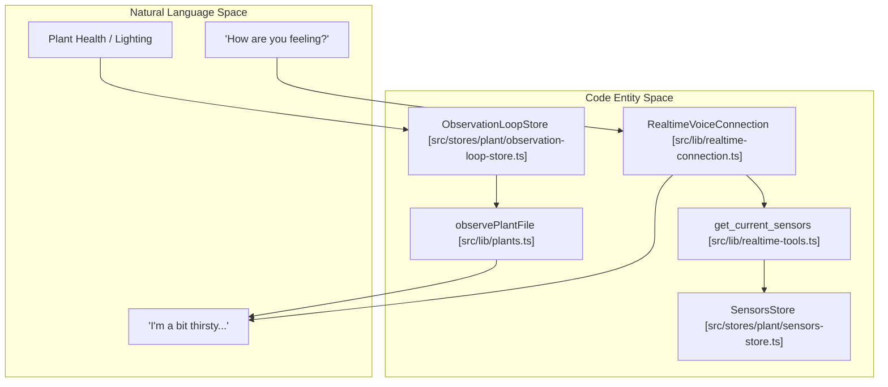
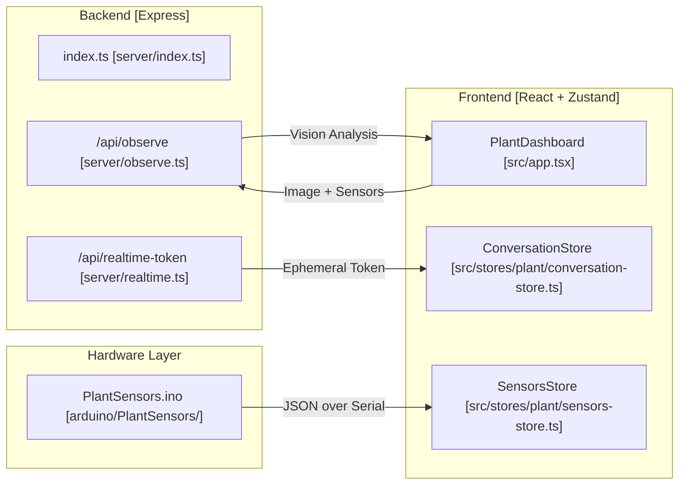

<!-- source: DeepWiki mcp.deepwiki.com · repo openai/planttalk · page 1 Plant Talk — Project Overview · fetched 2026-10-26 -->

# Plant Talk — Project Overview

Relevant source files

The following files were used as context for generating this wiki page:

- [AGENTS.md](AGENTS.md)
- [LICENSE](LICENSE)
- [NOTICE](NOTICE)
- [README.md](README.md)

Plant Talk is an interactive houseplant system that enables natural language conversations with a plant using the OpenAI Realtime API and Vision models. By combining computer vision, physical sensors (via Arduino), and a voice-enabled interface, the project gives a plant a "personality" that can perceive its environment and report on its own health.

The system is designed to run as a local web application that bridges physical hardware with cloud-based AI. It supports two primary modes of operation: a **Dashboard** for technical monitoring and an **Ambient Mode** for a high-fidelity, full-screen public experience.

### System Concept Map

The following diagram illustrates how the "Natural Language Space" (the user's conversation) maps to the "Code Entity Space" (the underlying software components).

**Natural Language to Code Entity Mapping**

Sources: [src/lib/realtime-connection.ts:1-20](), [src/stores/plant/observation-loop-store.ts:1-30](), [src/lib/plants.ts:1-15](), [src/lib/realtime-tools.ts:1-25](), [src/stores/plant/sensors-store.ts:1-20]()

---

### End-to-End Data Flow

Plant Talk functions through a continuous cycle of sensing, observing, and communicating. Data originates from either physical sensors or manual overrides and is fused with visual data before being processed by the LLM.

1.  **Sensing:** The `SensorsStore` ingests data from `PlantSensors.ino` via the Web Serial API or from manual sliders in the UI [src/stores/plant/sensors-store.ts:80-120]().
2.  **Observing:** The `ObservationLoopStore` periodically captures a frame from the `CameraPanel` and sends it to the Express backend's `/api/observe` endpoint [src/stores/plant/observation-loop-store.ts:150-180]().
3.  **Reasoning:** The server uses `PLANT_OBSERVER_PROMPTS` and the OpenAI Vision model to generate a structured JSON response and a reasoning stream [server/observe.ts:40-90]().
4.  **Conversing:** The `RealtimeVoiceConnection` maintains a WebRTC audio stream. When the user speaks, the model can call `get_current_sensors` or `get_observation_history` to provide context-aware answers [src/lib/realtime-config.ts:45-70]().

**High-Level Subsystem Architecture**

Sources: [server/index.ts:1-30](), [server/observe.ts:1-50](), [server/realtime.ts:1-40](), [src/app.tsx:1-40](), [arduino/PlantSensors/PlantSensors.ino:1-50]()

---

### Key Subsystems

| Subsystem | Primary Responsibility | Key Files |
| :--- | :--- | :--- |
| **Hardware** | Acquires moisture/light data and transmits via Serial. | `PlantSensors.ino`, `arduino-instructions.md` |
| **Backend** | Securely handles OpenAI API keys and proxies vision/token requests. | `server/observe.ts`, `server/realtime.ts` |
| **Sensing** | Manages live data streams from hardware or UI fallbacks. | `sensors-store.ts`, `sensors.ts` |
| **Vision** | Periodically analyzes camera frames for health trends. | `observation-loop-store.ts`, `prompts.ts` |
| **Voice** | Manages WebRTC connection and Realtime tool execution. | `realtime-connection.ts`, `realtime-tools.ts` |
| **UI** | Provides Dashboard and Ambient (kiosk) interfaces. | `app.tsx`, `AmbientExperience.tsx` |

---

### Deeper Reading

To explore specific parts of the codebase, refer to the following child pages:

*   **[Getting Started & Setup](#1.1)**: Instructions for environment configuration, `npm run setup`, and launching the dual-process development environment [AGENTS.md:79-140]().
*   **[System Architecture & Data Flow](#1.2)**: A detailed look at the three-tier architecture and how sensor readings are fused into LLM context [README.md:68-82]().

Sources: [AGENTS.md:1-168](), [README.md:1-116](), [src/app.tsx:1-50](), [server/index.ts:1-25]()

---

