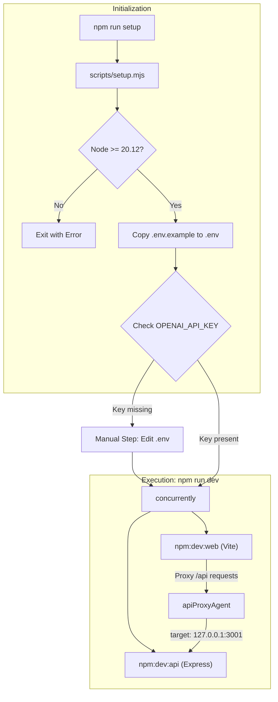

<!-- source: DeepWiki mcp.deepwiki.com · repo openai/planttalk · page 1.1 Getting Started & Setup · fetched 2026-10-26 -->

# Getting Started & Setup

<details>
<summary>Relevant source files</summary>

The following files were used as context for generating this wiki page:

- [.env.example](.env.example)
- [package.json](package.json)
- [scripts/setup.mjs](scripts/setup.mjs)
- [vite.config.ts](vite.config.ts)

</details>


This page provides a technical guide for initializing the Plant Talk development environment. It covers the automated bootstrap process, environment configuration, and the dual-process architecture used during local development.

## Environment Requirements

Plant Talk requires **Node.js version 20.12.0 or newer** [package.json:8-10](). The project utilizes modern JavaScript features and Node APIs (such as `node:fs` and `node:path` modules) that are not available in older LTS releases [scripts/setup.mjs:1-4]().

## Initializing the Project

The project includes a bootstrap script to ensure the environment is correctly configured before the first run.

### 1. Clone and Install
After cloning the repository, install the dependencies defined in `package.json`:
```bash
npm install
```

### 2. Run Setup Script
Execute the setup utility:
```bash
npm run setup
```

The `npm run setup` command invokes `scripts/setup.mjs` [package.json:12](), which performs the following logic:
1.  **Node Version Check**: Compares `process.versions.node` against the `MIN_NODE` constant `[20, 12, 0]` [scripts/setup.mjs:4-19]().
2.  **Environment File Creation**: Checks for the existence of a `.env` file. If missing, it copies `.env.example` to `.env` and sets restrictive file permissions (`0o600`) [scripts/setup.mjs:43-46]().
3.  **API Key Validation**: Scans the `.env` file to verify if the `OPENAI_API_KEY` has been changed from the default `replace-me` value [scripts/setup.mjs:21-26]().

### 3. Configure OpenAI API Key
You must provide a valid OpenAI API key to enable the Vision and Realtime capabilities.
1.  Open the newly created `.env` file.
2.  Locate the `OPENAI_API_KEY` variable [.env.example:4]().
3.  Replace `replace-me` with your secret key from the [OpenAI Platform](https://platform.openai.com/api-keys).

**Sources:** [package.json:8-12](), [scripts/setup.mjs:4-60](), [.env.example:1-4]()

## Development Environment Architecture

Plant Talk operates using a two-process development model coordinated via the `concurrently` utility [package.json:13, 38]().

### Process Breakdown

| Process | Command | Port | Responsibility |
| :--- | :--- | :--- | :--- |
| **Web Frontend** | `vite dev` | `3000` | Serves the React SPA and handles HMR. |
| **API Backend** | `tsx watch server/index.ts` | `3001` | Proxies OpenAI requests and serves Realtime tokens. |

### Development Data Flow & Proxying
The Vite development server is configured to proxy all requests starting with `/api` to the Express server running on port `3001` [vite.config.ts:25-31](). This avoids Cross-Origin Resource Sharing (CORS) issues during development.

To prevent `ENOBUFS` errors (common on Windows when handling long-lived streams like the `/api/observe` endpoint), the proxy uses a persistent `http.Agent` with `keepAlive: true` [vite.config.ts:10, 29]().

### Setup and Execution Flow
The following diagram illustrates the transition from the `setup` script to the active development state.

**Project Bootstrap and Dev Loop**

**Sources:** [package.json:11-15](), [vite.config.ts:10-31](), [scripts/setup.mjs:30-60]()

## Launching the Application

To start both the frontend and the backend simultaneously, run:
```bash
npm run dev
```

Once running:
*   **Frontend**: Accessible at `http://localhost:3000`.
*   **Backend**: Internal API at `http://localhost:3001`.
*   **Path Aliases**: The project uses the `@/` alias to refer to the `src` directory, configured in `vite.config.ts` [vite.config.ts:16-18]().

### Key Entity Mapping
This diagram bridges the conceptual setup steps to the specific code entities responsible for the environment.

**Configuration to Entity Mapping**
```mermaid
graph LR
    subgraph "Natural Language Space"
        "Node Requirement"
        "Environment Variables"
        "API Proxying"
        "Task Orchestration"
    end

    subgraph "Code Entity Space"
        "Node Requirement" --- "package.json [engines]"
        "Environment Variables" --- ".env.example"
        "API Proxying" --- "vite.config.ts [apiProxyAgent]"
        "Task Orchestration" --- "package.json [scripts.dev]"
    end
```
**Sources:** [package.json:8-15](), [vite.config.ts:10-31](), [.env.example:1-4]()

---

