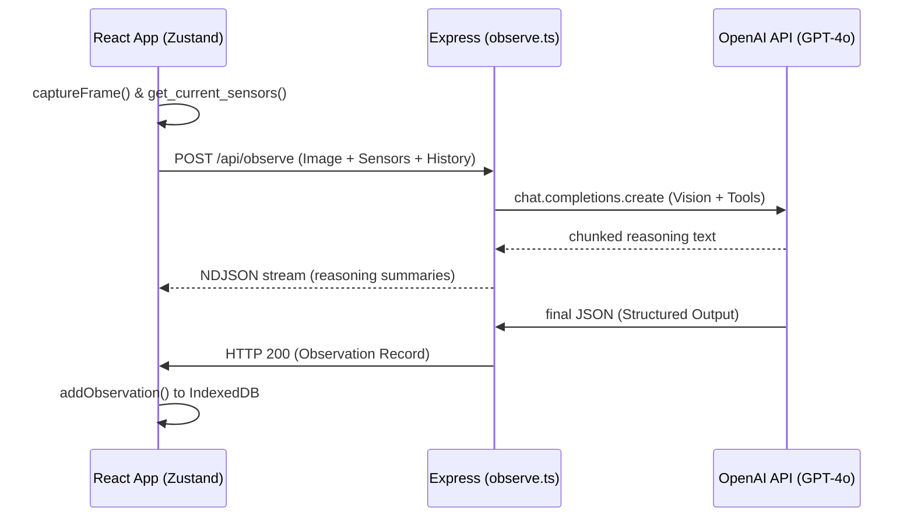

<!-- source: DeepWiki mcp.deepwiki.com · repo openai/planttalk · page 1.2 System Architecture & Data Flow · fetched 2026-10-26 -->

# System Architecture & Data Flow

<details>
<summary>Relevant source files</summary>

The following files were used as context for generating this wiki page:

- [AGENTS.md](AGENTS.md)
- [README.md](README.md)
- [server/index.ts](server/index.ts)
- [src/app.tsx](src/app.tsx)

</details>


This page details the three-tier architecture of Plant Talk, the mechanisms for environmental sensing, and the end-to-end data pipeline that transforms physical sensor data and visual frames into an interactive AI personality.

## Three-Tier Architecture

Plant Talk is structured as a distributed system across three distinct layers: the physical hardware (Arduino), the secure backend (Express), and the user interface (React).

1.  **Hardware Layer (Arduino Firmware):** A microcontroller runs a C++ loop to sample analog and digital sensors. It performs signal averaging and normalization before streaming JSON packets over USB Serial `[arduino/PlantSensors/PlantSensors.ino:1-10]()`.
2.  **Backend Layer (Express Server):** Acts as a security proxy and API orchestrator. It holds the `OPENAI_API_KEY` to prevent exposure to the client `[server/index.ts:1-6]()`. It handles high-bandwidth image uploads and manages the minting of ephemeral WebRTC tokens for the Realtime API `[server/realtime.ts:12-25]()`.
3.  **Frontend Layer (React SPA):** The central nervous system of the application. It manages the Web Serial connection to the hardware, handles the webcam lifecycle, maintains a local IndexedDB of plant history, and orchestrates the voice conversation using WebRTC `[src/app.tsx:6-11]()`.

### System Component Map

The following diagram maps high-level system components to their specific code entities.

**Diagram: System Component Mapping**
```mermaid
graph TD
    subgraph "Physical Space"
        "Sensors"["Analog/Digital Sensors"]
        "Arduino"["Arduino (PlantSensors.ino)"]
    end

    subgraph "Code Entity Space (Client)"
        "SerialStore"["sensors-store.ts (Zustand)"]
        "ObsLoop"["observation-loop-store.ts"]
        "VoiceConn"["realtime-connection.ts (WebRTC)"]
        "IDB"["observer-store.ts (IndexedDB)"]
    end

    subgraph "Code Entity Space (Server)"
        "ExpServer"["server/index.ts (Express)"]
        "ObsRoute"["server/observe.ts (handleObserveRequest)"]
        "RTToken"["server/realtime.ts (handleRealtimeTokenRequest)"]
    end

    "Sensors" -->|Raw Voltage| "Arduino"
    "Arduino" -->|JSON via Web Serial| "SerialStore"
    "SerialStore" --> "ObsLoop"
    "ObsLoop" -->|POST /api/observe| "ObsRoute"
    "ObsRoute" -->|NDJSON Reasoning| "ObsLoop"
    "VoiceConn" -->|POST /api/realtime-token| "RTToken"
    "ObsLoop" -->|Store Results| "IDB"
```
Sources: `[arduino/PlantSensors/PlantSensors.ino:1-20]()`, `[server/index.ts:25-35]()`, `[src/stores/plant/sensors-store.ts:1-15]()`, `[src/stores/plant/observation-loop-store.ts:1-20]()`.

## Sensing Modes

The system supports two sensing modes, toggled via the `useSensorsStore` `[src/stores/plant/sensors-store.ts:18-25]()`.

### 1. Manual Sliders Mode
Used for testing or software-only setups. The frontend uses React state driven by UI sliders in the `SensorsPanel` `[src/components/dashboard/sensors-panel.tsx:30-50]()` to simulate moisture and light levels.

### 2. Arduino Sensors Mode
When enabled, the frontend utilizes the **Web Serial API** to connect to the Arduino's COM port.
-   **Data Ingestion:** The `connect` function in `sensors-store.ts` opens the port at 115200 baud `[src/stores/plant/sensors-store.ts:68-75]()`.
-   **Parsing:** Incoming strings are processed by `parseSensorPayload`, which handles JSON objects like `{"moisture": 45, "light": 100}` `[src/stores/plant/sensors-store.ts:133-150]()`.
-   **Watchdog:** A timer monitors the stream; if no data arrives for 5 seconds, the system marks the hardware as disconnected `[src/stores/plant/sensors-store.ts:45-55]()`.

## End-to-End Data Flow

The "Observation Loop" is the primary data pipeline. It executes periodically (default 30 seconds) to update the plant's state.

### The Observation Pipeline
1.  **Capture:** The `ObservationPanel` triggers the `captureFrame` utility to get a base64 string from the `<video>` element `[src/lib/plant/camera-capture.ts:5-15]()`.
2.  **Context Fusion:** The `observation-loop-store.ts` gathers current sensor readings and the last 10 historical observations from the `observer-store.ts` `[src/stores/plant/observation-loop-store.ts:80-95]()`.
3.  **Backend Analysis:** Data is sent to `POST /api/observe`. The server uses `PLANT_OBSERVER_PROMPTS` to instruct the LLM (GPT-4o) to analyze the image and sensors together `[server/observe.ts:60-85]()`.
4.  **Reasoning Stream:** The server streams "thinking" steps as NDJSON (Networked Delimited JSON) so the UI can show live reasoning summaries `[server/observe.ts:110-125]()`.
5.  **Structured Output:** The final result is validated against the `plantObserverResponseSchema` (Zod), ensuring fields like `healthScore` and `statusMessage` are present `[src/lib/plant/schemas.ts:22-45]()`.

**Diagram: Data Fusion & LLM Pipeline**

Sources: `[server/observe.ts:100-140]()`, `[src/stores/plant/observation-loop-store.ts:100-130]()`, `[src/lib/plant/plants.ts:35-55]()`.

## Voice Conversation Flow

The voice interaction uses the **OpenAI Realtime API** via WebRTC.

1.  **Token Exchange:** The client calls `handleRealtimeTokenRequest` on the server to get an ephemeral key `[server/realtime.ts:12-30]()`.
2.  **WebRTC Handshake:** The client establishes a peer connection. The session is configured server-side with `PLANT_INSTRUCTIONS` and `PLANT_TOOLS` `[src/lib/plant/realtime-connection.ts:60-85]()`.
3.  **Tool Execution:** When the user asks "How are you?", the model calls `get_current_sensors` or `get_observation_history`. These functions are executed **client-side** in `realtime-tools.ts`, which reads directly from the Zustand stores `[src/lib/plant/realtime-tools.ts:10-30]()`.
4.  **Audio Loop:** The model's response is streamed as audio directly to the browser's `RTCPeerConnection` track `[src/lib/plant/realtime-connection.ts:110-125]()`.

Sources: `[server/realtime.ts:1-40]()`, `[src/lib/plant/realtime-config.ts:1-25]()`, `[src/lib/plant/realtime-tools.ts:1-40]()`.

---

