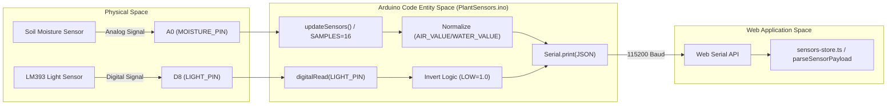
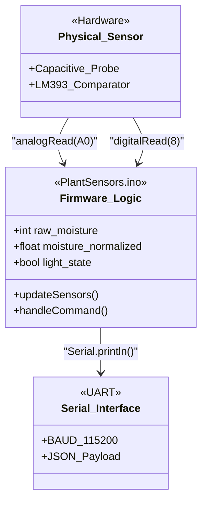

<!-- source: DeepWiki mcp.deepwiki.com · repo openai/planttalk · page 2 Arduino Hardware Layer · fetched 2026-10-26 -->

# Arduino Hardware Layer

<details>
<summary>Relevant source files</summary>

The following files were used as context for generating this wiki page:

- [arduino/PlantSensors/PlantSensors.ino](arduino/PlantSensors/PlantSensors.ino)
- [arduino/arduino-instructions.md](arduino/arduino-instructions.md)

</details>


The Arduino Hardware Layer serves as the "nervous system" for the Plant Talk project. It consists of a microcontroller (typically an Arduino Uno, Nano, or Mega) running specialized firmware to interface with physical sensors. This layer translates analog and digital signals from the environment into a structured JSON format, which is then consumed by the web application via the browser's Web Serial API.

### Hardware Architecture

The system utilizes two primary sensors to monitor the plant's environment. The Arduino acts as a data acquisition hub, performing multi-sample averaging to filter electronic noise before transmitting normalized values to the frontend.

#### High-Level Data Flow
The diagram below illustrates how physical signals are transformed into code entities and transmitted to the application.

**Diagram: Hardware to Browser Data Pipeline**

**Sources:** [arduino/PlantSensors/PlantSensors.ino:55-111](), [arduino/arduino-instructions.md:14-38](), [arduino/arduino-instructions.md:157-164]()

---

### PlantSensors Firmware
The `PlantSensors.ino` firmware is a lightweight C++ sketch responsible for polling sensors and managing a serial command interface. It implements a 16-sample rolling average [arduino/PlantSensors/PlantSensors.ino:56-56]() to mitigate jitter common in inexpensive NE555-based capacitive sensors.

The firmware outputs a single line of JSON every 1000ms by default [arduino/PlantSensors/PlantSensors.ino:62-62]():
```json
{"moisture":0.42,"light":1.00}
```

Key features include:
*   **Normalization:** Converts raw ADC values into a 0.0–1.0 float based on configurable `AIR_VALUE` and `WATER_VALUE` constants [arduino/PlantSensors/PlantSensors.ino:98-101]().
*   **Command Interface:** Supports interactive serial commands such as `calibrate`, `interval <ms>`, and `status` to adjust behavior without re-uploading code [arduino/PlantSensors/PlantSensors.ino:128-157]().

For a deep dive into the calibration workflow and logic, see **[PlantSensors Firmware (#2.1)]**.

**Sources:** [arduino/PlantSensors/PlantSensors.ino:1-49](), [arduino/PlantSensors/PlantSensors.ino:106-110]()

---

### Hardware Integration & Connectivity
The hardware layer is designed for accessibility, using common components that interface with the browser via standard USB serial communication.

| Component | Pin Mapping | Logic |
| :--- | :--- | :--- |
| **Capacitive Moisture Sensor** | `A0` (Analog) | Lower ADC = Wetter (Inverted in code) |
| **LM393 Light Sensor** | `D8` (Digital) | `LOW` = Light detected, `HIGH` = Dark |

**Web Serial Integration:**
The frontend connects to the Arduino at a baud rate of **115200** [arduino/arduino-instructions.md:159-161](). This connection allows the React application to receive real-time telemetry, which is then used to drive the plant's "personality" and the observation logic in the LLM.

For detailed wiring diagrams, pinouts, and browser connection troubleshooting, see **[Hardware Wiring & Web Serial Integration (#2.2)]**.

**Sources:** [arduino/arduino-instructions.md:82-109](), [arduino/PlantSensors/PlantSensors.ino:58-59](), [arduino/PlantSensors/PlantSensors.ino:103-104]()

---

### System Component Mapping
This diagram maps the physical hardware components to the specific code variables and logic gates defined in the firmware.

**Diagram: Component to Code Mapping**

**Sources:** [arduino/PlantSensors/PlantSensors.ino:58-111](), [arduino/arduino-instructions.md:82-109]()

---

