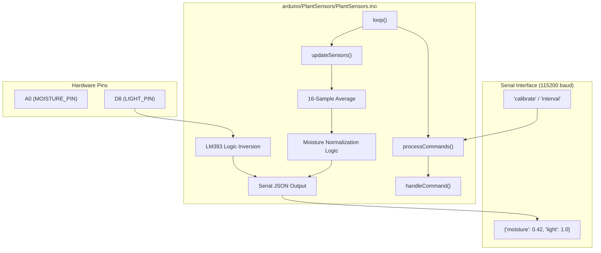
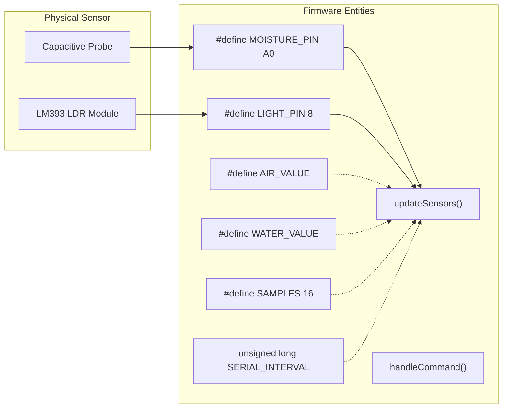

<!-- source: DeepWiki mcp.deepwiki.com · repo openai/planttalk · page 2.1 PlantSensors Firmware · fetched 2026-10-26 -->

# PlantSensors Firmware

Relevant source files

The following files were used as context for generating this wiki page:

- [arduino/PlantSensors/PlantSensors.ino](arduino/PlantSensors/PlantSensors.ino)

The `PlantSensors.ino` firmware is a lightweight data acquisition script designed for Arduino-compatible microcontrollers (Uno, Nano, Mega). Its primary purpose is to sample environmental data from a capacitive soil moisture sensor and an LM393-based light sensor, then transmit normalized readings as JSON strings over a serial connection at 115200 baud [arduino/PlantSensors/PlantSensors.ino:1-10]().

### Data Acquisition Pipeline

The firmware implements a robust sampling strategy to mitigate hardware inconsistencies common in low-cost NE555-based capacitive sensors.

#### NE555 Jitter Mitigation
Cheap capacitive sensors often suffer from oscillator jitter, which manifests as unstable ADC readings. To counter this, the firmware uses a multi-sample averaging technique [arduino/PlantSensors/PlantSensors.ino:42-43]().
*   **Sampling Rate**: The system takes 16 consecutive samples from the `MOISTURE_PIN` (A0) [arduino/PlantSensors/PlantSensors.ino:56-58]().
*   **Averaging**: The samples are summed into a `long` variable and divided by the `SAMPLES` constant to produce a stable integer `raw` value [arduino/PlantSensors/PlantSensors.ino:85-89]().

#### Moisture Normalization
Capacitive sensors are inversely proportional to moisture: a lower ADC value indicates higher moisture content [arduino/PlantSensors/PlantSensors.ino:26-27](). The firmware normalizes this raw input into a float between `0.0` (bone dry) and `1.0` (fully saturated) using the following formula [arduino/PlantSensors/PlantSensors.ino:98-99]():

$$moisture = \frac{AIR\_VALUE - raw}{AIR\_VALUE - WATER\_VALUE}$$

The result is clamped between `0.0` and `1.0` to prevent out-of-bounds values during environmental extremes [arduino/PlantSensors/PlantSensors.ino:100-101]().

#### LM393 Digital Inversion
The LM393 light sensor module provides a digital output on `LIGHT_PIN` (D8) [arduino/PlantSensors/PlantSensors.ino:59-60](). By default, the module's DO pin is `HIGH` when dark and `LOW` when light is detected [arduino/PlantSensors/PlantSensors.ino:34-34](). The firmware inverts this logic to provide a more intuitive `1.0` (light) or `0.0` (dark) value [arduino/PlantSensors/PlantSensors.ino:103-104]().

**Sources:** [arduino/PlantSensors/PlantSensors.ino:1-111]()

### Firmware Logic & Data Flow

The following diagram illustrates the relationship between the hardware pins, the internal processing functions, and the resulting serial output.

**Firmware Data Flow**

**Sources:** [arduino/PlantSensors/PlantSensors.ino:58-111](), [arduino/PlantSensors/PlantSensors.ino:113-126]()

### Calibration Workflow

Calibration is required to map the specific electrical characteristics of the soil probe to the `0.0`–`1.0` range. This is managed via the `AIR_VALUE` and `WATER_VALUE` constants [arduino/PlantSensors/PlantSensors.ino:51-53]().

1.  **Enter Calibration Mode**: Send the `calibrate` command over serial. This sets `calibrateMode` to `true` and increases the reporting frequency to every 200ms [arduino/PlantSensors/PlantSensors.ino:80-81](), [arduino/PlantSensors/PlantSensors.ino:141-145]().
2.  **Measure Air**: Hold the probe in dry air and record the `raw` value output by the serial monitor. Update `AIR_VALUE` [arduino/PlantSensors/PlantSensors.ino:38-39]().
3.  **Measure Water**: Submerge the probe in water up to the white line and record the `raw` value. Update `WATER_VALUE` [arduino/PlantSensors/PlantSensors.ino:40-41]().
4.  **Re-upload**: Flash the firmware with the new constants.

**Sources:** [arduino/PlantSensors/PlantSensors.ino:37-43](), [arduino/PlantSensors/PlantSensors.ino:141-145]()

### Interactive Command Interface

The firmware maintains a non-blocking command processor in `processCommands()` that listens for newline-terminated strings [arduino/PlantSensors/PlantSensors.ino:113-126]().

| Command | Action | Implementation |
| :--- | :--- | :--- |
| `calibrate` | Toggles raw ADC output every 200ms for sensor tuning. | [arduino/PlantSensors/PlantSensors.ino:141-145]() |
| `interval <ms>` | Sets the reporting frequency (100ms to 60000ms). | [arduino/PlantSensors/PlantSensors.ino:129-138]() |
| `read` | Forces an immediate sensor sample and serial transmission. | [arduino/PlantSensors/PlantSensors.ino:139-140]() |
| `status` | Returns JSON object containing current interval and calibration values. | [arduino/PlantSensors/PlantSensors.ino:146-153]() |

### Serial Output Format

The firmware outputs a single JSON line per interval. This format is designed for easy parsing by the Web Serial API in the browser.

*   **Standard Reading**: `{"moisture":0.42,"light":1.00}` [arduino/PlantSensors/PlantSensors.ino:106-110]()
*   **Calibration Reading**: `{"raw":385}` [arduino/PlantSensors/PlantSensors.ino:91-95]()
*   **System Status**: `{"status":{"serial_interval":1000,"air_value":398,"water_value":56}}` [arduino/PlantSensors/PlantSensors.ino:147-153]()

**Sources:** [arduino/PlantSensors/PlantSensors.ino:91-110](), [arduino/PlantSensors/PlantSensors.ino:147-153]()

### Code Entity Mapping

The following diagram maps the logical hardware components to their respective software identifiers within the `PlantSensors.ino` file.

**Hardware to Code Mapping**

**Sources:** [arduino/PlantSensors/PlantSensors.ino:52-62](), [arduino/PlantSensors/PlantSensors.ino:79-111]()

---

