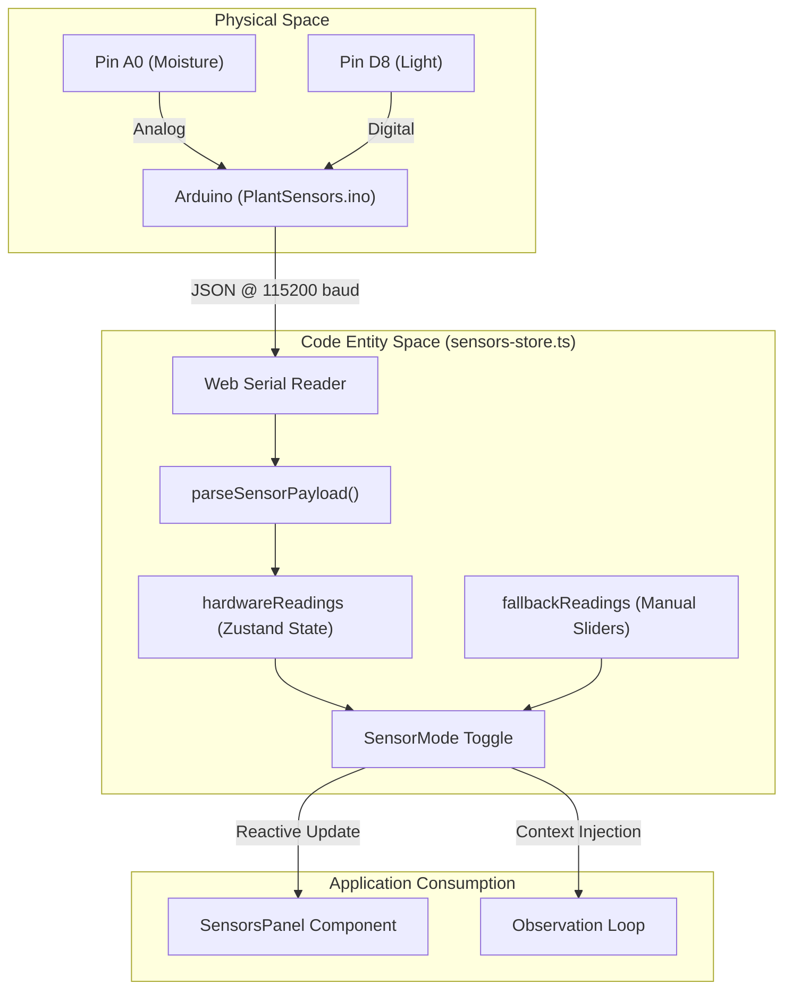

<!-- source: DeepWiki mcp.deepwiki.com · repo openai/planttalk · page 2.2 Hardware Wiring & Web Serial Integration · fetched 2026-10-26 -->

# Hardware Wiring & Web Serial Integration

<details>
<summary>Relevant source files</summary>

The following files were used as context for generating this wiki page:

- [arduino/arduino-instructions.md](arduino/arduino-instructions.md)
- [src/stores/plant/sensors-store.ts](src/stores/plant/sensors-store.ts)

</details>


This page details the physical assembly of the Plant Talk sensor suite and the technical implementation of the Web Serial bridge that ingests sensor data into the browser.

## Physical Hardware Mapping

The system utilizes an Arduino-compatible microcontroller to interface with two primary sensors. The firmware, `PlantSensors.ino`, expects specific pin assignments for analog and digital signals.

### Sensor Pinout Table
| Component | Arduino Pin | Signal Type | Description |
| :--- | :--- | :--- | :--- |
| **Soil Moisture Sensor** | `A0` | Analog Input | Measures resistance/capacitance (0-100%). |
| **Light Sensor (LM393)** | `D8` | Digital Input | High/Low threshold detection. |
| **Power (VCC)** | `5V` | Power Rail | Common 5V supply for both modules. |
| **Ground (GND)** | `GND` | Ground Rail | Common ground for both modules. |

### Wiring Logic
*   **Moisture Sensor**: The probe signal must be connected to `A0` [arduino/arduino-instructions.md:87-91](). It estimates moisture by measuring electrical resistance, where raw values are normalized based on calibration constants [arduino/arduino-instructions.md:60-68]().
*   **Light Sensor**: The LM393 module outputs a digital signal to `D8` [arduino/arduino-instructions.md:99-106](). While the physical sensor outputs `HIGH` for dark and `LOW` for light, the firmware inverts this logic to report `100` (light) or `0` (dark) for a more intuitive UI experience [arduino/arduino-instructions.md:74-75]().

**Sources:** [arduino/arduino-instructions.md:82-107](), [arduino/arduino-instructions.md:58-80]()

---

## Web Serial Implementation

The frontend communicates with the Arduino using the **Web Serial API**. This allows the browser to directly read the JSON stream emitted by the hardware without requiring a local proxy server.

### Connection Lifecycle
The connection is managed by `usePlantSensorsStore` in `src/stores/plant/sensors-store.ts`.

1.  **Initiation**: The user triggers `connect()`, which invokes `navigator.serial.requestPort()` [src/stores/plant/sensors-store.ts:252-258]().
2.  **Configuration**: The port is opened at a fixed baud rate of **115200** [src/stores/plant/sensors-store.ts:33-33](), [src/stores/plant/sensors-store.ts:264-266]().
3.  **Data Stream**: The store uses a `TextDecoderStream` to convert raw `Uint8Array` chunks into a string-based `ReadableStream` [src/stores/plant/sensors-store.ts:276-281]().
4.  **Parsing**: Lines are parsed in `parseSensorPayload`, which supports multiple JSON keys (e.g., `moisture`, `soil`, `lux`) to ensure compatibility with various sensor modules [src/stores/plant/sensors-store.ts:38-41](), [src/stores/plant/sensors-store.ts:468-492]().

### Hardware-to-Code Mapping
The following diagram bridges the physical hardware concepts to the specific TypeScript entities managing them.

**Diagram: Hardware Integration Data Flow**

**Sources:** [src/stores/plant/sensors-store.ts:30-59](), [src/stores/plant/sensors-store.ts:468-500](), [arduino/arduino-instructions.md:168-174]()

---

## UI Flow & Sensor Modes

The application supports two modes defined by the `SensorMode` type: `manual` and `arduino` [src/stores/plant/sensors-store.ts:31-31]().

### Mode Switching
*   **Manual Mode**: Readings are driven by UI sliders (`fallbackReadings`). This is the default if no hardware is connected [src/stores/plant/sensors-store.ts:45-45]().
*   **Arduino Mode**: The UI displays `hardwareReadings`. If the connection is lost, the system can be configured to persist the last known hardware value or wait for reconnection [src/stores/plant/sensors-store.ts:52-54]().

### Reliability Mechanisms
To handle the instability of physical serial connections, the store implements:
*   **Watchdog Timer**: If no data is received within a specific window (calculated as `interval * 3`), the store forces a port closure and attempts a reconnect [src/stores/plant/sensors-store.ts:143-172]().
*   **Startup Grace Period**: A 20-second buffer (`STARTUP_GRACE_MS`) allows the Arduino bootloader to finish before the watchdog begins monitoring [src/stores/plant/sensors-store.ts:35-35]().
*   **Auto-Reconnect**: If a known port is disconnected (e.g., USB cable tug), the store polls `getPorts()` every 3 seconds to restore the session [src/stores/plant/sensors-store.ts:34-34](), [src/stores/plant/sensors-store.ts:181-210]().

**Sources:** [src/stores/plant/sensors-store.ts:33-36](), [src/stores/plant/sensors-store.ts:143-172](), [src/stores/plant/sensors-store.ts:181-210]()

---

## Troubleshooting & Common States

| State / Issue | Cause | Resolution |
| :--- | :--- | :--- |
| **Scrambled Characters** | Baud Rate Mismatch | Ensure Serial Monitor or Web Serial is set to `115200` [arduino/arduino-instructions.md:160-165](). |
| **Port Locked** | Port in use by another app | Close the Arduino IDE Serial Monitor before connecting in the browser [arduino/arduino-instructions.md:142-143](). |
| **Inverted Moisture** | Wiring or sensor type | Check if the sensor is capacitive vs resistive; calibrate using `AIR_VALUE` and `WATER_VALUE` [arduino/arduino-instructions.md:60-68](). |
| **Watchdog Reconnects** | Arduino `interval` too high | The watchdog auto-adjusts based on the `arduinoCheckIntervalMs` setting [src/stores/plant/sensors-store.ts:147-149](). |

### Internal State Machine
The connection lifecycle transitions through four distinct states.

**Diagram: Connection State Machine**
```mermaid
stateDiagram-v2
    [*] --> "disconnected"
    "disconnected" --> "connecting" : "connect() called"
    "connecting" --> "connected" : "Port opened & Stream active"
    "connecting" --> "disconnected" : "Error / Port denied"
    "connected" --> "disconnected" : "disconnect() / Watchdog timeout"
    "connected" --> "unsupported" : "Browser lacks Web Serial"
```
**Sources:** [src/stores/plant/sensors-store.ts:30-30](), [src/stores/plant/sensors-store.ts:74-76](), [src/stores/plant/sensors-store.ts:252-290]()

---

