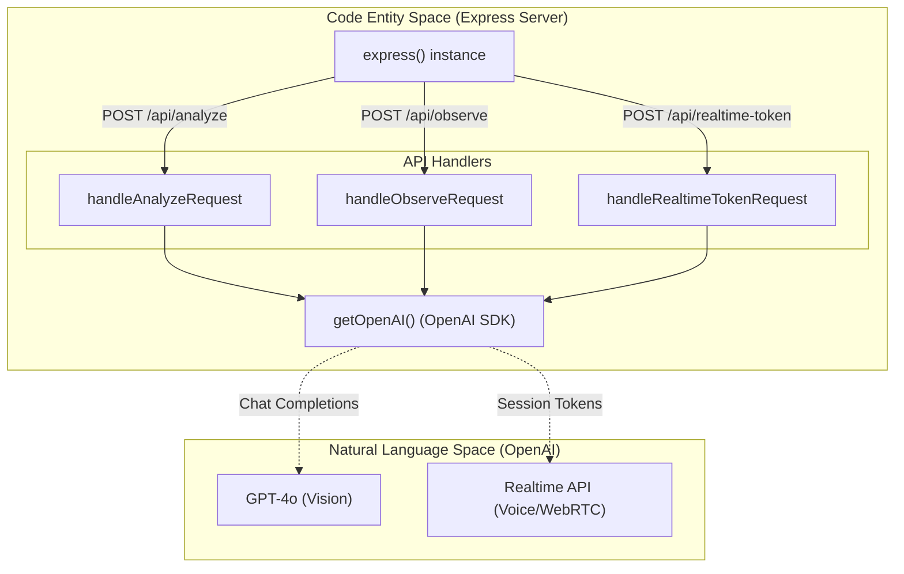
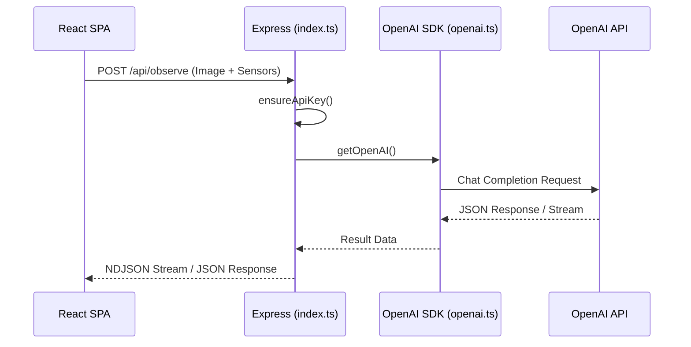

<!-- source: DeepWiki mcp.deepwiki.com · repo openai/planttalk · page 3 Express Backend Server · fetched 2026-10-26 -->

# Express Backend Server

Relevant source files

The following files were used as context for generating this wiki page:

- [server/env.ts](server/env.ts)
- [server/index.ts](server/index.ts)
- [server/openai.ts](server/openai.ts)

The Express server (located in the `server/` directory) acts as the secure orchestration layer for the Plant Talk application. It is a Node.js application that bridges the frontend React SPA with the OpenAI API.

## Core Responsibilities

The server fulfills two primary roles within the architecture:

1.  **API Security Proxy**: It encapsulates the `OPENAI_API_KEY`, ensuring that sensitive credentials never reach the client browser [server/index.ts:3-5](). All requests to OpenAI are proxied through authenticated server-side handlers.
2.  **Production Hosting**: In production environments, the server hosts the static assets of the built Single Page Application (SPA) from the `dist` directory [server/index.ts:38-42]().

### Environment Configuration
The server utilizes native Node.js environment file support (v20.12+) via `process.loadEnvFile()` [server/env.ts:8](). This is triggered by a side-effect import at the very top of the entry point to guarantee configuration is available before any other modules are evaluated [server/index.ts:10]().

## System Integration Diagram

The following diagram illustrates how the `express` server connects the "Natural Language Space" (OpenAI) to the "Code Entity Space" (API Handlers).

**Sources:** [server/index.ts:19-34](), [server/openai.ts:11-14](), [server/observe.ts:13-13](), [server/realtime.ts:15-15]()

## API Endpoints

The server exposes three specific POST endpoints to handle high-bandwidth data (like camera frames) and secure token exchange. Due to the transmission of base64-encoded images, the JSON body limit is increased to `12mb` [server/index.ts:23]().

| Endpoint | Handler Function | Description |
| :--- | :--- | :--- |
| `POST /api/analyze` | `handleAnalyzeRequest` | Performs a one-shot vision analysis of a plant image to identify species and health. |
| `POST /api/observe` | `handleObserveRequest` | Processes a frame, sensor data, and history to generate a "personality-driven" observation. |
| `POST /api/realtime-token` | `handleRealtimeTokenRequest` | Mints ephemeral WebRTC tokens for the plant's voice conversation. |

**Sources:** [server/index.ts:25-34]()

## OpenAI SDK Integration

The server interacts with OpenAI using a lazily-initialized client via the `getOpenAI()` function [server/openai.ts:11-14](). This prevents the server from crashing at boot time if the `OPENAI_API_KEY` is missing, instead allowing it to start and issue warnings [server/index.ts:44-49]().

### Key Security & Validation
Before processing any API request, the server verifies the environment configuration:
*   **`isApiKeyConfigured()`**: Checks if the key exists and is not the default placeholder [server/openai.ts:16-19]().
*   **`ensureApiKey(res)`**: A middleware-style helper that returns a `500` error to the client if the server is unconfigured [server/openai.ts:21-30]().

## Detailed Endpoint Documentation

The logic for these endpoints is split into specialized modules based on the OpenAI capability they leverage.

### Vision API Endpoints (`/api/analyze` & `/api/observe`) {#3.1}
These endpoints handle image-based reasoning. `handleAnalyzeRequest` is used for the initial "What plant is this?" identification, while `handleObserveRequest` is the heart of the plant's periodic awareness, combining visual data with hardware sensor readings.
*   For details, see [Vision API Endpoints (`/api/analyze` & `/api/observe`)](#3.1).

### Realtime Token Endpoint (`/api/realtime-token`) {#3.2}
This endpoint enables the low-latency voice interface. It generates a short-lived `client_secret` that allows the browser to establish a direct WebRTC connection to OpenAI's Realtime API without exposing the master API key.
*   For details, see [Realtime Token Endpoint (`/api/realtime-token`)](#3.2).

## Data Flow: Request Lifecycle

**Sources:** [server/index.ts:30-30](), [server/openai.ts:21-30](), [server/openai.ts:11-14]()

---

