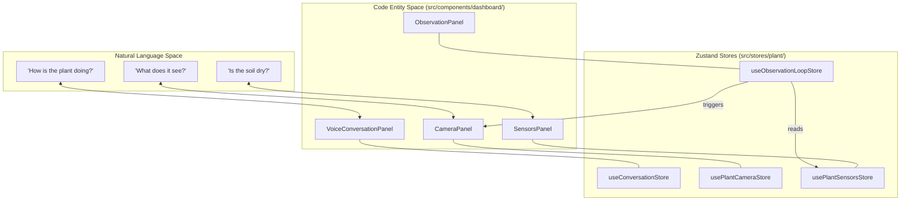
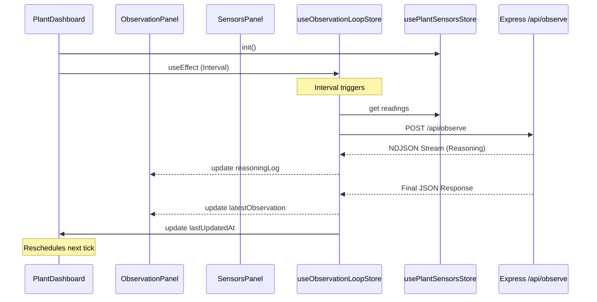

<!-- source: DeepWiki mcp.deepwiki.com · repo openai/planttalk · page 4.1 Dashboard Components · fetched 2026-10-26 -->

# Dashboard Components

Relevant source files

The following files were used as context for generating this wiki page:

- [src/components/dashboard/action-glyph.ts](src/components/dashboard/action-glyph.ts)
- [src/components/dashboard/camera-panel.tsx](src/components/dashboard/camera-panel.tsx)
- [src/components/dashboard/debug-panel.tsx](src/components/dashboard/debug-panel.tsx)
- [src/components/dashboard/history-panel.tsx](src/components/dashboard/history-panel.tsx)
- [src/components/dashboard/observation-panel.tsx](src/components/dashboard/observation-panel.tsx)
- [src/components/dashboard/plant-analysis-panel.tsx](src/components/dashboard/plant-analysis-panel.tsx)
- [src/components/dashboard/plant-dashboard.tsx](src/components/dashboard/plant-dashboard.tsx)
- [src/components/dashboard/plant-upload-panel.tsx](src/components/dashboard/plant-upload-panel.tsx)
- [src/components/dashboard/sensors-panel.tsx](src/components/dashboard/sensors-panel.tsx)
- [src/components/dashboard/voice-conversation-panel.tsx](src/components/dashboard/voice-conversation-panel.tsx)

The `PlantDashboard` serves as the primary administrative interface for the Plant Talk system. It is implemented as a CSS grid of modular panels located in `src/components/dashboard/`, each responsible for a specific subsystem (vision, sensors, voice, or state).

## PlantDashboard Layout and Lifecycle

The `PlantDashboard` component [src/components/dashboard/plant-dashboard.tsx:15-75]() manages the high-level orchestration of the application's lifecycle, including sensor initialization, camera auto-start, and the periodic observation loop.

### Observation Loop Wiring
The observation loop is managed via three `useEffect` hooks in `PlantDashboard`:
1.  **Sensor Initialization**: Calls `initSensors()` on mount to reconnect to remembered Arduino devices and `cleanupSensors()` on unmount [src/components/dashboard/plant-dashboard.tsx:26-31]().
2.  **Immediate Observation**: When `autoUpdatesEnabled` is toggled on and the camera is `ready`, it triggers an immediate call to `sendLiveUpdate` [src/components/dashboard/plant-dashboard.tsx:44-47]().
3.  **Interval Rescheduling**: Sets up a `setInterval` based on `observationIntervalMs`. By including `lastUpdatedAt` in the dependency array, manual triggers ("Observe now") effectively reset the timer, preventing overlapping API calls [src/components/dashboard/plant-dashboard.tsx:51-59]().

### Dashboard Component Architecture
Title: Dashboard Data Flow and Entity Mapping

Sources: [src/components/dashboard/plant-dashboard.tsx:1-75](), [src/components/dashboard/observation-panel.tsx:1-129]()

## Panel Reference

### CameraPanel
Provides a live preview of the webcam feed and device selection.
*   **Implementation**: Uses a `videoRef` to imperatively bind the `MediaStream` from `usePlantCameraStore` [src/components/dashboard/camera-panel.tsx:19-23]().
*   **Functionality**: Refreshes the device list when `devicechange` events occur [src/components/dashboard/camera-panel.tsx:28-35]().
*   **State**: Displays `cameraStatus` (ready, starting, error, etc.) using `ActionStatus` glyphs [src/components/dashboard/camera-panel.tsx:43-52]().

### SensorsPanel
Manages the source of environmental data.
*   **Modes**: Toggles between `manual` (UI sliders) and `arduino` (Web Serial) [src/components/dashboard/sensors-panel.tsx:59-80]().
*   **Arduino Integration**: Allows connecting/disconnecting via Web Serial and configuring the `interval` command to change the hardware reporting rate [src/components/dashboard/sensors-panel.tsx:127-142]().
*   **Manual Fallback**: Provides sliders for moisture and light when hardware is unavailable [src/components/dashboard/sensors-panel.tsx:91-107]().

### ObservationPanel
Triggers and displays periodic AI observations.
*   **Streaming Reasoning**: Displays a list of `reasoningLog` entries as the model processes the image and sensors in real-time [src/components/dashboard/observation-panel.tsx:76-92]().
*   **Countdown**: Calculates and displays the time remaining until the next automatic observation [src/components/dashboard/observation-panel.tsx:33-48]().
*   **Manual Trigger**: The "Observe now" button calls `sendLiveUpdate("manual", captureLiveFrame)` [src/components/dashboard/observation-panel.tsx:105]().

### VoiceConversationPanel
Handles the WebRTC-based Realtime Voice connection.
*   **Connection Lifecycle**: Manages `connect` and `disconnect` states, including token minting and microphone requesting [src/components/dashboard/voice-conversation-panel.tsx:73-80]().
*   **Transcript**: Renders a scrollable history of the conversation between the user and the plant [src/components/dashboard/voice-conversation-panel.tsx:131-142]().
*   **Tool Visibility**: Shows a summary of tool calls (e.g., `get_current_sensors`) made by the model during the conversation [src/components/dashboard/voice-conversation-panel.tsx:144-161]().

### HistoryPanel
Displays the "Plant's Memory" persisted in IndexedDB.
*   **Data Source**: Reads from `usePlantObserverStore` [src/components/dashboard/history-panel.tsx:9]().
*   **Visualization**: Lists the last 25 observations, flagging whether they used live hardware readings (`🔌`) or manual sliders (`🎚️`) [src/components/dashboard/history-panel.tsx:26-44]().

### DebugPanel
A technical overview of the system state.
*   **Status Tracking**: Monitors the health of the Serial connection, Camera, API calls, and Network connectivity in a tabular format [src/components/dashboard/debug-panel.tsx:60-105]().

### PlantUploadPanel & PlantAnalysisPanel
Used for testing the vision model with static files.
*   **Upload**: Allows users to select a local JPG/PNG and trigger `analyzePlantImage` [src/components/dashboard/plant-upload-panel.tsx:24-39]().
*   **Analysis**: Displays the raw JSON and a formatted table of attributes (dryness, size, texture) returned by the `analyze` endpoint [src/components/dashboard/plant-analysis-panel.tsx:34-70]().

## Status Visualization
All primary panels use `action-glyph.ts` to provide a consistent visual language for system readiness:
| Glyph | Status | Meaning |
| :--- | :--- | :--- |
| `👉` | `todo` | User action required (e.g., Start Camera) |
| `⏳` | `working` | Async operation in progress |
| `✅` | `done` | System active and healthy |
| `❌` | `error` | Failure state |
| `⚠️` | `warn` | Feature unsupported by browser |

Sources: [src/components/dashboard/action-glyph.ts:7-20](), [src/components/dashboard/camera-panel.tsx:43-52](), [src/components/dashboard/sensors-panel.tsx:43-51]()

## Component Interaction Diagram
Title: UI Component and Store Interactions

Sources: [src/components/dashboard/plant-dashboard.tsx:51-59](), [src/components/dashboard/observation-panel.tsx:18-25](), [src/components/dashboard/sensors-panel.tsx:18-26]()

---

