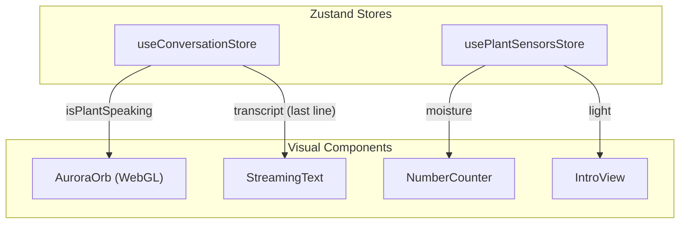
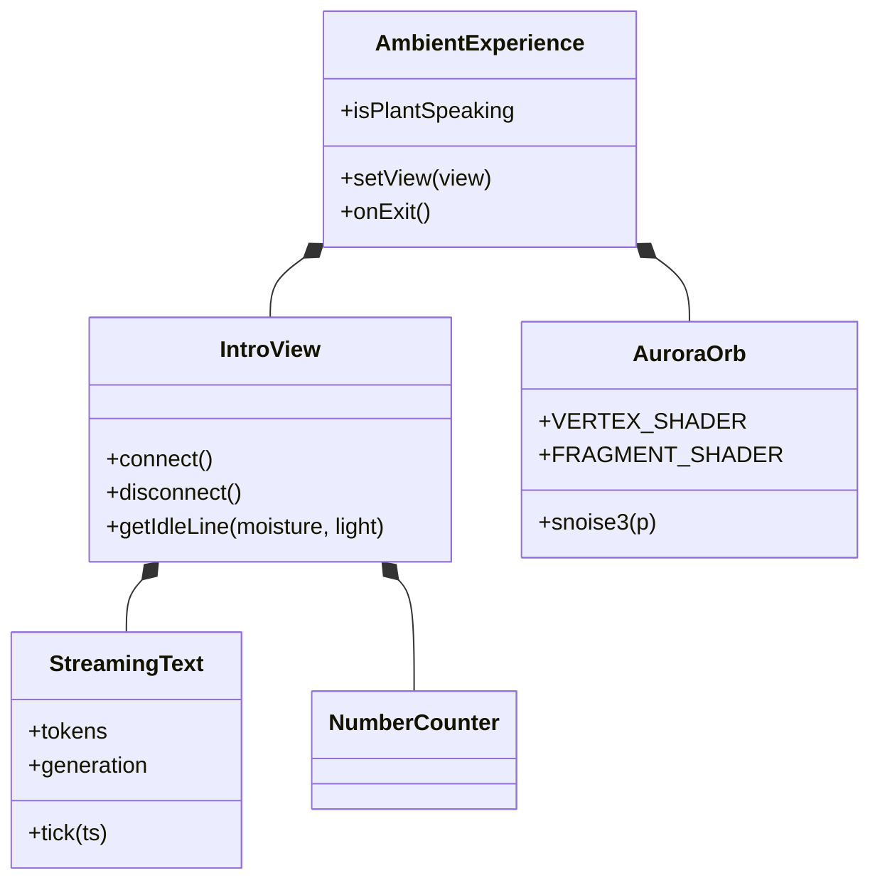

<!-- source: DeepWiki mcp.deepwiki.com · repo openai/planttalk · page 4.2 Ambient Mode (Public Experience) · fetched 2026-10-26 -->

# Ambient Mode (Public Experience)

Relevant source files

The following files were used as context for generating this wiki page:

- [src/components/public/intro-view.tsx](src/components/public/intro-view.tsx)
- [src/components/public/landing-view.tsx](src/components/public/landing-view.tsx)
- [src/components/public/number-counter.tsx](src/components/public/number-counter.tsx)
- [src/components/public/public-experience.css](src/components/public/public-experience.css)
- [src/components/public/public-experience.tsx](src/components/public/public-experience.tsx)
- [src/components/public/streaming-text.tsx](src/components/public/streaming-text.tsx)
- [src/components/public/webgl/aurora-orb.tsx](src/components/public/webgl/aurora-orb.tsx)
- [src/components/public/webgl/color.ts](src/components/public/webgl/color.ts)
- [src/components/public/webgl/wave-gradient-background.tsx](src/components/public/webgl/wave-gradient-background.tsx)

The Ambient Mode, implemented in `src/components/public/`, provides a kiosk-optimized user interface designed for public installations. Unlike the data-heavy Dashboard, this mode focuses on a high-fidelity visual experience using WebGL shaders and simplified sensor readouts to facilitate natural conversation between a visitor and the plant.

## Overview and Kiosk UX

The `AmbientExperience` component acts as a full-screen overlay [src/components/public/public-experience.tsx:11-15](). It manages two primary sub-views: the `LandingView` (an attract loop) and the `IntroView` (the active conversation interface) [src/components/public/public-experience.tsx:9-9]().

### Key UX Features:
*   **Scroll Lock:** The component programmatically disables document scrolling upon mounting to prevent the dashboard from appearing behind the overlay [src/components/public/public-experience.tsx:32-38]().
*   **Esc-to-Exit:** A hidden "developer exit" is implemented via a global key listener, allowing an operator to return to the dashboard by pressing `Escape` [src/components/public/public-experience.tsx:22-28]().
*   **Visual Hint:** A transient `public-experience__hint` informs the user/developer how to exit, which fades out after 3.5 seconds [src/components/public/public-experience.tsx:41-44]().
*   **Responsive Scaling:** The UI uses CSS `clamp()` and `vmin` units extensively to ensure the "Orb" and typography scale correctly across different display aspect ratios [src/components/public/public-experience.css:25-26](), [src/components/public/public-experience.css:94-94]().

**Sources:** [src/components/public/public-experience.tsx:1-81](), [src/components/public/public-experience.css:1-268]()

## Component Architecture

### Data Flow: Natural Language to UI
The following diagram illustrates how the `conversation-store` and `sensors-store` drive the visual elements in the Ambient Mode.

**Ambient Mode Data Flow**

**Sources:** [src/components/public/public-experience.tsx:19-19](), [src/components/public/intro-view.tsx:21-35](), [src/components/public/intro-view.tsx:82-91]()

### Landing vs. Intro Views
1.  **LandingView:** Displays a "Talk to [PLANT_NAME]" call-to-action [src/components/public/landing-view.tsx:20-20](). It tracks hover state to pulse the background `AuroraOrb` [src/components/public/public-experience.tsx:57-58]().
2.  **IntroView:** Automatically triggers the `connect()` method of the `useConversationStore` upon mounting [src/components/public/intro-view.tsx:38-41](). It monitors the `status` and `isActive` flags; if the conversation ends (e.g., server hangup), it automatically reverts the UI to the `LandingView` [src/components/public/intro-view.tsx:49-56]().

**Sources:** [src/components/public/landing-view.tsx:1-24](), [src/components/public/intro-view.tsx:1-94]()

## Visual Layer (WebGL & Animation)

The ambient experience utilizes the `ogl` library for high-performance WebGL rendering.

### AuroraOrb
The `AuroraOrb` is a central visual element that uses a GLSL simplex-noise shader to create a gaseous, glowing effect.
*   **Shader Logic:** It uses a 3D simplex noise function (`snoise3`) to perturb the distance field of the orb [src/components/public/webgl/aurora-orb.tsx:46-70]().
*   **Speaking Interaction:** The `active` prop (driven by `isPlantSpeaking`) is passed to the shader's `hover` uniform, which increases the noise turbulence and rotation when the plant is talking [src/components/public/webgl/aurora-orb.tsx:57-58](), [src/components/public/webgl/aurora-orb.tsx:130-131]().
*   **Color Utilities:** Hex and RGB strings are converted to normalized `[0, 1]` arrays via `toRgb` for use as GLSL uniforms [src/components/public/webgl/color.ts:3-14]().

### WaveGradientBackground
A full-bleed background that renders a warped gradient.
*   **Warping:** The shader applies a rotation matrix and harmonic sine waves to the UV coordinates to create a "liquid" movement [src/components/public/webgl/wave-gradient-background.tsx:74-101]().
*   **Fallback:** If the WebGL program fails to link, the component gracefully falls back to a static CSS gradient defined in `public-experience.css` [src/components/public/webgl/wave-gradient-background.tsx:216-227]().

**Sources:** [src/components/public/webgl/aurora-orb.tsx:8-141](), [src/components/public/webgl/wave-gradient-background.tsx:8-140](), [src/components/public/webgl/color.ts:1-15]()

## Specialized Text Components

To maintain a "natural" feel, text and numbers do not snap instantly.

### StreamingText
Used for the plant's spoken dialogue. It mimics a typewriter effect but with word-aware wrapping.
*   **Implementation:** It splits the incoming text into tokens (words and spaces) [src/components/public/streaming-text.tsx:46-52](). 
*   **Animation:** Each character is wrapped in a `span` with the `public-experience__char` class, which triggers a CSS `translateY` and `opacity` animation [src/components/public/public-experience.css:166-180]().
*   **Reset Logic:** It uses a `generation` counter to force a React remount when a new utterance starts, ensuring the animation replays from the beginning [src/components/public/streaming-text.tsx:19-24]().

### NumberCounter
Used for soil moisture percentages. 
*   **Easing:** It uses a `requestAnimationFrame` loop with an `easeOutCubic` function to animate the transition between two numeric values [src/components/public/number-counter.tsx:33-41]().
*   **Formatting:** Supports custom `decimalPlaces`, `prefix`, and `suffix` [src/components/public/number-counter.tsx:12-19]().

**Sources:** [src/components/public/streaming-text.tsx:1-71](), [src/components/public/number-counter.tsx:1-52]()

## Code Entity Mapping

This diagram maps the UI concepts to their specific code implementations.

**UI to Code Entity Mapping**

**Sources:** [src/components/public/public-experience.tsx:15-80](), [src/components/public/intro-view.tsx:20-94](), [src/components/public/webgl/aurora-orb.tsx:166-177](), [src/components/public/streaming-text.tsx:8-71]()

---

