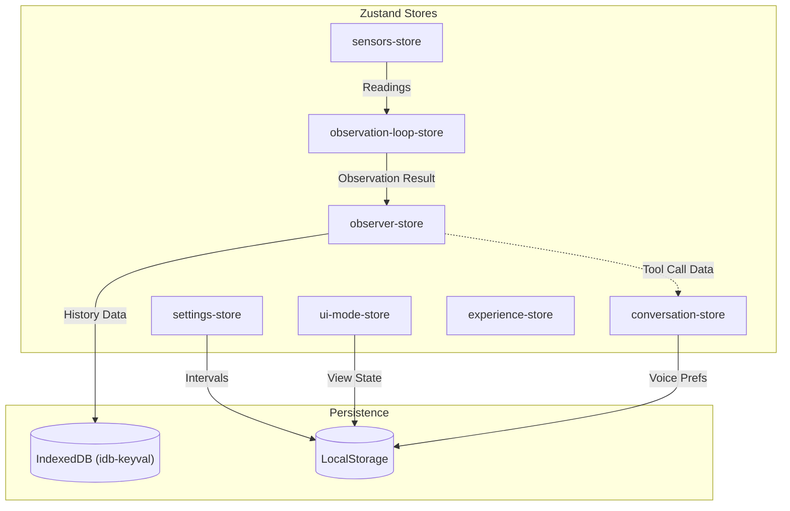
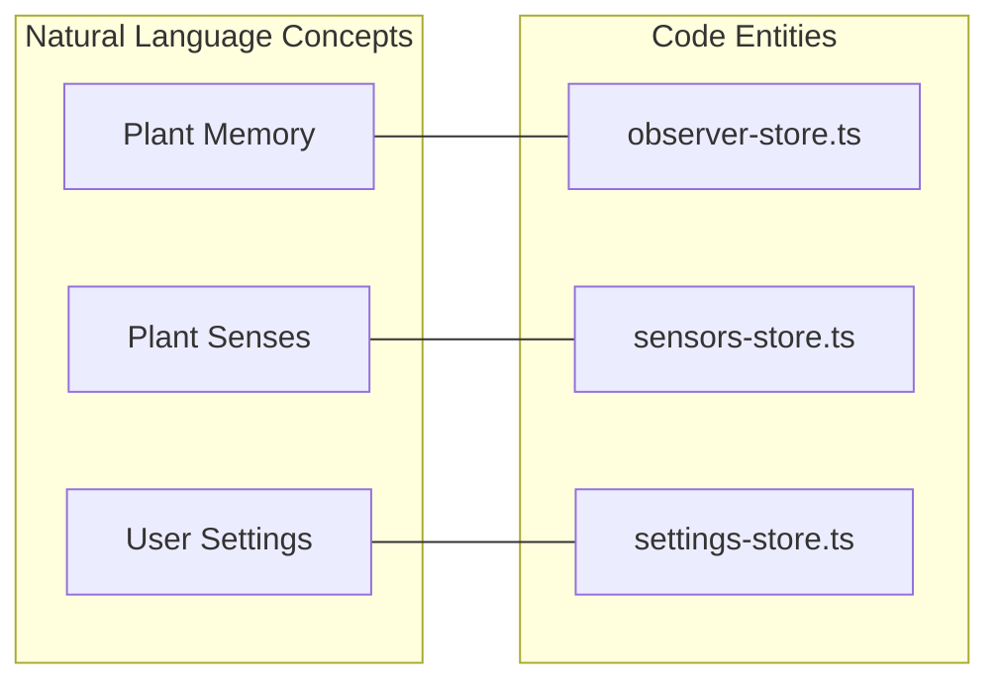

<!-- source: DeepWiki mcp.deepwiki.com · repo openai/planttalk · page 5 State Management (Zustand Stores) · fetched 2026-10-26 -->

# State Management (Zustand Stores)

Relevant source files

The following files were used as context for generating this wiki page:

- [src/stores/plant/experience-store.ts](src/stores/plant/experience-store.ts)
- [src/stores/plant/settings-store.ts](src/stores/plant/settings-store.ts)
- [src/stores/plant/ui-mode-store.ts](src/stores/plant/ui-mode-store.ts)

The Plant Talk application uses **Zustand** for state management, organized into several specialized stores within `src/stores/plant/`. The architecture is designed to handle high-frequency sensor data, periodic AI observation loops, and real-time voice interactions while maintaining a responsive UI and persistent history across sessions.

## Store Organization & Persistence

The system utilizes different persistence strategies based on the nature of the data:
*   **Volatile State:** UI flags, connection statuses, and transient analysis results are kept in memory.
*   **LocalStorage:** User preferences (intervals, voice selection, UI mode) are persisted using Zustand's `persist` middleware or manual `localStorage` setters [src/stores/plant/settings-store.ts:51](), [src/stores/plant/ui-mode-store.ts:24]().
*   **IndexedDB:** Large datasets, specifically the observation history, are stored in IndexedDB via `idb-keyval` to avoid LocalStorage size limits and performance bottlenecks.

### Store Architecture Overview

The following diagram illustrates the relationship between the major stores and their persistence layers:

**Zustand Store Ecosystem**

**Sources:** [src/stores/plant/settings-store.ts:29-51](), [src/stores/plant/ui-mode-store.ts:20-28](), [src/stores/plant/experience-store.ts:18-19]()

## Core Stores

### Settings & UI Stores
These stores manage the application's configuration and high-level visual state.

*   **`usePlantSettingsStore`**: Manages user-tunable timings like `observationIntervalMs` (default 15m) and `arduinoCheckIntervalMs` (default 1s) [src/stores/plant/settings-store.ts:6-7](). It includes a migration path to handle legacy setting names and enforces safe limits for API rate-limiting [src/stores/plant/settings-store.ts:60-84]().
*   **`useUiModeStore`**: Tracks whether the user is in `dashboard` or `ambient` mode [src/stores/plant/ui-mode-store.ts:5](). This state is manually persisted to `localStorage` [src/stores/plant/ui-mode-store.ts:22-27]().
*   **`usePlantExperienceStore`**: Specifically handles the "One-shot Analysis" flow, managing image file selection, object URL revocation for previews, and the `analyzePlantImage` async operation [src/stores/plant/experience-store.ts:27-61]().

**Sources:** [src/stores/plant/settings-store.ts:1-95](), [src/stores/plant/ui-mode-store.ts:1-29](), [src/stores/plant/experience-store.ts:1-80]()

### Sensor & Observation Stores
This group handles the ingestion of hardware data and the periodic execution of the AI "Observer" logic.

| Store | Responsibility | Key Entities |
| :--- | :--- | :--- |
| **Sensors** | Web Serial lifecycle & data parsing. | `parseSensorPayload`, `watchdog` |
| **Observation Loop** | Periodic execution of vision analysis. | `sendLiveUpdate`, `exponentialBackoff` |
| **Observer** | Persistence of historical sensor/AI data. | `summarizeObservationHistory`, `idb-keyval` |

For a deep dive into serial connections and the observation lifecycle, see **[Sensor & Observation Stores (#5.1)](#)**.

### Conversation & UI Stores
This group manages the interactive layer, including the Realtime Voice API and device hardware.

| Store | Responsibility | Key Entities |
| :--- | :--- | :--- |
| **Conversation** | Wrapper for `RealtimeVoiceConnection`. | `transcript`, `toolActivityLog` |
| **Microphone** | Audio input device selection. | `enumerateDevices`, `selectedDeviceId` |

For details on voice interaction and tool execution, see **[Conversation & UI Stores (#5.2)](#)**.

## Store Interactivity

The stores are designed to be decoupled but interact through the React component tree or direct tool execution:

1.  **Data Ingestion**: `sensors-store` provides raw values.
2.  **Context Aggregation**: When `observation-loop-store` triggers, it pulls the latest readings from `sensors-store`.
3.  **Persistence**: The resulting AI observation is saved into `observer-store` (IndexedDB).
4.  **Tool Execution**: When the LLM calls `get_observation_history` via the `conversation-store`, the store retrieves data from `observer-store` to provide context to the model.

**Natural Language to Code Mapping**

**Sources:** [src/stores/plant/settings-store.ts:1-5](), [src/stores/plant/experience-store.ts:1-16]()

---

