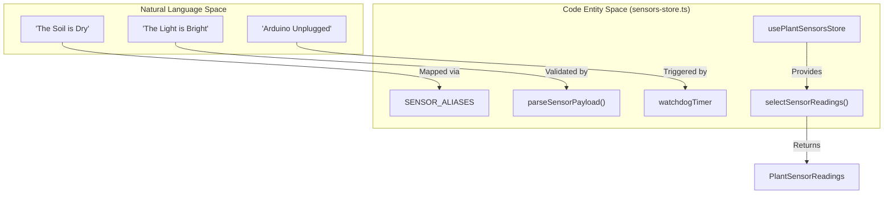
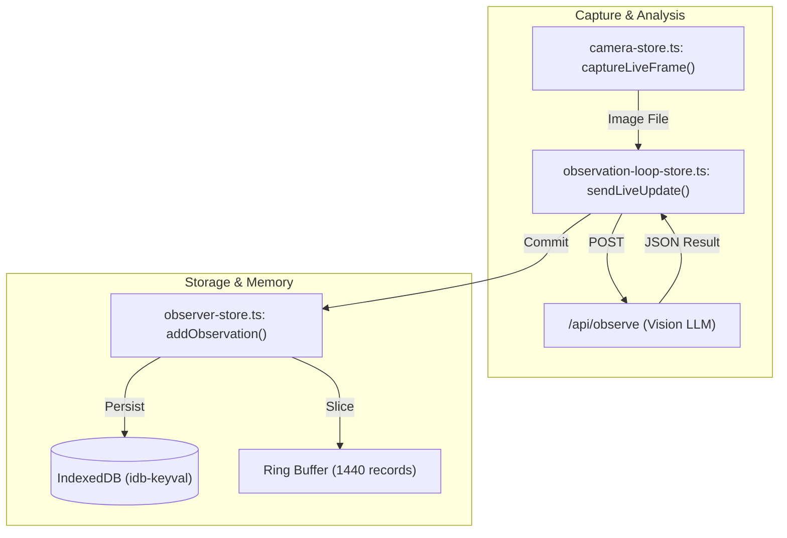

<!-- source: DeepWiki mcp.deepwiki.com · repo openai/planttalk · page 5.1 Sensor & Observation Stores · fetched 2026-10-26 -->

# Sensor & Observation Stores

Relevant source files

The following files were used as context for generating this wiki page:

- [src/stores/plant/camera-store.ts](src/stores/plant/camera-store.ts)
- [src/stores/plant/observation-loop-store.ts](src/stores/plant/observation-loop-store.ts)
- [src/stores/plant/observer-store.ts](src/stores/plant/observer-store.ts)
- [src/stores/plant/sensors-store.ts](src/stores/plant/sensors-store.ts)

The state management for Plant Talk is divided into two primary domains: real-time environmental data acquisition via **Sensors** and long-term memory via **Observations**. These stores coordinate to provide the LLM with a comprehensive context of the plant's current state and its historical trends.

## 5.1.1 Sensor Store (`sensors-store.ts`)

The `usePlantSensorsStore` manages the lifecycle of environmental data, supporting both a "Manual" mode (UI sliders) and an "Arduino" mode (Web Serial API). It handles the complexities of serial connection persistence, watchdog monitoring, and multi-format payload parsing.

### Connection Lifecycle & Auto-Reconnect
The store implements a robust connection manager for the Web Serial API. When in `arduino` mode, it attempts to maintain an active connection to the microcontroller.
*   **Auto-Reconnect**: If a connection is lost, a `reconnectTimer` polls for available ports every 3000ms [src/stores/plant/sensors-store.ts:34-34](), [src/stores/plant/sensors-store.ts:184-206]().
*   **Watchdog Timer**: To detect "silent" hardware failures (where the serial port is open but the firmware has hung), a watchdog timer is used [src/stores/plant/sensors-store.ts:143-172](). If no data arrives within a window (3x the `arduinoCheckIntervalMs`), the store forces a port closure and triggers a reconnect [src/stores/plant/sensors-store.ts:166-171]().
*   **Manual Override**: If a user explicitly clicks "Disconnect", `suppressAutoReconnect` is set to `true` to prevent the background timers from fighting the user's intent [src/stores/plant/sensors-store.ts:72-72]().

### Data Parsing & Selection
The store handles data from `PlantSensors.ino` which may arrive in various formats. The `parseSensorPayload` function uses a flexible alias system to map incoming JSON keys (e.g., `soil`, `lux`, `moisturePercent`) to the internal `moisture` and `light` keys [src/stores/plant/sensors-store.ts:38-41](), [src/stores/plant/sensors-store.ts:397-434]().

**Hardware vs. Fallback Logic:**
The system always maintains two sets of readings: `hardwareReadings` and `fallbackReadings`. The `selectSensorReadings` selector determines which to provide to the rest of the application based on the current `sensorMode` and the "freshness" of the hardware data [src/stores/plant/sensors-store.ts:468-479]().

### Sensors Entity Space
The following diagram bridges the logical sensing concepts to the code entities in `sensors-store.ts`.

Sources: [src/stores/plant/sensors-store.ts:38-41](), [src/stores/plant/sensors-store.ts:143-149](), [src/stores/plant/sensors-store.ts:397-400](), [src/stores/plant/sensors-store.ts:468-470]()

---

## 5.1.2 Observation Loop Store (`observation-loop-store.ts`)

The `useObservationLoopStore` orchestrates the periodic "heartbeat" of the system. Every N minutes, it captures a snapshot of the plant and consults the Vision LLM.

### Periodic Loop & Rate Limiting
The store facilitates the execution of `sendLiveUpdate`, which can be triggered automatically by a `setInterval` in the UI or manually by the user [src/stores/plant/observation-loop-store.ts:63-63]().
*   **Exponential Backoff**: If the OpenAI API returns a `429 Rate Limit` error, the store calculates a backoff window using `RATE_LIMIT_BASE_BACKOFF_MS` and an exponential multiplier [src/stores/plant/observation-loop-store.ts:166-176](). Auto-updates are skipped until this cooldown expires [src/stores/plant/observation-loop-store.ts:76-81]().
*   **Tab Visibility**: To save API costs, auto-updates are paused if `document.hidden` is true [src/stores/plant/observation-loop-store.ts:70-72]().

### Reasoning Log Streaming
Instead of waiting for a final JSON response, the store utilizes `observePlantFileWithReasoningStream` to ingest a stream of NDJSON events [src/stores/plant/observation-loop-store.ts:100-115](). As the model "thinks," the `reasoningLog` array is updated, allowing the UI to show real-time progress of the plant's analysis [src/stores/plant/observation-loop-store.ts:113-113]().

Sources: [src/stores/plant/observation-loop-store.ts:24-25](), [src/stores/plant/observation-loop-store.ts:70-72](), [src/stores/plant/observation-loop-store.ts:100-115](), [src/stores/plant/observation-loop-store.ts:166-176]()

---

## 5.1.3 Observer Store (`observer-store.ts`)

The `usePlantObserverStore` acts as the long-term memory of the plant, persisting data to the browser's **IndexedDB** using `idb-keyval` [src/stores/plant/observer-store.ts:1-1](), [src/stores/plant/observer-store.ts:35-46]().

### Persistence & Ring Buffer
Observations are stored in a "ring buffer" limited to `MAX_OBSERVATIONS` (1440 records), representing approximately 10 days of history at a 10-minute interval [src/stores/plant/observer-store.ts:12-12](). This ensures the database does not grow indefinitely while maintaining enough data for trend analysis.

### History Selection for LLM Context
Because LLM context windows are limited, the store does not send the entire history. The `selectObservationsForPrompt` function creates a curated subset [src/stores/plant/observer-store.ts:125-149]():
1.  **Recent Records**: The 5 most recent observations (`HISTORY_RECENT_COUNT`) [src/stores/plant/observer-store.ts:13-13]().
2.  **Sparse Records**: 6 records spread evenly across the entire historical window (`HISTORY_SPARSE_COUNT`) [src/stores/plant/observer-store.ts:14-14]().

### History Summarization
The `summarizeObservationHistory` and `computeHistorySummary` functions generate a natural language string describing moisture trends (e.g., "rising", "stable") and total light exposure in hours [src/stores/plant/observer-store.ts:152-181](). This summary provides the LLM with "at-a-glance" knowledge of the past several days without consuming excessive tokens [src/stores/plant/observer-store.ts:191-191]().

### Observation Data Flow
The following diagram tracks the movement of a single observation from the camera to the persistent database.

Sources: [src/stores/plant/camera-store.ts:174-180](), [src/stores/plant/observation-loop-store.ts:63-63](), [src/stores/plant/observation-loop-store.ts:138-148](), [src/stores/plant/observer-store.ts:12-12](), [src/stores/plant/observer-store.ts:35-46]()

---

