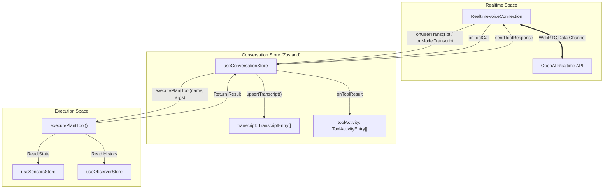
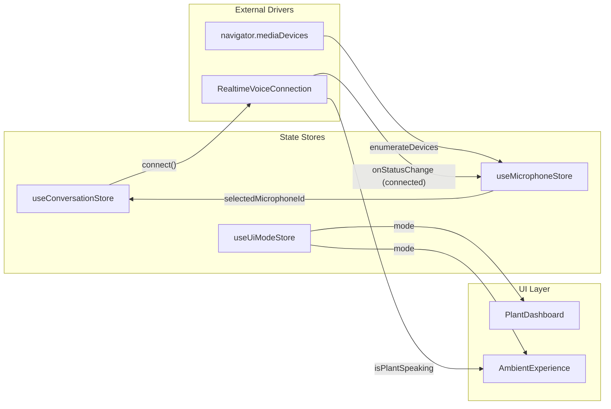

<!-- source: DeepWiki mcp.deepwiki.com · repo openai/planttalk · page 5.2 Conversation & UI Stores · fetched 2026-10-26 -->

# Conversation & UI Stores

Relevant source files

The following files were used as context for generating this wiki page:

- [src/stores/plant/conversation-store.ts](src/stores/plant/conversation-store.ts)
- [src/stores/plant/microphone-store.ts](src/stores/plant/microphone-store.ts)
- [src/stores/plant/ui-mode-store.ts](src/stores/plant/ui-mode-store.ts)

This section details the state management for the voice interaction pipeline, hardware input selection, and global application display modes. These stores are built using Zustand and serve as the reactive bridge between low-level WebRTC/Hardware APIs and the React UI components.

## Conversation Store

The `useConversationStore` acts as a thin reactive wrapper around the `RealtimeVoiceConnection` class. It manages the lifecycle of a voice session, maintains a rolling history of transcripts and tool executions, and provides status updates for UI feedback.

### Core Implementation
The store holds a reference to the active `RealtimeVoiceConnection` in a closure, ensuring that the connection instance itself does not trigger unnecessary React re-renders [src/stores/plant/conversation-store.ts:60-60](). It exposes reactive state for connection status, speech activity, and error messages.

### Data Management Logic
*   **Transcript Upserting**: Transcripts are streamed as deltas. The `upsertTranscript` function handles merging these deltas by matching conversation item IDs. When a "final" event is received, it replaces the accumulated delta with the authoritative text [src/stores/plant/conversation-store.ts:66-82]().
*   **Tool Activity Log**: Tracks the lifecycle of tool calls (e.g., `get_current_sensors`). It records the call ID, arguments, and eventually the result after `executePlantTool` completes [src/stores/plant/conversation-store.ts:120-136]().
*   **Debug Event Buffer**: Maintains a ring buffer of the last 100 server events for diagnostic purposes [src/stores/plant/conversation-store.ts:34-34](), [src/stores/plant/conversation-store.ts:145-149]().
*   **Voice Persistence**: The user's preferred plant voice is persisted to `localStorage` using the `SELECTED_VOICE_STORAGE_KEY` [src/stores/plant/conversation-store.ts:10-10](), [src/stores/plant/conversation-store.ts:173-178]().

### Connection Lifecycle
When `connect()` is called, the store initializes a new `RealtimeVoiceConnection` and passes a series of callbacks to sync the internal state with the WebRTC data channel events [src/stores/plant/conversation-store.ts:97-158]().

### Conversation Data Flow
The following diagram illustrates how the `useConversationStore` orchestrates data between the OpenAI Realtime API and the local application state.

**Diagram: Conversation State & Tool Execution Flow**

Sources: [src/stores/plant/conversation-store.ts:59-183](), [src/lib/plant/realtime-tools.ts:1-20]()

## Microphone Store

The `useMicrophoneStore` manages the enumeration and selection of audio input devices. It mirrors the logic used for camera selection but is specifically consumed by the `useConversationStore` when initiating a voice call.

### Key Behaviors
*   **Device Enumeration**: Uses `navigator.mediaDevices.enumerateDevices()` to filter for `audioinput` devices [src/stores/plant/microphone-store.ts:28-48]().
*   **Permission Sync**: Browser security often hides device labels until permission is granted. The store triggers a `refreshMicrophoneList()` inside the conversation store's `onStatusChange` callback once a connection is successfully established [src/stores/plant/conversation-store.ts:106-110]().
*   **Persistence**: The `selectedMicrophoneId` is stored in `localStorage` to maintain user preference across sessions [src/stores/plant/microphone-store.ts:50-60]().
*   **Next-Call Application**: Because WebRTC track replacement is complex, a change in the selected microphone only takes effect the next time `connect()` is called [src/stores/plant/microphone-store.ts:153-155]().

Sources: [src/stores/plant/microphone-store.ts:23-61](), [src/stores/plant/conversation-store.ts:154-154]()

## UI Mode Store

The `useUiModeStore` is a simple state container that determines which top-level view is rendered: the technical **Dashboard** or the public-facing **Ambient Mode**.

### Implementation Details
*   **Modes**: Supports `"dashboard"` (default) and `"ambient"` (kiosk/presentation mode) [src/stores/plant/ui-mode-store.ts:5-5]().
*   **Initial Load**: Checks `localStorage` on initialization to return the user to their last active view [src/stores/plant/ui-mode-store.ts:9-13]().
*   **Global Toggle**: Provides a `setMode` function used by the layout components to switch views, which also updates the persistent storage [src/stores/plant/ui-mode-store.ts:22-27]().

Sources: [src/stores/plant/ui-mode-store.ts:1-29]()

## Store Interaction & Hierarchy

The stores interact to provide a seamless experience where hardware selection, AI communication, and UI presentation are synchronized.

**Diagram: Store Interaction Map**

Sources: [src/stores/plant/conversation-store.ts:109-109](), [src/stores/plant/conversation-store.ts:154-154](), [src/stores/plant/ui-mode-store.ts:20-29]()

### Summary Table: Store Responsibilities

| Store | File | Primary Responsibility | Persistence |
| :--- | :--- | :--- | :--- |
| `useConversationStore` | `conversation-store.ts` | WebRTC session state, transcripts, tool logs. | `localStorage` (Voice) |
| `useMicrophoneStore` | `microphone-store.ts` | Audio input enumeration and selection. | `localStorage` (Device ID) |
| `useUiModeStore` | `ui-mode-store.ts` | Toggling between Dashboard and Ambient views. | `localStorage` (UI Mode) |

Sources: [src/stores/plant/conversation-store.ts:1-183](), [src/stores/plant/microphone-store.ts:1-61](), [src/stores/plant/ui-mode-store.ts:1-29]()

---

