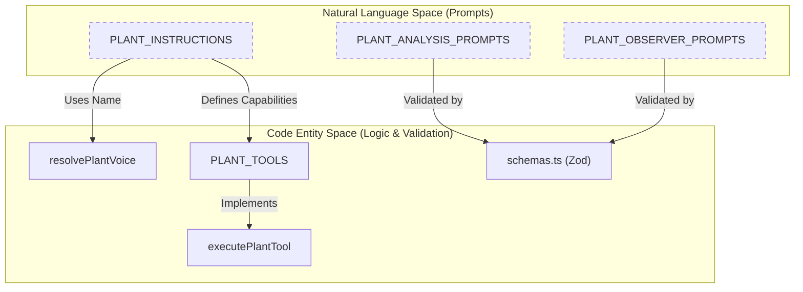
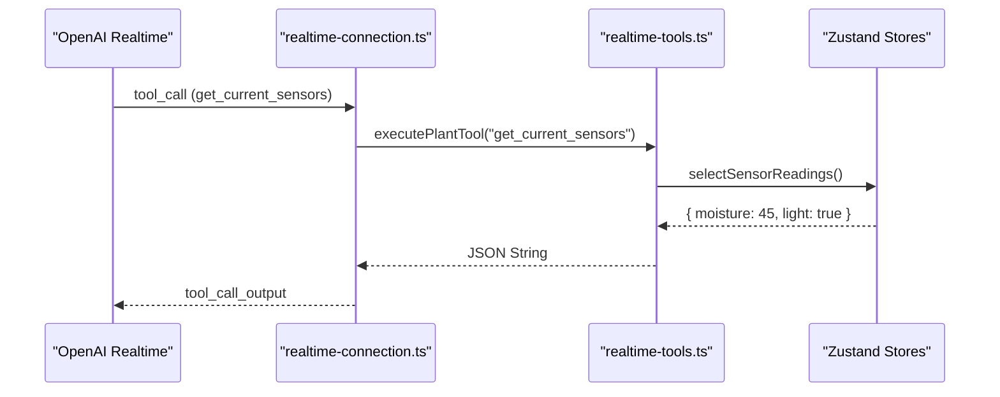

<!-- source: DeepWiki mcp.deepwiki.com · repo openai/planttalk · page 6 Plant Personality & AI Configuration · fetched 2026-10-26 -->

# Plant Personality & AI Configuration

Relevant source files

The following files were used as context for generating this wiki page:

- [src/lib/plant/prompts.ts](src/lib/plant/prompts.ts)
- [src/lib/plant/realtime-config.ts](src/lib/plant/realtime-config.ts)
- [src/lib/plant/realtime-tools.ts](src/lib/plant/realtime-tools.ts)
- [src/lib/plant/schemas.ts](src/lib/plant/schemas.ts)

This section provides a high-level overview of the configuration layer that defines the plant's identity, its sensory tools, and the AI models' behavioral constraints. The system separates "Personality" (how the plant speaks) from "Observation" (the scientific data logging), ensuring the plant's long-term memory remains factual even if its voice changes.

The AI configuration is distributed across several key files that bridge natural language instructions with structured code execution:

*   **`realtime-config.ts`**: Defines the name, voice, and conversational persona.
*   **`prompts.ts`**: Contains the neutral, scientific instructions for the vision-based observation loop.
*   **`schemas.ts`**: Enforces strict JSON contracts for AI responses using Zod.
*   **`realtime-tools.ts`**: Maps AI "function calls" to actual TypeScript code that reads from application state.

### System Configuration Map

The following diagram illustrates how configuration constants and schemas are distributed across the "Natural Language Space" (prompts) and "Code Entity Space" (Zod schemas and Tool handlers).

**Configuration Entity Mapping**

**Sources:** [src/lib/plant/realtime-config.ts:4-102](), [src/lib/plant/prompts.ts:1-83](), [src/lib/plant/schemas.ts:1-81](), [src/lib/plant/realtime-tools.ts:22-61]()

---

## Personality & Voice Configuration

The plant's personality is defined in `realtime-config.ts`. This configuration governs the **Realtime API** session, controlling how the plant interacts with users via voice.

*   **Identity**: Defined by `PLANT_NAME` (defaulting to "George") [src/lib/plant/realtime-config.ts:4-4]().
*   **Persona**: The `PLANT_INSTRUCTIONS` string provides the system prompt, instructing the model to be "quirky, funny, a little dramatic" and to speak in the first person about its physical body [src/lib/plant/realtime-config.ts:36-73]().
*   **Voice Selection**: A curated list of `PLANT_VOICES` is available, with `resolvePlantVoice` ensuring that only valid OpenAI voices are used [src/lib/plant/realtime-config.ts:9-31]().

For a deep dive into the voice implementation and WebRTC connectivity, see [Realtime Voice Configuration & Tools](#6.1).

---

## Sensory Tools (Function Calling)

To prevent the AI from hallucinating its own state, the system provides "tools" (function calls) that the model must use to access sensor data.

*   **`get_current_sensors`**: Allows the model to see live moisture and light levels [src/lib/plant/realtime-config.ts:79-82]().
*   **`get_observation_history`**: Provides access to the "diary" of past scientific observations [src/lib/plant/realtime-config.ts:85-98]().

These tools are defined in `realtime-config.ts` but implemented in `realtime-tools.ts`, where they query the `usePlantSensorsStore` and `usePlantObserverStore` to return real-time data to the model [src/lib/plant/realtime-tools.ts:24-56]().

**Tool Execution Flow**

**Sources:** [src/lib/plant/realtime-config.ts:76-101](), [src/lib/plant/realtime-tools.ts:22-61]()

---

## Observation & Vision Pipeline

While the personality layer is "dramatic," the observation layer is "scientific." This pipeline uses GPT-4o with Vision to analyze images and sensor data periodically.

*   **Neutrality**: `PLANT_OBSERVER_PROMPTS` instructs the model to be a "careful scientific observer" and to keep the tone "neutral and factual" [src/lib/plant/prompts.ts:51-61]().
*   **Structured Output**: Every observation must conform to `plantObserverResponseSchema`, which requires fields like `observerThoughts`, `hypothesis`, and `trend` [src/lib/plant/schemas.ts:48-75]().
*   **One-Shot Analysis**: A separate `PLANT_ANALYSIS_PROMPTS` is used for manual image uploads, focusing on physical attributes like `size` (in millimeters) and `branching` [src/lib/plant/prompts.ts:16-37]().

For details on the prompt engineering and the Zod schemas used for validation, see [Vision Prompts, Schemas & Observation API Client](#6.2).

---

## Child Pages
*   [Realtime Voice Configuration & Tools](#6.1) — Detailed documentation of the voice persona, WebRTC handling, and client-side tool execution.
*   [Vision Prompts, Schemas & Observation API Client](#6.2) — Technical breakdown of the vision prompts, Zod validation schemas, and the client-side API helpers.

---

